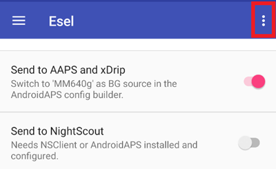

# Eversense

There are four different methods to access the readings from Eversense:

- ESEL în mod companion
- ESEL modificat
- xDrip companion app
- Notification Reader (built into **AAPS**)

## ESEL

Obțineți și instalați [aplicația ESEL](https://github.com/BernhardRo/Esel/tree/master/apk), urmând aceste instrucțiuni [](https://github.com/BernhardRo/Esel?tab=readme-ov-file#esel).

- In ESEL, open the three dots menu (⋮) at the top right and select **Settings** (also available from the ☰ menu). In the settings:
  - Activați "Trimiteți în AAPS și xDrip"
  - **Dezactivați** "Trimiteți la Nightscout"
  - Deoarece datele glicemice din Eversense pot fi zgomotoase, se recomandă activarea "Filtrați Datele" în ESEL.



### Mod Companion

Citește datele din notificările aplicației Eversense (funcționează cu aplicația Eversense standard, disponibilă de la versiunea ESEL 3.0.1).

1. Folosiți aplicația oficială Eversense din Google Play Store
   - Opțional, dar necesar pentru scriere în urmă: Autentificați-vă în contul dumneavoastră Eversense
   - În sincronizare, activați sincronizarea automată
2. Configurarea ESEL:
   - Dezactivați setarea "Obțineți date de la aplicația Eversense modificată"
   - Pentru scriere în urmă: Activați "Umpleți datele lipsă de la eversensedms.com"
   - Furnizați ca adresă de e-mail și parolă datele de conectare Eversense
3. Set "MM640g" as BG source in [**Configuration → BG Source**](#Config-Builder-bg-source).

### Aplicația Eversense modificată

 Necesită o versiune modificată a aplicației Eversense (funcționează complet offline, inclusiv scriere în urmă).

1. Dezinstalați aplicația Eversense (Atenție: datele dumneavoastră istorice locale (mai vechi de 1 săptămână) vor fi pierdute!)

2. Instalați aplicația [modificată Eversense](https://cr4ck3d3v3r53n53.club) și folosiți-o cum este descris de către producător

   - Porniți aplicația Eversense, conectați-vă la transmițătorul dumneavoastră și folosiți-o la fel ca pe aplicația normală.

3. Configurarea ESEL:

   - Activați setarea "Obțineți date de la aplicația Eversense modificată"


Dacă rulați ESEL cu o instalare nouă de Eversense pentru prima dată, poate dura până la 15 minute până când primele valori apar în xDrip!

4. Set "MM640g" as BG source in [**Configuration → BG Source**](#Config-Builder-bg-source).

## xDrip

xDrip can read notifications from the vendor app, like ESEL does. Nu este disponibilă scrierea înapoi a datelor lipsă.

- Download and install xDrip: [xDrip](https://github.com/NightscoutFoundation/xDrip)
- As data source in xDrip “Companion App” must be selected.
- Select xDrip in [**Configuration → BG Source**](#Config-Builder-bg-source).
- Adjust the xDrip settings according to the explanations on the xDrip settings page [xDrip settings](../CompatibleCgms/xDrip.md).
- Activați [Netezire exponențială](../CompatibleCgms/SmoothingBloodGlucoseData.md) în AAPS.

## Notification Reader

**AAPS** can read the glucose values directly from the notifications posted by the official Eversense app, without any other app in between. Nu este disponibilă scrierea înapoi a datelor lipsă.

- Select **Notification Reader** in [**Configuration → BG Source**](#Config-Builder-bg-source) and grant **AAPS** access to notifications when asked.
- Make sure the Eversense app shows the current glucose value in its notification.

```{warning}
Frecvența citirii valorilor glicemiei nu este întotdeauna de 5 minute și pot apărea duplicate.
```