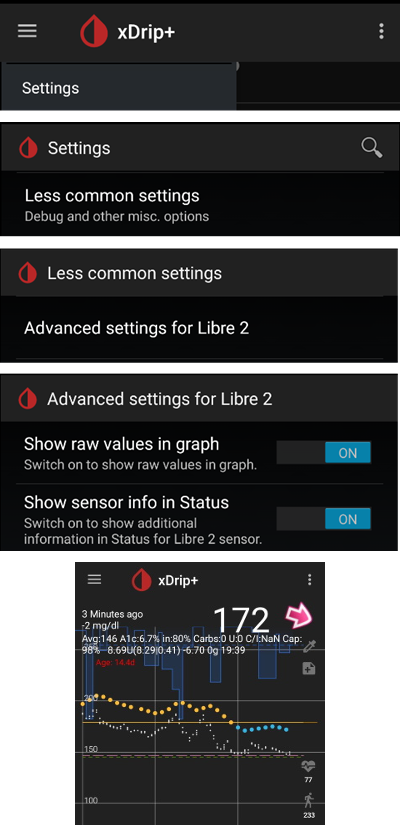

# Freestyle Libre 2 și 2+

Senzorul Freestyle Libre 2 este acum un CGM adevărat, chiar și cu aplicația oficială. Totuși, LibreLink nu poate trimite date către AAPS. Există mai multe soluții pentru a-l utiliza cu AAPS.

## 1. Utilizați o punte Bluetooth și OOP

Transmițătoarele prin Bluetooth pot fi utilizate împreună cu Libre 2 (UE) sau 2 + (UE) și cu o aplicație algoritm în afara procesului. Puteți primi valori ale glicemiei la fiecare 5 minute, ca în cazul [Libre 1](./Libre1.md).

Verificați dacă puntea și aplicația pe care doriți să le utilizați sunt compatibile cu senzorul și xDrip.

OOP pentru Libre2 (găsiți-l [aici](#Libre2_OOP2)) creează aceleași citiri de glicemie ca și în cazul cititorului original. AAPS cu Libre 2 face o netezire de 10 până la 25 de minute pentru a evita anumite salturi. Vedeți mai jos [Netezirea valorilor & valorile brute](#libre2-value-smoothing-raw-values). OOP generează citiri la fiecare 5 minute, ca medie a ultimelor 5 minute. Prin urmare, valorile glicemiei nu sunt atât de uniformizate, ci se potrivesc cu cele ale dispozitivului de citire original și urmează mai degrabă valorile "reale" ale glicemiei. Dacă doriți să folosiți bucla cu OOP, vă rugăm să activați toate setările de netezire din xDrip.

Există motive întemeiate pentru a utiliza un transmițător Bluetooth:

-   You can choose various OOP2 calibration strategies (1): have the reader values using "no calibration", or calibrate the sensor like a Libre 1 using "calibrate based on raw" or ultimately calibrate the reader-like values with "calibrate based on glucose".  
  Make sure to leave OOP1 disabled (2).

    → Meniu hamburger → Settings → Less common settings → Other misc. opțiuni


-   Senzorul Libre 2 poate fi utilizat 14,5 zile la fel ca Libre 1
-   Reumplerea datelor pe ultimele 8 ore este completat integrată

Observație: Transmițătorul poate fi utilizat în paralel cu aplicația LibreLink fără a interfera cu ea.

### Porniți senzorul

- → Meniu Hamburger (1) → Porniți senzorul (2) → Start senzor (3) → Răspuns "Nu astăzi (4)".


Acest lucru nu va porni fizic niciun senzor Libre2 și nici nu va interacționa cu acesta în vreun fel. This is simply to indicate xDrip that a new sensor is delivering blood sugar levels. If available, enter two blood-measured values for the initial calibration. Acum valorile glicemiei ar trebui să fie afișate în xDrip la fiecare 5 minute. Valorile pierdute, de exemplu pentru că ați fost prea departe de telefon, nu vor fi recuperate ulterior.

După o schimbare de senzor, xDrip va detecta automat senzorul nou și va șterge toate datele de calibrare. Puteți verifica glicemia după activare și puteți face o nouă calibrare inițială.

### Configurați AAPS (doar pentru buclă)

-   In **AAPS**, open the **menu** (☰) in the top-left corner, go to **Configuration** > **BG Source** and select **xDrip+**


-   Dacă AAPS nu primește valori ale glicemiei când telefonul este în modul avion, folosiți 'Identify receiver', așa cum este descris pe [pagina de setări xDrip](#xdrip-identify-receiver).

## 2. Use xDrip direct connection

```{admonition} Libre 2 EU only
:class: warning
xDrip doesn't support direct connection to Libre 2 US and AUS.
Doar modelele Libre 2 și 2+ **UE**.
```

- Follow [these instructions](./Libre2MinimalL00per.md) to setup xDrip as the original documentation links to an obsolete OOP2  version.
- Urmați instrucțiunile de configurare de pe [pagina de setări xDrip](../CompatibleCgms/xDrip.md).

-   Select xDrip+ in [Configuration > BG Source](#Config-Builder-bg-source).

(libre2-value-smoothing-raw-values)=

### Netezirea valorilor & valorile brute

Technically, the current blood sugar value is transmitted to xDrip every minute. Un filtru de medie ponderată calculează o valoare netezită pe baza ultimelor 25 de minute, în mod implicit. Puteți schimba perioada din meniul NFC Scan features.

→ Meniu hamburger → Settings → NFC Scan features → Smooth libre 3 data when using xxx method


Acest lucru este obligatoriu pentru buclă. Curbele sunt netede și rezultatele buclei sunt grozave. Valorile brute pe care se bazează alarmele oscilează puțin mai mult, dar corespund valorilor pe care le afișează și cititorul. In addition, the raw values can be displayed in the xDrip graph in order to be able to react in time to rapid changes. Vă rugăm să activați Less Common Settings \> Advanced Settings for Libre2 \> „show Raw values” (afișarea valorilor brute) și „show Sensors Infos” (afișarea informațiilor despre senzor). Apoi valorile brute sunt afișate în plus ca puncte mici albe, iar informații suplimentare despre senzor sunt disponibile în meniul sistemului.

Valorile brute sunt foarte utile atunci când glicemia din sânge variază rapid. Chiar dacă punctele sar mai mult, ați vedea tendința mult mai bine decât folosind linia netezită, pentru a lua decizii corecte de tratament.

→ Meniu hamburger → Settings → Less common settings → Advanced settings for Libre 2




#### Calibrare

Puteți calibra Libre2 **cu un decalaj de la -40 mg/dL la +20 mg/dL \[de la -2,2 mmol/L la +1,1 mmol/L\]** (intercept). Panta nu poate fi schimbată. Vă rugăm să verificați printr-o înțepătură în deget după punerea unui senzor nou, ținând cont că acesta ar putea să nu fie precis în primele 12 ore de la inserare. Deoarece pot exista diferențe mari față de măsurătorile sângelui, verificați la fiecare 24 de ore și calibrați dacă este necesar. Dacă senzorul dă valori complet greșite după câteva zile, atunci ar trebui să fie înlocuit.

## 3. Utilizarea Diabox

- Instalați [Diabox](https://www.bubblesmartreader.com/_files/ugd/6afd37_f183eabd4fbd44fcac4b1926a79b094f.pdf). În Setări, Integrare, activați Partajarea datelor cu alte aplicații.


- Select xDrip+ in [Configuration > BG Source](#Config-Builder-bg-source).

## 4. Utilizarea Juggluco

Vedeți [aici](./Juggluco.md).
