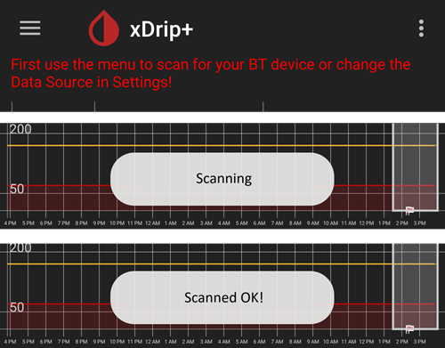
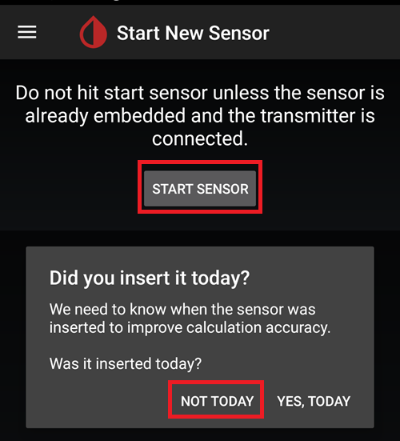
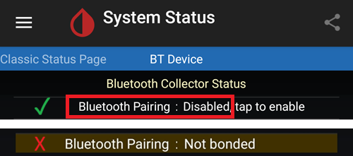

# How to setup FSL 2 and OOP2 to use a native Bluetooth connection in xDrip

Transferred from [MinimalL00per](https://www.minimallooper.com/post/how-to-setup-freestyle-libre-2-and-oop2-to-use-a-native-Bluetooth-connection-in-xdrip) to markdown and **revised/updated**: Aug 25, 2025 psonnera

În partea de jos a prezentului document există o listă de definiții. Dacă nu sunteți familiarizat cu termenii sau abrevierile nu ezitați să *[săriți jos](#minimallooper-definitions)* pentru clarificare.

 

## Configurare

### Dispozitive

- *FSL2 și 2+* **NOTĂ: versiunile US, CAN, NZ, AUS NU sunt acceptate**

**(OPȚIONAL) Cititor** (nu este compatibil cu FSL2+)

- Cititor 1 (cu firmware actualizat)

- Cititor 2

*NOTĂ: Dacă plănuiți să utilizați cititorul în această soluție, TREBUIE SĂ ÎNCEPEȚI senzorul cu READER FIRST. Dacă nu faceți acest lucru, nu veți putea folosi cititorul pentru a aduna citiri de la senzorul activat. After the sensor has warmed up, you can then take readings from the LL application or xDrip.*

### Software

**OOP** - Algoritmul în afara procesului, o aplicație externă APK Android care asistă la recuperarea datelor brute ale senzorilor pentru a obține valorile glicemiei. xDrip sends gathered FSL2 BT raw data to OOP and blood glucose values are returned to xDrip.

- **OOP2**

  - **Funcționează numai cu senzori europeni FSL2/2+**

  - Sursă închisă (nu este disponibilă pe GitHub)

  - Purpose is to decrypt the encrypted raw sensor values and return them to xDrip. Then xDrip can be used with either raw data, requiring calibration, or provide glucose values similar to the Reader 1.

[***xDrip***](https://jamorham.github.io/)

- [*Nightly*](https://github.com/NightscoutFoundation/xDrip/releases) cel mai recent cod sursă construit în fiecare noapte. Nu e testat bine

- [*Stabil*](https://xdrip-plus-updates.appspot.com/stable/xdrip-plus-latest.apk) ultima versiune testată.

- **NOTE: new sensors require updated an OOP2 app, for this it is recommended to use at least the latest xDrip release (Stable) version, matching the latest OOP2.**

 

## Proces

- *Mai întâi descărcați și instalați aplicațiile de mai jos*
- *Dezinstalați posibilele aplicații conflictuale*
- *How to Start a FSL2 Sensor in Bluetooth Native mode using LL and xDrip
  - [*Pasul 1: Instalarea și configurarea aplicației*](#minimallooper-step1)
  - [*Step 2: xDrip Settings Configuration*](#minimallooper-step2)
  - [*Pasul 3: Introduceți fizic senzorul*](#minimallooper-step3)
  - [*Pasul 4: Porniți aplicația LibreLink și porniți senzorul cu prima scanarea NFC*](#minimallooper-step4)
  - [*Step 5: Open xDrip and NFC SCAN the FSL2 sensor*](#minimallooper-step5)
  - [*Step 6: Start the new sensor in xDrip*](#minimallooper-step6)
  - [*Pasul 7: Așteptați 60 de secunde și scanați NFC senzorul din nou*](#minimallooper-step7)
  - [*Pasul 8: Colectarea datelor între 3 și 15 minute*](#minimallooper-step8)
  - [*Pasul 9: Verificați că senzorul e conectat și transmite date*](#minimallooper-step9)

- *[Note](#minimallooper-notes)*
- *[Avantaje](#minimallooper-advantages)*
- *[Dezavantaje](#minimallooper-disadvantages)*
- <u>*\[Depanare\](#minimallooper-troubleshooting)*</u>

## Înainte să începeți

Este recomandat cu tărie să urmăriți acest proces cu un **senzor nou**. Deși s-a raportat că o conexiune poate fi făcută cu un senzor activ (***vedeți [mai jos](#minimallooper-started-sensor)***), șansa ca aplicația LibreLink sau cititorul să creeze o nouă cheie privată de partajare pentru comunicare în timpul conexiunii este foarte probabilă. This means that after bonding, xDrip is not aware of the new key and will not be able to communicate with the sensor. Încercați o conexiune cu un senzor de rulare pe propriul risc, preferabil spre sfârșitul vieții senzorului.

### Mai întâi descărcați și instalați aplicațiile de mai jos

(Libre2_OOP2)=

- **OOP2** - Versiunile OOP2 pot fi găsite la:

  (*Notă: trebuie să fiți autentificat la Google pentru a accesa linkul.*)

*[oop2.apk](https://drive.google.com/file/d/1106h2s12b3Ev9gKCTU2G75q8h9ChHjcz/view?usp=sharing)* - OOP2_21_09_25 (05d1989) **2025.09.21** (ultima versiune)

- **xDrip** - **<u>latest version</u>** (minimum version 2025.09.26) can be found at:

[*xDrip.apk*](https://github.com/NightscoutFoundation/xDrip/releases)

(minimallooper-started-sensor)=

### Ce se întâmplă dacă senzorul meu este deja pornit? Can I still get reading in xDrip? DA!

Mulți oameni au întrebat dacă această metodă poate fi folosită cu un senzor deja activ și pot spune cu un **DA** răsunător, poți începe un senzor care rulează activ.

1.  **FIRST**, make sure you have made the configuration changes and settings to xDrip and installed and configured OOP2 as shown below.

2.  **APOI**, treceți la *Pasul 5* și **ASIGURAȚI-VĂ** ați închis forțat LibreLink înainte de a începe. Apoi urmați procesul până la finalizare.

*NOTĂ: Nu veți putea utiliza senzorul FSL2 activat cu FSLReader DACĂ nu a fost început cu FSLReader mai întâi. If it WAS started with the FSLReader first, then you will be able to **scan** the sensor and retrieve readings from BOTH the sensor and apps like LL and xDrip.*

## How to Start a FSL2 Sensor in Bluetooth Native mode using LL and xDrip

*NOTĂ: Dacă există setări în capturile de ecran care nu sunt afișate cu o CĂSUȚĂ în mod specific și sunt DEBIFATE (adică dezactivate) apoi PĂSTRAȚI-LE DEZACTIVATE. Capturile de ecran reflectă o configurație funcțională pentru TOATE setările afișate. Dacă doriți să experimentați pornind sau oprind alte funcții după ce aveți un senzor de lucru, sunteți liber să faceți acest lucru pe propriul risc.*

(minimallooper-step1)=

### Pasul 1: Instalarea și configurarea aplicației

**Instalați și configurați OOP2** și vedeți că funcționează prin deschiderea aplicației.


**Setări**

- *Utilizați serviciul* **pornit**

- *Utilizați serviciul în prim-plan* **pornit**

- *Timer Duration* **5 minutes**

  - Change to **1 sec** if you are not getting results fast enough (the screenshot below shows this setting).

**Versiunea 2: 93e5cac-2020.12.08 (ultima versiune)**


**Install xDrip** minimum version: latest release. Further documentation on xDrip installation and setup can be found [*here*](../CompatibleCgms/xDrip.md).

(minimallooper-step2)=

### Step 2: xDrip Settings Configuration

**Sursa de date hardware**: Bluetooth Libre


**Setări de scanare NFC**:*setările care nu au fost menționate sunt presupuse că sunt dezactivate.*

- *Utilizați funcția NFC*: **pornit**
- *Vechimea senzorului sau expirare*: **pornit**
- *Scan when not in xDrip*: **on**
- *Utilizați o metodă de citire optimizată pentru Any-tag*: **oprit** dar încercați **pornit** în cazul în care se întâmpină dificultăți la scanare


- *Începerea conexiunii Bluetooth cu senzorul FSL2*: **Conectați-vă întotdeauna la senzorii libre2**


- *Omogenizați datele Libre 3 când se folosește metoda xxx*: lasă implicit. Creșteți valoarea pentru senzorii zgomotoși, scădeți când este stabilă.


**Setări mai puțin obișnuite -\> Setări Bluetooth** (*sunt importante și pot varia în funcție de telefon/configurare*)

- *Activați Bluetooth*: **pornit**
- *Acordați încredere Auto-Connect*: **pornit**
- *Folosiți scanările de fundal*: **pornit**
- *Descoperiți întotdeauna serviciile*: **pornit**

You can setup xDrip using the QR code below. You need to scan it (or load the picture) in xDrip -> Auto Configure.

```{admonition} QR Code
:class: dropdown


```


Odată scanat codul QR de mai sus, dacă aveți un telefon Samsung (dar acest lucru este util și pentru multe mărci chinezești), scanați celălalt cod QR de mai jos pentru a schimba setările pentru o conexiune mai sigură:

- *Acordați încredere Auto-Connect*: **oprit**
- *Folosiți scanările de fundal*: **oprit**

```{admonition} QR Code
:class: dropdown


```


**Setări avansate pentru FSL2** (*opțional dar util*)

- *arătați valorile brute în grafic*: **pornit**

- *arătați informații despre senzori în Stare*: **pornit**


**Setări suplimentare de jurnalizare** (*necesar pentru depanare dacă nu funcționează corect*)

- *Etichete suplimentare pentru jurnalizare*: introduceți această valoare

`BgReading:d,jamorham librereceiver:v,LibreOOPAlgorthm:v,jamorham nsemulator:v,DexCollectionService:v`


(minimallooper-OOPsettings)=

**Setări mai puțin obișnuite -\> Alte opțiuni diverse**

> **Setări pentru configurarea OOP2**

- *Algoritmul Libre în afara procesului*: **OPRIT**

(*ASIGURAȚI-VĂ CĂ ACEST LUCRU ESTE **OPRIT** PENTRU OOP2, ALTFEL NU VEȚI OBȚINE CITIRI!*)


(minimallooper-step3)=

### Pasul 3: Introduceți fizic senzorul

(minimallooper-step4)=

### Pasul 4: Porniți aplicația LibreLink și porniți senzorul cu prima scanarea NFC

Porniți aplicația LibreLink, apoi scanați senzorul nou introdus, apoi închideți și dezactivați sau dezinstalați aplicația LibreLink. **You still need to wait for the sensor to warm-up the full 60 minutes before proceeding and starting the sensor in xDrip**. Nu vă bazați pe citiri de dinainte deoarece senzorul este încă se calibrează intern, iar valorile variază în mod dramatic.

#### Step 4a (OPTIONAL, Use FSLReader):

**Porniți senzorul FSL2 (nu 2+) prin scanarea acestuia cu FSLReader cu chiar întâia scanare NFC**

If you want to be able to use the **FSLReader** as well as the LL app or xDrip to read values from the FSL2 sensor, then **you will need to scan the newly inserted FSL2 sensor with the FSL Reader FIRST.** After the sensor warmup is complete you can then use the LL app or xDrip to scan readings.

*NOTĂ: Aplicația LibreLink este necesară doar pentru PRIMA scanare NFC după inserarea senzorului. Acesta servește la trimiterea semnalului de inițializare a încălzirii, după aceea aplicația TREBUIE dezactivată (setările aplicației>închidere forțată) sau dezinstalată. Puteți folosi aplicația modificată 2.3 sau versiunile oficiale, nu contează. The main thing is to prevent the LL app from running when xDrip is trying to start the BT bonding process with the sensor as the LL app interferes with the Bluetooth reconnection process by disrupting communication.*

*A fost raportat că simpla oprire a **permisiunilor de localizare** în setările Android ale aplicației LibreLink este suficient pentru a preveni interferarea cu conexiunea. Acest lucru a fost raportat de câțiva utilizatori ca fiind de succes. Din nou **recomand dezactivarea sau dezinstalarea aplicației**, dar puteți încerca acest lucru dacă doriți să experimentați.*

(minimallooper-step5)=

### Step 5: Open xDrip and NFC SCAN the FSL2 sensor

(*Memento! Asigurați-vă că LibreLink este dezactivat (locația este oprită) sau dezinstalat și că ați așteptat toate cele 60 de minute pentru ca senzorul să se încălzească și să fie calibrat.*)

**NFC SCAN** the FSL2 sensor with xDrip. Aceasta trimite un semnal către senzor pentru a activa asocierea Bluetooth pentru a începe procesul de legare. A small notification will appear briefly on the bottom of the xDrip Overview screen with the text **Scanning** followed by the notification **Scanned OK!** upon a successful NFC scan of the FSL 2 sensor.



(minimallooper-step6)=

### Step 6: Start the new sensor in xDrip

In the **xDrip Overview screen** press the **hamburger menu** in the upper left corner. Apoi alegeți **Start Senzor**.

Pe ecranul **Porniți noul senzor** apăsați **Start Senzor**. Un anunț va întreba **L-ați inserat astăzi?** Răspundeți apăsând **NU ASTĂZI**.




*NOTE: If you accidentally clicked "YES, TODAY" then you will need to "stop sensor" from the xDrip main menu followed by "start sensor" by proceeding with Step 5 again.*

(minimallooper-step7)=

### Pasul 7: Așteptați 60 de secunde și scanați NFC senzorul din nou

A second NFC scan is needed in order to **ADD** the sensor as the Bluetooth device from which xDrip will use to retrieve the readings. Odată finalizat, veți vedea o notificare care va spune **NOUL SENZOR PORNIT**.


O perioadă de așteptare de 60 de secunde este impusă deoarece senzorul nu poate fi scanat în timpul acestui proces de mai mult de o dată pe minut. Dacă senzorul este scanat prea devreme avertizarea **Nu atât de repede, așteptați 60 secunde** este afișat în ecranul privire de ansamblu al xDrip.


Open xDrip event logs and check the sensor paired correctly with xDrip.


(minimallooper-step8)=

### Pasul 8: Colectarea datelor între 3 și 15 minute

Între 3 și 15 minute suficiente date sunt colectate pentru a afișa primele valori. *Dacă încă nu primiți citiri în acest moment, uneori ajută repornirea telefonului.*

If you use a Samsung (or many Chinese brand phones) and have issues receiving data, scan the QR code below, in xDrip -> Auto Configure.

```{admonition} QR Code
:class: dropdown


```

It will change xDrip Bluetooth settings to:

- *Acordați încredere Auto-Connect*: **oprit**
- *Folosiți scanările de fundal*: **oprit**

(minimallooper-step9)=

### Pasul 9: Verificați că senzorul e conectat și transmite date

Press the Hamburger menu in the upper left of the xDrip Overview screen and select **System Status**. Pe ecranul de Stare al Sistemului, **Dispozitivele Bluetooth** active: afișează convenția de denumire Bluetooth FSL2 de la **ABB___XXXXXXXXX**, unde XXX reprezintă numărul de serie al senzorului. Câmpul **Starea Conexiunii** afișează **Conectat** și secțiunea **Startul senzorului:** a afișat data la care senzorul a fost pornit.


Pe ecranul **Dispozitiv Bluetooth** (glisare la stânga) puteți verifica detaliile legate de conexiune ale senzorului și puteți utiliza acest ecran pentru conexiunile de depanare. Mai jos este o listă de câmpuri și scopurile lor pentru a ajuta la depanarea conexiunii.

*NOTĂ: **<u>NU ATINGEȚI</u> ȘI SCHIMBAȚI Asocierea Bluetooth de la <u>Dezactivat</u>** în această fereastră. Acest lucru va încerca o conectare directă, va eșua (nu este legată) și va trebui să începeți din nou procesul de la Pasul 5.*



- **Stare serviciului telefonic:** Ultima dată când telefonul a făcut o conexiune Bluetooth la senzor (ar trebui să fie mai mică de 5 minute în urmă)
- **Dispozitiv Bluetooth:** Afișați starea curentă a conexiunii (fie **conectat** sau **deconectat**)
- **Adresa MAC a dispozitivului**: Acesta este ID hardware al senzorului.
- **Asociere Bluetooth**: Acesta ar trebui să fie **<u>dezactivat, apăsați pentru a activa</u>**. Aveți grijă să NU atingeți acest lucru. Dacă îl atingeți din greșeală, apăsați-l din nou până când acesta revine la dezactivat.
- **Cea mai lentă trezire**: Puteți ignora asta. xDrip doesn't spend its time waiting for readings: it will start expecting them at after a certain time (traditionally 5 minutes). If no data arrives at that time, you'll see "Woke up early" meaning xDrip was expecting data to be ready but there's none. Cea mai lentă trezire este întârzierea cea mai mare înregistrată înainte de primirea datelor în mod normal.
- **Următoarea trezire**: ar trebui să spună 5 minute


(minimallooper-notes)=

### Note

- **Using LL NFC Scans AFTER bonding/pairing in xDrip is completed**: You can conduct NFC scans but the bonding/pairing process with xDrip needs to be completed first. Always look at xDrip and see if it is close to the 5 minute reading (i.e. 4 minutes ago), if it is near 5 min, wait for the new BT reading to come in and then conduct the NFC scan. If you catch it at the wrong time it will disturb the BT process in xDrip and not receive BT readings, which can take a while to re-bond and transmit again and sometimes a sensor BT connection can be “stolen” by LL. Cu toate acestea, între aceste citiri Bluetooth, nu am avut probleme cu executarea unei scanări NFC, urmată de dezactivarea imediată a aplicației. Nu sunt sigur dacă LibreLink trebuie să fie dezactivată de fiecare dată, dar se poate dezactiva pentru siguranță.

- - **Ce se întâmplă?** Când o conexiune Bluetooth este făcută, o cheie privată partajată este necesară pentru a permite comunicarea între senzor și aplicația/dispozitivul de apelare. Este foarte probabil ca aplicația LibreLink sau cititorul să creeze o nouă cheie privată comună pentru comunicare în timpul conexiunii. This means that after bonding, xDrip is not aware of the new key and will not be able to communicate with the sensor.

  - Several users have reported that the LL app can be restarted after successfully starting the sensor and receiving readers in xDrip. În permisiunile aplicației LibreLink Android trebuie doar să opriți setarea **Permiteți localizarea**. Once this is done you should be able to use the LL app and xDrip simultaneously. Vă recomand să nu selectați o aplicație implicită pentru scanarea NFC și să alegeți ce aplicație doriți pentru citirea senzorului printr-o scanare NFC. De asemenea, NU UITAȚI, la următoarea schimbare a senzorului să forțați închiderea aplicației LibreLink după scanarea NFC inițială pe noul senzor. After the sensor is configured and receiving readings in xDrip you can then start the LL app again.

&nbsp;

- **Repornirea telefonului**: După repornire, și după dezactivarea sau închiderea forțată a aplicației, AMINTIȚI-VĂ să verificați că aplicația LibreLink NU rulează. Sugerez testarea unei reporniri pentru a vedea dacă LibreLink începe din nou automat. Puteți căuta în setările aplicației LibreLink sub setările aplicației Android de pe telefon. Dacă este încă activată, atunci dezactivați din nou aplicația LibreLink, iar dezinstalarea aplicației LibreLink poate fi singura modalitate de a evita acest lucru. Acest lucru este necesar pentru a preveni furtul accidental al legăturii Bluetooth. De asemenea, după repornirea sistemului, va dura aceleași 3-15 minute pentru a obține citiri Bluetooth din senzor, astfel încât să aveți răbdare și planificați acest lucru dacă reporniți aproape de momentul când aveți nevoie de o citire de glicemie pentru a face bolus, pentru mese, șamd.

&nbsp;

- **Setările de optimizare a bateriei**: Asigurați-vă că EXCLUDEȚI aceste aplicații din setările de optimizare a bateriei pe telefonul dumneavoastră

  - xDrip

  - OOP 2

  - LibreLink

  - AAPS

&nbsp;

- **Using Flight Mode:** There are some situations which call for turning on flight mode (when taking a flight ;-), sleeping at night and you do not wish to have Wi-Fi or Mobile connection signals operating with your phone in close range of your head) and this can cause issues with the Bluetooth communication during activation of Flight mode. La activarea modului de zbor pe telefon, urmat de activarea Bluetooth, valorile glicemiei vor fi pierdute. Singura soluție este să se repornească colectorul în xDrip+ -> Starea Sistemului - \> Pagina clasică de stare. După repornirea colectorului, valorile glicemiei au apărut din nou.

 

(minimallooper-advantages)=

### Avantaje

- **Aplicația modificată LibreLink nu mai este necesară** Nu mai ai nevoie de o versiune modificată a aplicației LibreLink pentru a prelua valorile de la senzorul FSL2. În timp ce puteți utiliza aplicația LibreLink modificată, versiunile oficiale ale aplicației LibreLink pot porni prima scanare de inițializare NFC în același mod ca aplicația modificată. Nu există nicio diferență în ceea ce privește scanarea de inițializare NFC pentru a porni senzorul.

&nbsp;

- **dispozitive terțe de scanare NFC nu mai sunt necesare** dispozitive terțe de scanare NFC cum ar fi (Miaomiao, Bubble sau Blucon) nu mai sunt *(dar poate fi folosit în continuare)* pentru a colecta citiri, deoarece doar senzorul le poate livra acum prin Bluetooth. Mai puține dispozitive înseamnă mai puține lucruri care pot merge prost, mai puține dispozitive pentru încărcare și o configurație mai minimalistă.

&nbsp;

- **You will still be able to NFC scan readings with the FSL2 Reader (version 1 with updated FW or version 2) WHEN the FSL2 sensor has been started with the FSL Reader FIRST.** The FSL2 standalone reader can still be used to scan readings on the active sensor once it is bonded via Bluetooth to xDrip.

  - privată  După acest punct, alte aplicații software vor putea, de asemenea, să ia citirile NFC de la senzorul activat acum.
- Înțelegerea este că senzorul FSL2 (atâta timp cât nu a stabilit sau nu încearcă să stabilească o conexiune) va face întotdeauna publică prezența sa (și disponibilitatea) în prin Bluetooth exact la fiecare 2 minute (vizibil pe orice dispozitiv Bluetooth care are capacitatea de a scana pentru dispozitivele Bluetooth). Indiferent ce dispozitiv este primul care răspunde la acest anunț câștigă cursa și este *singurul* dispozitiv căruia i se permite să se conecteze și să citească senzorul deoarece o cheie privată partajată este creată în timpul procesului de conexiune NFC care este folosită pentru a decripta comunicarea FSL 2. Senzorul este apoi indisponibil pentru alte dispozitive care nu au această cheie privată de partajare și ar putea încerca să se conecteze. Se pare că cititorul FSL 2 câștigă întotdeauna această cursă indiferent de "adversar".

&nbsp;

- **Configurare cu un număr minim de dispozitive fizice** Scopul meu a fost întotdeauna să mențin numărul de dispozitive medicale atașate corpului meu la un nivel minim. FSL2 în combinație cu sistemul Omnipod a atins acest obiectiv. Acest aspect este și mai important atunci când călătoresc (atât pe distanțe scurte, cât și pe distanțe lungi), deoarece numărul de obiecte și de schimburi pentru aceste obiecte devine mai reduse; ceea ce înseamnă că am mai mult spațiu pentru alte obiecte în bagajul meu. Sperăm că în viitor va exista o pompă cu plasturi care va avea doar un rezervor de înlocuire, iar cipul și sistemul motor pot fi ambalate ca o piesă fixabilă/reutilizabilă. Acest lucru ar reduce deșeurile și ambalajul necesar pentru schimbările de senzori/locuri de aplicare, ceea ce, din nou, îmi oferă mai mult loc în valiză pentru alte lucruri.

&nbsp;

- **Nu mai sunt decalaje de oră la schimbarea senzorilor** Pentru că puteți începe un alt senzor cu aplicația LibreLink folosind o scanare NFC inițială, senzorul curent poate continua să ruleze și să livreze citirile prin Bluetooth în același timp. După 20 de minute poți obține citiri de la noul senzor, dar cel mai bine este să aștepți 1 oră pentru ca senzorul să se calibreze intern corespunzător. Aceasta înseamnă că puteți opri senzorul curent și porni pe cel nou (după ce a fost setat și încălzit cu scanarea NFC a LibreLink cu o oră mai devreme) și în decurs de 3 până la 15 minute veți avea calibrările și citirile inițiale.

&nbsp;

(minimallooper-disadvantages)=

### Dezavantaje

- **Repornire telefonului:** Deoarece procesul Bluetooth trebuie să înceapă din nou când telefonul se repornește, mai întâi trebuie să vă asigurați că dezactivați manual aplicația LibreLink (dacă nu ați dezinstalat-o) și să fiți răbdător pentru prima citire (între 3 și 15 minute). Acest lucru înseamnă planificarea repornirilor telefonului astfel încât acestea să nu aibă loc în timpul unor momente critice, cum ar fi bolusurile de corecție sau orele de masă și gustări.

&nbsp;

- **You can't run LL and xDrip in parallel together for Bluetooth readings**. LibreLink va încerca întotdeauna să "fure" conexiunea Bluetooth la senzor și să facă legătura. Dacă acest lucru se întâmplă, sunteți blocat de LibreLink pentru tot restul vieții senzorului. Deci, rularea simultană a aplicațiilor nu funcționează tot timpul. As I mention below, you can enable the LL app and do an NFC scan to get the LL reading (if you need to compare, want to retrieve history for yourself or endocrinologist reports) however you should disable it as soon as you have your reading and not try to attempt this within a minute of when xDrip is going to retrieve its Bluetooth reading. Nu sunt sigur cum funcționează cititorul FSL2 în timp ce fac acest lucru, dar voi testa acest lucru mai târziu.
- Several users have reported that the LL app can be restarted after successfully starting the sensor and receiving readers in xDrip. În permisiunile aplicației LibreLink Android trebuie doar să opriți setarea **Permiteți localizarea**. Once this is done you should be able to use the LL app and xDrip simultaneously. Vă recomand să nu selectați o aplicație implicită pentru scanarea NFC și să alegeți ce aplicație doriți pentru citirea senzorului printr-o scanare NFC. De asemenea, NU UITAȚI, la următoarea schimbare a senzorului să forțați închiderea aplicației LibreLink după scanarea NFC inițială pe noul senzor. After the sensor is configured and receiving readings in xDrip you can then start the LL app again.

&nbsp;

- **Dispozitivele terțe de scanare NFC pot fi folosite în continuare**. Yes, I listed this as a disadvantage but I also wanted to point out that if something goes wrong with the sensor and LL captures control of it, you can always fall back to placing an NFC scanning device on the sensor to get readings in xDrip. De asemenea, puteți utiliza acest dispozitiv în locul unei conexiuni Bluetooth directe dacă sunteți mai confortabil cu o configurare constând dintr-un dispozitiv terț de scanare NFC (Miaomiao, Bubble, Blucon). Uneori, anumite telefoane nu funcționează bine cu conectarea Bluetooth nativă a senzorilor și extragerea datelor. Puteți utiliza aceste dispozitive ca o copie de rezervă sau ca o utilizare normală, în orice caz aveți această opțiune.
- Dacă plănuiți să utilizați **cititorul FSL** ca un dispozitiv de scanare NFC pentru citiri, TREBUIE să porniți senzorul FSL2 la **CHIAR PRIMA SCANARE** pentru a încălzi senzorul cu **CITITORUL PRIMA OARĂ**.

&nbsp;

- **LV data will not be uploaded automatically** Since the LL app does not have a constant Bluetooth connection (because LL should not be running simultaneously with xDrip once the sensor is actively sending Bluetooth readings) then it is not receiving readings automatically from the sensor. Aceasta înseamnă că datele privind glicemia nu sunt încărcate automat în LibreView și prin extensie în alte telefoane cu LibreLink. Consider că acesta este un dezavantaj deoarece știu că mulți părinți se bazează pe această funcționalitate, precum și pe cei care sunt obligați să utilizeze raportarea LibreView pentru furnizorul lor de asistență medicală. Încă puteți deschide aplicația LibreLink și să scanați la fiecare 8 ore pentru a obține datele completate înapoi de la senzor în LibreLink (de 3 ori pe zi, cel puțin la fiecare 8 ore, dar ar fi probabil nevoie de mai multe scanări pentru a capta toate cele 24 de ore de date), dar din nou acesta este un proces manual.

&nbsp;

(minimallooper-definitions)=

### Definitions

- **BT** - Bluetooth

- **BLE** - Bluetooth Low Energy

- **FSL** - FreeStyle Libre
  - **Libre 1 (FSL1)** - doar NFC. Prima versiune a senzorului

  - **FSL2 (FSL2)** - Bluetooth și NFC. A doua versiune a senzorului.

  - **Libre 3 (FSL3)** - Bluetooth și NFC. Cea de-a treia versiune mai mică a senzorului. Nu este acceptată de OOP2 (vedeți Juggluco).

- **LL** - LibreLink, **aplicația** folosită pentru a porni senzorul cu scanarea NFC inițială

- **LV** - LibreView, serviciu cloud pentru schimbul de date cu echipa de endocrinologie (luați în considerare utilizarea Tidepool sau Nightscout)

- **MM** - MiaoMiao, name and manufacturer of a 3rd party NFC scanning device that delivers readings via Bluetooth to xDrip.

- **NFC** - Near Field Communication (comunicare în câmp apropiat), o operațiune fizică în care apropiați senzorul NFC al telefonului de senzorul dumneavoastră pentru a iniția o citire. Aceasta este adesea denumită "scanarea senzorului", "scanarea de senzor" sau "scanare NFC". Acest proces nu folosește în niciun fel Bluetooth.

- **OOP1** - Out of Process Algorithm version 1, the 3rd party app that receives raw values (delivered to xDrip from the sensor by Bluetooth or NFC scan) and then uses an algorithm (very similar to the hardware algorithm on the sensor chip) to process the raw values and returns a calibrated (by the OOP1 algorithm, not by xDrip’s native calibrations) blood sugar back to xDrip to either display or be further processed with xDrip’s calibration (with a finger pick blood calibration) if needed.

- **OOP2** - Algoritmul Extern versiunea 2, aplicația terță care primește date criptate de la senzorul FSL 2 (prin Bluetooth sau scanare NFC) și apoi decriptează datele criptate. Once decrypted, the data is then sent to xDrip.

 

(minimallooper-troubleshooting)=

### Depanare

#### Eșec la scanarea senzorului cu NFC

- Asigurați-vă că dispozitivul de citire NFC este activat în setările Android.
- Cititorul NFC trebuie să fie compatibil cu etichetele **ISO 15693**. Unele telefoane Cubot sunt foarte greu de folosit.
- Uitați-vă în documentația telefonului pentru a identifica poziția antenei NFC. Bring it to the sensor and stay on it for 10 seconds: xDrip NFC reading takes longer than the vendor app or the reader.
- Try to close xDrip before scanning the sensor.
- Make sure no other app wants to read the sensor (you might see a selection with different app choices when scanning: select xDrip but don't move the phone).
- Try all combinations of xDrip NFC settings *Use faster multi-block reading method* and *Use Any-tag optimized reading method* knowing that NFC scans are usually more reliable with both these options **off**.

#### Blocat la colectarea citirilor inițiale

*Notă: FSL 2 nu este recunoscut ca o sursă de date de încredere atunci când este calibrat manual.*

Setați strategia de [calibrare OOP2](#minimallooper-OOPsettings) la "Nici o calibrare" până când nu aveți totul funcțional.

Apoi puteți decide dacă calibrați sau nu.


#### Senzorul este raportat ca FSL1


Make sure you are running the latest versions of xDrip and OOP2.

#### Conectarea la senzor nu a reușit

- Verificați ca OOP1 să fie dezactivat (vedeți [aici](#minimallooper-OOPsettings))


- Verificați ca OOP2 să nu fie adormit de aplicațiile și setările bateriei telefonului
- Verificați că protecția Google Play este dezactivată pentru că va închide OOP2
- Ați schimbat asocierea de tip Bluetooth în starea sistemului? Atingeți ecranul pentru a-l aduce înapoi la **<u>Dezactivat</u>**


#### Citiri ratate

Make sure OOP2 shows values that are not 0 or -1, it might be a sign your sensor is failing (example below in mmol/L).


Faptul că vechimea senzorului nu a avansat ar putea fi, de asemenea, un semn că senzorul dumneavoastră are probleme. This means xDrip received a value, but discarded it as it was not acceptable (sensor error).


#### Reporniți de la zero asocierea senzorului

1. xDrip menu -> Stop sensor (it won't stop the FSL2, just change xDrip state to not started)
2. xDrip menu -> System status -> Forget device
3. Scan the sensor with xDrip NFC. Așteptați cel puțin un minut
4. xDrip menu -> Start sensor. Așteptați cel puțin un minut
5. Scan the sensor with xDrip NFC, a few times,  always waiting at least one minute between two scans
