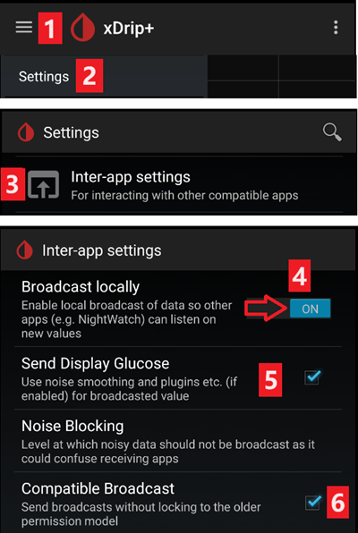
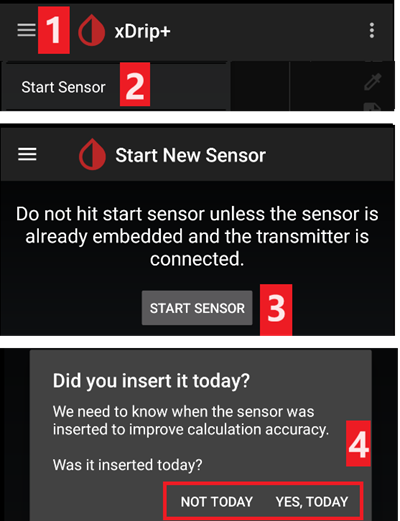

# Setări xDrip

If not already set up, download and install the latest xDrip release from the [xDrip releases page](https://github.com/NightscoutFoundation/xDrip/releases).

Dezactivați optimizarea bateriei și permiteți activitatea în fundal pentru aplicația xDrip.

## Setări de bază pentru toate sistemele CGM & FGM

### Dezactivați încărcarea datelor în Nightscout

Nu permiteți niciunei alte aplicații să încarce date (glicemie și tratamente) în Nightscout.

→ Meniu hamburger (1) → Settings (2) → Cloud Upload (3) → Nightscout Sync (REST-API) (4) → Comutați pe **OFF** `Enabled` (5)

#### Dezactivați calibrarea automată și tratamentele

Asigurați-vă că `Automatic Calibration` (7) este dezactivată. If the checkbox for `Automatic Calibration` is checked, activate `Download treatments` (6) once, then remove the checkbox for `Automatic Calibration` and deactivate `Download treatments` again.

Tap `Extra Options`(8)

    {admonition} Safety warning
    :class: warning
    You must deactivate "Upload treatments" from xDrip, otherwise treatments can be doubled in AAPS leading to false COB and IOB.

Dezactivați `Upload treatments`(9) și asigurați-vă că **NU** veți folosi `Back-fill data` (11).

Opțiunea `Alert on failures` ar trebui, de asemenea, dezactivată (10). Altfel veți primi o alarmă la fiecare 5 minute în caz de probleme cu rețeaua Wi-Fi/mobilă sau dacă serverul nu este disponibil.

### **Inter-app Settings** (transmisie)

Dacă folosiți AAPS, trebuie să activați transmisia (broadcast) în xDrip, în Inter-App settings, pentru ca datele să fie trimise către AAPS.

→ Meniu hamburger (1) → Settings (2) → Inter-app settings (3) → Broadcast locally **ON** (4)

Pentru ca valorile din AAPS să fie identice cu cele din xDrip, activați `Send the displayed glucose value` (5).

Activați Compatible Broadcast (6).

If you have also activated `Accept treatments` in xDrip and `Enable broadcasts to xDrip` in AAPS xDrip plugin, then xDrip will receive insulin, carbs and basal rate information from AAPS.

Dacă activați `Accept Calibrations`, xDrip va folosi calibrările din AAPS. Fiți atenți când folosiți această funcție cu senzori Dexcom: citiți mai întâi [această pagină](https://navid200.github.io/xDrip/docs/Calibrate-G6.html).

Remember to disable Import Sounds to avoid xDrip making a ringtone every time AAPS sends a basal/profile change.

(xdrip-identify-receiver)=

#### Identify receiver (identificarea receptorului)

- If you discover problems with local broadcast (AAPS not receiving BG values from xDrip) go to → Hamburger Menu (1) Settings (2) → Inter-app settings (3) → Identify receiver (7) and enter `info.nightscout.androidaps` for AAPS build (if you are using PumpControl build, please enter `info.nightscout.aapspumpcontrol` instead!!).
- Atenție: Auto-corectarea tinde uneori să schimbe litera i în majuscula I. **Trebuie să utilizați doar litere mici** când tastați `info.nightscout.androidaps` (sau `info.nightscout.aapspumpcontrol` pentru PumpControl). Un I mare (majusculă) ar împiedica aplicația să primească valori ale glicemiei de la xDrip.
    
    

## Utilizați AAPS pentru a calibra în xDrip

- Dacă doriți să puteți folosi AAPS pentru calibrare, în xDrip mergeți la Settings → Interapp Compatibility → Accept Calibrations și selectați ON. 
- Puteți verifica și opțiunile din Settings → Less Common Settings → Advanced Calibration Settings.

## Senzorii Dexcom

Everything related to the Dexcom sensor and transmitter themselves (starting, stopping, replacing, calibrating, troubleshooting) is documented and kept up to date in the [xDrip Dexcom documentation](https://navid200.github.io/xDrip/docs/Dexcom_page.html). Follow those instructions for the sensor; the settings connecting xDrip to **AAPS** (described above on this page) are the only AAPS-specific part.

### Dexcom G6 și ONE

- Configurați xDrip conform [setărilor recomandate](https://navid200.github.io/xDrip/docs/G6-Recommended-Settings.html).
- Transmițătorii G6 și ONE pot fi conectați simultan la receptorul Dexcom (sau alternativ la pompa t:slim) și la o aplicație de pe telefonul dumneavoastră.
- Când folosiți xDrip ca receptor, dezinstalați mai întâi aplicația Dexcom. **Nu puteți conecta în același timp xDrip și aplicația Dexcom la transmițător!**
- If you need Clarity and want to profit from xDrip features, use the [Build Your Own Dexcom App](#DexcomG6-if-using-g6-with-build-your-own-dexcom-app) with local broadcast to xDrip, or use xDrip as a Companion app receiving notifications from the official Dexcom app (with possible delays in BG readings).

#### Sensor restarts

- xDrip always uses the transmitter's [native algorithm](https://navid200.github.io/xDrip/docs/Native-Algorithm.html) with current transmitters; there is no reason to disable it.
- [Preemptive restarts](https://navid200.github.io/xDrip/docs/Preemptive-Restart.html) only function on old transmitters (firmware 1.6.5.25 or earlier), where they are needed to prevent the sensor stopping after 10 days. Recent (Firefly) transmitters ignore them.
- Restarting a sensor on a Firefly transmitter requires [removing the transmitter](https://navid200.github.io/xDrip/docs/Remove-transmitter.html) and readings can be significantly in error after the restart, which is dangerous when looping: read [Restart a sensor](https://navid200.github.io/xDrip/docs/Restart-G6-sensor.html) in full and [calibrate carefully](https://navid200.github.io/xDrip/docs/Calibrate-after-G6Restart.html).

(xdrip-connect-g6-transmitter-for-the-first-time)=

#### Pornirea, oprirea și înlocuirea senzorilor

Urmați instrucțiunile:

- [Pornirea unui transmițător G6 sau ONE](https://navid200.github.io/xDrip/docs/Starting-G6.html)
- [Oprirea și pornirea unui senzor G6 sau ONE](https://navid200.github.io/xDrip/docs/Dexcom/StartG6Sensor.html)
- [Scoaterea transmițătorului de pe un senzor](https://navid200.github.io/xDrip/docs/Remove-transmitter.html)
- [Transmitter lifetime](https://navid200.github.io/xDrip/docs/Transmitter-lifetime.html) can only be extended ([hard reset](https://navid200.github.io/xDrip/docs/Hard-Reset.html)) on rebatteried or modified transmitters, not on Firefly.

(xdrip-replace-transmitter)=

#### Înlocuirea unui transmițător

- Opriți receptorul Dexcom original (dacă îl folosiți) și nu îl reporniți înainte ca xDrip să afișeze citiri.
- Forget the device in xDrip (System Status → Forget Device) AND in the smartphone's Bluetooth settings (shown as DexcomXX where XX are the last two digits of the transmitter serial number).
- Keep the old transmitter out of Bluetooth range to prevent reconnection.
- Then follow [Start a G6 or ONE transmitter](https://navid200.github.io/xDrip/docs/Starting-G6.html).

### Dexcom G7, ONE+ și Stelo

- Urmați [instrucțiunile pentru G7, ONE+ și Stelo](https://navid200.github.io/xDrip/docs/Dexcom/G7.html) (este necesară o versiune recentă de xDrip — vedeți pagina din link).
- See also the [Dexcom G7, ONE+ and Stelo page](../CompatibleCgms/DexcomG7.md) for the available setups with **AAPS**.

(xdrip-troubleshooting-dexcom-g5-g6-and-xdrip)=

### Depanare Dexcom și xDrip

- [G6/ONE connectivity troubleshooting](https://navid200.github.io/xDrip/docs/Connectivity-troubleshoot.html)
- [Depanare G7/ONE+/Stelo](https://navid200.github.io/xDrip/docs/Dexcom/G7_Troubleshooting.html)
- [Problemă la pornirea unui senzor nou](https://navid200.github.io/xDrip/docs/Dexcom/SensorFailedStart.html)
- Full list: see **Troubleshooting** on the [xDrip Dexcom page](https://navid200.github.io/xDrip/docs/Dexcom_page.html).

## Libre 1

- Configurați în xDrip puntea NFC–Bluetooth
    
    → Meniu hamburger (1) → Settings (2) → Less common settings (3) → Bluetooth Settings (4)

- În Bluetooth Settings bifați casetele exact ca în capturile de ecran de mai jos (5)
    
    - Dezactivați mecanismele watchdogs deoarece vor reseta Bluetooth din telefon și vor întrerupe conexiunea cu pompa.
    
    

- Puteți încerca să activați următoarele setări (7)
    
    - Folosește scanarea
    - Trust Auto-Connect
    - Utilizați scanările în fundal

- Dacă pierdeți cu ușurință conexiunea la punte sau întâmpinați dificultăți la recuperarea conexiunii, **DEZACTIVAȚI-LE** (8).
    
    

- Lăsați toate celelalte opțiuni dezactivate, cu excepția cazului în care știți de ce doriți să le activați.
    
    

### Nivelul bateriei cititorului inteligent Libre

- Nivelul bateriei punților precum MiaoMiao și Bubble poate fi afișat în AAPS (nu Blucon).
- Detalii pot fi găsite pe pagina [capturi de ecran](#screens-sensor-level-battery).

### Conectați transmițătorul Libre & porniți senzorul

- Dacă senzorul dumneavoastră solicită acest lucru (Libre 2 EU și Libre 1 US) instalați cel mai recent algoritm în afara procesului.

- Your sensor must be already started using the vendor app or the reader (xDrip cannot start or stop Libre sensors).

- Setați sursa de date pe Libre Bluetooth.
    
    → Meniu hamburger (1) → Settings (2) → Selectați Libre Bluetooth în Hardware Data source (3)
    
    

- Scanați Bluetooth și conectați puntea.
    
    → Meniu hamburger (1) → Scan Bluetooth (2) → Scan (3)
    
    - Dacă xDrip nu găsește puntea, asigurați-vă că nu este conectată la aplicația producătorului. Puneți-o la încărcat și resetați-o.
    
    

- Porniți senzorul în xDrip.
    
        {admonition} Avertisment de siguranță
        :class: avertizare
        Nu utilizați datele senzorului înainte ca încălzirea de o oră să se termine: valorile pot fi extrem de mari și pot cauza decizii greșite în AAPS.
    
    → Hamburger Meniu (1) → Pornire senzor (2) → Pornire senzor (3) → Setează ora exactă la care l-ai pornit cu cititorul sau cu aplicația oficială. Dacă nu l-ați pornit astăzi, răspundeți "Nu astăzi" (4).

(xdrip-libre2-patched-app)=

## Aplicație Libre 2 modificată

- Setați sursa de date la aplicația Libre modificată.
    
    → Meniu hamburger (1) → Settings (2) → Selectați Libre (patched App) în Hardware Data source (3)
    
    

- Puteți adăuga `BgReading:d,xdrip libre_receiver:v` sub Setări mai puțin comune>Setări suplimentare de jurnalizare->Etichete suplimentare pentru jurnalizare. Aceasta va înregistra mesaje de eroare suplimentare pentru a depana problema.

