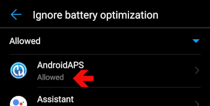

# Cum se configurează un telefon Huawei

**Which phones this page covers:** Huawei phones running **EMUI 12 to EMUI 15**. All of these are based on Android 12, the minimum for the current version of **AAPS**. On a phone with an older EMUI version, you can only use an [older AAPS version](#maintenance-android-version-aaps-version).

```{admonition} HarmonyOS NEXT / HarmonyOS 5 phones :class: warning

Recent Huawei phones sold in China run HarmonyOS NEXT (HarmonyOS 5 and above). Acest sistem nu mai este Android și nu poate rula **AAPS**. ```

Telefoanele Huawei închid foarte agresiv aplicațiile care rulează în fundal. Apply all the settings below to **AAPS** and to your CGM app (for example xDrip+ or Juggluco), otherwise the loop and glucose readings may stop when the screen is off.

Menu names can differ slightly between models. If you can't find a setting, type its name in the search bar at the top of **Settings**.

Capturile de ecran de mai jos provin dintr-o versiune EMUI mai veche. Setările sunt aceleași pe EMUI 12 până la 15.

## Ignorarea optimizării bateriei

1. Open **Settings > Apps > Apps**.
2. Tap the menu **⋮** in the top right corner and select **Special access > Battery optimization**.
3. Tap the arrow at the top of the list and select **All apps**.
4. Select **AAPS** and choose **Don't allow**. Huawei nu va mai optimiza aplicațiile din această listă.
5. Repeat for your CGM app.



## App launch: allow running in the background

1. Open **Settings > Battery > App launch** (or **Settings > Apps > Apps >** select the app **> Battery > App launch**).
2. Find **AAPS** and turn off **Manage automatically**.
3. In the **Manage manually** window, turn on all three options: 
    - **Auto-launch**
    - **Secondary launch** (can be launched by other apps)
    - **Run in background**
4. Repeat for your CGM app.


## Blocați AAPS în lista aplicațiilor recente

Aplicațiile blocate nu sunt închise când goliți lista aplicațiilor recente.

1. Deschideți lista aplicațiilor recente.
2. Swipe down on the **AAPS** card. Pe card apare un simbol de lacăt.
3. Do the same for your CGM app.


## Modul de economisire a energiei

Keep **Power saving mode** and **Ultra power saving** turned off (**Settings > Battery**). Acestea închid aplicațiile din fundal indiferent de setările de mai sus.

## If AAPS still stops in the background

See [Don't kill my app](https://dontkillmyapp.com/huawei) for more Huawei-specific solutions.

## Telefoane Honor

Honor is a separate brand now and its phones run MagicOS instead of EMUI. The background settings are very similar: look for **App launch** in the app's battery settings, turn off **Manage automatically** and allow all three options, then remove the app from battery optimization.