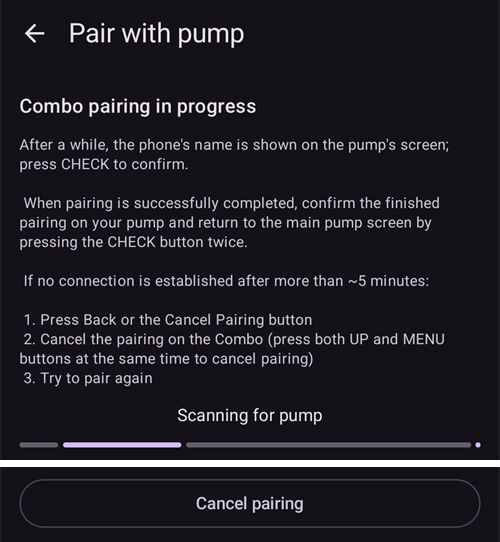
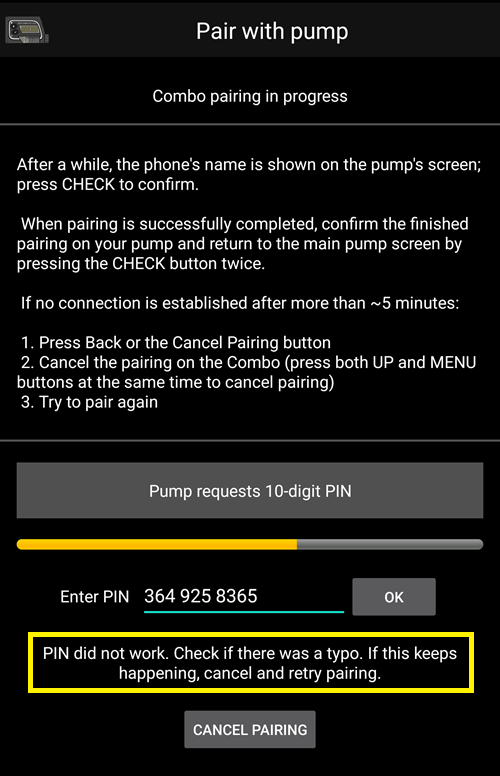
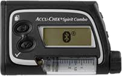

# Accu-Chek Combo

**Acesta aplicație face parte dintr-o soluție DIY (do-it-yourself/ o aplicație pe care o construiești singur) și nu este un produs finit; ea solicita implicarea utilizatorului: să citească, să învețe și să înțeleagă sistemul, de la construcție pana la modul de utilizare. Nu este un facut pentru a vă gestiona tratamentul diabetul in totalitate, dar vă permite să vă îmbunătățiți calitatea vieții alaturi de diabet, dacă sunteți dispus să acordați timpul necesar. Acordați-vă timp pentru a învăța sa-l intelegeti si folosi. You alone are responsible for what you do with it.**

```{admonition} Accu-Chek Combo is being phased out
:class: note

Roche is withdrawing from the insulin pump market to refocus its diabetes portfolio on the Accu-Chek SmartGuide CGM. It has communicated the end of sales of both the Accu-Chek Combo and Accu-Chek Insight pumps; its remaining Accu-Chek Solo micropump is also being wound down (last deliveries in Germany at the end of 2025). The change is being rolled out by region, starting in Germany, with other European markets expected to follow. If you rely on this pump, plan ahead for a transition to a supported pump.
```

```{contents} Table of contents
:depth: 1
:local: true
```

## Capacități pompă cu AAPS

* Communicates with **AAPS** over your phone's native Bluetooth, without an additional communication device.
* Automatic DST and timezone handling.

## Cerințe hardware și software

* O pompă de insulină Accu-Chek Combo (orice versiune de firmware, funcționează toate).
* Un dispozitiv Smartpix sau Realtyme împreună cu Softul de Configurare 360 pentru a configura pompa. (Roche trimite clienților lor la cerere și gratuit dispozitivele Smartpix împreuna cu softul de configurare)
* A compatible phone running Android 12 or newer. Vedeți notele [de eliberare](#maintenance-android-version-aaps-version) pentru detalii.
* The **AAPS** app installed on your phone.

Unele telefoane pot funcționa mai bine decât altele, în funcție de calitatea conexiunii prin Bluetooth și dacă au sau nu o logică suplimentară foarte agresivă de economisire a energiei. O listă de telefoane poate fi găsită în documentul [Telefoane AAPS](#Phones-list-of-tested-phones). Atenție la faptul că aceasta nu este o listă completă și reflectă doar experiența avută de utilizator în folosire. Vă încurajăm să scrieți și experiența pe care o aveți dumneavoastră, cu scopul de a ajuta și alte persoane în luarea unei decizii (toate aceste proiecte sunt despre a vă aduce propria contribuție la binele comunității).

(combov2-before-you-begin)=
## Înainte să începeți

**SIGURANȚA MAI ÎNTÂI** - nu încercați acest proces într-un mediu în care nu vă puteți recupera după o eroare. Țineți la îndemână dispozitivul Smartpix / Realtyme, împreună cu programul de configurare 360. Planificați pentru a petrece aproximativ o oră pentru a configura totul și pentru a verifica dacă totul funcționează corect.

Fiți conștienți de următoarele limitări:

* Bolusul extins și bolusul multiplu nu sunt acceptate în prezent (puteți utiliza [Carbohidrați extinși](../DailyLifeWithAaps/ExtendedCarbs.md)).
* Doar un singur profil bazal (primul) este acceptat.
* The lowest basal rate in your **Profile** is 0.05 U/h. **AAPS** refuses a **Profile** with a lower rate. The Combo rounds basal rates to its own steps (0.01 U/h below 1 U/h, 0.05 U/h up to 10 U/h, 0.1 U/h above). **AAPS** uses the rates the pump really gives.
* Temporary basal rates are limited to 500% of the current basal rate. **AAPS** takes this limit into account.
* Bucla este dezactivată dacă profilul actual activ al pompei nu este profilul cu numărul 1. This continues until profile no. 1 is made the active one; when that is done, the next time AAPS connects (either on its own after a while or because you tap **Refresh** on the Accu-Chek Combo pump screen), it will notice that profile no. 1 is the current one, and enable the loop again.
* Dacă bucla solicită ca o RBT care rulează să fie anulată, Combo va seta o RBT de 90% sau 110% timp de 15 minute. Acest lucru se datorează faptului că anularea unui RBT provoacă o alertă în pompă care provoacă o mulțime de vibrații, iar aceste vibrații nu pot fi dezactivate.
* Stabilitatea conexiunii Bluetooth variază în funcție de telefon, ceea ce cauzează apariția alertei "pompă inaccesibilă" și nu se mai realizează nici o altă conexiune între telefon și pompă. If that error occurs, make sure Bluetooth is enabled, tap **Refresh** on the pump screen (**Manage** > **Pump**) to see if this was caused by an intermitted issue and if still no connection is established, reboot the phone which should usually fix this.
* Există și o altă problemă atunci când o repornire a telefonului nu ajută, dar apăsarea unui buton al pompei trebuie apăsat (buton ce resetează sistemul Bluetooth al pompei), înainte ca pompa să accepte din nou conexiuni cu telefonul.
* Setarea unei RBT în pompă ar trebui evitată, deoarece doar bucla ar trebuie să ia astfel de decizii și să facă astfel de acțiuni - ar trebui să fie singura care controlează RBT-urile. Detectarea unei RBT noi în pompă durează până la 20 de minute și efectul RBT-ului va fi luat în calcul doar începând cu momentul detecției, astfel că în cazul cel mai rău pot exista 20 de minute a unei RBT a cărei valoare să nu se reflecte în IOB.

The driver is currently written to support the following languages on the Combo. (Acest lucru nu are legătură cu limba din AAPS - este limba afișată în LCD al pompei Combo însăși.)

* Engleză
* Spaniolă
* Franceză
* Italiană
* Rusă
* Turcă
* Poloneză
* Cehă
* Maghiară
* Slovacă
* Română
* Croată
* Olandeză
* Greacă
* Finlandeză
* Norvegiană
* Portugheză
* Suedeză
* Daneză
* Germană
* Slovenă
* Lituaniană

**Important**: Dacă pompa este setată într-o limbă care nu face parte din această listă, vă rugăm să contactați dezvoltatorii și să setați limba pompei într-una din listă. În caz contrar, driverul nu va funcționa corect.

## Configurare telefon

Este foarte important să vă asigurați că optimizările bateriei sunt oprite. AAPS deja detectează automat când este supus acestor optimizări și solicită ca acestea să fie dezactivate. Dar, pe telefoanele Android moderne, Bluetooth _în sine_ este o aplicație (o aplicație de sistem). Și, de obicei, "Aplicația Bluetooth" rulează _cu optimizările bateriei în mod implicit_. Ca rezultat, Bluetooth poate refuza să răspundă atunci când telefonul are ca scop să economisească energie deoarece oprește aplicația Bluetooth. Aceasta înseamnă că în setările aplicației de sistem Bluetooth, optimizările bateriei trebuie de asemenea dezactivate. Din păcate, cum se poate găsi aplicația de sistem Bluetooth diferă între telefoane. În modul implicit Android, accesați Setări -> Aplicații -> Vedeți toate aplicațiile N (N = numărul de aplicații de pe telefon). Apoi, deschideți meniul în colțul din dreapta sus, apăsați pe "Afișați sistem" sau "Afișați aplicațiile de sistem" sau "Toate aplicațiile". Acum, în noua listă extinsă de aplicații, căutați o aplicație "Bluetooth". Selectați, și pe informațiile sale despre aplicație, apăsați pe "Baterie". Acolo, dezactivați optimizările bateriei (uneori numite "utilizarea bateriei").

## Configurare Combo

* Configurați pompa folosind programul de configurare Accu-Chek 360. Dacă nu aveți acest software, contactați linia telefonică de suport Accu-Chek. De obicei, aceștia vor trimite către utilizatorii înregistrați un CD conținând software-ul "360° Pump Configuration Software" și un dispozitiv de conectare USB-infraroșu SmartPix (de asemenea, se poate folosi și dispozitivul Realtyme).

  - **Setări recomandate** (marcat cu verde în poze):

     * Setați/lăsați configurația de meniu ca "Standard", aceasta va afișa doar meniurile/acțiunile suportate pe pompă și le va ascunde pe cele care nu sunt acceptate (bolus extins/multival, rate bazale multiple), ceea ce determină restricționarea funcționalității buclei pentru că nu este posibil să rulați bucla într-o manieră sigură când este folosită.
     * Verificați că _Quick Info Text_ este denumit exact "QUICK INFO" (fără ghilimele; se găsește la _Opțiuni pompă de insulină_).
     * Setați RBT _Ajustare maximă_ la 500%
     * Dezactivați _Semnalizați terminarea Ratei Bazale Temporare_
     * Setați RBT _Incrementarea duratei_ la 15 minute
     * Activați Bluetooth-ul

  - **Setări recomandate** (marcat cu albastru în poze)

     * Stabiliți alarma de cartuș pe terminate așa cum considerați necesar
     * Configurați un bolus maxim potrivit indicațiilor dumneavoastră terapeutice pentru a vă proteja de o eventuală eroare posibilă în software
     * În mod similar, configurați o durată maximă a RBT ca un mijloc de protecție. Permiteți cel puțin 3 ore, deoarece opțiunea de a deconecta pompa timp de 3 ore stabilește un 0% pentru 3 ore.
     * Activați blocarea tastelor de pe pompă pentru a preveni bolusarea din pompă, mai ales când pompa a fost utilizată înainte și bolusarea rapidă era un obicei.
     * Stabiliți un interval minim de 5.5, respectiv 5 pentru timpul după care ecranul să se stingă automat sau meniurile să se stingă automat. Aceasta permite AAPS să își revină mult mai rapid din situații de eroare și reduce numărul de vibrații ce pot apărea în cazul unor astfel de erori

  

  

  

  

## Activarea driverului și asocierea cu Combo

* Open the **menu** (☰) in the top-left corner, go to [**Configuration** > **Pump**](../SettingUpAaps/ConfigBuilder.md) and select **Accu-Chek Combo**.

  

  Once it is selected, the **Accu-Chek Combo** card shows two buttons, **Settings** and **Open plugin**:

  

  **Settings** opens the settings of the Accu-Chek Combo driver (see [Settings](#combov2-preferences) below):

  

  **Open plugin** (or **Manage** > **Pump**) opens the Accu-Chek Combo pump screen. Before a pump is paired it shows **Not paired to a pump**:

  

* On the pump screen, tap **Pairing**. The **Pair with pump** screen opens. Follow the steps shown on screen, then tap **Start pairing**. When Android asks for permission to make the phone visible to other Bluetooth devices, tap **Allow**. Eventually, the Combo shows a 10-digit pairing PIN on its screen, and **AAPS** asks for it. Enter that PIN in the **10-digit PIN** field.

  

  

  

  The next pictures are from an older **AAPS** version. The steps and texts are the same, but the screens look slightly different.

  

  

  

* If the PIN is entered incorrectly, **AAPS** shows **PIN did not work. Check if there was a typo. If this keeps happening, cancel and retry pairing.**

  

* When **Successfully paired with Combo** is shown, tap **OK**. You return to the pump screen, which now shows the pump status (see [Accu-Chek Combo pump screen contents](#combov2-tab-contents) below). The **Pairing** button is replaced by **Unpair**.

* Pentru a verifica configurarea (cu pompa **deconectată** de la orice canulă pentru a fi în siguranță!) utilizați AAPS pentru a seta o RBT de 500% pentru 15 minute și administrați un bolus. Pompa ar trebui să aibă acum un RBT activă și să afișeze bolusul în istoric. AAPS ar trebui, de asemenea, să afișeze RBT activă și bolusul administrat.

* Pe Combo, este recomandat să activați blocarea tastelor pentru a preveni bolusul de la pompă, în special când pompa a fost utilizată înainte și utilizarea funcției de "bolus rapid" era un obicei.

## Note despre asociere

Accu-Chek Combo a fost dezvoltată înainte ca Bluetooth 4.0 să fie lansat și la doar un an de la lansarea primei versiuni de Android. Acesta este motivul pentru care modul ei de asociere cu alte dispozitive nu este 100 % compatibil cu modul în care se face astăzi în Android. Pentru a depăși pe deplin această situație, AAPS ar avea nevoie de permisiuni la nivelul sistemului, care sunt disponibile doar pentru aplicațiile de sistem. Acestea sunt instalate de către producătorii de telefoane pe telefon - utilizatorii nu pot instala aplicațiile de sistem.

The consequence of this is that pairing will never be 100% without problems. În special, în timpul asocierii, dialogul Android cu privire la PIN Bluetooth poate apărea pe scurt și poate dispărea automat. Dar câteodată rămâne pe ecran și cere un cod PIN de 4 cifre. (Aceasta nu trebuie confundată cu codul PIN de asociere Combo de 10 cifre) Nu introduceți nimic, doar apăsați pe butonul de anularea. Dacă asocierea nu continuă, urmați instrucțiunile de pe ecran pentru a reîncerca încercarea de asociere.

(combov2-tab-contents)=
## Accu-Chek Combo pump screen contents

To open the pump screen, go to **Manage** > **Pump**. Once a pump is paired, it shows the following information (items are listed from top to bottom):


1. **Driver state**: The driver can be in one of the following states:
   - **Disconnected**: There is no Bluetooth connection; the driver is in this state most of the time, and only connects to the pump when needed - this saves power
   - **Connecting**
   - **Checking pump**: the pump is connected, but the driver is currently performing safety checks to ensure that everything is OK and up to date
   - **Ready**: the driver is ready to accept commands from AAPS
   - **Suspended**: the pump is suspended (shown as "stopped" in the Combo)
   - A description of the command being executed, for example **Setting basal profile** or **Updating pump status**
   - **Error**: an error occurred; the connection was terminated, any ongoing command was aborted
2. **Last connection**: How many minutes ago the driver successfully connected to the Combo; if this goes beyond 30 minutes, this item is shown with a red color
3. **Battery**: Battery level; the Combo only indicates **Full**, **Low** or **Empty**, and does not offer anything more accurate (like a percentage), so only these three levels are shown here
4. **Reservoir**: How many IU are currently in the Combo's reservoir
5. **Last bolus**: How many minutes ago the last bolus was delivered; if none was delivered yet after AAPS was started, this is not shown
6. **Temp basal**: Details about the currently active temporary basal; if none is currently active, this is not shown
7. **Base basal rate**: Currently active base basal rate ("base" means the basal rate without any active TBR influencing the basal rate factor)
8. **Serial number**: Combo serial number as indicated by the pump (this corresponds to the serial number shown on the back of the Combo)
9. **Bluetooth address**: The Combo's 6-byte Bluetooth address, shown in the `XX:XX:XX:XX:XX:XX` format

While the driver is doing something (for example, setting a basal profile), a box below the list describes the current activity, with a thin progress bar showing the progress.

Combo poate fi operat prin Bluetooth în modul _terminal de la distanță_ sau în modul de _comandă _. Modul terminal de la distanță corespunde modului de comandă de la distanță, de pe contorul Combo, care imită LCD și patru butoane ale pompei. Unele comenzi trebuie să fie efectuate în acest mod de către driver, deoarece nu au niciun fel de omolog în modul de comandă. Acest din urmă mod este mult mai rapid, dar, după cum s-a afirmat, limitat ca domeniu de aplicare. When the remote-terminal mode is active, the current remote-terminal screen is shown in the field that is located just above the Combo drawing. Când driverul schimbă în modul de comandă totuși, acel câmp este lăsat necompletat.

(You do not influence this; the driver fully decides on its own what mode to use. This is merely a note for you to know why sometimes you can see Combo frames in that field.)

At the bottom, there are these buttons:

- **Refresh**: Triggers an immediate pump status update. It is also used to let AAPS know that a previously discovered error is now fixed and that AAPS can check again that everything is OK (more on that below in [the section about alerts](#combov2-alerts)). You can only tap it when the driver is disconnected, suspended or in the error state.
- **Unpair**: Unpairs the paired Combo from **AAPS** and Android, after you confirm **Do you really want to unpair the pump?**. When no pump is paired, this button is replaced by **Pairing**.

(combov2-preferences)=
## Setări

These settings are available for the Combo driver (**Configuration** > **Pump** > **Accu-Chek Combo** > **Settings**, or the settings icon (cog wheel) on the pump screen). Items are listed from top to bottom:

1. **Discovery duration (in seconds)**: When pairing, the driver makes the phone discoverable by the pump. Aceasta controlează cât timp durează această descoperire. În mod implicit, se selectează maximul (300 secunde = 5 minute). Android nu permite ca descoperirea să dureze la nesfârșit, așa că trebuie aleasă o durată.
2. **Autodetect and automatically enter insulin reservoir change**: If enabled, the driver enters the "reservoir change" that you would normally enter yourself with **Manage** > **Prime/Fill**. Acest lucru este explicat [în detaliu, mai jos](#combov2-autodetections).
3. **Autodetect and automatically enter battery change**: If enabled, the driver enters the "battery change" that you would normally enter yourself with **Manage** > **Pump Battery Change**. Acest lucru este explicat [în detaliu, mai jos](#combov2-autodetections).
4. **Enable verbose Combo logging**: This greatly expands the amount of logging done by the driver. **ATENȚIE**: Nu activați decât dacă vi se cere de către un dezvoltator. Otherwise, this can add a lot of noise to **AAPS** logs and lessen their usefulness.

Pairing and unpairing are done on the pump screen, not in the settings (see above).

(combov2-autodetections)=
## Autodetectare și introducerea automată a modificărilor de baterie și ale rezervorului

Driverul este capabil să detecteze modificările bateriei și ale rezervorului prin ținerea evidenței nivelurilor bateriei și rezervorului. Dacă nivelul bateriei a fost raportat de Combo ca fiind scăzut ultima dată când starea pompei a fost actualizată, și acum, în timpul actualizării noii stări a pompei, nivelul bateriei apare ca normal, apoi driverul concluzionează că utilizatorul trebuie să fi înlocuit bateria. Aceeași logică este utilizată și pentru nivelul rezervorului: Dacă acum este mai mare decât înainte, aceasta este interpretată ca o schimbare a rezervorului.

Acest lucru funcționează numai dacă bateria și rezervorul sunt înlocuite atunci când aceste niveluri sunt raportate ca fiind de nivel jos _și_ bateria și rezervorul sunt umplute suficient.

These autodetections can be turned off in the driver [settings](#combov2-preferences).

(combov2-alerts)=
## Alerte (avertismente și erori) și modul în care acestea sunt tratate

Combo afișează alerte ca ecrane de la terminalul de la distanță. Avertismentele sunt afișate cu codul "Wx" (x este o cifră), împreună cu o descriere scurtă. Un exemplu este "W7", "TBR OVER". Erorile sunt similare, dar apare în schimb codul "Ex".

Anumite avertismente sunt respinse automat de către driver. Acestea sunt:

- W1 "reservoir low" : the driver turns this into a "low reservoir" warning that is shown on the AAPS main screen
- W2 "battery low" : the driver turns this into a "low battery" warning that is shown on the AAPS main screen
- W3, W6, W7, W8 : toate acestea sunt pur informative pentru utilizator, astfel încât driverul poate să le respingă automat

Alte avertismente _nu_ sunt respinse automat. De asemenea, erorile _nu sunt niciodată_ respinse automat. Ambele sunt gestionate în același fel: ele determină driverul să producă un dialog de alertă deasupra interfeței AAPS, și de asemenea să anuleze orice comandă în derulare. The driver then switches to the "error" state (see [the Accu-Chek Combo pump screen contents above](#combov2-tab-contents)). Această stare nu permite executarea comenzilor. Utilizatorul trebuie să gestioneze eroarea de pe pompă; de exemplu, o eroare de ocluzie poate necesita înlocuirea canulei. Once the user took care of the error, normal operation can be resumed by tapping **Refresh** on the Accu-Chek Combo pump screen. Driverul se conectează apoi la pompa Combo și îi actualizează starea, verifică dacă vreo eroare mai este încă afișată pe ecran șamd. De asemenea, driverul reîmprospătează automat starea pompei după un timp, așa că apăsarea manuală a butonului nu este obligatorie.

Bolusarea este un caz special. Se face în modul de comandă Combo, care nu raportează în timpul bolusului că a apărut vreo alerta. În consecință, driverul nu poate respinge automat avertismentele _în timpul_ unui bolus. Aceasta înseamnă că, din păcate, pompa va emite semnale sonore până la terminarea bolusului. Alerta cea mai comună din timpul unui bolus este de obicei W1 "rezervor golit". **Nu** respingeți avertismentele Combo de pe pompă în timpul unui bolus. Riscați să întrerupeți bolusul. Driverul se va ocupa de avertisment odată ce bolusul s-a terminat.

Alertele care au loc în timp ce driverul nu este conectat la Combo nu vor fi observate de către driver. Combo nu are nici o modalitate de a împinge automat acea alertă la telefon; întotdeauna telefonul este cel care trebuie să inițieze conexiunea. În consecință, alerta va persista până când driverul se conectează la pompă. You can tap **Refresh** on the pump screen to trigger a connection and let the driver handle the alert right then and there (instead of waiting until AAPS itself decides to initiate a connection).

**IMPORTANT**: Dacă are loc o eroare, sau apare un avertisment care nu este unul dintre cei care sunt revocați automat, driverul intră în starea de eroare. În această stare, bucla **VA FI BLOCATĂ** până când starea pompei este reîmprospătată! It is unblocked after the pump status is updated (either by tapping **Refresh** or by the driver's eventual auto-update) and no error is shown anymore.

## Lucruri despre care trebuie să fiți atent când utilizați Combo

* Țineți cont că acesta nu este un produs, mai ales la început, utilizatorul trebuie să monitorizeze și să înțeleagă sistemul, limitările și modul în care poate eșua. Se recomandă ferm să NU utilizați acest sistem atunci când persoana care îl utilizează nu este capabilă să înțeleagă complet sistemul.
* Datorită modului în care merge funcționalitatea de control la distanță a pompei Combo, mai multe operațiuni (în special setarea unui profil bazal) sunt lente în comparație cu alte pompe. Aceasta este o limitare regretabilă a Combo, care nu poate fi depășită.
* Nu stabiliți sau anulați o RBT direct în pompă. Bucla presupune controlul RBT și nu poate funcționa în mod fiabil în caz contrar, din moment ce nu este posibil să se determine ora de începere a RBT care a fost setată de către utilizatorul pompei.
* Nu apăsați niciun buton de pe pompă în timp ce AAPS comunică cu pompa (simbolul Bluetooth este afișat în pompă în timp ce este conectat la AAPS). Acest lucru va întrerupe conexiunea Bluetooth. Faceți acest lucru numai dacă există probleme cu stabilirea unei conexiuni (vedeți secțiunea ["Înainte să începeți" de deasupra](#combov2-before-you-begin)).
* Nu apăsați niciun buton în timp ce pompa bolusează. În special, nu încercați să respingeți alertele prin apăsarea de butoane. Vedeți [secțiunea despre alerte](#combov2-alerts) pentru o explicație mai detaliată de ce.

## Listă de verificare atunci când nu poate fi stabilită nicio conexiune cu Combo

Driverul face tot posibilul să se conecteze la Combo, și folosește câteva trucuri pentru a maximiza fiabilitatea. Cu toate acestea, uneori, conexiunile nu sunt stabilite. Iată câțiva pași de făcut pentru a încerca să remediem această situație.

1. Apăsați un buton de pe Combo. Uneori, stiva de Bluetooth a pompei Combo devine non-responsivă și nu mai acceptă conexiuni. Prin apăsarea unui buton din Combo și aprinderea afișajului LCD, stiva Bluetooth este resetată. De cele mai multe ori, acesta este singurul pas necesar pentru rezolvarea problemelor de conectare.
2. Reporniți telefonul. Acest lucru ar putea fi necesar dacă există o problemă cu stiva Bluetooth a telefonului în sine.
3. Dacă capacul de baterie al Combo-ului este vechi, luați în considerare înlocuirea lui. Capacele vechi de baterie pot cauza probleme cu sursa de alimentare a Combo, care afectează Bluetooth.
4. Dacă încercările de conexiune tot nu reușesc, luați în considerare dezasocierea și apoi reasocierea pompei.

(combov2-tips-for-basic-usage)=
## Tips for basic usage

### How to ensure smooth operations

* Always **carry the smartphone with you**, leave it next to your bed at night. As your pump may lay behind or under you body while you sleep, a higher position (on a shelf or board) works best.
* Always make sure that the pump battery is as full as possible. See the battery section for tipps regarding the battery.
* Whenever possible, only operate the pump via the AAPS app. To facilitate this, activate the key lock on the pump under **PUMP SETTINGS / KEY LOCK / ON**. Only when changing the battery or the cartridge, it is necessary to use the pump's keys.


### Pump not reachable. What to do?

#### Activate pump unreachable alarm
* In **AAPS**, tap the **Settings** (gear) icon at the top right of the main screen, go to **Local alerts**, activate **Alert if pump is unreachable** and set **Pump unreachable threshold** to **31** minutes.
* This will give you enough time to not trigger the alarm when leaving the room while your phone is left on the desk, but informs you if the pump cannot be reached for a time that exceeds the duration of a temporary basal rate.

#### Restore reachability of the pump

* When AAPS reports a **pump unreachable** alarm, first release the keylock and **press any key on the pump** (e.g. "down" button). As soon as the pump display has turned off, tap **Refresh** on the Accu-Chek Combo pump screen (**Manage** > **Pump**). Mostly then the communication works again.
* If that does not help, reboot your smartphone. After the restart, AAPS will be reactivated and a new connection will be established with the pump.

* The tests with different smartphones have shown that certain smartphones trigger the "pump unreachable" error more often than others. See [AAPS Phones](#Phones-list-of-tested-phones) for successfully tested smartphones.

#### Root causes and consequences of frequent communication errors
* On phones with **low memory** (or **aggressive power-saving** settings), AAPS is often shut down. You can tell by the fact that the treatment buttons (QuickLaunch toolbar) on the main screen are not shown when opening AAPS because the system is initializing. This can trigger "pump unreachable alarms" at startup. In the **Last connection** field of the pump screen (**Manage** > **Pump**), you can check when AAPS last communicated with the pump.


* This error can drain the pump's battery faster because the basal profile is read from the pump when the app is restarted.
* It also increases the likelihood of causing the error that causes the pump to reject all incoming connections until a button on the pump is pressed.

### Cancellation of temporary basal rate fails
* Occasionally, AAPS cannot automatically cancel a **TBR CANCELED** alert. Then you have to either tap **Refresh** on the Accu-Chek Combo pump screen or the alarm on the pump will need to be confirmed.

### Pump battery considerations

#### Changing the battery
* After a **low battery** alarm, the battery should be changed as soon as possible to always have enough energy for a reliable Bluetooth communication with the smartphone, even if the phone is within a wider distance of the pump.
* Even after a **low battery** alarm, the battery might be used for a significant amount of time. However, it is recommended to always have a fresh battery with you after a "low battery" alarm rang.
* Before changing the battery, press on the **Loop** symbol on the main screen and select **Suspend loop** for 1 hour.
* Wait for the pump to communicate with the pump and the Bluetooth logo on the pump has faded.



* Release the key lock on the pump, put the pump into stop mode, confirm a possibly canceled temporary basal rate, and change the battery quickly.
* You don't need to re-set the pump's clock after the battery change: AAPS automatically updates the pump's date and time.
* Then put the pump back in run mode select **Resume** when pressing on the **Suspended Loop** icon on the main screen.
* AAPS will re-set a necessary temporary basal rate with the arrival of the next blood sugar value.

(Accu-Chek-Combo-Tips-for-Basic-usage-battery-type-and-causes-of-short-battery-life)=
#### Battery type and causes of short battery life
* As intensive Bluetooth communication consumes a lot of energy, only use **high-quality batteries** like Energizer Ultimate Lithium, the "power one"s from the "large" Accu-Chek service pack, or if you are going for a rechargeable battery, use Eneloop batteries.

 

Ranges for typical life time of the different battery types are as follows:
* **Energizer Ultimate Lithium**: 4 to 7 weeks
* **Power One Alkaline** (Varta) from the service pack: 2 to 4 weeks
* **Eneloop rechargeable** batteries (BK-3MCCE): 1 to 3 weeks

If your battery life is significantly shorter than the ranges given above, please check the following possible causes:
* There are some variants of the screw-on battery cap of the Combo pump, which partially short circuit the batteries and drain them quickly. The caps without this problem can be recognized by the golden metal contacts.
* If the pump clock does not "survive" a short battery change, it is likely that the capacitor is broken which keeps the clock running during a brief power outage. In this case, a replacement of the pump by Roche might help, which is not a problem during the warranty period.
* The smart phone hardware and software (Android operating system and Bluetooth stack) also impact the battery lifetime of the pump, even though the exact factors are not completely known yet. If you have the opportunity, try another smartphone and compare battery lifetimes.

### Extended bolus, multiwave bolus
The OpenAPS algorithm does not support a parallel extended bolus or multiwave bolus. But a similar treatment can be achieved by the following alternatives:
* Use **e-Carbs** when entering carbs or using the Bolus wizard by entering the carbs of the full meal and the duration you expect the carbs to arrive as glucose in your blood. The system will then calculate small carbs equally distributed over the whole duration which will cause th algorithm to provide equivalent insulin dosing while still permanently checking the overall rise/decrease of the blood glucose level. For a multiwave bolus approach, you can also combine a smaller immediate bolus with e-carbs.
* Before eating, set a temporary **Eating Soon** target with glucose 80 for several hours (press the target on the main screen, or **Manage** > **Temp Target**). The duration should be based on the interval you would choose for an extended bolus. This will keep your target lower than usual and therefore increase the amount of insulin delivered.
* Then use the **Bolus wizard** to enter the full carbs of the meal, but do not directly apply the values it suggests. If a multiwave-like bolus is to be delivered, correct the insulin dosage down. Depending on the meal, the algorithm now has to deliver additional SMBs or higher temporary basal rates to counteract the increase in blood sugar. Here, the safety limitation of the basal rate (Max IE / h, Maximum basal IOB) should be very carefully experimented with and, if necessary, temporarily changed.

* Don't use the extended or multiwave bolus directly on the pump. The driver does not support them (see [Before you begin](#combov2-before-you-begin)); if a multiwave bolus is given on the pump anyway, **AAPS** records it from the pump history as a normal bolus plus an extended bolus, so it is counted in IOB. An extended bolus does not work in a closed loop environment (see [this page](#extended-bolus-and-why-they-wont-work-in-closed-loop-environment) for details).

### Alarms at bolus delivery
* After each bolus, the driver reads the pump's bolus history. This is a safety mechanism to correctly calculate insulin on board (IOB), even when a bolus is delivered directly from the pump.
* Before a bolus, if the pump history has a bolus that **AAPS** did not know about (for example, a bolus given directly on the pump), the requested bolus is **not given**, because it was calculated without that insulin. **AAPS** shows **The pump history has a bolus that AAPS did not know about. The requested bolus was not given...** Check the bolus history on the pump and your IOB. If a bolus is still needed, calculate it again. This also applies when the unknown bolus is found on a new connection.
* If the bolus was given but the pump history also had other boluses that **AAPS** did not know about, they are recorded now and **AAPS** asks you to check IOB before the next bolus.
* If the connection to the pump is lost **during** a bolus, **AAPS** does not record 0 U: it shows how much the pump had given by then and warns that the pump may still give the rest. **Do not bolus again.** **AAPS** reads the real amount from the pump history at the next connection.
* If the connection is lost while **AAPS** sends the bolus, it is not known whether the pump got it. Check the bolus history on the pump before the next bolus.
* If **AAPS** cannot confirm that a bolus was delivered, it shows **Bolus delivery failed. It appears no bolus was delivered. To be sure, please check the pump to avoid a double bolus and then bolus again.** Boluses are never retried automatically.

## Unde să obțineți ajutor

Development of the Combo driver is done by the community on a **volunteer** basis. Before requesting help, please:

1. **Read** the relevant section of this documentation to confirm how the feature is meant to work.
2. **Ask** on the *#AAPS* channel on [Discord](https://discord.gg/4fQUWHZ4Mw), or in one of the other [community channels](../GettingHelp/WhereCanIGetHelp.md).
3. **Report a bug** by searching the [existing issues](https://github.com/nightscout/AndroidAPS/issues); if yours is not listed, open a [new issue](https://github.com/nightscout/AndroidAPS/issues) and attach your [log files](../GettingHelp/AccessingLogFiles.md).

When asking for help, include your phone make and model, Android version, **AAPS** version, and a plain-English description of the problem (what changed, when it last worked).
