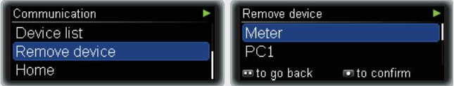
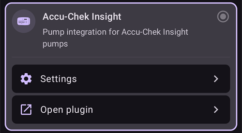
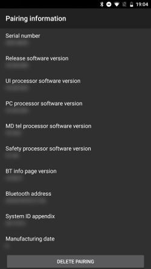

# Accu-Chek Insight

**Aceasta aplicatie face parte dintr-o soluție de pancreas artificial DIY (Do-it-Yourself), realizata personal) care nu este un produs finit, ceea ce inseamna ca va trebui ca TU sa citesti, să studiezi si să înțelegi sistemul, inclusiv cum să îl folosesti. Nu este ceva creat pentru a gestiona in totalitate tratamentul diabetul, dar permite îmbunătățirea calitatii vieții cu diabet, dacă acordati timpul necesar. Nu vă grăbiți, ci acordați-vă timp să învățați. Doar tu esti responsabil de utilizarea acestui sistem.**

```{admonition} Accu-Chek Insight is being phased out :class: note

Roche is withdrawing from the insulin pump market to refocus its diabetes portfolio on the Accu-Chek SmartGuide CGM. It has communicated the end of sales of both the Accu-Chek Combo and Accu-Chek Insight pumps; its remaining Accu-Chek Solo micropump is also being wound down (last deliveries in Germany at the end of 2025). The change is being rolled out by region, starting in Germany, with other European markets expected to follow. Support for the Insight is already listed as ended (see [Pumps no longer sold](./Future-possible-Pump-Drivers.md)). If you rely on this pump, plan ahead for a transition to a supported pump.

    <br />```{note}
    Before **AAPS** had a native Insight driver, the Insight was controlled through the separate [SightRemote](https://github.com/TebbeUbben/SightRemote) app. SightRemote is no longer needed or maintained: if you still have it installed from those days, uninstall it and use a current version of **AAPS** instead.
    

```{contents} Cuprins :depth: 1 :local: true

    <br />## Pump capabilities with AAPS
    
    * Communicates with **AAPS** over your phone's native Bluetooth, without an additional communication device.
    * Gestionare automată a orei de vară și a fusului orar.
    
    ## Hardware and software requirements
    
    * A Roche Accu-Chek Insight pump (any firmware, they all work)
    
    Note: AAPS will write data always in **first basal rate profile in the pump**.
    
    * Un telefon Android cu Android 12 sau mai nou (vedeți [Telefoane](../Getting-Started/Phones.md))
    * Aplicația AAPS instalată pe telefon
    
    ## Configurare
    
    * Pompa Insight trebuie conectată la un singur dispozitiv în același timp. If you have previously used the Insight remote control (meter), you must remove the meter from the paired devices list of your pump: **Menu** > **Settings** > **Communication** > **Remove device**.
    
       
    
    * In [Configuration > Pump](#Config-Builder-pump), select the **Accu-Chek Insight** card. Only one pump can be active at a time.
    
       
    
       Once it is selected, the **Accu-Chek Insight** card shows two buttons, **Settings** and **Open plugin**:
    
       
    
       **Settings** opens the settings of the Accu-Chek Insight driver (see [Settings in AAPS](#Accu-Chek-Insight-Pump-settings-in-aaps)).
    
       **Deschideți modulul** (sau **Gestionați → Pompă**) deschide ecranul pompei Accu-Chek Insight. Before a pump is paired it looks like this:
    
       
    
    (accu-chek-insight-pairing)=
    ### Pairing
    
    * On the pump screen, tap **Insight pairing**. The pairing wizard opens and searches for nearby Bluetooth devices (top of the picture below).
    * Pe pompa Insight, mergeți la **Menu** > **Settings** > **Communication** > **Add Device**. The pump shows the following screen (bottom of the picture below) with the serial number of the pump.
    
       
    
    * Back on your phone, tap the pump serial number in the list of Bluetooth devices. Dacă Android vă cere să confirmați asocierea, apăsați **Asociați**.
    
       
    
    * The pump and the phone both show a code. Check that the codes are the same on both devices. Confirmați pe pompă și apăsați **Da** pe telefon. (Tap **No** if the codes do not match.)
    
       
    
    * The phone shows **Pairing completed**. Tap **Exit** to return to the pump screen.
    
       
    
    * To check that all is well, look at the pump screen (**Manage → Pump**). Once the pump is paired, it shows information about the pump, such as **Serial number**, **Manufacturing date**, **Release software version** and **Bluetooth address**.
    
       
    
       ```{admonition} Older screenshot
       :class: note
       Apart from the top of the first picture, the pairing screenshots above are from an earlier **AAPS** version and may look different in **AAPS** 4.
       ```
    
    * To remove the pairing, tap **Unpair** on the pump screen and confirm **Reset pairing information?**. The **Insight pairing** button then appears again.
    
    Note: There is no permanent connection between the pump and the phone. **AAPS** only connects when needed (for example to set a temporary basal rate, give a bolus or read the pump history). Otherwise the batteries of the phone and the pump would drain far too fast.
    
    (Accu-Chek-Insight-Pump-settings-in-aaps)=
    ## Settings in AAPS
    
    Open the settings with **Settings** on the **Accu-Chek Insight** card in **Configuration** > **Pump**, or with the gear icon in the top-right corner of the pump screen.
    
    
    
    În setările Insight din **AAPS** puteți activa următoarele opțiuni:
    
    * **Înregistrați schimbările de rezervor**: înregistrează automat o schimbare a cartușului de insulină când schimbați cartușul în pompă.
    
    * **Log tube changes**: adds a note to the **AAPS** database when you run the "tube filling" program on the pump.
    
    * **Log site changes**: adds a note to the **AAPS** database when you run the "cannula filling" program on the pump. **Note: A site change also resets Autosens.**
    
    * **Log battery changes**: records a battery change when you put a new battery in the pump.
    
    * **Înregistrați schimbările modului de operare**: adaugă o notă în baza de date **AAPS** de fiecare dată când porniți, opriți sau puneți pompa în pauză.
    
    * **Log alerts**: adds a note to the **AAPS** database whenever the pump issues an alert (except reminders, bolus and TBR cancellation, which are not recorded).
    
    * **Enable TBR emulation**: the Insight pump can only set temporary basal rates (TBRs) up to 250%. To get around this limit, TBR emulation tells the pump to deliver an extended bolus for the extra insulin if a TBR of more than 250% is requested.
    
      **Note: Only use one extended bolus at a time. Several extended boluses at the same time might cause errors.**
    
    * **Disable vibrations on manual bolus delivery**: stops the Insight pump from vibrating when it delivers a manual bolus (or extended bolus). Only available with Insight firmware 3.x.
    
    * **Disable vibrations on automated bolus delivery**: stops the Insight pump from vibrating when it delivers an automatic bolus (SMB or temp basal with TBR emulation). Only available with Insight firmware 3.x.
    
    * **Min. recovery duration [s]** and **Max. recovery duration [s]**: how long **AAPS** waits before trying again after a failed connection attempt. Poți alege de la 0 la 20 de secunde. Dacă aveți probleme de conexiune, alegeți un timp de așteptare mai lung.
        <br><br>Example for min. de restabilire = 5 și timpul max. recovery duration = 20
        <br><br>no connection -> wait <b>5</b> sec.
          <br>  retry -> no connection -> wait <b>6</b> sec.
          <br>  retry -> no connection -> wait <b>7</b> sec.
          <br>  retry -> no connection -> wait <b>8</b> sec.
          <br>...
          <br>retry -> no connection -> wait <b>20</b> sec.
          <br>retry -> no connection -> wait <b>20</b> sec.
          <br>...
    
    * **Disconnect delay [s]**: how long (in seconds) **AAPS** waits before disconnecting from the pump after an operation is finished. Puteți alege între 0 și 15 secunde. Valoarea implicită este de 5 secunde.
    
    Pentru perioadele în care pompa a fost oprită, **AAPS** înregistrează o rată bazală temporară de 0%.
    
    ### The pump screen
    
    The Accu-Chek Insight pump screen (**Manage → Pump**) shows the current status of the pump, for example **Status**, **Last connected**, **Operating mode**, **Battery**, **Reservoir level**, today's total daily doses (**TDD Bolus**, **TDD Basal**), basal rates and the last bolus. Once the pump is paired, it has these buttons:
    
    * **Refresh**: refreshes the pump status.
    * **Enable notification of TBR end (pump setting)** / **Disable notification of TBR end (pump setting)**: a standard Insight pump sounds an alarm when a TBR finishes. This button turns that alarm on or off without the need for configuration software.
    * **Unpair**: removes the pairing with the pump (see [Pairing](#accu-chek-insight-pairing)).
    
    
    
    ```{admonition} Older screenshot
    :class: note
    The screenshot above is from an earlier **AAPS** version. În **AAPS** 4, ecranul pompei arată diferit și are și un buton **Dezasociați**.
    

## Setările pompei

Configurați alarmele în pompă după cum urmează:

* Menu > Settings > Device settings > Mode settings > Quiet > Signal > Sound
* Menu > Settings > Device settings > Mode settings > Quiet > Volume > 0 (remove all bars)
* Menu > Modes > Signal mode > Quiet

Aceasta va reduce la tăcere toate alarmele din pompă, permițând AAPS să decidă dacă o alarmă este relevantă pentru dumneavoastră. Dacă AAPS nu confirmă o alarmă, volumul acesteia va crește (mai întâi semnal sonor, apoi vibrații).

(Accu-Chek-Insight-Pump-vibration)=

### Vibrare

În funcție de versiunea de firmware a pompei dumneavoastră, Insight va vibra scurt de fiecare dată când un bolus este administrat (de exemplu, când AndroidAPS inițiază un SMB sau emularea prin TBR livrează un bolus extins).

* Firmware 1.x: Fără vibrații din proiectare.
* Firmware 2.x: Vibrațiile nu pot fi dezactivate.
* Firmware 3.x: AAPS livrează silențios bolusul.

Versiunea de firmware poate fi găsită în meniu.

## Înlocuire baterie

Durata de viață a bateriei pentru Insight în buclă este între 10 și 14 zile, cel mult 20 de zile. Utilizatorul care a raportat acest lucru utilizează baterii cu litiu de tip Energizer.

Pompa Insight are o baterie internă mică pentru a păstra funcțiile esențiale precum ceasul care rulează în timp ce se schimbă bateria detașabilă. Dacă schimbarea bateriei durează prea mult, această baterie internă se poate termina, ceasul se va reseta, și după introducerea unei baterii noi vi se va cere să completați din nou ora și data. Dacă se întâmplă acest lucru, toate intrările in AndroidAPS înainte de schimbarea bateriei nu vor mai fi incluse în calcule, deoarece timpul corect nu poate fi identificat corespunzător.

(Accu-Chek-Insight-Pump-insight-specific-errors)=

## Insight - erori specifice

### Bolus extins

Utilizați doar un bolus extins la un moment dat, deoarece mai multe bolusuri extinse în același timp ar putea cauza erori.

### Pauză

Uneori pompa Insight nu răspunde în timp ce **AAPS** stabilește conexiunea. **AAPS** then shows the notification "Timeout during handshake - reset bluetooth".


If this happens, turn off Bluetooth on the pump AND on the phone for about 10 seconds, then turn it back on.

## Traversarea fusurilor orare cu pompa Insight

Pentru informații despre călătoriile prin diverse fusuri orare, vedeți secțiunea [Călătorii de-a lungul fusurilor orare cu pompe](#timezone-traveling-insight).

## Unde să obțineți ajutor

Development of the Insight driver is done by the community on a **volunteer** basis. Înainte de a cere ajutor, vă rugăm:

1. **Read** the relevant section of this documentation to confirm how the feature is meant to work.
2. **Întrebați** pe canalul *#AAPS* de pe [Discord](https://discord.gg/4fQUWHZ4Mw) sau pe unul dintre celelalte [canale ale comunității](../GettingHelp/WhereCanIGetHelp.md).
3. **Report a bug** by searching the [existing issues](https://github.com/nightscout/AndroidAPS/issues); if yours is not listed, open a [new issue](https://github.com/nightscout/AndroidAPS/issues) and attach your [log files](../GettingHelp/AccessingLogFiles.md).

When asking for help, include your phone make and model, Android version, **AAPS** version, and a plain-English description of the problem (what changed, when it last worked).