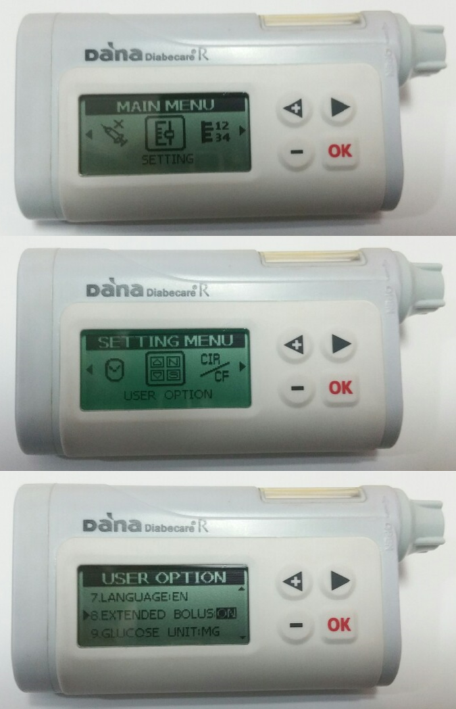

# DanaR

*Aceste instrucțiuni sunt destinate configurării aplicației și pompei pentru modelul de pompă DanaR. Vizitați [Pompa de insulină DanaRS](./DanaRS-Insulin-Pump.md) dacă aveți în schimb DanaRS lansat în 2017.*

## Capacități pompă cu AAPS

* Communicates with **AAPS** over your phone's native Bluetooth, without an additional communication device.
* Timezone and DST changes need no special action, as the pump does not use its own history.

## Instalare

* În pompă mergeți la Main Menu > Setting > User Option
* Porniți "8. Bolus extins"

* Mergeți la Main Menu > Setting > Discovery
* În setările telefonului mergeți la Bluetooth, scanați pentru găsirea de dispozitive bluetooth în apropiere, selectați numărul seriei pompei DanaR și introduceți parola (parola de împerechere este 0000). Dacă DanaR nu apare în lista de dispozitive bluetooth găsite la scanare, restartați telefonul și scoateți bateria din pompa DanaR, înlocuiți-o și apoi porniți pașii de instalare de la început.

* In **AAPS**, open the **menu** (☰) in the top-left corner, go to **Configuration** > **Pump** and select the type of DanaR you have (**DanaR**, **DanaR Korean** or **DanaRv2**).
  
  

* Open the pump screen: tap **Open plugin** on the DanaR card (or go to **Manage** > **Pump**).

* Tap **Pairing**. On the pairing screen: 
  * Enter your pump password under **Pump password** (default password is 1234).
  * Under **Select paired device**, tap your DanaR serial number. If the list is empty, tap **Open Bluetooth settings** and pair the pump with your phone first (see the step above). When you come back to **AAPS**, the pump appears in the list. If it does not, tap the refresh icon.
  * Tap **Pairing**. **AAPS** connects to the pump and checks the password.
* To change the driver settings, tap **Settings** on the DanaR card in **Configuration** > **Pump**: 
  * **Bolus speed** (DanaR and DanaRv2): change the default bolus speed (12 s/U, 30 s/U or 60 s/U).
  * **Use extended boluses for >200%** (DanaR and DanaR Korean): enable this if you want **AAPS** to allow a basal rate above 200%. Note this means you cannot loop with high TBRs while using extended boluses for food.
* Stabiliți pasul ratei bazale din pompă la 0.01 U/o
* Set bolus step on pump to 0.1 U. **AAPS** reads the bolus step from the pump and uses it for every bolus.
* Activați bolusurile extinse în pompă

## Traversarea fusurilor orare cu pompa Dana R

Pentru informații despre călătoriile de-a lungul fusurilor orare, consultați secțiunea [Călătorii de-a lungul fusurilor orare cu pompe](#timezone-traveling-danarv2-danars).

## Unde să obțineți ajutor

Development of the DanaR driver is done by the community on a **volunteer** basis. Before requesting help, please:

1. **Read** the relevant section of this documentation to confirm how the feature is meant to work.
2. **Ask** on the *#AAPS* channel on [Discord](https://discord.gg/4fQUWHZ4Mw), or in one of the other [community channels](../GettingHelp/WhereCanIGetHelp.md).
3. **Report a bug** by searching the [existing issues](https://github.com/nightscout/AndroidAPS/issues); if yours is not listed, open a [new issue](https://github.com/nightscout/AndroidAPS/issues) and attach your [log files](../GettingHelp/AccessingLogFiles.md).

When asking for help, include your phone make and model, Android version, **AAPS** version, and a plain-English description of the problem (what changed, when it last worked).