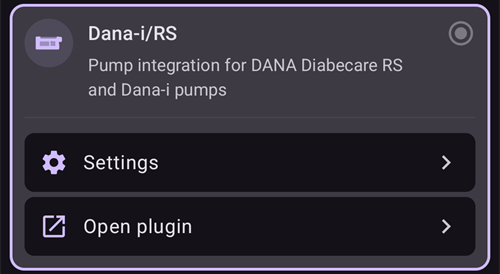
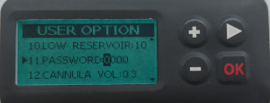

# DanaRS, Dana-i and Dana-i2

*These instructions are for configuring the app and your pump if you have a DanaRS from 2017 onwards, a Dana-i or a Dana-i2. Vizitați <0>Pompa de insulină DanaR</0> dacă aveți în schimb DanaR original.*

**Dana-i2 can be used from AAPS version 4.0 onwards.** It uses the same **Dana-i/RS** driver as the Dana-i.

* In DanaRS/i/i2 pump "BASAL A" is used by the app. Existing data gets overwritten.

    {contents} Table of contents
    :depth: 1
    :local: true

## Capacități pompă cu AAPS

* Communicates with **AAPS** over your phone's native Bluetooth, without an additional communication device.
* DST and timezone changes must be handled manually (see [Timezone traveling](#timezone-traveling-danarv2-danars)).

(DanaRS-Insulin-Pump-pairing-pump)=

## Asociere pompă

* Open the **menu** (☰) in the top-left corner of the **AAPS** main screen and select **Configuration**.
* Tap **Pump** and select **Dana-i/RS**.
    
    
    
    Once it is selected, the **Dana-i/RS** card shows two buttons, **Settings** and **Open plugin**:
    
    
    
    **Settings** opens the settings of the Dana-i/RS driver:
    
    
    
    **Open plugin** (or **Manage** > **Pump**) opens the Dana-i/RS pump screen. Before a pump is paired it looks like this:
    
    

* On the pump screen, tap **Pairing**. **AAPS** scans for nearby pumps.

* Tap the entry for your pump in the list.
    
    

* **You have to confirm the pairing on the pump!** This works the same way as other Bluetooth pairings you may know (for example, smartphone and car audio).
    
    

* Urmăriți procesul de asociere în funcție de tipul și firmware-ul pompei dumneavoastră:
    
    * For DanaRS v1, **AAPS** asks for the **Pump password (v1 only)**. Enter your pump password (see [Default password](#DanaRS-Insulin-Pump-default-password)).
    * For DanaRS v3, **AAPS** asks you to press OK on the pump and type the 2 sequences of numbers and letters shown on the pump. Keep the pump display on by pressing the minus button until you have finished. Then tap **Done**.
    * For Dana-i and Dana-i2, the standard Android pairing dialog appears. Enter the 6-digit number shown on the pump.

* When **Pairing successful!** is shown, tap **Done**.
    
    
    
    You are back on the pump screen, which now shows your pump's status.
    
    

* In **Settings**, select **Bolus speed** to change the default bolus speed (12 s/U, 30 s/U or 60 s/U).

* Stabiliți pasul bazalei în pompă la 0,01 U/h prin intermediul meniului de doctor (vedeți manualul de utilizare al pompei).
* Set bolus step on pump to 0.05 U using Doctors menu (see pump user guide). **AAPS** reads the basal and bolus steps from the pump and uses them for every bolus, so a bolus always matches the step set on the pump. The pump screen shows them in the **Basal/Bolus step** row.
* Activați bolusurile extinse în pompă

### Options shown only for some models

* **Auto lock**: on a Dana-i2, the **User options** screen (on the pump screen, **Manage** > **Pump**) has an **Auto lock** switch for the pump's auto lock setting. Press **Save options to pump** after changing it.
* **Easy mode**: on pump models that have an easy menu mode, the pump screen shows an **Easy mode** row with **On** or **Off**.
* If a Dana-i2 refuses a bolus, **AAPS** shows the reason, for example *Pump is not primed*, *Not enough insulin in the reservoir* or *Easy sleep mode is on in the pump*.

(DanaRS-Insulin-Pump-default-password)=

### Parola implicită

* Pentru DanaRS cu firmware v1 și v2 parola implicită este 1234.
* Pentru DanaRS cu firmware v3 sau Dana-i parola implicită este derivată din data de fabricație și se calculează ca LLZZ unde LL este luna și ZZ este ziua, pompa a fost produsă (ex "0124" reprezentând luna 01 și ziua 24).
    
    * Din MENU PRINCIPAL selectați REVIZUIRE și deschideți INFORMAȚII DE LIVRARE din sub-meniu
    * Numărul 3 este data producției. 
    * Pentru v3/i, această parolă este folosită numai pentru blocarea meniului în pompă. Nu este folosit pentru comunicare și nu este necesar să intrați în AAPS.

(DanaRS-Insulin-Pump-change-password-on-pump)=

## Schimbă parola pe pompă

* Apăsați butonul OK pe pompă
* În meniul principal selectați "OPȚIUNE" (mută spre dreapta prin apăsarea butonului săgeată de mai multe ori)
    
    

* În meniul de opțiuni selectați "OPȚIUNE UTILIZATOR"
    
    

* Folosiți butonul săgeată pentru a derula în jos la "11. parolă"
    
    

* Apăsați OK pentru a introduce parola veche.

* Introduceți **parola veche** (Parolă implicită vedeți [mai sus](#DanaRS-Insulin-Pump-default-password)) și apăsați OK
    
    

* Dacă este introdusă o parolă greșită aici nu va exista nici un mesaj care să indice greșeala!

* Setează **noua parolă** (Schimbă numerele cu + & - butoane / Mută la dreapta cu butonul săgeată).
    
    

* Confirmați cu butonul OK.

* Apăsați OK pentru a salva setările.
    
    

* Deplasați în jos la "14. IEȘIRE" și apăsați butonul OK.
    
    

(DanaRS-Insulin-Pump-dana-rs-specific-errors)=

## Erori specifice Dana RS

### Eroare în timpul administrării insulinei

În cazul în care conexiunea dintre AAPS și Dana RS este pierdută în timpul administrării insulinei prin bolus (de exemplu, vă îndepărtați de telefon în timp ce Dana RS pompează insulina) vei vedea următorul mesaj și vei auzi un sunet de alarmă.

* În cele mai multe cazuri, aceasta este doar o problemă de comunicare, iar cantitatea corectă de insulină este administrată.
* Check in the pump history that the correct bolus was given. You can do this on the pump itself, or in **AAPS** on the pump screen (**Manage** > **Pump**) > **Pump history** > **Boluses**.
* Delete the error entry in [treatments](#screens-bolus-carbs) if you wish.
* The real amount is read and recorded at the next connection. To force this, tap **Refresh** on the pump screen, or just wait for the next connection.

## Notă specială atunci când se schimbă telefonul

Când treceți la un telefon nou, sunt necesari următorii pași:

* [Exportați setările](../Maintenance/ExportImportSettings.md) pe telefonul tău vechi
* Transferați setările de pe un telefon vechi pe unul nou

### DanaRS v1

* **Asociați manual** Dana RS cu noul telefon
* If you tick **Also replace pump settings** when importing, the pump connection settings are imported too and AAPS on your new phone will already "know" the pump and therefore not start a Bluetooth scan. Prin urmare, telefonul nou și pompa trebuie asociate manual.
* Instalați AAPS pe noul telefon.
* [Importați setările](../Maintenance/ExportImportSettings.md) pe telefonul dumneavoastră nou

### DanaRS v3, Dana-i, Dana-i2

* Începeți procedura de asociere așa cum este descrisă [mai sus](#DanaRS-Insulin-Pump-pairing-pump).
* Sometimes you may need to clear the pairing information in **AAPS** first. On the pump screen (**Manage** > **Pump**), tap **Unpair** and confirm **Reset pairing information?**. Then tap **Pairing** again.

## Timezone traveling with DanaRS, Dana-i and Dana-i2 pumps

Pentru informații despre călătoriile de-a lungul fusurilor orare, consultați secțiunea [Călătorii de-a lungul fusurilor orare cu pompe](#timezone-traveling-danarv2-danars).

## Unde să obțineți ajutor

Development of the DanaRS/Dana-i/Dana-i2 driver is done by the community on a **volunteer** basis. Before requesting help, please:

1. **Read** the relevant section of this documentation to confirm how the feature is meant to work.
2. **Ask** on the *#AAPS* channel on [Discord](https://discord.gg/4fQUWHZ4Mw), or in one of the other [community channels](../GettingHelp/WhereCanIGetHelp.md).
3. **Report a bug** by searching the [existing issues](https://github.com/nightscout/AndroidAPS/issues); if yours is not listed, open a [new issue](https://github.com/nightscout/AndroidAPS/issues) and attach your [log files](../GettingHelp/AccessingLogFiles.md).

When asking for help, include your phone make and model, Android version, **AAPS** version, and a plain-English description of the problem (what changed, when it last worked).