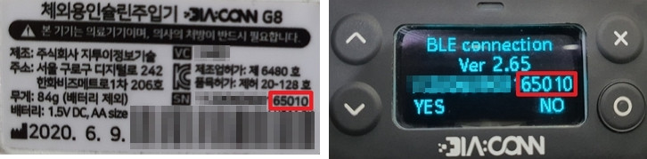
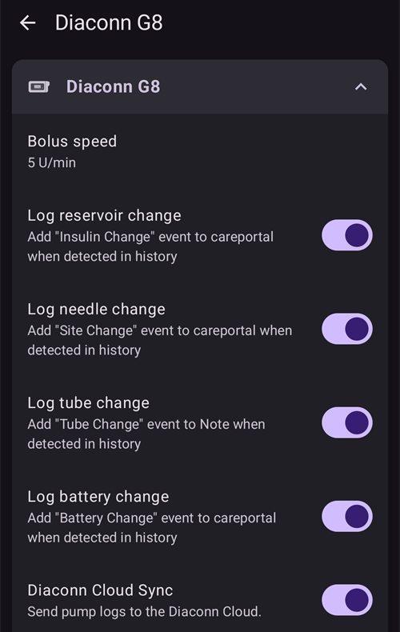

# Diaconn G8

```{contents} Table of contents
:depth: 1
:local: true
```

## Capacități pompă cu AAPS

* Communicates with **AAPS** over your phone's native Bluetooth, without an additional communication device.
* DST and timezone changes must be handled manually.

## Cuplarea pompei de insulină prin Bluetooth

- Apăsați **meniul** (☰) din colțul din stânga sus.


- Apăsați **Configurație** > **Pompă** și selectați **Diaconn G8**.


Once it is selected, the **Diaconn G8** card shows two buttons, **Settings** and **Open plugin**:


**Settings** opens the settings of the Diaconn G8 driver (see [Diaconn G8 insulin pump option setting](#diaconn-g8-insulin-pump-option-setting) below).

**Deschideți modulul** (sau **Gestionați** > **Pompă**) deschide ecranul pompei Diaconn G8. Before a pump is paired it looks like this:


```{admonition} Older screenshot
:class: note
The screenshot above is from an earlier **AAPS** version. In **AAPS** 4 pairing starts from the **Pair** button on the pump screen; there is no **Selected pump** setting.
```

- Pe ecranul pompei, apăsați **Asociați**. The **Diaconn Pump Pairing** screen opens and **AAPS** scans for nearby pumps.
- Tap your insulin pump's model number once it appears in the list (for example **DIACONN-65010**).


- Există două opțiuni pentru a verifica numărul modelului:

1. Ultimele 5 cifre ale numărului SN de pe spatele pompei.
2. Apăsați pe butonul O > Informații > BLE > Ultimele 5 cifre.



- După ce selectați pompa, apare o fereastră care cere un cod PIN. Introduceți numărul PIN afișat pe pompă pentru a finaliza conexiunea.

 

- When **Pairing successful!** is shown, tap **OK** to go back to the pump screen.

## Verificarea stării pompei și sincronizarea jurnalelor

- După ce pompa este conectată, deschideți ecranul pompei (**Gestionați** > **Pompă**). It shows the pump status (battery, reservoir, last connection, last bolus, basal rate and more).
- Apăsați **Actualizați** pentru a vă conecta la pompă, a actualiza starea și a sincroniza jurnalele.
- Apăsați **Istoric pompă** pentru a vedea istoricul citit din pompă.


```{admonition} Older screenshot
:class: note
The screenshot above is from an earlier **AAPS** version. In **AAPS** 4 the pump status is shown on the pump screen (**Manage** > **Pump**) and synchronized with the **Refresh** button.
```

(diaconn-g8-bluetooth-troubleshooting)=

## Depanare Bluetooth

**Ce trebuie să faceți în cazul unei conexiuni Bluetooth instabile cu pompa.**

### Metoda 1) Reporniți AAPS, apoi verificați din nou pompa

- Apăsați **meniul** (☰) din colțul din stânga sus.
- Apăsați **Ieșiți** în partea de jos a meniului.


- Porniți din nou **AAPS** și verificați conexiunea cu pompa.

### Metoda 2) Dacă prima metodă nu funcționează, deconectați Bluetooth-ul și apoi reconectați-l.

- Apăsați și mențineți apăsat butonul Bluetooth din partea de sus timp de aproximativ 3 secunde.


- Apăsați pe butonul de setare al pompei de insulină Diaconn G8 asociate.


- Dezasociați.


- În **AAPS**, deschideți ecranul pompei (**Gestionați** > **Pompă**), apăsați **Dezasociați** și confirmați **Resetați informațiile de asociere?**.
- Repetați procesul de asociere cu Bluetooth pentru pompă (vedeți mai sus).

## Informații suplimentare

(diaconn-g8-insulin-pump-option-setting)=

### Setări pompă de insulină Diaconn G8

- **Configurație** > **Pompă** > **Diaconn G8** > **Setări**
- Or, on the pump screen (**Manage** > **Pump**), tap the settings icon (cog wheel) in the top-right corner.



- **Bolus speed** sets how fast the pump delivers a bolus.
- If the **Log reservoir change** option is activated, the relevant details are automatically uploaded to the careportal when an "Insulin Change" event occurs.
- If the **Log needle change** option is activated, the relevant details are automatically uploaded to the careportal when a "Site Change" event occurs.
- If the **Log tube change** option is activated, the relevant details are automatically added as a note when a "Tube Change" event occurs.
- If the **Log battery change** option is activated, the relevant details are automatically uploaded to the careportal when a "Battery Change" event occurs. You can also record a battery change yourself with **Manage** > **Pump Battery Change**. (Notă: Pentru a schimba bateria, vă rugăm să opriți toate funcțiile în curs ce implică injectar înainte de a continua)
- **Diaconn Cloud Sync** sends the pump logs to the Diaconn Cloud.


```{admonition} Older screenshot
:class: note
The screenshot above is from an earlier **AAPS** version. In **AAPS** 4 a battery change is recorded with **Manage** > **Pump Battery Change**; there is no **Actions** tab.
```

### Funcția de bolus extins

- Dacă utilizați bolusul extins, acesta va dezactiva bucla închisă.
- Vedeți [această pagină](#extended-bolus-and-why-they-wont-work-in-closed-loop-environment) pentru detalii de ce bolusul extins nu funcționează într-un scenariu de buclă închisă.

## Unde să obțineți ajutor

Driverul Diaconn G8 este dezvoltat de comunitate, pe bază de **voluntariat**. Înainte de a cere ajutor, vă rugăm:

1. **Read** the relevant section of this documentation to confirm how the feature is meant to work.
2. **Întrebați** pe canalul *#AAPS* de pe [Discord](https://discord.gg/4fQUWHZ4Mw) sau pe unul dintre celelalte [canale ale comunității](../GettingHelp/WhereCanIGetHelp.md).
3. **Report a bug** by searching the [existing issues](https://github.com/nightscout/AndroidAPS/issues); if yours is not listed, open a [new issue](https://github.com/nightscout/AndroidAPS/issues) and attach your [log files](../GettingHelp/AccessingLogFiles.md).

When asking for help, include your phone make and model, Android version, **AAPS** version, and a plain-English description of the problem (what changed, when it last worked).
