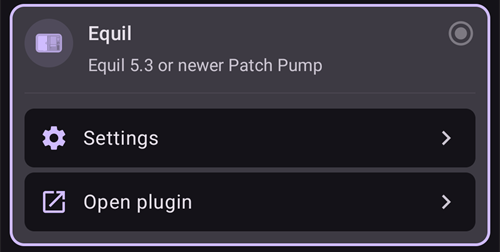

# Equil

Aceste instrucțiuni sunt pentru configurarea pompei de insulină Equil.

```{contents} Table of contents
:depth: 1
:local: true
```

## Capacități pompă cu AAPS

* Tubeless patch pump that communicates with **AAPS** over your phone's native Bluetooth, without an additional communication device.
* **AAPS** treats the Equil as a patch pump with a 200 U reservoir: the main screen shows the patch pump status lights, and **Prime/Fill** and **Pump battery change** are not offered. Umplerea, amorsarea și schimbarea bateriei se fac în asistenții pompei.
* While the pump is suspended or stopped, **AAPS** records a 0 U/h temporary basal, so no basal insulin is counted in IOB.
* DST and timezone changes must be handled manually.

## Cerințe hardware și software
* **Echipament compatibil Equil**

  Currently Equil 5.3 and 5.4 are supported.

* **AAPS** built and installed using the [Build APK](../SettingUpAaps/BuildingAaps.md) instructions

## Instalare

### Selectați pompa Equil

Deschideți **meniul** (☰) din colțul din stânga sus, alegeți **[Configurație](#Config-Builder-pump)** și, la **Pompă**, selectați **Equil**.

Once it is selected, the **Equil** card shows two buttons, **Settings** and **Open plugin**:



**Deschideți modulul** (sau **Gestionați** → **Pompă**) deschide ecranul pompei Equil. Before a pump is paired it looks like this:


### Setări

Open the Equil settings with **Settings** on the **Equil** card, or with the gear icon in the top-right corner of the pump screen.


* **Alarmă baterie descărcată**: vă avertizează când bateria pompei este descărcată.
* **Low drug storage alarm**: warns you when the insulin in the reservoir is low.
* **Alert tone**: how the pump alerts you: **Mute**, **Vibrate only**, **Tone only** or **Vibrate and tone**.
* **Viteză bolus**: cât de repede este administrat un bolus: **1,5 U/min (standard)**, **3 U/min**, **6 U/min** sau **12 U/min**. Un bolus mai rapid poate provoca mai multe alarme de ocluzie.


```{admonition} Max basal and max bolus on the patch
:class: note
The patch itself refuses any basal rate above a maximum that **AAPS** programs into it. **AAPS** takes the higher of your **max basal** [setting](../SettingUpAaps/Preferences.md) and the highest hourly basal rate in your **Profile**, so the patch always accepts your profile and the temp basals the loop asks for. **AAPS** also sends your maximum allowed bolus to the patch.

When you change your **max basal** or **max bolus**, **AAPS** sends the new values to the patch automatically. They are also sent with every profile switch. There is nothing to set on the patch itself.
```

### Asocierea pompei

On the pump screen, press **Pair**. Un asistent vă ghidează prin fiecare pas. The row of dots at the top shows how far along you are.

If Android asks whether **AAPS** may find and connect to nearby devices, press **Allow**. **AAPS** needs this to find the pump.


The wizard has these steps. Press **Next** to move on, or **Cancel** to leave the wizard.

1. **Profile required**: only shown if you have never activated a **Profile** in **AAPS**. Select the profile to use and press **Activate profile**.
1. **Asamblați pompa**: asamblați pompa, rezervorul umplut și bateria încărcată.

   

1. **Găsiți pompa**: **AAPS** caută pompele Equil din apropiere. Selectați pompa dumneavoastră din listă.

   
1. **Pair device**: you can enter a pairing password in **Set pair password**. Trebuie să aibă 4 caractere, alese din `ABCDEF0123456789`. Press **Pair**.

   

1. **Select Insulin**: only shown if you have more than one insulin set up. Selectați insulina din rezervor.
1. **Amorsare / Umplere**: pompa **nu** trebuie să fie pe placa de bază. Apăsați **Amorsare/Umplere** și amorsați rezervorul până când apare o picătură de insulină pe vârful acului. Apăsați **Următor**.

   
1. **Site Rotation**: only shown if **Manage pump site rotation** is turned on in the site rotation settings. Tap where you will attach the pump, or press **Skip**.
1. **Attach pump**: attach the pump to its base plate.

   
1. **Prime cannula**: once the pump is on the base plate, press **Purge air** to remove air from the cannula. Apăsați **Următor**.

   

1. **Confirm**: put the pump on your body and press **Finish**.

   

```{warning}
Dacă setați propria parolă de asociere (recomandat pentru siguranța dumneavoastră), păstrați-o într-un loc sigur. Parola este salvată în pompă. Pompa o cere la fiecare asociere nouă, până când o dezasociați corect în **AAPS**. Until then, the pump also cannot be used with the original handheld controller (PDA).
```

### Ecranul pompei după asociere

Once the pump is paired, the pump screen shows these buttons:

* **Actualizați**: citește acum starea și istoricul pompei.
* **Suspend** / **Resume delivery**: stop or restart insulin delivery.
* **Change reservoir**: guides you through detaching the pump, fitting a new reservoir (and, if needed, a new battery), priming and attaching it again. The first step asks *Will you also put on a new infusion set (base plate and cannula)?*
  * **Da, set nou de infuzie**: alegeți locul, canula este amorsată, iar **AAPS** înregistrează o schimbare de insulină și o schimbare de canulă.
  * **Nu, doar rezervor sau baterie**: canula nu este amorsată, iar **AAPS** înregistrează doar o schimbare de insulină.

  After a reservoir change the battery level shows **-** until **AAPS** reads it again from the pump.

  

* **History**: shows the events recorded by the pump.
* **Unpair device**: guides you through detaching the pump and unpairing it from **AAPS**. This stops insulin delivery, moves the pump plunger back to the bottom, and deletes the pairing.

### Alarme

* The low insulin alarm sounds once at each level (10 U, 5 U and 2 U) and when the reservoir is empty. The low battery alarm sounds once at 10% and once at 5%. Each level alarms only once until the next reservoir change.
* Alarmele și opririle pompei sunt înregistrate și ca anunțuri în tratamente, la ora la care le-a înregistrat pompa, astfel încât să puteți vedea mai târziu când și de ce s-a oprit pompa.
* If the reservoir runs empty during a bolus, **AAPS** records only the insulin given until then and tells you both amounts.

## Unde să obțineți ajutor

Development of the Equil driver is done by the community on a **volunteer** basis. Înainte de a cere ajutor, vă rugăm:

1. **Read** the relevant section of this documentation to confirm how the feature is meant to work.
2. **Întrebați** pe canalul *#AAPS* de pe [Discord](https://discord.gg/4fQUWHZ4Mw) sau pe unul dintre celelalte [canale ale comunității](../GettingHelp/WhereCanIGetHelp.md).
3. **Report a bug** by searching the [existing issues](https://github.com/nightscout/AndroidAPS/issues); if yours is not listed, open a [new issue](https://github.com/nightscout/AndroidAPS/issues) and attach your [log files](../GettingHelp/AccessingLogFiles.md).

When asking for help, include your phone make and model, Android version, **AAPS** version, and a plain-English description of the problem (what changed, when it last worked).
