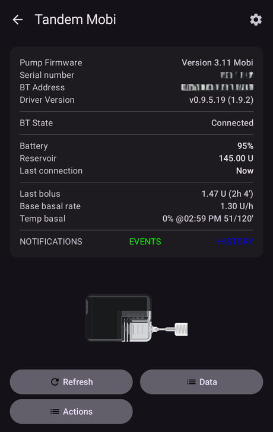

# Controlere de pompe (posibile) viitoare

Aceasta este o listă cu unele pompe de pe piață, stadiul suportului lor în alte sisteme de buclă și stadiul lor în AAPS. La final găsiți câteva informații despre ce îi trebuie unei pompe pentru a fi „compatibilă cu bucla”.

    {contents} Cuprins
    :depth: 1
    :local: true

## Pompe în faza de integrare în AAPS

**Coming soon:** drivers for these pumps are in development and already running in test builds.

Omnipod 5 ([Pagina de pornire](https://www.omnipod.com/))

Tandem: t:Mobi ([Pagina de pornire](https://www.tandemdiabetes.com/))

## Pompe care pot fi folosite în buclă

### Kaleido ([Pagina de pornire](https://www.hellokaleido.com/))

**Stare buclă:** Pompa este un candidat la buclă, dar protocolul este necunoscut în acest moment. Producătorul nu are niciun interes pentru sursa deschisă.

**Cerință hardware pentru AAPS:** Nici una. Se pare că are Bluetooth.

### Tandem: t:slim X3 ([Pagina de pornire](https://www.tandemdiabetes.com/about-us/pipeline))

**Loop status:** Possible future Loop candidate. The hope is that t:slim X3 will allow full control from a phone, which would enable AAPS support, but the timeline and features are still unknown.

**Cerință hardware pentru AAPS:** Nici una. Se așteaptă să aibă Bluetooth.

**Comments:** Not yet released. t:slim X3 appears to be repeatedly deprioritized on Tandem's roadmap in favour of t:Mobi (including a tubeless version) and Sigi (their patch pump).

### Twiist ([Pagina de pornire](https://www.twiist.com/))

**Loop status:** Loop candidate.

**Cerință hardware pentru AAPS:** Nici una. Are Bluetooth.

### Pompă de insulină Willcare ([Pagina de pornire](http://shinmyungmedi.com/en/))

**Loop status:** At the moment it is not a Loop candidate, but their staff contacted us and they are interested in making the pump loopable (it seems to be missing only the get/set profile commands).

**Cerință hardware pentru AAPS:** Nici una. Se pare că are Bluetooth.

**Comentarii:** Deoarece firma este interesată de integrarea cu AAPS, ar putea face implementarea chiar ei.

### Ypsopump ([Pagina de pornire](https://www.ypsomed.com/))

**Loop status:** Loop candidate. The pump's Bluetooth protocol has been reverse-engineered by the community, so communicating with it is possible in principle.

**Cerință hardware pentru AAPS:** Nici una. Are Bluetooth.

**Comments:** The Ypsopump protects its Bluetooth communication with heavy third-party encryption. Working with it is technically demanding, which makes building and maintaining a reliable driver hard. There is no production-ready AAPS driver yet.

## Pompe care nu se mai vând (companii care nu mai funcționează)

### Animas Vibe

### Animas Ping

### Cellnovo

### Accu-Chek Insight

**Comentarii:** Sfârșitul suportului martie 2025.

## Pompe cu care nu se poate face buclă

### Bluetooth Medtronic

**Comentarii:** Medtronic [s-a retras](https://www.tidepool.org/blog/tidepool-loop-partner-update-ace-pumps).

### Tandem: t:slim X2 ([Pagina de pornire](https://www.tandemdiabetes.com/))

**Comentarii:** Protocolul Bluetooth Tandem a fost descifrat prin inginerie inversă, dar pe t:slim X2 se pot administra doar bolusuri — administrarea bazalei nu poate fi controlată — deci nu poate fi folosită în siguranță pentru buclă. This is unlikely to change unless Tandem allows full control of the X2 from a phone, which would more probably arrive with the t:slim X3 instead.

### Accu-Chek Solo

**Comentarii:** Niciun succes al comunității în comunicarea cu pompa Solo.

## Cerințe pentru pompele cu care se poate face Buclă

**Cerințe preliminare**

- Pompa trebuie să accepte un fel de control de la distanță. (BT, radio frecvență etc.)
- Protocolul este descifrat/documentat/șamd

**Cerință minimă**

- Setarea ratei bazale temporare
- Preia Starea
- Anulează Rata Bazală Temporară

**Pentru oref1(SMB) sau Bolus:**

- Setarea bolusului

**Bine de avut**

- Anulează Bolus
- Preia Profilul Bazalei (aproape obligatoriu)
- Setare Profil Bazală (bine de avut)
- Citirea istoricului 

**Altele (nu sunt necesare, dar bune de avut)**

- Setați bolus extins
- Anulează bolusul extins
- Citirea istoricului
- Citirea DZT (doza zilnică totală)

### Suport pentru alte pompe

Dacă aveți și alte pompe a căror starea doriți să o aflați, vă rugăm să ne contactați pe Discord.