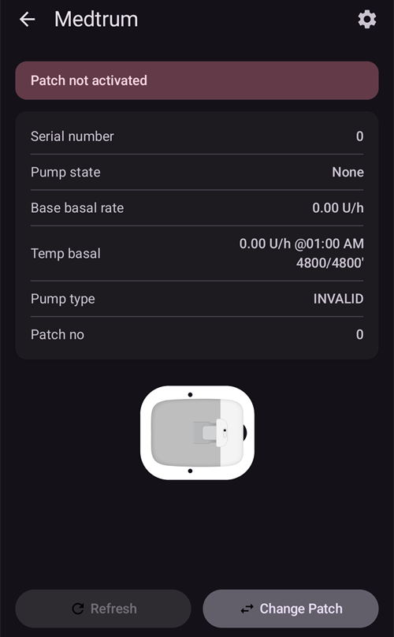
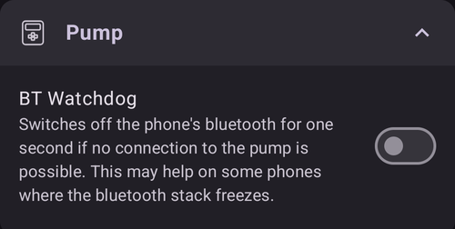
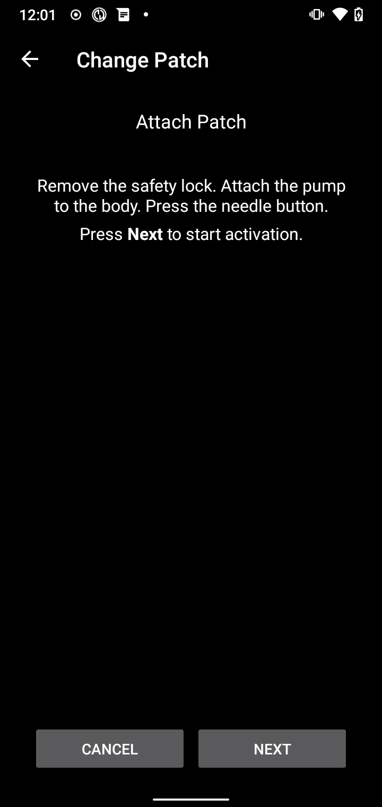
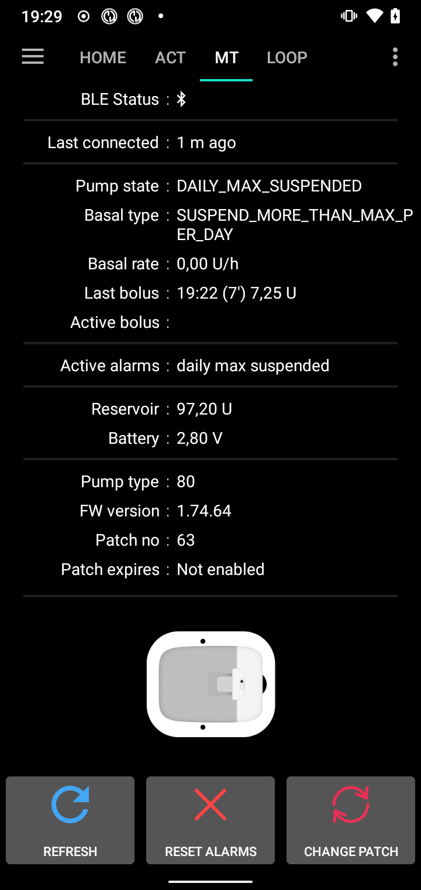

(medtrum-nano-300u)=
# Medtrum Nano 200U / 300U

Aceste instrucțiuni sunt pentru configurarea pompei de insulină Medtrum.

```{contents} Table of contents
:depth: 1
:local: true
```

## Capacități pompă cu AAPS
* Toată funcționalitatea buclei suportată (SMB, RBT șamd)
* Gestionare automată a orei de vară și a fusului orar
* Bolusul extins nu este acceptat de driverul AAPS

## Cerințe hardware și software
* **Baze de pompă Medtrum compatibile și plasturi cu rezervor**
    - Acceptat în prezent:
        - Medtrum TouchCare Nano 200U with pumpbase refs: **MD0201** and **MD8201**.
        - Medtrum TouchCare 300U cu baza pompei ref.: **MD8301**.
        - Dacă aveți un model neacceptat și sunteți dispuși să donați echipamente sau să asistați cu testarea, vă rugăm să ne contactați prin intermediul discord [aici](https://discordapp.com/channels/629952586895851530/1076120802476441641).
* **AAPS built and installed** using the [Build APK](../SettingUpAaps/BuildingAaps.md) instructions.
* **Telefon Android compatibil** cu o conexiune Bluetooth BLE
    - Vedeți [Notele de lansare](../Maintenance/ReleaseNotes.md) AAPS

## Înainte să începeți

**SIGURANȚA MAI ÎNTÂI** Nu încercați acest proces într-un mediu în care nu vă puteți recupera după o eroare (trebuie să aveți la îndemână plasturi suplimentari, insulină și dispozitive de control al pompei).

**Telecomanda de control și aplicația Medtrum nu vor funcționa cu un plasture care este activat de către AAPS.** Anterior, ați folosit probabil telecomanda sau aplicația Medtrum pentru a trimite comenzi către pompa dumneavoastră. Din motive de securitate, puteți folosi plasturele activat dar cu dispozitivul sau aplicația care au fost folosite pentru activare sa.

*Aceasta NU înseamnă că ar trebui să vă aruncați telecomanda. Este recomandat să fie păstrată undeva în siguranță ca rezervă în caz de urgență, de exemplu, dacă telefonul se pierde sau AAPS nu funcționează corect.*

**Pompa nu va opri administrarea insulinei atunci când nu este conectată la AAPS** Ratele bazale implicite sunt programate în pompă așa cum sunt definite în profilul activ în prezent. Atâta timp cât AAPS este operațional, va trimite comenzi pentru rate bazale temporare care rulează pentru un maximum de 120 de minute. Dacă dintr-un motiv sau altul pompa nu primește nicio comandă nouă (spre exemplu deoarece comunicarea a fost pierdută din distanței dintre pompă și telefonul), pompa va reveni la rata bazală implicită programată în pompă odată ce rata bazală temporară se încheie.

**The AAPS Profile does not support a 30 minute basal rate time frame** If you are new to AAPS and are setting up your basal rate profile for the first time, please be aware that basal rates starting on a half-hour basis are not supported, and you will need to adjust your basal rate profile to start on the hour. De exemplu, dacă aveți o rată bazală de 1,1 unități care începe la ora 09:30 și are o durată de 2 ore, cu terminare la ora 11:30, aceasta nu va funcționa. Va trebui să schimbați această rată bazală de 1,1 unități într-un interval de timp ca 9:00-11:00 sau 10:00-12:00. Chiar dacă pompa Medtrum în sine acceptă intervale de 30 de minute în profilul bazal, AAPS nu le poate lua în considerare în prezent în algoritmii săi.

**Ratele bazale de 0U/h din profil NU sunt acceptate în AAPS** Deși pompa Medtrum acceptă o rată bazală zero, AAPS folosește multipli ai ratei bazale din profil pentru a determina tratamentul automat și, prin urmare, nu poate funcționa cu o rată bazală zero. Rata bazală minimă din profil este 0,05 U/h.

O rată bazală temporară zero poate fi obținută prin funcția „Deconectați pompa” sau printr-o combinație de Dezactivare buclă/Rată bazală temporară sau Suspendare buclă/Rată bazală temporară.

## Instalare

```{caution}
Când activați un plasture cu **AAPS**, **TREBUIE** să opriți orice alt dispozitiv care poate comunica cu baza pompei Medtrum, de exemplu un PDM activ sau aplicația Medtrum.
```

### Pasul 1: Selectați pompa Medtrum

#### Opțiunea 1: Instalări noi

If you are installing **AAPS** for the first time, the **Setup Wizard** guides you through the setup. Selectați **Medtrum** când ajungeți la pasul **Pompă**.

If in doubt, you can also select **Virtual Pump** and select **Medtrum** later, after setting up **AAPS** (see option 2).


#### Option 2: The Configuration screen

On an existing installation you can select the **Medtrum** pump in [Configuration > Pump](#Config-Builder-pump):

Open the top-left **menu** (☰), tap **Configuration** > **Pump**, and select the **Medtrum** card. Only one pump can be active at a time.


După selectare, cardul **Medtrum** afișează două butoane, **Setări** și **Deschideți modulul**:


**Deschideți modulul** (sau **Gestionați → Pompă**) deschide ecranul pompei Medtrum. You use it to change patches and to see the pump status. Before a patch is activated it looks like this:



(medtrum-step-2)=
### Pasul 2: Modificați setările Medtrum

Tap **Settings** on the **Medtrum** card in **Configuration** > **Pump**. You can also tap the gear icon in the top-right corner of the Medtrum pump screen. This opens the **Medtrum pump settings**:


```{note}
There is no **Serial Number** setting any more. **AAPS** găsește baza pompei printr-o scanare Bluetooth prima dată când activați un plasture (vedeți [Pasul 3](#medtrum-activate-patch)) și îi reține numărul de serie. To use a different pump base, see [Unpair](#medtrum-unpair).
```

#### Setări alarmă

***Implicit: semnal sonor.***

This setting changes the way that the pump alerts you when there is a warning or error.

- **Beep**: the patch beeps on alarms and warnings.
- **Silențios**: plasturele nu vă alertează la alarme și avertizări.

Note: In silent mode **AAPS** still sounds the alarm, depending on your phone's volume settings. If you do not respond to the alarm, the patch eventually beeps.

#### Notificare la avertizarea pompei

***Implicit: Activat.***

Această setare schimbă modul în care **AAPS** afișează notificările pentru avertizările necritice ale pompei. When enabled, a notification is shown on the phone when a pump warning occurs, including:
- Baterie slabă
- Low reservoir (20 units)
- Plasturele expiră în curând

We recommend leaving this enabled when the pump alarms are set to **Silent**. În ambele cazuri, aceste avertizări sunt afișate și pe ecranul pompei Medtrum, la [Alarme active](#medtrum-active-alarms).

(medtrum-patch-expiration)=
#### Expirare plasture

***Implicit: Activat.***

Această setare schimbă comportamentul plasturelui. When enabled, the patch expires after 3 days and gives an audible warning if you have sound enabled. After 3 days and 8 hours the patch stops working.

If this setting is disabled, the patch does not warn you before it stops. Cu firmware-ul recent al bazei pompei, un plasture funcționează cel mult 5 zile.

#### Atenționare expirare pompă [ore]

***Implicit: 72 de ore.***

Această setare schimbă momentul avertizării de expirare. When [Patch Expiration](#medtrum-patch-expiration) is enabled, **AAPS** shows a notification this many hours after activation.

#### Insulină maximă pe oră [unități]

***Implicit: 25U.***

Această setare modifică cantitatea maximă de insulină care poate fi administrată într-o oră. If this limit is exceeded, the patch suspends and gives an alarm. Puteți reseta alarma cu butonul **Resetare alarme** de pe ecranul pompei, vedeți [Resetați alarmele](#nano-reset-alarms).

Stabiliți aceasta la o valoare rezonabilă pentru necesarul dumneavoastră de insulină.

#### Insulină maximă zilnică [unități]

***Implicit: 80U.***

Această setare schimbă cantitatea maximă de insulină care poate fi administrată într-o zi. If this limit is exceeded, the patch suspends and gives an alarm. Puteți reseta alarma cu butonul **Resetare alarme** de pe ecranul pompei, vedeți [Resetați alarmele](#nano-reset-alarms).

Stabiliți aceasta la o valoare rezonabilă pentru necesarul dumneavoastră de insulină.

#### Scanare la eroare de conexiune

***Implicit: oprit.***

Se găsește în **Setări avansate**.

Only enable this if you have connection problems. When enabled, the driver scans for the pump again before trying to reconnect to it. Make sure the Location permission for **AAPS** is set to "Allow all the time".

### Pasul 2b: Setările de alertă AAPS

Aceste setări nu fac parte din driverul Medtrum. Open them from the **Settings** (gear) icon in the top-right corner of the main screen. Vedeți [Setări](../SettingUpAaps/Preferences.md) pentru mai multe informații.

#### BT Watchdog

Deschideți **Setări** > **Pompă**:



**BT Watchdog** oprește Bluetooth-ul telefonului timp de o secundă dacă **AAPS** nu se poate conecta la pompă. This may help on some phones where Bluetooth freezes.

Enable this setting if you often have connection problems with your pump.

#### Alerte locale

Deschideți **Setări** > **Alerte locale**:


##### Alertă dacă pompa nu este accesibilă

***Implicit: Activat.***

This setting is forced on when the Medtrum driver is enabled. Vă alertează când pompa nu este accesibilă. This can happen when the pump is out of range, or when it is not responding because of a faulty patch or pump base, for example when water leaks between the pump base and the patch.

Din motive de siguranță, această setare nu poate fi dezactivată.

##### Prag pompă indisponibilă

***Implicit: 30 de minute.***

This setting changes how long **AAPS** waits before alerting you that the pump is unreachable.

You can change this setting when using the Medtrum pump, but we recommend keeping it at 30 minutes for safety reasons.

(medtrum-activate-patch)=
### Pasul 3: Activați plasturele

**Înainte să continuați:**
- Have your Medtrum pump base and a new reservoir patch ready.
- Opriți celelalte dispozitive care pot comunica cu pompa Medtrum (PDM și aplicația Medtrum).
- Ideally, make sure **AAPS** is set up and a [profile is activated](../DailyLifeWithAaps/ProfileSwitch-ProfilePercentage.md). If no profile is active, the activation starts with a **Profile required** step where you choose the profile to activate.

#### Start the activation

Open the [Medtrum pump screen](#nano-overview) (**Manage → Pump**) and tap **Change Patch**. If you have set up [settings protection](#Preferences-protection), you must enter your password or PIN first.

If a patch is already active, you are asked to deactivate it first, see [Deactivate patch](#nano-deactivate-patch).

Activarea este un asistent pas cu pas. Urmați instrucțiunile pentru a umple și a activa un nou plasture. Tap **Cancel** at any step to stop.

```{important}
Only put the patch on your body and insert the cannula when the wizard tells you to (after priming is complete).
```

Primii pași pe care îi vedeți depind de configurația dumneavoastră:

1. **Profil necesar**: doar dacă niciun profil nu este activ. Selectați profilul de aplicat, apoi continuați.
2. **Găsiți pompa**: doar prima dată sau după ce ați folosit [Dezasociați](#medtrum-unpair). Conectați baza pompei la un plasture nou pentru a o porni. **AAPS** scans for nearby Medtrum pump bases (their names start with `MT`). Tap yours in the list. **AAPS** salvează numărul ei de serie, apoi trece direct la umplerea plasturelui.

   

3. **Activate Patch**: only when **AAPS** already knows your pump base. The screen says "No active patch. Apăsați **Următor** pentru a începe procesul de activare.” Make sure the pump base is **not** connected to the patch yet, then tap **Next**.


#### Conectați și umpleți plasturele


Connect the pump base to the patch, remove the residual air and fill the patch with insulin. A minimum of 70 units is needed for activation. The screen shows the reservoir level. Nu atașați încă plasturele pe corp.

Când plasturele este detectat și umplut, apare butonul **Următor**. Tap it.

#### Selectați insulina

This step only appears if you have more than one insulin set up in **AAPS**. Selectați insulina cu care umpleți plasturele. **AAPS** applies a profile switch with this insulin after activation.

#### Amorsați plasturele


Do **not** remove the safety lock. Half-press the needle button on the patch, then tap **Next** to start priming.


Așteptați finalizarea amorsării.


When priming is complete, tap **Next** to continue.

#### Rotație loc

This step only appears if you manage pump sites with [Site Rotation](#Aapsscreens-site-rotation) (setting **Manage pump site rotation**). Choose where you place the patch on your body, or skip this step.

#### Atașați plasturele



Curățați pielea și îndepărtați autocolantele. Remove the safety lock, attach the patch to your body, and press the needle button to insert the cannula.

Tap **Next** to activate the patch.

#### Activați plasturele


**AAPS** activează pompa și setează rata bazală inițială. Vă rugăm să așteptați. Când activarea este finalizată, apare următorul ecran:


```{admonition} Older screenshot
:class: note
Apart from **Find Pump**, the activation screenshots above are from an earlier **AAPS** version and may look different in **AAPS** 4.
```

It shows how many units are left in the patch. Tap **OK** to return to the pump screen.

```{tip}
După o activare nouă, [exportați setările](../Maintenance/ExportImportSettings.md). This lets you recover this patch session later, for example on a new phone.
```

(nano-deactivate-patch)=

### Dezactivați plasturele

To deactivate the active patch, open the [Medtrum pump screen](#nano-overview) (**Manage → Pump**) and tap **Change Patch**.


Vi se cere să confirmați că doriți să dezactivați plasturele curent. **This cannot be undone.** Tap **Next** to deactivate, or **Cancel** to return to the pump screen.


If **AAPS** cannot deactivate the patch (for example because the pump base has already been removed from the patch), tap **Discard** to forget the current patch session. Apoi puteți activa un plasture nou.


When deactivation is complete, retract the needle and remove the patch from your body. Scoateți baza pompei și aruncați plasturele folosit. Tap **OK** to return to the pump screen, or **Next** to start activating a new patch.

(nano-resume-interrupted-activation)=

### Reluați activarea întreruptă

If a patch activation is interrupted, for example because the phone battery runs out, you can resume it. Open the [Medtrum pump screen](#nano-overview) (**Manage → Pump**) and tap **Change Patch**.


Tap **Next** to resume the activation. Tap **Discard** to reset the activation status, so you can activate a new patch.


```{admonition} Older screenshot
:class: note
The screenshots in **Deactivate patch** and **Resume interrupted activation** are from an earlier **AAPS** version and may look different in **AAPS** 4.
```

The driver reads the activation status from the pump. If this works, the wizard continues at the step where it stopped.

(nano-overview)=

## Ecranul pompei

Ecranul pompei Medtrum (**Gestionați → Pompă**) afișează starea curentă a plasturelui Medtrum. It also has buttons to change the patch, reset alarms and refresh the status. A banner at the top shows important states, for example **Patch not activated** or **Pump is suspended**.


Ecranul poate afișa aceste rânduri. Unele rânduri apar doar când au o valoare.

- **Last connection**: how long ago **AAPS** last connected to the pump.
- **Last bolus**: the last bolus that was delivered.
- **Battery**: the current battery voltage of the patch.
- **Reservoir**: the current reservoir level.
- **Serial number**: the serial number of your pump base.
- **Stare pompă**: starea curentă a pompei. For example **Active** (the patch is activated and running normally) or **Stopped** (the patch is not activated).
- **Base basal rate**: the basal rate from your profile that is running now.
- **Temp basal**: the temporary basal rate, if one is running.
- **Active bolus**: the bolus that is being delivered right now.
- **Alarme active**: vedeți [mai jos](#medtrum-active-alarms).
- **Pump type**: the model of your pump base.
- **FW version**: the firmware version of the pump base.
- **Plasture nr.**: numărul de ordine al plasturelui activat. Crește cu unu de fiecare dată când activați un plasture nou.
- **Activation**: the date and time the patch was activated, and how long ago that was.
- **Plasturele expiră**: data și ora la care expiră plasturele. Afișează **Nu este activat** dacă [Expirare plasture](#medtrum-patch-expiration) este dezactivată.

(medtrum-active-alarms)=
### Alarme active

This row shows any alarms that are active right now, for example a low reservoir or an expiring patch.

### Actualizați

Acest buton actualizează starea plasturelui. Este disponibil doar când un plasture este activ și **AAPS** nu este conectat la pompă în acel moment.

### Schimbați plasturele

Acest buton pornește asistentul pentru schimbarea plasturelui. Vedeți [Activați plasturele](#medtrum-activate-patch) pentru mai multe informații.

(medtrum-unpair)=
### Dezasociați

Acest buton apare doar când **AAPS** cunoaște o bază de pompă. It clears the stored pump base serial number and disconnects. Data viitoare când activați un plasture, **AAPS** caută din nou o bază de pompă (pasul **Găsiți pompa**). Use this if you switch to a different pump base. Only do this when no patch is active.

(nano-reset-alarms)=

### Resetați alarmele

The **Reset alarms** button only appears on the pump screen when the patch has suspended itself, for example after a maximum daily insulin alarm. Tap it to reset the alarms and resume insulin delivery.



```{admonition} Older screenshot
:class: note
The screenshot above is from an earlier **AAPS** version. In **AAPS** 4 the pump screen looks different, but the **Reset alarms** button works the same way.
```

## Schimbarea telefonului, setări export/import

Când treceți la un telefon nou, procedați astfel:
* [Exportați setările](../Maintenance/ExportImportSettings.md) pe telefonul vechi.
* Transferați fișierul de setări de pe telefonul vechi pe telefonul nou și importați-l în **AAPS**. Bifați **Înlocuiți și setările pompei** pe ecranul de import, altfel sesiunea plasturelui nu este transferată pe telefonul nou.

The imported settings file must be from the patch session you are using now, otherwise the patch will not connect (see [Tubeless pumps](#ExportImportSettings-tubeless-pumps)).

After a settings import, the driver syncs the history with the pump. This can take a while, depending on the age of the settings file. The progress ("Syncing records, ... left") is shown on the main screen:


(medtrum-nano-troubleshooting)=

## Depanare

### Probleme de conexiune

If you have connection timeouts or other connection problems:
- In the Android app settings for **AAPS**, set the Location permission to "Allow all the time".
- Try enabling **Scan on connection error** (Medtrum settings > **Advanced Settings**) and **BT Watchdog** (**Settings** > **Pump**), see [Step 2](#medtrum-step-2).

### Probleme Bluetooth
Pentru probleme cunoscute cu conexiunile Bluetooth, întreruperile pompei, activarea și problemele de conexiune [Depanarea Bluetooth](../GettingHelp/BluetoothTroubleshooting.md)

### Activare întreruptă

Dacă activarea este întreruptă, de exemplu din cauza unei baterii descărcate a telefonului sau a unei blocări a telefonului, o puteți relua. Tap **Change Patch** on the pump screen and follow the steps in [Resume interrupted activation](#nano-resume-interrupted-activation).

### Prevenirea defecțiunilor plasturelui

Plasturele poate produce o varietate de erori. Pentru a preveni erorile frecvente:
- Asigurați-vă că baza pompei este așezată corespunzător în plasture și că nu sunt vizibile goluri.
- La umplerea plasturelui nu aplicați o forță excesivă pistonului. Nu încercați să umpleți plasturele peste limita maximă care se aplică modelului dumneavoastră.

## Unde să obțineți ajutor

Toată munca de dezvoltare pentru driverul Medtrum este realizată de comunitate pe bază **voluntară**; vă cerem să vă amintiți acest lucru și să utilizați următoarele recomandări înainte de a solicita asistență:

-  **Nivelul 0:** Citiți secțiunea relevantă a acestei documentații pentru a vă asigura că înțelegeți cum ar trebui să meargă funcționalitatea cu care aveți dificultăți.
-  **Nivelul 1:** Dacă încă întâmpinați probleme pe care nu le puteți rezolva folosind acest document, apoi vă rugăm să mergeți la canalul *#Medtrum* pe **Discord** folosind [această legătură de invitație](https://discord.gg/4fQUWHZ4Mw).
-  **Nivelul 2:** Căutați problemele existente pentru a vedea dacă problema dumneavoastră a fost deja raportată la [Issues](https://github.com/nightscout/AAPS/issues). Dacă există, vă rugăm să confirmați/comentați/adăugați informații despre problema dumneavoastră. Dacă nu, vă rugăm să creați o nouă problemă [](https://github.com/nightscout/AndroidAPS/issues) și să atașați [fișierele de jurnal](../GettingHelp/AccessingLogFiles.md).
-  **Fiți răbdători - majoritatea membrilor comunității noastre sunt voluntari bine-voitori, și rezolvarea problemelor necesită adesea timp și răbdare atât din partea utilizatorilor cât și din partea dezvoltatorilor.**