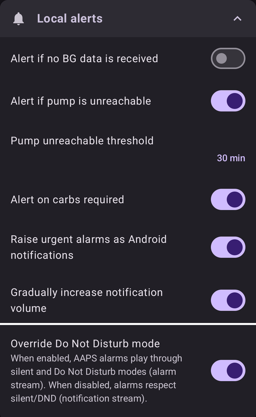
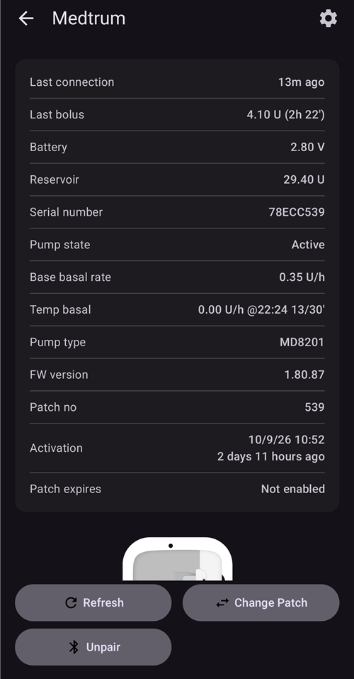

(medtrum-nano-300u)=
# Medtrum Nano 200U / 300U

Aceste instrucțiuni sunt pentru configurarea pompei de insulină Medtrum.

```{contents} Table of contents
:depth: 1
:local: true
```

## Capacități pompă cu AAPS
* Toată funcționalitatea buclei suportată (SMB, RBT șamd)
* Detecția automată a timpului și a fusului orar activată
* Bolusul extins nu este acceptat de driverul AAPS

## Cerințe hardware și software
* **Pompa de bază Medtrum compatibilă și plasturii cu rezervor**
    - Acceptat în prezent:
        - Medtrum TouchCare Nano 200U with pumpbase refs: **MD0201** and **MD8201**.
        - Medtrum TouchCare 300U cu referințe ale pompei de bază: **MD8301**.
        - Dacă aveți un model neacceptat și sunteți dispuși să donați echipamente sau să asistați cu testarea, vă rugăm să ne contactați prin intermediul discord [aici](https://discordapp.com/channels/629952586895851530/1076120802476441641).
* **AAPS built and installed** using the [Build APK](../SettingUpAaps/BuildingAaps.md) instructions.
* **Telefon Compatibil Android** cu o conexiune Bluetooth BLE
    - Vedeți [Notele de lansare](../Maintenance/ReleaseNotes.md) AAPS

## Înainte să începeți

**SIGURANȚA MAI ÎNTÂI** Nu încercați acest proces într-un mediu în care nu vă puteți reveni după o eroare (trebuie să existe plasturi suplimentari, insulină și dispozitive de control a pompei).

**Telecomanda de control și aplicația Medtrum nu vor funcționa cu un plasture care este activat de către AAPS.** Anterior, ați folosit probabil telecomanda sau aplicația Medtrum pentru a trimite comenzi către pompa dumneavoastră. Din motive de securitate, puteți folosi plasturele activat dar cu dispozitivul sau aplicația care au fost folosite pentru activare sa.

*Aceasta NU înseamnă că ar trebui să vă aruncați telecomanda. Este recomandat să fie păstrată undeva în siguranță ca rezervă în caz de urgență, de exemplu, dacă telefonul se pierde sau AAPS nu funcționează corect.*

**Pompa nu va opri administrarea insulinei atunci când nu este conectată la AAPS** Ratele bazale implicite sunt programate în pompă așa cum sunt definite în profilul activ în prezent. Atâta timp cât AAPS este operațional, va trimite comenzi pentru rate bazale temporare care rulează pentru un maximum de 120 de minute. Dacă dintr-un motiv sau altul pompa nu primește nicio comandă nouă (spre exemplu deoarece comunicarea a fost pierdută din distanței dintre pompă și telefonul), pompa va reveni la rata bazală implicită programată în pompă odată ce rata bazală temporară se încheie.

**The AAPS Profile does not support a 30 minute basal rate time frame** If you are new to AAPS and are setting up your basal rate profile for the first time, please be aware that basal rates starting on a half-hour basis are not supported, and you will need to adjust your basal rate profile to start on the hour. Spre exemplu, dacă ai o rată bazală de 1,1 unități care începe la ora 09:30 și are o durată de 2 ore cu terminare la ora 11:30, aceasta nu va funcționa. Va trebui să schimbați această rată bazală de 1,1 unități într-un interval de timp ca 9:00-11:00 sau 10:00-12:00. Chiar dacă dispozitivul pompei Medtrum în sine acceptă incrementele de 30 de minute ale profilului bazalei AAPS nu le poate lua în considerare cu algoritmii săi în prezent.

**Ratele bazale de 0U/h din profil NU sunt acceptate în AAPS** Deși pompa Medtrum acceptă o rată bazală de zero unități AAPS folosește multipli ai ratei bazale de profil pentru a determina tratamentul automat și prin urmare nu poate funcționa cu o rată bazală de zero unități. The minimum profile basal rate is 0.05 U/h.

O rată bazală temporară de zero unități poate fi obținută prin intermediul funcției "Deconectare pompă" sau printr-o combinație de Dezactivare a buclei/ratei bazale temporare sau prin Suspendarea Buclei/Ratei bazale temporare.

## Instalare

```{caution}
When you activate a patch with **AAPS**, you **MUST** turn off every other device that can talk to the Medtrum pump base, for example an active PDM or the Medtrum app.
```

### Pasul 1: Selectați pompa Medtrum

#### Opțiunea 1: Instalări noi

If you are installing **AAPS** for the first time, the **Setup Wizard** guides you through the setup. Select **Medtrum** when you reach the **Pump** step.

If in doubt, you can also select **Virtual Pump** and select **Medtrum** later, after setting up **AAPS** (see option 2).


#### Option 2: The Configuration screen

On an existing installation you can select the **Medtrum** pump in [Configuration > Pump](#Config-Builder-pump):

Open the top-left **menu** (☰), tap **Configuration** > **Pump**, and select the **Medtrum** card. Only one pump can be active at a time.


Once it is selected, the **Medtrum** card shows two buttons, **Settings** and **Open plugin**:


**Open plugin** (or **Manage → Pump**) opens the Medtrum pump screen. You use it to change patches and to see the pump status. Before a patch is activated it looks like this:


(medtrum-step-2)=
### Pasul 2: Modificați setările Medtrum

Tap **Settings** on the **Medtrum** card in **Configuration** > **Pump**. You can also tap the gear icon in the top-right corner of the Medtrum pump screen. This opens the **Medtrum pump settings**:


```{note}
There is no **Serial Number** setting any more. **AAPS** finds your pump base with a Bluetooth scan the first time you activate a patch (see [Step 3](#medtrum-activate-patch)), and remembers its serial number. To use a different pump base, see [Unpair](#medtrum-unpair).
```

#### Alarm Settings

***Implicit: semnal sonor.***

This setting changes the way that the pump alerts you when there is a warning or error.

- **Beep**: the patch beeps on alarms and warnings.
- **Silent**: the patch does not alert you on alarms and warnings.

Note: In silent mode **AAPS** still sounds the alarm, depending on your phone's volume settings. If you do not respond to the alarm, the patch eventually beeps.

#### Notificare la avertizarea pompei

***Implicit: Activat.***

This setting changes the way **AAPS** shows notifications for non-critical pump warnings. When enabled, a notification is shown on the phone when a pump warning occurs, including:
- Baterie slabă
- Low reservoir (20 units)
- Patch expires soon

We recommend leaving this enabled when the pump alarms are set to **Silent**. In either case these warnings are also shown on the Medtrum pump screen under [Active alarms](#medtrum-active-alarms).

(medtrum-patch-expiration)=
#### Expirare plasture

***Implicit: Activat.***

Această setare schimbă comportamentul plasturelui. When enabled, the patch expires after 3 days and gives an audible warning if you have sound enabled. After 3 days and 8 hours the patch stops working.

If this setting is disabled, the patch does not warn you before it stops. With recent pump base firmware, a patch runs for 5 days at most.

#### Pump expiry warning [hours]

***Implicit: 72 de ore.***

This setting changes the time of the expiration warning. When [Patch Expiration](#medtrum-patch-expiration) is enabled, **AAPS** shows a notification this many hours after activation.

#### Hourly Maximum Insulin [Units]

***Implicit: 25U.***

Această setare modifică cantitatea maximă de insulină care poate fi administrată într-o oră. If this limit is exceeded, the patch suspends and gives an alarm. You can reset the alarm with the **Reset alarms** button on the pump screen, see [Reset alarms](#nano-reset-alarms).

Stabiliți aceasta la o valoare rezonabilă pentru necesarul dumneavoastră de insulină.

#### Daily Maximum Insulin [Units]

***Implicit: 80U.***

Această setare schimbă cantitatea maximă de insulină care poate fi administrată într-o zi. If this limit is exceeded, the patch suspends and gives an alarm. You can reset the alarm with the **Reset alarms** button on the pump screen, see [Reset alarms](#nano-reset-alarms).

Stabiliți aceasta la o valoare rezonabilă pentru necesarul dumneavoastră de insulină.

#### Scan on connection error

***Implicit: oprit.***

Localizat sub **Setări avansate**.

Only enable this if you have connection problems. When enabled, the driver scans for the pump again before trying to reconnect to it. Make sure the Location permission for **AAPS** is set to "Allow all the time".

### Step 2b: AAPS alert settings

These settings are not part of the Medtrum driver. Open them from the **Settings** (gear) icon in the top-right corner of the main screen. See [Settings](../SettingUpAaps/Preferences.md) for more.

#### BT Watchdog

Open **Settings** > **Pump**:


**BT Watchdog** switches off the phone's Bluetooth for one second if **AAPS** cannot connect to the pump. This may help on some phones where Bluetooth freezes.

Enable this setting if you often have connection problems with your pump.

#### Alerte locale

Open **Settings** > **Local alerts**:



##### Alertați dacă pompa este indisponibilă

***Implicit: Activat.***

This setting is forced on when the Medtrum driver is enabled. It alerts you when the pump is unreachable. This can happen when the pump is out of range, or when it is not responding because of a faulty patch or pump base, for example when water leaks between the pump base and the patch.

Din motive de siguranță, această setare nu poate fi dezactivată.

##### Pump unreachable threshold

***Implicit: 30 de minute.***

This setting changes how long **AAPS** waits before alerting you that the pump is unreachable.

You can change this setting when using the Medtrum pump, but we recommend keeping it at 30 minutes for safety reasons.

(medtrum-activate-patch)=
### Pasul 3: Activați plasturele

**Înainte să continuați:**
- Have your Medtrum pump base and a new reservoir patch ready.
- Turn off other devices that can talk to the Medtrum pump (PDM and Medtrum app).
- Ideally, make sure **AAPS** is set up and a [profile is activated](../DailyLifeWithAaps/ProfileSwitch-ProfilePercentage.md). If no profile is active, the activation starts with a **Profile required** step where you choose the profile to activate.

#### Start the activation

Open the [Medtrum pump screen](#nano-overview) (**Manage → Pump**) and tap **Change Patch**. If you have set up [settings protection](#Preferences-protection), you must enter your password or PIN first.

If a patch is already active, you are asked to deactivate it first, see [Deactivate patch](#nano-deactivate-patch).

The activation is a step-by-step wizard. Urmați instrucțiunile pentru a umple și a activa un nou plasture. Tap **Cancel** at any step to stop.

```{important}
Only put the patch on your body and insert the cannula when the wizard tells you to (after priming is complete).
```

The first steps you see depend on your setup:

1. **Profile required**: only if no profile is active. Select the profile to apply, then continue.
2. **Find Pump**: only the first time, or after you used [Unpair](#medtrum-unpair). Connect the pump base to a fresh patch to power it on. **AAPS** scans for nearby Medtrum pump bases (their names start with `MT`). Tap yours in the list. **AAPS** saves its serial number, then goes straight to filling the patch.

   

3. **Activate Patch**: only when **AAPS** already knows your pump base. The screen says "No active patch. Press **Next** to begin the activation process." Make sure the pump base is **not** connected to the patch yet, then tap **Next**.


#### Connect and fill the patch


Connect the pump base to the patch, remove the residual air and fill the patch with insulin. A minimum of 70 units is needed for activation. The screen shows the reservoir level. Do not attach the patch to your body yet.

When the patch is detected and filled, the **Next** button appears. Tap it.

#### Select insulin

This step only appears if you have more than one insulin set up in **AAPS**. Select the insulin you are filling the patch with. **AAPS** applies a profile switch with this insulin after activation.

#### Amorsați plasturele transdermic


Do **not** remove the safety lock. Half-press the needle button on the patch, then tap **Next** to start priming.


Wait for priming to complete.


When priming is complete, tap **Next** to continue.

#### Rotație loc

This step only appears if you manage pump sites with [Site Rotation](#Aapsscreens-site-rotation) (setting **Manage pump site rotation**). Choose where you place the patch on your body, or skip this step.

#### Atașați plasturele


Clean the skin and remove the stickers. Remove the safety lock, attach the patch to your body, and press the needle button to insert the cannula.

Tap **Next** to activate the patch.

#### Activați plasturele


**AAPS** activates the pump and sets the initial basal rate. Please wait. When activation is complete, the following screen appears:


```{admonition} Older screenshot
:class: note
Apart from **Find Pump**, the activation screenshots above are from an earlier **AAPS** version and may look different in **AAPS** 4.
```

It shows how many units are left in the patch. Tap **OK** to return to the pump screen.

```{tip}
After a new activation, [export your settings](../Maintenance/ExportImportSettings.md). This lets you recover this patch session later, for example on a new phone.
```

(nano-deactivate-patch)=

### Dezactivați plasturele

To deactivate the active patch, open the [Medtrum pump screen](#nano-overview) (**Manage → Pump**) and tap **Change Patch**.


You are asked to confirm that you want to deactivate the current patch. **This cannot be undone.** Tap **Next** to deactivate, or **Cancel** to return to the pump screen.


If **AAPS** cannot deactivate the patch (for example because the pump base has already been removed from the patch), tap **Discard** to forget the current patch session. You can then activate a new patch.


When deactivation is complete, retract the needle and remove the patch from your body. Remove the pump base and dispose of the used patch. Tap **OK** to return to the pump screen, or **Next** to start activating a new patch.

(nano-resume-interrupted-activation)=

### Reluați activarea întreruptă

If a patch activation is interrupted, for example because the phone battery runs out, you can resume it. Open the [Medtrum pump screen](#nano-overview) (**Manage → Pump**) and tap **Change Patch**.


Tap **Next** to resume the activation. Tap **Discard** to reset the activation status, so you can activate a new patch.


```{admonition} Older screenshot
:class: note
The screenshots in **Deactivate patch** and **Resume interrupted activation** are from an earlier **AAPS** version and may look different in **AAPS** 4.
```

The driver reads the activation status from the pump. If this works, the wizard continues at the step where it stopped.

(nano-overview)=

## Pump screen

The Medtrum pump screen (**Manage → Pump**) shows the current status of the Medtrum patch. It also has buttons to change the patch, reset alarms and refresh the status. A banner at the top shows important states, for example **Patch not activated** or **Pump is suspended**.



The screen can show these rows. Some rows only appear when they have a value.

- **Last connection**: how long ago **AAPS** last connected to the pump.
- **Last bolus**: the last bolus that was delivered.
- **Battery**: the current battery voltage of the patch.
- **Reservoir**: the current reservoir level.
- **Serial number**: the serial number of your pump base.
- **Pump state**: the current state of the pump. For example **Active** (the patch is activated and running normally) or **Stopped** (the patch is not activated).
- **Base basal rate**: the basal rate from your profile that is running now.
- **Temp basal**: the temporary basal rate, if one is running.
- **Active bolus**: the bolus that is being delivered right now.
- **Active alarms**: see [below](#medtrum-active-alarms).
- **Pump type**: the model of your pump base.
- **FW version**: the firmware version of the pump base.
- **Patch no**: the sequence number of the activated patch. It goes up by one every time you activate a new patch.
- **Activation**: the date and time the patch was activated, and how long ago that was.
- **Patch expires**: the date and time when the patch expires. Shows **Not enabled** if [Patch Expiration](#medtrum-patch-expiration) is off.

(medtrum-active-alarms)=
### Active alarms

This row shows any alarms that are active right now, for example a low reservoir or an expiring patch.

### Refresh

This button refreshes the status of the patch. It is only available when a patch is active and **AAPS** is not connected to the pump at that moment.

### Change Patch

This button starts the wizard to change the patch. Vedeți [Activați plasture](#medtrum-activate-patch) pentru mai multe informații.

(medtrum-unpair)=
### Unpair

This button only appears when **AAPS** knows a pump base. It clears the stored pump base serial number and disconnects. The next time you activate a patch, **AAPS** scans for a pump base again (the **Find Pump** step). Use this if you switch to a different pump base. Only do this when no patch is active.

(nano-reset-alarms)=

### Resetați alarmele

The **Reset alarms** button only appears on the pump screen when the patch has suspended itself, for example after a maximum daily insulin alarm. Tap it to reset the alarms and resume insulin delivery.


```{admonition} Older screenshot
:class: note
The screenshot above is from an earlier **AAPS** version. In **AAPS** 4 the pump screen looks different, but the **Reset alarms** button works the same way.
```

## Schimbarea telefonului, setări export/import

When you switch to a new phone, do the following:
* [Export settings](../Maintenance/ExportImportSettings.md) on your old phone.
* Transfer the settings file from the old phone to the new phone, and import it into **AAPS**. Tick **Also replace pump settings** on the import screen, otherwise the patch session is not transferred to the new phone.

The imported settings file must be from the patch session you are using now, otherwise the patch will not connect (see [Tubeless pumps](#ExportImportSettings-tubeless-pumps)).

After a settings import, the driver syncs the history with the pump. This can take a while, depending on the age of the settings file. The progress ("Syncing records, ... left") is shown on the main screen:


(medtrum-nano-troubleshooting)=

## Depanare

### Probleme de conexiune

If you have connection timeouts or other connection problems:
- In the Android app settings for **AAPS**, set the Location permission to "Allow all the time".
- Try enabling **Scan on connection error** (Medtrum settings > **Advanced Settings**) and **BT Watchdog** (**Settings** > **Pump**), see [Step 2](#medtrum-step-2).

### Probleme Bluetooth
Pentru probleme cunoscute cu conexiunile Bluetooth, întreruperile pompei, activarea și problemele de conexiune [Depanarea Bluetooth](../GettingHelp/BluetoothTroubleshooting.md)

### Activare întreruptă

If the activation is interrupted, for example by an empty phone battery or a phone crash, you can resume it. Tap **Change Patch** on the pump screen and follow the steps in [Resume interrupted activation](#nano-resume-interrupted-activation).

### Prevenirea defecțiunilor plasturelui

Plasturele poate produce o varietate de erori. Pentru a preveni erorile frecvente:
- Asigurați-vă că baza pompei este așezată corespunzător în plasture și că nu sunt vizibile goluri.
- La umplerea plasturelui nu aplicați o forță excesivă pistonului. Nu încercați să umpleți plasturele peste limita maximă care se aplică modelului dumneavoastră.

## Unde să obțineți ajutor

Toată munca de dezvoltare pentru driverul Medtrum este realizată de comunitate pe bază **voluntară**; vă cerem să vă amintiți acest lucru și să utilizați următoarele recomandări înainte de a solicita asistență:

-  **Nivelul 0:** Citiți secțiunea relevantă a acestei documentații pentru a vă asigura că înțelegeți cum ar trebui să meargă funcționalitatea cu care aveți dificultăți.
-  **Nivelul 1:** Dacă încă întâmpinați probleme pe care nu le puteți rezolva folosind acest document, apoi vă rugăm să mergeți la canalul *#Medtrum* pe **Discord** folosind [această legătură de invitație](https://discord.gg/4fQUWHZ4Mw).
-  **Nivelul 2:** Căutați problemele existente pentru a vedea dacă problema dumneavoastră a fost deja raportată la [Probleme](https://github.com/nightscout/AAPS/issues) dacă există, vă rugăm să confirmați/comentați/adăugați informații despre problema dumneavoastră. Dacă nu, vă rugăm să creați o nouă problemă [](https://github.com/nightscout/AndroidAPS/issues) și să atașați [fișierele de jurnal](../GettingHelp/AccessingLogFiles.md).
-  **Fiți răbdători - majoritatea membrilor comunității noastre sunt voluntari bine-voitori, și rezolvarea problemelor necesită adesea timp și răbdare atât din partea utilizatorilor cât și din partea dezvoltatorilor.**