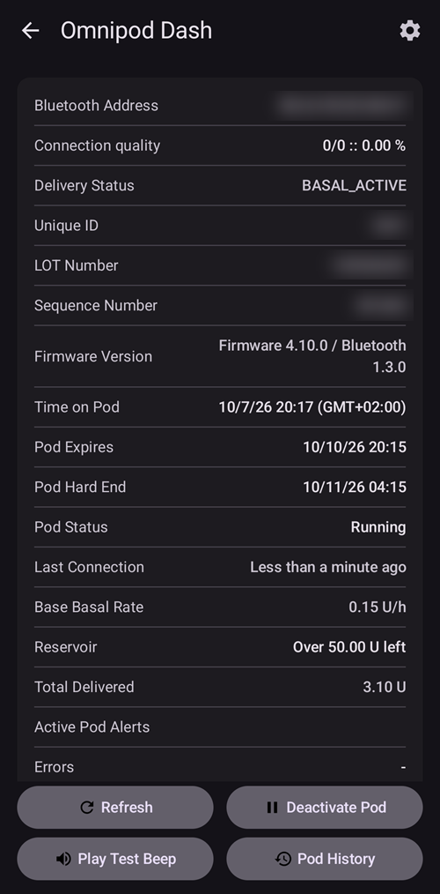
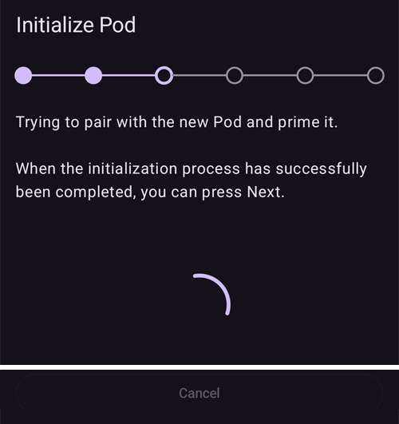
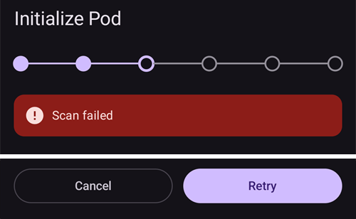
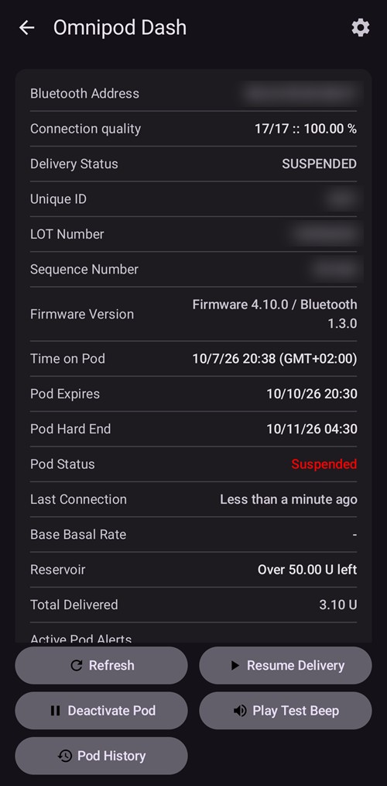
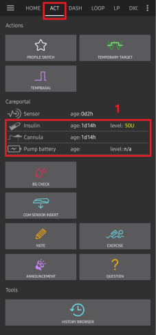

# Omnipod DASH

These instructions are for configuring the **Omnipod DASH** generation pump **(NOT Omnipod Eros)**. The DASH driver is a well-established way to loop with Omnipod.

```{contents} Table of contents
:depth: 1
:local: true
```

## Specificații Omnipod DASH

Key characteristics of the **Omnipod DASH** ('DASH'):

- The DASH pods are identified by a **blue needle cap** (the older EROS pod has a clear needle cap). Capsulele sunt în rest identice în ceea ce privește dimensiunile fizice.
- DASH nu necesită un dispozitiv BLE link/bridge (NU este nevoie de RileyLink, OrangeLink sau EmaLink).
- Conexiunea Bluetooth a DASH este utilizată numai atunci când se trimite o comandă (spre exemplu un Bolus) și se deconectează imediat după emiterea comenzii.
- **AAPS** va aștepta accesibilitatea pompei pentru a trimite comenzi.
- La activarea pompei, **AAPS** va găsi și se va conecta la o nouă pompă DASH.
- Rază de acțiune preconizată: 5-10 metri (Rezultatele pot varia).

(omnipod-dash-constraints)=

## Constrângeri/probleme AAPS cunoscute pentru Omnipod DASH
- General advice is to run **AAPS** on Android 14 or 16. Android 15 has many reported [issues](https://github.com/nightscout/AndroidAPS/issues/3471) from the community. However, if you do run on Android 15 you will likely need to turn on **Bluetooth bonding** (in the **Advanced Settings** section of the [Dash settings](#omnipod-dash-advanced-settings)) to successfully activate and use Pods, see [General Troubleshooting](../GettingHelp/GeneralTroubleshooting.md) for more info on the Bonding settings.
- DST and timezone changes are not applied automatically. After a clock change you must update the pod manually: press **Refresh** on the DASH pump screen, then press **Set time** (shown when the pod and phone time zones differ) or perform a **Profile Switch** (see [Timezone change for Omnipod Dash](#timezone-traveling-with-pumps)).
- Dash acceptă doar rata bazale în pași de 0,05 U/h. Dacă încercați să setați bazala cu pași de 0,01 în profilul **AAPS**, AAPS nu vă va da un avertisment, chiar dacă pompa va rotunji rata bazală în pași de 0,05. If you open **Pod History** on the DASH pump screen, it will display that 0.05 basal was set. Acest lucru înseamnă, de asemenea, cea mai mică rată bazală permisă de DASH din **AAPS** este de 0,05U/h.
- The settings file contains the active Pod session. Export your settings after each Pod activation, and see [Export and import settings](#omnipod-dash-export-import) before importing settings.
- La setarea unui profil bazal nou, DASH va suspenda administrarea înainte de a seta noul **Profil** bazal. Dacă există o întrerupere sau o eroare de comunicare, profilul bazalei nu va reporni automat. Vedeți secțiunea [Reluarea Administrării de insulină](#omnipod-dash-resuming-insulin-delivery) pentru detalii.
- În cazul în care alertele sunt configurate, iar pompa este pe cale să expire, pompa va continua să piuie până când alertele sunt reduse la tăcere, Vedeți [Suprimarea alertelor pompei](#omnipod-dash-silencing-pod-alerts) pentru detalii.
- Există o serie de probleme cunoscute cu Bluetooth, care pot cauza probleme de activare a pompei. Vedeți [Depanarea Bluetooth](../GettingHelp/BluetoothTroubleshooting.md) pentru problema cunoscută și soluțiile la aceste probleme.

(hardware-software-requirements)=

(omnipod-dash-hardware-software-requirements)=
## Cerințe hardware și software

- Omnipod DASH este identificat prin capacul albastru al acului.


- **Un telefon Android** compatibil cu Bluetooth Low Energy (BLE) (a se vedea [Telefoane](../Getting-Started/Phones.md) pentru mai multe informații), În plus, următoarele informații vă vor ghida cu privire la alte aspecte esențiale legate de activarea și utilizarea cu succes a DASH pe un telefon compatibil:
    -  Driverul **AAPS** Omnipod Dash se conectează cu pompa DASH folosind Bluetooth.  
      **AAPS** va stabili automat o nouă conexiune Bluetooth la pompă de fiecare dată când trebuie să trimită o comandă (spre exemplu, un bolus), după trimiterea comenzii, conexiunea Bluetooth este deconectată imediat.
       - **NOTĂ:**
         - Conexiunea Bluetooth poate fi întreruptă/perturbată de alte dispozitive Bluetooth conectate la telefonul care rulează **AAPS**, cum ar fi căștile șamd... Dispozitive ca acestea pot cauza erori de conectare sau probleme de activare ale pompei pe unele modele de telefoane. It's a good idea to review the [tested hardware setups](https://docs.google.com/spreadsheets/u/1/d/e/2PACX-1vScCNaIguEZVTVFAgpv1kXHdsHl3fs6xT6RB2Z1CeVJ561AvvqGwxMhlmSHk4J056gMCAQE02sAWJvT/pubhtml?gid=683363241&single=true) list for known working configurations when choosing the phone for an Omnipod DASH setup.
         - Există o serie de probleme cunoscute cu Bluetooth, care pot cauza probleme de activare a pompei (Vedeți [Depanarea](#troubleshooting) pentru sfaturi cu privire la alte probleme Bluetooth) în mod specific secțiunea [probleme legate de Bluetooth](#omnipod-dash-bluetooth-related-issues).
    - The phone must run **Android 12 or newer**, with **AAPS** built and installed using the [**Build APK**](../SettingUpAaps/BuildingAaps.md) instructions. Always run the latest released version.
- Un [**Senzor de monitorizare continuă a glicemiei (CGM)**](../Getting-Started/CompatiblesCgms.md)

Instrucțiunile de mai jos explică cum să activați o nouă sesiune de pompă prin utilizarea **AAPS**. Ar trebui să așteptați ca pompa curentă să fie aproape de expirare pentru că va trebui să activați o pompă nouă cu **AAPS**. Odată ce o pompă este dezactivată, nu poate fi reutilizată/reactivată, dezactivarea este finală.

## Înainte să începeți

Asigurați-vă că ați citit și înțeles acest ghid, că ați citit și înțeles secțiunea **Înainte de a începe**, precum și  **[Constrângeri și Probleme Omnipod și AAPS](#omnipod-dash-constraints)** pentru a evita apariția unor probleme cunoscute.

### **SIGURANȚA MAI ÎNTÂI** - **NU AR TREBUI** să încercați să conectați **AAPS** la o pompă Omnipod DASH pentru prima oară fără sa aveți acces la următoarele:
1. Pompe suplimentare (3 sau mai multe de rezervă)
2. Insulină de rezervă și stilouri de insulină
3. Un PDM Omnipod (În cazul în care**AAPS** nu funcționează)
4. Telefoanele acceptate sunt o necesitate! (Vedeți [Cerințele Hardware/Software](#hardware-software-requirements))
5. Versiunea corectă a AAPS construită și instalată

### Telecomanda dumneavoastră Omnipod Dash va fi redundantă după ce driverul AAPS Dash vă activează pompa.
- Înainte de utilizarea **AAPS** ar fi trebuit ca dumneavoastră sau persoana care vă îngrijește să gestioneze pompa folosind telecomanda Omnipod (sau în unele regiuni o aplicație de telefon) pentru a trimite comenzi către pompa DASH (spre exemplu un bolus).
- DASH poate facilita o singură conexiune cu un singur dispozitiv Bluetooth (de exemplu telecomanda sau telefon) pentru gestionare și trimiterea comenzilor.
- Dispozitivul care activează cu succes pompa este singurul dispozitiv care are permisiunea de a comunica cu acea pompă din acel moment. Asta înseamnă că odată ce activați DASH cu telefonul dumneavoastră Android folosind **AAPS**, **nu vei mai putea folosi telecomanda cu acea pompă!** Pentru perioada în care pompa este activă ** driverul Dash** care rulează pe telefonul dumneavoastră Android este acum noua telecomanda pentru pompă.
- **NU aruncați telecomanda Omnipod!** Se recomandă să fie păstrat ca o copie de rezervă și pentru urgențe, de exemplu când telefonul se pierde sau **AAPS** nu funcționează corect.

### Pompa **NU VA** opri administrarea insulinei atunci când nu este conectată la AAPS.
Ratele bazale implicite sunt programate pe pompă la momentul activării așa cum sunt definite în [**profilul**](../SettingUpAaps/YourAapsProfile.md) care este activat în prezent.  
Atâta timp cât **AAPS** este operațional va trimite comenzi de ajustare ale ratei bazale care vor rula pentru un maximum de 120 de minute.  
Când pentru vreun motiv anume pompa nu primește comenzi noi (de exemplu pentru că comunicarea a fost pierdută din cauza distanței pompă ➜ telefon) pompa va reveni la rata bazală implicită așa cum a fost setată în [**profilul**](../SettingUpAaps/YourAapsProfile.md) dumneavoastră.

### Profilul(urile) AAPS nu acceptă intervale de 30 minute pentru ratele bazale
Dacă sunteți la început cu **AAPS** și configurați [**profilul**](../SettingUpAaps/YourAapsProfile.md) ratei bazale pentru prima dată, vă rugăm să rețineți că ratele bazale la intervale de o jumătate de oră nu sunt acceptate. De exemplu, pe telecomanda Omnipod, dacă aveţi o rată bazală de 1,1 unități care începe la ora 09:30 și cu o durată de 2 ore care se termină la ora 11:30, nu este posibilă reproducerea exactă acestui **Profil** de bazale în **AAPS**.  
Va trebui să schimbați această rată bazală de 1,1 unități într-un interval de timp de fie 9:00-11:00, sau 10:00-12:00. Chiar dacă hardware-ul DASH însuși suportă incrementele de 30 de minute ale **profilulului** ratei bazale, **AAPS** NU acceptă această caracteristică.

### Valori bazale de 0U/h ale profilului NU sunt acceptate în AAPS
Deși DASH acceptă o rată bazală de zero, **AAPS** folosește multiplii ai ratelor bazale din **Profil** pentru a determina tratamentul automat; nu poate funcționa cu rată bazală de zero.  
În schimb o rată bazală temporară de zero poate fi obținută prin funcția "Deconectare pompă", ori printr-o combinație de Oprire buclă/Rate bazale temporare sau Suspendare buclă/Rate bazale temporare.  
**NOTĂ:** Cea mai mică rată bazală permisă de către DASH în **AAPS** este 0,05U/h.

## Selectare Dash în AAPS

There are **two** ways to select the Omnipod DASH driver in **AAPS**:

### Opțiunea 1: Instalări noi

When you install **AAPS** for the first time, the **Setup Wizard** guides you through the key features and installation requirements of **AAPS**. When you reach the **Pump** step, select **Omnipod Dash**.


If you are not sure yet, you can select **Virtual Pump** for now and select **Omnipod Dash** later, after setting up **AAPS** (see Option 2).

(omnipod-dash-option-2-config-builder)=
### Option 2: The Configuration screen

On an existing installation you can select the **Omnipod Dash** pump from the **Configuration** screen:

1. Open the **menu** (☰) in the top-left corner of the main screen and select **Configuration**.
2. Tap **Pump** and select the radio button of **Omnipod Dash** (*"Pump integration for Omnipod Dash (the new, Bluetooth-enabled model with a blue needle cap)"*).

3. Once it is selected, the **Omnipod Dash** card shows two buttons:
   - **Settings** opens the [Dash settings](#omnipod-dash-settings).
   - **Open plugin** opens the [DASH pump screen](#omnipod-dash-tab).

   

### Verificarea Selecției Driverului Omnipod

To check that **Omnipod Dash** is selected, open **Manage** (bottom navigation of the main screen) and tap **Pump**. The DASH pump screen opens, as shown in the next section.

(omnipod-dash-tab)=

## The DASH pump screen

The DASH pump screen is where you manage your pods: activate and deactivate them, refresh the pod status, silence alerts and look at the pod history. Open it with **Manage** > **Pump**, or with **Open plugin** on the **Omnipod Dash** card in **Configuration** > **Pump**.

This is the screen without an active pod:


And this is the screen with an active pod:



The **Settings** (gear) icon in the top-right corner opens the [Dash settings](#omnipod-dash-settings).

***NOTE:** If a field on the pump screen shows (uncertain), press **Refresh** to update the pod status.*

### Câmpuri

- **Bluetooth Address:** The Bluetooth address of the pod.

- **Connection quality:** How reliably **AAPS** connects to the pod, shown as *successful connections / all connection attempts :: success rate*, for example `412/420 :: 98.10 %`. After more than 50 successful connections, the value turns yellow below 90 % and red below 70 %. A low value points to a Bluetooth problem (see [Bluetooth related issues](#omnipod-dash-bluetooth-related-issues)).

- **Delivery Status:** The raw delivery status reported by the pod. This field is shown only in engineering mode builds.

- **Unique ID:** The unique ID **AAPS** gave to the pod during activation.

- **LOT Number:** The production lot number of the pod.

- **Sequence Number:** The sequence number of the pod.

- **Firmware Version:** The firmware and Bluetooth versions of the pod.

- **Time on Pod:** The current time on the pod, with its time zone. The text turns red when the time zone of the pod is different from the time zone of the phone, and yellow when the pod time is more than 10 minutes off.

- **Pod Expires:** The date and time when the pod expires (72 hours after activation). The text turns yellow in the last 4 hours before this time. It never turns red, because the pod keeps delivering insulin after it.

- **Pod Hard End:** The end of the pod's grace period (8 hours after **Pod Expires**, for a maximum pod life of 80 hours). The text turns yellow when the grace period starts (at **Pod Expires**) and red in the last 4 hours before the hard end. During the grace period it also shows the time left, for example *(17m remaining)*. The pod stops delivering insulin at the hard end and must be changed.

- **Pod Status:** The state of the pod: **No Active Pod**, **Setup in progress**, **Running**, **Suspended** or, after a pod fault, **ALARM**.

- **Last Connection:** How long ago **AAPS** last communicated with the pod.

  - *Moments ago* - less than 10 seconds ago.

  - *Less than a minute ago* - between 10 and 60 seconds ago.

  - *XX minutes ago* - more than 1 minute ago (and *X hours and XX minutes ago* after an hour).

- **Last bolus:** The amount of the last bolus sent to the pod and how long ago it was given. An unconfirmed bolus is marked (uncertain).

- **Base Basal Rate:** The basal rate programmed for the current time in your basal **Profile**.

- **Temp Basal Rate:** The temporary basal rate (TBR) that is currently running, with its start time and duration. This field is only shown while a TBR is running.

- **Reservoir:** Shows *Over 50 U left* when more than 50 units are left in the reservoir. Below 50 units, the exact amount is shown. The value turns red below 20 units.

- **Total Delivered:** The total amount of insulin delivered from the reservoir. This includes the insulin used for priming.

- **Active Pod Alerts:** Alerts that are currently active on the pod, for example *Pod will expire soon* or *Low Reservoir*.

- **Errors:** The pod fault, if the pod has failed, shown in red as *Pod Fault:* followed by the fault code and name, for example *Pod Fault: 020 ALARM_OCCLUDED*. Review the [Pod History](#omnipod-dash-view-pod-history) and the log files for past errors and more detailed information. See [Pod Failures](#omnipod-dash-pod-failures).

- **PDM Notification:** Shown only after a pod fault. It shows the fault the way the Omnipod PDM would have shown it: a title (for example *Occlusion Detected*, *Empty Reservoir* or *Pod Expired*), what happened (for example *Insulin delivery stopped. Change Pod now.*) and a *Ref:* code.

### Butoane

The buttons at the bottom of the pump screen change with the state of the pod. Only the buttons that make sense at that moment are shown.

- **Refresh:** Asks the pod for its current status.
  - *Use it to update the pod status and to clear fields that show (uncertain).*
  - *See the [Troubleshooting](#omnipod-dash-troubleshooting) section below for more information.*

- **Silence Alerts:** Stops the pod alert beeps (for example pod expiry or low reservoir). Shown only while the pod has an active alert. See [Silencing Pod Alerts](#omnipod-dash-silencing-pod-alerts).

- **Resume Delivery:** Resumes insulin delivery on a suspended pod. Shown only when delivery is suspended. See [Resuming Insulin Delivery](#omnipod-dash-resuming-insulin-delivery).

- **Set time:** Updates the pod to the time zone of your phone by sending your basal **Profile** again. Shown only when the time zone of the pod differs from the time zone of your phone.

- [**Activați pompa**](#omnipod-dash-activate-pod): Amorsează și activează o nouă pompă. Shown when no pod is active.

- [**Deactivate Pod**](#omnipod-dash-deactivate-pod): Deactivates the active pod. Shown as soon as a pod is paired with **AAPS**, also when an activation stopped part-way (for example because the pod failed during activation). **AAPS** asks you to confirm before it deactivates the pod.

- **Play Test Beep:** Makes the pod play a single test beep.

- [**Pod History**](#omnipod-dash-view-pod-history): Shows the activity history of the active pod.

- **Discard Pod:** Removes an unfinished pod from **AAPS**. Shown only when a pod activation stopped part-way. **AAPS** asks you to confirm. After discarding, **AAPS** can no longer communicate with that pod: remove it from your body.


```{admonition} Older screenshot
:class: note
The screenshot above is from an earlier **AAPS** version, which had a separate **Pod Management** menu. In **AAPS** 4 all these actions, including **Activate Pod**, **Deactivate Pod**, **Play Test Beep** and **Pod History**, are buttons with text labels directly on the pump screen.
```

(omnipod-dash-activate-pod)=

## Activează pompă

1. Open the DASH pump screen (**Manage** > **Pump**) and press **Activate Pod**. The activation wizard opens.

   

   ```{admonition} Older screenshot
   :class: note
   The screenshot above is from an earlier **AAPS** version. In **AAPS** 4 **Activate Pod** is a button directly on the DASH pump screen instead of in the **Pod Management** menu.
   ```

   If you have never activated a **Profile** in **AAPS** before, the wizard first shows the **Profile required** step: select the profile to apply on activation and continue.

2. The **Fill Pod** step is shown. Fill a new pod with enough insulin for 3 days, **at least 80 units**. Listen for two beeps from the pod: they mean the minimum amount of 80 units has been filled. Empty the fill syringe completely, even after hearing the two beeps. Do not remove the pod's needle cap yet.

   ***NOTE:** When you calculate the amount of insulin you need for 3 days, remember that priming the pod uses about 3-10 units.*

   

   

   Make sure that the new pod and the phone running **AAPS** are close to each other and press **Next**.

3. If you use more than one insulin in **AAPS**, the **Select Insulin** step is shown. It shows the **Currently active** insulin. If you filled the pod with a different insulin, press **Change** and select it. **AAPS** applies a **Profile Switch** with this insulin when the activation is finished. Press **Next**.

   

4. On the **Initialize Pod** step, **AAPS** pairs with the new pod and primes it. You hear a click followed by a series of ticking sounds as the pod primes itself. When this has finished successfully, the **Next** button appears. Press **Next**.

       

   ***NOTE**: If an error message such as _Scan failed_ or _'Could not find an available pod for activation'_ appears (this can happen), do not panic. Press **Retry**. In most cases the activation then continues successfully.*

   

   If the pod has failed (for example because its activation time was exceeded), **Deactivate Pod** is shown instead of **Retry**. Use it and start again with a new pod.

   If you press **Cancel** before the activation is finished, **AAPS** asks you to confirm that you want to exit. Press **OK** to leave the wizard, or **Cancel** to stay.

   

5. If you manage pump site rotation in **AAPS** (**Manage pump site rotation** in the [Site Rotation](#Aapsscreens-site-rotation) settings), the **Site location** step is shown. Select where you are going to place the pod on the body diagram and press **Next**, or press **Skip**.

   

6. Next, prepare the infusion site for the new pod. Wash your hands to avoid any risk of infection. Clean the infusion site with soap and water or an alcohol wipe, and let the skin air dry completely before you continue. If the adhesive irritates your skin, consider using a barrier wipe or barrier spray.

   On the **Attach Pod** step, remove the pod's blue plastic needle cap. If the cannula or anything else sticks out of the pod, or it looks unusual, **STOP**: press **Cancel** and start again with a new pod. If everything looks **OK**, take off the white paper backing from the adhesive and stick the pod to the chosen site on your body.

   When finished, press **Next**.

   

7. A confirmation dialog appears: *When you press OK, the cannula will be inserted.* **Press OK ONLY if you are ready to insert the cannula!**

   

8. On the **Insert Cannula** step, **AAPS** sets your basal schedule and the pod inserts the cannula. This can take some time (1-2 minutes maximum). **Aveți răbdare**

   ***NOTE:** It is good practice to pinch the skin near the cannula insertion point before the cannula is inserted. This helps the needle go in smoothly and lowers your chance of occlusions (blockages).*

       

9. When the cannula has been inserted successfully, the **Next** button appears. Press **Next**.

   

10. The **Pod Activated** step is shown. Check that the cannula has been inserted correctly, and change the pod if you think it has not.

    Press **Finish**.

    Felicitări! Tocmai ați început o nouă sesiune de pompă.

    

11. You are back on the DASH pump screen. It now shows the information of your active pod, including the current basal rate, reservoir level, insulin delivered, pod errors and alerts. **Activate Pod** is replaced by **Deactivate Pod**: you cannot activate another pod without deactivating the active pod first.

    ***NOTE:** For more details on the information shown, see [The DASH pump screen](#omnipod-dash-tab).*

    

    ***NOTE:** It is good practice to export your settings AFTER activating the pod. Export your settings after each pod change and once a month. Copy the exported settings file to a cloud storage location (for example Google Drive) or somewhere off your phone in case you lose your phone (see [**Export settings**](../Maintenance/ExportImportSettings.md)).*

If an earlier activation stopped after the pod was primed, pressing **Activate Pod** continues from the **Attach Pod** step.

(omnipod-dash-deactivate-pod)=

## Dezactivare pompă

Under normal circumstances, a pod lasts three days (72 hours), plus a grace period of 8 hours after the pod expiry warning: 80 hours in total.

To deactivate a pod (either because it expired or because it failed):

1. Open the DASH pump screen (**Manage** > **Pump**) and press **Deactivate Pod**.

   

2. On the **Deactivate Pod** step, press **Next**. A dialog asks *A deactivated Pod can not be used again. Deactivate this Pod now?* Press **OK** to start deactivating the pod, or **Cancel** to keep it. Deactivation suspends all insulin delivery and cannot be undone.

   

3. The **Deactivating Pod** step is shown while **AAPS** deactivates the pod. The pod beeps to confirm that deactivation was successful.

   

   ```{admonition} Older screenshot
   :class: note
   The screenshot above is from an earlier **AAPS** version. In **AAPS** 4 the wizard shows its progress as a row of dots at the top instead of a progress bar.
   ```

   When deactivation has finished successfully, the **Next** button appears. Press **Next**.

   

   If deactivation fails, an error message and a **Discard Pod** button are shown. See [Discarding a pod](#omnipod-dash-discard-pod) below before you use it. You can also press **Cancel** and try **Deactivate Pod** again later.

4. The **Pod Deactivated** step is shown. Remove the pod from your body and press **Finish**.

   

5. You are back on the DASH pump screen. Check that the **Pod Status** field shows **No Active Pod** and that the **Activate Pod** button is shown again.

   

(omnipod-dash-discard-pod)=

### Discarding a pod

Only discard a pod when all communication with it keeps failing. If **AAPS** can still communicate with the pod, use **Deactivate Pod** instead.

- **AAPS** asks you to confirm before it discards the pod.
- After that, **AAPS** can no longer communicate with that pod.
- **Insulin delivery has NOT been suspended**, because the pod was not deactivated properly. **Remove the pod from your body!**
- The **Pod Discarded** step confirms that the pod state has been discarded. Press **Finish**. You can now activate a new pod.

(omnipod-dash-resuming-insulin-delivery)=

## Reluarea administrării de insulină

**NOTE**: During **Profile Switches**, like when using the PDM, **AAPS** must suspend delivery on the pod before setting the new basal **Profile**. If communication fails between the suspend and resume commands, delivery can stay suspended. Read [**Delivery suspended**](#omnipod-dash-delivery-suspended) in the troubleshooting section for more details.

When insulin delivery is suspended, you need to tell the pod to resume insulin delivery. When the command has been processed successfully, the pod delivers insulin again using the basal rate for the current time from your active basal **Profile**. The pod again accepts commands for bolus, **TBR** and **SMB**.

1. Open the DASH pump screen and check that the **Pod Status** field shows **Suspended**. Press **Resume Delivery** to tell the pod to resume normal insulin delivery.

   

2. When the command was successful, the **Pod Status** field shows **Running** and the **Resume Delivery** button disappears.

   

   

   ```{admonition} Older screenshot
   :class: note
   The screenshots above are from an earlier **AAPS** version, which showed a confirmation dialog. In **AAPS** 4 you confirm the result on the DASH pump screen: the **Pod Status** field shows **Running** and the **Resume Delivery** button is gone.
   ```

   If the command fails, **AAPS** shows a warning dialog starting with *Failed to resume delivery*. Press **Refresh** and try again.

   

(omnipod-dash-silencing-pod-alerts)=

## Amuțirea alertelor de pompă

This section explains how to stop the pod beeps when the pod approaches the end of its life. When these beeps start depends on the **Alerts** settings (see [Dash Settings](#omnipod-dash-settings)):

- **Reminder at hours before expiry (72 Hours):** how many hours before the 72-hour expiry the pod starts to beep.
- **Alert at hours before shutdown (80 Hours):** how many hours before the 80-hour shutdown the pod beeps again.

The maximum life of a pod is 80 hours (3 days 8 hours). However, the pod manufacturer recommends not going beyond 72 hours (3 days).

***NOTE**: The **Silence Alerts** button is only shown on the DASH pump screen while the pod has an active alert, for example pod expiry or low reservoir. If the **Silence Alerts** button is not shown but you hear the pod beeping, press **Refresh**.*

1. When the reminder time is reached, the pod beeps to tell you that it will expire soon and that you need to change it. On the DASH pump screen, the **Pod Expires (1)** field shows the exact time the pod will expire (72 hours after activation). The text turns yellow 4 hours before this time. After it, **Pod Hard End** turns yellow and shows the time left until the pod stops delivering insulin. The **Active Pod Alerts (2)** field shows **Pod will expire soon**, and the **Silence Alerts (3)** button is shown.

   

2. Press **Silence Alerts**. **AAPS** sends the command to the pod to stop the expiry beeps.

   

   ```{admonition} Older screenshot
   :class: note
   The screenshot above is from an earlier **AAPS** version, where this screen was the **DASH** tab. In **AAPS** 4 the **Silence Alerts** button is on the DASH pump screen (**Manage** > **Pump**).
   ```

3. When the alerts have been silenced, the alert is no longer shown in the **Active Pod Alerts** field, the **Silence Alerts** button disappears, and the pod stops its expiry beeps.

   

   ```{admonition} Older screenshot
   :class: note
   The screenshot above is from an earlier **AAPS** version, which showed a confirmation dialog. In **AAPS** 4 you confirm the result on the DASH pump screen: the alert is gone from the **Active Pod Alerts** field.
   ```

   If the command fails, **AAPS** shows a warning dialog starting with *Failed to silence alerts*. Press **Refresh** and try again.

The low reservoir alert works the same way. When the insulin left in the pod drops to the **Number of units** set in the **Alerts** settings, the pod beeps. The **Reservoir** field shows the amount left, the **Active Pod Alerts** field shows **Low Reservoir**, and the **Silence Alerts** button is shown. Press **Silence Alerts** to stop the beeps, and plan your next pod change.


(omnipod-dash-view-pod-history)=

## Vedeți istoricul pompei

This section explains how to look at the history of your active pod and filter it by type of action. The pod history shows the commands sent to your active pod and their results during its three-day (72 - 80 hours) life.

It is useful to check the boluses, TBRs and basal commands that were sent to the pod. The other categories help with troubleshooting and show the order of events that led up to a failure.

***NOTĂ:** **Numai ultima comandă poate fi incertă**. New commands *are not sent* until the **last 'uncertain' command becomes 'confirmed' or 'denied'**. To 'fix' an uncertain command, press **Refresh** on the DASH pump screen.*

1. Open the DASH pump screen and press **Pod History**.

   

   ```{admonition} Older screenshot
   :class: note
   The screenshot above is from an earlier **AAPS** version. In **AAPS** 4 **Pod History** is a button directly on the DASH pump screen instead of in the **Pod Management** menu.
   ```

2. The **Pod History** screen opens with the **All** filter selected. It lists every command with its time and result, newest first, grouped by day. Use the filter buttons at the top (for example **Boluses** or **Basals**) to show only one type of command. Press the back arrow to return to the DASH pump screen.

    

   ```{admonition} Older screenshot
   :class: note
   The second screenshot above is from an earlier **AAPS** version, where you picked the type of command from a **Type** list. In **AAPS** 4 you use the filter buttons shown in the first screenshot.
   ```

   For boluses, the amount is followed by the bolus type when it is not a normal bolus, for example *0.05 U (SMB)* or *0.05 U (Basal correction)*. A basal correction is a very small bolus (one pod pulse, 0.05 U) that the driver sends by itself; you did not request it.

   ```{admonition} Why basal corrections happen
   :class: note
   The pod delivers basal insulin in pulses of 0.05 U, timed by an internal clock. Each time the basal rate changes (for example when the loop sets a new **TBR**), the pod restarts this clock, and the pulse it was counting towards is lost. Because the loop changes the basal rate often, especially overnight, the pod can end up delivering less basal insulin than expected.

   **AAPS** compares the basal insulin the pod reports as delivered with what it should have delivered. When the shortfall reaches half a pulse or more, the driver delivers one extra pulse as a basal correction, so you still get the basal insulin your profile and the loop asked for. No correction is sent while the pod is suspended, or while a zero **TBR** is running.
   ```

(omnipod-dash-settings)=

## Setări Dash

There are two ways to open the Dash driver settings:

- Press the **Settings** (gear) icon in the top-right corner of the [DASH pump screen](#omnipod-dash-tab).
- Open the **menu** (☰) in the top-left corner of the main screen and select **Configuration** > **Pump**. On the **Omnipod Dash** card, press **Settings**.

The settings are grouped into four expandable sections: **Confirmation Beeps**, **Alerts**, **Notifications** and **Advanced Settings**. Tap a section to open it:


Most settings are on/off switches.

### Confirmation Beeps


Confirmation beeps from the pod for bolus, basal, SMB and TBR delivery and changes.

**Bolus beeps enabled:**    The pod beeps when a bolus is delivered. On by default.

**Basal beeps enabled:**    The pod beeps when a new basal rate is set, or when the active basal rate is canceled or changed. Off by default.

**SMB beeps enabled:**  The pod beeps when an SMB is delivered. On by default.

**TBR beeps enabled:**  The pod beeps when a TBR is set or canceled. Off by default.

### Alerte


```{admonition} Older screenshot
:class: note
The screenshot above is from an earlier **AAPS** version. In **AAPS** 4 these settings are in the expandable **Alerts** section.
```

Pod alerts for pod expiry, shutdown and low reservoir. When you change these settings while a pod is active, **AAPS** sends the new alert settings to the pod.

***NOTE:** An **AAPS** notification is ALWAYS shown for any alert once **AAPS** has communicated with the pod after the alert was triggered. Dismissing the notification does NOT stop the pod alert. To stop the alert, open the DASH pump screen and press **Silence Alerts**.*

**Expiration reminder enabled:**    When this is on, the pod beeps when the reminder time is reached. On by default.

**Reminder at hours before expiry (72 Hours):** How many hours before the 72-hour pod expiry the reminder starts (1 to 24 hours; default 4).

**Expiration alert enabled:**   When this is on, the pod beeps when the alert time is reached, and again 1 hour before shutdown. On by default.

**Alert at hours before shutdown (80 Hours):**  How many hours before the 80-hour pod shutdown the alert starts (1 to 8 hours; default 8).

**Low reservoir alert enabled:**    The pod alerts you when the insulin left in the reservoir drops to the value in **Number of units**. On by default.

**Number of units:**    The number of units at which the low reservoir alert is triggered (5 to 50 units; default 20).

### Notificări


Choose whether **AAPS** plays a sound with its notifications when it is uncertain whether a TBR, SMB or bolus was delivered, and when delivery is suspended.

***NOTE:** These are phone notifications only; the pod itself does not beep.*

**Sound for uncertain TBR notifications enabled:**  Plays a sound with the notification when **AAPS** is uncertain whether a TBR was set.

**Sound for uncertain SMB notifications enabled:**  Plays a sound with the notification when **AAPS** is uncertain whether an SMB was delivered.

**Sound for uncertain bolus notifications enabled:**    Plays a sound with the notification when **AAPS** is uncertain whether a bolus was delivered.

**Sound when delivery suspended notification enabled:**     Plays a sound with the notification when insulin delivery is suspended.

(omnipod-dash-advanced-settings)=

### Setări avansate


**Bluetooth bonding:**  Bonds the pod with the phone over Bluetooth. Try it only if the pod cannot keep a stable connection, for example on Android 15 (see [Omnipod DASH known AAPS constraints/issues](#omnipod-dash-constraints)). When it is on, the phone shows pairing requests that you must accept. Leave it off if the pod connects fine. It has no effect below Android 15. Off by default.

## Insulin and cannula age

The [status row](#screens-sensor-level-battery) on the main screen shows the age of your insulin and cannula. With Omnipod, these work a little differently than with tube-based pumps.

**AAPS** records a cannula change and an insulin change automatically each time you activate a pod. This resets the **Insulin** and **Cannula** ages to zero after every pod change. You do not need to record them yourself with **Prime/Fill**. This is because the pod inserts the cannula directly into the skin where it is attached: Omnipod does not use a tube.

**Pump battery** age is not reported: the battery and the insulin reservoir are built into each pod, and the battery always lasts longer than the pod itself (maximum 80 hours).



```{admonition} Older screenshot
:class: note
The screenshot above is from an earlier **AAPS** version, where these ages were shown in the **Careportal** section of the **Actions** tab. In **AAPS** 4 they are shown in the status row on the main screen.
```

### Nivel

**Nivelul insulinei**

The insulin level shown is the amount reported by the pod. However, the pod only reports the actual reservoir level when it is below 50 units. Until then, *Over 50 U left* is shown. The amount reported is not exact: when the pod reports 'empty', in most cases the reservoir still has a few units of insulin left.

The DASH pump screen shows the level as follows:

  * **Over 50 U left** - The pod reports more than 50 units in the reservoir.
  * **Below 50 units** - The exact amount of insulin left in the reservoir, as reported by the pod.

Notă suplimentară:
  * **SMS** - Returns the value, or 50+U when over 50 units, in SMS responses.
  * **Nightscout** - Uploads a value of 50 when over 50 units to Nightscout (version 14.07 and older). Newer versions report a value of 50+ when over 50 units.

(omnipod-dash-troubleshooting)=

## Depanare

Prezenta secțiune se referă la problemele comune cunoscute și la soluțiile pentru utilizarea Omnipod DASH împreună cu AAPS. Există, de asemenea, secțiunea [Depanare generală](../GettingHelp/GeneralTroubleshooting.md) în documentație care ar trebui să fie reluată deoarece acoperă subiecte relevante și pentru unele probleme specifice pompei Omnipod.

---

(omnipod-dash-bluetooth-related-issues)=

## Probleme legate de Bluetooth

Pentru probleme cunoscute cu conexiunile Bluetooth, întreruperile pompei, activarea și problemele de conexiune [Depanarea Bluetooth](../GettingHelp/BluetoothTroubleshooting.md)

---

(omnipod-dash-delivery-suspended)=

### Administrarea insulinei suspendată

  - Nu mai există niciun buton de suspendare. Dacă doriți să "suspendați" pompa, puteți seta o **RBT** zero pentru x minute.
  - În timpul **Comutării de profil**, DASH trebuie să suspende administrarea înainte de a seta noul **profil** bazal. Dacă comunicarea nu reușește între cele două comenzi, atunci administrarea poate rămâne suspendată. Când se întâmplă acest lucru:
     - Nu va fi nicio administrare a insulinei, nici bazală, SMB, bolusare manuală șamd.
     - Este posibil să existe notificări că una dintre comenzi este neconfirmată: acest lucru depinde de când a avut loc eșecul.
     - **AAPS** va încerca să seteze noul profil bazal la fiecare 15 minute.
     - **AAPS** va afișa o notificare care va informa că administrarea este suspendată la fiecare 15 minute, dacă administrarea este încă suspendată (reluarea administrării a eșuat).
     - The [**Resume Delivery**](#omnipod-dash-resuming-insulin-delivery) button is shown on the DASH pump screen if you want to resume delivery manually.
     - Dacă **AAPS** nu reia singur administrarea (acest lucru se întâmplă dacă pompa nu este accesibilă, sunetul este dezactivat, șamd), pompa va începe să emită semnale sonore de 4 ori pe minut timp de 3 minute; se repetă la fiecare 15 minute, dacă administrarea este încă suspendată timp de peste 20 de minute.
  - For unconfirmed commands, press **Refresh** on the DASH pump screen to confirm or deny them.

*****NOTĂ:** Când auziți semnale sonore de la pompă, nu presupuneți că administrarea va continua fără a verifica telefonul, administrarea poate rămâne suspendată, ***așa că trebuie să verificați!******

---
(omnipod-dash-pod-failures)=

### Eșecuri pompă

- Ocazional, apare un eșec din cauza unei varietăți de probleme, inclusiv a problemelor de hardware cu pompa în sine.
- Este recomandat să nu deschideți tichete de suport sau cereri de înlocuire la Insulet, deoarece AAPS nu este o metodă de utilizare aprobată pentru pompe.
- O listă a codurilor de defecțiuni poate fi [**găsită aici**](https://github.com/openaps/openomni/wiki/Fault-event-codes) pentru a ajuta la determinarea cauzei.

When a pod fails, it stops delivering insulin and beeps continuously. **AAPS** shows a notification on the main screen with the fault code and name, and the *Ref:* code, for example *Pod Fault: 020 ALARM_OCCLUDED*. Press **Dismiss** to close the notification. This does not stop the pod beeping.


On the DASH pump screen, the **Pod Status** field shows **ALARM**, the **Errors** field shows the pod fault, and the **PDM Notification** field explains it, for example *Occlusion Detected. Insulin delivery stopped. Change Pod now. Check your BG*.


A failed pod cannot be used again. Check your blood glucose, then [deactivate the pod](#omnipod-dash-deactivate-pod) and activate a new one.

---
### Prevenirea erorii 49 de pompă

Acest eșec este legat de o stare incorectă a pompei pentru o comandă sau o eroare în timpul unei comenzi de administrare a insulinei. Asta se întâmplă atunci când driverul și pompa sunt în dezacord cu starea de fapt. Pompa (datorită unei măsuri de siguranță integrate) reacționează apoi cu un cod de eroare nevalorificabil 49 (0x31) care se termină cu ceea ce se știe ca un "sunet țipător": sunetul lung și iritant care poate fi oprit doar prin perforarea unei găuri la locul potrivit în spatele pompei. Originea exactă a "defecțiunii 49 a pompei" este adesea greu de identificat. În situații care sunt suspectate de această defecțiune (de exemplu, la închiderile din senin ale aplicației, rularea unei versiuni de dezvoltare sau reinstalare).

---

### Alerte de pompă inaccesibilă

Atunci când nu poate fi stabilită nicio comunicare cu pompa pentru o perioadă preconfigurată de timp o alertă de tip "pompă inaccesibilă" va fi emisă. Pump unreachable alerts can be configured by pressing the **Settings** (gear) icon on the top right of the main screen, then selecting **Local Alerts** ➜ **Pump unreachable threshold**. Valoarea recomandată este alertarea după **120** minute.

---
(omnipod-dash-export-import)=
### Export and import settings

Exporting **AAPS** settings lets you restore all your settings and Objectives, for example after reinstalling **AAPS** or on a new phone. **Export your settings right after each Pod activation** and copy the file to a safe place off your phone (for example Google Drive), so the active Pod can be restored too. See [Creating and restoring back-ups](#ExportImportSettings-Settings-Export).

```{admonition} Importing settings can end your active Pod
:class: warning
On the phone that is already running the Pod, leave **Also replace pump settings** unticked: the Pod session is kept and only the other settings are imported. Tick it only on a new phone, with a file exported during the Pod you are wearing now. See [Tubeless pumps](#ExportImportSettings-tubeless-pumps).
```

If the imported settings contain a Pod that is no longer active, see the next section.

---
### Importă setările care conțin starea pompei de la o pompă inactivă

Atunci când se importă setări care conțin date pentru o pompă care nu mai este activă, AAPS va încerca să se conecteze cu ea, ceea ce în mod evident va eșua. You cannot activate a new Pod in this situation.

Pentru a elimina vechea sesiune de pompă:
1. On the DASH pump screen, press **Deactivate Pod**. The deactivation will most likely fail.
2. When it fails, press **Discard Pod** and confirm (see [Discarding a pod](#omnipod-dash-discard-pod)).
3. Once the old pod is removed, you can activate a new pod.

### Eroare generică: java.lan.illegalStateException: Se încearcă setarea unei adrese Bluetooth la ***, dar este deja setată la ***.

Dacă primiți această eroare atunci când încercați să inițializați o pompă nouă **AAPS** eșuează deoarece încă mai are setările pentru o pompă veche stocate în configurație.


Acest lucru se poate întâmpla dacă restaurați dintr-o copie de rezervă sau dacă dezactivarea pompei eșuează.

To resolve it, press **Cancel** to leave the activation. On the DASH pump screen, press **Discard Pod** if it is shown. Otherwise press **Deactivate Pod**, and when the deactivation fails, press **Discard Pod** (see [Discarding a pod](#omnipod-dash-discard-pod)).

Acum ar trebui să puteți activa o pompă nouă.

---
### Reinstalarea AAPS

La dezinstalarea **AAPS** veți pierde toate setările, obiectivele și sesiunea de pompă curentă. **Pentru a le restaura asigurați-vă că aveți disponibil un fișier de setări exportate recent!**

When on an active Pod, use an export made during the current Pod session (see [Export and import settings](#omnipod-dash-export-import)).

1. Exportă setările și stochează o copie într-un loc sigur (de exemplu Google Drive).
2. Dezinstalați **AAPS** și reporniți telefonul.
3. Instalați noua versiune de **AAPS**.
4. Importați-vă setările.
5. Verificați toate preferințele (opțional importați din nou setările).
6. Activați un nouă pompă.
7. Când s-a terminat: Exportați setările curente.

---
### Actualizarea AAPS la o versiune mai nouă

În cele mai multe cazuri nu este necesară dezinstalarea. Puteți instala "în loc" prin pornirea instalării pentru noua versiune. Acest lucru este posibil chiar și atunci când există o sesiune activă de pompă.

1. Exportați setările.
2. Instalați noua versiune **AAPS**.
3. Verificați că instalarea a reușit
4. Repornește pompa sau activează o pompă nouă.
5. Când s-a terminat: Exportați setările curente.

---
### Alerte driver Omnipod

The Omnipod Dash driver presents a variety of unique alerts on the **main screen**, most of them are informational and can be dismissed while some provide the user with an action requiring their input to resolve the cause of the triggered alert.

Un rezumat al principalelor alerte pe care este posibil să le întâlniți este prezentat mai jos:

- *Pod Fault: XXX NAME*, followed by *Ref: ...*: the pod has failed and stopped delivering insulin. Change the pod. See [Pod Failures](#omnipod-dash-pod-failures).
- *No Active Pod*: no pod session was found. This notification keeps coming back until you activate a new pod. Once a pod is activated, it disappears automatically.
- *Insulin delivery suspended*: the pod has suspended insulin delivery. See [Resuming Insulin Delivery](#omnipod-dash-resuming-insulin-delivery).
- *Setting basal profile might have failed. Administrarea insulinei poate fi suspendată! Please manually refresh the Pod status from the Omnipod tab and resume delivery if needed.* Setting the basal **Profile** on the pod may have failed. Press **Refresh** on the DASH pump screen (the message still says "Omnipod tab"), and press **Resume Delivery** if it is shown.
- *Unable to verify whether SMB bolus (X U) succeeded. Refresh pod status to confirm or deny this command.* **AAPS** could not confirm that the **SMB** was delivered. Press **Refresh** on the DASH pump screen and check the **Last bolus** field.
- *Bolus delivery status uncertain. Refresh pod status to confirm or deny.* The same for a normal bolus: press **Refresh** on the DASH pump screen.
- *Timezone on pod is different from the timezone on phone. Basal rate is incorrect. Switch profile to fix* See the DST and timezone note in [Omnipod DASH known AAPS constraints/issues](#omnipod-dash-constraints).

(omnipod-dash-where-to-get-help-for-dash)=

## Unde să obțineți ajutor

Toată activitatea de dezvoltare pentru DASH este făcută de comunitate pe o bază **voluntară**; vă rugăm să rețineți acest lucru și să utilizați următoarele instrucțiuni înainte de a solicita asistență:

-  **Nivelul 0:** Citiți secțiunea relevantă a acestei documentații pentru a vă asigura că înțelegeți cum ar trebui să meargă funcționalitatea cu care aveți dificultăți.
-  **Nivelul 1:** Dacă încă întâmpinați probleme pe care nu le puteți rezolva prin intermediul acestui document, apoi vă rugăm să mergeți la canalul *#AAPS* pe **Discord** folosind [acest link de invitație](https://discord.gg/4fQUWHZ4Mw). Există, de asemenea, numeroase grupuri de Facebook și alte grupuri pe care le puteți întreba de asemenea (vedeți [**Obținerea Ajutorului**](../GettingHelp/WhereCanIGetHelp.md))
-  **Nivelul 2:** Căutați problemele existente pentru a vedea dacă problema a fost deja raportată la [Probleme](https://github.com/nightscout/AndroidAPS/issues) dacă există, vă rugăm să confirmați/comentați/adăugați informații despre problema dumneavoastră. Dacă nu, vă rugăm să creați o nouă problemă [](https://github.com/nightscout/AndroidAPS/issues) și să atașați [fișierele de jurnal](../GettingHelp/AccessingLogFiles.md).
-  **Fiți răbdători - majoritatea membrilor comunității noastre sunt voluntari bine-voitori, și rezolvarea problemelor necesită adesea timp și răbdare atât din partea utilizatorilor cât și din partea dezvoltatorilor.**

Atunci când solicitați ajutor veniți pregătit cu următoarele informații pentru a-i ajuta pe cei din comunitate cu întrebările și problemele dumneavoastră specifice:
- Marca și modelul telefonului Android
- Versiunea Android OS (de exemplu 15 sau 16)
  - Ați actualizat recent versiunea Android OS?
- Versiunea **AAPS** pe care o utilizați
- Descriere simplă în limba engleză a problemei cu care vă confruntați luând în considerare câteva dintre următoarele lucruri
   - A funcționat până acum?
   - Când a funcționat sau nu a funcționat?
   - Ați făcut vreo modificare în configurație sau în setările de profil?
   - Did you pair a new Bluetooth device?
   - Ați actualizat sau instalat o aplicație nouă?
   - Cât de mult a funcționat înainte să înceteze să funcționeze?
