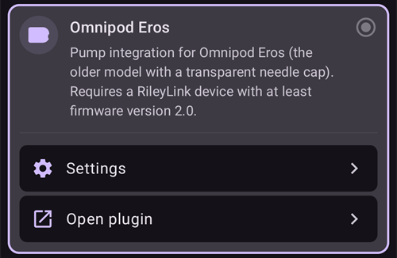
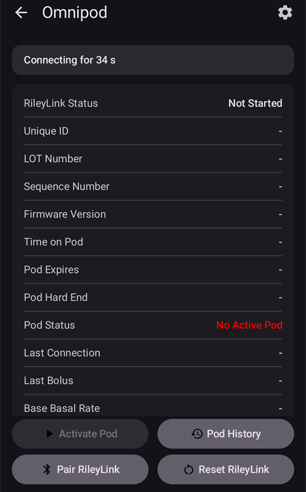

# Omnipod Eros

These instructions are for configuring the Omnipod Eros generation pump (**NOT Omnipod Dash**).

```{admonition} Omnipod Eros is being phased out
:class: note

The [Omnipod System](https://www.omnipod.com/current-podders/resources/omnipod-system) (the original Omnipod, comprising both the Personal Diabetes Manager (PDM) and the Pod) is being discontinued, and the end date varies by country. For example, it will no longer be available in Canada after 30 June 2026. If you rely on the Eros pump, plan ahead for a transition to a supported pump.
```

**Această aplicație face parte dintr-o soluție DIY (do-it-yourself/ o aplicație pe care o construiți singur) și nu este un produs finit; și necesită ca dumneavoastră să citiți, să învățați și să înțelegeți sistemul, de la construcție pana la modul de utilizare. You alone are responsible for what you do with it.**

```{contents} Table of contents
:depth: 1
:local: true
```

## Cerințe hardware și software

- **Dispozitiv de comunicare cu pompa**

> Componenta care face puntea de comunicarea de la telefonul cu AAPS activat către generația de pompe Eros.
> 
> > -   [Website OrangeLink](https://getrileylink.org/product/orangelink)
> > -  [433MHz RileyLink](https://getrileylink.org/product/rileylink433)
> > -   [Site Emalink](https://github.com/sks01/EmaLink) - [Informații de contact](mailto:getemalink@gmail.com)
> > -   DiaLink - [Informații de contact](mailto:Boshetyn@ukr.net)
> > -   [SiteLoopLink](https://www.getlooplink.org/) - [Informații de contact](https://jameswedding.substack.com/) - Netestat

-   **Telefon mobil**

> Componenta care va opera AAPS și va trimite comenzi de control către dispozitivul de comunicare cu pompa.
> 
> > - Supported [Android phone](#Phones-list-of-tested-phones) with **AAPS** and related components set up.

-   **Dispozitiv de administrare insulină**

> Componenta care va interpreta comenzile primite de la dispozitivul de comunicare cu pompa care provine de la telefonul ce rulează AAPS.
> 
> > - O nouă pompă Omnipod (generația Eros - **NU DASH**)

These instructions assume that you are starting a new pod session. If this is not the case, please be patient and start this process at your next pod change.

In this page, **RileyLink** means any of the pod communication devices listed above.

## Înainte să începeți

**SIGURANȚA MAI ÎNTÂI** - nu încercați acest proces într-un mediu în care nu vă puteți reveni după o eroare (pompe suplimentare, insulină, RileyLink încărcat și dispozitive de telefonie mobilă sunt obligatorii).

**Telecomanda dumneavoastră Omnipod nu va mai funcționa după ce driverul AAPS pentru Omnipod activează pompa**. Anterior, ați folosit telecomanda Omnipod pentru a trimite comenzi la pompa Omnipod Eros. O pompă Omnipod Eros permite unui singur dispozitiv să comunice cu ea. Dispozitivul care activează cu succes pompa este singurul dispozitiv care are permisiunea de a comunica cu ea de atunci încolo. Aceasta înseamnă că odată ce activați o pompă Omnipod Eros cu RileyLink prin intermediul driverului AAPS pentru Omnipod, **nu veți mai putea folosi telecomanda cu pompa**. Driverul AAPS Omnipod cu RileyLink este acum telecomanda dumneavoastră în vigoare. *Acest lucru nu înseamnă că ar trebui să aruncați telecomanda, este recomandat să o păstrați în caz de rezervă, și pentru urgențele când AAPS nu funcționează corect.*

**Only one RileyLink at a time can communicate with a pod.** **AAPS** remembers one paired RileyLink. If you pair a different one, it replaces the previous one.

**Pompa dumneavoastră nu se va închide atunci când dispozitivul RileyLink nu este în preajmă.** Când RileyLink este în afara razei de acțiune sau semnalul este blocat de la comunicarea cu pompa activă, pompa dumneavoastră va continua să administreze insulină bazală. La activarea unei pompe, profilul bazal definit în AAPS va fi programat în noua pompă. În cazul în care pierdeți contactul cu pompa, aceasta va reveni la acest profil bazal. Nu veți putea emite noi comenzi până când dispozitivul RileyLink nu va reveni în aria de acoperire și nu va putea restabili conexiunea.

**Profile cu rate bazale pe durate de 30 de minute nu sunt acceptate în AAPS.** Dacă sunteți la început în AAPS și configurați pentru prima dată profilul de rată a bazalei vă rugăm să rețineți că ratele bazale care încep de la jumătatea orei nu sunt acceptate și va trebui să vă ajustați profilul de rată bazală pentru a începe la fix. Spre exemplu, dacă aveți o rată bazală de 1,1 unități care începe la ora 09:30 și are o durată de 2 ore cu terminare la ora 11:30, aceasta nu va funcționa.  Va trebui să actualizați această rată bazală de 1,1 unități la un interval de timp de 9:00-11:00 sau 10:00-12:00.  Chiar dacă incrementele de 30 de minute ale profilului ratei bazale sunt acceptate de pompa Omnipod, AAPS nu le poate lua în considerare cu algoritmii săi în prezent.

## Activarea driverului Omnipod în AAPS

Puteți activa driverul Omnipod în AAPS în **două feluri**:

### Opțiunea 1: Asistentul de instalare

After installing a new version of AAPS, the **Setup Wizard** starts automatically. If you have already exported your settings from a previous installation, you can import them in the wizard. For new installations, continue below.

Go through the [Setup Wizard](../SettingUpAaps/SetupWizard.md) until you reach the **Pump** step, then select **Omnipod Eros** (the description reads "Pump integration for Omnipod Eros").


The Setup Wizard does not pair your RileyLink. After finishing the wizard, open the Omnipod pump screen and pair it as described in the [RileyLink Setup section](#OmnipodEros-rileylink-setup).

**SAU**

### Option 2: The Configuration screen

Open the top-left **menu** (☰) > **Configuration** > **Pump** and select the **radio button** of **Omnipod Eros**.

Once it is selected, the **Omnipod Eros** card shows two buttons, **Settings** and **Open plugin**:



**Settings** opens the settings of the Omnipod driver (see [Omnipod Settings](#OmnipodEros-omnipod-settings)):


**Open plugin** opens the Omnipod pump screen. You can also open it at any time from the main screen with **Manage** > **Pump**. This page calls it the **Omnipod pump screen**. Before a RileyLink is paired and a pod is activated, it looks like this:



### Verificarea Selecției Driverului Omnipod

To verify that you have enabled the Omnipod driver, open **Manage** > **Pump** from the main screen. You should see the **Omnipod Eros** pump screen shown above. If you have not paired a RileyLink yet, **RileyLink Status** shows **Not Started** and **Pod Status** shows **No Active Pod**.

## Configurare Omnipod

All pod and RileyLink functions are buttons on the [Omnipod pump screen](#OmnipodEros-omnipod-pod-tab) (**Manage** > **Pump**). Some buttons only appear in certain situations, for example when a pod is active.

>  Reîmprospătați conectivitatea și starea pompei
> 
>  Administrare pompă (activare, dezactivare, redare semnal sonor de test și istoric pompă)

```{admonition} Older screenshot
:class: note
The screenshots above are from an earlier **AAPS** version. In **AAPS** 4 there is no **POD MGMT** button or Pod Management menu: **Refresh** and all pod management actions are buttons on the Omnipod pump screen.
```

(OmnipodEros-rileylink-setup)=

### Setare RileyLink

If you have already paired your RileyLink, continue to the [Activating a Pod section](#OmnipodEros-activating-a-pod) below.

*Note: A good visual indicator that the RileyLink is not connected is that the treatment buttons (QuickLaunch toolbar) on the main screen will be missing. Aceasta va apărea, de asemenea, aproximativ în primele 30 de secunde după începerea AAPS, deoarece se conectează activ la RileyLink.*

1. Make sure that your RileyLink is fully charged and powered on.

2. Place the RileyLink [close to your phone](#OmnipodEros-optimal-omnipod-and-rileylink-positioning) (~30 cm away or less).

3. Open the Omnipod pump screen (**Manage** > **Pump**) and press **Pair RileyLink**.

4. The **Pair RileyLink** screen starts scanning for Bluetooth devices right away. Tap your RileyLink in the list of found devices.

   

5. When **RileyLink paired successfully** is shown with the name and address of your device, press **OK**.

6. Back on the Omnipod pump screen, check that **RileyLink Status** changes to **Connected**. **Pod Status** should show **No Active Pod**. If the RileyLink does not connect, press **Reset RileyLink**, or restart **AAPS**.

 

 


```{admonition} Older screenshot
:class: note
The six screenshots above (after step 6) are from an earlier **AAPS** version. In **AAPS** 4 you pair the RileyLink with the **Pair RileyLink** button on the Omnipod pump screen instead of **RileyLink Configuration** in the Omnipod settings, and scanning starts automatically.
```

```{note}
To switch to another RileyLink (for example a backup device), press **Pair RileyLink** again and select the new device. It replaces the one paired before. You do not need to remove the old device first.
```

(OmnipodEros-activating-a-pod)=

### Activarea unei pompe

Before you can activate a pod, make sure your RileyLink is paired and **RileyLink Status** shows **Connected**. The **Activate Pod** button stays disabled until the RileyLink is ready.

*REAMINTIRE: Comunicarea cu pompa se realizează pe o rază limitată în timpul activării și al asocierii, din motive de siguranță și securitate. Înainte de asociere semnalul radio al pompei este mai slab, însă după ce acesta va fi asociat, acesta va opera la putere totală de semnal. During these procedures, make sure that your pod is* [within close proximity](#OmnipodEros-optimal-omnipod-and-rileylink-positioning) *(~30 cm away or less) but not on top of or right next to the RileyLink.*

01. Open the Omnipod pump screen (**Manage** > **Pump**) and press **Activate Pod**.

    If you have never activated a profile, a **Profile required** step appears first. Select the profile to apply on activation.

    >   
    > 
    > ```{admonition} Older screenshot
    >     :class: note
    >     The screenshots above are from an earlier **AAPS** version. In **AAPS** 4 **Activate Pod** is a button on the Omnipod pump screen instead of in the **POD MGMT** menu.
    > ```

02. Ecranul **Umplere Pompă** este afișat. Fill a new pod with enough insulin for 3 days and listen for two beeps. They mean that the minimum amount of 80 units has been filled. Empty the fill syringe completely, even after hearing the two beeps. Când calculați cantitatea totală de insulină de care aveți nevoie pentru 3 zile, vă rugăm să luați în considerare faptul că amorsarea pompei va utiliza 12 până la 15 unități. Do not remove the pod's needle cap yet.

    > 
    > 
    > Ensure the new pod and RileyLink are within close proximity of each other (~30cm or less) and press **Next**.

03. **Select Insulin** (only shown if you have more than one insulin configured): select the insulin you are filling the pod with and press **Next**. A profile switch with this insulin is applied after activation.

04. Pe ecranul **inițializare pompă**, pompa va începe amorsarea (veți auzi un clic urmat de o serie de sunete ticăitoare pe măsură ce pompa se amorsează). Dacă dispozitivul RileyLink este în afara razei de comunicarea a pompei ce se activează, veți primi un mesaj de eroare **Niciun răspuns de la pompă**. If this occurs, [move the RileyLink closer](#OmnipodEros-optimal-omnipod-and-rileylink-positioning) (~30 cm away or less) to but not on top of or right next to the Pod and press **Retry**.

    >  

05. When priming is successful, a green checkmark is shown and the **Next** button becomes enabled. Press **Next**.

    > 

06. **Site location** (only shown if **Manage pump site rotation** is enabled in [Site Rotation](#Aapsscreens-site-rotation)): select where you place the pod on your body and press **Next**.

07. The **Attach Pod** screen is displayed. Prepare the infusion site of the new pod. Remove the pod's plastic needle cap and white paper backing from the adhesive and apply the pod to your chosen site on your body. If the cannula sticks out, press **Cancel** and discard the pod. When finished, press **Next**.

    > 

08. A confirmation dialog appears: "When you press OK, the cannula will be inserted". **ONLY press OK if you are ready to deploy the cannula**.

    > 

09. On the **Insert Cannula** screen, it may take some time before the Omnipod responds and inserts the cannula (1-2 minutes maximum), so be patient.

    > Dacă dispozitivul RileyLink este în afara razei de comunicarea a pompei ce se activează, veți primi un mesaj de eroare **Niciun răspuns de la pompă**. If this occurs, move the RileyLink closer (~30 cm away or less) to but not on top of or right next to the Pod and press **Retry**.
    > 
    > Dacă RileyLink este în afara razei de acțiune Bluetooth sau nu are conexiune activă la telefon, veți primi un mesaj de eroare **Niciun răspuns de la RileyLink**. If this occurs, move the RileyLink closer to the phone and press **Retry**.
    > 
    > *NOTĂ: Înainte de introducerea canulei, este o bună practică să strângeți pielea lângă punctul de inserție al canulei. Acest lucru asigură o inserare lină a acului și va reduce riscul de apariție a ocluziilor.*
    > 
    > 
    > 
    >  

10. O bifă verde va apărea, și butonul **Următorul** devine activat la inserarea cu succes a canulei. Press **Next**.

    > 

11. The **Pod Activated** screen is displayed. Check that the cannula has been inserted correctly, and change your pod if you think it has not. Press **Finish**. Felicitări! Acum ați început o nouă sesiune activă de pompă.

    >  
    > 
    > ```{admonition} Older screenshot
    >     :class: note
    >     The screenshots in steps 2 to 11 are from an earlier **AAPS** version and may look different in **AAPS** 4. The **Select Insulin** and **Site location** steps are not pictured.
    > ```

12. You are returned to the Omnipod pump screen. The **Activate Pod** button is replaced by **Deactivate Pod**, because you cannot activate another pod without deactivating the active one first.

    The pump screen now shows information about your active pod, including the current basal rate, reservoir level, insulin delivered, pod errors and alerts. For more details, see the [Omnipod pump screen](#OmnipodEros-omnipod-pod-tab) section.

     

    ```{admonition} Older screenshot
    :class: note
    The screenshots above are from an earlier **AAPS** version. In **AAPS** 4 there is no Pod Management menu: you return directly to the Omnipod pump screen, where **Deactivate Pod** replaces **Activate Pod**.
    ```

```{note}
If activation was interrupted after priming (for example the app was closed), press **Activate Pod** again. The wizard continues from the cannula insertion steps.
```

### Dezactivarea unei pompe

În condiții normale, durata de viață preconizată a unei pompe este de trei zile (72 de ore) și de încă 8 ore după avertismentul privind expirarea pompei, pentru un total de 80 de ore de utilizare totală a pompei.

Pentru a dezactiva o pompă (fie de la expirare, fie de la o defecțiune de pompă):

1. Open the Omnipod pump screen (**Manage** > **Pump**) and press **Deactivate Pod**.

   >   
   > 
   > ```{admonition} Older screenshot
   >    :class: note
   >    The screenshots above are from an earlier **AAPS** version. In **AAPS** 4 **Deactivate Pod** is a button on the Omnipod pump screen instead of in the **POD MGMT** menu.
   > ```

2. On the **Deactivate Pod** screen, first make sure the RileyLink is in close proximity to the pod but not on top of or right next to the pod. Then press **Next**. A dialog asks *A deactivated Pod can not be used again. Deactivate this Pod now?* Press **OK** to start deactivating the pod, or **Cancel** to keep it. Deactivation suspends all insulin delivery and cannot be undone.

   > 

3. The **Deactivating Pod** screen appears, and you will receive a confirmation beep from the pod that deactivation was successful.

   > 
   > 
   > **IF deactivation fails** and you do not receive a confirmation beep, you may receive a **No response from RileyLink** or **No response from Pod** message. Press **Retry** to attempt deactivation again. If deactivation keeps failing, press **Discard Pod** and confirm. **AAPS** then forgets the pod. Insulin delivery has **not** been suspended, so remove the pod from your body. If your pod has a screaming alarm, you may need to silence it manually (using a pin or a paperclip), because **Discard Pod** does not silence it.
   > 
   > >   

4. A green checkmark appears when deactivation is successful. Press **Next** to display the **Pod Deactivated** screen. Acum puteți să dați jos pompa deoarece sesiunea activă a fost dezactivată.

   > 

5. Press **Finish** to return to the Omnipod pump screen.

   >  
   > 
   > ```{admonition} Older screenshot
   >    :class: note
   >    The screenshots in steps 2 to 5 are from an earlier **AAPS** version and may look different in **AAPS** 4.
   > ```

6. On the Omnipod pump screen, check that **RileyLink Status** shows **Connected** and **Pod Status** shows **No Active Pod**.

   >    
   > 
   > ```{admonition} Older screenshot
   >    :class: note
   >    The screenshots above are from an earlier **AAPS** version. In **AAPS** 4 **Finish** returns you directly to the Omnipod pump screen; there is no Pod Management menu or **Omnipod (POD)** tab.
   > ```

### Suspendarea și reluarea administrării insulinei

The process below shows you how to suspend and resume insulin delivery.

*NOTE - if you do not see a **Suspend** button*, it is hidden by default. Enable **Show Suspend Delivery button in Omnipod tab** in the [Omnipod settings](#OmnipodEros-omnipod-settings) under **Other**.

#### Suspendarea administrării insulinei

Folosiți această comandă pentru a pune pompa activă într-o stare suspendată. În această stare de suspendare, pompa nu va mai administra deloc insulină. Această comandă imită funcția de suspendare pe care telecomanda Omnipod originală o transmite unei pompe active.

1. Open the Omnipod pump screen (**Manage** > **Pump**) and press **Suspend**. The suspend command is sent through the RileyLink to the active pod.

2. When the pod has suspended all insulin delivery, **Pod Status** shows **Suspended** and the **Suspend** button is replaced by **Resume Delivery**.

   >  
   > 
   > 
   > 
   >  
   > 
   > ```{admonition} Older screenshot
   >    :class: note
   >    The screenshots above are from an earlier **AAPS** version. In **AAPS** 4 these steps take place on the Omnipod pump screen instead of the **Omnipod (POD)** tab, and the result is shown in **Pod Status**.
   > ```

If the command fails, a **Warning** dialog shows "Failed to suspend delivery" with the reason. Check the RileyLink connection and try again.

#### Reluarea administrării de insulină

Utilizați această comandă pentru a instrui pompa activă, aflată în prezent în suspendare, pentru a relua administrarea insulinei. După ce comanda a fost procesată cu succes, insulina va relua administrarea normală folosind rata bazală curentă pe baza timpului curent din profilul bazal activ. Pompa va accepta din nou comenzi pentru bolus, RBT, și SMB.

1. Open the Omnipod pump screen and check that **Pod Status** shows **Suspended**. Press **Resume Delivery**.

2. When the command succeeds, **Pod Status** shows **Running** again and the **Resume Delivery** button disappears (the **Suspend** button is shown again if you have enabled it).

   >  
   > 
   > 
   > 
   >  
   > 
   > ```{admonition} Older screenshot
   >    :class: note
   >    The screenshots above are from an earlier **AAPS** version. In **AAPS** 4 these steps take place on the Omnipod pump screen instead of the **Omnipod (POD)** tab, and the result is shown in **Pod Status**.
   > ```

If the command fails, a **Warning** dialog shows "Failed to resume delivery" with the reason. Check the RileyLink connection and try again.

### Amuțirea alertelor de pompă

*NOTE - The **Silence Alerts** button is only shown on the Omnipod pump screen while the pod has an active alert (for example the pod expiration or low reservoir alert), and only if **Automatically silence Pod alerts** is disabled.*

The process below shows you how to silence pod beeps that start when the pod reaches the warning time before it expires. This warning time is set with **Alert at hours before shutdown (80 Hours)** in the Omnipod **Alerts** settings. Durata maximă de viață a unei pompe este de 80 de ore (3 zile 8 ore), cu toate acestea, Insulet recomandă să nu fie depășită limita de 72 de ore (3 zile).

*NOTE - If you have enabled **Automatically silence Pod alerts** in the Omnipod **Alerts** settings, **AAPS** silences the alert automatically at the next communication with the pod, and you do NOT need to do it manually.*

1. When the warning time is reached, the pod beeps to tell you that it will soon expire and needs to be changed. On the Omnipod pump screen, **Pod Expires** shows the exact time the pod expires (72 hours after activation); it turns **yellow** 4 hours before. **Pod Hard End** shows when the pod stops delivering insulin. **Active Pod Alerts** shows **Pod will expire soon**, and the **Silence Alerts** button appears. **AAPS** also shows a notification about the upcoming pod expiration.

   >   
   > 
   > ```{admonition} Older screenshot
   >    :class: note
   >    The screenshots above are from an earlier **AAPS** version. In **AAPS** 4 the **ACK ALERTS** button is called **Silence Alerts** and is on the Omnipod pump screen.
   > ```

2. Press **Silence Alerts**. The RileyLink sends the command to the pod to stop the expiration warning beeps.

   >  
   > 
   > ```{admonition} Older screenshot
   >    :class: note
   >    The screenshot above is from an earlier **AAPS** version. In **AAPS** 4 the button is called **Silence Alerts**.
   > ```

3. When the alerts are silenced, the pod beeps twice. **Active Pod Alerts** no longer shows the warning, the **Silence Alerts** button disappears and the pod stops its expiration warning beeps.

   >  
   > 
   > ```{admonition} Older screenshot
   >    :class: note
   >    The screenshot above is from an earlier **AAPS** version. In **AAPS** 4 the result is shown on the Omnipod pump screen: the warning disappears from **Active Pod Alerts**.
   > ```

If the command fails (for example the RileyLink is out of range of the pod), a **Warning** dialog shows "Failed to silence alerts" with the reason. Move the RileyLink closer to the pod and try again.


```{admonition} Older screenshot
:class: note
The screenshot above is from an earlier **AAPS** version. In **AAPS** 4 the **Warning** dialog shows "Failed to silence alerts" with the reason.
```

(OmnipodEros-view-pod-history)=

### Vedeți istoricul pompei

Această secțiune vă arată cum să examinați istoricul pompelor active și să filtrați după diferite categorii de acțiune. Instrumentul de istoric pompă vă permite să vizualizați acțiunile și rezultatele angajate față de pompa activă în timpul vieții sale de trei zile (72-80 de ore).

Această caracteristică este utilă pentru verificarea bolusurilor, a RBT, a modificărilor bazale care au fost făcute, dar este posibil să nu fiți sigur dacă acestea au fost finalizate. Restul categoriilor sunt utile în general pentru depanarea problemelor și determinarea ordinii evenimentelor care au avut loc până la un eșec.

*NOTĂ:* **Nesigur** comenzile vor apărea în istoricul pompei, însă, datorită naturii lor, nu se poate asigura acuratețea lor.

1. Open the Omnipod pump screen (**Manage** > **Pump**) and press **Pod History**.

   >   
   > 
   > ```{admonition} Older screenshot
   >    :class: note
   >    The screenshots above are from an earlier **AAPS** version. In **AAPS** 4 **Pod History** is a button on the Omnipod pump screen instead of in the **POD MGMT** menu.
   > ```

2. The **Pod History** screen lists all pod actions and their results, newest first, grouped by day. By default **All** is selected. Tap one of the filter buttons at the top to show only one category. Use the back arrow at the top left to return to the Omnipod pump screen.

   > 

   >  
   > 
   > ```{admonition} Older screenshot
   >    :class: note
   >    The second screenshot is from an earlier **AAPS** version and may look different in **AAPS** 4.
   > ```

### Vedeți Setările RileyLink și Istoric

The **RileyLink Stats** screen shows the settings of your RileyLink and active pod, and the communication history of both. It has two tabs: **Settings** and **History**.

The **RileyLink Stats** button is hidden by default. To show it on the Omnipod pump screen, enable **Show RileyLink Stats button in Pod Management menu** in the [Omnipod settings](#OmnipodEros-omnipod-settings) under **Other**.

#### Restabiliți manual comunicarea Bluetooth a dispozitivului de comunicare cu pompă

If your pod communication device was out of Bluetooth range of your phone for a while, **RileyLink Status** may report **RileyLink unreachable** on the Omnipod pump screen. **AAPS** normally reconnects by itself when the device is back in range. If it does not:

1. Make sure the RileyLink is powered on, charged and close to your phone.

2. On the Omnipod pump screen, press **Reset RileyLink**. A message confirms **RileyLink configuration reset**. See the [Reset RileyLink notes](#OmnipodEros-reset-rileylink-config-notes) below.

3. Dacă conexiunea **Bluetooth** nu se restabilește, încercați să **dezactivați ** manual și apoi înapoi **să activați** funcția Bluetooth de pe telefonul dumneavoastră.

4. If it still does not reconnect, press **Pair RileyLink** and select your RileyLink again.

5. After a successful reconnection, **RileyLink Status** shows **Connected**. You can also check **Connection Status** on the **Settings** tab of the **RileyLink Stats** screen. Felicitări, ați reconectat dispozitivul de comunicare cu pompa configurat la AAPS!

 


```{admonition} Older screenshot
:class: note
The screenshots above are from an earlier **AAPS** version. In **AAPS** 4 you reconnect with **Reset RileyLink** or **Pair RileyLink** on the Omnipod pump screen instead of the refresh button on the RileyLink Settings screen.
```

#### Setări ale dispozitivului de comunicare cu pompă și ale pompei active

This screen shows information and status for both the currently paired pod communication device and the currently active Omnipod Eros pod. The information refreshes automatically.

1. Open the Omnipod pump screen (**Manage** > **Pump**) and press **RileyLink Stats**. The **Settings** tab shows your currently paired **RileyLink** and the active pod (**Device**).

   >   
   > 
   > ```{admonition} Older screenshot
   >    :class: note
   >    The screenshots above are from an earlier **AAPS** version. In **AAPS** 4 **RileyLink Stats** is a button on the Omnipod pump screen instead of in the **POD MGMT** menu.
   > ```

   > 

##### RileyLink fields

> - **Address:** MAC address of the paired pod communication device.
> - **Name:** Bluetooth name of the paired pod communication device.
> - **Battery Level:** The current battery level of the connected pod communication device. Only shown when **Show battery level reported by OrangeLink/EmaLink/DiaLink** is enabled.
> - **Stare conexiune**: Starea curentă a legăturii Bluetooth între dispozitivul de comunicare cu pompa și telefonul pe care rulează AAPS.
> - **Connection Error:** If there is an error with the pod communication device Bluetooth connection, details are displayed here.
> - **Versiunea de firmware:** Versiunea curentă de firmware instalată pe dispozitivul de comunicare cu pompa conectat în prezent.

##### Device fields - With an Active Pod

> - **Device Type:** The type of device communicating with the pod communication device (Omnipod (Eros)).
> - **Configured Device Model:** The model of the device configured to communicate with the pod communication device.
> - **Connected Device Model:** The model of the device currently communicating with the pod communication device.
> - **Pump Serial Number:** Serial number of the currently activated pod.
> - **Pump Frequency:** Radio frequency used to communicate with the pod.
> - **Last Used Frequency:** Last known radio frequency the pod used to communicate with the pod communication device.
> - **Ultimul dispozitiv de contact:** Data și ora ultimului contact făcut de pompă cu dispozitivul de comunicare cu pompa.

(omnipod-eros-rileylink-and-active-pod-history)=
#### RileyLink și istoricul pompei active

This tab lists, newest first, each state or action of the RileyLink or the currently connected pod. The history is only available for the currently active pod. After a pod change, this history is erased and only events from the newly activated pod are recorded and shown.

1. Open the Omnipod pump screen (**Manage** > **Pump**), press **RileyLink Stats** and then tap the **History** tab.

   >   
   > 
   > ```{admonition} Older screenshot
   >    :class: note
   >    The screenshots above are from an earlier **AAPS** version. In **AAPS** 4 **RileyLink Stats** is a button on the Omnipod pump screen instead of in the **POD MGMT** menu.
   > ```

   > 

##### Câmpuri

Each entry shows:

> - **Device:** The device to which the action or state refers.
> - **Time:** The time of the event.
> - **State or Action:** The state of the device or the action it performed.

(OmnipodEros-omnipod-pod-tab)=

## Omnipod pump screen

Below is an explanation of the status fields and buttons on the **Omnipod pump screen** (**Manage** > **Pump**, or **Configuration** > **Pump** > **Open plugin**).

The gear icon at the top right opens the [Omnipod settings](#OmnipodEros-omnipod-settings).

*NOTE: If any status field shows (uncertain), press **Refresh** to refresh the pod status and clear it.*


```{admonition} Older screenshot
:class: note
The screenshot above is from an earlier **AAPS** version, where this screen was the **Omnipod (POD)** tab. In **AAPS** 4 it is the Omnipod pump screen, and some field names and buttons differ.
```

### Câmpuri

- **RileyLink Status:** Displays the current connection status of the RileyLink. Errors are shown in red.

- *Not Started* - no RileyLink is paired yet, or the connection has not started.
- *RileyLink unreachable* - pod communication device is either not within Bluetooth range of the phone, powered off or has a failure preventing Bluetooth communication.
- *RileyLink ready* - pod communication device is powered on and actively initializing the Bluetooth connection.
- *Conectat* - dispozitivul de comunicare cu pompa este pornit, conectat și capabil să comunice prin Bluetooth.

- **Unique ID:** Displays the address of the active pod.

- **LOT Number:** Displays the LOT number of the active pod.

- **Sequence Number:** Displays the serial number (TID) of the pod.

- **Versiunea firmware:** Afișează versiunea de firmware a pompei activ.

- **Timpul din pompă:** Afișează timpul actual de pe pompa activă. It is highlighted when it differs from the phone time by more than 5 minutes.

- **Pod Expires:** Displays the date and time when the active pod will expire. The text turns yellow in the last 4 hours before this time. It never turns red, because the pod keeps delivering insulin after it.

- **Pod Hard End:** Displays the end of the pod's grace period (8 hours after **Pod Expires**, for a maximum pod life of 80 hours). The text turns yellow when the grace period starts (at **Pod Expires**) and red in the last 4 hours before the hard end. During the grace period it also shows the time left, for example *(17m remaining)*. The pod stops delivering insulin at the hard end and must be changed.

- **Pod Status:** Displays the status of the active pod (for example **No Active Pod**, **Running** or **Suspended**).

- **Last Connection:** Displays the last time communication with the active pod was achieved. The text turns red when the [pump unreachable threshold](#OmnipodEros-troubleshooting) is exceeded.

- *Adineauri* - mai puțin de 20 de secunde în urmă.
- *Cu mai puțin de un minut în urmă* - mai mult de 20 de secunde, dar mai puțin de 60 de secunde în urmă.
- *Acum 1 minut* - mai mult de 60 de secunde, dar mai puțin de 120 de secunde (2 minute)
- *XX minute în urmă* - mai mult de 2 minute în urmă așa cum este definit de valoarea XX

- **Last Bolus:** Displays the dosage of the last bolus sent to the active pod and how long ago it was issued in parenthesis.

- **Base Basal Rate:** Displays the basal rate programmed for the current time from the basal rate profile.

- **Temp Basal Rate:** Only shown while a Temporary Basal Rate is running. Displays it in the following format:

- Unități / oră @ ora la care a fost emisă RBT (minute rulate / total minute pentru care RBT va fi rulată)
- *Exemplu:* 0.00U/h @18:25 ( 90/120 minute)

- **Reservoir:** Displays **Over 50 U left** when more than 50 units are left in the reservoir. Below this value the approximate number of units is displayed. The text turns red below the low reservoir threshold set in the [Alerts settings](#OmnipodEros-omnipod-settings).

- **Total Delivered:** Displays the total number of units of insulin delivered from the reservoir. *Rețineți că aceasta este o aproximare deoarece amorsarea și umplerea pompei nu este un proces exact.*

- **Active Pod Alerts:** Reserved for currently running alerts on the active pod. Folosit în mod normal atunci când expirarea pompei a trecut de 72 de ore și sunt rulate alerte sonore native.

- **Errors:** Displays the last error encountered (shown in red). Revizuiți [Istoricul de pompă](#OmnipodEros-view-pod-history), [Istoricul RileyLink](#omnipod-eros-rileylink-and-active-pod-history) și fișierele de jurnal pentru erorile din urmă și informații mai detaliate.

### Butoane

The buttons at the bottom of the pump screen change depending on the situation. Buttons that cannot be used right now are greyed out, for example while the RileyLink is not connected.

**Pod status buttons** (shown when a pod is active):

- **Refresh:** Sends a refresh command to the active pod to update its status. Use it to refresh the pod status and clear status fields that contain the text (uncertain). Vedeți secțiunea [Depanare](#OmnipodEros-troubleshooting) de mai jos pentru informaţii suplimentare.

  

  ```{admonition} Older screenshot
  :class: note
  The screenshot above is from an earlier **AAPS** version. In **AAPS** 4 this is a text button named **Refresh** on the Omnipod pump screen.
  ```

- **Silence Alerts:** Silences the pod expiration and low reservoir beeps and notifications. Only shown when the pod has an active alert and **Automatically silence Pod alerts** is disabled. After the alerts are silenced, the button disappears.

  

  ```{admonition} Older screenshot
  :class: note
  The screenshot above is from an earlier **AAPS** version. In **AAPS** 4 this button is called **Silence Alerts**.
  ```

- **Set time:** Updates the time on the pod with the current time on your phone. Only shown when the time on the pod differs from the phone time by more than 5 minutes.

  

  ```{admonition} Older screenshot
  :class: note
  The screenshot above is from an earlier **AAPS** version. In **AAPS** 4 this is a text button named **Set time** on the Omnipod pump screen.
  ```

- **Suspend:** Suspends insulin delivery on the active pod. Only shown if enabled in the settings (**Show Suspend Delivery button in Omnipod tab**).

  

  ```{admonition} Older screenshot
  :class: note
  The screenshot above is from an earlier **AAPS** version. In **AAPS** 4 this is a text button named **Suspend** on the Omnipod pump screen.
  ```

- **Resume Delivery:** Resumes insulin delivery on the currently suspended, active pod. Only shown while the pod is suspended.

  

  ```{admonition} Older screenshot
  :class: note
  The screenshot above is from an earlier **AAPS** version. In **AAPS** 4 this is a text button named **Resume Delivery** on the Omnipod pump screen.
  ```

**Pod and RileyLink management buttons:**


```{admonition} Older screenshot
:class: note
The screenshot above is from an earlier **AAPS** version. In **AAPS** 4 there is no Pod Management menu: these actions are buttons directly on the Omnipod pump screen.
```

- **Activate Pod:** Primes and activates a new pod. Shown when no pod is active. It is enabled only when the RileyLink is connected.

  

  ```{admonition} Older screenshot
  :class: note
  The screenshot above is from an earlier **AAPS** version. In **AAPS** 4 **Activate Pod** is a button on the Omnipod pump screen instead of in the Pod Management menu.
  ```

- **Deactivate Pod:** Deactivates the currently active pod. Shown as soon as a pod is paired, also when an activation stopped part-way (for example because the pod failed during activation). It is enabled only when the RileyLink is connected. **AAPS** asks you to confirm before it deactivates the pod.

- Utilizați această comandă pentru a dezactiva o pompă ce emite un semnal sonor încontinuu (eroare 49).
- If deactivation fails, the deactivation wizard offers a **Discard Pod** option.

  

  ```{admonition} Older screenshot
  :class: note
  The screenshot above is from an earlier **AAPS** version. In **AAPS** 4 **Deactivate Pod** is a button on the Omnipod pump screen instead of in the Pod Management menu.
  ```

- **Play Test Beep:** Plays a single test beep on the pod when pressed. Shown when a pod is paired.

  

  ```{admonition} Older screenshot
  :class: note
  The screenshot above is from an earlier **AAPS** version. In **AAPS** 4 **Play Test Beep** is a button on the Omnipod pump screen instead of in the Pod Management menu.
  ```

- **Pod History:** Displays the active pod activity history. See [View Pod History](#OmnipodEros-view-pod-history).

  

  ```{admonition} Older screenshot
  :class: note
  The screenshot above is from an earlier **AAPS** version. In **AAPS** 4 **Pod History** is a button on the Omnipod pump screen instead of in the Pod Management menu.
  ```

- **Pair RileyLink:** Scans for your pod communication device and pairs it. See [RileyLink Setup](#OmnipodEros-rileylink-setup).

- **RileyLink Stats:** Opens the RileyLink Stats screen with two tabs. Only shown if enabled in the settings (**Show RileyLink Stats button in Pod Management menu**).

- **Setări** - afișați informații despre setările dispozitivului RileyLink și ale pompei active
- **Istoric** - afișați istoricul de comunicare ale dispozitivului RileyLink și ale pompei

  

  ```{admonition} Older screenshot
  :class: note
  The screenshot above is from an earlier **AAPS** version. In **AAPS** 4 **RileyLink Stats** is a button on the Omnipod pump screen instead of in the Pod Management menu.
  ```

- **Reset RileyLink:** Resets the configuration of the currently connected pod communication device. When communication is started, specific data is sent to and set in the RileyLink:

- Memory Registers are set
- Communication Protocols are set
- Tuned Radio Frequency is set
  > 
  > See [additional notes](#OmnipodEros-reset-rileylink-config-notes) below.

  

  ```{admonition} Older screenshot
  :class: note
  The screenshot above is from an earlier **AAPS** version. In **AAPS** 4 this button is called **Reset RileyLink** and is on the Omnipod pump screen.
  ```

- **Discard Pod:** Discards the pod state of an unresponsive pod, after a confirmation. Only shown when a pod has been started but not fully paired, as proper deactivation is no longer possible:

- O pompă **nu este pe deplin asociată** şi astfel ignoră comenzile de dezactivare.
- A **pod is stuck** during the pairing process between steps.
- O pompă **pur și simplu nu se asociază deloc.**
  > 
  > After you discard a pod, **AAPS** can no longer communicate with it. Remove the pod from your body.

  

  ```{admonition} Older screenshot
  :class: note
  The screenshot above is from an earlier **AAPS** version. In **AAPS** 4 **Discard Pod** is a button on the Omnipod pump screen instead of in the Pod Management menu.
  ```

(OmnipodEros-reset-rileylink-config-notes)=

#### *Reset RileyLink Notes*

- Utilizarea primară a acestei funcții este atunci când dispozitivul activ de comunicare cu pompa nu răspunde și comunicarea este într-o stare blocată.
- If the pod communication device is turned off and then back on, press **Reset RileyLink** so that these communication parameters are set again in the pod communication device.
- Dacă acest lucru nu este făcut, atunci AAPS va trebui să fie repornit după ce dispozitivul de comunicare cu pompa este repornit.
- This button **DOES NOT** need to be pressed when switching between different pod communication devices.

(OmnipodEros-omnipod-settings)=

## Setări Omnipod

To open the Omnipod driver settings, either:

- press the gear icon at the top right of the Omnipod pump screen (**Manage** > **Pump**), or
- open the top-left **menu** (☰) > **Configuration** > **Pump** and press **Settings** on the **Omnipod Eros** card.


```{admonition} Older screenshot
:class: note
The screenshot above is from an earlier **AAPS** version. In **AAPS** 4 you open the settings with **Settings** on the **Omnipod Eros** card or the gear icon on the Omnipod pump screen, instead of the settings gear in **Configuration** or the 3-dot menu.
```

The settings are grouped as listed below. Tap a group to expand it. Most entries are switches you can enable or disable:


*NOTĂ: Un asterisc (\*) indică valoarea implicită pentru o setare activată.*

### RileyLink

Settings for the pod communication device. You pair the device itself with the **Pair RileyLink** button on the pump screen (see [RileyLink Setup](#OmnipodEros-rileylink-setup)).

- **Use Scanning:** Scans before connecting to the OrangeLink. This can improve connections. It can also be used with other RileyLink clones if needed.

- **Show battery level reported by OrangeLink/EmaLink/DiaLink:** Reports the actual battery level of the OrangeLink/EmaLink/DiaLink. Este **recomandat cu insistență** ca toți utilizatorii de OrangeLink/EmaLink/DiaLink să activeze această setare.

- NU funcționează cu dispozitivul RileyLink original.
- Este posibil să nu funcționeze cu dispozitivele alternative RileyLink.
- Activat - Raportează nivelul bateriei curente pentru dispozitivele acceptate de comunicare cu pompa.
- Dezactivat - Raportează o valoare de n/a.

- **Enable battery change logging in Actions:** Only available when the battery reporting setting above is enabled. Some pod communication devices can use regular batteries that you can change. With this setting enabled, you can record a **Pump Battery Change** [careportal entry](#aaps-screens-careportal) to note the change and reset the battery age.

### Confirmation Beeps

Furnizează semnale acustice de confirmare de la pompă pentru administrarea și modificările de bolus, insulină bazală, SMB și TBR.

- **\*Semnale sonore activate pentru bolusuri:** Activați sau dezactivați semnalele sonore de confirmare atunci când un bolus este administrat.
- **Basal beeps enabled:** Enable or disable confirmation beeps when a new basal rate is set, active basal rate is canceled or current basal rate is changed.
- **\*Semnale sonore SMB-uri:** Activează sau dezactivează semnalele sonore de confirmare atunci când un SMB este administrat.
- **Semnale sonore RBT:** Activează sau dezactivează mesajele de confirmare atunci când o RBT este setată sau anulată.

### Alerte

Furnizează alerte AAPS în ceea ce privește expirarea pompei, închiderii, rezervorului scăzut în baza unităților prag definite.

*Țineți cont că o notificare AAPS va fi emisă ÎNTOTDEAUNA pentru orice alertă după comunicarea inițială cu pompa de când alerta a fost declanșată. Dismissing the notification will NOT silence the alert UNLESS **Automatically silence Pod alerts** is enabled. To silence the alert MANUALLY, open the Omnipod pump screen and press **Silence Alerts**.*

- **\*Expiration reminder enabled:** When enabled, the pod beeps when the time set below is reached.
- **Alert at hours before shutdown (80 Hours):** The number of hours before the pod shuts down (80 hours after activation) at which the expiration reminder is triggered (1 to 8 hours, default 8).
- **Alertă de rezervor scăzut activată:** Activați sau dezactivați o alertă atunci când se atinge limita joasă a unităților rămase în rezervorul din pompă, așa cum a fost definită în câmpul Număr de unități.
- **Number of units:** The number of units at which to trigger the pod low reservoir alert (5 to 50, default 20).
- **Automatically silence Pod alerts:** When enabled, a notification is still issued, but the alert is silenced automatically at the next communication with the pod after the alert started.

### Notificări

Oferă notificări AAPS și alerte sonore de telefon atunci când nu este sigur dacă evenimentele de tip RBT, SMB sau bolus au avut succes.

*NOTĂ: Acestea sunt doar notificări, nu sunt emise alerte sonore.*

- **\*Sound for uncertain TBR notifications enabled:** Enable or disable this setting to trigger an audible alert and visual notification when AAPS is uncertain if a TBR was successfully set.
- **Sunet pentru notificări SMB incerte activat:** Activează sau dezactivează această setare pentru a declanșa o alertă sonoră și o notificare vizuală atunci când AAPS nu este sigur dacă un SMB a fost administrat cu succes.
- **Sunet pentru notificări de bolus incert activat:** Activați sau dezactivați această setare pentru a declanșa o alertă sonoră și o notificare vizuală atunci când AAPS nu este sigur dacă un bolus a fost administrat cu succes.

### Altele

Oferă setări avansate pentru a ajuta depanarea.

- **Show Suspend Delivery button in Omnipod tab:** Hide or display the **Suspend** button on the Omnipod pump screen.
- **Show Pulse Log button in Pod Management menu:** This setting is still listed, but the current version of the pump screen has no **Pulse Log** button.

- **Show RileyLink Stats button in Pod Management menu:** Hide or display the **RileyLink Stats** button on the Omnipod pump screen.
- **\*DST/Time zone detection enabled:** Allows time zone changes to be automatically detected if the phone is used in an area where DST is observed.

### Schimbarea sau eliminarea unui dispozitiv activ de comunicare cu pompa (RileyLink)

With many alternative models to the original RileyLink available (such as OrangeLink or EmaLink), or the need to have multiple or backup versions of the same pod communication device, you may need to switch to another device.

To switch, open the Omnipod pump screen (**Manage** > **Pump**), press **Pair RileyLink** and select the new device, as described in [RileyLink Setup](#OmnipodEros-rileylink-setup). The new device replaces the previously paired one.

 


 

```{admonition} Older screenshot
:class: note
The screenshots above are from an earlier **AAPS** version. In **AAPS** 4 you add a device with **Pair RileyLink** on the Omnipod pump screen instead of **RileyLink Configuration** in the Omnipod settings, and scanning starts automatically.
```

There is no separate button to remove a paired device. If you stop using a RileyLink, simply pair the new one when you need it.


```{admonition} Older screenshot
:class: note
The screenshots above are from an earlier **AAPS** version. In **AAPS** 4 there is no **Remove** button: pairing a new RileyLink replaces the previous one.
```

## Status row and careportal

There are a few items that are specific to how the Omnipod pod differs from tube based pumps, especially after applying a new pod.

The **insulin** and **cannula** ages in the [status row](#screens-sensor-level-battery) of the main screen are **reset** to 0 days and 0 hours **after each pod change**. Asta se face datorită modului în care pompa Omnipod este construită și funcționează. **Bateria pompei** și **rezervorul de insulină** sunt integrate înăuntrul fiecărei pompe. Deoarece pompa inserează canula direct în piele la locul aplicării pompei, un fir obișnuit nu este utilizată în pompele Omnipod. *Prin urmare, după schimbarea pompei vechimea fiecăreia dintre aceste valori se va reseta automat la zero.* **Vechimea bateriei pompei** nu este raportată deoarece bateria din pompă va fi întotdeauna mai mare decât durata de viață a pompei (maxim 80 de ore).


```{admonition} Older screenshot
:class: note
The screenshot above is from an earlier **AAPS** version, where these ages were shown in the **Careportal** section of the **Actions (ACT)** tab. In **AAPS** 4 they are shown in the status row of the main screen.
```

### Niveluri

**Nivelul insulinei**

Raportarea cantității de insulină din pompa Omnipod Eros nu este exactă. This is because it is not known exactly how much insulin was put in the pod, only that when the 2 beeps are triggered while filling the pod at least 80 units have been filled. O pompă poate ține maximum 200 de unități. Priming can also introduce variance as it is not an exact process. Cu ambii factori, driverul Omnipod a fost scris pentru a oferi cea mai bună aproximare a insulinei rămase în rezervor.

> - **Peste 50 de unități** - raportează o valoare de 50+U atunci când mai mult de 50 de unități se află în rezervor.
> - **Sub 50 de unități** - raportează o valoare calculată aproximativă a insulinei rămase în rezervor.
> - **SMS** - Returnează valoarea sau 50+U pentru răspunsuri SMS
> - **Nightscout** - Încarcă în Nightscout valoarea de 50 atunci când sunt peste 50 de unități (versiunea 14.07 și mai vechi).  Versiunile mai noi vor raporta o valoare de 50+ atunci când depășesc 50 de unități.

**Nivelul bateriei**

Raportarea nivelului bateriei este o setare care poate fi activată pentru a returna nivelul de baterie curent al dispozitivelor de comunicare cu pompa, precum OrangeLink, EmaLink sau DiaLink.  Dispozitivul RileyLink nu poate raporta nivelul său al bateriei.  Nivelul bateriei este raportat după fiecare comunicare cu pompa, astfel încât nu se poate observa o creștere liniară atunci când se încarcă.  O reîmprospătare manuală va actualiza nivelul bateriei curente.  Atunci când un dispozitiv acceptat de comunicare cu pompa este deconectat, va fi raportată o valoare de 0%.

> - **Dispozitivul RileyLink NU poate raporta nivelul bateriei**
> - **"Afișare nivelului de baterie raportat de OrangeLink/EmaLink/DiaLink" Setarea TREBUIE activată în setările Omnipod pentru a raporta valorile nivelului bateriei**
> - **Raportarea nivelului bateriei funcționează numai pentru dispozitivele OrangeLink, EmaLink și DiaLink**
> - **Raportarea nivelului de baterie POATE funcționa pentru alte dispozitive (cu excepția RileyLink)**
> - **SMS** - Returnează nivelul bateriei curente ca răspuns atunci când există un nivel real, o valoare de n/a nu va fi returnată
> - **Nightscout** - Nivelul bateriei este raportat atunci când există un nivel real, o valoare de n/a nu va fi raportată

(OmnipodEros-troubleshooting)=

## Depanare

### Eșecuri pompă

Ocazional, apare un eșec din cauza unei varietăți de probleme, inclusiv a problemelor de hardware cu pompa în sine. Cel mai bine este să nu se recurgă la Insulet, deoarece AAPS nu este un caz de utilizare aprobat. O listă de coduri de eroare poate fi găsită [aici](https://github.com/openaps/openomni/wiki/Fault-event-codes) pentru a ajuta la determinarea cauzei.

### Prevenirea erorii 49 de pompă

Acest eșec este legat de o stare incorectă a pompei pentru o comandă sau o eroare în timpul unei comenzi de administrare a insulinei. We recommend that you set Nightscout synchronization to *upload only*: keep all the "Receive ... from NS" options disabled in the synchronization settings of the Nightscout client (see [Nightscout](../SettingUpAaps/Nightscout.md)) to prevent possible failures.

### Alerte de pompă inaccesibilă

We recommend setting pump unreachable alerts to **120 minutes**. Press the **Settings** (gear) icon at the top right of the main screen, select **Local alerts** > **Pump unreachable threshold** and set it to **120**.

(OmnipodEros-import-settings-from-previous-aaps)=
### Importați setările din AAPS anterior

```{admonition} Importing settings can end your active Pod
:class: warning
On the phone that is already running the Pod, leave **Also replace pump settings** unticked: the Pod session is kept and only the other settings are imported. Tick it only with a file exported during the Pod you are wearing now. See [Tubeless pumps](#ExportImportSettings-tubeless-pumps).
```

The safest way to reinstall **AAPS** is between two Pods:

1. Dezactivați sesiunea activă de pompă. Verificați dacă nu aveți o sesiune activă de pompă.
2. Exportați-vă setările și stocați o copie într-un loc sigur.
3. Dezinstalați versiunea anterioară a AAPS și reporniți telefonul.
4. Instalați noua versiune de AAPS și verificați dacă nu aveți o sesiune activă de pompă.
5. Importați setările și activați noua pompă.

### Alerte driver Omnipod

Please note that the Omnipod driver presents a variety of unique alerts on the **main screen**, most of them are informational and can be dismissed while some provide the user with an action to take to resolve the cause of the triggered alert. Un rezumat al principalelor alerte pe care este posibil să le întâlniți este prezentat mai jos:

#### Nicio pompă activă

Nicio sesiune activă de pompă detectată. Această alertă poate fi dezactivată temporar prin apăsarea **AMÂNAȚI** dar va continua să se declanșeze atâta timp cât o nouă pompă nu a fost activată. Odată activată, această alertă este pusă în mod silențios automat.

#### Pompă suspendată

Alertă informațională că pompa a fost suspendată.

#### Setarea profilului bazalei a eșuat. Administrarea insulinei poate fi suspendată! Please manually refresh the Pod status from the Omnipod tab and resume delivery if needed.

Informational alert that the Pod basal profile setting has failed. Open the Omnipod pump screen and press **Refresh**, then **Resume Delivery** if needed.

#### Nu s-a putut verifica dacă bolusul SMB a avut loc cu succes. If you are sure that the Bolus didn't succeed, you should manually delete the SMB entry from Treatments.

Alert that the SMB bolus success could not be verified. Check the **Last Bolus** field on the Omnipod pump screen to see if the SMB succeeded. If it did not, remove the entry from the treatments.

#### Nu este sigur dacă "sarcina bolus/RBT/SMB" s-a finalizat; vă rugăm verificați manual dacă a avut succes.

Datorită modului în care dispozitivul RileyLink și pompa Omnipod comunică, pot apărea situații în care este *incert* dacă o comandă a fost procesată cu succes. Necesitatea informării utilizatorului cu privire la această incertitudine era necesară.

Iată câteva exemple de situații în care poate apărea o notificare de incertitudine.

- **Bolusuri** - Bolusurile nesigure nu pot fi verificate automat. Notificarea va rămâne până la următorul bolus, dar o reîmprospătare manuală a pompei va șterge mesajul. *În mod implicit, semnalele sonore sunt activate pentru acest tip de notificare, deoarece utilizatorul va trebui să le verifice manual.*
- **RBT, Stări pompă, Schimbări profil, Schimbări fus orar** - o reîmprospătare manuală a pompei va șterge mesajul.
- **Pod Time Deviation -** When the time on the pod and the time on your phone differ too much, it is difficult for the AAPS loop to function and make accurate predictions and dosage recommendations. If the time difference between the pod and the phone is more than 5 minutes, a **Set time** button appears on the Omnipod pump screen. Press **Set time** to synchronize the time on the pod with the time on the phone. If **Pod Status** shows **Suspended** afterwards, press **Resume Delivery** to continue normal pod operations.

## Cele mai bune practici

(OmnipodEros-optimal-omnipod-and-rileylink-positioning)=

### Poziționarea optimă a pompei Omnipod și a dispozitivului RileyLink

Antena utilizată pe RileyLink pentru a comunica cu o pompă Omnipod este o antenă spirală helică de 433 MHz. Datorită proprietăților sale de construcție, radiază un semnal omnidirecțional ca o gogoașă tridimensională cu axa Z reprezentând antena verticală în picioare. Aceasta înseamnă că există poziții optime pentru amplasarea dispozitivului RileyLink, în special în timpul activării pompei și a rutinelor de dezactivare.


> *(Fig 1. Reprezentarea grafică a unei antene spirale elicoidale cu diagramă de radiație omnidirecțională*)

Din motive de siguranță și securitate, *activarea* pompei trebuie să fie realizată la un interval *mai apropiat (~30 cm sau mai puțin)* decât alte operațiuni, cum ar fi administrarea unui bolus, setarea unei RBT sau pur și simplu reîmprospătarea stării pompei. Datorită naturii transmiterii semnalului de la antena RileyLink, este recomandat să NU se plaseze pompa direct pe sau lângă RileyLink.

Imaginea de mai jos arată modul optim de poziționare a dispozitivului RileyLink în timpul procedurilor de dezactivare și activare. Pompa se poate activa în alte poziții, dar veți avea cel mai mare succes folosind poziția din imaginea de mai jos.

*Notă: Dacă după poziționarea optimă comunicarea cu pompa și RileyLink eșuează, aceasta se poate datora unei baterii scăzute care scade intervalul de transmitere al antenei RileyLink. Pentru a evita această problemă, asigurați-vă că RileyLink este încărcat corespunzător sau conectat direct la un cablu de încărcare în timpul acestui proces.*


## Unde să obțineți ajutor

Toată munca de dezvoltare pentru driverul Omnipod este realizată de comunitate pe bază voluntară; vă cerem să vă amintiți acest lucru și să utilizați următoarele recomandări înainte de a solicita asistență:

- **Nivelul 0:** Citiți secțiunea relevantă a acestei documentații pentru a vă asigura că înțelegeți cum ar trebui să meargă funcționalitatea cu care aveți dificultăți.
- **Nivelul 1:** Dacă încă întâmpinați probleme pe care nu le puteți rezolva folosind acest document, apoi vă rugăm să mergeți la canalul *#androidaps* pe **Discord** folosind [această legătură de invitație](https://discord.gg/4fQUWHZ4Mw).
- **Nivelul 2:** Căutați problemele existente pentru a vedea dacă problema dumneavoastră a fost deja raportată; dacă nu, vă rugăm să creați un tichet nou [problemă](https://github.com/nightscout/AndroidAPS/issues) și să atașați [fișierele jurnal](../GettingHelp/AccessingLogFiles.md).
- **Fiți răbdători - majoritatea membrilor comunității noastre sunt voluntari bine-voitori, și rezolvarea problemelor necesită adesea timp și răbdare atât din partea utilizatorilor cât și din partea dezvoltatorilor.**
