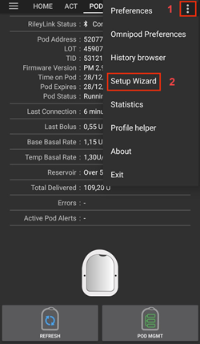
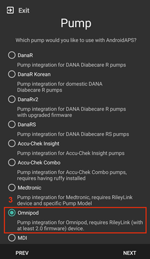
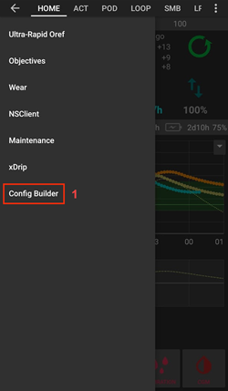
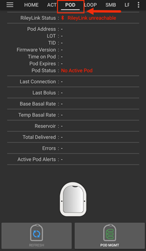
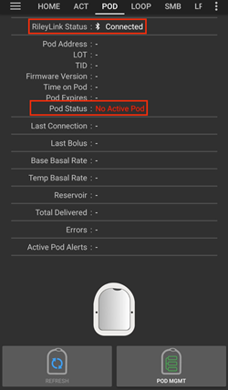
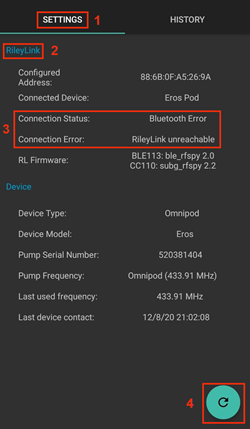
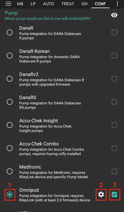
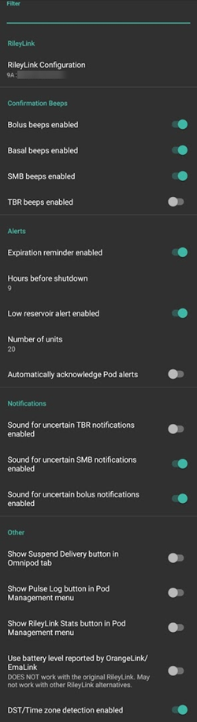
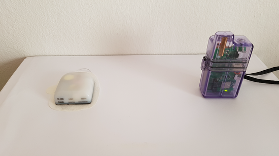

# Documentație pentru driverul AAPS al pompei de insulină Omnipod

Aceste instrucțiuni sunt pentru configurarea pompei Omnipod Eros (**NU Omnipod Dash**). Driverul Omnipod este disponibil ca parte a AAPS (AAPS) începând cu versiunea 2.8.

**Această aplicație face parte dintr-o soluție DIY (do-it-yourself/ o aplicație pe care o construiți singur) și nu este un produs finit; și necesită ca dumneavoastră să citiți, să învățați și să înțelegeți sistemul, de la construcție pana la modul de utilizare. You alone are responsible for what you do with it.**

```{contents}
:backlinks: entry
:depth: 2
```

## Cerințe hardware și software

- **Dispozitiv de comunicare cu pompa**

> Componenta care face puntea de comunicarea de la telefonul cu AAPS activat către generația de pompe Eros.
> 
> > -   [Website OrangeLink](https://getrileylink.org/product/orangelink)
> > -  [433MHz RileyLink](https://getrileylink.org/product/rileylink433)
> > -   [Site Emalink](https://github.com/sks01/EmaLink) - [Informații de contact](mailto:getemalink@gmail.com)
> > -   DiaLink - [Informații de contact](mailto:Boshetyn@ukr.net)
> > -   [SiteLoopLink](https://www.getlooplink.org/) - [Informații de contact](https://jameswedding.substack.com/) - Netestat

-   **Telefon mobil**

> Componenta care va opera AAPS și va trimite comenzi de control către dispozitivul de comunicare cu pompa.
> 
> > - [Un telefon Android cu driver Omnipod](#Phones-list-of-tested-phones) acceptat cu o versiunea AAPS 2.8 și elementele conexe configurate.

-   **Dispozitiv de administrare insulină**

> Componenta care va interpreta comenzile primite de la dispozitivul de comunicare cu pompa care provine de la telefonul ce rulează AAPS.
> 
> > - O nouă pompă Omnipod (generația Eros - **NU DASH**)

Aceste instrucțiuni vor presupune că porniți o nouă sesiune de pompă; în caz contrar, vă rugăm să aveți răbdare și să încercați să începeți acest proces la următoarea schimbare de pompă.

## Înainte să începeți

**SIGURANȚA MAI ÎNTÂI** - nu încercați acest proces într-un mediu în care nu vă puteți reveni după o eroare (pompe suplimentare, insulină, RileyLink încărcat și dispozitive de telefonie mobilă sunt obligatorii).

**Telecomanda dumneavoastră Omnipod nu va mai funcționa după ce driverul AAPS pentru Omnipod activează pompa**. Anterior, ați folosit telecomanda Omnipod pentru a trimite comenzi la pompa Omnipod Eros. O pompă Omnipod Eros permite unui singur dispozitiv să comunice cu ea. Dispozitivul care activează cu succes pompa este singurul dispozitiv care are permisiunea de a comunica cu ea de atunci încolo. Aceasta înseamnă că odată ce activați o pompă Omnipod Eros cu RileyLink prin intermediul driverului AAPS pentru Omnipod, **nu veți mai putea folosi telecomanda cu pompa**. Driverul AAPS Omnipod cu RileyLink este acum telecomanda dumneavoastră în vigoare. *Acest lucru nu înseamnă că ar trebui să aruncați telecomanda, este recomandat să o păstrați în caz de rezervă, și pentru urgențele când AAPS nu funcționează corect.*

**Puteți configura mai multe dispozitive RileyLink, dar numai un RileyLink selectat pe rând poate comunica cu o pompă.** Driverul AAPS pentru Omnipod suportă abilitatea de a adăuga mai multe dispozitive RileyLink în configurația RileyLink, cu toate acestea, numai câte un RileyLink poate fi selectat pentru a fi utilizat în vederea trimiterii și primirii comunicării.

**Pompa dumneavoastră nu se va închide atunci când dispozitivul RileyLink nu este în preajmă.** Când RileyLink este în afara razei de acțiune sau semnalul este blocat de la comunicarea cu pompa activă, pompa dumneavoastră va continua să administreze insulină bazală. La activarea unei pompe, profilul bazal definit în AAPS va fi programat în noua pompă. În cazul în care pierdeți contactul cu pompa, aceasta va reveni la acest profil bazal. Nu veți putea emite noi comenzi până când dispozitivul RileyLink nu va reveni în aria de acoperire și nu va putea restabili conexiunea.

**Profile cu rate bazale pe durate de 30 de minute nu sunt acceptate în AAPS.** Dacă sunteți la început în AAPS și configurați pentru prima dată profilul de rată a bazalei vă rugăm să rețineți că ratele bazale care încep de la jumătatea orei nu sunt acceptate și va trebui să vă ajustați profilul de rată bazală pentru a începe la fix. Spre exemplu, dacă aveți o rată bazală de 1,1 unități care începe la ora 09:30 și are o durată de 2 ore cu terminare la ora 11:30, aceasta nu va funcționa.  Va trebui să actualizați această rată bazală de 1,1 unități la un interval de timp de 9:00-11:00 sau 10:00-12:00.  Chiar dacă incrementele de 30 de minute ale profilului ratei bazale sunt acceptate de pompa Omnipod, AAPS nu le poate lua în considerare cu algoritmii săi în prezent.

## Activarea driverului Omnipod în AAPS

Puteți activa driverul Omnipod în AAPS în **două feluri**:

### Opțiunea 1: Asistentul de instalare

După instalarea unei noi versiuni de AAPS, **Asistentul de configurare** va porni automat.  Acest lucru se va întâmpla și în timpul actualizărilor.  Dacă ați exportat deja setările dintr-o instalare anterioară, puteți să ieșiți din Asistentul de configurare și să importați setările vechi.  Pentru instalările noi, continuați mai jos.

Prin **Asistentul de configurare AAPS (2)** situat în colțul din dreapta sus **meniul cu trei puncte (1)** și treceți prin meniul asistentului până ajungeți la ecranul **Pompa**. Apoi selectați **butonul radio Omnipod (3)**.

>   

Pe același ecran, sub selecția pompei, sunt afișate **setările driverului Omnipod**, sub **configurația dispozitivului RileyLink** adăugați dispozitivul dumneavoastră RileyLink prin apăsarea textului **Nesetat**.

Pe ecranul **Selecție RileyLink** apăsați butonul **Scanați** și selectați dispozitivul dumneavoastră RileyLink prin scanarea tuturor dispozitivelor Bluetooth disponibile și selectarea dispozitivului dumneavoastră RileyLink din listă. Când este selectată corect, vă veți întoarce la ecranul de selecție a driverului pompei care afișează setările driverului Omnipod ce arată dispozitivul RileyLink selectat cu adresa MAC prezentată.

Apăsați butonul **Următorul** pentru a continua cu restul din **Asistentul de configurare.**  Poate dura până la un minut pentru ca dispozitivul RileyLink selectat să se inițializeze și butonul **Următorul** să devină activ.

Pași detaliați despre cum să configurați dispozitivul de comunicare cu pompa sunt enumerați mai jos în [secțiunea de configurare RileyLink](#OmnipodEros-rileylink-setup).

**SAU**

### Opțiunea 2: Configurator

Prin **meniul de tip hamburger** din colțul stânga-sus sub **Constructorul de configurare (1)**➜**Pompă**➜**Omnipod** prin selectarea **butonului radio (2)** denumit **Omnipod**. Alegerea **casetei de selecție (4)** de lângă **Roata zimțată de setări (3)** va afișa meniul Omnipod ca o filă în interfața AAPS intitulată **POD**. Acest lucru este menționat în această documentație ca fila **Omnipod (POD)**.

> **NOTĂ:** O modalitate mai rapidă de a accesa **Setările Omnipod** poate fi găsită mai jos în [secțiunea Setări Omnipod](#OmnipodEros-omnipod-settings) a acestui document.
> 
>  

### Verificarea Selecției Driverului Omnipod

*Notă: Dacă ați ieșit din modul de configurare mai devreme fără a vă selecta dispozitivul RileyLink, driverul Omnipod este activat, dar tot va trebui să selectați dispozitivul RileyLink.  Puteți vedea fila Omnipod (POD) așa cum apare mai jos*

Pentru a verifica dacă ați activat driverul Omnipod în AAPS **glisați spre stânga** din fila **Vedere de ansamblu**, unde veți vedea acum fila **Omnipod** sau **POD**.



## Configurare Omnipod

Vă rugăm să **glisați la stânga** în fila **Omnipod (POD)** unde veți putea gestiona toate funcțiile pompei și ale dispozitivului RileyLink (unele dintre aceste funcții nu sunt activate sau vizibile fără o sesiune activă de pompă):

>  Reîmprospătați conectivitatea și starea pompei
> 
>  Administrare pompă (activare, dezactivare, redare semnal sonor de test și istoric pompă)

(OmnipodEros-rileylink-setup)=

### Setare RileyLink

Dacă ați asociat deja cu succes un dispozitiv RileyLink în Asistentul de Configurare sau în pașii de dinainte, atunci puteți continua cu [secțiunea Activarea unei pompe](#OmnipodEros-activating-a-pod) mai jos.

*Notă: Un bun indicator vizual că RileyLink nu este conectat ar fi că butoanele de insulină și calculator din fila Acasă lipsesc. Aceasta va apărea, de asemenea, aproximativ în primele 30 de secunde după începerea AAPS, deoarece se conectează activ la RileyLink.*

1. Asigurați-vă că dispozitivul RileyLink este încărcat și pornit.

2. După selectarea driverului Omnipod, identificați și selectați dispozitivul RileyLink din **Constructorul de configurări (1)**➜**Pompă**➜**Omnipod**➜**Rotița zimțată (Setări) (2)**➜Configurare RileyLink (3)</strong> prin apăsarea textului **Nesetat** sau **Adresă MAC (dacă este prezentă)**.

   > Asigurați-vă că bateria dispozitivului RileyLink este încărcată și că este [poziționată în apropierea imediată](#OmnipodEros-optimal-omnipod-and-rileylink-positioning) (~30 cm sau mai puțin) a telefonului dumneavoastră pentru ca AAPS să o identifice în baza adresei MAC. Odată selectat, puteți continua pentru a activa prima sesiune de pompă. Utilizați butonul înapoi de pe telefon pentru a reveni la interfața principală AAPS.
   > 
   >  

3. În ecranul de **selecție a dispozitivului RileyLink** apăsați pe butonul **Scanare (4)** pentru a iniția o scanare Bluetooth. **Alegeți dispozitivul dumneavoastră RileyLink (5)** din lista de dispozitive Bluetooth disponibile.

   >  

4. După selectarea cu succes veți fi redirecționat la pagina Setări Omnipod unde este afișată **adresa MAC a dispozitivului RileyLink selectat curent (6).**

   > 

5. Verificați că în fila **Omnipod (POD)** că **Starea RileyLink (1)** apare ca **Conectat**. Câmpul **Starea pompei (2)** ar trebui să arate **Nicio pompă activă**; dacă nu, vă rog să încercați pasul anterior sau să părăsiți AAPS pentru a vedea dacă se reîmprospătează conexiunea.

   > 

(OmnipodEros-activating-a-pod)=

### Activarea unei pompe

Înainte de a putea activa o pompă, vă rugăm să vă asigurați că ați configurat corect și că ați conectat puntea RileyLink în setările Omnipod

*REAMINTIRE: Comunicarea cu pompa se realizează pe o rază limitată în timpul activării și al asocierii, din motive de siguranță și securitate. Înainte de asociere semnalul radio al pompei este mai slab, însă după ce acesta va fi asociat, acesta va opera la putere totală de semnal. În timpul acestor proceduri, asigurați-vă că pompa dumneavoastră este* [în imediata apropiere](#OmnipodEros-optimal-omnipod-and-rileylink-positioning) (~30 cm sau mai puțin), dar nu deasupra sau chiar lângă dispozitivul RileyLink.\*

01. Navigați la fila **Omnipod (POD)** și apăsați pe butonul **Gestionare pompă (1) **, și apoi apăsați pe **Activați pompă (2)**.

    >  

02. Ecranul **Umplere Pompă** este afișat. Umpleți un nouă pompă cu cel puțin 80 de unități de insulină și ascultați cele două semnale sonore care indică faptul că pompa este gata de amorsare. Când calculați cantitatea totală de insulină de care aveți nevoie pentru 3 zile, vă rugăm să luați în considerare faptul că amorsarea pompei va utiliza 12 până la 15 unități.

    > 
    > 
    > Asigurați-vă că noua pompa și dispozitivul RileyLink sunt foarte aproape unul de celălalt (~30 cm sau mai puțin) și apăsați pe butonul **Următorul**.

03. Pe ecranul **inițializare pompă**, pompa va începe amorsarea (veți auzi un clic urmat de o serie de sunete ticăitoare pe măsură ce pompa se amorsează). Dacă dispozitivul RileyLink este în afara razei de comunicarea a pompei ce se activează, veți primi un mesaj de eroare **Niciun răspuns de la pompă**. Dacă se întâmplă aceasta, [mutați dispozitivul RileyLink mai aproape](#OmnipodEros-optimal-omnipod-and-rileylink-positioning) (~30 cm sau mai aproape) dar nu deasupra sau chiar lângă pompă și apăsați pe butonul **Reîncercați (1)**.

    >  

04. După amorsarea cu succes va fi afișată o bifă verde, iar butonul **Următorul** va fi activat. Apăsați pe butonul **Următorul** pentru a finaliza inițializarea de amorsare a pompei și pentru afișarea ecranului **Atașați Pompa**.

    > 

05. În continuare, pregătiți locul de infuzare al pompei. Îndepărtați capacul de plastic al acului și hârtia protectoare de pe adeziv și puneți pompa pe locul selectat de pe corp. Când ați terminat, apăsați pe butonul **Următorul**.

    > 

06. Caseta de dialog **Atașează Pompă** va apărea acum. **Apăsați pe butonul OK DOAR dacă sunteți pregătit să introduceți canula**.

    > 

07. După ce apăsați **OK**, poate dura ceva timp până când Omnipod răspunde și introduce canula (maxim 1-2 minute), așa că aveți răbdare.

    > Dacă dispozitivul RileyLink este în afara razei de comunicarea a pompei ce se activează, veți primi un mesaj de eroare **Niciun răspuns de la pompă**. Dacă se întâmplă aceasta, mutați dispozitivul RileyLink mai aproape (~30 cm sau mai puțin) dar nu deasupra sau chiar lângă pompă și apăsați butonul **Reîncercați**.
    > 
    > Dacă RileyLink este în afara razei de acțiune Bluetooth sau nu are conexiune activă la telefon, veți primi un mesaj de eroare **Niciun răspuns de la RileyLink**. Dacă se întâmplă acest lucru, mutați dispozitivul RileyLink mai aproape de telefon și apăsați pe butonul **Reîncercați**.
    > 
    > *NOTĂ: Înainte de introducerea canulei, este o bună practică să strângeți pielea lângă punctul de inserție al canulei. Acest lucru asigură o inserare lină a acului și va reduce riscul de apariție a ocluziilor.*
    > 
    > 
    > 
    >  

08. O bifă verde va apărea, și butonul **Următorul** devine activat la inserarea cu succes a canulei. Apăsați pe butonul **Următorul**.

    > 

09. Ecranul **Pompă activată** este afișat. Apăsați pe butonul verde **Finalizare**. Felicitări! Acum ați început o nouă sesiune activă de pompă.

    > 

10. Ecranul meniului **Gestionare pompă** ar trebui să afișeze acum butonul **Activați pompa (1)** ca *dezactivat* și butonul **Dezactivați pompa (2)** ca *activat*. Acest lucru se datorează faptului că o pompă este acum activă și nu puteți activa o pompă suplimentară fără a dezactiva mai întâi pompa activă.

    Apăsați pe butonul înapoi de pe telefonul dumneavoastră pentru a reveni la ecranul filei **Omnipod (POD)** care va afișa acum informații despre sesiunea activă de pompă, inclusiv rata bazală curentă, nivelul rezervorului din pompă, insulina administrată, erorile pompei și alertele.

    Pentru mai multe detalii despre informația afișată mergeți la secțiunea [Fila Omnipod (POD)](#OmnipodEros-omnipod-pod-tab) a acestui document.

     

### Dezactivarea unei pompe

În condiții normale, durata de viață preconizată a unei pompe este de trei zile (72 de ore) și de încă 8 ore după avertismentul privind expirarea pompei, pentru un total de 80 de ore de utilizare totală a pompei.

Pentru a dezactiva o pompă (fie de la expirare, fie de la o defecțiune de pompă):

1. Mergeți la fila **Omnipod (POD)**, apăsați pe butonul **Gestionare pompă (1) **, pe ecranul **Gestionare pompă** apăsați pe butonul **Dezactivați pompa (2)**.

   >  

2. Pe ecranul **Dezactivați pompa**, mai întâi, asigurați-vă că dispozitivul RileyLink este în imediata apropiere a pompei, dar nu deasupra sau chiar lângă pompă, apoi apăsați pe butonul **Următorul** pentru a începe procesul de dezactivare a pompei.

   > 

3. Ecranul **Dezactivați pompa** va apărea, și veți primi un semnal sonor de confirmare de la pompă că dezactivarea a avut loc cu succes.

   > 
   > 
   > **DACĂ dezactivarea eșuează** și nu primiți semnalul sonor de confirmare, puteți un mesaj **Niciun răspuns de la dispozitivul RileyLink** sau **Niciun răspuns de la pompă**. Apăsați vă rog pe butonul **Reîncercați (1)** pentru a încerca dezactivarea din nou. Dacă dezactivarea continuă să eșueze, vă rugăm să apăsați clic pe butonul **Renunțați la pompă (2)** pentru a renunța la pompă. Acum puteți să dați jos pompa deoarece sesiunea activă a fost dezactivată. Dacă pompa emite o alarmă sonoră continuă, veți fi probabil nevoit să îl reduceți la tăcere în mod manual (folosind un bold sau o agrafă) deoarece butonul **Renunțați la pompă (2)** nu o poate opri.
   > 
   > >   

4. O bifă verde va apărea după dezactivarea cu succes. Apăsați pe butonul **Următorul** pentru a afișa ecranul de pompă dezactivată. Acum puteți să dați jos pompa deoarece sesiunea activă a fost dezactivată.

   > 

5. Apăsați pe butonul verde pentru a reveni la ecranul **Gestionare pompă**.

   > 

6. Acum că v-ați întors la meniul **Gestionare pompă** apăsați butonul de înapoi de pe telefonul dumneavoastră pentru a reveni la fila **Omnipod (POD)**. Verificați dacă câmpul **Stare RileyLink:** raportează **Conectat** și câmpul **Starea pompei** afișează un mesaj **Nicio pompă activă**.

   >   

### Suspendarea și reluarea administrării insulinei

Procesul de mai jos vă va arăta cum se suspendă și se reia administrarea pompei de insulină.

*NOTĂ - dacă nu vedeți un buton SUSPENDAȚI*, apoi nu a fost activat să fie afișat în fila Omnipod (POD). Activați setarea **Afișați butonul Suspendaț Administrare în fila Omnipod** din [setările Omnipod](#OmnipodEros-omnipod-settings) sub categoria **Altele**.

#### Suspendarea administrării insulinei

Folosiți această comandă pentru a pune pompa activă într-o stare suspendată. În această stare de suspendare, pompa nu va mai administra deloc insulină. Această comandă imită funcția de suspendare pe care telecomanda Omnipod originală o transmite unei pompe active.

1. Mergeți la fila **Omnipod (POD)** și apăsați pe butonul **SUSPENDAȚi (1)**. Comanda de suspendare este trimisă din dispozitivul RileyLink către pompa activă și butonul **SUSPENDAȚI (3)** va deveni inactiv. **Starea pompei (2)** va afișa **ADMINISTRARE SUSPENDATĂ**.

   >  

2. Când comanda de suspendare este confirmată cu succes de către dispozitivul RileyLink, un dialog de confirmare va afișa mesajul **Administrarea de insulină a fost suspendată**. Apăsați **OK** pentru a confirma și continua.

   > 

3. Pompa dumneavoastră activă a suspendat acum toată administrarea de insulină. Fila **Omnipod (POD)** va actualiza **Starea pompei (1)** în **Suspendat**. Butonul **SUSPENDAȚI** se va schimba într-un nou buton **Reluați Administrarea (2)**

   > 

#### Reluarea administrării de insulină

Utilizați această comandă pentru a instrui pompa activă, aflată în prezent în suspendare, pentru a relua administrarea insulinei. După ce comanda a fost procesată cu succes, insulina va relua administrarea normală folosind rata bazală curentă pe baza timpului curent din profilul bazal activ. Pompa va accepta din nou comenzi pentru bolus, RBT, și SMB.

1. Mergeți la fila **Omnipod (pompă)** și asigurați-vă că în câmpul **Stare Pompă (1)** se afișează **Suspendat**, apoi apăsați butonul **Reluați administrarea (2)** pentru a începe procesul prin care pompa va relua administrarea normală de insulină. Un mesaj **RELUAȚI ADMINISTRAREA** va fi afișat în câmpul **Stare pompă (3)** ceea ce înseamnă că RileyLink trimite comanda în mod activ către pompa suspendată.

   >  

2. Când comanda de reluare a administrării este confirmată cu succes de către RileyLink, un dialog de confirmare va afișa mesajul **Administrarea insulinei a fost reluată**. Apăsați **OK** pentru a confirma și continua.

   > 

3. Fila **Omnipod (pompă)** va actualiza câmpul **Stare pompă (1)** să afișeze **FUNCȚIONEAZĂ,** și butonul **Reluați administrarea** va afișa acum butonul **SUSPENDAȚI (2)**.

   > 

### Confirmarea alertelor de pompă

*NOTĂ - dacă nu vedeți un buton ACK ALERTE, pentru că este afișat condiționat în fila Omnipod (POD) numai atunci când a fost declanșată expirarea pompei sau alerta de rezervor scăzut.*

Procesul de mai jos vă va arăta cum să recunoașteți și să respingeți semnalele sonoare ale pompei care apar atunci când timpul pompei active atinge limita de timp de avertizare înainte de expirarea a pompei de 72 de ore (3 zile). Această limită de avertizare este definită în setarea **ore înainte de închidere** a alertelor Omnipod. Durata maximă de viață a unei pompe este de 80 de ore (3 zile 8 ore), cu toate acestea, Insulet recomandă să nu fie depășită limita de 72 de ore (3 zile).

*NOTĂ - Dacă ați activat setarea "Recunoașteți automat alertele pompei" din Alertele Omnipod, această alertă va fi gestionată automat după prima apariție și NU va trebui să anulați manual alerta.*

1. Atunci când este atinsă limita de timp definită în **Ore înainte de închiderea**, pompa va emite semnale sonore de avertizare pentru a vă informa că se apropie de ora expirării și că va fi necesară o schimbare a pompei. Puteți verifica acest lucru în fila **Omnipod (pompă)**, câmpul **Pompa expiră: (1)** va arăta ora exactă la care pompa va expira (72 ore după activare) și textul se va face **roșu** după acest timp se va fi scurs, sub câmpul **Alerte Active Pompă(2)** unde mesajul de stare **Pompa va expira în curând** este afișat. Acest declanșator va afișa butonul **CONFIRMAȚI ALERTELE (3)**. **O notificare de sistem (4)** vă va informa de asemenea despre viitoarea expirare a pompei

   >  

2. Mergeți la fila **Omnipod (pompă)** și apăsați butonul **CONFIRMAȚI ALERTELE (2)** (alerte de înștiințare). Dispozitivul RileyLink trimite comanda către pompă să dezactiveze semnalele sonore de expirare ale pompei și să actualizeze câmpul **Starea pompei (1)** cu **CONFIRMAȚI ALERTELE**.

   > 

3. La **dezactivarea cu succes** a alertelor, **2 semnale sonore** vor fi emise de către pompa activă și un dialog de confirmare va afișa mesajul **Alertele de activare au fost confirmate**. Apăsați pe butonul **OK** pentru a confirma și a închide dialogul.

   > 
   > 
   > Dacă dispozitivul RileyLink nu este în raza de acțiune a pompei, în timp ce comanda de confirmare a alertelor este procesată, un mesaj de avertizare va afișa 2 opțiuni. **Amuțește (1)** va sista această avertizare curentă. **OK (2)** va confirma acest avertisment și va permite utilizatorului să încerce din nou să confirme alertele. 
   > 
   > 

4. Mergeți la fila **Omnipod (pompă)**, sub câmpul **Alerte active pompe**, mesajul de avertizare nu mai este afișat, iar pompa activă nu va mai emite semnale sonore de avertizare a expirării pompei.

(OmnipodEros-view-pod-history)=

### Vedeți istoricul pompei

Această secțiune vă arată cum să examinați istoricul pompelor active și să filtrați după diferite categorii de acțiune. Instrumentul de istoric pompă vă permite să vizualizați acțiunile și rezultatele angajate față de pompa activă în timpul vieții sale de trei zile (72-80 de ore).

Această caracteristică este utilă pentru verificarea bolusurilor, a RBT, a modificărilor bazale care au fost făcute, dar este posibil să nu fiți sigur dacă acestea au fost finalizate. Restul categoriilor sunt utile în general pentru depanarea problemelor și determinarea ordinii evenimentelor care au avut loc până la un eșec.

*NOTĂ:* **Nesigur** comenzile vor apărea în istoricul pompei, însă, datorită naturii lor, nu se poate asigura acuratețea lor.

1. Mergeți la fila **Omnipod (pompă)** și apăsați butonul **GESTIONARE POMPĂ (1)** pentru a accesa meniul **Gestionare Pompă** și apoi apăsați butonul **Istoric Pompă (2)** pentru a accesa ecranul istoricului de pompă.

   >  

2. Pe ecranul **Istoric Pompă**, categoria implicită **Toate (1)** este afișată și arată **Data și ora (2)** ale tuturor **Acțiunilor (3)** și **Rezultatelor(4)** pompei în ordine cronologică inversă. Folosiți **butonul de înapoi telefonului dumneavoastră de 2 ori** pentru a reveni la fila **Omnipod (pompă)** din interfața principală AAPS.

   >  

### Vedeți Setările RileyLink și Istoric

Această secțiune vă arată cum să verificați setările pompei active și ale dispozitivului RileyLink împreună cu istoricul comunicărilor fiecăruia. Această caracteristică, odată accesată, este împărțită în două secțiuni: **Setări** și **Istoric**.

Principala utilizare a acestei funcții este atunci când dispozitivul dumneavoastră de comunicare cu pompa nu mai este în aria de acoperire Bluetooth a telefonului dumneavoastră după o perioadă de timp și **starea RileyLink** raportează **RileyLink inaccesibil**. Butonul **REÎMPROSPĂTAȚI** din fila principală **Omnipod (pompă)** va încerca manual să restabilească comunicarea prin Bluetooth cu dispozitivul RileyLink configurat în setările Omnipod.

În cazul în care butonul **REÎMPROSPĂTAȚI** din fila principală **Omnipod (pompă)** nu restabilește conexiunea la dispozitivul de comunicare cu pompa, vă rugăm să urmați pașii suplimentari de mai jos pentru o reconectare manuală.

#### Restabiliți manual comunicarea Bluetooth a dispozitivului de comunicare cu pompă

1. Din fila **Omnipod (pompă)** atunci când **Starea RileyLink: (1)** raportează **RileyLink inaccesibil** apăsați butonul **Gestionare pompă (2)** pentru a naviga la meniul **Gestionare pompă**. În meniul **Gestionare pompă** veți vedea o notificare care apare în mod activ în căutarea unei conexiuni RileyLink, apăsați butonul **RileyLink (3)** pentru a accesa ecranul **Setări RileyLink**.

   >  

2. În ecranul **Setări RileyLink (1)** sub secțiunea **RileyLink (2)** puteți confirma atât starea conexiunii Bluetooth, cât și eroarea în câmpurile **Stare de conexiune și Eroare: (3)**. Stările *Eroare Bluetooth* și *RileyLink inaccesibil* ar trebui să fie afișate. Porniți reconectarea Bluetooth manuală prin apăsarea butonului **Reîmprospătați (4)** din colțul din dreapta jos.

   > 
   > 
   > Dacă dispozitivul de comunicare cu pompa nu răspunde sau nu are rază de acțiune în timp ce comanda Bluetooth de reîmprospătare este în curs de procesare un mesaj de avertizare va afișa 2 opțiuni.

   - **Amuțește (1)** va sista această avertizare curentă.
   - **OK (2)** va confirma această avertizare și îi va permite utilizatorului să restabilească conexiunea Bluetooth.

   > 

3. Dacă conexiunea **Bluetooth** nu se restabilește, încercați să **dezactivați ** manual și apoi înapoi **să activați** funcția Bluetooth de pe telefonul dumneavoastră.

4. După o reconectare cu succes la dispozitivul Bluetooth RileyLink câmpul **Starea conexiunii: (1)** ar trebui să raporteze **RileyLink pregătit**. Felicitări, ați reconectat dispozitivul de comunicare cu pompa configurat la AAPS!

   > 

#### Setări ale dispozitivului de comunicare cu pompă și ale pompei active

Acest ecran va furniza informații, stare și setări de configurare pentru dispozitivul de comunicare cu pompa configurat în prezent și pompa Omnipod Eros activă.

1. Mergeți la fila **Omnipod (pompă)** și apăsați butonul **Gestionare pompă (1)** pentru a accesa meniul **Gestionare pompă**, apoi apăsați butonul **Statistici RileyLink (2)** pentru a vedea setările dispozitivului **RileyLink (3)** configurat și setările **pompei active (4)**.

   >  
   > 
   > 

##### câmpuri RileyLink (3)

> - **Adresă:** Adresa MAC a dispozitivului selectat de comunicare cu pompa definit în Setările Omnipod.
> - **Nume:** numele de identificare Bluetooth al dispozitivului selectat de comunicare cu pompa definit în setările Bluetooth ale telefonului.
> - **Nivelul bateriei:** Afișați nivelul bateriei curente a dispozitivului de comunicare cu pompa care este conectat
> - **Dispozitiv conectat:** Modelul pompei Omnipod ce comunică în prezent cu dispozitivul de comunicare cu pompa
> - **Stare conexiune**: Starea curentă a legăturii Bluetooth între dispozitivul de comunicare cu pompa și telefonul pe care rulează AAPS.
> - **Eroare de conexiune:** Dacă există vreo eroare în legătura Bluetooth a dispozitivului de comunicare cu pompa detaliile vor fi afișate aici.
> - **Versiunea de firmware:** Versiunea curentă de firmware instalată pe dispozitivul de comunicare cu pompa conectat în prezent.

##### Câmpuri dispozitiv (4) - Cu o pompă activă

> - **Tipul de dispozitiv:** Tipul de dispozitiv care comunică cu dispozitivul de comunicare cu pompa (pompă Omnipod)
> - **Modelul dispozitivului:** Modelul dispozitivului activ conectat la dispozitivul de comunicare cu pompa (numele modelului curent al pompei Omnipod, care este Eros)
> - **Număr de serie al pompei:** Numărul de serie al pompe activate în prezent
> - **Frecvența pompei:** Frecvența radio de comunicații pe care dispozitivul de comunicare cu pompa a adaptat-o pentru a activa comunicarea între el și pompă.
> - **Ultima frecvență utilizată:** Ultima frecvență radio cunoscută pe care o folosea pentru a comunica cu dispozitivul de comunicare cu pompa.
> - **Ultimul dispozitiv de contact:** Data și ora ultimului contact făcut de pompă cu dispozitivul de comunicare cu pompa.
> - **Butonul reîmprospătați** reîmprospătează manual setările de pe această pagină.

(omnipod-eros-rileylink-and-active-pod-history)=
#### RileyLink și istoricul pompei active

Acest ecran furnizează informații în ordinea cronologică inversă a fiecărei stări sau acțiuni pe care RileyLink sau pompa conectată în prezent se află sau pe care a întreprins-o. Întregul istoric este disponibil doar pentru pompa activă, după o schimbare de pompă acest istoric va fi șters și doar evenimentele din noua pompă activată vor fi înregistrate și afișate.

1. Mergeți la fila **Omnipod (pompă)** și apăsați butonul **GESTIONARE POMPĂ (1)** pentru a accesa meniul **Gestionare pompă**, apoi apăsați butonul **Istoric pompă (2)** pentru a vedea ecranele de **Setări ** și **Istoricul**. Apăsați pe textul **ISTORIC (3)** pentru a afișa întreaga istorie a sesiunii RileyLink și a celei de pompă activă.

   >  
   > 
   > 

##### Câmpuri

> - **Data & Timp**: În ordine cronologică inversă marcajul temporal al fiecărui eveniment.
> - **Dispozitiv:** Dispozitivul la care acțiunea sau starea curentă se referă.
> - **Starea sau Acțiunea:** Starea curentă sau acțiunea realizată de dispozitiv.

(OmnipodEros-omnipod-pod-tab)=

## fila Omnipod (POD)

Mai jos este o explicație a aspectului și semnificației pictogramelor și a câmpurilor de stare din fila **Omnipod (Pompă)** din interfața principală AAPS.

*NOTĂ: Dacă vreun mesaj din câmpurile de stare ale filei Omnipod (POD) raportează (incert), atunci va trebui să apăsați butonul Reîmprospătați pentru a șterge mesajul și a actualiza starea pompei.*

> 

### Câmpuri

- **Stare RileyLink:** Afișează starea curentă a conexiunii RileyLink

- *RileyLink inaccesibil* - dispozitivul de comunicare cu pompa nu este în raza Bluetooth a telefonului, este oprită sau are o eroare ceea ce previne comunicarea Bluetooth.
- *RileyLink pregătit* - dispozitivul de comunicare cu pompa este pornit și inițializează activ conexiunea Bluetooth
- *Conectat* - dispozitivul de comunicare cu pompa este pornit, conectat și capabil să comunice prin Bluetooth.

- **Adresă pompă:** Afișează adresa curentă în care se face referire la pompa activă

- **LOT:** Afișează numărul de LOT al pompei active

- **TID:** Afișează numărul de serie al pompei.

- **Versiunea firmware:** Afișează versiunea de firmware a pompei activ.

- **Timpul din pompă:** Afișează timpul actual de pe pompa activă.

- **Pompa expiră:** Afișează data și ora când pompa activă va expira.

- **Stare pompă:** Afișează starea pompei active.

- **Ultima conexiune:** Afișează ultimul timp când comunicare cu pompa activă a fost efectuată.

- *Adineauri* - mai puțin de 20 de secunde în urmă.
- *Cu mai puțin de un minut în urmă* - mai mult de 20 de secunde, dar mai puțin de 60 de secunde în urmă.
- *Acum 1 minut* - mai mult de 60 de secunde, dar mai puțin de 120 de secunde (2 minute)
- *XX minute în urmă* - mai mult de 2 minute în urmă așa cum este definit de valoarea XX

- **Ultimul bolus:** Afișează doza ultimului bolus trimis către pompa activă și cu cât timp în urmă a fost administrat în paranteză.

- **Rată bazală de bază:** Afișați rata bazală programată pentru timpul curent din profilul ratei bazale.

- **Rata bazalei temporare:** Afișați rata bazală temporară care rulează în prezent în următorul format

- Unități / oră @ ora la care a fost emisă RBT (minute rulate / total minute pentru care RBT va fi rulată)
- *Exemplu:* 0.00U/h @18:25 ( 90/120 minute)

- **Rezervor:** Afișați peste 50+U rămase atunci când mai mult de 50 de unități au rămas în rezervor. Sub această valoare, unitățile exacte sunt afișate în text galben.

- **Total administrat:** Afișați numărul total de unități de insulină administrate din rezervor. *Rețineți că aceasta este o aproximare deoarece amorsarea și umplerea pompei nu este un proces exact.*

- **Eroare:** Afișați ultima eroare întâlnită. Revizuiți [Istoricul de pompă](#OmnipodEros-view-pod-history), [Istoricul RileyLink](#omnipod-eros-rileylink-and-active-pod-history) și fișierele de jurnal pentru erorile din urmă și informații mai detaliate.

- **Alerte active de pompă:** Rezervat pentru rularea alertelor pe pompa activă. Folosit în mod normal atunci când expirarea pompei a trecut de 72 de ore și sunt rulate alerte sonore native.

### Pictograme

- **REÎMPROSPĂTAȚI:**

  > 
  > 
  > Trimite o comandă de reîmprospătare către pompa activă pentru a actualiza comunicarea
  > 
  > Folosiți pentru a reîmprospăta starea pompei și a închide câmpurile de stare care conțin textul (incert).
  > 
  > Vedeți secțiunea [Depanare](#OmnipodEros-troubleshooting) de mai jos pentru informaţii suplimentare.

- **GESTIONARE POMPĂ:**

  > 
  > 
  > Navigare la meniul de administrare a pompei

- **ACCEPTAȚI ALERTE:**

  > 
  > 
  > Când apăsați acest lucru va dezactiva semnalele sonore și notificările de expirare.
  > 
  > Butonul este afișat numai atunci când timpul pompei a trecut de avertizarea de expirare După o demitere reușită, această pictogramă nu va mai apărea.

- **SETARE TIMP:**

  > 
  > 
  > Când apăsați se va actualiza ora pompei cu ora curentă pe telefon.

- **SUSPENDAȚI:**

  > 
  > 
  > Suspendați pompa activă

- **RELUAȚI ADMINISTRAREA:**

  > 
  > 
  > > Reluați activitatea pompei curente suspendate

### Meniu Gestionare Pompă

Mai jos este o explicație a aspectului și semnificației pictogramelor din meniul **Gestionare pompă** accesat din fila **Omnipod (Pompă)**.

> 

- **Activează pompă**

  > 
  > 
  > Amorsați și activați o nouă pompă

- **Dezactivare pompă**

  > 
  > 
  > Dezactivați pompa activă curentă.
  > 
  > O pompă parțial asociată va ignora această comandă.
  > 
  > Utilizați această comandă pentru a dezactiva o pompă ce emite un semnal sonor încontinuu (eroare 49).
  > 
  > Dacă butonul este dezactivat (gri) utilizați butonul renunțați la pompă.

- **Redați semnale sonore de test**

  > 
  > 
  > Redă un singur semnal sonor de test pe pompă atunci când este apăsat.

- **Renunțați la pompă**

  > 
  > 
  > Dezactivați și eliminați starea pompei pentru o pompă care nu răspunde, atunci când este apăsat.
  > 
  > Butonul este afișat doar în cazuri foarte specifice atunci când dezactivare corectă nu mai este posibilă:
  > 
  > > - O pompă **nu este pe deplin asociată** şi astfel ignoră comenzile de dezactivare.
  > > - O pompă **este blocată** în timpul procesului de asociere între pași
  > > - O pompă **pur și simplu nu se asociază deloc.**

- **Istoric pompă**

  > 
  > 
  > Afișați istoricul de activitate al pompei active

- **Stare RileyLink:**

  > 
  > 
  > Navigare la ecranul de statistică RileyLink care afișează setările curente și istoricul conexiunii RileyLink
  > 
  > > - **Setări** - afișați informații despre setările dispozitivului RileyLink și ale pompei active
  > > - **Istoric** - afișați istoricul de comunicare ale dispozitivului RileyLink și ale pompei

- **Resetați configurația RileyLink**

  > 
  > 
  > Când este apăsat acest buton va reseta configurația dispozitivului conectat de comunicare cu pompa.
  > 
  > > - Când comunicarea este inițiată, date specifice sunt trimise și setate în RileyLink: > - Sunt setați registrii de memorie > - Sunt setate protocoalele de comunicare > - Este setată frecvența radio acordată 
  > > - Vedeți [notele adiționale](#OmnipodEros-reset-rileylink-config-notes) la sfârșitul acestui tabel

- **Citește Jurnal Puls:**

  > 
  > 
  > > Trimiteți jurnalul activ ale pulsurilor de pompă în clipboard

(OmnipodEros-reset-rileylink-config-notes)=

#### *Resetați notele de configurare RileyLink*

- Utilizarea primară a acestei funcții este atunci când dispozitivul activ de comunicare cu pompa nu răspunde și comunicarea este într-o stare blocată.
- Dacă dispozitivul de comunicare cu pompa este oprit și apoi înapoi pornit, butonul **Resetați configurație RileyLink** trebuie apăsat, astfel încât să seteze acești parametri de comunicare în configurația dispozitivului de comunicare cu pompa.
- Dacă acest lucru nu este făcut, atunci AAPS va trebui să fie repornit după ce dispozitivul de comunicare cu pompa este repornit.
- Acest buton **NU** trebuie să fie apăsat când comutați între diferite dispozitive de comunicare cu pompa

(OmnipodEros-omnipod-settings)=

## Setări Omnipod

Setările driverului Omnipod sunt configurabile din colțul stânga-sus **meniul hamburger** sub **Constructorul de Configurație**➜**Pompă**➜**Omnipod**➜**Rotița de setări (2)** prin selectarea **butonului radio (1)** denumit **Omnipod**. Selectarea **casetei (3)** de lângă **Rotița zimțată de setări (2)** va permite afișarea meniului Omnipod ca o filă în interfața AAPS intitulată **OMNIPOD** sau **POD**. Acest lucru este menționat în această documentație ca fila **Omnipod (POD)**.



**NOTĂ:** O modalitate mai rapidă de a accesa setările **Omnipod** este prin accesarea meniului **3 puncte (1)** în colțul din dreapta sus al filei **Omnipod (POD)** și selectarea **Preferințe Omnipod (2)** din meniul derulant.


Grupurile de setări sunt listate mai jos; puteți activa sau dezactiva printr-un comutator pentru majoritatea intrărilor descrise mai jos:



*NOTĂ: Un asterisc (\*) indică valoarea implicită pentru o setare activată.*

### RileyLink

Permite scanarea unui dispozitiv de comunicare cu pompa. Driverul Omnipod nu poate alege mai mult de un dispozitiv de comunicare cu pompa odată.

- **Arată nivelul bateriei raportat de OrangeLink/EmaLink/DiaLink:** raportează nivelul actual al bateriei pentru OrangeLink/EmaLink/Dialink. Este **recomandat cu insistență** ca toți utilizatorii de OrangeLink/EmaLink/DiaLink să activeze această setare.

- NU funcționează cu dispozitivul RileyLink original.
- Este posibil să nu funcționeze cu dispozitivele alternative RileyLink.
- Activat - Raportează nivelul bateriei curente pentru dispozitivele acceptate de comunicare cu pompa.
- Dezactivat - Raportează o valoare de n/a.

- **Activați notarea schimbărilor de baterie în Acțiuni:** În meniul Acțiuni, butonul de schimbare a bateriei este activat, DACĂ ați activat această setare ȘI setarea de raportare a bateriei de mai sus.  Unele dispozitive de comunicare cu pompa au acum capacitatea de a utiliza baterii obișnuite care pot fi schimbate.  Această opțiune vă permite să rețineți că resetați contorul de vârstă al bateriei.

### Semnale sonore de confirmare

Furnizează semnale acustice de confirmare de la pompă pentru administrarea și modificările de bolus, insulină bazală, SMB și TBR.

- **\*Semnale sonore activate pentru bolusuri:** Activați sau dezactivați semnalele sonore de confirmare atunci când un bolus este administrat.
- **\*Semnale sonore activate pentru bazale** Activați sau dezactivați semnalele sonore de confirmare atunci când o nouă rată bazală este setată, rata bazală activă este anulată sau rata bazală curentă este schimbată.
- **\*Semnale sonore SMB-uri:** Activează sau dezactivează semnalele sonore de confirmare atunci când un SMB este administrat.
- **Semnale sonore RBT:** Activează sau dezactivează mesajele de confirmare atunci când o RBT este setată sau anulată.

### Alerte

Furnizează alerte AAPS în ceea ce privește expirarea pompei, închiderii, rezervorului scăzut în baza unităților prag definite.

*Țineți cont că o notificare AAPS va fi emisă ÎNTOTDEAUNA pentru orice alertă după comunicarea inițială cu pompa de când alerta a fost declanșată. Închiderea notificării NU va anula alerta DECÂT dacă opțiunea de recunoaștere automată a alertelor de pompă este activată. Pentru a înlătura MANUAL alerta trebuie să vizitați fila Omnipod (POD) și să apăsați butonul CONFIRMAȚI ALERTELE.*

- **\*Memento expirare activat:** Activați sau dezactivați mementoul de expirare al pompei, setat să se declanșeze atunci când este atins numărul de ore definit înainte de oprirea acesteia.
- **Ore înainte de închidere:** Definește numărul de ore înainte ca pompa activă să se închidă, ceea ce va declanșa apoi alerta de expirare.
- **Alertă de rezervor scăzut activată:** Activați sau dezactivați o alertă atunci când se atinge limita joasă a unităților rămase în rezervorul din pompă, așa cum a fost definită în câmpul Număr de unități.
- **Numărul de unități:** Numărul de unități la care să fie declanșată alerta rezervor scăzut al pompei.
- **Confirmați automat alertele pompei:** Când este activată, notificarea va fi în continuare emisă totuși imediat după prima comunicare cu pompa de la emiterea alertei, aceasta va fi acum recunoscută automat și alerta va fi înlăturată.

### Notificări

Oferă notificări AAPS și alerte sonore de telefon atunci când nu este sigur dacă evenimentele de tip RBT, SMB sau bolus au avut succes.

*NOTĂ: Acestea sunt doar notificări, nu sunt emise alerte sonore.*

- **Sunet pentru notificări RBT incerte activat:** Activează sau dezactivează această setare pentru a declanșa o alertă sonoră și o notificare vizuală atunci când AAPS nu este sigur dacă un RBT a fost setat cu succes.
- **Sunet pentru notificări SMB incerte activat:** Activează sau dezactivează această setare pentru a declanșa o alertă sonoră și o notificare vizuală atunci când AAPS nu este sigur dacă un SMB a fost administrat cu succes.
- **Sunet pentru notificări de bolus incert activat:** Activați sau dezactivați această setare pentru a declanșa o alertă sonoră și o notificare vizuală atunci când AAPS nu este sigur dacă un bolus a fost administrat cu succes.

### Altele

Oferă setări avansate pentru a ajuta depanarea.

- **Afișati butonul de suspendare administrare în fila Omnipod:** Ascundeți sau afișați butonul de suspendare administrare în fila **Omnipod (POD)**.
- **Afișați butonul jurnal impulsuri în meniul de administrare al pompei:** Ascunde sau afișează butonul de jurnal impulsuri din meniul **Gestionare Pompă**.
- **Afișați butonul de Statistici RileyLink în meniul de Administrare Pompă:** Ascundeți sau afișați butonul Statistici RileyLink în meniul **Gestionare pompă**.
- **\*Detectare schimbare fus orar sau oră de vară activată:** permite ca modificările de fus orar să fie detectate automat dacă telefonul este folosit într-o zonă unde ora de vară este implementată.

### Schimbarea sau eliminarea unui dispozitiv activ de comunicare cu pompa (RileyLink)

Cu multe modele alternative la dispozitivul RileyLink disponibil (cum ar fi OrangeLink sau EmaLink) sau nevoia de a avea mai multe/copii de rezervă ale aceluiași dispozitiv de comunicare cu pompa (RileyLink), devine necesar să comutați sau să eliminați dispozitivul de comunicare cu pompa selectat (RileyLink) din configurația de Setări Omnipod.

Următorii pași vor arăta cum să **Eliminați** dispozitivul existent de comunicare cu pompa (RileyLink) precum și să **Adăugați** un nou dispozitiv de comunicare cu pompa.  Rularea ambilor pași **Eliminați** și **Adăugați** vor schimba dispozitivul dumneavoastră.

1. Accesarea meniului **Selecție RileyLink** prin selectarea **meniului cu 3 puncte (1)** in colțul din dreapta sus a filei **Omnipod (pompă)** și selectarea **Preferințelor Omnipod (2)** din meniul derulant. În meniul **Setări Omnipod** de sub **Configurație RileyLink (3)** apăsați pe textul **Nu este setat** (dacă niciun dispozitiv nu a fost selectat) sau **Adresă MAC** (dacă un dispozitiv este prezent) pentru a deschide meniu **Selecție RileyLink**.

   >  

### Eliminați dispozitivul de comunicare cu pompa selectat în prezent (RileyLink)

Acest proces va arăta cum să eliminați dispozitivul de comunicare cu pompa selectat în prezent (RileyLink) din setările Omnipod Driver.

1. În **Configurare RileyLink** apăsați pe textul **Adresă MAC (1)** pentru a deschide meniul **Selecție RileyLink**.

   > 

2. În meniul **Selecție RileyLink** apăsați **Eliminați (2)** pentru a elimina **dispozitivul RileyLink actualmente selectat (3)**

   > 

3. La dialogul de confirmare, apăsați **Da (4)** pentru a confirma eliminarea dispozitivului dumneavoastră.

   > 

4. Vă întoarceți la meniul **Setare Omnipod** unde sub **Configurație RileyLink** veți vedea că dispozitivul este **Nu este setat (5)**.  Felicitări, ați eliminat cu succes dispozitivul de comunicare cu pompa selectat.

   > 

### Adăugați dispozitivul de comunicare cu pompa selectat în prezent (RileyLink)

Acest proces vă arată cum să eliminați dispozitivul de comunicare cu pompa selectat în prezent din setările Omnipod Driver.

1. Sub **Configurarea RileyLink** apăsați pe textul **Nu este setat (1)** pentru a deschide meniul **Selecție RileyLink**.

   > 

2. Apăsați butonul **Scanare (2)** pentru a începe scanarea pentru toate dispozitivele Bluetooth disponibile.

   > 

3. Selectați **dispozitivul dumneavoastră RileyLink (3)** din lista de dispozitive disponibile și vă veți întoarce în meniul **Setări Omnipod** care afișează adresa **MAC (4)** a noului dumneavoastră dispozitiv selectat.  Felicitări ați selectat cu succes dispozitivul dumneavoastră de comunicare cu pompa.

   >  

## Fila Acțiuni (ACT)

Această filă este bine documentată în documentația principală AAPS, dar există câteva elemente în această filă care sunt specifice modului în care pompa Omnipod diferă de pompele bazate pe fir, mai ales după aplicarea unei noi pompe.

1. Mergeți la fila **Acțiuni (ACT)** din interfața principală AAPS.
2. În secțiunea **Careportal (1)** următoarele 3 câmpuri vor avea **resetarea vârstei** la 0 zile și 0 ore **după fiecare schimbare de pompă**: **Insulină** și **Canulă**. Asta se face datorită modului în care pompa Omnipod este construită și funcționează. **Bateria pompei** și **rezervorul de insulină** sunt integrate înăuntrul fiecărei pompe. Deoarece pompa inserează canula direct în piele la locul aplicării pompei, un fir obișnuit nu este utilizată în pompele Omnipod. *Prin urmare, după schimbarea pompei vechimea fiecăreia dintre aceste valori se va reseta automat la zero.* **Vechimea bateriei pompei** nu este raportată deoarece bateria din pompă va fi întotdeauna mai mare decât durata de viață a pompei (maxim 80 de ore).

> 

### Niveluri

**Nivelul insulinei**

Raportarea cantității de insulină din pompa Omnipod Eros nu este exactă.  Acest lucru se datorează faptului că nu se cunoaște exact câtă insulină a fost introdusă în pompă, numai faptul că atunci când se declanșează cele 2 semnale sonore în timp ce se umple pompa au fost introduse cel puțin 85 de unități. O pompă poate ține maximum 200 de unități. Armarea poate introduce, de asemenea, variații, deoarece nu este un proces exact și precis.  Cu ambii factori, driverul Omnipod a fost scris pentru a oferi cea mai bună aproximare a insulinei rămase în rezervor.

> - **Peste 50 de unități** - raportează o valoare de 50+U atunci când mai mult de 50 de unități se află în rezervor.
> - **Sub 50 de unități** - raportează o valoare calculată aproximativă a insulinei rămase în rezervor.
> - **SMS** - Returnează valoarea sau 50+U pentru răspunsuri SMS
> - **Nightscout** - Încarcă în Nightscout valoarea de 50 atunci când sunt peste 50 de unități (versiunea 14.07 și mai vechi).  Versiunile mai noi vor raporta o valoare de 50+ atunci când depășesc 50 de unități.

**Nivelul bateriei**

Raportarea nivelului bateriei este o setare care poate fi activată pentru a returna nivelul de baterie curent al dispozitivelor de comunicare cu pompa, precum OrangeLink, EmaLink sau DiaLink.  Dispozitivul RileyLink nu poate raporta nivelul său al bateriei.  Nivelul bateriei este raportat după fiecare comunicare cu pompa, astfel încât nu se poate observa o creștere liniară atunci când se încarcă.  O reîmprospătare manuală va actualiza nivelul bateriei curente.  Atunci când un dispozitiv acceptat de comunicare cu pompa este deconectat, va fi raportată o valoare de 0%.

> - **Dispozitivul RileyLink NU poate raporta nivelul bateriei**
> - **"Afișare nivelului de baterie raportat de OrangeLink/EmaLink/DiaLink" Setarea TREBUIE activată în setările Omnipod pentru a raporta valorile nivelului bateriei**
> - **Raportarea nivelului bateriei funcționează numai pentru dispozitivele OrangeLink, EmaLink și DiaLink**
> - **Raportarea nivelului de baterie POATE funcționa pentru alte dispozitive (cu excepția RileyLink)**
> - **SMS** - Returnează nivelul bateriei curente ca răspuns atunci când există un nivel real, o valoare de n/a nu va fi returnată
> - **Nightscout** - Nivelul bateriei este raportat atunci când există un nivel real, o valoare de n/a nu va fi raportată

(OmnipodEros-troubleshooting)=

## Depanare

### Eșecuri pompă

Ocazional, apare un eșec din cauza unei varietăți de probleme, inclusiv a problemelor de hardware cu pompa în sine. Cel mai bine este să nu se recurgă la Insulet, deoarece AAPS nu este un caz de utilizare aprobat. O listă de coduri de eroare poate fi găsită [aici](https://github.com/openaps/openomni/wiki/Fault-event-codes) pentru a ajuta la determinarea cauzei.

### Prevenirea erorii 49 de pompă

Acest eșec este legat de o stare incorectă a pompei pentru o comandă sau o eroare în timpul unei comenzi de administrare a insulinei. Recomandăm utilizatorilor să comute la clientul Nightscout la *Doar încărcați (Dezactivați sincronizarea)* sub **Configurator**➜**General**➜**NSClient**➜**Roată dințată**➜**Setări avansate** pentru a preveni posibile eșecuri.

### Alerte de pompă inaccesibilă

Se recomandă ca alertele inaccesibile ale pompei să fie configurate la **120 de minute** prin accesarea meniului cu trei puncte din dreapta sus, selectarea **Preferințe**➜**Alerte Locale**➜**Prag pompă inaccesibilă \[min\]** și setarea acestui prag la **120**.

(OmnipodEros-import-settings-from-previous-aaps)=
### Importați setările din AAPS anterior

Vă rugăm să rețineți că importarea setărilor are posibilitatea de a importa o stare a unei pompe învechite. Drept urmare, este posibil să pierdeți o pompă activă. Prin urmare, este recomandat ca **să nu importați setări cât timp sunteți într-o sesiune activă de pompă**.

1. Dezactivați sesiunea activă de pompă. Verificați dacă nu aveți o sesiune activă de pompă.
2. Exportați-vă setările și stocați o copie într-un loc sigur.
3. Dezinstalați versiunea anterioară a AAPS și reporniți telefonul.
4. Instalați noua versiune de AAPS și verificați dacă nu aveți o sesiune activă de pompă.
5. Importați setările și activați noua pompă.

### Alerte driver Omnipod

vă rugăm să rețineți că driverul Omnipod prezintă o varietate de alerte unice în secțiunea **Privire de ansamblu**, cele mai multe dintre acestea sunt informative și pot fi respinse, în timp ce altele îi furnizează utilizatorului o măsură de rezolvare a cauzei alertei declanșate. Un rezumat al principalelor alerte pe care este posibil să le întâlniți este prezentat mai jos:

#### Nicio pompă activă

Nicio sesiune activă de pompă detectată. Această alertă poate fi dezactivată temporar prin apăsarea **AMÂNAȚI** dar va continua să se declanșeze atâta timp cât o nouă pompă nu a fost activată. Odată activată, această alertă este pusă în mod silențios automat.

#### Pompă suspendată

Alertă informațională că pompa a fost suspendată.

#### Setarea profilului bazalei a eșuat. Administrarea insulinei poate fi suspendată! Reîmprospătați manual starea pompei din fila Omnipod și reluați administrarea, dacă este necesar.

Alerta informațională că setarea profilului bazal al pompei a eșuat și va trebui să apăsați *Reîmprospătați* în fila Omnipod.

#### Nu s-a putut verifica dacă bolusul SMB a avut loc cu succes. If you are sure that the Bolus didn't succeed, you should manually delete the SMB entry from Treatments.

Alertă că bolusul SMB nu a putut fi verificat, va trebui să verificați câmpul *Ultimul bolus* din fila Omnipod pentru a vedea dacă bolusul SMB a reușit și dacă nu eliminați intrarea din fila Tratamente.

#### Nu este sigur dacă "sarcina bolus/RBT/SMB" s-a finalizat; vă rugăm verificați manual dacă a avut succes.

Datorită modului în care dispozitivul RileyLink și pompa Omnipod comunică, pot apărea situații în care este *incert* dacă o comandă a fost procesată cu succes. Necesitatea informării utilizatorului cu privire la această incertitudine era necesară.

Iată câteva exemple de situații în care poate apărea o notificare de incertitudine.

- **Bolusuri** - Bolusurile nesigure nu pot fi verificate automat. Notificarea va rămâne până la următorul bolus, dar o reîmprospătare manuală a pompei va șterge mesajul. *În mod implicit, semnalele sonore sunt activate pentru acest tip de notificare, deoarece utilizatorul va trebui să le verifice manual.*
- **RBT, Stări pompă, Schimbări profil, Schimbări fus orar** - o reîmprospătare manuală a pompei va șterge mesajul. În mod implicit, alertele semnal sonor sunt dezactivate pentru acest tip de notificare.
- **Deviație timp pompă** Când timpul de pe pompă și timpul telefonului deviază prea mult este dificil pentru bucla AAPS să funcționeze și să facă predicții și recomandări de dozaj exacte. Dacă deviația de timp dintre pompă și telefon este mai mare de 5 minute, AAPS va raporta că pompa este într-o stare suspendată în starea pompei cu un mesaj GESTIONARE SCHIMBARE ORĂ. O pictogramă suplimentară **Setați timpul** va apărea în partea de jos a filei Omnipod (Pompă). Dacă apăsați pe setare timp veți sincroniza ora de pe pompă cu cea de pe telefon și apoi puteți să apăsați pe butonul RELUAȚI ADMINISTRAREA pentru a continua operațiunile normale ale pompei.

## Cele mai bune practici

(OmnipodEros-optimal-omnipod-and-rileylink-positioning)=

### Poziționarea optimă a pompei Omnipod și a dispozitivului RileyLink

Antena utilizată pe RileyLink pentru a comunica cu o pompă Omnipod este o antenă spirală helică de 433 MHz. Datorită proprietăților sale de construcție, radiază un semnal omnidirecțional ca o gogoașă tridimensională cu axa Z reprezentând antena verticală în picioare. Aceasta înseamnă că există poziții optime pentru amplasarea dispozitivului RileyLink, în special în timpul activării pompei și a rutinelor de dezactivare.


> *(Fig 1. Reprezentarea grafică a unei antene spirale elicoidale cu diagramă de radiație omnidirecțională*)

Din motive de siguranță și securitate, *activarea* pompei trebuie să fie realizată la un interval *mai apropiat (~30 cm sau mai puțin)* decât alte operațiuni, cum ar fi administrarea unui bolus, setarea unei RBT sau pur și simplu reîmprospătarea stării pompei. Datorită naturii transmiterii semnalului de la antena RileyLink, este recomandat să NU se plaseze pompa direct pe sau lângă RileyLink.

Imaginea de mai jos arată modul optim de poziționare a dispozitivului RileyLink în timpul procedurilor de dezactivare și activare. Pompa se poate activa în alte poziții, dar veți avea cel mai mare succes folosind poziția din imaginea de mai jos.

*Notă: Dacă după poziționarea optimă comunicarea cu pompa și RileyLink eșuează, aceasta se poate datora unei baterii scăzute care scade intervalul de transmitere al antenei RileyLink. Pentru a evita această problemă, asigurați-vă că RileyLink este încărcat corespunzător sau conectat direct la un cablu de încărcare în timpul acestui proces.*



## Unde să obțineți ajutor pentru driverul Omnipod

Toată munca de dezvoltare pentru driverul Omnipod este realizată de comunitate pe bază voluntară; vă cerem să vă amintiți acest lucru și să utilizați următoarele recomandări înainte de a solicita asistență:

- **Nivelul 0:** Citiți secțiunea relevantă a acestei documentații pentru a vă asigura că înțelegeți cum ar trebui să meargă funcționalitatea cu care aveți dificultăți.
- **Nivelul 1:** Dacă încă întâmpinați probleme pe care nu le puteți rezolva folosind acest document, apoi vă rugăm să mergeți la canalul *#androidaps* pe **Discord** folosind [această legătură de invitație](https://discord.gg/4fQUWHZ4Mw).
- **Nivelul 2:** Căutați problemele existente pentru a vedea dacă problema dumneavoastră a fost deja raportată; dacă nu, vă rugăm să creați un tichet nou [problemă](https://github.com/nightscout/AndroidAPS/issues) și să atașați [fișierele jurnal](../GettingHelp/AccessingLogFiles.md).
- **Fiți răbdători - majoritatea membrilor comunității noastre sunt voluntari bine-voitori, și rezolvarea problemelor necesită adesea timp și răbdare atât din partea utilizatorilor cât și din partea dezvoltatorilor.**
