# Ecranele AAPS

```{contents}
:backlinks: entry
:depth: 2
```

(AapsScreens-the-homescreen)=

## Ecranul de pornire


Acesta este primul ecran peste care veți da când deschideți **AAPS**, și conține majoritatea informațiilor de care veți avea nevoie zi de zi.

### Secțiunea A - Pagini

* Navigați între diferitele module **AAPS**.
* Alternativ, puteți schimba ecranele prin glisare în stânga sau în dreapta.
* Filele afișate pot fi selectate în [Configurator](#Config-Builder-tab-or-hamburger-menu).

(aaps-screens-profile--target)=

### Secțiunea B - Profil & țintă

#### Profil curent

Profilul curent este afișat în bara din stânga.

Apăsați scurt pe bara de profil pentru a vizualiza detaliile profilului. Apăsați lung bara de profil pentru [comutați între diferite profiluri](../DailyLifeWithAaps/ProfileSwitch-ProfilePercentage.md).


1. Afișaj normal cu activare standard a profilului.
2. Schimbare de profil cu o durată rămasă de 59 de minute.
3. Schimbare de profil cu un procent specific de 120%.
4. Schimbarea profilului cu un procent specific de 80% și o durată rămasă de 59 de minute.
5. Schimbare a profilului cu un decalaj temporal de -1 o oră.
6. Schimbarea profilului cu un procent specific de 120%, un decalaj temporal de 1 oră și o durată rămasă de 59 de minute.

#### Țintă


Valoarea țintă curentă a glicemiei este afișată în bara dreaptă.

Apăsați scurt pe bara țintă pentru a seta o **[Țintă temporară](../DailyLifeWithAaps/TempTargets.md)**.

Dacă este stabilită o țintă temporară, bara devine galbenă și timpul rămas în minute este afișat în paranteze.

(AapsScreens-visualization-of-dynamic-target-adjustment)=

#### Vizualizarea ajustare dinamică a țintei


Când se utilizează funcționalitatea [SMB](#Config-Builder-aps) și [Autosens](#Open-APS-features-autosens), **AAPS** vă poate ajusta dinamic ținta în funcție de sensibilitate.

Activați una sau ambele dintre următoarele opțiuni în [Preferințe > Setări OpenAPS SMB](#Preferences-openaps-smb-settings):

     * "sensibilitatea ridică ținta" și/sau 
     * "rezistența scade ținta" 
    

Dacă **AAPS** detectează rezistență sau sensibilitate, ținta se va schimba față de ceea ce este setat din profil. Când modifică glicemia țintă, fundalul se va schimba în verde.

(AapsScreens-section-c-bg-loop-status)=

### Secțiunea C - Glicemie & stare buclă

#### Valoarea actuală a glicemiei

Cea mai recentă valoare a glicemiei din sânge de la senzorul de monitorizare continuă a glicemiei (CGM) este indicată în partea stângă.

Culoarea valorii glicemiei indică starea curentă în raport cu [intervalul](#Preferences-range-for-visualization) definit.

     * verde = în interval
     * roșu = sub interval
     * galben = deasupra intervalului 
    


Secțiunile din mijloc arată:

1. câte minute de la ultima citire **a senzorului de monitorizare continuă a glicemiei (CGM)**
2. diferențe față de ultima citire: Δ, și cu media pe ultimele 15 și 40 de minute (Δ15 și Δ40).  
  Diferențele lungi sunt calculate ca o valoare medie a diferențelor din trecut, indicând care a fost schimbarea medie.

(AapsScreens-loop-status)=

#### Stare buclă


În partea dreaptă, o pictogramă arată starea buclei:

1. Cerc verde = [buclă închisă](#KeyAapsFeatures-ClosedLoop), bucla funcționează
2. Cerc violet cu linie punctată = [suspendare la hipoglicemie (LGS)](#KeyAapsFeatures-LGS)
3. Cerc roșu = buclă dezactivată (nu funcționează permanent)
4. Cerc roșu = buclă suspendată (temporar întreruptă, dar insulina bazală va fi administrată) - timpul rămas este afișat mai jos
5. Cerc cenușiu = pompă deconectată (nu există temporar nicio administrare de insulină) - timpul rămas este indicat mai jos de pictogramă
6. cerc portocaliu = rulează super bolus - timpul rămas este afișat sub iconiță
7. Cerc albastru cu linie punctată = [buclă deschisă](#KeyAapsFeatures-OpenLoop)

Apăsați scurt sau apăsați lung pe pictogramă pentru a deschide dialogul de buclă pentru a schimba modul buclei (Închisă, Suspendare hipoglicemie, Deschisă sau Dezactivată), suspendare / reactivare buclă sau deconectare / reconectare pompă.

     * Dacă apăsați scurt pe pictograma buclă, este necesară o validare după selecție în dialogul de buclă
    
     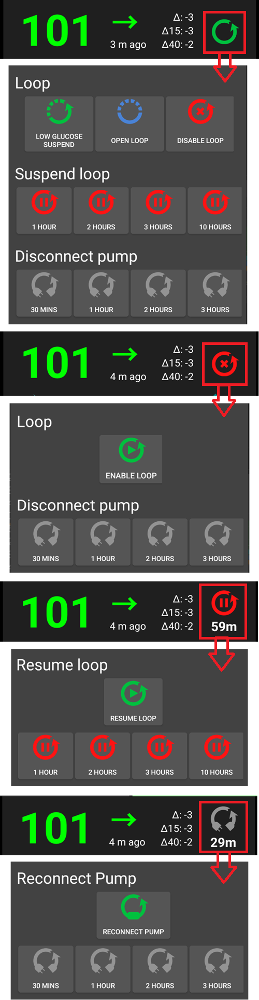
    

(aaps-screens-bg-warning-sign)=

#### Semn de avertizare glicemie

Dacă din orice motiv există probleme în citirea glicemiei **AAPS**, veți primi un semnal de avertizare sub valoarea dumneavoastră de glicemie pe ecranul principal.

##### Semn roșu de avertizare: Date duplicate ale glicemiei

Semnalul de avertizare roșu vă semnalizează pentru a vă face activ imediat: Primiți **date duplicat ale glicemiei**, care împiedică bucla să își facă treaba. Prin urmare, bucla dumneavoastră va fi dezactivată până când este rezolvată problema.

    {admonition} Bucla dumneavoastră nu rulează
    Notă:class:
    Bucla dumneavoastră nu rulează până când nu rezolvați această problemă!

    
    

Trebuie să aflați de ce primiți glicemii duplicat:

* Este activată puntea Dexcom pe site-ul Nightscout? Dezactivați puntea în panoul de administrare al instanței Nightscout, editați variabila "enable" și eliminați partea "bridge" de acolo. (Pentru heroku [detaliile pot fi găsite aici](https://nightscout.github.io/troubleshoot/troublehoot/#heroku-settings).)
* Sunt multiple surse care încarcă glicemia în Nightscout? Dacă utilizați aplicația BYODA, activați încărcarea în **AAPS** dar nu o activați în xDrip+, dacă îl utilizați.
* Aveți vreo persoană care ar putea primi glicemia, dar care o încarcă din nou pe site-ul dumneavoastră Nightscout?
* În ultimă instanță: În **AAPS**, accesați [Preferințe > NSClient](#Preferences-nsclient), selectați setările de sincronizare și dezactivați opțiunea "Acceptați CGM date din NS".

Pentru a elimina imediat avertismentul și a face bucla funcțională din nou, trebuie să ștergeți manual câteva intrări din fila Dexcom/xDrip+.

Cu toate acestea, atunci când există multe duplicate, ar putea fi mai ușor să

* [faceți copii de rezervă setărilor](../Maintenance/ExportImportSettings.md),
* resetați baza de date în meniul de întreținere și
* [importați setările](../Maintenance/ExportImportSettings.md) din nou

##### Semnal galben de avertizare

Semnalul de avertizare galben indică faptul că glicemia dumneavoastră a ajuns în intervale neregulate de timp sau că unele glicemii lipsesc. La apăsarea semnului, mesajul indică „Date recalculate utilizate”.

    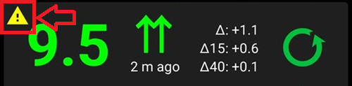
    

De obicei, nu trebuie să luați nicio măsură. Bucla închisă va continua să funcționeze!

Deoarece schimbarea senzorului întrerupe fluxul constant al datelor glicemiei, un semnal de avertizare galben după schimbarea senzorului este normal și nu este nimic de care să vă faceți griji.

Nota specială pentru utilizatorii Libre:

* Fiecare senzor Libre întârzie un minut sau două la fiecare câteva ore, ceea ce înseamnă că nu primiți niciodată un flux perfect de date glicemice.
* De asemenea, citirile cu sărituri întrerup fluxul continuu.
* Prin urmare, semnalul de avertizare galben va fi 'întotdeauna pornit' pentru utilizatorii Libre.

*Notă*: Până la 30 de ore sunt considerate pentru calculele **AAPS**. Deci chiar și după ce ați rezolvat problema originii, poate dura aproximativ 30 de ore până la dispariția triunghiului galben după ultimul interval neregulat.

#### Mod simplu

O pictogramă cu fața unui copil în dreapta sus a acestei secțiuni indică faptul că sunteți în [Modul simplu](#preferences-simple-mode).

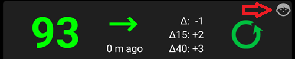

### Secțiunea D - IOB, COB, BR și AS


1. **Seringa**: insulină la bord (IOB) - cantitatea de insulină activă din corpul dumneavoastră  
  Cantitatea de insulină la bord ar fi zero dacă ar rula doar bazala standard și nu ar mai exista insulină din bolusurile anterioare.
  
  * IOB poate fi negativ dacă s-au înregistrat recent perioade de bazală redusă.
  * Apăsați pictograma pentru a vedea împărțirea insulinei între bolus și bazală

2. **Spic**: [carbohidrați la bord (COB)](../DailyLifeWithAaps/CobCalculation.md) - carbohidrați neabsorbiți pe care i-ați mâncat deja Pictograma pulsează roșu dacă sunt necesari carbohidrați (vedeți [mai jos](#aaps-screens-carbs-required))

3. **Linie mov**: rată bazală curentă. Pictograma se schimbă pentru a reflecta schimbările temporare ale ratei bazale (la nivel la 100%) 
  * Apăsați pictograma pentru a vedea rata bazalei și detaliile oricărei bazale temporare (inclusiv durata rămasă)
4. **Săgețile sus & jos**: indică starea caracteristicilor de sensibilitate dinamică ([Autosens](#Open-APS-features-autosens) sau [DynamicISF](#Open-APS-features-DynamicISF)): activat sau dezactivat. Mai multe valori pot fi indicate în această secțiune: 
  * AS: Valoare Autosens. Afișat chiar dacă Autosens este dezactivat (doar informativ). De asemenea este afișat când DynISF este activat, deși nu are niciun efect.
  * Alg: Valoarea dinamică FSI (pe baza DZT). Mai multe informații pe ultima linie din pagina [DynamicISF](#Open-APS-features-DynamicISF).

(aaps-screens-carbs-required)=

#### Carbohidrați necesari

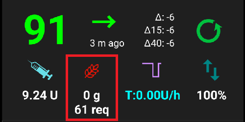

Sunt oferite sugestii pentru carbohidrați atunci când designul de referință detectează că este nevoie de carbohidrați.

Acesta este momentul în care algoritmul oref crede că nu te poate salva cu o bazală temporară zero și vei avea nevoie de carbohidrați pentru ca soluție.

Notificările pentru carbohidrați sunt mult mai sofisticate decât cele ale calculatorului pentru bolus. S-ar putea să vedeți sugestii pentru carbohidrați în timp ce calculatorul de bolus nu arată carbohidrați lipsă.

Notificările necesare pentru carbohidrați pot fi împinse la Nightscout, dacă doriți, caz în care va fi afișat și difuzat un anunț.

### Secțiunea E - Lumini de stare


Starea luminilor oferă un avertisment vizual pentru

* Vechime canulă
* Vechimea insulinei (de câte zile este utilizat rezervorul)
* Nivelul rezervorului (unități)
* Vechime senzor
* Vechimea și nivelul bateriei (%)

În cazul în care pragul de avertizare este depășit, valorile vor fi afișate în galben.

Dacă pragul critic este depășit, valorile vor fi evidențiate cu roșu.

Setările pot fi modificate în [Preferințe > Prezentare > Lumini stare](#Preferences-status-lights).

În funcție de pompa pe care o utilizați, este posibil să nu aveți toate aceste pictograme.

(aaps-screens-main-graph)=

### Secțiunea F - Grafic principal

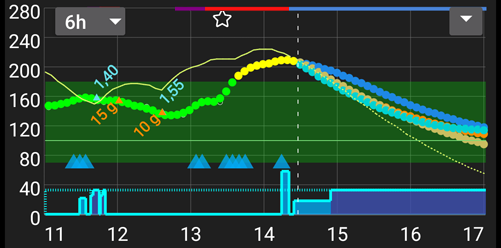

Graficul indică glicemia dumneavoastră așa cum este citită de la senzorul dumneavoastră de monitorizare continuă a glicemiei (CGM).

Utilizați meniul din stânga sus a graficului sau apăsați lung oriunde pe grafic pentru a schimba scara de timp. Puteți alege între 6, 12, 18 sau 24 de ore.

Zona verde reflectă intervalul dumneavoastră țintă.

Aceste informații sunt, de asemenea, prezentate în acest grafic:

* Bolusuri: triunghi albastru pe curba de glicemie și cantitatea de insulină
* Intrări de carbohidrați: triunghi portocaliu pe curba de glicemie și cantitatea de carbohidrați
* Ținta așa cum este definită în profil sau modificată de ținta temporară: linie verde
* Schimbări de profil: stea în partea de sus a graficului
* Starea buclei: linie de culoare în partea de sus a graficului atunci când starea este orice altceva decât bucla închisă - vezi [Starea buclei](#AapsScreens-loop-status) pentru culori
* [SMB](#Open-APS-features-super-micro-bolus-smb) - dacă este activat în [Preferințe > OpenAPS SMB](#Preferences-openaps-smb-settings): triunghiuri albastre în partea de jos a graficului

(AapsScreens-activate-optional-information)=

#### Activați informații opționale

Prin folosirea săgeții din dreapta sus, puteți activa aceste informații opționale:

* Predicții (vedeți mai jos)
* Tratamente: note introduse în fila de acțiune: puncte gri, portocalii sau roșii, în funcție de gravitate, precum și calibrări capilare ale glicemiei: punct roșu
* Bazale 
  * Așa cum este definit în profil: linia albastră punctată în partea de jos a graficului
  * Bazala administrată de fapt: linie albastră cu fundal albastru
* Activitate - curba activității insulinei: linie galbenă

Pentru a afișa această informație, apăsați pe triunghiul din partea dreaptă a graficului principal. Pentru graficul principal sunt disponibile doar cele patru opțiuni de deasupra liniei "Graficul 1 2 3 4".

     
    

(aaps-screens-prediction-lines)=

#### Linii de predicție

* Linia **portocalie**: [COB](CobCalculation) (culoarea este folosită în general pentru a reprezenta COB și carbohidrați)
  
  Această linie de predicție arată unde glicemia dumneavoastră (nu unde se află COB!) va evolua în baza setărilor curente de**Profil**, presupunând că abaterile datorate absorbției carbohidraților rămân constante. Această linie apare numai dacă există COB cunoscuți.

* Linia **albastru închis**: IOB (culoarea este folosită în general pentru a reprezenta IOB și insulină)
  
  Această linie de predicție arată ce s-ar întâmpla doar sub influența insulinei. De exemplu, dacă ați administrat insulină și apoi nu ați mâncat niciun carbohidrat.

* Linia **albastru deschis**: temporară zero (glicemia prezisă dacă se va stabili rata bazală temporară la 0%)
  
  Această linie de predicție arată cum se va schimba linia de traiectorie a glicemiei dacă pompa ar opri administrarea insulinei (RBT 0%).
  
  *Această linie apare numai când se folosește algoritmul [SMB](#Config-Builder-aps).*

* Linia **galben închis**: [UAM](#SensitivityDetectionAndCob-sensitivity-oref1) (mese neanunțate)
  
  Mesele inopinate (neanunțate) înseamnă că se detectează o creștere semnificativă a nivelului glicemiei din cauza meselor, a adrenalinei sau a altor influențe. Linia de predicție este similară cu linia **portocalie COB**, dar presupune că devierile vor scădea în ritm constant (prin extinderea ratei actuale de reducere).
  
  *Această linie apare numai când se folosește algoritmul [SMB](#Config-Builder-aps).*

* Linia **portocaliu închis**: aCOB (absorbție accelerată a carbohidraților)
  
  Similar cu COB, dar în ipoteza unei rate statice de 10 mg/dL/5m (-0,555 mmol/l/5m) de absorbție a carbohidraților. Învechită și de utilitate limitată.
  
  *Această linie apare doar când este folosit algoritmul [AMA](#Config-Builder-aps).*

De obicei, curba reală a glicemiei ajunge în mijlocul acestor linii, sau aproape de cea care face presupuneri care se apropie cel mai mult de situația dumneavoastră.

#### Bazale

Linia **albastru solid** afișează administrarea bazală a pompei și reflectă administrarea efectivă de-a lungul timpului.

Linia **albastră punctată** afișează cum ar fi rata bazală dacă nu ar exista ajustări temporare ale bazalei (RBT).

Când este dată rata bazală standard, zona de sub curbă este afișată cu albastru închis. Când rata bazală este ajustată temporar (mărită sau scăzută), aria de sub curbă este afișată cu albastru deschis.

#### Exercițiu fizic

Linia **galbenă subțire** arată activitatea Insulinei.

Aceasta se bazează pe scăderea preconizată a concentrației insulinei în sistemul dumneavoastră dacă nu au fost prezenți alți factori (cum sunt carbohidrații).

(AapsScreens-section-g-additional-graphs)=

### Secțiunea G - Grafice adiționale

Puteți activa până la patru grafice suplimentare sub graficul principal. Când sunteți în [Mod simplu](#preferences-simple-mode), graficele adiționale sunt presetate și nu pot fi modificate. Dezactivați **Modul simplu** dacă doriți să setați propria configurație de grafice suplimentare.

Pentru a deschide setările pentru graficele suplimentare, faceți clic pe triunghiul din partea dreaptă a [graficului principal](#aaps-screens-main-graph) și derulați în jos.


Pentru a configura grafice suplimentare, bifați casetele care corespund datelor pe care doriți să le vedeți pe fiecare grafic.

Majoritatea utilizatorilor găsesc următoarea configurație a graficelor suplimentare ca adecvată:

* Graficul 1 cu IOB, COB, modificarea sensibilității
* Graficul 2 cu abateri și impactul glicemiei.

#### Insulină absolută

Insulina activă, inclusiv bolusuri **și bazală**.

#### Insulină la bord

Arată insulina pe care o aveți la bord (= insulină activă în corpul dumneavoastră). Include insulina din bolus și bazala temporară (**dar exclude ratele bazale stabilite în profilul dumneavoastră**).

Dacă nu ar exista [SMB](#Open-APS-features-super-micro-bolus-smb), fără bolusuri și fără RBT în timpul DIA acesta ar fi zero.

IOB poate fi negativ dacă nu mai aveți insulină din bolusuri și bazală temporară zero sau scăzută de o perioadă mai lungă de timp.

Descompunerea depinde de [setările dumneavoastră pentru DIA și profilul de insulină](../SettingUpAaps/YourAapsProfile.md).

#### Carbohidrați la bord

Arată carbohidrații pe care îi aveți la bord (= activi, nu sunt încă dezintegrați în corpul dumneavoastră).

Descompunerea depinde de deviațiile [pe care algoritmul le detectează](../DailyLifeWithAaps/CobCalculation.md).

Dacă algoritmul detectează o absorbție de carbohidrați mai mare decât cea așteptată, se administrează insulină, iar aceasta crește cantitatea de IOB (mai mult sau mai puțin, în funcție de condițiile dumneavoastră de siguranță).

#### Modificare sensibilitate

Arată sensibilitatea detectată de [Autosens](#Open-APS-features-autosens).

Sensibilitatea este un calcul al sensibilității la insulină ca rezultat al exercițiilor fizice, hormonilor șamd.

Notă, trebuie să fiți în [Obiectivul 8](#objectives-objective8) pentru a permite Detectării Sensibilității /[Autosens](#Open-APS-features-autosens) să ajusteze automat cantitatea de insulină administrată. Înainte de a atinge acel obiectiv, linia din grafic este afișată doar pentru informații.

### Sensibilitate variabilă

Afișează sensibilitatea calculată de [DynamicISF](../DailyLifeWithAaps/DynamicISF.md). Populat numai dacă folosiți această caracteristică.

(screen-heart-rate-steps)=

#### Ritm cardiac & Pași

Aceste date pot fi disponibile atunci când utilizați un [ceas inteligent Wear](../WearOS/WearOsSmartwatch.md). Activați-le în aplicația Wear **AAPS** și acordați permisiunea pentru date de sănătate.

#### Deviații

* Barele **gri** afișează o abatere datorată carbohidraților. 
* Barele **verzi** arată că glicemia este mai mare decât era așteptat de către algoritm să fie. Barele verzi sunt folosite pentru a crește rezistența în [Autosens](#Open-APS-features-autosens).
* Barele **roșii** arată că glicemia este mai mică decât se aștepta algoritmul să fie. Barele roșii sunt folosite pentru a crește sensibilitatea în [Autosens](#Open-APS-features-autosens).
* Barele **galbene** afișează o abatere cauzată de UAM.
* Barele **negre** arată mici abateri care nu sunt luate în considerare pentru sensibilitate

#### Impactul glicemiei

Această linie arată nivelul până la care glicemia "ar trebui" să crească sau să scadă, numai în funcție de activitatea insulinei.

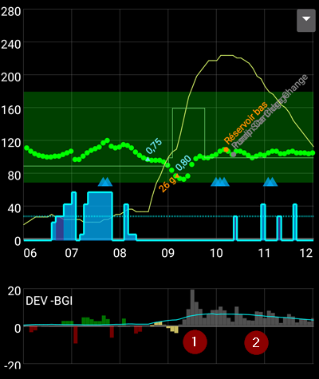

Este o combinație bună să afișezi această linie împreună cu barele de deviere. Ele împart aceeași scară, dar este una diferită de celelalte date opționale, deci este o idee bună să le afișăm pe un grafic separat, așa cum se arată mai sus. Compararea liniei de impact al glicemiei cu barele de deviație este o altă modalitate de a înțelege cum fluctuează **glicemia**. Aici, la momentul marcat cu **1**, barele de deviație sunt mai mari decât linia impactului glicemiei, ceea ce indică că glicemia este în creștere. Mai târziu, în timpul orelor marcate cu **2**, impactul glicemiei și deviațiile sunt destul de aliniate, indicând că glicemia este stabilă.

### Secțiunea H - Butoane


Butoanele pentru insulină și carbohidrați sunt aproape întotdeauna vizibile. Dacă conexiunea la pompă este pierdută, butonul Calculator nu va fi vizibil.

Alte butoane pot fi setate în [Preferințe > Vedere de ansamblu > Butoane](#Preferences-buttons).

Despre folosirea butoanelor Insulină, Carbohidrați și Calculator: Dacă este activată în [Preferințe > Vedere de ansamblu](#Preferences-show-notes-field-in-treatments-dialogs), câmpul **Note** vă permite să introduceți un text care va fi afișat pe graficul principal, și poate fi încărcat în Nightscout - în funcție de setările pentru NS.

(aaps-screens-buttons-insulin)=

#### Insulină


Pentru a administra o anumită cantitate de insulină fără a utiliza [ calculatorul de bolus](#aaps-screens-bolus-wizard).

Prin bifarea casetei **Țintă temporară mănânc în curând**, poți porni automat [Țintă temporară mănânc în curând](#TempTargets-eating-soon-temp-target).

Dacă nu doriți să administrați un bolus prin pompă, dar să înregistrați o cantitate de insulină (spre exemplu insulină administrată cu stiloul injector) bifați căsuța corespunzătoare. Când bifați această cutie, obțineți un câmp suplimentar "Decalaj de timp", pe care îl puteți utiliza pentru a înregistra o injecție de insulină efectuată în trecut.

Puteți utiliza butoanele pentru a crește rapid cantitatea de insulină. Valorile incrementului pot fi modificate în [Preferințe > Vedere de ansamblu > Butoane](#Preferences-buttons).

Butonul de insulină poate fi utilizat și atunci când pompa este suspendată, de exemplu pentru a înregistra insulina injectată cu un stilou injector. În acest caz, antetul va fi afișat în galben, iar căsuța de selectare „Nu bolusați, doar înregistrare” nu poate fi debifată.

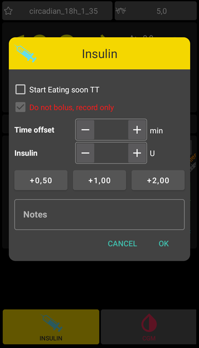

#### CH


Pentru a înregistra carbohidrați fără bolusare.

Anumite [ținte prestabilite temporare](#TempTargets-hypo-temp-target) pot fi stabilite direct prin bifarea casetei.

**Decalaj de timp**: Când veți / ați mâncat carbohidrați (în minute).

**Durată**: A fi folosită pentru ["carbohidrații extinși"](ExtendedCarbs)

Puteți folosi butoanele pentru a crește rapid cantitatea de carbohidrați. Valorile incrementului pot fi modificate în [Preferințe > Vedere de ansamblu > Butoane](#Preferences-buttons).

#### Calculator

Vedeți [ secțiunea de mai jos](#aaps-screens-bolus-wizard) asistent de bolusare.

#### Calibrări

Trimiteți o calibrare la xDrip+ sau deschidețî dialogul de calibrare cu Dexcom.

Must be activated in [Preferences > Overview > Buttons](#Preferences-buttons).

#### CGM

Deschideți xDrip+

Back button returns to **AAPS**.

Must be activated in [Preferences > Overview > Buttons](#Preferences-buttons).

#### Asistent Rapid

Introduceți cu ușurință cantitatea de carbohidrați și stabiliți calculele de bază.

Details are set up in [Preferences > Overview > QuickWizard settings](#Preferences-quick-wizard).

(aaps-screens-bolus-wizard)=

## Asistent Bolus


Când doriți să faceți un bolus pentru o masă, în mod normal de aici veți face asta.

### Secțiunea I

Afișați bolusul calculat.

În cazul în care cantitatea de insulină la bord depășește bolusul calculat, atunci aceasta va afișa doar cantitatea de carbohidrați care mai sunt necesari.

(AapsScreens-section-j)=

### Secțiunea J

Câmpul glicemie este deja completat cu ultima citire din CGM. Dacă nu aveți un CGM funcțional, atunci acesta va fi gol.

În câmpul **Carbohidrați** adăugați cantitatea de carbohidrați - sau echivalent - pentru care doriți să bolusați.

Câmpul **Corecție** există dacă doriți să modificați dozajul final dintr-un anumit motiv.

Câmpul **Timp carbohidrați** este pentru pre-bolusare astfel încât să puteți spune sistemului că va exista o întârziere înainte ca carbohidrații să fie așteptați. Puteți să puneți un număr negativ în acest câmp dacă bolusați pentru carbohidrați anteriori.

**Memento masă** : Pentru carbohidrații din viitor, caseta de selectare a alarmei poate fi selectată (și este implicită atunci când este introdusă o oră în viitor), astfel încât să vă poată fi reamintit la un moment dat, când să mâncați carbohidrații introduși în **AAPS**.


### Secțiunea K

**Profilul** vă permite să selectați un profil diferit de cel curent, pentru a realiza calculul necesar pentru insulină. Această selecție de profil se aplică numai pentru bolusul curent, nu este o schimbare de profil.

**Super bolus** este locul unde insulina bazală pentru următoarele două ore este adăugată la bolusul de-acum, iar pentru următoarele două ore este emisă o RBT zero pentru a lua înapoi insulina în plus. Opțiunea este prezentă numai când "Activați Superbolus în asistent" este setată în [Preferințe > Vedere de ansamblu > Setări avansate](#Preferences-advanced-settings-overview). Ideea este de a administra insulina mai devreme în speranța de a reduce vârfurile.

Pentru detalii vizitați [diabetesnet.com](https://www.diabetesnet.com/diabetes-technology/blue-skying/super-bolus/).

### Secțiunea L

Detalii despre asistentul de calculul al bolusului.

Puteți deselecta orice lucru pe care nu doriți să îl includeți, dar în mod normal nu ați dori să faceți.

Din motive de siguranță, căsuța **Țintă temporară trebuie bifată manual**, dacă doriți ca asistentul de bolus să calculeze pe baza unei ținte temporare existente.

#### Combinații de COB și IOB și ce înseamnă acestea

* Din motive de securitate, căsuța IOB nu poate fi debifată când este bifată căsuța COB, deoarece există riscul să acumulați prea multă insulină fiindcă **AAPS** nu ține cont de ceea ce a fost deja dat.
* Dacă bifați COB și IOB, carbohidrații neabsorbiți care nu sunt deja acoperiți de insulină + toată insulina care a fost eliberată sub formă de RBT sau SMB vor fi luați în considerare.
* Dacă bifați IOB fără COB, **AAPS** ia în considerare insulina deja administrată, dar nu o va acoperi în raport cu niciun carbohidrat care nu a fost încă absorbit. Acest lucru conduce la o notiță "carbohidrați lipsă".
* Dacă bolusați pentru **mâncare suplimentară** la scurt timp după o masă (spre exemplu desert suplimentar) poate fi util să **debifați toate căsuțele**. În acest fel, doar noii carbohidrați sunt adăugați deoarece masa principală nu va fi absorbită astfel încât IOB nu se potrivește cu precizie cu COB la scurt timp după un bolus de masă.

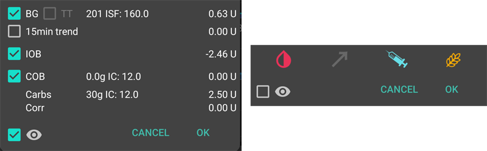

The box near the eye allows you to choose between the detailed view, with the numbers entering the calculation for each item, or the simple view with icons. Pressing on an icon will enable / disable this entry from the calculation.

(AapsScreens-wrong-cob-detection)=

#### Detectare cantitate COB greșită 


If you see the warning above after using bolus wizard, **AAPS** has detected that the calculated COB value may be wrong. So, if you want to bolus again after a previous meal with COB, you should be aware of overdosing!

For details, see the hints on [COB calculation page](#CobCalculation-detection-of-wrong-cob-values).

(screens-action-tab)=

## Pagina Acțiuni

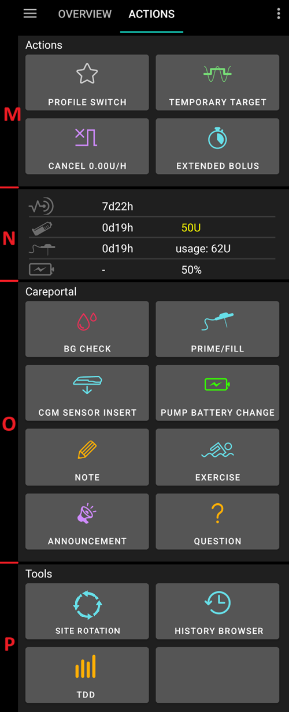

### Acțiuni - secțiunea M

Butonul **[Schimbați profilul](../DailyLifeWithAaps/ProfileSwitch-ProfilePercentage.md)** ca alternativă la apăsarea [profilului curent](#aaps-screens-profile--target) de pe ecranul principal.

Butonul **[Țintă temporară](../DailyLifeWithAaps/TempTargets.md)** ca alternativă la apăsarea [țintei curente](#aaps-screens-profile--target) de pe ecranul principal.

Buton pentru a porni sau anula o rată bazală temporară. Please note that the button changes from “TEMPBASAL” to “CANCEL x%” when a temporary basal rate is set.

Chiar dacă [bolusurile extinse](#extended-bolus-and-why-they-wont-work-in-closed-loop-environment) nu funcționează cu adevărat într-un sistem de buclă închisă, unii oameni au cerut opțiunea de a utiliza oricum bolusul extins.

* Această opțiune este disponibilă doar pentru pompele Dana RS și Insight. 
  * Closed loop will automatically be stopped and switched to open loop mode for the time running extended bolus.
  * Make sure to read the [details](../DailyLifeWithAaps/ExtendedCarbs.md) before using this option.

(aaps-screens-careportal)=

### Careportal - secțiunea N

Afișați informații la:

     * vechime & nivel senzor (procentaj baterie)
     * vechime & nivel insulină (unități)
     * vechime canulă
     * vechime & nivel baterie pompă (procentaj)
    

Mai puține informații vor fi afișate dacă este folosită **interfața cu rezoluție joasă** ([Preferințe > General > Interfață](#Preferences-skin)).

(screens-sensor-level-battery)=

#### Nivel senzor (baterie)

Funcționează pentru senzorul de monitorizare continuă a glicemiei (CGM) cu un transmițător suplimentar, cum ar fi MiaoMiao 2. (Tehnic senzorul trebuie să trimită informații despre nivelul cat către xDrip+.)

Pragurile pot fi setate în [Preferințe > Vedere de ansamblu > Lumini de stare](#Preferences-status-lights).

### Careportal - secțiunea O

Verificare glicemie (BG), amorsare/umplere (prime/fill), inserție senzor și schimbare baterie pompă sunt baza pentru datele afișate în [secțiunea N](#aaps-screens-careportal).

Amorsarea/Umplerea (Prime/Fill) vă permite să înregistrați schimbarea locului de inserție al pompei și a cartușului de insulină.

Secțiunea O reflectă portalul de îngrijire Nightscout. Așa că exercițiile, anunțurile și întrebările sunt forme speciale de note.

### Instrumente - secțiunea P

(Aapsscreens-site-rotation)=

#### Rotație loc

Site Rotation button opens the Site Rotation Dialog in View mode:

* Puteți selecta dacă doriți să vedeți doar locurile de canulă, doar cele de senzor, sau ambele prin bifarea casetelor de selectare de sus
* Toate evenimentele de schimbare de canulă și de schimbare a senzorului din ultimele 45 de zile sunt disponibile.
* Apăsați pe o zonă a corpului sau pe o singură intrare din lista de mai jos pentru a filtra lista cu intrările doar din zona selectată. Zona selectată va fi evidențiată cu o culoare verde deschis.
* Puteți deschide vederea de editare pentru a actualiza locul de pe corp, săgeata sau comentariul asociat fiecărei intrări


* Fila setare (rotița dințată dreapta sus) vă permite să ajustați vizualizarea pacientului (bărbat, femeie sau copil), și să selectați dacă doriți să gestionați doar siturile de pompă, doar siturile de senzor sau pe ambele.


*Notă: această setare va fi utilizată pentru a deschide automat sau nu dialogul de rotație a sitului (modul editare) atunci când o nouă intrare este făcută din butonul "Amorsați / Umpleți" sau "Butonul de inserare a senzorului"*

* Pentru schimbarea locului efectuată direct din pompă, trebuie să deschideți Modul de vizualizare și să editați noua intrare pentru a selecta locul și săgeata

Edit Mode allows you to select Location, Arrow, and Note associated to selected Entry:

* Entry type is visible on the to of Edit mode (Cannula Icon, or Sensor Icon)
* You have to select Front or Back tab and then the Area
* Once a Site selected (highlighted in green), you will see in the list below the list of all entries done in the pas 45 days in this site


* You can adjust an optional arrow with a click on little arrow icon on the top (Arrow allow you to precise sub-location, from 2 to 9, or Pod Orientation)


* You can also adjust comments concerning selected site
* After confirmation, the site is recorded

Filtering can be done graphically on the image, or clicking a therapy event in the list To remove filtering, just click on the image outside any sites


#### Vizualizare istoric

Allows you to ride back in **AAPS** [history](../Maintenance/Reviewing.md).

#### TDD

Doza zilnică totală = bolus + bazală pe zi

Unii medici folosesc – în special pentru noii utilizatori de pompe – un raport bazal-bolus de 50:50.

Therefore, ratio is calculated as TDD / 2 * TBB (Total base basal = sum of basal rate within 24 hours).

Alți medici preferă TBB între 32% și 37% din DZT.

Ca majoritatea regulilor generale, formulele acestea au o valabilitate reală limitată. Notă: Diabetul dumneavoastră poate varia!

(AapsScreens-insulin-profile)=

## Insulin Profile

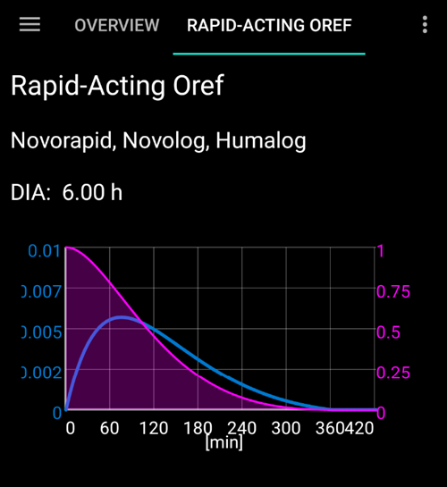

This shows the activity profile of the insulin you have chosen in [Config builder > Insulin](#Config-Builder-insulin). The curves will vary based on the [DIA](#your-aaps-profile-duration-of-insulin-action) and the time to peak.

The **purple** line shows how much insulin remains after it has been injected as it decays with time and the **blue** line shows how active it is.

See [Your AAPS Profile > Duration of insulin action](#your-aaps-profile-duration-of-insulin-action) to learn more about what it is and how to set it.

## Stare pompă

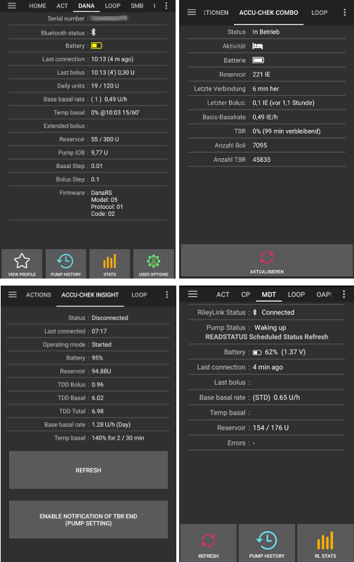

* Different information on pump status. Displayed information depends on your pump model.
* See [pumps page](../Getting-Started/CompatiblePumps.md) for details.

## Buclă, AMA / SMB

These tabs show details about the algorithm's calculations and why **AAPS** acts the way it does.

Calculations are run each time the system gets a fresh reading from the CGM.

For more details see [APS section on config builder page](#Config-Builder-aps).

(aaps-screens-profile)=

## Profil


Profile contains information on your individual diabetes settings, see the detailed **[Profile](../SettingUpAaps/YourAapsProfile.md)** page for more information.

## Automatizare

See the dedicated page [here](../DailyLifeWithAaps/Automations.md).

## Client NS


This page displays the status of the connection with your Nightscout site.

Settings can be changed in [Preferences > NS Client](#Preferences-nsclient).

For troubleshooting see this [page](../GettingHelp/TroubleshootingNsClient.md).

## BG Source - xDrip+, BYODA...


Depending on your BG source settings, this tab is named differently.

Shows history of CGM readings and offers option to remove reading in case of failure (i.e. compression low) or duplicate readings.

(aaps-screens-treatments)=

## Tratamente

This view can be accessed by pressing the 3 dots on the right of the menu, then Treatments. It is not possible to show it in the main menu through the Config Builder. În acest mod de vizualizare, puteți vedea și modifica istoricul următoarelor tratamente:

* Bolus & carbohidrați
* [Bolus extins](#Extended-Carbs-extended-bolus-and-switch-to-open-loop-dana-and-insight-pump-only)
* Rată bazală temporară
* [Țintă temporară](../DailyLifeWithAaps/TempTargets.md)
* [Schimbare de profil](../DailyLifeWithAaps/ProfileSwitch-ProfilePercentage.md)
* Careportal: note introduse prin fila de acțiune și note în dialoguri
* Mod de funcționare: istoric stare buclă
* User entry: other notes that are not sent to Nightscout

In the last column, the data source for each line is displayed in blue. It can be :

* NS for Nightscout : the data comes from or has been recorded to Nightscout
* PH for Pump History : the data has been processed by the pump

(screens-bolus-carbs)=

### Bolus & carbohidrați


On this tab you can view the bolus and carbs log. Each bolus (line **1** and **4**) shows the remaining associated IOB next to the insulin amount. The origin of the bolus can be either :

* Meal (manually entered though the Insulin, Quick Wizard or Bolus Wizard buttons)
* SMB, when using the SMB Functionality

The carbs (line **2**) are only stored in Nightscout. If you have used the [Bolus Wizard](#aaps-screens-bolus-wizard) to calculate insulin dosage, you can press the “Calc” text (line **3**) to show the details of how the bolus was calculated.

Depending on the pump used, insulin and carbs can be shown in one single line, or will result in multiple lines: one for the calculation detail, one for the carbs, one for the bolus itself.

The treatment tab can be used to correct faulty carb entries (*i.e.* you over- or underestimated carbs). Note that it is not possible to edit an existing entry, you need to follow the following process:

1. Check and remember actual COB and IOB on homescreen.
2. Depending on pump in treatment tab carbs might be shown together with insulin in one line or as a separate entry (i.e. with Dana RS).
3. Eliminați înregistrarea cu cantitatea eronată de carbohidrați. (Latest versions have trashcan icon in treatments screen. Press the trashcan icon, select the lines to remove, and then press the trashcan icon again to finalize.)
4. Make sure carbs are removed successfully by checking COB on homescreen again.
5. Do the same for IOB if there is just one line in treatment tab including carbs and insulin.
  
  → If carbs are not removed as intended, and you add additional carbs as explained here (6.), COB will be too high and that might lead to too high insulin delivery.

6. Enter correct carb amount through carbs button on homescreen and make sure to set the correct event time.

7. If there is just one line in treatment tab including carbs and insulin you have to add also the amount of insulin. Make sure to set the correct event time and check IOB on homescreen after confirming the new entry.

### Bazală temporară


The **temp basals** applied by the loop are shown here. When there is still an impact on the IOB for an entry, the information is shown in green. It can be:

* Positive IOB if the temp basal was higher than the one set in the Profile (line **2**)
* Negative IOB for a zero-temp or if the temp basal was lower than the one set in the Profile (line **1**)

Deleting the entries only affects your reports in Nightscout and will probably tamper your real IOB - it is not recommended.

On the left of a line, a red S means “Suspend” : it happens when basal is not currently delivered. This is a normal situation when in the process of changing a pod, for example.

### Țintă temporară


The history of temporary targets can be seen here.

### Schimbare profil


The history of profile switches can be seen here. You may see multiple entries each time you switch profile : line **1**, stored in Nightscout but not in Pump History, corresponds to the request of a profile switch made by the user. Line **2**, stored both in NS and PH, correspond to the actual switch.

Deleting the entries only affects your reports in Nightscout and will never actually change the current profile.

You can use the **Clone** button shown on line **1** to make a copy of a **Profile Switch**. See [Your AAPS Profile > Manage your profiles](#your-aaps-profile-clone-profile-switch) for more information.

(AapsScreens-running-mode)=

### Mod de rulare


This tab shows the history of [loop status](#AapsScreens-loop-status) changes : open, closed, suspend loop.

### Care portal


This tab shows all notes and alerts recorded in Nightscout.

(aaps-screens-running-mode)=

## Vizualizare istoric

This view can be accessed by pressing the 3 dots on the right of the menu, then History. It is not possible to put in the main menu through the Config Builder. It can also be accessed through a button at the bottom of the [Action tab](#screens-action-tab).

Allows you to ride back in **AAPS** history. See the dedicated page [Reviewing your data > History Browser](../Maintenance/Reviewing.md).

## Statistici

This view can be accessed by pressing the 3 dots on the right of the menu, then Statistics. It is not possible to put in the main menu through the Config Builder.

Gives you statistics about your Time In Range and Total Daily Dose. See the dedicated page [Reviewing your data > Statistics](#reviewing-statistics).

(aaps-screens-profile-helper)=

## Ajutorul de profil

This view can be accessed by pressing the 3 dots on the right of the menu, then Profile Helper. It is not possible to put in the main menu through the Config Builder. The Profile Helper can help you:

* [să construiți un profil de la zero pentru un copil](#your-aaps-profile-profile-from-scratch-for-a-kid)
* [comparați două profiluri](#your-aaps-profile-compare-profiles)