# Ecranele AAPS

```{contents}
:backlinks: entry
:depth: 2
```

(the-homescreen)= (AapsScreens-the-homescreen)=

## Ecranul principal


Acesta este primul ecran peste care veți da când deschideți **AAPS**, și conține majoritatea informațiilor de care veți avea nevoie zi de zi.

### Secțiunea A - Bara de sus

* The **menu** (☰) on the left opens the navigation drawer with **Treatments history**, **History browser**, **Statistics**, **Profile helper**, **Maintenance**, **Setup Wizard**, **Configuration** and more.
* The **search bar** finds settings, dialogs and documentation — just start typing (see [Global search](../DailyLifeWithAaps/GlobalSearch.md)).
* The **Settings** (gear) icon on the right opens all [settings](../SettingUpAaps/Preferences.md).

(aaps-screens-profile--target)=

### Secțiunea B - Blocul de stare

#### Valoarea actuală a glicemiei

Ultima citire a glicemiei de la CGM este afișată în cercul mare din stânga, împreună cu diferența față de citirea anterioară (delta) și vechimea citirii.

Culoarea valorii glicemiei indică starea curentă în raport cu [intervalul](#Preferences-range-for-visualization) definit.

* verde = în interval
* roșu = sub interval
* galben = peste interval

 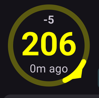 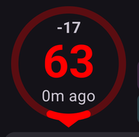

(loop-status)= (AapsScreens-loop-status)=

#### Stare buclă


Lângă cercul glicemiei, o pictogramă arată modul de funcționare al buclei (de sus în jos în imagine):

1. Cerc verde = [buclă închisă](#KeyAapsFeatures-ClosedLoop), bucla funcționează
2. Cerc violet cu linie punctată = [suspendare la glicemie scăzută (LGS)](#KeyAapsFeatures-LGS)
3. Cerc albastru cu linie punctată = [buclă deschisă](#KeyAapsFeatures-OpenLoop)
4. Red circle with cross = loop disabled (not working permanently)
5. Red pause icon = loop suspended (temporarily paused but basal insulin will be given) - remaining time is shown next to the icon
6. Cerc gri cu ștecher = pompă deconectată (temporar nu se administrează deloc insulină) - timpul rămas este afișat lângă pictogramă

Apăsați pictograma pentru a deschide dialogul Buclă. Conținutul dialogului depinde de starea curentă:

* Cât timp bucla **funcționează** (închisă, deschisă sau LGS), puteți schimba modul de funcționare (Buclă închisă, Suspendare la glicemie scăzută, Buclă deschisă sau Dezactivați bucla), puteți **suspenda** bucla sau puteți **deconecta** pompa pentru o durată aleasă.
* While the loop is **disabled**, you can re-enable it by selecting a running mode, or disconnect the pump.
* While the loop is **suspended**, you can **resume** it, disconnect the pump, or pick a new duration under **Suspend loop** to extend the suspension.
* While the pump is **disconnected**, you can **reconnect** the pump, or pick a new duration under **Disconnect pump** to extend the disconnection.

When you extend a suspension or a disconnection, the new duration **starts from now**: it replaces the remaining time, it is not added to it. Nu trebuie să reluați sau să reconectați mai întâi.

Dialogul când bucla funcționează în buclă închisă:


Dialogul când bucla este suspendată, cu **Reluați** și duratele pentru prelungirea suspendării:


Dialogul când pompa este deconectată, cu **Reconectați pompa** și duratele pentru prelungirea deconectării:


The dialog in Low Glucose Suspend, in open loop and while the loop is disabled only differs in the running modes it offers:


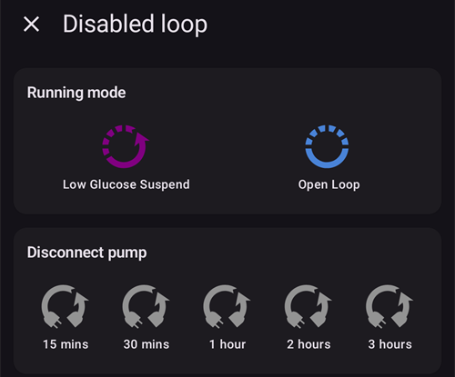

Așa arată ecranul principal în fiecare mod. The color band at the top of the graph changes at the time of the switch.

Suspendare la glicemie scăzută:


Buclă deschisă:


Buclă dezactivată:


Loop suspended — the remaining time is shown next to the icon:

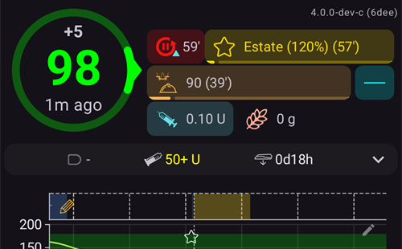

Pump disconnected — the remaining time is shown next to the icon. The treatment buttons stay in the QuickLaunch toolbar, so you can still record insulin given with a pen or carbs:


A validation is required after each selection.

```{admonition} Alarm: the pump did not accept the zero temp basal :class: warning While the pump is disconnected, **AAPS** keeps a zero temporary basal on the pump and sets it again if it is missing. If this still fails after 10 minutes, **AAPS** raises an urgent alarm: *"The pump did not accept the zero temp basal. Este posibil să administreze încă insulină bazală. Check the pump."* The alarm repeats every 15 minutes until the zero temporary basal is set or the disconnection ends. If you see it, check your pump: it may be delivering basal insulin although **AAPS** shows it as disconnected.

    <br />Note: the modes offered depend on your progress in the [Objectives](../SettingUpAaps/CompletingTheObjectives.md) — Closed Loop and LGS only become available as you complete them.
    
    (aaps-screens-bg-warning-sign)=
    #### BG warning sign
    
    If **AAPS** detects a problem with the BG readings it receives, a shortcut to your BG source (named after it, for example **xDrip+ BG**) appears in the bottom bar of the main screen, with a red warning badge. Tap it to open the [BG source screen](#aaps-screens-bg-source).
    
    ##### Duplicate BG data
    
    The red warning sign is signaling you to get active immediately: You are receiving **duplicate BG data**, which prevents the loop from doing its work right. **AAPS** cannot calculate your BG trend reliably from duplicated readings, so it stops correcting.
    
    If your loop was closed, **AAPS** switches it to [Low Glucose Suspend (LGS)](#KeyAapsFeatures-LGS) mode: the loop icon turns purple.
    
      
    
    Press the loop icon: the **Constraints** card at the top tells you why: "BgQualityCheck: LGS mode due to doubled values in BG source".
    
      
    
    ```{admonition} Your loop is running in Low Glucose Suspend
    :class: note
    Your loop keeps running, but only to protect you against lows: **AAPS** can still reduce or suspend your basal, and it will not give any correction insulin until you solve this issue !
    

Trebuie să aflați de ce primiți glicemii duplicat:

* Este activată puntea Dexcom pe site-ul Nightscout? Dezactivați puntea în panoul de administrare al instanței Nightscout, editați variabila "enable" și eliminați partea "bridge" de acolo. (Pentru Heroku [detaliile pot fi găsite aici](https://nightscout.github.io/troubleshoot/troubleshoot/#heroku).)
* Sunt multiple surse care încarcă glicemia în Nightscout? If you use the BYODA app, enable the upload in **AAPS** but do not enable it in xDrip, if you use that.
* Aveți vreo persoană care ar putea primi glicemia, dar care o încarcă din nou pe site-ul dumneavoastră Nightscout?
* Last resort: In [NSClient settings](#Preferences-nsclient), select the Synchronization settings and disable the "Receive CGM data from NS" option.

To remove the warning immediately and get your loop correcting again, delete the duplicate entries from the BG source screen: tap the shortcut in the bottom bar. Citirea duplicată este evidențiată cu roșu. Long press a reading to start selecting, tick the duplicates and tap the trash icon at the top right.

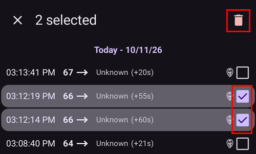

Cu toate acestea, atunci când există multe duplicate, ar putea fi mai ușor să

* [faceți copii de rezervă setărilor](../Maintenance/ExportImportSettings.md),
* resetați baza de date în meniul de întreținere și
* [importați setările](../Maintenance/ExportImportSettings.md) din nou

    {admonition} Switch back to Closed Loop yourself
    :class: important
    **AAPS** does not return to **Closed Loop** on its own once the duplicates are gone. Press the loop icon on the main screen and select **Closed Loop** again.

##### Flat BG data

With some BG sources (Libre 1, AiDEX, Glutec, Medtronic and sources that do not report their sensor type), **AAPS** also checks for readings that do not change: if your BG has changed by less than 2 mg/dL (0.1 mmol/L) for 45 minutes, the data is considered wrong. The BG source shortcut then shows a red flat-trend badge, and the loop stops any high temporary basal and gives no correction insulin until the readings change again. Verificați senzorul și aplicația care trimite citirile.

##### Irregular BG data

Când citirile sosesc la intervale neregulate sau unele lipsesc, **AAPS** recalculează valori la 5 minute din citirile pe care le are. This happens for example after a sensor change, or with Libre sensors, whose timing slips a minute or two every few hours. Bucla continuă să funcționeze și nu trebuie să faceți nimic. **AAPS** 4 no longer shows a yellow warning sign for this.

#### Profil curent

Profilul curent este afișat lângă pictograma stea.

Tap the profile name to open the [Profile screen](#aaps-screens-profile), where you can view the profile details and [switch between different profiles](../DailyLifeWithAaps/ProfileSwitch-ProfilePercentage.md).

To **change the profile percentage** (and its duration), tap the profile name, then tap the round **▶** (Activate) button at the bottom right of the Profile screen. In **AAPS** 3.x this screen opened with a long press on the profile name; in **AAPS** 4 a long press does nothing. Pas cu pas: [Schimbarea procentajului profilului](#ProfileSwitch-change-percentage).


1. Afișaj normal cu activare standard a profilului.
2. Profile switch with a specific percentage of 90% and a remaining duration of 9 minutes — the profile name turns yellow while a temporary profile switch is running.
3. Profile switch with a time shift of 1 hour and a remaining duration of 9 minutes.

#### Țintă


The current target blood glucose level is displayed below the profile name.

Short press the target to open the **[Temporary Target](../DailyLifeWithAaps/TempTargets.md)** screen.

1. Afișare normală: intervalul țintă definit în profilul dumneavoastră.
2. If a temp target is set, the target turns yellow/orange with the icon of the used preset, and the remaining time in minutes is shown in brackets.

(AapsScreens-visualization-of-dynamic-target-adjustment)=

#### Vizualizarea ajustare dinamică a țintei

Când se utilizează funcționalitatea [SMB](#Config-Builder-aps) și [Autosens](#Open-APS-features-autosens), **AAPS** vă poate ajusta dinamic ținta în funcție de sensibilitate.

Enable either one or both of the following options in [OpenAPS SMB settings](#Preferences-openaps-smb-settings):

* „Sensibilitatea ridică ținta” și/sau
* „Rezistența la insulină coboară ținta”

If **AAPS** detects resistance or sensitivity, the target will change from what is set from profile, and the displayed target changes color to indicate the adjustment.

(aaps-screens-iob-cob-basal-sens)=

#### IOB, COB, bazală și sensibilitate

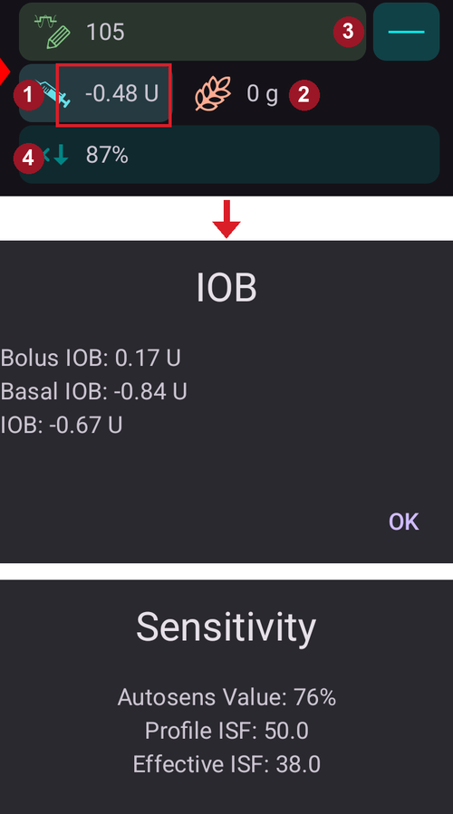

1. **Seringă**: insulin on board (IOB) - amount of active insulin inside your body  
    The insulin on board figure would be zero if just your standard basal was running and there was no insulin remaining from previous boluses. 
    * IOB poate fi negativ dacă s-au înregistrat recent perioade de bazală redusă.
    * Press the chip to see the split of bolus and basal insulin (first dialog in the picture — here with a negative IOB after a period of reduced basal)
2. **Grain**: [carbs on board (COB)](../DailyLifeWithAaps/CobCalculation.md) - yet unabsorbed carbs you have eaten before
3. The teal button on the right reflects the **current basal delivery**: a flat line when the profile basal is running, a changed icon while a temporary basal rate is active
4. The **percentage row** shows the current sensitivity ([Autosens](#Open-APS-features-autosens) / [DynamicISF](../DailyLifeWithAaps/DynamicISF.md)). When the loop changes your ISF, the row also shows the profile ISF, an arrow and the ISF the loop uses now, for example "80% 2.0 ↗ 2.5". Press it to see the Autosens value and the effective ISF (second dialog in the picture). If the loop works with a different value than the last Autosens result (for example because a temp target changes your sensitivity), the dialog also shows that value as **Autosens in algorithm**. When Autosens is off, the loop keeps your profile ISF and no effective ISF is shown.

Dialogul IOB, deschis prin apăsarea etichetei IOB:


Press the teal button to see the temporary basal rate that is running, when it started and how long it has been running:


(aaps-screens-carbs-required)=

#### Carbohidrați necesari

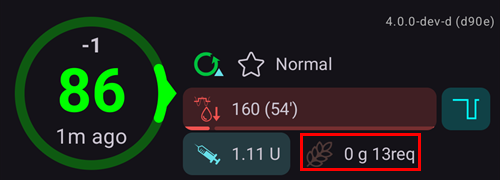

Sunt oferite sugestii pentru carbohidrați atunci când designul de referință detectează că este nevoie de carbohidrați.

Acesta este momentul în care algoritmul oref crede că nu te poate salva cu o bazală temporară zero și vei avea nevoie de carbohidrați pentru ca soluție.

Notificările pentru carbohidrați sunt mult mai sofisticate decât cele ale calculatorului pentru bolus. You might see a carbs suggestion while the bolus calculator does not show missing carbs.

Notificările „Carbohidrați necesari” pot fi trimise către Nightscout, dacă doriți; în acest caz va fi afișat și difuzat un anunț.

### Secțiunea C - Rândul de stare

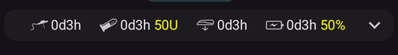

The status row gives a visual warning for

* Vechime canulă
* Insulin age (days reservoir is used) and reservoir level (units)
* Vechime senzor
* Vechimea și nivelul bateriei pompei (%)

În cazul în care pragul de avertizare este depășit, valorile vor fi afișate în galben.

Dacă pragul critic este depășit, valorile vor fi evidențiate cu roșu.

The age is always shown in its short form, whatever the screen size: *4h* on the first day, *3d4h* later.

Thresholds can be changed via the small **Settings** icon shown when the status row is **expanded** (chevron on the right) — see [Status lights](#Preferences-status-lights).

The expanded status panel also has a button at the end of some rows to record a change, which resets the corresponding age: **Add** on the **Sensor** row records a sensor insertion. If your pump supports it, **Prime/Fill** appears on the **Cannula** (or **Patch pump**) and **Insulin** rows, and **Add** on the **Pump battery** row.


În funcție de pompa pe care o utilizați, este posibil să nu aveți toate aceste pictograme.

(screens-sensor-level-battery)=

#### Nivel senzor (baterie)

Funcționează pentru senzorul de monitorizare continuă a glicemiei (CGM) cu un transmițător suplimentar, cum ar fi MiaoMiao 2. (Technically sensor has to send battery level information to xDrip.)

Pragurile pot fi setate în [Lumini de stare](#Preferences-status-lights).

(aaps-screens-main-graph)=

### Secțiunea D - Graficul principal


Graficul indică glicemia dumneavoastră așa cum este citită de la senzorul dumneavoastră de monitorizare continuă a glicemiei (CGM).

Use scroll and pinch-zoom gestures on the graph to change the visible time frame.

Zona verde reflectă intervalul dumneavoastră țintă.

Aceste informații sunt, de asemenea, prezentate în acest grafic:

* Bolusuri manuale: triunghi albastru chiar deasupra curbei glicemiei, cu vârful în jos spre citirea din acel moment, cu cantitatea de insulină
* Carbs entries: orange triangle just below the BG curve, pointing up at the reading, with the carb amount. A meal entered with its bolus looks like one marker, split by the reading.
* The triangles come in three sizes (small, medium, large), following the amount compared with the largest of the day. If there is no BG reading at that time (sensor gap), the triangle is drawn at the bottom of the graph.
* BG checks and calibrations: drawn at their own measured value, so you can compare them with the sensor curve
* Ținta așa cum este definită în profil sau modificată de ținta temporară: linie verde
* Schimbări de profil: pictograme stea în partea de sus a graficului
* Loop status: color band at the top of the graph when the [running mode](#AapsScreens-loop-status) is anything else than closed loop: blue = open loop, purple = LGS, red = loop disabled, yellow = loop suspended, grey = pump disconnected, orange = superbolus (in the screenshot: purple, then yellow). The history of these changes is listed in [Running mode](#AapsScreens-running-mode)
* [SMBs](#Open-APS-features-super-micro-bolus-smb) are not drawn on the BG graph (there would be one every few minutes): they are shown on the [IOB graph](#aaps-screens-iob).

Tap a **BG check** in the graph to see its value, and its note if you wrote one.

(aaps-screens-graph-press-and-hold)=

#### Vedeți valorile la un anumit moment

**Press and hold** the BG graph for a moment to see the values at one reading. A dot marks the nearest reading, a dashed line is drawn at that time in all the graphs, and a pop-up at the top of the graph shows:

* ora și valoarea glicemiei
* IOB, COB (only when it is above 0 g) and the basal rate at that time — the basal icon shows whether a temporary basal rate was running, as on the main screen
* any bolus, SMB or carbs at that time, with the same triangles as in the graphs

Keep your finger on the screen and move it left or right to go from one reading to the next. You feel a light tick at each reading, and the graph does not scroll while you do this. The pop-up stays for 2 seconds after you lift your finger.

This works the same way on the [additional graphs](#aaps-screens-additional-graphs) below the BG graph (IOB, COB...): press and hold any of them.


(aaps-screens-graph-clock-change)=

#### Clock changes

When the clock of the phone jumped, at a daylight saving change or in a new time zone, a dashed vertical line marks that moment in the BG graph, with a small clock icon at its foot. The same dashed line runs through the [additional graphs](#aaps-screens-additional-graphs) below.


(AapsScreens-activate-optional-information)=

#### Activați informații opționale

Apăsați pictograma **creion** din colțul din dreapta sus al graficului pentru a deschide setările graficului:


* **Graph height** adjusts how tall the graph is drawn.
* **ACT** overlays the insulin activity curve: a solid yellow-green line <span style="background:#141218;color:#D3F166;padding:0 0.3em;border:1px solid #141218;border-radius:4px">━━━━</span> (not to be confused with the dotted yellow UAM prediction)
* **PRED** suprapune [liniile de predicție](#aaps-screens-prediction-lines) (vedeți mai jos)

(aaps-screens-prediction-lines)=

#### Linii de predicție

When **PRED** is on, AAPS draws its predictions as **dotted lines** to the right of the "now" line. Fiecare predicție are propria culoare. The dark theme uses lighter shades of the same colors, and a line inside the green target range can look slightly greener.

| Linie                     | Temă luminoasă                                                                                                                    | Temă întunecată                                                                                                                    | Ce prezice                              |
| ------------------------- | --------------------------------------------------------------------------------------------------------------------------------- | ---------------------------------------------------------------------------------------------------------------------------------- | --------------------------------------- |
| **IOB** (albastru)        | <span style="background:#FFFFFF;color:#1E88E5;padding:0 0.3em;border:1px solid #CCCCCC;border-radius:4px">●●●●</span>             | <span style="background:#141218;color:#64B5F6;padding:0 0.3em;border:1px solid #141218;border-radius:4px">●●●●</span>              | doar insulina                           |
| **COB** (portocaliu)      | <span style="background:#FFFFFF;color:#FB8C00;padding:0 0.3em;border:1px solid #CCCCCC;border-radius:4px">●●●●</span>             | <span style="background:#141218;color:#FFB74D;padding:0 0.3em;border:1px solid #141218;border-radius:4px">●●●●</span>              | carbohidrați la bord                    |
| **UAM** (galben)          | <span style="background:#FFFFFF;color:#C9BD60;padding:0 0.3em;border:1px solid #CCCCCC;border-radius:4px">●●●●</span>             | <span style="background:#141218;color:#E6D39A;padding:0 0.3em;border:1px solid #141218;border-radius:4px">●●●●</span>              | masă neanunțată                         |
| **ZT** (cyan)             | <span style="background:#FFFFFF;color:#00D2D2;padding:0 0.3em;border:1px solid #CCCCCC;border-radius:4px">●●●●</span>             | <span style="background:#141218;color:#4DD4D4;padding:0 0.3em;border:1px solid #141218;border-radius:4px">●●●●</span>              | bazală temporară zero (insulina oprită) |
| **aCOB** (portocaliu pal) | <span style="background:#FFFFFF;color:rgba(251,140,0,0.5);padding:0 0.3em;border:1px solid #CCCCCC;border-radius:4px">●●●●</span> | <span style="background:#141218;color:rgba(255,183,77,0.5);padding:0 0.3em;border:1px solid #141218;border-radius:4px">●●●●</span> | older AMA algorithm only                |

When two predictions give the same values, their dots overlap and you only see one of the colors (for example, UAM on top of IOB when BG is flat).

* Linia **COB** (portocalie): [carbohidrați la bord](CobCalculation.md) (portocaliul este folosit în tot AAPS pentru COB și carbohidrați)
    
    Această linie de predicție arată unde va evolua glicemia dumneavoastră (nu unde va evolua COB!) pe baza setărilor curente ale **Profilului**, presupunând că deviațiile datorate absorbției carbohidraților rămân constante. Această linie apare numai dacă există COB cunoscuți.

* **IOB** line (blue): insulin on board (blue is used throughout AAPS for IOB and insulin)
    
    Această linie de predicție arată ce s-ar întâmpla doar sub influența insulinei. De exemplu, dacă ați administrat insulină și apoi nu ați mâncat niciun carbohidrat.

* **ZT** line (cyan): zero-temp (predicted BG if temporary basal rate at 0% would be set)
    
    Această linie de predicție arată cum se va schimba linia de traiectorie a glicemiei dacă pompa ar opri administrarea insulinei (RBT 0%). Linia se oprește când urcă peste ținta dumneavoastră.
    
    *Această linie apare numai când se folosește algoritmul [SMB](#Config-Builder-aps).*

* Linia **UAM** (galbenă): [mese neanunțate](#SensitivityDetectionAndCob-sensitivity-oref1)
    
    Mesele inopinate (neanunțate) înseamnă că se detectează o creștere semnificativă a nivelului glicemiei din cauza meselor, a adrenalinei sau a altor influențe. Linia de predicție este similară cu linia **portocalie COB**, dar presupune că devierile vor scădea în ritm constant (prin extinderea ratei actuale de reducere).
    
    *This line appears only when the [SMB](#Config-Builder-aps) algorithm is used, **Enable UAM** is on in the OpenAPS SMB settings, and BG is rising more than insulin alone explains.*

* **aCOB** line (pale, see-through orange): accelerated carbohydrate absorption
    
    Similară cu COB, dar presupune o rată fixă de absorbție a carbohidraților de 10 mg/dL/5m (0,555 mmol/L/5m). Învechită și de utilitate limitată.
    
    *Această linie apare doar când este folosit algoritmul [AMA](#Config-Builder-aps).*

De obicei, curba reală a glicemiei ajunge în mijlocul acestor linii, sau aproape de cea care face presupuneri care se apropie cel mai mult de situația dumneavoastră.

(aaps-screens-how-predictions-become-a-dosing-decision)=

#### Cum transformă AAPS predicțiile într-o decizie de dozare

AAPS doesn't dose insulin based on your current BG alone — every loop cycle (roughly every 5 minutes) it looks at all of the prediction lines above together and works out the safest course of action.

The core rule is **safety first**: if *any* prediction line, in any time frame, dips below your low safety threshold, AAPS issues a zero-temp (0% temporary basal rate) and withholds further insulin, even if your current BG is high. Only once every prediction line stays above that threshold will AAPS consider giving more insulin.

When it is safe to give more insulin, AAPS looks at where BG is ultimately predicted to end up (the **eventual BG**) across the blended predictions, and works out how much correction is needed to bring that eventual BG back to target — delivered either as an increased temporary basal rate, or (if the oref1/[SMB](#Open-APS-features-super-micro-bolus-smb) algorithm is enabled) as a small immediate bolus. If BG is high now but is already trending down enough on its own, AAPS will hold off, or may even reduce the basal rate, rather than add insulin that would only push a later low even lower.

For worked examples of this decision logic with real screenshots, see the [dosing scenarios in the Clinician's guide](#clinicianguide-dosing-scenarios) — they were written for a clinician audience but apply to any AAPS user.

*For the full technical treatment of how these predictions and the resulting dosing decision are calculated, see [OpenAPS's determine-basal documentation](https://openaps.readthedocs.io/en/latest/docs/While%20You%20Wait%20For%20Gear/Understand-determine-basal.html).*

#### Bazale

Linia **albastră continuă** afișează administrarea bazală a pompei și reflectă administrarea efectivă de-a lungul timpului.

Linia **albastră punctată** afișează cum ar fi rata bazală dacă nu ar exista ajustări temporare ale bazalei (RBT).

Când este dată rata bazală standard, zona de sub curbă este afișată cu albastru închis. Când rata bazală este ajustată temporar (mărită sau scăzută), aria de sub curbă este afișată cu albastru deschis.

#### Activitatea insulinei

Linia **galbenă subțire** arată activitatea Insulinei.

Se bazează pe scăderea așteptată a glicemiei produsă de insulina din organism, dacă nu ar exista alți factori (cum ar fi carbohidrații).

(AapsScreens-section-g-additional-graphs)= (aaps-screens-additional-graphs)=

### Secțiunea E - Grafice suplimentare

Puteți activa grafice suplimentare sub graficul principal. În [Modul simplu](#preferences-simple-mode), graficele suplimentare sunt presetate și nu pot fi schimbate. Dezactivați **Modul simplu** dacă doriți să setați propria configurație de grafice suplimentare.

Graficele suplimentare urmează graficul principal: când derulați sau măriți graficul glicemiei, ele se mișcă împreună cu acesta. A sideways drag on an additional graph also scrolls all the graphs. They have no time labels of their own — read the time on the BG graph.

Pentru a configura un grafic suplimentar, apăsați pictograma **creion** din colțul lui din dreapta sus:


Select the chips corresponding to the data you want to see on this graph; the **Remove** button deletes the graph.

To create one more graph, press **Add graph** below the last graph and select its chips in the same way:


The new graph is added below the others — here a second additional graph with **SENS%** and **DEV**:

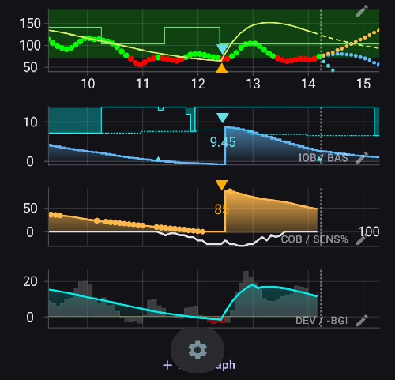

Majoritatea utilizatorilor găsesc următoarea configurație a graficelor suplimentare ca adecvată:

* Graficul 1 cu IOB, COB, modificarea sensibilității
* Graficul 2 cu abateri și impactul glicemiei.

#### Insulină absolută (ABS)

Insulina activă, inclusiv bolusuri **și bazală**.

(aaps-screens-iob)=

#### Insulin on board (IOB)

Arată insulina pe care o aveți la bord (= insulină activă în corpul dumneavoastră). Include insulina din bolus și bazala temporară (**dar exclude ratele bazale stabilite în profilul dumneavoastră**).

Dacă nu ar exista [SMB](#Open-APS-features-super-micro-bolus-smb), fără bolusuri și fără RBT în timpul DIA acesta ar fi zero.

SMBs are shown on this graph as blue triangles, in three sizes following the amount compared with the largest SMB of the day.

IOB poate fi negativ dacă nu mai aveți insulină din bolusuri și bazală temporară zero sau scăzută de o perioadă mai lungă de timp.

Decaying depends on your [DIA and insulin type settings](#Config-Builder-insulin-dia).

#### Carbohidrați la bord (COB)

Arată carbohidrații pe care îi aveți la bord (= activi, nu sunt încă dezintegrați în corpul dumneavoastră).

Descompunerea depinde de deviațiile [pe care algoritmul le detectează](../DailyLifeWithAaps/CobCalculation.md).

Dacă algoritmul detectează o absorbție de carbohidrați mai mare decât cea așteptată, se administrează insulină, iar aceasta crește cantitatea de IOB (mai mult sau mai puțin, în funcție de condițiile dumneavoastră de siguranță).

#### Sensitivity change (SENS%)

Arată sensibilitatea detectată de [Autosens](#Open-APS-features-autosens).

Sensibilitatea este un calcul al sensibilității la insulină ca rezultat al exercițiilor fizice, hormonilor șamd.

Notă, trebuie să fiți în [Obiectivul 8](#objectives-objective8) pentru a permite Detectării Sensibilității /[Autosens](#Open-APS-features-autosens) să ajusteze automat cantitatea de insulină administrată. Înainte de a atinge acel obiectiv, linia din grafic este afișată doar pentru informații.

### Sensibilitate variabilă (VSENS)

Afișează sensibilitatea calculată de [DynamicISF](../DailyLifeWithAaps/DynamicISF.md). Populat numai dacă folosiți această caracteristică.

(screen-heart-rate-steps)=

#### Heart rate (HR) & Steps

Aceste date pot fi disponibile atunci când utilizați un [ceas inteligent Wear](../WearOS/WearOsSmartwatch.md). Activați-le în aplicația Wear **AAPS** și acordați permisiunea pentru date de sănătate.

Steps are drawn as columns, and the heart rate as a curved line that breaks where the watch sent no data.

#### Deviații (DEV)

* Barele **gri** afișează o abatere datorată carbohidraților.
* Barele **verzi** arată că glicemia este mai mare decât era așteptat de către algoritm să fie. Barele verzi sunt folosite pentru a crește rezistența în [Autosens](#Open-APS-features-autosens).
* Barele **roșii** arată că glicemia este mai mică decât se aștepta algoritmul să fie. Barele roșii sunt folosite pentru a crește sensibilitatea în [Autosens](#Open-APS-features-autosens).
* Barele **galbene** afișează o abatere cauzată de UAM.
* Barele **negre** arată mici abateri care nu sunt luate în considerare pentru sensibilitate

#### Impactul asupra glicemiei (-BGI)

Această linie arată nivelul până la care glicemia "ar trebui" să crească sau să scadă, numai în funcție de activitatea insulinei.


Este o combinație bună să afișați această linie împreună cu barele de deviație. Ele împart aceeași scară, dar aceasta este diferită de cea a celorlalte date opționale, deci este o idee bună să le afișați pe un grafic separat, așa cum se arată mai sus. Compararea liniei de impact al glicemiei cu barele de deviație este o altă modalitate de a înțelege cum fluctuează **glicemia**. Here, at the time marked **1**, the Deviation bars are well above the BGI line: BG rises more than insulin activity alone explains (for example after carbs). At the time marked **2**, the Deviation bars are below zero (red): BG is lower than the algorithm expected.

### Section F - QuickLaunch toolbar


The floating toolbar at the bottom of the screen holds your **[QuickLaunch](../DailyLifeWithAaps/QuickLaunch.md)** actions. The small **gear** opens the QuickLaunch configuration where you choose which buttons are shown (treatments, careportal entries, CGM actions, the screens of the **Manage** sheet, [Quick Wizard](../DailyLifeWithAaps/QuickWizards.md) buttons, [Scenes](../DailyLifeWithAaps/Scenes.md) and more).

O configurație tipică este afișată mai sus: **Insulină**, **Carbohidrați** și **Asistent bolusare**.

While the pump is **disconnected**, the treatment buttons stay in the toolbar, for example to record insulin given with a pen (see [Insulin](#aaps-screens-buttons-insulin) below). The same actions are also available in the [Treatments sheet](#aaps-screens-treatments-sheet) of the bottom navigation.

(aaps-screens-buttons-insulin)=

#### Insulină


Pentru a administra o anumită cantitate de insulină fără a utiliza [ calculatorul de bolus](#aaps-screens-bolus-wizard).

By enabling **Start Eating soon TT**, you can automatically start your [eating soon temp target](#TempTargets-eating-soon-temp-target).

Dacă nu doriți să faceți bolusul prin pompă, ci doar să înregistrați o cantitate de insulină (de exemplu, insulină administrată cu stiloul), activați „**Bolusul doar va fi înregistrat (nu va fi administrat de pompă)**”. An additional **Time** row, set to **Now**, lets you record an insulin injection made in the past: use **-** / **+** to change it, or tap the chevron to type the minutes or pick a date and time.

 

You can use the **+0.5 / +1.0 / +2.0** buttons to quickly increase the insulin quantity. The increment values can be changed in the [Bolus wizard settings](#Preferences-deliver-this-part-of-bolus-wizard-result).

The insulin dialog can be used when the pump is suspended or disconnected as well, e.g. to record insulin injected with a pen. În acest caz, „**Bolusul doar va fi înregistrat (nu va fi administrat de pompă)**” este activat obligatoriu (afișat cu roșu) și apar câmpuri suplimentare pentru a selecta tipul de insulină și o decalare de **Timp** pentru o injecție făcută în trecut:


#### CH

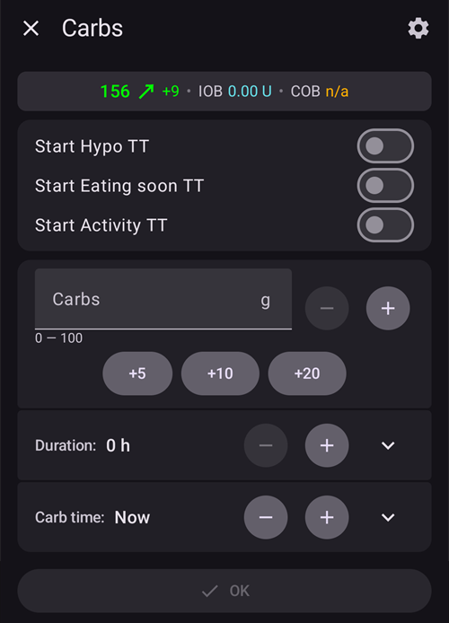

Pentru a înregistra carbohidrați fără bolusare.

Certain [pre-set temporary targets](#TempTargets-hypo-temp-target) (Hypo, Eating soon, Activity) can be started directly with the switches on top.

**Carb time**: When will you / have you been eating carbs.

**Durată**: se folosește pentru [„carbohidrați extinși”](ExtendedCarbs.md). This row is folded, so that you do not type the grams into it by mistake: use **-** / **+** to change it, or tap the chevron to open it and type a value.

You can use the **+5 / +10 / +20** buttons to quickly increase the carb amount.

#### Asistent Rapid

Introduceți ușor cantitatea de carbohidrați și setați bazele calculului cu un singur buton preconfigurat.

Details are set up in [Quick Wizard](../DailyLifeWithAaps/QuickWizards.md).

(aaps-screens-treatments-sheet)=

### Secțiunea G - Navigarea de jos

Bara de navigare de jos oferă acces la:

* **Treatments** — a quick-actions sheet with your treatment actions:
    
    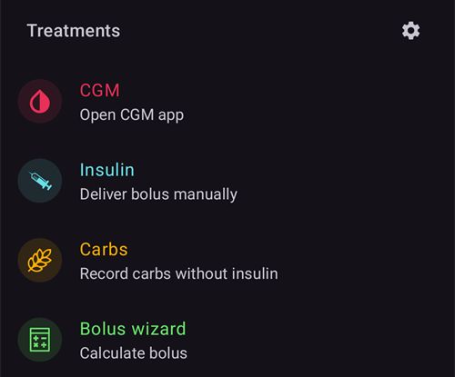

* **Scenes** — shown only when you have at least one [scene](../DailyLifeWithAaps/Scenes.md) or an **Automation** rule marked as **User action**. It opens a sheet from which you can start them; a badge shows how many you can start right now. The **pencil** at the top of the sheet opens **Manage → Scenes**.

* **Manage** — the hub for everything you manage in **AAPS**: Profile, Insulin settings, Temp Target, QuickWizard, Scenes, Automation, Food, Site Rotation, Pump and Authorized clients. Below them are device and basal actions such as Sensor Insert and Temp Basal. Some items only appear when they apply to your setup — for example Prime/Fill and battery change depend on your pump, and Temp Basal, Extended Bolus and the Careportal entries are hidden in [Simple Mode](#preferences-simple-mode):
    
    

* **Objectives** — your progress through the [Objectives](../SettingUpAaps/CompletingTheObjectives.md); a badge shows how many are completed. This item disappears once all objectives are finished, and is not present on **AAPSClient**.

(aaps-screens-notifications)=

#### Notificări

A **notification bubble** may appear above the bottom bar, on the right. It collects the active notifications of **AAPS**; the small number shows how many there are. Its color follows the most important one: red for an urgent message, green for a simple information.


Tap the bubble to open the **Notification** panel. Each message shows the time it was raised. Press **Dismiss** below a message to remove it; some messages have another button instead, to take you to the setting that needs your attention.


(bolus-wizard)= (aaps-screens-bolus-wizard)=

## Asistent bolusare


Când doriți să faceți un bolus pentru o masă, în mod normal de aici veți face asta.

### Secțiunea I

Antetul **Calcul** arată bolusul calculat. În cazul în care cantitatea de insulină la bord depășește bolusul calculat, atunci aceasta va afișa doar cantitatea de carbohidrați care mai sunt necesari.

The bolus calculator can be used whatever your current **BG**, including when it is too high or too low. If **BG** is above target, a correction is added to the meal bolus. If **BG** is below target, the bolus is reduced and, if the insulin already on board is more than needed, the calculator tells you how many carbs are still required instead of proposing insulin.

Rândul de pictograme de sub antet arată ce date intră în calcul (glicemie, tendință, IOB, țintă temporară, COB). Pressing an icon enables / disables this entry from the calculation; the **(i)** icon shows the detailed numbers behind the calculation.

#### Combinații de COB și IOB și ce înseamnă acestea

* For safety reasons, the IOB input cannot be disabled when COB is enabled as you might run the risk of too much insulin as **AAPS** is not accounting for what’s already given.
* If you enable COB and IOB, unabsorbed carbs that are not already covered with insulin + all insulin that has been delivered as TBR or SMB will be taken into account.
* If you enable IOB without COB, **AAPS** takes account of already delivered insulin but won’t cover that off against any carbs still to be absorbed. Acest lucru conduce la o notiță "carbohidrați lipsă".
* If you bolus for **additional food** shortly after a meal bolus (e.g. additional dessert) it can be helpful to **disable all inputs**. În acest fel, doar noii carbohidrați sunt adăugați deoarece masa principală nu va fi absorbită astfel încât IOB nu se potrivește cu precizie cu COB la scurt timp după un bolus de masă.
* For safety reasons, a **temporary target** is only included in the calculation if you enable its input manually.

(AapsScreens-section-j)=

### Secțiunea J - Câmpuri de introducere

In the **Carbs** field, you add your estimate of the amount of carbs, **in grams**, that you want to bolus for; the **+** buttons below it add carbs quickly. **AAPS** only works with grams: if you count in bread units or exchanges (*e.g.* DAFNE "CHO" exchanges), convert them to grams before entering them. See the [note about bread units](#your-aaps-profile-insulin-to-carbs-ratio) on the profile page.

#### Carbs type: bread, cake or pizza

Sub câmpul **Carbohidrați**, butoanele **Pâine**, **Prăjitură** și **Pizza** îi spun lui **AAPS** cât de repede este absorbită masa. With **Cake** and **Pizza**, the bolus covers only a part of the carbs now and the rest is added later as eCarbs. See [Carbs type: bread, cake or pizza](#AapsScreens-carbs-type) on the Extended carbs page for the percentages and timing.

The **Correction** row is if you want to modify the end dosage for some reason.

Only the **Carbs** field is always open. The other rows (**Correction**, **Carb time**, **BG** and **Use percentage**) are folded: they show their value with **-** / **+** buttons, so you can change it in small steps. Tap the chevron to open a row and type a value, and tap it again to close the row. Astfel evitați să tastați din greșeală grame în câmpul **Corecție**.


Tap anywhere on the **Profile** row to open the list of your profiles, then tap a name to use that profile for this calculation.


Câmpul **Timp carbohidrați** este pentru pre-bolusare astfel încât să puteți spune sistemului că va exista o întârziere înainte ca carbohidrații să fie așteptați. Puteți să puneți un număr negativ în acest câmp dacă bolusați pentru carbohidrați anteriori.

**Set alarm** (eating reminder): when a carb time in the future is entered, a "**Set alarm**" switch appears so that you are reminded at the given time, when to eat the carbs you have input into **AAPS**:


The reminder starts when the bolus has been delivered. Cât timp rulează, pe ecranul principal o bară **Este timpul să mâncați** face numărătoarea inversă, cu **Stop** și **+5 min**. **+5 min** mută sfârșitul așteptării cu cinci minute mai târziu, iar bara arată așteptarea totală. Când a venit momentul, mementoul sună cu propriul sunet, un cronometru de bucătărie discret. Pe lângă **Opriți sunetul** (ecranul rămâne deschis) și **Opriți sunetul și închideți**, ecranul alarmei oferă **+5 min**, care pornește o nouă așteptare de cinci minute. După ce a sunat, bara arată *Timpul a expirat* cu **+5 min** și **Renunțați**; **Opriți sunetul și închideți** elimină și bara. Bara și alarma sunt afișate și în **AAPSClient** și pe [ceas](#WearOsSmartwatch-wizard-carb-time). Mementoul nu creează un temporizator în aplicația ceas a telefonului. Dacă Android nu permite ca **AAPS** să seteze alarme, asistentul vă cere să permiteți *Alarme și mementouri* pentru **AAPS** în setările Android. Clopoțelul nu este oferit pentru o oră a carbohidraților din trecut.


The **BG** field is normally already populated with the latest reading from your CGM. Dacă nu aveți un CGM funcțional, atunci acesta va fi gol. When the reading is recent, the **BG** row stays folded. Câmpul urmează citirile noi cât timp asistentul este deschis, până când îl modificați chiar dumneavoastră.

The result button at the bottom shows the proposed bolus; pressing it asks for confirmation before any insulin is delivered. Cât timp confirmarea așteaptă, bucla nu dă niciun SMB, astfel încât bolusul pe care îl confirmați rămâne corect. Dacă în acel moment se administrează un SMB, **OK** așteaptă până când acesta s-a terminat.

Bine de știut:

* If the calculated bolus is above your **[Maximum bolus](#Preferences-maximum-bolus)**, it is reduced to the max bolus, and the confirmation shows the warning "Bolus constraint applied". A [QuickWizard](../DailyLifeWithAaps/QuickWizards.md) is refused instead.
* Când bolusul este doar înregistrat (de exemplu, cât timp pompa este deconectată), avertismentul „**Bolusul doar va fi înregistrat (nu va fi administrat de pompă)**” rămâne în partea de sus a dialogului, și când derulați.
* A bolus you give by hand has priority over an [SMB](#Open-APS-features-super-micro-bolus-smb) that is waiting to be delivered: the SMB is dropped and the loop calculates again. If an SMB is being delivered right now, your bolus is refused with the message "An SMB is being delivered right now. Try again when it has finished." No insulin is given, and carbs entered with that bolus are not saved: wait a moment and enter them again.

(AapsScreens-wrong-cob-detection)=

#### Detectare greșită a COB


Dacă vedeți avertismentul de mai sus după ce ați folosit asistentul de bolusare, **AAPS** a detectat că valoarea COB calculată poate fi greșită. So, if you want to bolus again after a previous meal with COB, you should be aware of overdosing!

For details, see the hints on [COB calculation page](#CobCalculation-detection-of-wrong-cob-values).

Căutați fila **Acțiuni** din **AAPS** 3.x? Its functions moved to the main screen, the **Manage** sheet and the QuickLaunch toolbar: see [Where did the Actions tab go?](#screens-action-tab).

(aaps-screens-careportal)=

## Careportal entries

The ages and levels shown in the [status row](#screens-sensor-level-battery) (sensor, insulin, cannula, pump battery) are based on careportal entries: **Prime/Fill** (records pump site and insulin cartridge changes), **Sensor Insert** and **Pump Battery Change**.

You can record them from the expanded status panel on the main screen, from the **Manage** sheet, or with [QuickLaunch](../DailyLifeWithAaps/QuickLaunch.md) buttons.

**Prime/Fill** records a pump site change and/or an insulin cartridge change, and can deliver a prime amount:


**Inserare senzor** și **Schimbare baterie pompă** cer doar ora evenimentului:


 Exercise, announcement, question and note entries reflect the Nightscout careportal and are special forms of notes.

In the **Manage** sheet, scroll down and press **Careportal** to show these entries: **BG Check**, **Note**, **Exercise**, **Question** and **Announcement**.


**BG Check**, **Question** and **Announcement** let you enter a glucose value (from a meter, the sensor or another source), a note and the time of the event. In **Question** and **Announcement**, the glucose row is folded and shows the meter type next to the value: if you change the value, the type changes from **Sensor** to **Meter**.


**Note** and **Exercise** let you enter a duration (a folded row: use **-** / **+**, or tap the chevron to type it), a note and the time of the event:


In all these dialogs (**Prime/Fill**, **Sensor Insert**, **Pump Battery Change** and the careportal entries), the time of the event uses the same **Time** row as the [insulin dialog](#aaps-screens-buttons-insulin) and the bolus wizard: use **-** / **+** to move the time in 5-minute steps (up to one week back and 12 hours ahead), or tap the chevron to pick any date and time.

## Rotație loc

**Manage → Site Rotation** records where each cannula and sensor was placed on a body map, so you can rotate your sites: see [Site Rotation](#Aapsscreens-site-rotation) on the Pumps and cannulas page.

**TDD** (total daily dose) and the basal/bolus ratio rule of thumb are explained with the [Statistics Insulin tab](#reviewing-tdd).

(AapsScreens-insulin-profile)=

## Insulină


**Gestionați → Setări insulină** afișează și gestionează configurațiile dumneavoastră de insulină. Fiecare configurație este afișată pe un card cu **timpul de vârf** și **[DIA](#Config-Builder-insulin-dia)**; cea folosită este marcată **ACTIV**. Sub card vedeți curba de activitate. You can edit the nickname, peak and DIA of any configuration except the active one: to change the insulin you are using, [add a new configuration and activate it](#Config-Builder-insulin-change-active).

Vedeți [Durata de acțiune a insulinei](#Config-Builder-insulin-dia) pentru a afla mai multe despre ce este și cum se setează.

## Stare pompă


**Manage → Pump** (or **Configuration → Pump → Open plugin**) shows the status of your pump: last connection, base basal rate, battery, reservoir...

* Informațiile afișate depind de modelul pompei dumneavoastră.
* See [pumps page](../Getting-Started/CompatiblePumps.md) for details.

## Buclă, AMA / SMB

**Configuration → Loop → Open plugin** (and **Configuration → APS → Open plugin**) show details about the algorithm's calculations and why **AAPS** acts the way it does: last run, the resulting request, and the constraints. The **Loop** screen lists only the constraints that actually limited the delivered temp basal rate or SMB (and why closed loop is not allowed, if that is the case); the **APS** screen lists every constraint that went into the calculation.

Calculations are run each time the system gets a fresh reading from the CGM.

Pentru mai multe detalii, vedeți [secțiunea APS de pe pagina Configurație](#Config-Builder-aps).

(aaps-screens-profile)=

## Profil


**Manage → Profile** (or a tap on the profile name on the main screen) opens the Profile screen: your profiles as a swipeable card carousel, with buttons to add, edit, clone, delete and **activate** a profile.

Profile contains information on your individual diabetes settings, see the detailed **[Profile](../SettingUpAaps/YourAapsProfile.md)** page for more information.

## Automatizare


**Gestionați → Automatizare** listează regulile dumneavoastră de automatizare. Vedeți pagina dedicată [aici](../DailyLifeWithAaps/Automations.md).

## NSClient


**Configuration → Communication → NSClientV3 → Open plugin** displays the status of the connection with your Nightscout site: URL, websocket status, queue and a log of the synchronization activity.

Settings can be changed in [NSClient settings](#Preferences-nsclient).

For troubleshooting see this [page](../GettingHelp/TroubleshootingNsClient.md).

(aaps-screens-bg-source)=

## Sursă glicemie - xDrip, BYODA...


**Configuration → BG Source → Open plugin** shows the history of CGM readings and offers the option to remove readings in case of failure (i.e. compression low) or duplicate readings.

## Istoricul tratamentelor

Open the **menu** (☰) and select **Treatments history** to view, check and correct everything **AAPS** has recorded: carbs and boluses, temp basals, temporary targets, profile switches, careportal entries, loop mode changes and user entries. See [Treatments history](#aaps-screens-treatments) on the Reviewing your data page.

## Vizualizare istoric


Deschideți **meniul** (☰) și selectați **Vizualizare istoric**.

Allows you to ride back in **AAPS** history. See the dedicated page [Reviewing your data > History Browser](../Maintenance/Reviewing.md).

(aaps-screens-statistics)=

## Statistici


Deschideți **meniul** (☰) și selectați **Statistici**.

Gives you statistics about your Total Daily Dose, Time In Range, your glucose profile over the day (AGP) and your insulin cycle pattern, on four tabs. See the dedicated page [Reviewing your data > Statistics](#reviewing-statistics).

(aaps-screens-profile-helper)=

## Ajutorul de profil

Deschideți **meniul** (☰) și selectați **Ajutor de profil**.


Ajutorul de profil vă permite să comparați profiluri și să generați profiluri de pornire pentru copii. See [Your AAPS Profile](../SettingUpAaps/YourAapsProfile.md) — sections [Build a Profile from scratch for a kid](#your-aaps-profile-profile-from-scratch-for-a-kid) and [Compare two Profiles](#your-aaps-profile-compare-profiles).

(aaps-screens-widgets)=

## Home screen widgets

**AAPS** provides five widgets that you can add to your phone's home screen, to see your data without opening the app. See the dedicated page [Home screen widgets](../DailyLifeWithAaps/Widgets.md).

