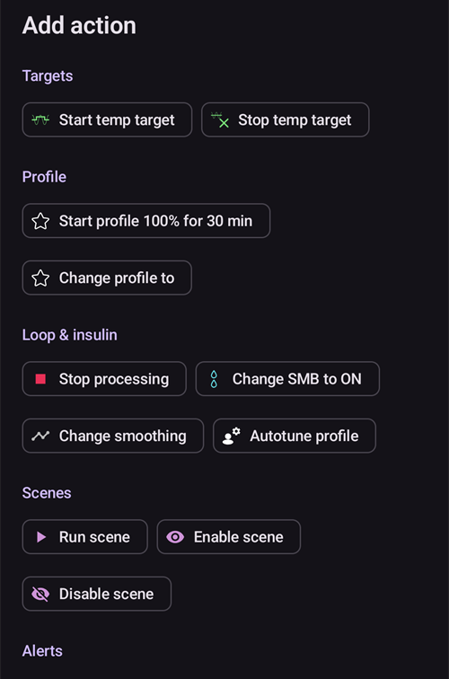

# Automatizare

```{contents} In this page
:backlinks: entry
:depth: 2
```

## Ce este o Automatizare?

"**Automation**" is a feature which can automate tasks in AAPS.

Automation performs specific actions based on one or more conditions or triggers. Declanșatoarele pot include evenimente neregulate, cum ar fi niveluri scăzute sau crescute ale glicemiei în sânge (BG) sau o cantitate negativă stabilită de insulină la bord (IOB). Automations can also handle recurring events, such as meals or exercise at certain times of day, or when the user is within a specific distance of a GPS location or a Wi-Fi SSID area. Automatizarea poate face copiile de rezervă ale setărilor AAPS pe baza unei planificări sau la fiecare schimbare de pompă (Omnipod).

Automation rules are created and modified from the **Automation** screen (**Manage → Automation**). Fiecare regulă este definită de două caracteristici:

- Una sau mai multe condiții sau "declanșatoare" care inițiază o acțiune.

    Gândiți-vă la un anumită planificare, un eveniment sau valori ale caracteristicilor în AAPS

- Una sau mai multe acțiuni de efectuat.

    Cum ar fi o alarmă sau setarea unui procentaj de profil sau exportul setărilor AAPS la schimbarea pompei (Omnipod).


Există o gamă largă de opțiuni de automatizare, iar utilizatorii sunt încurajați să le studieze în cadrul aplicației AAPS, în secțiunea Automatizare. You can also search the AAPS user groups on [**Facebook**](https://www.facebook.com/groups/AndroidAPSUsers) and [**Discord**](https://discord.gg/4fQUWHZ4Mw) for Automation examples from other users.

## Cum poate ajuta automatizarea

1. **Automate recurring tasks:** Automatically executing programmed actions without user interaction.

1. **Reducerea oboselii decizionale:** Beneficiul principal al **Automatizărilor** este de a scuti utilizatorul de sarcina de a face intervenții manuale în **AAPS**. [Cercetările](https://www.ncbi.nlm.nih.gov/pmc/articles/PMC6286423/#ref4) estimează că 180 de decizii zilnice suplimentare trebuie luate de cei care trăiesc cu diabet de tip 1. **Automatizările** pot reduce povara mentală, eliberând energia mentală a utilizatorului pentru alte aspecte ale vieții.

1. **Îmbunătățirea potențială a controlului glicemic:** de exemplu **Automatizările** se pot asigura că **Țintele temporare** sunt întotdeauna stabilite atunci când este necesar, chiar și în situații de program încărcat sau în perioade de uitare. De exemplu, dacă un copil cu diabet zaharat are sporturi programate la școală marți, la ora 10:00 și joi, la ora 14:00 și necesită o țintă temporară ("TT") acționată cu 30 de minute înainte de activitatea sportivă; **Ținta temporară** poate fi activată prin intermediul unei **Automatizări**.

1. **Enabling AAPS to be highly customized** to be more or less aggressive in specific situations, according to a user's preference. De exemplu, declanșarea unei reduceri temporare a **Profilului** % pentru o perioadă de timp determinată dacă se strânge **IOB** negativ la mijlocul nopții, ceea ce indică că **Profilul** existent poate fi prea puternic.

Exemplul de mai jos ilustrează cum o **Automatizare** poate permite eliminarea pașilor.

Utilizatorul face exerciții în fiecare dimineață la ora 6 dimineața: trebuie să își amintească să stabilească manual o țintă temporară în AAPS la 5 dimineața, înainte de a face exerciții.


Utilizatorul a setat o **Automatizare** care să declanșeze o "Țintă temporară de activitate" la ora 5 dimineața pentru a se asigura că **glicemia** și **IOB** sunt optime, în vederea pregătirii exercițiului său de la 6 dimineața:


## Considerații-cheie înainte de a începe cu automatizările

1. Înainte de a configura anumite automatizări, ar trebui să aveți un control rezonabil **al glicemiei** cu **AAPS**. Automatizările nu ar trebui folosite pentru a compensa setările suboptime ale bazalelor, **ISF** sau **ICR** (discutate mai jos). Evitați să setați o **schimbare a profilului** automată pentru a compensa creșterile de **glicemie** din cauza _, spre exemplu, _ alimentelor, acestea sunt gestionate mai bine prin intermediul altor strategii (SMB șamd).

1. Cum este cu orice tehnologie, **CGM**, **pompele** și telefoanele se pot defecta: probleme tehnice sau erori ale senzorilor pot întrerupe acțiunile **Automatizărilor**, și este nevoie de intervenții manuale.

1. **Cerințele pentru **Automatizări** se vor schimba probabil odată cu schimbarea rutinelor**. Atunci când schimbați între perioade de lucru/școală/vacanță, setați un memento în calendar pentru a verifica care **Automatizări** sunt în prezent active (sunt ușor de activat și de dezactivat). For example, if you go on holiday, and no longer need an Automation set up for school sports or daily exercise, or need to adjust the timings.

1. **Automatizările** pot intra în conflict unele cu altele, și este bine să revizuiești orice nouă **Automatizare** care se stabilește cu atenție într-un mediu sigur; și să înțelegeți de ce o **automatizare** poate sau nu să fi fost declanșată în modul în care vă așteptați.

1. Dacă utilizați Autosens, încercați să faceți uz de **Ținte Temporare** în locul **Schimbărilor de profil**. **Țintele temporare** nu resetează Autosens înapoi la 0. **Profile Switches** reset Autosens.

1. Most **Automations** should only be set for a **limited time duration**, after which **AAPS** can re-evaluate and repeat the **Automation**, if necessary, and if the condition is still met. For example, "start temp target of 7.0 mmol/L for 30 min" or "start **Profile** 110% for 10 min" _and_ "start temp target of 5.0 mmol/L for 10 min". Using **Automations** to create permanent changes (e.g. to stronger %profile) risks hypoglycemia.

## When can I start using Automation?

**Automations** can be started in **objective 10**.

## Where are Automations located in AAPS?

Open **Manage** in the bottom navigation of the main screen and select **Automation**.

## How can I set up an Automation?

To set up an **Automation**, press the **+** button on the Automation screen to create a ‘rule’:


* give your ‘rule’ a title (Task name);
* press "**EDIT**" under **Condition**. On the **Condition** screen, choose how the triggers are combined (**And**, **Or**, **Exclusive or**) and press "**Add trigger**":


* add at least one trigger:


* press "**ADD**" under **Action** and select one action:



* save the rule with the **Save** button, and make sure the checkbox left of the rule name is ‘ticked’ to activate the **Automation**:


To deactivate an **Automation** rule, untick the box left of the name of the **Automation**. The example below shows an **Automation** as either activated (‘ticked') or deactivated (‘unticked’):


When setting up an **Automation**, you can first test it by activating the ‘notification’ option under "Actions". This triggers **AAPS** to first display a notification rather than actually automating an action. When you are comfortable that the notification has been triggered at the correct time/conditions, the **Automation** rule can be updated to replace the ‘Notification’ with an ‘Action’.


```{admonition} Important note
:class: note

**Automations** are still active when the Loop is disabled!
```


## When rules are checked

**AAPS** checks all **Automation** rules each time a new glucose reading has been processed, so rules are evaluated at the pace of your CGM, also while the phone screen is off. Rules are also checked when the phone starts charging, when the network or location changes, and when a Bluetooth device connects. Only one check runs at a time, so a rule whose actions take a while (for example a pump command) cannot be executed twice.

## Safety limits

There are safety limits set for **Automations**:

* A **Temp Target** set by an **Automation** has to be between 72 and 180 mg/dL (or 4 and 10 mmol/L).
* The **Profile Percentage** has to be between 50% and 130%.
* There is a 5 minute time limit between executions of  **Automation** (and first execution).

## Correct use of negative values

```{admonition} Warning
:class: warning

Please be careful when selecting a negative value in **Automation**
```

Caution must be taken when selecting a ‘negative value’ within the ‘Condition’ like "less than" in **Automations**. Spre exemplu:


**Example 1:** Creating a Condition **"is lesser than"** "-0.1mmol/L" (or "-2mg/dL") will:

Trigger an **Automation** for any number which is **strictly less than** -0.1 (-2). This includes numbers like -0.2, -0.3, -0.4 (-4, -6, -8) and so on. Remember that -0.1 (-2) itself **is not** included in this condition. (The condition "is equal or lesser than -0.1mmol/L (-2 mg/dL)" _would_ include -0.1 mmol/L or -2 mg/dL).

**Example 2:** Creating a Condition "is greater than" -0.1mmol/L (-2mg/dL) will:

Trigger an **Automation** for any number which is **greater than** -0.1mmol/L (-2mg/dL). This includes numbers like 0, 0.2, 0.4mmol/L, (0, 4, 8mg/dL) and any other positive number.

It is important to carefully consider the exact intention of your **Automation** when choosing these conditions and values.

(automations-automation-triggers)=
## Automation Triggers


Scroll down to see the rest of the list:


There are various ‘Triggers’ that can be selected by the user. Triggers are the conditions that must be met in order for the automation to execute. The list below is non-exhaustive:

**Trigger:** connect conditions

**Options:**

Several conditions can be linked with
* "Și"
* "Sau"
* “Exclusive or” (which means that if one - and only one of the - conditions applies, the action(s) will happen)

**Trigger:** time vs. recurring time

**Options:**

* time = single time event
* recurring time = something that happens regularly (i.e. once a week, every working day etc.)

**Trigger:** location

**Options:**

* in [Settings > Automation](#preferences-maintenance-settings), the user can select their required location service.

**Trigger:** location service

**Options:**

* Use passive location: **AAPS** only takes locations when other apps are requesting it.
* Folosiți locația rețelei: locația Wi-Fi.
* Utilizează locația GPS (Atenție! This can cause excessive battery drain!)

**Triggers** : pump and sensor data

* Cannula age trigger: Available for all pumps
* Insulin age trigger: Available for supported pumps
* Battery age trigger: Available for supported pumps
* Sensor age trigger: always available
* Pod Activation trigger: Available for patch pumps

Note that for all age related triggers the equal comparison is unlikely to trigger, so in that case two triggers are required to create a range

* Reservoir level trigger: Available for all pumps, comparison "NOT\_AVAILABLE" is not working for this trigger as the value is always filled in **AAPS**
* Pump battery level trigger: Available for supported pumps, comparison "NOT\_AVAILABLE" is not working for this trigger as the value is always filled in **AAPS**

(automations-automation-action)=
## Acțiune


Scroll down to see the rest of the list:


**Actions:** start **Temp Target**

**Options:**

* **BG** must be between 72 mg/dL and 180 mg/dL (4 mmol/L and 10 mmol/L)
* **TT** works only if there is no previous Temp Target — **AAPS** adds this automatically as a "**Preconditions: Temp target not exists**" line to the rule

**Actions:** stop **Temp Target**

**Options:**

niciunul

**Actions:** **Profile Percentage**

**Options:**

* **Profile** must be between 50% and 130%
* works only if the previous Percentage is 100%

**Actions:** **Change smoothing**

**Options:**

* select the [smoothing method](../CompatibleCgms/SmoothingBloodGlucoseData.md) to switch to
* runs only if that smoothing method is not already active — **AAPS** adds this automatically as a "**Preconditions: Smoothing … is not active**" line to the rule. Once the selected smoothing is active, the rule is skipped silently.
* Example: combined with the **Sensor age** trigger, switch to **Average smoothing** during the first day of a new sensor and back to **No smoothing** afterwards.

**Actions:** **Note** (in the **Alerts** group of the list)

**Options:**

* select the event to record: **Note**, **Exercise**, **Question**, **Announcement** or **Pump Site Change**, and an optional note. The name of the action changes to the event you select.
* **Duration**: used for **Note**, **Exercise** and **Pump Site Change**. **Question** and **Announcement** have no duration: they record your current BG instead.
* **Pump Site Change** resets the cannula age, as if you had recorded a site change by hand. Example: some pumps (like the Combo) record a reservoir change by themselves, but not the site change. If you always change both together, a rule with **Insulin age** less than 1 hour and **Cannula age** more than 24 hours can record the site change for you.

 

**Actions:** **Send SMS** (in the **Alerts** group)

**Options:**

* enter the text of the message. It is sent to all the phone numbers allowed in the [SMS Communicator](../RemoteFeatures/SMSCommands.md) settings. The SMS Communicator plugin must be enabled.

**Actions:** **Change profile to** (in the **Profile** group)

**Options:**

* select the **Profile** to activate. It is activated at 100%, without timeshift. If this profile is already active, the action does nothing.

**Actions:** **Enable/disable SMB** (in the **Loop & insulin** group)

**Options:**

* choose **On** or **Off**. This changes the **Enable SMB** setting of OpenAPS SMB, exactly as if you had changed it in **Settings**, and stays until you or another rule change it back.

**Actions:** **Autotune profile** (in the **Loop & insulin** group)

**Options:**

* select the profile to tune and the number of days: see [Run Autotune with an automation rule](#autotune-run-autotune-with-an-automation-rule).

**Actions:** **Stop processing** (in the **Loop & insulin** group)

**Options:**

* none. When a rule with this action runs, **AAPS** does not check the rules below it in the list during that run. Add it to a rule that must take priority over the rules below it (see [the order of the Automations](#Automations-the-order-of-the-automations-in-the-list-matters)).

**Actions:** **Run scene**, **Enable scene**, **Disable scene** (in the **Scenes** group)

**Options:**

* select the [scene](Scenes.md) to run, enable or disable.

Once the ‘Action’ is added,  the default values must be changed to the desired number by clicking and adjusting the default values.


(Automations-the-order-of-the-automations-in-the-list-matters)=
## The order of the **Automations** in the list matters
 **AAPS** will automate the rules created in the order of preference, starting from the top of the **Automation** list. For example, if the ‘Low’  **Automation** is the most important **Automation**, above all other rules, then this  **Automation** should appear at the top of the user’s **Automation** list as demonstrated below:


To reprioritize the **Automation** rules, touch and hold the **=** handle on the right side of the rule. Reorder the  **Automations** by moving the rules up or down.


## How to delete Automation rules

To delete an **Automation** rule click on the trash icon.


## Examples of Automations

Below are examples of **Automations**. Further discussion on **Automations** and how users have individualised their  **Automation** can be found in Facebook discussions groups or on Discord. The examples below should not be replicated without the user having a good understanding of how the **Automation** will work.

(automations-low-glucose-temp-target)=
### Țintă temporară în caz de hipoglicemie

This **Automation** triggers an automatic **Temp Target** when **BG** falls below a certain threshold — here, when glucose is lesser than 70 mg/dL, a target of 110 mg/dL is started for 30 minutes:


### Lunch Time Temp Target (with ‘Location’)


This **Automation** has been created for a user who eats their lunch at work around the same time every weekday but triggered only if the user is situated within a set ‘location’.  So if the user is not at work one day, this **Automation** will not activate.

This **Automation** will set a low **Temp Target** (Eating Soon) at 13:00 to drive BG to 90 mg/dL (or 5 mmol/L) in preparation for lunch.

The ‘Trigger’ location has a name, a position (tap **Pick from map**, or use your current location) and a radius in metres, and fires when you are inside (or outside) the area:


Because of the ‘And’ connection, the **Automation** only happens during the ‘chosen time’ and if the user is at the selected location.

The **Automation** will not be triggered on any other time at this location or at this time outside the 50-metre radius around the chosen position.

### Wi-Fi SSID Location Automation

Using a Wi-Fi SSID is a good option to trigger an **Automation** while within range of a specific Wi-Fi network (compared with GPS): it is fairly precise, uses less battery, and works in enclosed spaces where GPS and other location services might not be available.

Here is another example of setting up a **Temp Target** for work days only before breakfast(1).


The **Automation** will trigger at 05:30am only on Monday-Friday(2)  
and while being connected to a home Wi-Fi network (3).


It will then set a **Temp Target** of 75 mg/dL for 30 minutes (4). One of the advantages of including the location is that it will not trigger if the user is traveling on vacation, for instance.


Scroll down to see the action: a **Temp Target** of 75 mg/dL for 30 minutes (4).


Here is the screenshot detailing the **Automation** triggers:

1) Under the main “AND” (both conditions need to be met to trigger) 1) Recurring time = M,T,W,T,F At 5:30am  
1) Wi-Fi SSID = My_Home_WiFi_Name


(automating-preference-settings-export)=

## Automating Preference Settings Export

### Unattended Exports: scheduled (daily)

Screenshots detailing the Automation triggers:

1) Condiție: Timp recurent = L, M, Mi, J, V la 8:00 dimineața 1) Acțiune: Setări Export (pentru "Text în tratamente" introduceți "Zilnic")


Note: Export execution will be logged on Careportal

### Unattended Exports: Pod Activation (patch pump only)

Screenshots detailing the Automation triggers:

1) Condiție: Activare pompă 1) Acțiune: Setări Export (pentru "Text în tratamente" introduceți "Activare Pompă: setări export")


Note: Export execution will be logged on Careportal. Note : Automation will not trigger **at all** if you have not done a manual settings export before. See [Settings → Maintenance](#preferences-maintenance-settings) for proper activation of unattended settings export.


## Automation Logs

**AAPS** shows a log of the most recent **Automation** events at the bottom of the **Automation** screen, below the rules. Use it to verify that your rules triggered when you expected them to.

In the example below, the **Low glucose temp target** rule (1) (see [Low Glucose Temp Target](#automations-low-glucose-temp-target) above) is enabled. The log (2) shows that at 03:09 PM, glucose fell below 70 mg/dL and the rule triggered:
* the action was "Start temp target: 110mg/dL@30 min": a **Temp Target** of 110 mg/dL for 30 minutes;
* **OK** at the end means that the action was carried out successfully.


(automations-troubleshooting)=

## Depanare

* Problem: __My automations are not being triggered by AAPS?__

Check that the box left of the **Automation** name is ‘ticked’ to ensure the rule is activated:


* Problem: __My automations are being triggered in the wrong order.__

Check your rule prioritization order as discussed above here.

* Problem: __A condition shows "Unknown trigger … - never true".__

The rule contains a trigger that this version of **AAPS** cannot read, for example after you went back to an older version or imported settings from a newer one. Such a trigger is never true, so the rule does not run. It is kept unchanged, so a newer version can still use it. Edit the rule and replace the trigger, or update **AAPS**.

## Alternatives to Automations

For advanced users, there are other possibilities to automate tasks using IFTTT or a third party Android app called Automate. 
