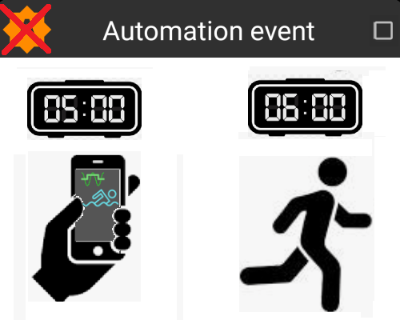
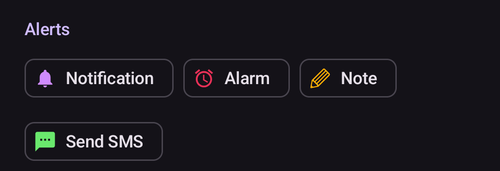
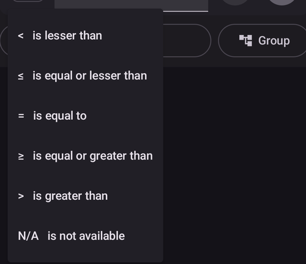
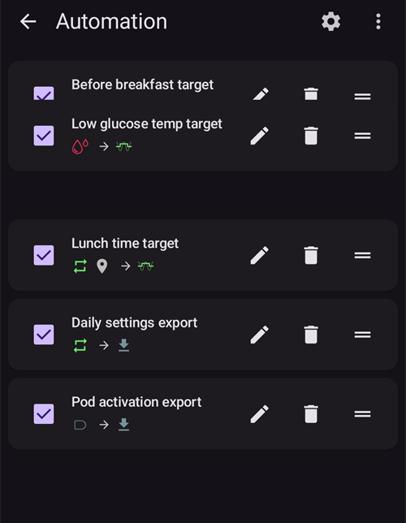
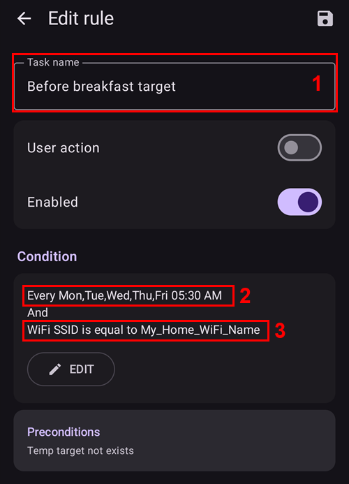

# Automatizare

```{contents} In this page
:backlinks: entry
:depth: 2
```

## Ce este o Automatizare?

"**Automation**" is a feature which can automate tasks in AAPS.

Automation performs specific actions based on one or more conditions or triggers. Declanșatoarele pot include evenimente neregulate, cum ar fi niveluri scăzute sau crescute ale glicemiei în sânge (BG) sau o cantitate negativă stabilită de insulină la bord (IOB). Automations can also handle recurring events, such as meals or exercise at certain times of day, or when the user is within a specific distance of a GPS location or a Wi-Fi SSID area. Automatizarea poate face copiile de rezervă ale setărilor AAPS pe baza unei planificări sau la fiecare schimbare de pompă (Omnipod).

Regulile de automatizare se creează și se modifică din ecranul **Automatizare** (**Gestionați → Automatizare**). Fiecare regulă este definită de două caracteristici:

- Una sau mai multe condiții sau "declanșatoare" care inițiază o acțiune.

    Gândiți-vă la un anumită planificare, un eveniment sau valori ale caracteristicilor în AAPS

- Una sau mai multe acțiuni de efectuat.

    Cum ar fi o alarmă, setarea unui procentaj de profil sau exportul setărilor AAPS la schimbarea pompei (Pod).


Există o gamă largă de opțiuni de automatizare, iar utilizatorii sunt încurajați să le studieze în cadrul aplicației AAPS, în secțiunea Automatizare. You can also search the AAPS user groups on [**Facebook**](https://www.facebook.com/groups/AndroidAPSUsers) and [**Discord**](https://discord.gg/4fQUWHZ4Mw) for Automation examples from other users.

## Cum poate ajuta automatizarea

1. **Automate recurring tasks:** Automatically executing programmed actions without user interaction.

1. **Reducerea oboselii decizionale:** Beneficiul principal al **Automatizărilor** este de a scuti utilizatorul de sarcina de a face intervenții manuale în **AAPS**. [Cercetările](https://www.ncbi.nlm.nih.gov/pmc/articles/PMC6286423/#ref4) estimează că 180 de decizii zilnice suplimentare trebuie luate de cei care trăiesc cu diabet de tip 1. **Automatizările** pot reduce povara mentală, eliberând energia mentală a utilizatorului pentru alte aspecte ale vieții.

1. **Îmbunătățirea potențială a controlului glicemic:** de exemplu **Automatizările** se pot asigura că **Țintele temporare** sunt întotdeauna stabilite atunci când este necesar, chiar și în situații de program încărcat sau în perioade de uitare. De exemplu, dacă un copil cu diabet zaharat are sporturi programate la școală marți, la ora 10:00 și joi, la ora 14:00 și necesită o țintă temporară ("TT") acționată cu 30 de minute înainte de activitatea sportivă; **Ținta temporară** poate fi activată prin intermediul unei **Automatizări**.

1. **Enabling AAPS to be highly customized** to be more or less aggressive in specific situations, according to a user's preference. De exemplu, declanșarea unei reduceri temporare a **Profilului** % pentru o perioadă de timp determinată dacă se strânge **IOB** negativ la mijlocul nopții, ceea ce indică că **Profilul** existent poate fi prea puternic.

Exemplul de mai jos ilustrează cum o **Automatizare** poate permite eliminarea pașilor.

Utilizatorul face exerciții fizice în fiecare dimineață la ora 6: trebuie să își amintească să seteze manual în AAPS, la ora 5, o „Țintă temporară - Exercițiu fizic”, înainte de exerciții.



Utilizatorul a setat o **Automatizare** care declanșează la ora 5 o ‘Țintă temporară - Exercițiu fizic’, pentru ca **glicemia** și **IOB** să fie optime în vederea exercițiilor de la ora 6:


## Considerații-cheie înainte de a începe cu automatizările

1. Înainte de a configura anumite automatizări, ar trebui să aveți un control rezonabil **al glicemiei** cu **AAPS**. Automatizările nu ar trebui folosite pentru a compensa setări nepotrivite ale bazalei, **ISF** sau **IC** (vedeți mai jos). Evitați să setați o **schimbare a profilului** automată pentru a compensa creșterile de **glicemie** din cauza _, spre exemplu, _ alimentelor, acestea sunt gestionate mai bine prin intermediul altor strategii (SMB șamd).

1. Ca orice tehnologie, **CGM**, **pompele** și telefoanele se pot defecta: probleme tehnice sau erori ale senzorului pot întrerupe acțiunile **Automatizărilor** și poate fi nevoie de intervenție manuală.

1. **Requirements for Automations are likely to change as routines change**. Atunci când schimbați între perioade de lucru/școală/vacanță, setați un memento în calendar pentru a verifica care **Automatizări** sunt în prezent active (sunt ușor de activat și de dezactivat). For example, if you go on holiday, and no longer need an Automation set up for school sports or daily exercise, or need to adjust the timings.

1. **Automatizările** pot intra în conflict unele cu altele, și este bine să revizuiești orice nouă **Automatizare** care se stabilește cu atenție într-un mediu sigur; și să înțelegeți de ce o **automatizare** poate sau nu să fi fost declanșată în modul în care vă așteptați.

1. Dacă utilizați Autosens, încercați să faceți uz de **Ținte Temporare** în locul **Schimbărilor de profil**. **Țintele temporare** nu resetează Autosens înapoi la 0. **Schimbările de profil** resetează Autosens.

1. Most **Automations** should only be set for a **limited time duration**, after which **AAPS** can re-evaluate and repeat the **Automation**, if necessary, and if the condition is still met. For example, "start temp target of 7.0 mmol/L for 30 min" or "start **Profile** 110% for 10 min" _and_ "start temp target of 5.0 mmol/L for 10 min". Using **Automations** to create permanent changes (e.g. to stronger %profile) risks hypoglycemia.

## Când pot începe să folosesc Automatizarea?

**Automations** can be started in **objective 10**.

## Where are Automations located in AAPS?

Open **Manage** in the bottom navigation of the main screen and select **Automation**.

## Cum pot configura o Automatizare?

To set up an **Automation**, press the **+** button on the Automation screen to create a ‘rule’:


* give your ‘rule’ a title (Task name);
* apăsați „**EDITAȚI**” sub **Condiție**. On the **Condition** screen, choose how the triggers are combined (**And**, **Or**, **Exclusive or**) and press "**Add trigger**":


* adăugați cel puțin un declanșator:


* apăsați „**ADĂUGAȚI**” sub **Acțiune** și selectați o acțiune:


* save the rule with the **Save** button, and make sure the checkbox left of the rule name is ‘ticked’ to activate the **Automation**:


Pentru a dezactiva o regulă de **Automatizare**, debifați caseta din stânga numelui **Automatizării**. The example below shows an **Automation** as either activated (‘ticked') or deactivated (‘unticked’):


When setting up an **Automation**, you can first test it by activating the ‘notification’ option under "Actions". This triggers **AAPS** to first display a notification rather than actually automating an action. When you are comfortable that the notification has been triggered at the correct time/conditions, the **Automation** rule can be updated to replace the ‘Notification’ with an ‘Action’.



```{admonition} Important note
:class: note

**Automations** are still active when the Loop is disabled!
```


## Când sunt verificate regulile

**AAPS** checks all **Automation** rules each time a new glucose reading has been processed, so rules are evaluated at the pace of your CGM, also while the phone screen is off. Regulile sunt verificate și când telefonul începe să se încarce, când se schimbă rețeaua sau locația și când se conectează un dispozitiv Bluetooth. Only one check runs at a time, so a rule whose actions take a while (for example a pump command) cannot be executed twice.

## Limite de siguranță

Pentru **Automatizări** există limite de siguranță:

* A **Temp Target** set by an **Automation** has to be between 72 and 180 mg/dL (or 4 and 10 mmol/L).
* **Procentajul profilului** trebuie să fie între 50% și 130%.
* Între două execuții ale **Automatizării** (și înainte de prima execuție) există o limită de timp de 5 minute.

## Correct use of negative values

```{admonition} Warning
:class: warning

Aveți grijă când alegeți o valoare negativă în **Automatizare**
```

Caution must be taken when selecting a ‘negative value’ within the ‘Condition’ like "less than" in **Automations**. Spre exemplu:



**Example 1:** Creating a Condition **"is lesser than"** "-0.1mmol/L" (or "-2mg/dL") will:

Trigger an **Automation** for any number which is **strictly less than** -0.1 (-2). This includes numbers like -0.2, -0.3, -0.4 (-4, -6, -8) and so on. Rețineți că -0,1 (-2) în sine **nu este** inclus în această condiție. (The condition "is equal or lesser than -0.1mmol/L (-2 mg/dL)" _would_ include -0.1 mmol/L or -2 mg/dL).

**Example 2:** Creating a Condition "is greater than" -0.1mmol/L (-2mg/dL) will:

Trigger an **Automation** for any number which is **greater than** -0.1mmol/L (-2mg/dL). This includes numbers like 0, 0.2, 0.4mmol/L, (0, 4, 8mg/dL) and any other positive number.

It is important to carefully consider the exact intention of your **Automation** when choosing these conditions and values.

(automations-automation-triggers)=
## Automation Triggers


Derulați în jos pentru a vedea restul listei:


There are various ‘Triggers’ that can be selected by the user. Triggers are the conditions that must be met in order for the automation to execute. The list below is non-exhaustive:

**Trigger:** connect conditions

**Opțiuni:**

Several conditions can be linked with
* "Și"
* "Sau"
* “Exclusive or” (which means that if one - and only one of the - conditions applies, the action(s) will happen)

**Trigger:** time vs. recurring time

**Opțiuni:**

* time = single time event
* timp recurent = ceva ce se întâmplă regulat (de ex. o dată pe săptămână, în fiecare zi lucrătoare etc.)

**Trigger:** location

**Opțiuni:**

* în [Setări > Automatizare](#preferences-maintenance-settings), utilizatorul poate selecta serviciul de localizare dorit.

**Declanșator:** serviciu de localizare

**Opțiuni:**

* Use passive location: **AAPS** only takes locations when other apps are requesting it.
* Utilizați localizarea bazată pe rețea: locația rețelei Wi-Fi.
* Utilizați localizarea GPS (Atenție! This can cause excessive battery drain!)

**Triggers** : pump and sensor data

* Declanșatorul Vechimea canulei: disponibil pentru toate pompele
* Insulin age trigger: Available for supported pumps
* Battery age trigger: Available for supported pumps
* Sensor age trigger: always available
* Pod Activation trigger: Available for patch pumps

Note that for all age related triggers the equal comparison is unlikely to trigger, so in that case two triggers are required to create a range

* Reservoir level trigger: Available for all pumps, comparison "NOT\_AVAILABLE" is not working for this trigger as the value is always filled in **AAPS**
* Pump battery level trigger: Available for supported pumps, comparison "NOT\_AVAILABLE" is not working for this trigger as the value is always filled in **AAPS**

(automations-automation-action)=
## Acțiune


Derulați în jos pentru a vedea restul listei:


**Actions:** start **Temp Target**

**Opțiuni:**

* **Glicemia** trebuie să fie între 72 mg/dL și 180 mg/dL (4 mmol/L și 10 mmol/L)
* **TT** works only if there is no previous Temp Target — **AAPS** adds this automatically as a "**Preconditions: Temp target not exists**" line to the rule

**Actions:** stop **Temp Target**

**Opțiuni:**

niciunul

**Actions:** **Profile Percentage**

**Opțiuni:**

* **Profilul** trebuie să fie între 50% și 130%
* works only if the previous Percentage is 100%

**Acțiuni:** **Schimbați netezirea** (în grupul **Buclă & insulină**)

**Opțiuni:**

* selectați [metoda de netezire](../CompatibleCgms/SmoothingBloodGlucoseData.md) la care doriți să treceți. Lista este aceeași ca în **Configurație** > **Netezire**, iar acțiunea face exact ce face o schimbare de acolo: metoda nouă este salvată, sincronizată cu clienții asociați, iar datele de glicemie sunt netezite din nou imediat.
* runs only if that smoothing method is not already active — **AAPS** adds this automatically as a "**Preconditions: Smoothing … is not active**" line to the rule. Once the selected smoothing is active, the rule is skipped silently.
* Exemplu: un senzor nou are adesea mult zgomot în prima zi. Două reguli cu declanșatorul **Vechimea senzorului** dau o filtrare mai puternică cât timp senzorul se stabilizează și o netezire fără întârziere după aceea:
  * **Vechimea senzorului** mai mică de 24 h: **Schimbați netezirea** la **Filtru Kalman Nescentrat**
  * **Vechimea senzorului** mai mare de 24 h: **Schimbați netezirea** la **Netezire medie**

**Acțiuni:** **Notă** (în grupul **Alerte** din listă)

**Opțiuni:**

* selectați evenimentul de înregistrat: **Notă**, **Activitate fizică**, **Întrebare**, **Anunț** sau **Schimbare canulă/loc infuzie**, și o notă opțională. The name of the action changes to the event you select.
* **Durată**: folosită pentru **Notă**, **Activitate fizică** și **Schimbare canulă/loc infuzie**. **Question** and **Announcement** have no duration: they record your current BG instead.
* **Schimbare canulă/loc infuzie** resetează vechimea canulei, ca și cum ați fi înregistrat manual o schimbare a locului de infuzie. Example: some pumps (like the Combo) record a reservoir change by themselves, but not the site change. If you always change both together, a rule with **Insulin age** less than 1 hour and **Cannula age** more than 24 hours can record the site change for you.

 

**Acțiuni:** **Trimiteți SMS către toate numerele** (în grupul **Alerte**)

**Opțiuni:**

* introduceți textul mesajului. It is sent to all the phone numbers allowed in the [SMS Communicator](../RemoteFeatures/SMSCommands.md) settings. The SMS Communicator plugin must be enabled.

**Acțiuni:** **Schimbați profilul în** (în grupul **Profil**)

**Opțiuni:**

* select the **Profile** to activate. It is activated at 100%, without timeshift. Dacă acest profil este deja activ, acțiunea nu face nimic.

**Acțiuni:** **Activați/dezactivați SMB** (în grupul **Buclă & insulină**)

**Opțiuni:**

* alegeți **Pornit** sau **Oprit**. This changes the **Enable SMB** setting of OpenAPS SMB, exactly as if you had changed it in **Settings**, and stays until you or another rule change it back.

**Acțiuni:** **Rulați Autotune** (în grupul **Buclă & insulină**)

**Opțiuni:**

* select the profile to tune and the number of days: see [Run Autotune with an automation rule](#autotune-run-autotune-with-an-automation-rule).

**Acțiuni:** **Oprire procesare** (în grupul **Buclă & insulină**)

**Opțiuni:**

* niciunul. Cât timp condițiile unei reguli cu această acțiune sunt adevărate, **AAPS** nu verifică regulile aflate sub ea în listă. Imediat ce condițiile ei sunt din nou false, regulile de dedesubt sunt verificate ca de obicei. Adăugați-o la o regulă care trebuie să aibă prioritate față de regulile de sub ea (vedeți [ordinea Automatizărilor](#Automations-the-order-of-the-automations-in-the-list-matters)).

**Acțiuni:** **Rulați scenariul**, **Activați scenariul**, **Dezactivați scenariul** (în grupul **Scenarii**)

**Opțiuni:**

* select the [scene](Scenes.md) to run, enable or disable.

Once the ‘Action’ is added,  the default values must be changed to the desired number by clicking and adjusting the default values.


(Automations-the-order-of-the-automations-in-the-list-matters)=
## The order of the **Automations** in the list matters
 **AAPS** will automate the rules created in the order of preference, starting from the top of the **Automation** list. De exemplu, dacă **Automatizarea** „Glicemie scăzută” este cea mai importantă **Automatizare**, mai importantă decât toate celelalte reguli, atunci această **Automatizare** trebuie să apară în partea de sus a listei de **Automatizări** a utilizatorului, așa cum se vede mai jos:


To reprioritize the **Automation** rules, touch and hold the **=** handle on the right side of the rule. Reordonați **Automatizările** mutând regulile în sus sau în jos.



## How to delete Automation rules

To delete an **Automation** rule click on the trash icon.


## Examples of Automations

Mai jos sunt exemple de **Automatizări**. Mai multe discuții despre **Automatizări** și despre felul în care utilizatorii și-au personalizat **Automatizarea** găsiți în grupurile de discuții de pe Facebook sau pe Discord. The examples below should not be replicated without the user having a good understanding of how the **Automation** will work.

(automations-low-glucose-temp-target)=
### Țintă temporară în caz de hipoglicemie

This **Automation** triggers an automatic **Temp Target** when **BG** falls below a certain threshold — here, when glucose is lesser than 70 mg/dL, a target of 110 mg/dL is started for 30 minutes:


### Lunch Time Temp Target (with ‘Location’)


This **Automation** has been created for a user who eats their lunch at work around the same time every weekday but triggered only if the user is situated within a set ‘location’.  So if the user is not at work one day, this **Automation** will not activate.

This **Automation** will set a low **Temp Target** (Eating Soon) at 13:00 to drive BG to 90 mg/dL (or 5 mmol/L) in preparation for lunch.

The ‘Trigger’ location has a name, a position (tap **Pick from map**, or use your current location) and a radius in metres, and fires when you are inside (or outside) the area:


Because of the ‘And’ connection, the **Automation** only happens during the ‘chosen time’ and if the user is at the selected location.

The **Automation** will not be triggered on any other time at this location or at this time outside the 50-metre radius around the chosen position.

### Wi-Fi SSID Location Automation

Using a Wi-Fi SSID is a good option to trigger an **Automation** while within range of a specific Wi-Fi network (compared with GPS): it is fairly precise, uses less battery, and works in enclosed spaces where GPS and other location services might not be available.

Iată un alt exemplu de setare a unei **Ținte temporare** doar în zilele lucrătoare, înainte de micul dejun (1).


**Automatizarea** se va declanșa la ora 05:30 doar de luni până vineri (2)  
și doar când telefonul este conectat la rețeaua Wi-Fi de acasă (3).


It will then set a **Temp Target** of 75 mg/dL for 30 minutes (4). One of the advantages of including the location is that it will not trigger if the user is traveling on vacation, for instance.



Scroll down to see the action: a **Temp Target** of 75 mg/dL for 30 minutes (4).


Here is the screenshot detailing the **Automation** triggers:

1) Under the main “AND” (both conditions need to be met to trigger) 1) Recurring time = M,T,W,T,F At 5:30am  
1) Wi-Fi SSID = My_Home_WiFi_Name


(automating-preference-settings-export)=

## Automating Preference Settings Export

### Unattended Exports: scheduled (daily)

Screenshots detailing the Automation triggers:

1) Condiție: Timp recurent = L, M, Mi, J, V la 8:00 dimineața 1) Acțiune: Setări Export (pentru "Text în tratamente" introduceți "Zilnic")


Note: Export execution will be logged on Careportal

### Unattended Exports: Pod Activation (patch pump only)

Screenshots detailing the Automation triggers:

1) Condiție: Activare pompă 1) Acțiune: Setări Export (pentru "Text în tratamente" introduceți "Activare Pompă: setări export")


Note: Export execution will be logged on Careportal. Note : Automation will not trigger **at all** if you have not done a manual settings export before. See [Settings → Maintenance](#preferences-maintenance-settings) for proper activation of unattended settings export.


## Automation Logs

**AAPS** shows a log of the most recent **Automation** events at the bottom of the **Automation** screen, below the rules. Use it to verify that your rules triggered when you expected them to.

In the example below, the **Low glucose temp target** rule (1) (see [Low Glucose Temp Target](#automations-low-glucose-temp-target) above) is enabled. The log (2) shows that at 03:09 PM, glucose fell below 70 mg/dL and the rule triggered:
* the action was "Start temp target: 110mg/dL@30 min": a **Temp Target** of 110 mg/dL for 30 minutes;
* **OK** at the end means that the action was carried out successfully.


(automations-troubleshooting)=

## Depanare

* Problemă: __Automatizările mele nu sunt declanșate de AAPS?__

Check that the box left of the **Automation** name is ‘ticked’ to ensure the rule is activated:


* Problem: __My automations are being triggered in the wrong order.__

Verificați ordinea de prioritate a regulilor, așa cum s-a discutat mai sus.

* Problem: __A condition shows "Unknown trigger … - niciodată adevărat”.__

The rule contains a trigger that this version of **AAPS** cannot read, for example after you went back to an older version or imported settings from a newer one. Such a trigger is never true, so the rule does not run. It is kept unchanged, so a newer version can still use it. Editați regula și înlocuiți declanșatorul sau actualizați **AAPS**.

## Alternatives to Automations

For advanced users, there are other possibilities to automate tasks using IFTTT or a third party Android app called Automate. 
