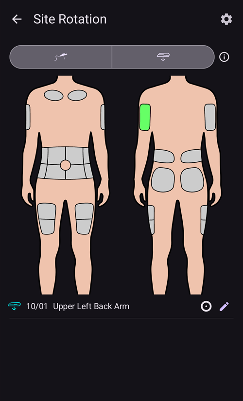

# Pumps and cannulas

## Schimbarea seturilor de infuzie: rezervoare de insulină și canule

Procedura descrisă mai jos este numai pentru pompe cu fir și nu se aplică pentru pompe plasture cum ar fi Omnipod, Medtrum Nano, Accu-Chek Solo șamd. This procedure is sometimes referred to as a "set change", with a "full" set change including the insulin reservoir and cannula, and a "partial" set change referring to a change of cannula only.

Patch pumps fill and prime themselves in their own activation wizard, and their cannula is already in the body. **AAPS** does not offer a prime for them: **Prime/Fill** is not shown in the **Manage** sheet or in QuickLaunch. See the page of your pump in [Compatible pumps](../Getting-Started/CompatiblePumps.md).

Modificările cartușului fizic/rezervorului nu pot fi efectuate prin intermediul **AAPS** și trebuie efectuate direct prin intermediul pompei. Acestea trebuie să fie înregistrate manual în **AAPS**, odată terminate.

(pumps-cannulas-changing-reservoir-and-cannula)=
### Ghid pentru schimbarea atât a rezervorului pompei cât și a canulei

1. In **AAPS**, disconnect the pump: press the [loop icon](#AapsScreens-loop-status) on the main screen and select **Disconnect pump** for 1 hour. The icon changes to a grey plug icon, indicating that the pump is disconnected.

2. Schimbați fizic rezervorul de insulină: deconectați fizic pompa de corp și schimbați rezervorul/cartușul și canula conform instrucțiunilor fabricantului.

3. Amorsați/umpleți canula: aceasta se poate face direct prin pompă. Asigurați-vă că eliminați bulele de aer din tub.

4. Atașați noua canulă pe corp. Odată ce canula este introdusă și acul este îndepărtat, canula atașată are acum un mic spațiu de aer care trebuie, de asemenea, să fie amorsat. To announce this in **AAPS** and prime the site: open **Prime/Fill** (in the expanded status panel on the main screen, in the **Manage** sheet, or as a [QuickLaunch](QuickLaunch.md) button) and tick **Pump site change** and/or **Insulin cartridge change** as appropriate to record the change. Now press the default insulin cannula prime amount (it is usually around 0.3 U, but check this value is correct for your cannula) and select **OK**. Read the summary message, and confirm to execute the priming by tapping **OK**.

   


5. Reconnect the pump in **AAPS**: press the grey plug icon and select **Reconnect pump** to continue looping.

### Informații utile privind modificările de insulină/canulă

* Logging a pump site change resets Autosens to 100%. It also resets the corresponding cannula/insulin status lights and ages on the **AAPS** main screen.

* You can set/adjust the default prime amounts in the **Prime/Fill** settings — type "prime" in the main screen search bar to open them (see [Preferences](../SettingUpAaps/Preferences.md)). Vedeți instrucțiunile din cutia canulei pentru câte unități (în funcție de lungimea acului și lungimea tubului) ar trebui să fie amorsate pentru canulă.

* Insulin delivered using the prime function is not taken into account by **AAPS** when calculating insulin on board (IOB), and is marked in the [Treatments history](#aaps-screens-treatments) as "Prime".

* Any insulin bolused from the pump during a pump disconnection will also not be taken into account by **AAPS**. If you happen to bolus directly from the pump while **AAPS** is disconnected, once you reconnect the pump you can announce this insulin (without bolusing it) in the **Insulin** dialog (see [To announce delivered insulin without actually bolusing](#pumps-cannulas-announce-insulin) below).

### Canula, locul de perfuzare, tubulatura şi/sau problemele pompei

If you are confident that you haven't received any insulin for a period of time, despite **AAPS** recording that you have, and you know exactly when the issue started (_e.g._ you remove the cannula and see that the cannula was kinked during the insertion process) you can correct this in **AAPS**, while being aware that the insulin may in fact have been delivered but may be slow to act for some reason.

```{admonition} Caution - Risk of Hypoglycemia
:class: pericol
Ștergeți administrarea insulinei din **AAPS** numai cu precauție MAXIMĂ, în cazul în care insulina _a_ fost de fapt administrată și monitorizați-vă îndeaproape glicemia pentru următoarele 24 de ore.
```

To remove boluses and SMBs which you know have not been delivered, open the **menu** (☰), select [Treatments history](#aaps-screens-treatments) and, on the **Carbs and bolus** tab, conservatively delete the logged boluses starting from the point the incident happened. This will correct the "insulin on board" (IOB) value which is key for **AAPS**' calculations; if you now return to the main screen you will see that the IOB has reduced. Be aware that you cannot delete basal insulin which **AAPS** calculates to have been delivered, so that will still be taken into account by **AAPS**.

In less obvious cases of insulin delivery problems _e.g._ leakages, occlusions or tunneling where either you are not sure when the issue started, or think some of the insulin was delivered, you need to be careful. You may detect these issues either by "smelling" the insulin, seeing a wet adhesive, encountering high glucose values or by getting an alarm. As you will never know how much insulin you got into your skin (which might be starting to work after a while) it will be hard to determine the correct amount of insulin which needs to be deducted from the current "insulin on board" (IOB) value. O strategie este să întrerupeți bucla timp de 5 ore (sau durata specifică de acțiune a insulinei) după ce ați rezolvat problema de administrare a insulinei, și reluare buclei după aceea. Acest lucru va asigura corectitudinea IOB după repornirea buclei.

(pumps-cannulas-disconnecting)=
## Deconectarea pompei pentru duș sau activitate

If you take your pump off for showering, bathing, swimming, contact sports or other activities you must let **AAPS** know that no insulin is being delivered, to keep the IOB correct. The pump can be disconnected using the [loop icon](#AapsScreens-loop-status) on the main screen: press it and select **Disconnect pump** with the duration you need. If the activity takes longer than planned, open the same dialog again and pick a new duration under **Disconnect pump**: the disconnection is extended and the new duration starts from now. You do not need to reconnect first.

Deoarece nu primiți insulină în timp ce pompa este deconectată, trebuie să vă reconectați la fiecare două ore pentru a compensa bazala lipsă. You can do this by connecting, bolusing the missing basal amounts (_e.g._ of the last two hours) before disconnecting again. Acest lucru ajută la evitarea lipsei severe de insulină care poate duce la cetoacidoză diabetică (CAD). If it is inconvenient to reconnect the pump during activity (cannula site is covered by wearing a wetsuit _etc._), consider a pen injection instead. This manual injection can be logged in **AAPS**, and doesn't have to be logged at the time of injection (just make a note of the time of injection) since you can announce the insulin and backdate the time the insulin was actually given when you reconnect the pump.

(pumps-cannulas-announce-insulin)=
## Pentru a anunța insulina administrată fără a bolusa propriu-zis

To announce insulin delivered from the pump either while **AAPS** was disconnected, or from pen injections: open the [Insulin dialog](#aaps-screens-buttons-insulin) (**Treatments** in the bottom navigation, or a QuickLaunch button), enter the amount in units and enable **Bolus will be recorded only**. A **Time** row (set to **Now**) then lets you record the actual time of the injection: you can ignore it if the injection was given recently. If the bolus was given some time ago, use **-** to move the time back (_e.g._ -30 min), or open the row with the chevron to pick the exact date and time. **AAPS** will then take into account the duration of insulin action and calculate the remaining insulin still in the system accordingly.

If you are using **AAPS** as a caregiver, you can remotely disconnect (and reconnect) the pump very easily by [SMS command](../RemoteFeatures/SMSCommands.md) using commands such as "pump disconnect 120" and "pump connect 120". Intervalul de timp pentru deconectarea de la distanță este de 1 - 120 de minute (în acest exemplu este de 120 de minute). This is very useful if the **AAPS** handset is inconvenient for you to access, buried in a pump belt on a kid who is running off towards the swimming complex, or being closely guarded (or in use) by a teenager.

## Reconectarea pompei după activitate

After a long disconnection (1 - 2 hours) it is fairly common for **AAPS** to calculate that you now have negative IOB. Când reconectați pompa, în funcție de preferință/nivelul curent al glicemiei/alimentației planificate sau de activitatea ulterioară, puteți fie:

a) Just reconnect the pump in **AAPS** (grey-to-green, for closed loop) and leave it up to **AAPS** to start to deliver insulin again

_sau_

b) If you want to be more aggressive (for example, you are heading for hyperglycemia), you can open the [Bolus wizard](#aaps-screens-bolus-wizard) and bolus for zero carbs, to immediately deliver the calculated missing insulin as a bolus.

Ce strategie preferați este foarte personal, și se determină cel mai bine prin încercări și erori.


(Aapsscreens-site-rotation)=
## Rotație loc

**Manage → Site Rotation** opens the Site Rotation Dialog in View mode:

- With the two buttons at the top (cannula icon and sensor icon), you can show Cannula sites only, Sensor sites only, or both
- All Cannula change and Sensor change event since the past 45 days are available.
- Click on a Site area, or in one entry in the list below to filter the list with only entries in selected area. The selected area will be highlighted in light green color.
- Tap the **pencil** icon next to an entry to open the Edit view and update its Site location, Arrow or Note


- The **cog** icon (upper right) opens the settings: **User profile for site rotation** opens a dialog where you choose **Man**, **Woman** or **Child**, and the **Manage pump site rotation** and **Manage CGM site rotation** switches select which sites you manage.


*Note: this setting will be used to automatically open or not Site Rotation Dialog (Edit mode) when a new entry is done from "Prime/Fill button" or "CGM Sensor Insert button"*

- For Site change done directly from Pump, you have to open the View Mode and Edit the new entry to select Location and Arrow

Edit Mode allows you to select Location, Arrow, and Note associated to selected Entry:

- The entry being edited is shown below the body images, with its type icon (cannula or sensor)
- Front and back views are shown side by side: tap the area where you placed it
- Once a Site selected (highlighted in green), you will see in the list below the list of all entries done in the pas 45 days in this site


- You can add an optional arrow by tapping the arrow icon at the right of the entry: the **Select Arrow** dialog lets you specify a sub-location or the pod orientation


- You can also add a **Note** about the selected site
- Tap the **save** icon (upper right) to record the site

Filtering can be done graphically on the image, or clicking a therapy event in the list To remove filtering, just click on the image outside any sites


