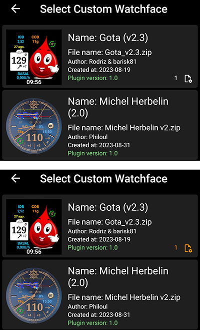

# Custom Watchface Reference Document

This page is for designers of new Watchfaces. It will list all the keywords and features available when you want to create or animate a new watchface.

- New features and keys available in Custom Watchface V2 (Wear apk 3.3.0 or above) are available [here](#cwf-reference-new-v2-features)

## Formatul cadranului personalizat

Custom Watchface is an open format designed for AAPS and associated to the new "AAPS (Custom)" watchface available on Watch.

The Watchface file is a simple zip file, but to be recognized as a Watchface file, the zip file must contain the following files:

- One image file named CustomWatchface (can be bitmap files `CustomWatchface.jpg`, `CustomWatchface.png` or a vector `CustomWatchface.svg`). This file is the little icon used to select the watchface when you click on "Load Watchface" button, and also the image visible within AAPS Wear plugin.
- Un fișier numit `CustomWatchface.json` (vedeți [Structura JSON](#cwf-reference-json-structure) mai jos). This second file is the core file that will include all information required to design the watchface. This json file must be valid (it's probably the most tricky point when you edit manually this file within a text editor, because a missing or additional comma is enough to break the json format). This JSON file must also include a `"metadata"` block with a `"name"` key with not empty value. This will be the name of your custom watchface (see [Metadata settings](#cwf-reference-metadata-settings) below)
- the size of this zip should be as small as possible (less than about 500kb). If this file is too big, it will just be blocked and not transmitted to the watch.

Fișierul zip poate conține și câteva fișiere de resurse suplimentare:

- Hardcoded file names for images that will be used used in standard views included in the watchface (like `Background`, `CoverChart`... see [List of hardcoded resource files](#cwf-reference-list-of-hardcoded-resource-files) below). Toate aceste fișiere pot fi în format `jpg`, `png` sau `svg`. but for most of them, you will have to use `png` or `svg` that manage transparency (jpg are smaller in size compared to png, but with no transparency). Note that the best quality associated to the smallest size will generally be with svg files (vector format).
- Additional resource files with free names. These additional files can be either image files, or font files (`ttf` and `otf` format are accepted for fonts). Rețineți că, pentru aceste fișiere suplimentare, `filename` (fără extensie) va fi folosit ca keyValue în fișierul JSON, pentru a specifica unde sau când trebuie folosite aceste fișiere.
  - image files are often used as background of text views or for dynamic animation (like battery level from 0% to 100%)
  - font files allow you to use dedicated fonts within your watchface

(cwf-reference-json-structure)=

## Structura JSON

JSON files can be edited in Notepad (or notepad++) text editor (prefer notepad++ that recognize JSON and use color formatting)

- it contains string keys `"string_key":` and key values that can be strings like `"key value"`, integer, boolean like `true`or `false` or block of data.
- each value is separated by a comma `,`
- Un bloc de date începe cu `{`  și se termină cu `}`
- the json file is a whole block so it starts by  `{`  and ends by `}`, and inside this file all embedded blocks are associated to a `"key"` that should be unique within the block
- To improve readability of json file, it's generally indented (each new key is on a new line, each new block is shifted on the right by 4 spaces characters)

(cwf-reference-metadata-settings)=

### Metadata Settings

This block is the first block included into the json file and is mandatory. It contains all the information associated to this watchface, like the name, the author, the date of creation or update, the author version or the plugin version.

See below an example of metadata block:

```text
"metadata": {
    "name": "Default Watchface",
    "author": "myName",
    "created_at": "07\/10\/2023",
    "author_version": "1.0",
    "cwf_version": "1.0",
    "comment": "Default watchface, you can click on EXPORT WATCHFACE button to generate a template"
},
```

Note that `/` used for the date is a special character, so to be recognize correctly within json file, you have to put before an "escape" character `\`

You can see in some json file an additional key `"filename"`, this key will be automatically created or updated when the custom watchface will be loaded within AAPS (it will be used to show to the user the zip filename within exports folder), so you can remove this key within metadata block.

(cwf-reference-general-parameter-settings)=

### General parameter settings

După primul bloc cu metadate, veți seta câțiva parametri generali (vezi [Lista parametrilor generali](#cwf-reference-list-of-general-parameters) de mai jos), aceasta vă permite să setați culori grafice (carbohidrați, bolus, valorile glicemiei șamd), dar și culorile implicite pentru valoarea în interval, hiperglicemie sau hipoglicemie (culori implicite ale valorii glicemiei și săgeți)

See below an example of general parameters

```text
"highColor": "#FFFF00",
"midColor": "#00FF00",
"lowColor": "#FF0000",
"lowBatColor": "#E53935",
"carbColor": "#FB8C00",
"basalBackgroundColor": "#0000FF",
"basalCenterColor": "#64B5F6",
"gridColor": "#FFFFFF",
"pointSize": 2,
"enableSecond": true,
```
(cwf-reference-imageview-settings)=

### ImageView settings

Custom image can be tuned using correct filename associated to each ImageView included into custom watchface Layout, then the json block is only here to define the position, the size, if the view is visible or not, and optionally tune the color:

See below an example of an Image block for second_hand, (in this case there are no image included into zip file so default second hand image will be used, but tuned with a custom color.

```text
"second_hand": {
    "width": 400,
    "height": 400,
    "topmargin": 0,
    "leftmargin": 0,
    "visibility": "visible",
    "color": "#BC906A"
}
```
To have second_hand colored with default BG color (lowRange, midRange or highRange), you just have to modify the latest line with the keyValue `bgColor`

```json
    "color": "bgColor"
```

(cwf-reference-textview-settings)=

### TextView settings

TextView are mai mulți parametri disponibili decât ImageView: puteți ajusta rotația (număr întreg în grade), textsize (număr întreg în pixeli), gravity (pentru a defini dacă textul va fi centrat (valoare implicită) sau aliniat la stânga sau la dreapta), puteți seta font, fontStyle și fontColor, precum și culoarea de fundal a TextView

```text
"basalRate": {
    "width": 91,
    "height": 32,
    "topmargin": 133,
    "leftmargin": 249,
    "rotation": 0,
    "visibility": "visible",
    "textsize": 23,
    "gravity": "center",
    "font": "default",
    "fontStyle": "bold",
    "fontColor": "#BDBDBD"
},
```
Țineți cont că dacă nu doriți să gestionați o singură vizualizare de pe ceas, apoi puneți tasta `"vizibilitate"` pentru `"dus"` dar, de asemenea, setați dimensiunea și poziția în afara zonei vizibile astfel:

```text
"second": {
    "width": 0,
    "height": 0,
    "topmargin": 0,
    "leftmargin": 0,
    "rotation": 0,
    "visibility": "gone",
    "textsize": 46,
    "gravity": "center",
    "font": "default",
    "fontStyle": "bold",
    "fontColor": "#BDBDBD"
},
```
If size and position are within visible area, you can get some "flash" of the hidden value during the refresh of the watchface.

Dacă doriți să personalizați imaginea de fundal a unei vizualizări text, apoi puteți folosi cheia `"fundal":` și să puneți numele imaginii incluse în fișierul zip ca valoare cheie, puteți de asemenea să schimbați culoarea de fundal folosind cheia `"culoare:"`.

```json
"background": "fileName"
```

You also have 4 specific textViews (named freetext1 to freetext4) that have a specific parameter `"textvalue":` that can be used to set for example a label

(cwf-reference-chartview-settings)=

### ChartView settings

Chart view is a very specific view that can share some parameters with ImageView or with TextView...

Setările standard pentru această vizualizare sunt foarte simple:

```text
"chart": {
    "width": 400,
    "height": 170,
    "topmargin": 230,
    "leftmargin": 0,
    "visibility": "visible"
},
```
The 2 additional parameters you can include for Chart view is a background color (default is transparent), using `"color"` key or a background image using `"background"` key.

(cwf-reference-how-to-build-watchface)=

## How to build/design your first Watchface

### Instrumente necesare

- Text editor: My advice is to use NotePad++ (or equivalent) that is a simple text editor, but added value is you can see formatted text with color code, so it's easier to detect errors. any simple text editor will do the job. Since the purpose is to tune json information.
- Editor de imagini (bitmap și/sau vectorial)
  - Dacă folosiți bitmap
    - Image editor should be able to manage transparency (required for all image above background), and png format (if you used bitmap image)
    - Imaginea de fundal poate fi în format jpg (mai mic decât png)
    - Image editor should allow you to measure in pixel graphical objects (can be a simple square) (top, left, width, height)
    - Editorul de imagini trebuie să vă poată arăta culorile cu codul RRGGBB în hexazecimal
    - Image editor should be able to resize image to 400px x 400px (very important to work with this resolution)
  - Dacă folosiți imagini vectoriale
    - Imaginea vectorială trebuie exportată în format svg

### Get template to not start from scratch

When you want to design your first watchface, the best is to start by the default watchface (this will ensure you to have latest version with all available views correctly sorted)

- You can get zip file by clicking on "Export Template" button within Wear plugin and get zip file within AAPS/exports folder
- Note that you will need to have a watch connected to AAPS to see Custom Watchface buttons (but watch is also required to check, test and tune your custom watchface)

Cadranul implicit este foarte simplu, iar fișierul zip va conține doar 2 fișiere:

- CustomWatchface.png (image of default watchface for WF selection)
- CustomWatchface.json

### Organizați fișierele pe computer

Cel mai simplu este să aveți telefonul conectat la computer și să lucrați cu două dosare anume:

- one explorer opened on a specific folder that will have all files (json, bitmap images, vector images, fonts), and the CustomWatchface.zip file within it
- another explorer (or navigation tree tuned) opened to have Phone/AAPS/exports folder available

That way working is very easy: each time you tune json file with a text editor, image with image editor (bitmap or vector) you have to just:

1. salvați modificările în fiecare aplicație
2. trageți și plasați toate fișierele în fișierul CustomWatchface.zip
3. trageți și plasați CustomWatchface.zip în dosarul AAPS/exports al telefonului
4. send CustomWatchface to the watch to check the results

### Initialize Watchface customization

First step you will have to define a watchface Name (necessary to select it easily for testing), and start to tune metadata keys at the beginning of json file

Then you will have to define which information you want to show so which view should be visible or hidden.

- will you manage second or not?
- do you want to design an analog watch or a digital watch (or both...)

Now you can start to modify json file with the `"visibility":` key of each view set to `"visible"` or `"gone"` (if you want to keep or not the view)

Puteți începe și să ajustați aproximativ marginile de sus și din stânga, lățimea și înălțimea, pentru a începe organizarea cadranului (aceste valori vor fi ajustate mai târziu cu editorul de imagini)

Note: everything is design within a **400px x 400px rectangle**. So everything will be position in absolute coordinates within this size.

When you design your first watchface, you have to know that everything is organized by layer from the Back to the Top, so each view (ImageView or TextView) can hide something that is behind...


Then within json file all views are sorted from the Back to the Top (this will help you to remember what is behind what...)

If you design or tune your first custom watchface, start by simple things: change visibility of some views, include a dedicated background image without changing json file...

### Gestionarea culorilor

Within json file, you will have several keys to specify colors: `"color"`, `"fontColor"`for views, but also `"highColor"`, `"midColor"`, `"lowColor"`, ... (see [List of General Parameters](#cwf-reference-list-of-general-parameters))

Colors are specified with a text field that starts by `#` followed by RRGGBB (Red, Green, Blue) values in hexadecimal format:

- `"#FFFFFF"` este alb, `"#000000"` este negru, `"#FF0000"` este roșu...

You can also include 2 additional values for alpha layer and specify a transparency level (AARRGGBB):

- `"#00000000"`is completely transparent, and `"#FF000000"` is completely opaque ( so  `"#FF000000"` is equivalent to  `"#000000"`)

You can also use the specific keyvalue `"bgColor"` to automatically use `"highColor"`, `"midColor"`, `"lowColor"` specified in general parameters according to BG Value:

- `"fontColor": "bgColor",` va seta automat culoarea fontului vizualizării în funcție de valoarea glicemiei
- Note that `sgv` (for BG Value) and `direction` (for trend arrow) views automatically apply BG colors set into general parameters (for these 2 views, if you want to have different colors, you will have to use advanced [dynData](#cwf-reference-dyndata-feature) feature with one step color...)

Pentru mai multe informații despre ImageViews și cheia `"culoare":`, a se vedea capitolul [Ajustați culoarea imaginii](#cwf-reference-tune-image-color) de mai jos.

### Include Hardcoded images

cel mai simplu mod de a începe reglarea feței de ceas este de a include în fișierul zip unele imagini cu nume specifice (vezi [Lista fișierelor resurse codate dur](#cwf-reference-list-of-hardcoded-resource-files))

- Imaginea trebuie să fie în format `.jpg`, `.png` sau `.svg`. but be careful, jpg doesn't manage transparency, so should be only used for background layer. For all intermediate layers (cover_chart, cover_plate, hands) use either `.png`or `.svg` image

- If you have a vector image editor (like for example Illustrator), prefer this format that will produce small text files with `.svg` extension the best quality.
- You should take care to use exact filename (including High/lower case)

Now if you want a dedicated background image, you only have to include within the zip file a file named `Background.jpg` (without changing anything else). Send the zip file to the watch and check the result!

Dacă doriți să personalizați hour_hand, minute_hand sau second_hand pentru un ceas analogic, includeți pur și simplu `HourHand.png` (sau `HourHand.svg`), `MinuteHand.png` și `SecondHand.png`.

- these images will automatically rotate around the center of the image, so the images should be set to 00:00:00 (and for a "full frame" analog watch, use a size of 400 x 400 px positioned at top 0 left 0)

You can also noticed within [List of Hardcoded resource files](#cwf-reference-list-of-hardcoded-resource-files) that for each image view, you have two additional hardcoded filenames `High` and `Low` (for example you can include other images named `BackgroundHigh.jpg` and `BackgroundLow.jpg` within zip file). then image will automatically change according to you BG level (within Range, Hyper or Hypo). Vedeți cadranul AIMICO ca exemplu.

(cwf-reference-tune-image-color)=

### Tune image color

Cheia `"color"` poate fi folosită pentru a ajusta culoarea implicită a imaginii:

- applied on background view, it will set the background color (default black)
- applied on cover_plate (simple dial) or hands, it will change the default image (white) by the color specified (including `"bgColor"`)

When you apply `"color"` key on a bitmap image (`.jpg` or `.png`), color will apply an interesting effect on color saturation. So you will still recognize your bitmap.

Finally on `.svg` image file, `"color"`key will have no effect, consider color of vector files as hardcoded within the image. If you want to change colors, you will have to include several `svg` files, and use advanced [dynData](#cwf-reference-dyndata-feature) feature to change it

### Use additional fonts for TextViews

Several defaults font are already available within wear apk (see font keys included into [key values](#cwf-reference-key-values) chapter). But if you want to use additional fonts not available as default, you can include additional fonts within zip file:

- cele 2 formate de font acceptate sunt fișierele `.ttf` și `.otf`
- if you include a custom font within zip file, for example with a file named `myCustomFont.ttf`, then you will have to use the filename to use it within json file for a TextView:

```
"font": "myCustomFont",
```

Keep in mind that some fonts can be included into big files (and you are limited to a maximum size for zip file). So if you only use very few characters (numbers, `.`, `,`), you can use free tools to remove unused characters (for example [here](https://products.aspose.app/font/generator/ttf-to-ttf)) and then reduce font size.

(cwf-reference-advanced-features)=

## Funcții avansate

(cwf-reference-preference-feature)=

### Funcția Preferințe

CustomWatchface can automatically tune some watch preferences to have the correct visualization of the watchface (if authorization is given within Wear preferencesby the user).

Dar această funcție trebuie folosită cu grijă. Preferences are common with all other watchfaces. So several rules to respect with this feature:

- never set preferences concerning hidden views
- try to maximize the visible views
- feel free to oversize the width of certain views:
  - TBR can be shown as percentage (small width, but also as absolute values much wider)
  - delta or avg delta with detailed information can be wide
  - same for iob2: this view can have total iob, but if detailed iob is selected, then text size can be very long

If you still need some very specific settings to have a correct display (in example below, if there is not enough space for detailed iob, you can "force" this parameter to `false` of your watch, you can include within metadata block some settings constraint like that

```text
"metadata": {
    "name": "Default Watchface",
    "author": "myName",
    "created_at": "07\/10\/2023",
    "author_version": "1.0",
    "cwf_version": "1.0",
    "comment": "Default watchface, you can click on EXPORT WATCHFACE button to generate a template",
    "key_show_detailed_iob": false
},
```

If user authorize custom watchface to modify watch parameter (setting within wear plugin) then Show detailed iob will be set to "disable", and locked to disable (no modification of this parameter possible, until authorization is disabled within wear plugin parameter, or another watchface is selected)

- Note that when a user select a watchface, he can see the number of "required parameter" during watchface selection

În exemplul de mai jos, cadranul Gota are un parametru necesar. If authorization is not given it will be shown in white color, but authorization is given, then this parameter will be set and locked on the watch (in this case the number is in orange color)




(cwf-reference-twinview-feature)=

### Funcția TwinView

Twin views provide an easy way to adjust the view position based on the visible views. This does not have the power of a layout entirely made up of LinearLayout, but can handle many common cases.

In example below you can see AAPS (Cockpit) watchface with all views visible within settings, and the same watchface with "Show rig battery" disabled and "Show avg delta" disabled


You can see that when one of the twin views is hidden, the other is shifted to be centered

in this example, you can see that within `"uploader_battery"` block, we have `"twinView":` key is added to define `"rig_battery"` view, and in `"rig_battery"` block  `"twinView":` key define `"uploader_battery"` as twin. Then then additional key `"leftOffsetTwinHidden":` define the number of pixel to shift the view when twin is hidden.

To calculate this number, you can see that the difference between the leftMargin of each of the twin views is 50 pixels, so the offset to stay centered is half in one direction or the other.

If the twin views are positioned vertically, in this case you must use the key `"topOffsetTwinHidden":`

```text
"uploader_battery": {
    "width": 49,
    "height": 30,
    "topmargin": 354,
    "leftmargin": 150,
    "rotation": 0,
    "visibility": "visible",
    "textsize": 23,
    "gravity": "center",
    "font": "roboto_condensed_bold",
    "fontStyle": "bold",
    "fontColor": "#FFFFFF",
    "twinView": "rig_battery",
    "leftOffsetTwinHidden": 25
},
"rig_battery": {
    "width": 49,
    "height": 30,
    "topmargin": 354,
    "leftmargin": 200,
    "rotation": 0,
    "visibility": "visible",
    "textsize": 23,
    "gravity": "center",
    "font": "roboto_condensed_bold",
    "fontStyle": "bold",
    "fontColor": "#FFFFFF",
    "twinView": "uploader_battery",
    "leftOffsetTwinHidden": -25
},
```
(cwf-reference-dyndata-feature)=

### Funcția DynData

DynData is the most powerful feature if you want to include some animation within you watchface, according to some internal values (like BG value, BG level, delta, % of battery... see list of available data [here](#cwf-reference-dyndata-key-values))

To illustrate this feature, I will take the example of AAPS (SteamPunk) watchface:


In this watchface, we will have to manage the [rotation of BG value](#cwf-reference-background-management) (from 30 degrees to 330 degrees) on the right, the [dynamic range of avg_delta](#cwf-reference-avg-delta-management) (scale up to 5mgdl, 10mgdl or 20mgdl according to value), the [rotation of pointer](#cwf-reference-dynamic-rotation-management) that should be synchronized to the scale, and also the different layer of the views...

To be able to manage this Watchface, see below all the images included into the zip file:

Note: to be able to see the transparency, all these images are on a yellow background and surrounded by a red square


- On the first row, Background.jpg and CoverPlate.png will be automatically mapped with associated view (default views filename), and steampunk_pointer.png will be managed by dynData
- On the second row you see the 3 scales of dynamic range for avg_delta that will also be managed by dynData
- On the third row, chartBackground.jpg will be linked manually within chart view, HourHand.png and finally MinuteHand.png files will be automatically mapped with associated views

(cwf-reference-background-management)=

#### Gestionarea fundalului

First, concerning BG value image, no choice here, it can only be in the background layer (otherwise it will be in front of the chart view and chart will not be visible!). So we will have to map BG value to the background, and then rotate background image according to BG value.

În blocul `"background"` vom include 2 chei speciale pentru această rotație:

```text
"background": {
    "width": 400,
    "height": 400,
    "topmargin": 0,
    "leftmargin": 0,
    "dynData": "rotateSgv",
    "rotationOffset": true,
    "visibility": "visible"
},
```
`"dynData":` key will define which block should be used to define the animation (value, range, conversion...) here this block was named "rotateSgv" (choose an explicit name when you use this feature),

`"rotationOffset": true,` will define that the expected animation according to value should be a rotation. (others available keys are `"leftOffset"` and `"topOffset"` if you want to create a slider)

Acum mergem la sfârșitul fișierului, după ultima vizualizare:

```text
"second_hand": {
    "width": 120,
    "height": 120,
    "topmargin": 140,
    "leftmargin": 140,
    "visibility": "gone"
},
"dynData": {
    "rotateSgv": {
        "valueKey": "sgv",
        "minData": 30,
        "maxData": 330
    },
```
You can see that after the latest view (`"second_hand"`), we added a new `"dynData": { ... }` block that  will contains all the animations:

The block defined within `"background"`view was named `"rotateSgv"`, it's the first block you will find into `"dynData"`!

This block is simple: you have a first key named `"valueKey":` that will be used to define which value should be used. in this case `"sgv"` is a "keyValue" that defines BG value (note that in most cases the keyValue has the same name that the view that shows this information).

Referitor la valoarea glicemiei, datele de minim implicite sunt setate la 39mgdl și datele maxime sunt setate la 400mgdl (vedeți

Valorile cheie de referință DynData/0> sub toate valorile cheie disponibile și valorile de date asociate min/max).</p> 

Within `"rotateSgv"` block the two additional keys (`"minData":` and `"maxData":`) will be used to tune min and max data to 30 and 330. With these min and max values, we will be able to directly use data value (without any conversion) to rotate background in degrees. In this situation all BG values above 330mgdl will be limited to 330, upper limit of the image. 


#### Gestionarea graficului

Default background of chart is transparent, so to hide BG scale included into background image, we will need to include a dedicated background image (this image will include the overall shadows of Steampunk watchface). The link to chartBackground.jpg file is done with `"background":` key

Of course, the sizing and positioning of the view must be done to the pixel!


```text
"chart": {
    "width": 216,
    "height": 107,
    "topmargin": 280,
    "leftmargin": 80,
    "visibility": "visible",
    "background": "chartBackground"
},
```


(cwf-reference-avg-delta-management)=


#### Avg delta management

To be able to manage dynamic range of avg delta, we will use the four freetext views. freetext1 will be used to manage the image scale, and freetext2 to freetext4 will be used to manage pointer rotation according to scale.

**freetext1**

As explain before, freetext views are in front of chart and in front of background, that's why we included transparent area to see these images (right side and bottom side of the image)

Rețineți că partea de jos eliminată din aceste imagini a fost folosită ca fundal al graficului, pentru o integrare perfectă.


```text
"freetext1": {
    "width": 400,
    "height": 400,
    "topmargin": 0,
    "leftmargin": 0,
    "rotation": 0,
    "visibility": "visible",
    "dynData": "avgDeltaBackground"
},
```


For this view we include the link to another `"dynData"`block named `avgDeltaBackground`. Acest bloc va gestiona scala avgDelta în funcție de valoarea avgDelta.


```text
"avgDeltaBackground": {
    "valueKey": "avg_delta",
    "minData": -20,
    "maxData": 20,
    "invalidImage": "steampunk_gauge_mgdl_5",
    "image1": "steampunk_gauge_mgdl_20",
    "image2": "steampunk_gauge_mgdl_20",
    "image3": "steampunk_gauge_mgdl_10",
    "image4": "steampunk_gauge_mgdl_5",
    "image5": "steampunk_gauge_mgdl_5",
    "image6": "steampunk_gauge_mgdl_10",
    "image7": "steampunk_gauge_mgdl_20",
    "image8": "steampunk_gauge_mgdl_20"
},
```


- `"valueKey":` face legătura cu valoarea `"avg_delta"`
- min and max Data will also limit the range to the maximum value available within this watchface (from -20mgdl to 20mgdl). For mmol users, keep in mind that all internal values are always in mgdl within AAPS.

Then we will see here how to manage dynamic background image according to value.

`"invalidImage":` is the key to manage image to show when we have an invalid data (or missing data). Here we make the link to additional resource image including into zip file with 5 mgdl scale

Then we will use a series of images, starting from `"image1":` to `"image8":`. Numărul de imagini furnizate definește numărul de pași dintre `minData` și `maxData`. 

- `image1` will define image to show when avg_delta is equal or close to `minData` and the image with the highest number (here `image8`) will be used to define the image that should be shown when avg_delta is equal or close to `maxData`
- between -20mgdl and 20mgdl, the overall range is 40mgdl, divided by 8 (number of images provided), we will have 8 steps of 5mgdl
- Now we can map background images according to avg_delta value, starting from the lowest values: between -20 and -15, and also between -15 and -10 we will use  `steampunk_gauge_mgdl_20` for the scale, then between -10 and -5 `steampunk_gauge_mgdl_10`, and so on until +15 and +20 where we will again use `steampunk_gauge_mgdl_20` background image

(cwf-reference-dynamic-rotation-management)=

**freetext2 până la freetext4**

Pentru aceste vizualizări vom combina imaginile dinamice cu funcția de rotație explicată mai sus:


```text
"freetext2": {
    "width": 276,
    "height": 276,
    "topmargin": 64,
    "leftmargin": 64,
    "rotation": 0,
    "visibility": "visible",
    "dynData": "avgDelta5",
    "rotationOffset": true
},
"freetext3": {
    "width": 276,
    "height": 276,
    "topmargin": 64,
    "leftmargin": 64,
    "rotation": 0,
    "visibility": "visible",
    "dynData": "avgDelta10",
    "rotationOffset": true
},
"freetext4": {
    "width": 276,
    "height": 276,
    "topmargin": 64,
    "leftmargin": 64,
    "rotation": 0,
    "visibility": "visible",
    "dynData": "avgDelta20",
    "rotationOffset": true
},
```


Here each view is dedicated to a specific scale (so is linked to a dedicated dynData block), you can also notice that `"rotationOffset":` key is enabled for these 3 views.Now take a look on the first dynData block:


```text
"avgDelta5": {
    "valueKey": "avg_delta",
    "minData": -20,
    "maxData": 20,
    "rotationOffset": {
        "minValue": -120,
        "maxValue": 120
    },
    "invalidImage": "null",
    "image1": "null",
    "image2": "null",
    "image3": "null",
    "image4": "steampunk_pointer",
    "image5": "steampunk_pointer",
    "image6": "null",
    "image7": "null",
    "image8": "null"
},
```


Here, even if dynamic range will be used only between -5 and +5 avg_delta data, it's important to keep the overall range of -20, +20mgdl to ensure that the pointer will be synchronize with the background during scale switches. That's why we keep the same overall range than for `avgDeltaBackground`  and the same number of steps (8 images).

You can note that either `"invalidImage"` or several `"imagexx"` are with `"null"` key value (it could be any string not existing as a filename within zip file). When a filename is not found, then view background image will be transparent. So the setting ensure that pointer will only be visible for step 4 and step 5 (avg delta between -5mgdl and +5 mgdl), and will not be visible outside this range.

Now we can see a new block `"rotationOffset":` that will have inside two keys `"minValue":` and `"maxValue":`. These values are used to make the conversion between internal data (in mgdl), and the angle rotation we want to have.

- Steampunk watchface is designed to have maximum from -30 degrees to 30 degrees rotation for the pointer. So according to the scale (here from -5mgdl to 5mgdl), we will want to have 30 degrees for these values. Because `minData` and `maxData`are 4 times greater, then the corresponding minValues and maxValues are 4 * 30 degrees so -120 and +120 degrees. But for all rotation above or below +-30 degrees the pointer will be hidden (no image visible), and the pointer will only be visible for values between -5 and +5mgdl... So it's exactly what is expected here.

The other dynData blocks are defined the same way to tune `"avgDelta10"`and `"avgDelta20"`


#### vizualizarea loop

in Steampunk watchface loop green and red arrows (for status) are disabled, this is also managed with a dedicated dynData block associated to loop view.


```text
    "loopArrows": {
        "invalidImage": "greyArrows",
        "image1": "greenArrows",
        "image2": "redArrows"
    }
```


Deoarece acest bloc este apelat doar de vizualizarea loop, iar datele implicite gestionate de această vizualizare sunt informațiile despre buclă, cheia `"valueKey":` este opțională.

Default `minData` and `maxData` for loop are defined to 0min and 28min, so with two images, all data values below 14 min will be shown with background `image1` and all data values above 14 min will be shown with `image2`. 14 min is exactly the threshold to switch from green arrow to red arrow.

In this example, `greyArrows`, `greenArrows` and `redArrows` files are not included into zip file, so these arrows are just removed (invisible), but you can use this block "as is" if you want to tune status arrows with custom background images.


#### vizualizările rig_battery și uploader_battery

To finish the overview of dynData feature, we will take a look on battery management. Ideea aici este să personalizăm culoarea textului în funcție de nivelul bateriei (de la 0 la 100%)


```text
"uploader_battery": {
    "width": 60,
    "height": 28,
    "topmargin": 100,
    "leftmargin": 170,
    "rotation": 0,
    "visibility": "visible",
    "textsize": 20,
    "gravity": "center",
    "font": "default",
    "fontStyle": "bold",
    "fontColor": "#00000000",
    "dynData": "batteryIcons",
    "twinView": "rig_battery",
    "topOffsetTwinHidden": -13
},
"rig_battery": {
    "width": 60,
    "height": 28,
    "topmargin": 74,
    "leftmargin": 170,
    "rotation": 0,
    "visibility": "visible",
    "textsize": 20,
    "gravity": "center",
    "font": "default",
    "fontStyle": "bold",
    "fontColor": "#00000000",
    "dynData": "batteryIcons",
    "twinView": "uploader_battery",
    "topOffsetTwinHidden": 13
},
```


You can see here that these both views share the same `dynData` block named `batteryIcons`. It's possible because by default attached data is the one of the view (to without specifying a  `"valueKey":` key within  `batteryIcons` block, it will be applied with `uploader_battery` data or `rig_battery` data according to the view).

Note these two views also use TwinView feature explain [here](#cwf-reference-twinview-feature).

Acum să ne uităm la blocul dynData:


```text
"batteryIcons": {
    "invalidFontColor": "#00000000",
    "fontColor1": "#A00000",
    "fontColor2": "#000000",
    "fontColor3": "#000000",
    "fontColor4": "#000000",
    "fontColor5": "#000000"        
},
```


Here we use exactly the same logic that for dynamic background image, but with dedicated keys (`"invalidFontColor"` and  `"fontColor1"` to `"fontColor5"` to specify 5 steps of 20% each one).

- `"fontColor1"` (dark red) will be used for all values below 20%, and white will be used for all values above this threshold.
- If you want to lower the threshold to "below 10%", you just have to add 5 additional keys from `"fontColor6"` to `"fontColor10"` , but you can also adjust each color if you want progressive variation from green to yellow, orange and red...

(cwf-reference-dynpref-feature)=


### Funcția DynPref

Before reading this chapter, you have to understand how [dynData](#cwf-reference-dyndata-feature) works, because DynPref is an advanced usage of DynData: You will now be able to adjust each DynData block according to preferences set by the user:

To illustrate DynPref feature, we will use two example:

- Steampunk watchface (simple use to include into the same watchface mgdl and mmol version, watchface will automatically switch according to unit selected into aaps).
- AAPS V2 watchface will combine different preferences to be able to manage text color and background according to dark and match divider preferences.


#### Utilizare simplă a dynPref în cadranul Steampunk

În Steampunk avem două seturi de imagini, în funcție de unități: imaginea `background`, care conține scala glicemiei și se rotește în funcție de valoarea glicemiei. și `freeText1`, care conține scala dinamică în funcție de valoarea avgDelta. Pentru a avea un singur cadran care afișează automat unitățile corecte, trebuie să selectăm imaginea în funcție de unitatea selectată.

To do that we will replace `dynData` key by a `dynPref`key within view block:


```text
 "background": {
    "width": 400,
    "height": 400,
    "topmargin": 0,
    "leftmargin": 0,
    "dynPref": "rotateSgv",
    "rotationOffset": true,
    "visibility": "visible"
},
```


Usage of `dynPref`keys will be very close to `dynData`keys explained in previous chapter

Acum ne uităm la sfârșitul fișierului json, după blocul `dynData`:


```text
"dynData": {
    ...
},
"dynPref": {
    "rotateSgv": {
        "prefKey": "key_units",
        "true": {
            "valueKey": "sgv",
            "minData": 30,
            "maxData": 330,
            "invalidImage": "Background_mgdl",
            "image1": "Background_mgdl"
        },
        "false": {
            "valueKey": "sgv",
            "minData": 30,
            "maxData": 330,
            "invalidImage": "Background_mmol",
            "image1": "Background_mmol"
        }
    },
    ...
}
```


You can see that the dynpref key defined within `background` view block (`"dynPref": "rotateSgv"`) exists into the `dynPref` json block included at the end of json file:

This block should contains a `"prefKey"`key that will define which preference should be used. In this example the key `"key_units"` is linked to units selected within AAPS on phone, and value is `"true"`if selected unit is mgdl, `"false"`if selected unit is mmol.

Then you will find two json blocks that will use "dynData" format, and that will be used according to selected preference

Note that the "HardCoded" file name for Background image is now replaced by a dynamic image that will be the same whatever the BG value (`Background_mgdl.png`file if key_units is "true", `Background_mmol.png` if key_units is false), and we also include an `"invalidImage"` key to always have a background image even if no data has been received from the phone.


#### Combinarea mai multor preferințe în dynPref cu AAPS V2

Most of the time, when you set a preference, it's not to get "dynamic behavior", but only the results according to what you select, but within dynPref, it's considered as a dynamic feature...

- when in `dynData`you specify one full block of parameters (with images, fontColor, Color, ...), with `dynPref`, you will be able to combine each parameter according to one specific preference.
- Here we will see how match divider preference will be associated to dark preference to show when it's enabled (true) white text on black background on dark watchface (dark parameter true) or black text on white background on light watchface (dark false)...

Mai întâi să vedem începutul fișierului json:


```text
"dynPrefColor": "prefColorDark",
"pointSize": 2,
"enableSecond": false,
"background": {
    "width": 400,
    "height": 400,
    "topmargin": 0,
    "leftmargin": 0,
    "visibility": "visible",
    "dynPref": "dark"
},
```


`"dynPrefColor": "prefColorDark"` will specify the dynPref block of all default colors outside views. These colors will be tuned according to dark parameter within `"prefColorDark"`:

And at the end, within the `dynPref` block, you will have a specific dynPref block for default colors:


```text
"prefColorDark": {
    "prefKey": "key_dark",
    "true": {
        "highColor": "#FFFF00",
        "midColor": "#00FF00",
        "lowColor": "#FF0000",
        "lowBatColor": "#E53935",
        "carbColor": "#FB8C00",
        "basalBackgroundColor": "#0000FF",
        "basalCenterColor": "#64B5F6",
        "gridColor": "#FFFFFF"
    },
    "false": {
        "highColor": "#A0A000",
        "midColor": "#00A000",
        "lowColor": "#A00000",
        "lowBatColor": "#E53935",
        "carbColor": "#D07C00",
        "basalBackgroundColor": "#0000A0",
        "basalCenterColor": "#64B5F6",
        "gridColor": "#303030"
    }
}
```


Diferența dintre acest bloc dynPref și celelalte blocuri dynPref standard folosite pentru vizualizări este că aici nu aveți un bloc dynData pentru fiecare valoare a parametrului `"key_dark"`, ci doar lista culorilor principale (`highColor`, `midColor` , ...)

Acum să ne uităm la elementele incluse în „bannerul separator” (în exemplul de mai jos, vizualizarea `"basalRate"` legată de vizualizarea dynPref `"matchDivider"`):


```text
"basalRate": {
    "width": 90,
    "height": 32,
    "topmargin": 127,
    "leftmargin": 242,
    "rotation": 0,
    ...
    "leftOffsetTwinHidden": 33,
    "dynPref": "matchDivider"
},
```


Then within dynPref block, you can see that Match divider parameter (`key_match_divider` key), include the 2 blocks "true" and "false", but these two blocks are only used to define that view will use either "dark" dynBlock (so exactly the same background and text color than the otherviews outside the banner), or "white" dynBLock that will set opposite colors for background and text...


```text
"matchDivider": {
    "prefKey": "key_match_divider",
    "true": {
        "dynPref": "dark"
    },
    "false": {
        "dynPref": "white"
    }
},
"dark": {
    "prefKey": "key_dark",
    "true": {
        "color1": "#000000",
        "fontColor1": "#FFFFFF"
    },
    "false": {
        "color1": "#FFFFFF",
        "fontColor1": "#000000"
    }
},
```


Note that here you are within a "dynData" block, then to define a color or a fontColor, you will use a dynData (not specified here), and a single step (`"color1"` and `'fontColor1'` are used)

- for all parameter other than `image` default "invalid value (if not set specifically by `"invalidColor"` key or `"invalidFontColor"` keys) will be `"color1"` and `"fontColor1"`.

Then we will see a third example with iob views (`iob1` and `iob2`), where we will use smaller text for detailed iob and bigger text for total iob:


```text
"iob1": {
    "width": 125,
    "height": 33,
    "topmargin": 168,
    "leftmargin": 275,
    "rotation": 0,
    "visibility": "visible",
    "textsize": 19,
    ...
    "dynPref": "prefIob1"
},
"iob2": {
    "width": 125,
    "height": 33,
    "topmargin": 196,
    "leftmargin": 275,
    "rotation": 0,
    "visibility": "visible",
    "textsize": 24,
    ...
    "leftOffsetTwinHidden": -10,
    "dynPref": "prefIob2"
},
```


You will see within default view settings the text size (19 on `iob1` and 24 on `iob2`) and the two different `dynPref` block that should tune textsize (according to detailed iob parameter), and colors (according to dark parameter)


```text
"prefIob1": {
    "prefKey": "key_show_detailed_iob",
    "true": {
        "dynPref": "dark",
        "textsize1": 24
    },
    "false": {
        "dynPref": "dark"
    }
},
"prefIob2": {
    "prefKey": "key_show_detailed_iob",
    "true": {
        "dynPref": "dark",
        "textsize1": 19
    },
    "false": {
        "dynPref": "dark"
    }
},
```


You can see here that according to detailed iob parameter (`"key_show_detailed_iob"` key), when it's "true" then textsize is defined to a fix value bigger than default (24 instead of 19): this is done using textsize "step" feature, within only one value so one step... (note that for all parameter others than images,if invalidTextSize is not set, then textsize1 will be used for invalid data)

Apoi blocul dynPref „dark” va fi folosit pentru a seta color și fontColor

In this example the dynData block that will be used for iob1 view will be if detailed IOB is enabled and dark enabled:


```text
{
    "color1": "#000000",
    "fontColor1": "#FFFFFF",
    "textsize1": 24
},
```


Deci textul va fi alb pe fundal negru, iar dimensiunea 24 va înlocui dimensiunea implicită 19 setată în vizualizare

The dynData block that will be used for the same view iob1 if detailed IOB is disabled and dark disabled will be:


```text
{
    "color1": "#FFFFFF",
    "fontColor1": "#000000"
},
```


Acum textul va fi negru pe fundal alb, cu dimensiunea 19


#### Sfaturi și trucuri pentru dynPref

- You can combine as many pref than you want, but be careful, the number of blocks to describe can increase very fast (it's exponential): if you chain 3 parameters and you want to define all situations, you will have 8 blocks to describe, if each parameter has only 2 values...
- Be careful to not build "infinite loop" (for example if dynpref1 block should be completed by dynpref2 block that should be completed by dynpref1 block...). In this case the dynpref blocks will be considered as invalid...
- Nu uitați să includeți indexul numeric după cheie (de exemplu, când folosiți cheia `"textsize"`într-o vizualizare, va trebui să folosiți `"textsize1"`în blocul de valori dynPref, deoarece este un format „dynData”, deci legat de valoare, în acest caz cu un singur pas)
- Only one key `"valueKey"` should be set for one view, so if the final `dynData` block is built from several `dynPref`blocks, do not include several `"valueKey"`  (and associated `"minData"`, `"maxData"`, ...)

(cwf-reference-new-v2-features)=


### Funcții noi în CustomWatchface V2 (AAPS V3.3.0 sau mai nou)

Note that the watchfaces using these new features or views will require the latest wear apk built from 3.3.0 version of AAPS.

Dacă folosiți un zip „v2” cu un ceas care are CustomWatchface V1, vor lipsi informații sau conținutul cadranului va fi greșit.

CustomWatchface V2 include aceste funcții noi:

- [Vizualizarea nouă Status](#cwf-reference-new-status-feature)
- [Vizualizarea nouă TempTarget](#cwf-reference-new-temp-target-feature)
- [Vizualizarea nouă Reservoir Level](#cwf-reference-new-reservoir-level-feature)
- [New Formatting Feature](#cwf-reference-new-formating-feature)
- [Show External data for Follower](#cwf-reference-show-external-datas) (up to 3 set of data within one single Watchface, for AAPS, AAPSCLIENT and AAPSCLIENT2)

(cwf-reference-new-status-feature)=


#### Vizualizarea nouă Status

The key of this view is `"status"` and associated block is automatically included into the template exported from wear apk "Custom Watchface V2" (built from AAPS 3.3.0 version or above)

This view was included into previous AAPS (NoChart), AAPS (BigChart) and AAPS (Large) previous existing watchfaces available and include a string value (built within wear apk).

Aceste cadrane anterioare au fost eliminate și înlocuite cu 3 cadrane personalizate noi în AAPS 3.3.0.

- the minimum information is IOB value (always visible whatever IOB parameter into watch)
- then you have detailed IOB values (BolusIOB|BasalIOB) if enabled within preferences
- și valoarea BGI (tot dacă este activată în preferințe)

Această vizualizare `"status"` este asociată cu cheia `"key_show_loop_status"` (în dynPref) pentru a gestiona vizibilitatea.

This view could be managed in V1 using `"iob1"`, `"iob2"` and `"bgi"`  existing views, but with the need of complex dynPref settings to manage spacing within each information according to different settings selected within Watch.

(cwf-reference-new-temp-target-feature)=


#### Vizualizarea nouă TempTarget

The key of this view is `"tempTarget"` and associated block is automatically included into the template exported from wear apk "Custom Watchface V2" (built from AAPS 3.3.0 version or above).

It shows within watchface:

- Profile target (single value or min-max target values) (default color in white)
- Loop adjusted target (default color in Green)
- Temp Target defined by user (default color in Yellow)

Această vizualizare `"tempTarget"` este asociată cu cheia `"key_show_temp_target"` (în dynPref) pentru a gestiona vizibilitatea.

The DynData Key (associated with color information) is `"tempTarget"` (default DynData key associated with TempTarget View)

DynData value equals:

- 0 (ținta din profil),
- 1 (ținta buclei) sau
- 2 (User Temp Target)

Note that this view is also available for external data (see [below](#cwf-reference-show-external-datas)) with `"tempTarget_Ext1"` and  `"tempTarget_Ext2"` keys (View and DynData)

(cwf-reference-new-reservoir-level-feature)=


#### Vizualizarea nouă Reservoir Level

The key of this view is `"reservoir"` and associated block is automatically included into the template exported from wear apk "Custom Watchface V2" (built from AAPS 3.3.0 version or above).

This view show Reservoir level (in `U`) with a White default color, Yellow if Warning Level, Red if Urgent Level

Această vizualizare `"reservoir"` este asociată cu cheia `"key_show_reservoir_level"` (în dynPref) pentru a gestiona vizibilitatea.

Cheile DynData asociate cu nivelul rezervorului sunt:

-  `"reservoir"`  (Default DynData Key associated with Reservoir Level view) associated with level in insulin `U` 
    - Valoarea minimă este 0,0 U
  - Valoarea maximă este 500,0 U
-  `"reservoirLevel"` 
    - 0 (Standard Level, White Color by default)
  - 1 (Warning Level, Yellow color by default)
  - 2 (Urgent Level, Red color by default)

Note that this view is also available for external data (see [below](#cwf-reference-show-external-datas)) with `"reservoir_Ext1"`, `"reservoir_Ext2"`, `"reservoirLevel_Ext1"` and  `"reservoirLevel_Ext2"` keys (View and DynData).

(cwf-reference-new-formating-feature)=


#### New Formatting feature for DynData or DynPref

You can now manage a custom formatting of raw values received by the watch and included in [dyndata key value table](#cwf-reference-dyndata-key-values) below.

To illustrate how this feature works, lets take as an example AAPS (Large) watchface and look at the results according to "time ago value" and the new "status" view visible or not:


- In first screenshot in the left, status view is visible (with IOB, detailed IOB and BGI), so only 1/3 of the line is available to show timestamp (very compact information with `1'`, and for uploader battery information `U: 55%`)
- In second screenshot, now `status`view has been hidden in watch parameter, so you have a lot of place available to show full label for timestamp information and uploader battery (`1 minute ago` and `Uploader : 55%`)
- In the third screenshot in the right, you have exactly the same setting within watch, but now timestamp has changed and is above "1". now the custom watchface is able to show the label updated with plural management (`2 minutes ago`)

I will not explain below how the whole views are managed within zip file (positioning of each view according to different settings), but I will only focus on the way we manage formatting feature and associated dynamic value within AAPS (Large) watchface.

**Această funcție necesită un „bloc dinamic”** (poate fi un bloc `dynData` sau un bloc `dynPref`)

- For AAPS (Large) Watchface, we wanted to have the format tuned according to parameters (short or long format according to `status` view visibility) so we used a `dynPref` block for that.

Mai întâi să începem cu vizualizările:


```text
"uploader_battery": {
    "width": 200,
    "height": 50,
    "topmargin": 175,
    "leftmargin": 0,
    "rotation": 0,
    "visibility": "visible",
    "textsize": 25,
    "gravity": "center",
    "font": "roboto_condensed_light",
    "fontStyle": "normal",
    "dynPref": "uploader",
    "dynValue": false,
    "fontColor": "#BDBDBD"
},

"timestamp": {
    "width": 200,
    "height": 50,
    "topmargin": 175,
    "leftmargin": 0,
    "rotation": 0,
    "visibility": "visible",
    "textsize": 25,
    "gravity": "center",
    "font": "roboto_condensed_light",
    "fontStyle": "normal",
    "dynPref": "timestamp",
    "dynValue": false,
    "fontColor": "#FFFFFF"
},
```


here the most important key is `"dynValue"`: Having this key information will enable dynamic management of raw value. the boolean behind (true or false) will define if value should be "converted or not"

- `false`: raw value will be use as it is without any limitation or conversion
- `true`: raw value will be converted (using `minData` and `maxData` keys in dynData block and using `minValue` and `maxValue` defined in dynData)

Pentru acest cadran, valorile brute sunt folosite fără nicio conversie, deci pentru ambele vizualizări cheia `"dynValue"` a fost setată la `false`.

Acum ne uităm la blocul `"uploader"` definit în `"dynPref"`:


```text
"uploader": {
    "prefKey": "key_show_loop_status",
    "true": {
        "dynPref": "uploader_true_ago",
        "invalidTextvalue": "U: --",
        "textvalue1": "U: %.0f%%"
    },
    "false": {
        "dynPref": "uploader_false_ago",
        "invalidTextvalue": "Uploader: --",
        "textvalue1": "Uploader: %.0f%%"
    }
},
```


By default  `"uploader_battery"` view is linked to `"uploader_battery"` , so no need to add an explicit line with

`"valueKey": "uploader_battery"` (min value 0, max value 100, and raw value is percentage of phone battery)

The formatting string is included into `"textvalue1"` key (`"textvalue1"`, `"textvalue2"`, etc keys are linked to `"textvalue"` key that could be included into `view` block)

- `"textvalue"`  key can be used with formatting information within the view block (in this situation format will be static, whatever the value or the settings)
- Dacă doriți să modificați informațiile de formatare în funcție de setări sau valori, puteți aplica toată funcția dynData, iar cheile speciale sunt `"invalidTextValue"` (fără „informații de formatare”, deoarece valoarea nu este validă) și `"textvalue1"`, `"textvalue2"`... (și atâtea valori câte doriți pentru a gestiona pașii dintre minData și maxData)
- the additional `"dynPref"` keys are used to define other blocks for positioning variation and color variation depending on visible views, dark and matchDivider settings

Concerning now the formatting string, syntax is the following: `%[flags][width][.precision]f`

- `%` is the beginning of a formatting, `f` is the end and should be used for Double value conversion. 
    - Note that if you want to use `%` character within your string, you will have to use `%%` to specify that it's not a formatting string but percentage character.
- `[flag]` is optional, mainly can be `+` if you always want a sign before the number, or `(` if you want negative values in parentheses
- `[width]`  is optional, define the minimum number of characters to be written to the output
- `[.precision]` used to define number of digits after radix point. 
    - Note that values are Double so it's wise to always set a precision (to avoid a lot of characters after radix point due to kotlin precision)

So in the above example `%.0f` will show Double value as an integer

Let's now take a look on timestamp dynPref block to manage plural:


```text
"timestamp": {
    "prefKey": "key_show_loop_status",
    "true": {
        "dynPref": "timestamp_true_uploader",
        "invalidTextvalue": "U: --",
        "textvalue1": "%.0f'"
    },
    "false": {
        "dynPref": "timestamp_false_uploader",
        "minData": 0,
        "maxData": 3,
        "invalidTextvalue": "-- minute ago",
        "textvalue1": "%.0f minute ago",
        "textvalue2": "%.0f minutes ago"
    }
},
```


- here if `status` view is visible (so  `"key_show_loop_status"` key is `true`), a single format is used (`"textvalue1"`), with `'`  as "unit"
- if  `status` view is hidden, you have 2 different format used one for 0 or 1 with singular, and another format for values above 2 with plural
  
    - `"minData"` and `"maxData"` are used to define the range and be sure the switch from singular to plural will be done between 1 and 2 values
  - Note that `"maxData"` (integer) has been set to 3 and not 2, just because Double data managed into the system is not integer, so a value a bit above or a bit lower 1 may have singular or plural format even if after rounding to integer, the value equals 1.
- For `timestamp` view, it's important to set `"dynValue"` key to `false`,  otherwise because of formatting (singular/plural), all values above 3 will be limited to `3 minutes ago` with conversion using `maxData`...

**Comentariu suplimentar despre funcția de formatare**

- keep in mind that the only dynamic values available are the one listed [here](#cwf-reference-dyndata-key-values)
- All `BG` values are in mgdl unit, if you want to use formatting feature to show values in mmol units, you will have to manage mgdl to mmol conversion. Within a `dynData` or `dynPref` block, the key that should be used to name the block that will include `"minValue"`and `"maxValue"` for value conversion should be named `"dynValue": { ...  }`. (see [Dyn Data Keys](#cwf-reference-dyndata-keys))
- If within a view you want to use a static formatting string, with `"textvalue"` key to define format, and `"dynValue"` key to define usage of dynamic value, then you will have to also use a `"dynData"` or a `"dynPref"`block (even if empty), to be able to use formatting feature.
- `"textvalue1"`, `"textvalue2"` to textvalue*n* can be used without formatting feature to replace double value step by a dedicated text label (for example with `"day_name"` key value and  seven steps to define custom name of the dayx of the week, ... )

- For full documentation you can see [Class Formatter](https://docs.oracle.com/javase/8/docs/api/java/util/Formatter.html)

(cwf-reference-show-external-datas)=


#### Afișarea datelor externe pentru urmăritori

Custom Watchface is now able to display on the same watchface up to 3 set of data: AAPS, AAPSCLIENT and AAPSCLIENT2

Pentru a folosi această funcție, trebuie să:

- have at least 2 of the 3 following apps installed in phone (AAPS, AAPSCLIENT, AAPSCLIENT2)
- enable Broadcast data in AAPSCLIENT and/or AAPSCLIENT2 to broadcast data to the main app used to sync with CustomWatchface (AAPS or AAPSCLIENT)
- Use a CustomWatchface that implement Views with Key including `_Ext1` or `_Ext2` (see [Key and KeyValue reference](#cwf-reference-key-and-keyvalue-reference) below)

Note that if main app in phone is AAPSCLIENT and secondary app which broadcast data is AAPSCLIENT2, you will have to enable `Switch external data in watchface` parameter within Custom Watchface dedicated parameter if you use a watchface which use standard views and Ext1 additional views (Ext1 is linked to AAPSCLIENT and Ext2 is linked to AAPSCLIENT2)

În plus, au fost adăugate trei vizualizări noi (`"patient_name"` , `"patient_name_Ext1"`  și `"patient_name_Ext2"` *) pentru a include automat pe cadran numele pacientului (setat în preferințele AAPS) (vedeți exemplul de mai jos)


(cwf-reference-key-and-keyvalue-reference)=


## Key and KeyValue reference

(cwf-reference-list-of-metadata-keys)=


### Lista cheilor de metadate

(cwf-reference-list-of-standard-metadata-keys)=


#### List of Standard information metadata keys

| Cheie              | Comentariu                                                                                                     |
| ------------------ | -------------------------------------------------------------------------------------------------------------- |
| `"name"`           | Numele cadranului personalizat                                                                                 |
| `"author"`         | Numele sau pseudonimul autorului (autorilor)                                                                   |
| `"created_at"`     | Creation (or update) date, be careful `/` is a special character, so if you use it for the date put `\`before |
| `"cwf_version"`    | Watchface plugin compatible with the design of your watchface                                                  |
| `"author_version"` | Autorul poate specifica aici versiunea cadranului său                                                          |
| `"comment"`        | Free text that can be used to give some information or limitation of current watchface                         |


(cwf-reference-preference-keys)=


#### Chei de preferințe

| Cheie                         | Valoare implicită și comentariu                                                                                                                                                                                                                              |
| ----------------------------- | ------------------------------------------------------------------------------------------------------------------------------------------------------------------------------------------------------------------------------------------------------------ |
| `"key_show_detailed_iob"`     | true will lock detailed IOB data on view `iob2`, then `iob1` (if visible and not replaced by an icon) will show iob total.<br />false will lock total iob on `iob2`view. can be used if the width of `iob2`is too small to show correctly detailed iob |
| `"key_show_detailed_delta"`   | false (only if design is not compatible with the width of detailed delta for `delta`and `avg_delta` views)                                                                                                                                                   |
| `"key_show_bgi"`              | true dacă designul dumneavoastră necesită informația `bgi`                                                                                                                                                                                                   |
| `"key_show_iob"`              | true dacă designul dumneavoastră necesită vizualizările `iob1` sau `iob2`                                                                                                                                                                                    |
| `"key_show_cob"`              | true dacă designul dumneavoastră necesită vizualizările `cob1` sau `cob2`                                                                                                                                                                                    |
| `"key_show_delta"`            | true dacă designul dumneavoastră necesită informația `delta`                                                                                                                                                                                                 |
| `"key_show_avg_delta"`        | true dacă designul dumneavoastră necesită informația `avg_delta`                                                                                                                                                                                             |
| `"key_show_temp_target"`      | true dacă designul dumneavoastră necesită informația `tempTarget`                                                                                                                                                                                            |
| `"key_show_reservoir_level"`  | true dacă designul dumneavoastră necesită informația `reservoir`                                                                                                                                                                                             |
| `"key_show_uploader_battery"` | true dacă designul dumneavoastră necesită informația `uploader_battery` (bateria telefonului)                                                                                                                                                                |
| `"key_show_rig_battery"`      | true dacă designul dumneavoastră necesită informația `rig_battery`                                                                                                                                                                                           |
| `"key_show_temp_basal"`       | true dacă designul dumneavoastră necesită informația `basalRate`                                                                                                                                                                                             |
| `"key_show_direction"`        | true dacă designul dumneavoastră necesită informația `direction` (săgețile de variație a glicemiei)                                                                                                                                                          |
| `"key_show_ago"`              | true dacă designul dumneavoastră necesită informația `timestamp` (minute de la ultima glicemie primită)                                                                                                                                                      |
| `"key_show_bg"`               | true dacă designul dumneavoastră necesită informația `sgv` (valoarea glicemiei)                                                                                                                                                                              |
| `"key_show_loop_status"`      | true if your design requires `loop` information (loop status and ago)                                                                                                                                                                                        |
| `"key_show_week_number"`      | true dacă designul dumneavoastră necesită informația `week_number`                                                                                                                                                                                           |
| `"key_show_date"`             | true dacă designul dumneavoastră necesită informațiile `Date`, `Month` sau `Day of the week`                                                                                                                                                                 |


#### Chei interne

| Cheie                 | Comentariu                                                                                                                                                                                    |
| --------------------- | --------------------------------------------------------------------------------------------------------------------------------------------------------------------------------------------- |
| `"filename"`          | Această cheie va fi creată (sau actualizată) automat când cadranul este încărcat și va conține numele local al fișierului zip din dosarul exports                                             |
| `"cwf_authorization"` | this key will be created (when the watchface is loaded) and updated each time authorization preference is changed in Wear settings, and it will be used to synchronize authorization to watch |


(cwf-reference-list-of-general-parameters)=


### Lista parametrilor generali

| Cheie                    | Comentariu                                                                                                                                                                                                                                                |
| ------------------------ | --------------------------------------------------------------------------------------------------------------------------------------------------------------------------------------------------------------------------------------------------------- |
| `"highColor"`            | `"#FFFF00"`(default Yellow): Color of BG value, trend arrows and bg value in graph if bg is above upper limit (Hyper)                                                                                                                                     |
| `"midColor"`             | `"#00FF00"`(default Green): Color of BG value, trend arrows and bg value in graph if bg is within range                                                                                                                                                   |
| `"lowColor"`             | `"#FF0000"`(default Red): Color of BG value, trend arrows and bg value in graph if bg is below lower limit (Hypo)                                                                                                                                         |
| `"lowBatColor"`          | `"#E53935"`(implicit roșu închis): Culoarea `uploader_battery` când valoarea este mică (sub 30%)                                                                                                                                                          |
| `"carbColor"`            | `"#FB8C00"`(default Orange): Color of Carbs points within graph                                                                                                                                                                                           |
| `"basalBackgroundColor"` | `"#0000FF"`(default Dark blue): Color of TBR curve within graph                                                                                                                                                                                           |
| `"basalCenterColor"`     | `"#64B5F6"`(default Light blue): Color of Bolus or SMB points within graph                                                                                                                                                                                |
| `"gridColor"`            | `"#FFFFFF"`(default White): Color of lines and text scale within graph                                                                                                                                                                                    |
| `"pointSize"`            | 2 (implicit): dimensiunea punctelor din grafic (1 pentru puncte mici, 2 pentru puncte mari)                                                                                                                                                               |
| `"enableSecond"`         | false (default): specify if watchface will manage seconds or not within `time`, `second` or `second_hand` views. it's important to be consistent between view visibility and this overall setting that will allow update every second of time information |
| `"dayNameFormat"`        | "E" (implicit): de la "E" la "EEEE" specifică formatul numelui zilei (număr, nume scurt, nume complet)                                                                                                                                                    |
| `"monthFormat"`          | "MMM" (implicit): de la "M" la "MMMM" specifică formatul lunii (număr, nume scurt, nume complet)                                                                                                                                                          |


(cwf-reference-list-of-hardcoded-resource-files)=


### List of HardCoded resource files

For most images, High and Low suffix allow tuning of image according to BG level (in Range, Hyper or Hypo)

| Nume de fișiere                                                 | Comentariu                                                                                                                                                                                               |
| --------------------------------------------------------------- | -------------------------------------------------------------------------------------------------------------------------------------------------------------------------------------------------------- |
| CustomWatchface                                                 | Image shown for watchface selection and within Wear plugin                                                                                                                                               |
| Background,<br />BackgroundHigh,<br />BackgroundLow | none (default black): Background image. background is always visible and default color is black if no image provided. Culoarea poate fi modificată pentru a se potrivi cu designul cadranului            |
| CoverChart,<br />CoverChartHigh,<br />CoverChartLow | none (default): Image in front of Chart (transparency should be available to see Chart behind) Can be used to limit boundaries of graph                                                                  |
| CoverPlate,<br />CoverPlateHigh,<br />CoverPlateLow | simple dial (default): image in front of all text values. transparency mandatory to see all values that are behind                                                                                       |
| HourHand,<br />HourHandHigh,<br />HourHandLow       | hour_hand (default): image of hour hand. este furnizată o imagine implicită, care poate fi colorată pentru a se potrivi cu designul analogic. Note axis for rotation will be the center of the image     |
| MinuteHand,<br />MinuteHandHigh,<br />MinuteHandLow | minute_hand (default): image of minute hand. este furnizată o imagine implicită, care poate fi colorată pentru a se potrivi cu designul analogic. Note axis for rotation will be the center of the image |
| SecondHand,<br />SecondHandHigh,<br />SecondHandLow | second_hand (default): image of second hand. este furnizată o imagine implicită, care poate fi colorată pentru a se potrivi cu designul analogic. Note axis for rotation will be the center of the image |
| ArrowNone                                                       | ?? (implicit): imaginea afișată când nu este disponibilă nicio săgeată validă.                                                                                                                           |
| ArrowDoubleUp                                                   | ↑↑ (implicit): imaginea săgeții duble în sus                                                                                                                                                             |
| ArrowSingleUp                                                   | ↑ (implicit): imaginea săgeții simple în sus                                                                                                                                                             |
| Arrow45Up                                                       | ↗ (default): image of fortyfive arrow up                                                                                                                                                                 |
| ArrowFlat                                                       | → (implicit): imaginea săgeții orizontale                                                                                                                                                                |
| Arrow45Down                                                     | ↘ (default): image of fortyfive arrow down                                                                                                                                                               |
| ArrowSingleDown                                                 | ↓ (implicit): imaginea săgeții simple în jos                                                                                                                                                             |
| ArrowDoubleDown                                                 | ↓↓ (implicit): imaginea săgeții duble în jos                                                                                                                                                             |


Pentru fiecare dintre numele de fișiere de mai sus, extensia poate fi `.jpg`, `.png` sau `.svg`. But be careful, `.jpg`doesn't manage transparency (so most of the files should be with .png or .svg to not hide view that are behind...)

(cwf-reference-list-of-view-keys)=


### List of View keys

This list is sorted from background to foreground this is very important when you organize your watchface to know this order because some image or text can be hidden by other images.

Note: all keys including `_Ext1` or `_Ext2` at the end are new and dedicated for multi users Watchfaces.

| Cheie                                                                                  | Tipul vizualizării  | Date atașate                                                                                                                                  | Cheie DynData                                                                                                                                    |
| -------------------------------------------------------------------------------------- | ------------------- | --------------------------------------------------------------------------------------------------------------------------------------------- | ------------------------------------------------------------------------------------------------------------------------------------------------ |
| `"background"`                                                                         | Image View          |                                                                                                                                               |                                                                                                                                                  |
| `"chart"`                                                                              | Specific Chart View | Curbe grafice                                                                                                                                 |                                                                                                                                                  |
| `"cover_chart"`                                                                        | Image View          |                                                                                                                                               |                                                                                                                                                  |
| `"freetext1"`                                                                          | Text View           |                                                                                                                                               |                                                                                                                                                  |
| `"freetext2"`                                                                          | Text View           |                                                                                                                                               |                                                                                                                                                  |
| `"freetext3"`                                                                          | Text View           |                                                                                                                                               |                                                                                                                                                  |
| `"freetext4"`                                                                          | Text View           |                                                                                                                                               |                                                                                                                                                  |
| `"patient_name"` *<br/>`"patient_name_Ext1"` *<br/>`"patient_name_Ext2"` * | Text View           | Numele pacientului                                                                                                                            |                                                                                                                                                  |
| `"iob1"`<br/>`"iob1_Ext1"` *<br/>`"iob1_Ext2"` *                           | Text View           | Eticheta IOB sau IOB total                                                                                                                    |                                                                                                                                                  |
| `"iob2"`<br/>`"iob2_Ext1"` *<br/>`"iob2_Ext2"` *                           | Text View           | IOB total sau IOB detaliat                                                                                                                    |                                                                                                                                                  |
| `"cob1"`<br/>`"cob1_Ext1"` *<br/>`"cob1_Ext2"` *                           | Text View           | Carb label                                                                                                                                    |                                                                                                                                                  |
| `"cob2"`<br/>`"cob2_Ext1"` *<br/>`"cob2_Ext2"` *                           | Text View           | Valoarea COB                                                                                                                                  |                                                                                                                                                  |
| `"delta"`<br/>`"delta_Ext1"` *<br/>`"delta_Ext2"` *                        | Text View           | Delta scurtă (5 min)                                                                                                                          | delta<br/>delta_Ext1<br/>delta_Ext2                                                                                                  |
| `"avg_delta"`<br/>`"avg_delta_Ext1"` *<br/>`"avg_delta_Ext2"` *            | Text View           | Delta medie (15 min)                                                                                                                          | avg_delta<br/>avg_delta_Ext1<br/>avg_delta_Ext2                                                                                  |
| `"tempTarget"`*<br/>`"tempTarget_Ext1"` *<br/>`"tempTarget_Ext2"` *        | Text View           | BG Target (single value or min - max targets values)                                                                                          | tempTarget<br/>tempTarget_Ext1<br/>tempTarget_Ext2                                                                                   |
| `"reservoir"`*<br/>`"reservoir_Ext1"` *<br/>`"reservoir_Ext2"` *           | Text View           | Reservoir level                                                                                                                               | reservoir<br/>reservoirLevel<br/>reservoir_Ext1<br/>reservoirLevel_Ext1<br/>reservoir_Ext2<br/>reservoirLevel_Ext2 |
| `"uploader_battery"`                                                                   | Text View           | nivelul bateriei telefonului (%)                                                                                                              | uploader_battery                                                                                                                                 |
| `"rig_battery"`<br/>`"rig_battery_Ext1"` *<br/>`"rig_battery_Ext2"` *      | Text View           | rig battery level (%)                                                                                                                         | rig_battery<br/>rig_battery_Ext1<br/>rig_battery_Ext2                                                                            |
| `"basalRate"`<br/>`"basalRate_Ext1"` *<br/>`"basalRate_Ext2"` *            | Text View           | % sau valoare absolută                                                                                                                        |                                                                                                                                                  |
| `"bgi"`<br/>`"bgi_Ext1"` *<br/>`"bgi_Ext2"` *                              | Text View           | mgdl/(5 min) or mmol/(5 min)                                                                                                                  |                                                                                                                                                  |
| `"status"` *<br/>`"status_Ext1"` *<br/>`"status_Ext2"` *                   | Text View           | Sinteza IOB (indiferent de setarea IOB de pe ceas), IOB detaliat (în funcție de setarea de pe ceas) și BGI (în funcție de setarea de pe ceas) |                                                                                                                                                  |
| `"time"`                                                                               | Text View           | HH:MM sau HH:MM:SS                                                                                                                            |                                                                                                                                                  |
| `"hour"`                                                                               | Text View           | HH                                                                                                                                            |                                                                                                                                                  |
| `"minute"`                                                                             | Text View           | MM                                                                                                                                            |                                                                                                                                                  |
| `"second"`                                                                             | Text View           | SS                                                                                                                                            |                                                                                                                                                  |
| `"timePeriod"`                                                                         | Text View           | AM sau PM                                                                                                                                     |                                                                                                                                                  |
| `"day_name"`                                                                           | Text View           | numele zilei (vezi dayNameFormat)                                                                                                             | day_name                                                                                                                                         |
| `"day"`                                                                                | Text View           | data DD                                                                                                                                       | day                                                                                                                                              |
| `"week_number"`                                                                        | Text View           | (WW) numărul săptămânii                                                                                                                       | week_number                                                                                                                                      |
| `"month"`                                                                              | Text View           | numele lunii (vezi monthFormat)                                                                                                               |                                                                                                                                                  |
| `"loop"`<br/>`"loop_Ext1"` *<br/>`"loop_Ext2"` *                           | Text View           | min ago since last run and status (color arrows in background), color arrows can be tuned with DynData                                        | loop                                                                                                                                             |
| `"direction"`<br/>`"direction_Ext1"` *<br/>`"direction_Ext2"` *            | Image View          | TrendArrows                                                                                                                                   | direction                                                                                                                                        |
| `"timestamp"`<br/>`"timestamp_Ext1"` *<br/>`"timestamp_Ext2"` *            | Text View           | integer (min ago)                                                                                                                             | timestamp                                                                                                                                        |
| `"sgv"`<br/>`"sgv_Ext1"` *<br/>`"sgv_Ext2"` *                              | Text View           | sgv value (mgdl or mmol)                                                                                                                      | sgv<br />sgvLevel<br/>sgv_Ext1<br />sgvLevel_Ext1<br/>sgv_Ext2<br />sgvLevel_Ext2                                  |
| `"cover_plate"`                                                                        | Image View          |                                                                                                                                               |                                                                                                                                                  |
| `"hour_hand"`                                                                          | Image View          |                                                                                                                                               |                                                                                                                                                  |
| `"minute_hand"`                                                                        | Image View          |                                                                                                                                               |                                                                                                                                                  |
| `"second_hand"`                                                                        | Image View          |                                                                                                                                               |                                                                                                                                                  |


**View added in Custom Watchface V2.0 or above (available on AAPS 3.3.0 wear apk or above)*

(cwf-reference-list-of-json-keys)=


### Lista cheilor Json

(cwf-reference-common-keys)=


#### Chei comune

that can be used on all view types (Text View, image View, graph view)

| Cheie                    | tip     | comentariu / valoare                                                                                                                                                                   |
| ------------------------ | ------- | -------------------------------------------------------------------------------------------------------------------------------------------------------------------------------------- |
| `"width"`                | int     | lățimea vizualizării în pixeli                                                                                                                                                         |
| `"height"`               | int     | înălțimea vizualizării în pixeli                                                                                                                                                       |
| `"topmargin"`            | int     | marginea de sus în pixeli                                                                                                                                                              |
| `"leftmargin"`           | int     | marginea din stânga în pixeli                                                                                                                                                          |
| `"rotation"`             | int     | unghiul de rotație în grade                                                                                                                                                            |
| `"visibility"`           | string  | see key value table                                                                                                                                                                    |
| `"dynData"`              | string  | key block name that will specify dynamic data to link and associated animation (colors, image, shift, rotation)<br />`"dynData": "customName",` (see below )                     |
| `"leftOffset"`           | boolean | includeți această cheie cu valoarea true pentru a activa deplasarea orizontală (valoare pozitivă sau negativă) în funcție de valoarea dynData                                          |
| `"topOffset"`            | boolean | includeți această cheie cu valoarea true pentru a activa deplasarea verticală (valoare pozitivă sau negativă) în funcție de valoarea dynData                                           |
| `"rotationOffset"`       | boolean | includeți această cheie cu valoarea true pentru a activa rotația (valoare pozitivă sau negativă) în funcție de valoarea dynData                                                        |
| `"twinView"`             | string  | key of the other view (generally the other view also include the twinView parameter with the key of this view in it)                                                                   |
| `"topOffsetTwinHidden"`  | int     | number of pixel to shift view position vertically if twin view is hidden (positive or negative value)<br />topOffsetTwinHidden = (topOffset twinView - topOffset thisView)/2     |
| `"leftOffsetTwinHidden"` | int     | number of pixel to shift view position horizontally if twin view is hidden (positive or negative value)<br />leftOffsetTwinHidden= (leftOffset twinView - leftOffset thisView)/2 |
| `"dynPref"`              | string  | key block name that will specify dynamic pref to link and associated animation (colors, image, shift, rotation)<br />`"dynPref": "customName",` (see below )                     |


(cwf-reference-textview-keys)=


#### Chei TextView

| Cheie          | tip     | comment                                                                                                                                                                                                                                                                                                                                                                                                                                                                                                                                                                                                                                                                                                                                                                                                      |
| -------------- | ------- | ------------------------------------------------------------------------------------------------------------------------------------------------------------------------------------------------------------------------------------------------------------------------------------------------------------------------------------------------------------------------------------------------------------------------------------------------------------------------------------------------------------------------------------------------------------------------------------------------------------------------------------------------------------------------------------------------------------------------------------------------------------------------------------------------------------ |
| `"textsize"`   | int     | size of font in pixel (keep in mind that font can include top and bottom margin so the real text size will generally be smaller than the number of pixel set). Note that size should be smaller than view height to not be truncated                                                                                                                                                                                                                                                                                                                                                                                                                                                                                                                                                                         |
| `"gravity"`    | string  | see key value table                                                                                                                                                                                                                                                                                                                                                                                                                                                                                                                                                                                                                                                                                                                                                                                          |
| `"font"`       | string  | see key value table for available fonts.<br />Can also be font filename (without extension) for fonts included into zip file                                                                                                                                                                                                                                                                                                                                                                                                                                                                                                                                                                                                                                                                           |
| `"fontStyle"`  | string  | see key value table                                                                                                                                                                                                                                                                                                                                                                                                                                                                                                                                                                                                                                                                                                                                                                                          |
| `"fontColor"`  | string  | Manage color of the font<br />`"#RRGGBB"`: color code in RGB format, hexadecimal values #FF0000 is red<br />`"#AARRGGBB"`: AA include Alpha information (transparency), 00 is transparent, FF is opaque<br />`"bgColor"`: keyValue bgColor is an easy way to use highColor, midColor or lowColor according to BG value                                                                                                                                                                                                                                                                                                                                                                                                                                                                     |
| `"allCaps"`    | boolean | true if you want text in uppercase (mainly day name or month name)                                                                                                                                                                                                                                                                                                                                                                                                                                                                                                                                                                                                                                                                                                                                           |
| `"background"` | string  | `resource_filename` you can include a resource image as background of the text view (resource file will be resized to fit height and width of text view, but keeping image ratio). text value will be in front of background image.<br />- Note that this key can also be used for `chart` view to set a custom background to the chart, in front of background image                                                                                                                                                                                                                                                                                                                                                                                                                                  |
| `"color"`      | string  | Manage the color of view Background or tune color of image (if bitmap only)<br />`"#RRGGBB"`: color code in RGB format, hexadecimal values #FF0000 is red<br />`"#AARRGGBB"`: AA include Alpha information (transparency), 00 is transparent, FF is opaque<br />`"bgColor"`: keyValue bgColor is an easy way to use highColor, midColor or lowColor according to BG value<br />- For default embedded image (hand, dial) color will be applied directly, for bitmap image (jpg or png) this will apply a saturation gradient filter on image<br />- For svg this parameter will have no effect (color of svg files cannot be modified)<br />- Note that this key can also be used for `chart` view to set a custom background to the chart, in front of background image |
| `"textvalue"`  | string  | Key specific to the 4 free text views included into the layout (from freetext1 to freetext4), this allow you to set the text that should be included (can be a label, or just `:` if you want to add a separator between hour view and minute view...)  
From Custom Watchface plugin v2 (AAPS 3.3), textvalue can be used to include a format string for the other textViews (to use with `dynValue` key and `dynData` or `dynPref`). de exemplu                                                                                                                                                                                                                                                                                                                                                            |
| `"dynValue"`*  | boolean | true if you want to include raw value in (double). Useful with `textvalue` key if you want a dedicated format to show value                                                                                                                                                                                                                                                                                                                                                                                                                                                                                                                                                                                                                                                                                  |


**Key added in Custom Watchface V2.0 or above (available on AAPS 3.3.0 wear apk or above)*

(cwf-reference-imageview-keys)=


#### Chei ImageView

| Cheie     | tip    | comment                                                                                                                                                                                                                                                                                                                                                                                                                                                                                                                                                                                                                                                                                                                                                                                                      |
| --------- | ------ | ------------------------------------------------------------------------------------------------------------------------------------------------------------------------------------------------------------------------------------------------------------------------------------------------------------------------------------------------------------------------------------------------------------------------------------------------------------------------------------------------------------------------------------------------------------------------------------------------------------------------------------------------------------------------------------------------------------------------------------------------------------------------------------------------------------ |
| `"color"` | string | Manage the color of view Background or tune color of image (if bitmap only)<br />`"#RRGGBB"`: color code in RGB format, hexadecimal values #FF0000 is red<br />`"#AARRGGBB"`: AA include Alpha information (transparency), 00 is transparent, FF is opaque<br />`"bgColor"`: keyValue bgColor is an easy way to use highColor, midColor or lowColor according to BG value<br />- For default embedded image (hand, dial) color will be applied directly, for bitmap image (jpg or png) this will apply a saturation gradient filter on image<br />- For svg this parameter will have no effect (color of svg files cannot be modified)<br />- Note that this key can also be used for `chart` view to set a custom background to the chart, in front of background image |


(cwf-reference-chartview-keys)=


#### Chei ChartView

| Cheie          | tip    | comment                                                                                                                                                                                                                                                                                                                                                                                                                                                                                                                                                                                                                                                                                                                                                                                                      |
| -------------- | ------ | ------------------------------------------------------------------------------------------------------------------------------------------------------------------------------------------------------------------------------------------------------------------------------------------------------------------------------------------------------------------------------------------------------------------------------------------------------------------------------------------------------------------------------------------------------------------------------------------------------------------------------------------------------------------------------------------------------------------------------------------------------------------------------------------------------------ |
| `"color"`      | string | Manage the color of view Background or tune color of image (if bitmap only)<br />`"#RRGGBB"`: color code in RGB format, hexadecimal values #FF0000 is red<br />`"#AARRGGBB"`: AA include Alpha information (transparency), 00 is transparent, FF is opaque<br />`"bgColor"`: keyValue bgColor is an easy way to use highColor, midColor or lowColor according to BG value<br />- For default embedded image (hand, dial) color will be applied directly, for bitmap image (jpg or png) this will apply a saturation gradient filter on image<br />- For svg this parameter will have no effect (color of svg files cannot be modified)<br />- Note that this key can also be used for `chart` view to set a custom background to the chart, in front of background image |
| `"background"` | string | `resource_filename` you can include a resource image as background of the text view (resource file will be resized to fit height and width of text view, but keeping image ratio). text value will be in front of background image.<br />- Note that this key can also be used for `chart` view to set a custom background to the chart, in front of background image                                                                                                                                                                                                                                                                                                                                                                                                                                  |


(cwf-reference-key-values)=


### Valorile cheilor

| Valoarea cheii               | cheie      | comentariu                                                                                        |
| ---------------------------- | ---------- | ------------------------------------------------------------------------------------------------- |
| `"gone"`                     | visibility | vizualizare ascunsă                                                                               |
| `"visible"`                  | visibility | vizualizare vizibilă în cadran (dar vizibilitatea poate fi activată sau dezactivată în parametri) |
| `"center"`                   | gravity    | textul este centrat vertical și orizontal în vizualizare                                          |
| `"left"`                     | gravity    | textul este centrat vertical, dar aliniat la stânga în vizualizare                                |
| `"right"`                    | gravity    | textul este centrat vertical, dar aliniat la dreapta în vizualizare                               |
| `"sans_serif"`               | font       |                                                                                                   |
| `"default"`                  | font       |                                                                                                   |
| `"default_bold"`             | font       |                                                                                                   |
| `"monospace"`                | font       |                                                                                                   |
| `"serif"`                    | font       |                                                                                                   |
| `"roboto_condensed_bold"`    | font       |                                                                                                   |
| `"roboto_condensed_light"`   | font       |                                                                                                   |
| `"roboto_condensed_regular"` | font       |                                                                                                   |
| `"roboto_slab_light"`        | font       |                                                                                                   |
| `"normal"`                   | fontStyle  |                                                                                                   |
| `"bold"`                     | fontStyle  |                                                                                                   |
| `"bold_italic"`              | fontStyle  |                                                                                                   |
| `"italic"`                   | fontStyle  |                                                                                                   |


(cwf-reference-dyndata-keys)=


### Chei DynData

| Cheie                     | tip    | comment                                                                                                                                                                                                                                                                                                                                                                                                                                                                                                                       |
| ------------------------- | ------ | ----------------------------------------------------------------------------------------------------------------------------------------------------------------------------------------------------------------------------------------------------------------------------------------------------------------------------------------------------------------------------------------------------------------------------------------------------------------------------------------------------------------------------- |
| `"dynData"`               | block  | definește blocul care conține toate blocurile de date dinamice folosite pentru vizualizări. generally after the last view.<br />All the keys defined within this block will be used as key Value within view block:<br />`"dynData": { dynData blocks }`<br />and each block is defined by a custom name and several keys inside:<br />`"customName": { one dynData block }`                                                                                                                          |
| `"valueKey"`              | string | name of dynamic data to use (generally same that associated view key).<br />If not existing, the default will be the values used for the view that uses this block. <br />for example you can define one block to customize battery level percentage without specifying valueKey, and then use the same block to customize uploader_battery and rig_battery                                                                                                                                                     |
| `"minData"`               | int    | specify the minimum value to take into account for AAPS data : for example if value is sgv (unit mgdl internally), if minData is set to 50, all bg values below 50mgdl will be set to 50.<br />- Note that minData and maxData will be used to calculate dynamic values (in pixel or in degrees).                                                                                                                                                                                                                       |
| `"maxData"`               | int    | specify the maximum value to take into account for AAPS data : for example if value is sgv (unit mgdl internally), if maxData is set to 330, all bg values above 330mgdl will be set to 330.                                                                                                                                                                                                                                                                                                                                  |
| `"leftOffset"`            | block  | Specifică deplasarea orizontală a vizualizării, în pixeli, în funcție de valorile minime și maxime.<br />- Include cheia `minValue`, cheia `maxValue` și cheia `invalidValue` (opțional)<br />- Dacă datele sunt mai mici sau egale cu minData, vizualizarea va fi deplasată cu minValue pixeli, iar dacă datele sunt mai mari sau egale cu maxData, vizualizarea va fi deplasată cu maxValue pixeli<br />Rețineți că, pentru a aplica această deplasare, `leftOffset` trebuie setat la true în vizualizare |
| `"topOffset"`             | block  | Specifică deplasarea verticală a vizualizării, în pixeli, în funcție de valorile minime și maxime.<br />- Include cheia `minValue`, cheia `maxValue` și cheia `invalidValue` (opțional)<br />- Dacă datele sunt mai mici sau egale cu minData, vizualizarea va fi deplasată cu minValue pixeli, iar dacă datele sunt mai mari sau egale cu maxData, vizualizarea va fi deplasată cu maxValue pixeli<br />Rețineți că, pentru a aplica această deplasare, topOffset trebuie setat la true în vizualizare     |
| `"rotationOffset"`        | block  | Specifică unghiul de rotație al vizualizării, în grade, în funcție de valorile minime și maxime.<br />- Include cheia `minValue`, cheia `maxValue` și cheia `invalidValue` (opțional)<br />- Dacă datele sunt mai mici sau egale cu `minData`, vizualizarea se va roti cu `minValue` grade, iar dacă datele sunt mai mari sau egale cu `maxData`, vizualizarea se va roti cu `maxValue` grade<br />Rețineți că, pentru a aplica această rotație, `rotationOffset` trebuie setat la true în vizualizare      |
| `"dynValue"`*             | block  | Specifică conversia dynValue din intervalul min și max în valorile min și max.<br />- Include cheia `minValue`, cheia `maxValue` și cheia `invalidValue` (opțional)<br />- Dacă datele sunt mai mici sau egale cu `minData`, dynValue trimis va fi minValue (convertit în double), iar dacă datele sunt mai mari sau egale cu `maxData`, dynValue calculat va fi maxValue (convertit în double)<br />Rețineți că, pentru a aplica această conversie, cheia `dynValue` trebuie setată la true în vizualizare |
| `"minValue"`              | int    | result value to apply to the view (key only applicable within a leftOffset, topOffset or rotationOffset block)                                                                                                                                                                                                                                                                                                                                                                                                                |
| `"maxValue"`              | int    | result value to apply to the view (key only applicable within a leftOffset, topOffset or rotationOffset block)                                                                                                                                                                                                                                                                                                                                                                                                                |
| `"invalidValue"`          | int    | result value to apply to the view if data is invalid (key only applicable within a leftOffset, topOffset or rotationOffset block)                                                                                                                                                                                                                                                                                                                                                                                             |
| `"invalidImage"`          | string | `resource_filename` de folosit pentru ImageView sau pentru fundalul TextView dacă datele sunt invalide                                                                                                                                                                                                                                                                                                                                                                                                                        |
| image*1_to_n*           | string | `resource_filename` image to use for each step between minData (or close to minData) with `"image1"` and maxData (or close to maxData) with image*n*<br />If for example your put 5 images (from image1 to image5), the range between minData and maxData will be divided in 5 steps and according to data value, the corresponding image will be shown                                                                                                                                                                 |
| `"invalidFontColor"`      | string | Manage fontColor steps if the data is invalid<br />`"#RRGGBB"` or `"#AARRGGBB"`: Color to use if an invalid data is received (can be transparent if AA=00)                                                                                                                                                                                                                                                                                                                                                              |
| fontColor*1_to_n*       | string | Manage fontColor steps<br />`"#RRGGBB"` or `"#AARRGGBB"`: color to use for each step between minData (or close to minData) with `"fontColor1"` and maxData (or close to maxData) with fontColor*n*                                                                                                                                                                                                                                                                                                                      |
| `"invalidColor"`          | string | Manage background color or image color steps if the data is invalid<br />`"#RRGGBB"` or `"#AARRGGBB"`: Color to use if an invalid data is received (can be transparent if AA=00)                                                                                                                                                                                                                                                                                                                                        |
| color*1_to_n*           | string | Manage background color or image Color steps<br />`"#RRGGBB"` or `"#AARRGGBB"`: color to use for each step between minData (or close to minData) with `"color1"` and maxData (or close to maxData) with color*n*                                                                                                                                                                                                                                                                                                        |
| `"invalidTextSize"`       | int    | Manage text size steps if the data is invalid                                                                                                                                                                                                                                                                                                                                                                                                                                                                                 |
| textsize*1_to_n*        | int    | Manage text size to use for each step between minData (or close to minData) with `"textsize1"` and maxData (or close to maxData) with textsize*n*                                                                                                                                                                                                                                                                                                                                                                             |
| `"invalidLeftOffset"`     | int    | Manage leftOffset steps if the data is invalid                                                                                                                                                                                                                                                                                                                                                                                                                                                                                |
| leftOffset*1_to_n*      | int    | Manage leftOffset to use for each step between minData (or close to minData) with `"leftOffset1"` and maxData (or close to maxData) with leftOffset*n*<br />Note, can be used with dynPref to shift a view when another is hidden...                                                                                                                                                                                                                                                                                    |
| `"invalidTopOffset"`      | int    | Manage topOffset steps if the data is invalid                                                                                                                                                                                                                                                                                                                                                                                                                                                                                 |
| topOffset*1_to_n*       | int    | Manage topOffset to use for each step between minData (or close to minData) with topOffset1 and maxData (or close to maxData) with topOffset*n*<br />Note, can be used with dynPref to shift a view when another is hidden...                                                                                                                                                                                                                                                                                           |
| `"invalidRotationOffset"` | int    | Manage rotationOffset steps if the data is invalid                                                                                                                                                                                                                                                                                                                                                                                                                                                                            |
| rotationOffset*1_to_n*  | int    | Manage rotationOffset to use for each step between minData (or close to minData) with rotationOffset1 and maxData (or close to maxData) with rotationOffset*n*                                                                                                                                                                                                                                                                                                                                                                |
| `"invalidTextvalue"`*     | string | Gestionează textvalue dacă datele sunt invalide                                                                                                                                                                                                                                                                                                                                                                                                                                                                               |
| textvalue*1_to_n* *     | string | Manage textvalue to use for each step between minData (or close to minData) with textvalue1 and maxData (or close to maxData) with textvalue*n*<br />Note, can include formatting string if `"dynValue"` is set to true within view                                                                                                                                                                                                                                                                                     |


**Key added in Custom Watchface V2.0 or above (available on AAPS 3.3.0 wear apk or above)*

(cwf-reference-dyndata-key-values)=


### Valorile cheilor DynData

| Valoarea cheii                                                                              | cheie    | comment                                                                                                                                                                                                                                                           |
| ------------------------------------------------------------------------------------------- | -------- | ----------------------------------------------------------------------------------------------------------------------------------------------------------------------------------------------------------------------------------------------------------------- |
| `"sgv"`<br/>`"sgv_Ext1"` *<br>`"sgv_Ext2"` *                                    | valueKey | default minData = 39 mgdl<br />default maxData = 400 mgdl<br />- Note that real maxData is linked to your sensor and units are always in mgdl for internal values                                                                                     |
| `"sgvLevel"`<br/>`"sgvLevel_Ext1"` *<br/>`"sgvLevel_Ext2"` *                    | valueKey | default minData = -1 (Hypo)<br />default maxData = 1 (Hyper)<br />if BG is within Range = 0                                                                                                                                                           |
| `"direction"`<br/>`"direction_Ext1"` *<br/>`"direction_Ext2"` *                 | valueKey | minData implicit = 1 (dublă în jos)<br />maxData implicit = 7 (dublă în sus)<br />săgeată orizontală = 4<br />Eroare sau date lipsă = 0                                                                                                         |
| `"delta"`<br/>`"delta_Ext1"` *<br/>`"delta_Ext2"` *                             | valueKey | default minData = -25 mgdl<br />default maxData = 25 mgdl<br />- Note that real min and maxData can be above, and units are always mgdl for internal values                                                                                           |
| `"avg_delta"`<br/>`"avg_delta_Ext1"` *<br/>`"avg_delta_Ext2"` *                 | valueKey | default minData = -25 mgdl<br />default maxData = 25 mgdl<br />- Note that real min and maxData can be above, and units are always mgdl for internal values                                                                                           |
| `"tempTarget"`*<br/>`"tempTarget_Ext1"` *<br/>`"tempTarget_Ext2"` *             | valueKey | minData implicit = 0 (ținta din profil)<br />maxData implicit = 2 (țintă temporară)<br />Ținta ajustată de buclă = 1<br/>Informație implicită sau lipsă = 0                                                                                     |
| `"reservoir"`*<br/>`"reservoir_Ext1"` *<br/>`"reservoir_Ext2"` *                | valueKey | minData implicit = 0 U<br />maxData implicit = 500 U                                                                                                                                                                                                        |
| `"reservoirLevel"`*<br/>`"reservoirLevel_Ext1"` *<br/>`"reservoirLevel_Ext2"` * | valueKey | default minData = 0 (Standard Color)<br/>default maxData = 2 (Urgent Color)<br/>Warning Color = 1                                                                                                                                                     |
| `"uploader_battery"`                                                                        | valueKey | minData implicit = 0 %<br />maxData implicit = 100%                                                                                                                                                                                                         |
| `"rig_battery"`<br/>`"rig_battery_Ext1"` *<br/>`"rig_battery_Ext2"` *           | valueKey | minData implicit = 0 %<br />maxData implicit = 100%                                                                                                                                                                                                         |
| `"timestamp"`<br/>`"timestamp_Ext1"` *<br/>`"timestamp_Ext2"` *                 | valueKey | minData implicit = 0 min<br />maxData implicit = 60 min                                                                                                                                                                                                     |
| `"loop"`<br/>`"loop_Ext1"` *<br/>`"loop_Ext2"` *                                | valueKey | default minData = 0 min<br />default maxData = 28 min<br />- Note that status arrows are in green below 14 min and in red above 14 min so if you put 2 images, you can replace status background with your custom images with default min and maxData |
| `"day"`                                                                                     | valueKey | minData implicit = 1<br />maxData implicit = 31                                                                                                                                                                                                             |
| `"day_name"`                                                                                | valueKey | minData implicit = 1<br />maxData implicit = 7                                                                                                                                                                                                              |
| `"month"`                                                                                   | valueKey | minData implicit = 1<br />maxData implicit = 12                                                                                                                                                                                                             |
| `"week_number"`                                                                             | valueKey | minData implicit = 1<br />maxData implicit = 53                                                                                                                                                                                                             |


**Key added in Custom Watchface V2.0 or above (available on AAPS 3.3.0 wear apk or above)*

(cwf-reference-dynpref-keys)=


### Chei DynPref

| Cheie            | tip    | comment                                                                                                                                                                                                                                                                                                                                                                                                                                                                                                                                |
| ---------------- | ------ | -------------------------------------------------------------------------------------------------------------------------------------------------------------------------------------------------------------------------------------------------------------------------------------------------------------------------------------------------------------------------------------------------------------------------------------------------------------------------------------------------------------------------------------- |
| `"dynPref"`      | block  | definește blocul care conține toate blocurile de preferințe dinamice folosite pentru vizualizări. Generally after the last view or after the dynData block.<br />All the keys defined within this block will be used as key Value within view block:<br />`"dynPref": { dynPref blocks }`<br />and each block is defined by a custom name and several keys inside:<br />`"customName": { one dynPref block }`                                                                                                  |
| `"dynPref"`      | string | *Within a view Block*<br />name of dynamic dynPref block to use (generally same that associated view key or associated preference).                                                                                                                                                                                                                                                                                                                                                                                              |
| `"dynPref"`      | string | *Within a partial dynData Block included into a dynPref Block*<br />name of dynamic dynPref block to use to complete the dynData block. This allow you to tune a dynData block according to several preferences                                                                                                                                                                                                                                                                                                                  |
| `"dynPrefColor"` | string | această cheie este specifică blocului principal cu toate culorile principale (highColor, midColor, lowColor, culorile graficului...). o veți folosi dacă doriți să ajustați culorile principale în funcție de preferințe                                                                                                                                                                                                                                                                                                               |
| `"prefKey"`      | string | specify the preference key Value that will be used to get user preferences (see [PrefKey values](#cwf-reference-prefkey-values) below). This key should be used within a `dynPref` block.<br />Then according to preference key, the `dynPref`block should contains as many keys than prefKey has values.<br />Note that most of the time preferences are "Boolean" so you should find within the dynPref block these two dynData blocks: <br />`"true": { dynData Block },`<br />`"false": { dynData Block }` |
| `"true"`         | block  | majoritatea preferințelor setează o valoare booleană `"true"` sau `"false"`. You will specify the dynData block to use if preference selected by user is true.<br />Note that if the block also contains a `"dynPref":`key, the dynData block will be merged with other block. This allow you to tune for example color according to one preference, and textsize according to another preference                                                                                                                                |
| `"false"`        | block  | majoritatea preferințelor setează o valoare booleană `"true"` sau `"false"`. You will specify the dynData block to use if preference selected by user is false.<br />Note that if the block also contains a `"dynPref":`key, the dynData block will be merged with other block. This allow you to tune for example color according to one preference, and textsize according to another preference                                                                                                                               |


(cwf-reference-prefkey-values)=


### Valorile PrefKey

Toate cheile incluse în capitolul [Chei de preferințe](#cwf-reference-preference-keys) de mai sus pot fi folosite pentru a ajusta parametrii vizualizărilor 

You can also use these additional keys below included into AAPS (Custom) specific parameters:

| Cheie                 | tip     | comment                                                                                                                                                                                                                                                                                                                                                             |
| --------------------- | ------- | ------------------------------------------------------------------------------------------------------------------------------------------------------------------------------------------------------------------------------------------------------------------------------------------------------------------------------------------------------------------- |
| `"key_units"`         | boolean | *true*: if units selected on AAPS is mgdl<br />*false*: if units selected on AAPS is mmol                                                                                                                                                                                                                                                                     |
| `"key_dark"`          | boolean | *true*: to use a dark background<br />*false*: to use a light background<br />Note: this parameter is often used in previous AAPS watchfaces (AAPS, AAPS V2...)                                                                                                                                                                                         |
| `"key_match_divider"` | boolean | *true*: divider included into AAPS, AAPS v2 watchfaces will not be visible<br />*false*: divider included into AAPS, AAPS v2 watchfaces will be visible<br />Note: this setting is often combine with dark preference (using `dynPref` key into `dynData`block) to set text color (and background) on the same or opposite color than dark parameter... |
