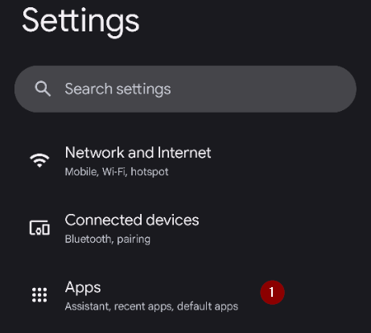

(generaltroubleshooting)=

# Depanare

**Start here when something is not working.** Troubleshooting information lives on many pages across the documentation. This page brings it together: it is a single collection of links, sorted by topic, to help you solve the most common problems.

Dacă nu găsiți răspunsul mai jos, verificați și:

* [FAQ](../UsefulLinks/FAQ.md) pentru răspunsuri la întrebările frecvente și
* the [Profile tuning guide](ProfileTuning.md) if your loop runs but your glucose control needs improving.

```{admonition} Still stuck?
:class: tip
If none of the links solve your problem, see [Where can I get help](WhereCanIGetHelp.md) to ask the community (Facebook, Discord), or send your [log files](AccessingLogFiles.md) to the developers.
```

---

(generaltroubleshooting-aaps-app)=

## Aplicația AAPS

### Construire și actualizare

* If the build fails, see [If the build fails](#building-aaps-troubleshooting): it lists the troubleshooting section for each build method:
  * [AAPS Builder](#aaps-builder-troubleshooting)
  * [Construirea în browser](#aaps-ci-troubleshooting)
  * [Android Studio](TroubleshootingAndroidStudio.md)
* Keystore pierdut sau keystore nou: [Reinstalarea AAPS](#reinstall-aaps)
* Updating **AAPS**: [with AAPS Builder](#aaps-builder-updates), [with a browser build (fork)](#update-browser-build-troubleshooting), [with Android Studio](#update-computer-build-troubleshooting)

### Instalare

* [Avertismentul Google Play Protect](#transferring-installing-play-protect-warning): aplicația este raportată ca nesigură.
* Installation **blocked** with a message about an unverified developer: see [Android developer verification](#android-developer-verification) for the free installation methods.

### Setări

* [Profil: „Rata bazală nu este compatibilă cu pompa curentă”](#your-aaps-profile-basal-not-compatible)
* [Pompă: „Datele vin de la o pompă diferită”](#config-builder-wrong-pump-data)
* [Nightscout Client](TroubleshootingNsClient.md)
* **„Setările AAPS nu pot fi citite”** la pornire: setările sunt criptate cu o cheie pe care Android o păstrează pentru **AAPS**, iar această cheie nu le mai poate deschide, de exemplu după ce depozitul de chei al telefonului a fost resetat. Cât timp este afișat acest ecran, **AAPS** nu rulează și nu controlează pompa. Apăsați **Reîncercați**: aceasta închide și repornește **AAPS**. Dacă nu ajută, reporniți telefonul. Folosiți **Începeți de la zero** numai când nimic altceva nu ajută: fișierul de setări care nu poate fi citit este pus deoparte (este redenumit și păstrat), iar **AAPS** pornește cu setări goale. Apoi importați ultimul [export al setărilor](../Maintenance/ExportImportSettings.md).

### Utilizare

* [Valori greșite ale carbohidraților (absorbție lentă a carbohidraților)](#CobCalculation-detection-of-wrong-cob-values)
* [Automatizări](#automations-troubleshooting)
* [Full closed loop](#full-closed-loop-troubleshooting)

---

(generaltroubleshooting-bluetooth-related-issues)=


## Probleme legate de Bluetooth

Pentru probleme cunoscute cu conexiunile Bluetooth, întreruperile pompei, activarea și problemele de conexiune [Depanarea Bluetooth](../GettingHelp/BluetoothTroubleshooting.md)

---

(generaltroubleshooting-android-related-issues)=

## Probleme legate de Android

### Optimizarea bateriei

**AAPS** vă poate ajuta să găsiți setările potrivite pentru telefonul dumneavoastră: deschideți **meniul** (☰) > **Despre** și apăsați **Nu-mi opriți aplicația?**. It opens the instructions for your phone brand on [Don't kill my app](https://dontkillmyapp.com/). The [setup wizard](#setup-wizard-bluetooth-battery-optimisation) also asks you to turn off battery optimization for **AAPS** and Bluetooth.

Android has implemented battery saving setting that are enabled by default. These settings automatically suspend/pause applications that are not required for the system to function to help conserve the amount of battery energy used by apps that don't always need to be running.

When this is enabled, it will very likely cause issue for **AAPS** and other supporting apps like **xDrip**.

It's important to ensure that you have disabled Battery Optimization to ensure **AAPS** and other supporting apps remain active all the time.

Depending on your phone model and make there may be more than one location and setting which needs to have this disabled.

***NOTĂ:** Urmați pașii de mai jos pentru a dezactiva optimizarea bateriei pentru serviciul Bluetooth, dacă telefonul dumneavoastră are această opțiune. Aceiași pași pot fi folosiți pentru **AAPS** și pentru alte aplicații, dar capturile de ecran arată doar cum se face acest lucru pentru serviciul Bluetooth.*

#### Telefoane Pixel (Android standard)

* Go to the Android settings, select "Apps".

  

* Select "See all apps"

  

* On the menu on the right, select "Show system" apps.

  

* Acum căutați și selectați aplicația „Bluetooth”.

  

* Click the "App battery usage" and select "Unrestricted" (called "Not optimized" on some older Android versions).

  


#### Telefoane Samsung

* Go to the android settings, select "Apps"

* On the icon that supposedly changes the sorting algorithm (1), select "Show system apps" (2).

  

  

* Now search the Bluetooth app and select it to see its settings.

  

* Select "battery".

  

* Set it to "Unrestricted" (called "Not optimized" on some older Android versions).

  

#### Telefoane Huawei

See this guide for [Huawei Bluetooth & battery optimization](../CompatiblePhones/Huawei.md)

---

(generaltroubleshooting-cgm)=

## Senzor de monitorizarea continuă a glicemiei (CGM)

Useful links to known issues and steps to resolve for CGMs.

* [General](#general-cgm-troubleshooting)
* [Dexcom G6](#DexcomG6-troubleshooting-g6)
* [Libre 2 cu Minimal Looper](#minimallooper-troubleshooting)
* [Libre 3](#libre3-experiences-and-troubleshooting)
* [xDrip - no CGM data](#xdrip-identify-receiver)
* [xDrip - depanare Dexcom](#xdrip-troubleshooting-dexcom-g5-g6-and-xdrip)

---

(generaltroubleshooting-pumps)=

## Pompe

Useful links to known issues and steps to resolve for Pumps

* [Accu-Chek Combo](#combov2-tips-for-basic-usage)
* [Accu-Chek Insight](#Accu-Chek-Insight-Pump-insight-specific-errors)
* [CareLevo](#carelevo-alarms-and-notifications)
* [DanaRS](#DanaRS-Insulin-Pump-dana-rs-specific-errors)
* [Diaconn G8](#diaconn-g8-bluetooth-troubleshooting)
* [EOPatch2](#eopatch2-alarms-and-warnings)
* [Medtronic + RileyLink](#MedtronicPump-what-to-do-if-i-loose-connection-to-rileylink-and-or-pump)
* [Medtrum Nano](#medtrum-nano-troubleshooting)
* [Omnipod DASH](#omnipod-dash-troubleshooting)
* [Omnipod Eros](#OmnipodEros-troubleshooting)

---

(generaltroubleshooting-phones)=

## Telefoane

Useful links to known issues and steps to resolve for Phones

* [List of tested phone and device setups](https://docs.google.com/spreadsheets/u/1/d/e/2PACX-1vScCNaIguEZVTVFAgpv1kXHdsHl3fs6xT6RB2Z1CeVJ561AvvqGwxMhlmSHk4J056gMCAQE02sAWJvT/pubhtml?gid=683363241&single=true)
* [Jelly](../CompatiblePhones/Jelly.md)
* [Huawei Bluetooth & battery optimization](../CompatiblePhones/Huawei.md)

---

(generaltroubleshooting-remote-control)=

## Control de la distanță

* [AAPSClient și controlul de la distanță (asociere, comenzi care nu sunt primite)](#client-master-control-troubleshooting)
* [Probleme cu „Cod de acces Nightscout”](#remotecontrol-nightscout-access-token)
* [SMS commands](#SMSCommands-troubleshooting)
* [Android Auto](#android-auto-troubleshooting)

---

(generaltroubleshooting-smartwatches)=

## Ceasuri inteligente

Useful links to known issues and steps to resolve for Smartwatches

* [Depanarea aplicației Wear](#Watchfaces-troubleshooting-the-wear-app)
* [Ceasul și telefonul nu comunică](#wear-os-watch-phone-communication)
* [Wear OS 5](#wear-os-5-troubleshooting)
* [Construirea aplicației Wear](#building-aaps-wear-os-troubleshooting)
