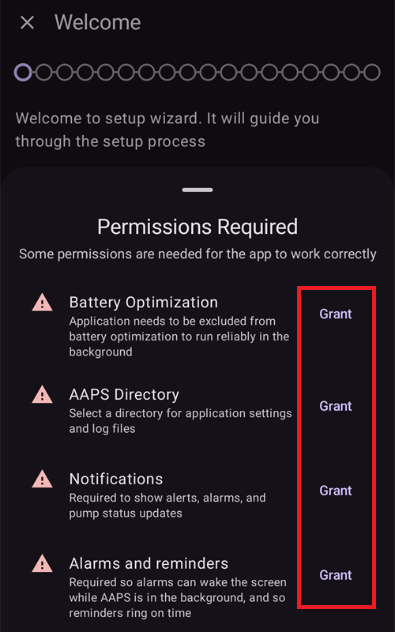
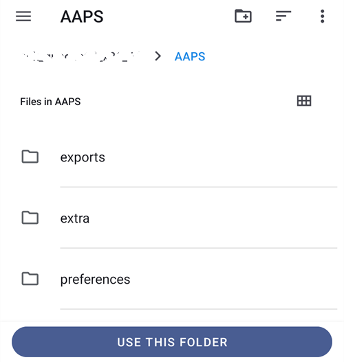
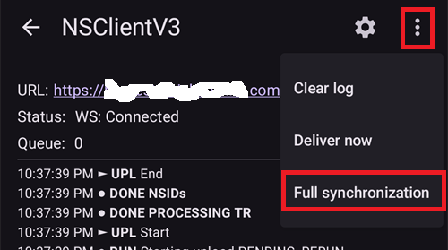

(reinstall-aaps)=
# Reinstalarea AAPS cu un keystore nou

Fiecare apk **AAPS** este semnat cu un **keystore**. An update only installs over your current **AAPS** if it is signed with the **same keystore**: all your settings and data are then kept. That's why it is recommended to store the keystore and its password in a safe place.

If you try to install an apk signed with a different keystore than before, you will get an error message explaining that the installation failed!

(reinstall-aaps-when)=
## Când trebuie să reinstalați?

You need to uninstall and reinstall **AAPS** when your new apk is signed with a different keystore, for example:

- You cannot find your old keystore or its password.
- You created a new keystore, for example with [Option 1 of the browser build](../SettingUpAaps/BrowserBuildKeystore.md) or **Create a new key** in [AAPS Builder](../SettingUpAaps/BrowserBuildAapsBuilder.md).
- You build on a new computer and did not copy your keystore to it.

If you still have your keystore, you don't need this page: reuse it and [update **AAPS**](../Maintenance/UpdateToNewVersion.md) in place.

(reinstall-aaps-before)=
## Înainte de a începe

- Uninstalling **AAPS** deletes all its settings, your [objectives](../SettingUpAaps/CompletingTheObjectives.md) and the current pump connection. Le recuperați importând **fișierul de setări**, așa că asigurați-vă că aveți unul recent.
- Fișierul de setări nu conține istoricul tratamentelor și al glicemiei. If you upload to [Nightscout](../SettingUpAaps/SettingUpTheReportingServer.md), you can load it back after the reinstall (step 8).
- Aveți nevoie de [**parola principală**](#Preferences-master-password): fișierul de setări este criptat cu ea.
- **Omnipod and Medtrum users:** read [Tubeless pumps](#ExportImportSettings-tubeless-pumps) first. Your settings file must have been exported during the pod or patch you are wearing now.
- Dacă este nevoie, [configurați receptorul sursei CGM/glicemie](../Getting-Started/CompatiblesCgms.md) înainte de a începe.

(reinstall-aaps-steps)=
## Pași

Imaginile arată trecerea de la **AAPS** 3.4 (pașii 1-3) la **AAPS** 4 (pașii 6-8). Other versions look slightly different.

(reinstall-aaps-export)=
### 1. Export your settings

Export your settings with the **AAPS** currently installed on your phone. See [Settings Export](#ExportImportSettings-Settings-Export) for details.

In **AAPS** 3.4: open **Maintenance** and tap **Export options**. Under **User Settings**, tick **Local Storage** and tap **OK**.

*Note: you can also use [Cloud Storage](#preferences-maintenance-cloud) to have a safety backup copy: that's a good idea, but keep Local Storage for recovering settings quickly.*

The button now reads **Export settings (local)**. Tap it.

**AAPS** afișează numele fișierului pe care îl va crea. Apăsați **OK**, introduceți parola principală și apăsați **OK**.

In **AAPS** 4: open **Maintenance**, select the **Local** chip next to **Export settings** and tap **Export settings**.

(reinstall-aaps-copy)=
### 2. Copy the settings file off your phone

The file is in the **preferences** folder of your [**AAPS** directory](#SetupWizard-StoragePermission), named like `2026-10-13_222735_full.json`. Copy or upload it to an external location (i.e. your computer, cloud storage service...). The file normally stays on your phone after the uninstall, but keep a copy elsewhere in case.

(reinstall-aaps-nightscout-before)=
### 3. Sincronizați cu Nightscout

This step is not mandatory but recommended if you use [DynISF](#Open-APS-features-DynamicISF): it will allow you to resume directly with the current settings instead of waiting 5 days to build necessary data for the plugin. NSClient V3 trebuie să fie [activat și configurat](../SettingUpAaps/SettingUpTheReportingServer.md).

Make sure Nightscout has all your data before you uninstall.

Deschideți **NSClient**, apăsați butonul **Sincronizare completă** din partea de jos a ecranului, apoi **OK**.

*Note: the time necessary depends on your Nightscout hosting service.*

**AAPS** then offers to clean up its database. **OK** removes data older than 3 months from the phone, which makes the synchronization much faster. **Cancel** synchronizes without cleaning up. The phone database is deleted when you uninstall anyway, so both are fine.

Leave **AAPS** running until the synchronization is finished.

(reinstall-aaps-build)=
### 4. Construiți noul apk

[Build](../SettingUpAaps/BuildingAaps.md) a new signed apk with your new keystore and transfer it to your phone.

(reinstall-aaps-uninstall)=
### 5. Dezinstalați AAPS

In your phone's **Settings** > **Apps** > **AAPS**, tap **Uninstall** and confirm with **OK**.

(reinstall-aaps-install)=
### 6. Instalați și porniți noul AAPS

[Instalați](../SettingUpAaps/TransferringAndInstallingAaps.md) noul apk și porniți **AAPS**. [Asistentul de configurare](../SettingUpAaps/SetupWizard.md) cere permisiunile de care are nevoie **AAPS**: apăsați **Acordați** pentru fiecare dintre ele. This also turns [battery optimization](#setup-wizard-bluetooth-battery-optimisation) off again.

For **AAPS Directory**, select the same **AAPS** folder as before (the one with the **preferences** folder in it), tap **Use this folder** and **Allow**.

Când **AAPS** găsește setările exportate, asistentul de configurare afișează ecranul [Setări salvate găsite](#setup-wizard-import-settings), de unde le puteți importa. Puteți și să închideți asistentul și să importați din **Mentenanță**, așa cum este descris mai jos.

(reinstall-aaps-import)=
### 7. Importați setările

Dacă fișierul de setări nu mai este pe telefon, copiați-l înapoi în dosarul **preferences** din dosarul **AAPS**.

Open the menu (☰) > **Maintenance**, select the **Local** chip next to **Import settings** and tap **Import settings**.

The list shows each file with its **AAPS** version and how old it is. Alegeți fișierul pe care l-ați exportat la pasul 1.

Nu trebuie să setați mai întâi o parolă principală în noul **AAPS**. Type the master password you used for the export in **Decryption password** and tap **Decrypt**. **File was encrypted with a different password** is expected: the new **AAPS** doesn't know your password yet. Importul o restaurează împreună cu celelalte setări.

Tick **Also replace pump settings**: without it, your pump and its settings are not restored. Omnipod and Medtrum users: only tick it if the file was exported during your current pod or patch (see [Tubeless pumps](#ExportImportSettings-tubeless-pumps)).

Apăsați **Importați**, apoi **OK** pentru a aplica setările și din nou **OK** la **Setări aplicate**.

(reinstall-aaps-nightscout-after)=
### 8. Recuperați istoricul din Nightscout

Deschideți meniul (☰) > [**Configurație**](../SettingUpAaps/ChangeAapsConfiguration.md) > **Comunicare** și apăsați **Deschideți modulul** sub **NSClientV3**. Verificați că starea arată **Conectat**. If it doesn't, see [Troubleshooting NSClient](TroubleshootingNsClient.md).

Apăsați butonul **Sincronizare completă** din partea de jos a ecranului și **OK**. The database is new, so you can answer the cleanup question either way.

**AAPS** loads your data from Nightscout. The log shows **Full sync finished** when it is done.

(reinstall-aaps-check)=
### 9. Check and keep looping

Check that your pump is connected and your CGM values arrive, then keep on looping.

(reinstall-aaps-afterwards)=
## După aceea

Always keep using your new keystore from now on, and store it with its password somewhere safe, off your phone. See [Creating back-ups](../Maintenance/ExportImportSettings.md).
