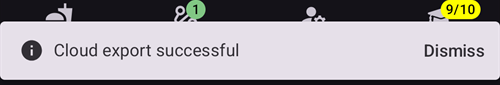

# Crearea și restaurarea copiilor de rezervă

Când instalați AAPS pe telefon, acesta devine un „dispozitiv medical” pe care vă bazați zilnic. It is highly recommended to have an emergency backup plan for when your phone gets defective, stolen or lost. Therefore, it is essential to prepare by asking yourself: "What if?"

To restore your AAPS setup to an existing or new phone, it's important to keep following items in a secure location (read: not on your phone). Best practice is to keep at least two separate backups: on a local hard drive, USB stick and (preferred) on Cloud storage like Google Drive or Microsoft 365 OneDrive. By storing your backups in the cloud you'll always have everything needed accessible from your phone to restore your setup anywhere and anytime.

Consider acquiring a secondary backup phone and practicing restoring AAPS to ensure the backup phone works as expected. This step will give you confidence that your emergency plan is effective and that you can seamlessly continue using AAPS if your primary phone becomes unavailable.

```{admonition} Android backups and phone-transfer tools do not carry your AAPS settings
:class: warning
Since **AAPS** 4.0 the settings are kept in an encrypted store on the phone, and they are left out of the Google backup and of the phone-to-phone transfer of a new phone. A settings export, as described on this page, is the only way to carry them over.
```

To be able to restore, having the following items at hand is important:

- Your **Android Studio keystore file** and associated **password**: Needed for (re)building the AAPS .APK installer file.
- O copie recentă a **fișierului de instalare AAPS .APK**
- A recent **settings export** file: For restoring important settings (which includes your objectives!).
- **Parola principală AAPS**
- Copii de rezervă ale utilitarelor suplimentare: de exemplu BYODA și/sau xDrip.
- Notițe personale despre configurația dumneavoastră.

Below are the items that are recommended for keeping back-ups.

## Crearea copiilor de rezervă

### Keystore file from the computer you used to build the APK
When building your .APK installer file from Android Studio, it uses the **keystore file and password to sign the .APK installer file**. To update your current AAPS installation, it is required to sign the update .APK installer file with the same keystore used for the initial installation. When updating, all settings and the AAPS database will be kept. Note that without this, you are required to first uninstall the current application and then [reinstall](#reinstall-aaps) and reconfigure AAPS.

Maintaining the keystore and associated password will greatly reduce the complexity of updating the APK in the future, especially if you need to build the app from a new computer. See the [Updating AAPS](../Maintenance/UpdateToNewVersion.md) section for details on using the keystore when building a new APK.

**When to back-up:** The keystore should be backed up after you first build the **AAPS** .APK installer file.

**How to back-up:** Locate your keystore path. If you don’t remember it you can find it in Android Studio by selecting **Build > APK > Next**. Calea va fi afișată în „Key store path”. Using your file explorer, navigate to this path and make a copy of your keystore file (ending in file extension `.jks`). Save it to a safe cloud location should your computer become unavailable. Make sure to also record your key store password, key alias and key password.

### Copii ale celui mai recent APK
In case your main **AAPS** phone is lost or damaged, having a copy of the APK available will allow you to quickly resume using **AAPS** with a new phone. Note: you will also need your preferences backed up as noted below.

**When to back-up:** You should maintain a back-up of the most recent APK that you installed on your main **AAPS** phone. You may want to also maintain one earlier version in case you need to roll back to that for any reason.

**How to back-up:** Maintain a copy on the computer used to build the APK with Android Studio. Additionally, it is recommended to use a cloud platform to store a copy of the installer APK. Make sure you know how to locate both backups when needed. Consider setting up dedicated folders to store these backups.

### Fișierul de setări AAPS (numit și „Preferințe”)

```{admonition} Where are preferences stored on my phone?
:class: tip
You will find your settings in the **AAPS Directory** you have selected during [AAPS setup](#SetupWizard-StoragePermission).</br>
You can also change the **AAPS directory** on the **Maintenance** screen (**menu** (☰) > **Maintenance**), see [Setting the local AAPS directory](#preferences-maintenance-logdirectory).
```

With a copy of the APK installer file (see above) and your **Settings** file, you can quickly get up and running on an existing or new phone.

The **Settings** file is used to customize the AAPS application to fit your specific setup. They encompass details such as your **Configuration** settings, objective status, third-party communication settings (e.g., Nightscout, Tidepool), automations, and profiles.

Exporting the AAPS settings to file enables you to restore its configuration to a specific point in time. As mentioned, in addition to all configuration settings, the export file also contains the status of your objectives, which you need to restore when **(re)installing** AAPS. Without this you will be required to redo all objectives from start to enable closed loop. Settings files also enable you to restore "last known good" settings for undoing any configuration changes.

**Când să faceți copia de rezervă a setărilor AAPS:**
* Each time you complete an objective to prevent losing your progress. _Without a copy of your **Settings** you will have to complete all objectives again in the event you need to re-install AAPS or replace your phone._

* Any time you plan to make significant changes to your configuration (change SMB settings, change insulin types, change pump, make changes to automations) you should back up your **Settings** before and after making the changes. This way you have your most recent settings as well as a copy of what they were before the changes in case you need to revert back to them.

* Tubeless pumps (Such as Omnipod and Medtrum) users only: the **Settings** file contains connection details on your current pod and can be used to restore connection to that pod with a new phone. If you do not have a copy of your preferences exported after you started your current pod you will need to start a new pod in the event you need to replace your current phone.

**How to back-up manually:**

1. Dacă exportați sau importați **Setările** pentru prima dată, trebuie să setați o parolă principală în [Setări > Protecție](#Preferences-master-password). Setați o parolă și notați-o într-un loc sigur. _Fără această parolă nu veți putea accesa copiile de rezervă ale **Setărilor**._

2. From the **AAPS** main screen, open the **menu** (☰) > **Maintenance**. Choose where to save the file with the **Local** and **Cloud** chips next to **Export settings** (see **Exporting or Importing Settings** below), then tap **Export settings**. **AAPS** shows where the file will go: the file name for **Local**, **Google Drive** for **Cloud**. Apăsați **OK**.

   

   

   Introduceți parola principală setată mai sus și apăsați **OK**.

   

   **Settings exported** (local) or **Cloud export successful** (cloud) confirms the export.

   

   

3. Using the file explorer on your phone (commonly called “Files” or “My Files”) navigate to Internal Storage > AAPS > preferences. Aici veți vedea o copie a tuturor fișierelor de preferințe exportate. Numele fișierului ar trebui să fie `YYYY-MM-DD_Time_appname.json`. Upload this file to the cloud platform of your choice. Then from the cloud platform, also download a copy to your local computer.

(ExportImportSettings-Settings-Export)=

## Settings Export

```{admonition} Where are preferences stored on my phone?
:class: tip
You will find your settings in the **AAPS Directory** you have selected during [AAPS setup](#SetupWizard-StoragePermission).</br>
You can also change the **AAPS directory** on the **Maintenance** screen (**menu** (☰) > **Maintenance**), see [Setting the local AAPS directory](#preferences-maintenance-logdirectory).
```

It is recommended to do regular settings exports, especially before and after making configuration changes. You can choose to do exports **manually or (preferred) through automation**. Make sure to take a note of your AAPS master password and to backup your settings files by copying them off your phone to for instance a cloud storage location.

**Nota**: _Setările exportate vor fi criptate cu parola principală AAPS: fără parola principală utilizată pentru exportul nu veți putea importa fișierul de setări!_

If you forgot your master password, you can [reset it](#FAQ-reset-master-password), but settings files exported with the old password still need the old one.

### Exporting or Importing Settings
Pentru a exporta sau importa setările, deschideți **meniul** (☰) și selectați **Mentenanță**. Under **File management**, the **Local** and **Cloud** chips next to **Export settings** and **Import settings** choose where the settings file is saved to or read from: **Local** is the AAPS directory on your phone, **Cloud** is available once a [Cloud Directory](#preferences-maintenance-cloud) is set up. Tapping a chip turns it on or off; at least one always stays selected, and both rows share the same choice. Then tap **Export settings** or **Import settings** itself to start.


(ExportImportSettings-Automating-Settings-Export)=
### Automating Settings Export

Pentru a automatiza exporturile setărilor [(**vedeți Automatizare**)](../DailyLifeWithAaps/Automations.md#automating-preference-settings-export), deschideți [**Setări** > **Mentenanță**](#preferences-maintenance-settings), extindeți **Exportare nesupravegheată a setărilor** și activați **Activați exportarea automată a setărilor**.

You can now configure [Automation](../DailyLifeWithAaps/Automations.md#automating-preference-settings-export) to export settings, either on a regular basis (_i.e._ each week), or after a pod change.

_**Note:** On importing settings, the user always needs to enter the AAPS master password!_


(ExportImportSettings-restoring-from-your-backups-on-a-new-phone-or-fresh-installation-of-aaps)=
## Restaurarea din copiile de rezervă pe un telefon nou sau la o instalare nouă a AAPS

```{admonition} Where are preferences stored on my phone?
:class: tip
You will find your settings in the **AAPS Directory** you have selected during [AAPS setup](#SetupWizard-StoragePermission).</br>
You can also change the **AAPS directory** on the **Maintenance** screen (**menu** (☰) > **Maintenance**), see [Setting the local AAPS directory](#preferences-maintenance-logdirectory).</br>
If **AAPS** loses access to that directory (this can happen after a reinstall or after clearing the app's storage), it shows an **Access to the AAPS directory was lost** notification and stops saving settings to the phone until you [select the directory again](#preferences-maintenance-logdirectory).
```

Use these instructions if you have a back-up of your APK and **Settings** that you want to load on to a new phone or if you needed to delete and reinstall the APK on your existing phone for any reason.

_If you are updating **AAPS** using an APK built with the same keystore you should not need to follow this process. However, it is still advised to create a back-up before you apply the update._

If you are updating **AAPS** after you lost or replaced your original keystore (i.e. using a new build computer without transferring the keystore), ensure that you back up all settings per the above and then uninstall the existing version of **AAPS** on your phone. See [Reinstalling AAPS with a new keystore](#reinstall-aaps) for the full procedure.

Dacă este nevoie, [configurați receptorul sursei CGM/glicemie](../Getting-Started/CompatiblesCgms.md) înainte de pașii de mai jos

(ExportImportSettings-tubeless-pumps)=
```{admonition} Tubeless pumps (Omnipod and Medtrum) users
:class: warning
The **Preferences** file contains the session of the pod or patch that was active when you exported it.
- **Exportați imediat după fiecare activare a unei pompe (pod) sau a unui plasture** și copiați fișierul de pe telefon.
- **Same phone, pod still running:** leave **Also replace pump settings** unticked. Your current pod is kept and only the other settings are imported.
- **New phone taking over the pod:** tick **Also replace pump settings**, and only use a file exported during the pod you are wearing now. A file from an earlier pod replaces your current pod session, and you will need to start a new pod.
- **An old pod session was imported by mistake:** **AAPS** keeps trying to reach that pod and you cannot activate a new one. Deactivate it; if that fails, discard it (see for example [Discarding a pod](#omnipod-dash-discard-pod) for Omnipod DASH).
```

```{admonition} Pump settings are kept unless you say otherwise
:class: note
By default, an import leaves your pump settings alone: the pump selected in **Configuration**, its pairing and all its other settings stay as they are on this phone. Tick **Also replace pump settings** on the import screen only when you restore onto a new phone that should take over the same pump. Settings that are not in the file are never deleted by an import.
```

1. Using the back-up copy of your APK from above, follow the instructions for a [new installation](../SettingUpAaps/TransferringAndInstallingAaps.md)

2. Launch **AAPS** and allow any requested permissions

3. Exit the Setup Wizard. Vom importa toate setările necesare din copia de rezervă a **Setărilor**

4. From the **AAPS** main screen press **Grant** and allow all permissions listed in the **Permissions Required** panel on the top

5. From the **AAPS** main screen, set the master password in [Settings > Protection](#Preferences-master-password) to the same password as you used with your back-ups.

6. If you haven't done it yet, [set the **AAPS directory**](#preferences-maintenance-logdirectory): from the **AAPS** main screen, open the **menu** (☰) > **Maintenance** > **AAPS directory**.

7. From the **AAPS** main screen, open the **menu** (☰) > **Maintenance** > **Export settings** > type in the master password set above > **OK**. This will create the preferences folder if it does not already exist on your phone.

8. Download the back-up of your **Preferences** file from your cloud platform.

9. Use your file explorer (commonly called “Files” or “My Files”) to move the file from your downloads to `/internal storage/AAPS/preferences` if your **AAPS Directory** has been set `/internal storage/AAPS`

10. From the **AAPS** main screen, open the **menu** (☰) > **Maintenance** and tap **Import settings**. Select the preferences file you want to restore from (the newest is at the top). Make sure you select the correct preferences file, all .json files from the preferences folder (or from the cloud directory, with **Cloud**) will be shown.

    

    **AAPS** afișează detaliile fișierului. Introduceți parola principală setată mai sus și apăsați **Decriptați & Revizuiți**.

11. După ce fișierul este decriptat, decideți ce faceți cu setările pompei. On a new phone that takes over the same pump, tick **Also replace pump settings** so the pairing and the pump settings come from the file. Leave the box unticked to keep the pump this phone is already paired with. Apoi apăsați **Importați**.

    

12. **AAPS** asks **Apply imported settings?** and tells you how many settings will change and, if you left the box unticked, how many pump settings are kept. Nothing has been written yet, so **Cancel** leaves your phone exactly as it was. Apăsați **OK** pentru a aplica.

    

13. **AAPS** applies the imported settings straight away, without restarting. Sunt repornite doar modulele ale căror setări s-au schimbat. While this runs, **AAPS** shows **Applying settings…**; if the pump is busy, it shows **Waiting for pump…** and applies the settings once the pump is idle. If the pump is still busy after one minute, **AAPS** offers to try again. A **Settings applied** message confirms that the imported settings are in use. Any treatment you had queued while the import ran is dropped and **AAPS** tells you that it was cancelled, so nothing is sent to the pump twice.

    

If the file selected a pump that this version of **AAPS** does not have, **AAPS** falls back to the **Virtual Pump** and tells you so. Selectați din nou pompa în **Configurație** și verificați setările ei.

14. Tubeless pumps (Omnipod and Medtrum) users only - if you ticked **Also replace pump settings** and your **Preferences** were not backed up from the same pod you are currently using, you will need to start a new pod to begin insulin delivery.

**Troubleshooting:** if you are unable to get an active profile set from the **AAPS** main screen, open the **menu** (☰) in the top left > **Configuration** > **Pump** > switch to **Virtual Pump** > then switch back to your pump type

### Notă pentru utilizatorii Dana RS

- If you ticked **Also replace pump settings**, the pump connection settings are imported too: **AAPS** on your new phone will already "know" the pump and therefore not start a Bluetooth scan.
- Vă rugăm să conectați manual noul telefon și pompa.