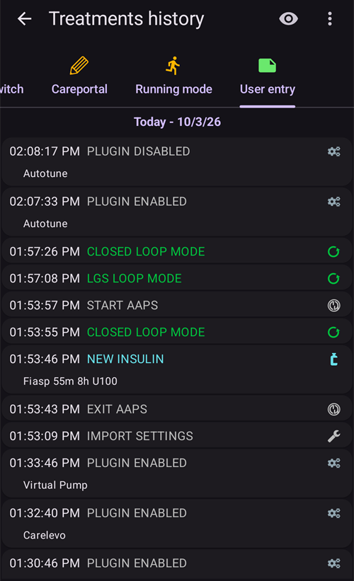

# Reviewing your data

## AAPS History Browser

**AAPS** keeps all your history (**BG**, treatments, basal, targets, **Profile Switch**, …) in a local database on the phone. This database is not part of the [settings export](../Maintenance/ExportImportSettings.md). You can review it in **AAPS** itself with the **History browser** and the **Statistics** screen described below. For long-term reviews and reports, upload your data to [Nightscout](../SettingUpAaps/Nightscout.md) or [Tidepool](../SettingUpAaps/Tidepool.md).

**AAPS** history can be reviewed in the **History browser**: open the **menu** (☰) and select **History browser**.

- Tap the **date card** to pick the day you want to review.
- The graphs open zoomed out to show the **whole selected day**. Pinch to zoom in on part of it.
- Folosiți săgețile **<** și **>** pentru a merge o zi înapoi sau înainte și **Acum** pentru a reveni la ziua curentă.
- Graficele arată aceleași date ca graficele de pe ecranul principal (glicemie, tratamente, bazală, IOB, COB, activitate, deviații...).

(reviewing-statistics)=
## AAPS Statistics

**AAPS** oferă statistici de bază pentru monitorizare.

Majoritatea valorilor se bazează pe [recomandările](https://diabetesjournals.org/care/article/46/Supplement_1/S97/148053/6-Glycemic-Targets-Standards-of-Care-in-Diabetes) ADA 2023.

Pentru a le deschide, deschideți **meniul** (☰) și selectați **Statistici**.

Ecranul **Statistici** are patru file: **Insulină**, **Timp în interval**, **Glicemie** și **Ciclu**. Tap a tab, or swipe left or right to move between them.

(reviewing-tdd)=
### Insulin tab: Total Daily Dose

The **Total Daily Dose** card shows one line per day for the previous days (up to one week) for which **AAPS** has insulin data, then their **Average**, then **Today** so far. Imediat după instalarea **AAPS**, este afișat doar **Astăzi**. Coloanele sunt:

- **Bazală**: doar bazala.
- **Bolus**: the sum of bolus treatments and SMBs.
- **TDD Total**: the Total Daily Dose of insulin (**TDD**), the sum of bolus and basal insulin delivered during the day.
- **Carbs**: declared carbs and eCarbs treatments.

The **TDD** section is calculated when you open the page and takes a few seconds to compute. Apăsați **Recalculați** pentru a o calcula din nou.

The **TDD** is your bolus plus basal insulin per day. Some doctors use - especially for new pumpers - a basal-bolus ratio of 50:50: the total base basal (**TBB**, the sum of your basal rates over 24 hours) should then be about half of the TDD. Alții preferă o TBB de 32 % până la 37 % din DZT.

Like most rules of thumb, this is of limited real validity. Diabetul dumneavoastră poate fi diferit!

### Fila Timp în interval

Time In Range (**TIR**): 70-180 mg/dL or 3.9-10 mmol/L.

**TIR** information is available for 7 and 30 days, depending on the amount of data available within the **AAPS** database.

Time In Tight Range (TITR) 70-140 mg/dL or 3.9-7.8 mmol/L statistics are available below (the screen shows this range as 70-141).

**Discuss targets with your endo**

Diabetul dumneavoastră poate fi diferit. Any suggested targets should be discussed with your endocrinologist or supporting medical team. Folosite corect, statisticile AAPS pot fi un instrument eficient pentru a urmări tendințele __glicemiei__ și progresul.

Below, the **Dexcom TIR** card shows detailed 14 days **TIR** statistics.

**SD**: Standard Deviation, an [indicator](https://www.ncbi.nlm.nih.gov/pmc/articles/PMC3125941/) of BG variability (the highest = the worst).

HbA1c: estimarea hemoglobinei glicate rezultate, pe baza mediei măsurătorilor CGM. This is an indicative value that might not match blood HbA1c tests.

(reviewing-statistics-agp)=
### Glucose tab: Ambulatory Glucose Profile (AGP)

The **Ambulatory Glucose Profile** (**AGP**) shows how your glucose usually moves over the day. Choose the period with the buttons at the top: **Today**, **24h**, **7d**, **30d** or **90d**.

- **The chart**: one day from midnight to midnight. The line is the **Median** (half of your readings at that hour were lower, half were higher). Around it, one band holds the middle half of your readings (**25–75%**) and a wider band most of them (**10–90%**). A narrow band means your glucose is similar from day to day at that hour. Dashed lines mark your **LOW mark**, 140 mg/dL (7.8 mmol/L) and your **HIGH mark**.
- **Glycemic overview**: the time spent in your range, in the tight range (70–140 mg/dL or 3.9–7.8 mmol/L), above your range and below it, then your **Average** and **Median** glucose. Your range is the **LOW mark** and **HIGH mark** set in [Range for visualization](#Preferences-range-for-visualization).
- **eA1c** and **GMI**: two estimates of HbA1c calculated from your CGM readings. Like the HbA1c above, they might not match your blood HbA1c tests.
- **SD** (standard deviation) and **CV** (coefficient of variation): how much your glucose varies. O valoare mai mică înseamnă o glicemie mai stabilă.
- **Zile**: câte zile de date CGM au fost folosite.

 

Below the AGP, the **Glucose Pentagon (CGP)** card draws five measures of your last 14 days of glucose as a pentagon. Un pentagon mai mic înseamnă un control mai bun al glicemiei.

### Cycle tab: TDD Cycle Pattern

**TDD Cycle Pattern** overlays your daily insulin totals in 28-day cycles, to help you spot recurring patterns. Fiecare ciclu este desenat ca o linie (**Cicluri individuale**), împreună cu media lor.

- **Raw TDD** / **Cleaned TDD**: choose the total daily dose as delivered, or the TDD minus insulin for carbs.
- **Cycle offset**: moves the start of the cycle (0 to 27 days).

At least 56 days of data (2 cycles) are needed. Cu mai puține date, cardul afișează **Date insuficiente (necesită cel puțin 56 de zile pentru 2 cicluri)**. The pattern is calculated only when you open the **Cycle** tab, because it reads 168 days of data.

(aaps-screens-treatments)=
## Istoricul tratamentelor

Deschideți **meniul** (☰) din colțul din stânga sus al ecranului principal și selectați **Istoricul tratamentelor**. In this view, you can view and alter the history of the following treatments, each on its own tab (swipe the tab row to see all of them):

* Carbohidrați și bolusuri
* [Bolus extins](#Extended-Carbs-extended-bolus-and-switch-to-open-loop-dana-and-insight-pump-only)
* Bazală temporară
* [Țintă temporară](../DailyLifeWithAaps/TempTargets.md)
* [Schimbare de profil](../DailyLifeWithAaps/ProfileSwitch-ProfilePercentage.md)
* Careportal: notes and careportal entries
* Mod de funcționare: istoricul stării buclei
* User entry: other notes that are not sent to Nightscout

At the end of each line, small icons show where the data comes from or has been sent to:
* **Nightscout** icon (the Nightscout logo): the data comes from or has been recorded to Nightscout
* **Pump** icon: the data comes from the pump history (it has been processed by the pump)
* **Trash can** icon: the entry has been deleted (it is shown only when you display deleted entries with the **eye** icon at the top right)

(screens-bolus-carbs)=
### Carbohidrați și bolusuri

On this tab you can view the bolus and carbs log. Each bolus (line **1**) shows the remaining associated IOB next to the insulin amount. Originea bolusului poate fi:
* Masă (introdusă manual prin butoanele Insulină, Asistent Rapid sau Asistent bolusare)
* SMB, when using the SMB Functionality

The carbs entries (line **2**) are shown with their amount in grams.

If you have used the [Bolus Wizard](#aaps-screens-bolus-wizard) to calculate insulin dosage, you can press the “Calc” text on the bolus line to show the details of how the bolus was calculated.

În funcție de pompa folosită, insulina și carbohidrații pot fi afișați pe un singur rând sau pe mai multe rânduri: unul pentru detaliile calculului, unul pentru carbohidrați și unul pentru bolusul propriu-zis.

The Treatments history can be used to correct faulty carb entries (_i.e._ you over- or underestimated carbs). Note that it is not possible to edit an existing entry, you need to follow the following process:

1. Check and remember actual COB and IOB on the main screen.
2. Depending on pump, carbs might be shown together with insulin in one line or as a separate entry (i.e. with Dana RS).
3. Remove the entry with the faulty carb amount: press the trashcan icon, select the lines to remove, and then press the trashcan icon again to finalize.
4. Make sure carbs are removed successfully by checking COB on the main screen again.
5. Do the same for IOB if there is just one line including carbs and insulin.

   → If carbs are not removed as intended, and you add additional carbs as explained here (6.), COB will be too high and that might lead to too high insulin delivery.

6. Enter the correct carb amount again (**Treatments → Carbs** in the bottom navigation, or a [QuickLaunch](#quicklaunch) **Carbs** button) and make sure to set the correct event time.
7. If there is just one line including carbs and insulin you have to add also the amount of insulin. Make sure to set the correct event time and check IOB on the main screen after confirming the new entry.

### Bazală temporară

The **temp basals** applied by the loop are shown here. When there is still an impact on the IOB for an entry, the information is shown next to the rate (line **1**). It can be:
* Positive IOB if the temp basal was higher than the one set in the Profile
* Negative IOB for a zero-temp (as on line **1**) or if the temp basal was lower than the one set in the Profile

Ștergerea înregistrărilor afectează doar rapoartele dumneavoastră din Nightscout și probabil va denatura IOB-ul real - nu este recomandată.

În stânga unui rând, un S roșu înseamnă „Suspendare”: apare când bazala nu este administrată în acel moment. This is a normal situation when in the process of changing a pod, for example.

### Țintă temporară

The history of temporary targets can be seen here.

### Schimbare de profil

The history of profile switches can be seen here. You may see multiple entries each time you switch profile : line **1**, stored both in NS and Pump History, corresponds to the actual switch. Line **2**, stored in Nightscout but not in Pump History, corresponds to the request of a profile switch made by the user.

Ștergerea înregistrărilor afectează doar rapoartele dumneavoastră din Nightscout și nu va schimba niciodată profilul curent.

You can use the **Clone** button shown on line **2** to make a copy of a **Profile Switch**. See [Your AAPS Profile > Manage your profiles](#your-aaps-profile-clone-profile-switch) for more information.

### Careportal

This tab shows all notes and careportal entries recorded in Nightscout.

(AapsScreens-running-mode)= (aaps-screens-running-mode)=
### Mod de funcționare

Această filă arată istoricul schimbărilor de [stare a buclei](#AapsScreens-loop-status): deschisă, închisă, LGS, suspendată, deconectată.

### Înregistrare utilizator

Această filă listează acțiunile făcute în **AAPS** de utilizator sau de o **Automatizare** (schimbări ale modului buclei, schimbări de profil, tratamente, exporturi de setări...). Aceste înregistrări nu sunt trimise la Nightscout.

------

## Care este diferența dintre Nightscout și Tidepool?

Nightscout can facilitate the user’s storage of **AAPS’** data and offers a wide range of [reporting tools](https://nightscout.github.io/nightscout/reports/).

Whereas, Tidepool allows the user to [review their data](https://www.tidepool.org/viewing-your-data) and provides [simple sharing with your endo team](https://www.tidepool.org/providers/how-it-works#tidepool-data-platform).