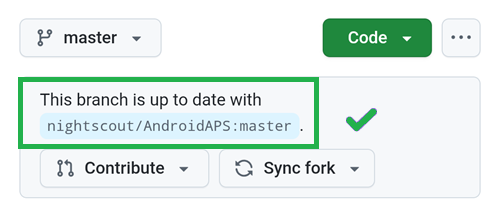
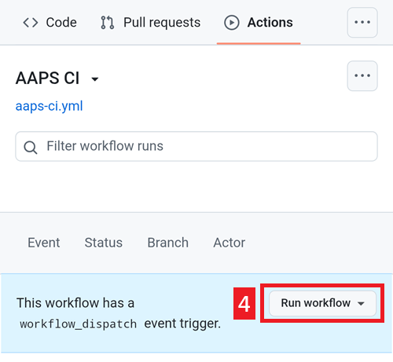

# Update with a browser (fork)

```{tip}
Ați construit AAPS cu **AAPS Builder**? You don't need this page: see [Updating AAPS with AAPS Builder](#aaps-builder-updates).
```

## Construiți aplicația, nu o descărcați

**AAPS** is not available to download, due to regulations concerning medical devices. It is legal to build the app for your own use, but you must not give a copy to others! See [FAQ page](../UsefulLinks/FAQ.md) for details.

```{note}
In case you want to upgrade **AAPS** with a browser for the first time: copy your back-up keystore file to your Google Drive. Then follow the [Browser Build **AAPS** procedure](../SettingUpAaps/BrowserBuild.md) instead of this guide. Instead of creating a new keystore, you must select the one you have copied from your computer.
This operation will be mandatory only the first time, then for successive upgrades you will be able to follow this guide.
```

```{tip}
**Switching to AAPS Builder?** [AAPS Builder](../SettingUpAaps/BrowserBuildAapsBuilder.md) is the simpler browser build: no fork to sync, and you download the app directly from GitHub. You don't have to switch: this guide keeps working. If you switch, first get a copy of your keystore from your fork, as explained in [Coming from the previous browser build](#aaps-builder-from-fork). Otherwise the new build cannot update the AAPS on your phone.
```

## Overview for updating to a new version of AAPS with a browser

```{contents} Steps for updating to a new version of AAPS
:depth: 1
:local: true
```

In case you experience problems, see separate page for [browser build troubleshooting](../GettingHelp/BrowserBuildTroubleshooting.md).

### Export your settings

Export your settings from the existing **AAPS** version on your phone. You might not need it, but better be safe than sorry.

See the [Export & import settings](ExportImportSettings.md) page if you don't remember how to do this.

(Update-to-new-version-update-your-repo)=
### Update your GitHub repository

[Log into GitHub](https://github.com/login).

1. Selectați Repositories.
2. Scroll down and select your own AndroidAPS repository.


3. Verificați că folosiți propria copie a AndroidAPS (Forked from nightscout/AndroidAPS)
4. Tap Sync Fork to update it (the number of commits behind might differ from the picture)


5. Tap Update Branch


Notă: dacă ați modificat din greșeală copia dumneavoastră a AndroidAPS, veți vedea acest ecran. Discard all changes (commits) to return to the released version.


You have now synchronized (updated) your own copy with the latest release of **AAPS**. Foarte bine.



### Rulați fluxul de lucru pentru a construi APK-ul semnat

1. In your GitHub copy of AndroidAPS, select Actions.
2. Extindeți All Workflows.
3. Selectați AAPS-CI


4. Scroll down and tap Run Workflow.



5. Lăsați ramura setată pe master. În **Select AAPS Version**, verificați că este selectată **4.0.0**, cea mai nouă versiune, din partea de sus a listei. Dacă fork-ul dumneavoastră nu este actualizat, versiunea preselectată este una mai veche: dacă rulați fluxul de lucru cu formularul așa cum se deschide, construiți din nou acea versiune veche și aplicația nu este actualizată. Choose the [variant](#browserbuild-variant) (fullRelease), and then tap Run workflow.

   ```{note}
   Lista de versiuni face parte din fluxul de lucru din fork-ul dumneavoastră. Dacă **4.0.0** lipsește, fork-ul dumneavoastră nu este încă sincronizat: reveniți la [Actualizați depozitul GitHub](#Update-to-new-version-update-your-repo).
   ```


6. Veți vedea mesajul Workflow run was successfully requested. Refresh your browser page and you will be able to monitor the build progress. Când acțiunea se termină, acțiunea AAPS CI va afișa o bifă verde. Ați construit cu succes versiunea actualizată a **AAPS**. This means that the Master and Wear apk is now directly saved into your Google Drive (as per below). AAPSClient apk can be downloaded from Github > nightscout > AndroidAPS [here](https://github.com/nightscout/AndroidAPS/releases)


### Instalați APK-ul AAPS

1. Deschideți Google Drive
2. Browse into AAPS, select the new version folder and you will find both the phone and Android Wear versions.


```{note}
From September 2026, Google's [Android developer verification](#android-developer-verification) may block installing the APK by tapping the file, depending on your country. Free workarounds are explained on that page.
```

Continuați [aici](#Update-to-new-version-check-aaps-version-on-phone)

(update-browser-build-troubleshooting)=

## Depanare

Dacă ceva nu merge bine, nu intrați în panică.

Respirați adânc!

Then check if your problem is already documented: see [AAPS Builder troubleshooting](#aaps-builder-troubleshooting) if you build with **AAPS Builder**, or [Browser build troubleshooting](#aaps-ci-troubleshooting) otherwise.

If you need further help, please reach out to other **AAPS** users on [Facebook](https://www.facebook.com/groups/AndroidAPSUsers) or [Discord](https://discord.gg/4fQUWHZ4Mw).
