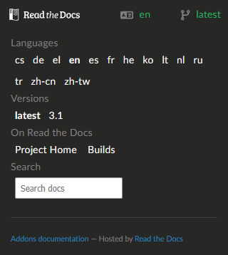

# Change language and version

The documentation you are currently reading is available in several languages and is specific to a given version of **AAPS**. Both the language and the version can be changed from the menu at the bottom right of the screen.

```{note}
Click on the bar at the bottom right of the screen to open the language and version selection menu.
```



## Schimbați limba

In the menu, select the language you want to read the documentation in.

Feel welcome to join [Crowdin](https://crowdin.com/project/androidapsdocs) translators and proofreaders to help translate the documentation into your language.

## Schimbați versiunea

Versiunea curentă este afișată în dreapta jos a ecranului. To switch to a different version, click on the current version and select the version you need.

```{warning}
Atunci când schimbați limba și/sau versiunea, este posibil să primiți 404 - Pagina nu a fost găsită, în cazul în care pagina cu limba sau versiunea nu există. Acest lucru se va întâmpla frecvent la schimbarea versiunii, dar nu ar trebui să se întâmple atunci când se schimbă limba: pagina va apărea în limba engleză, dacă nu este încă tradusă.
```
