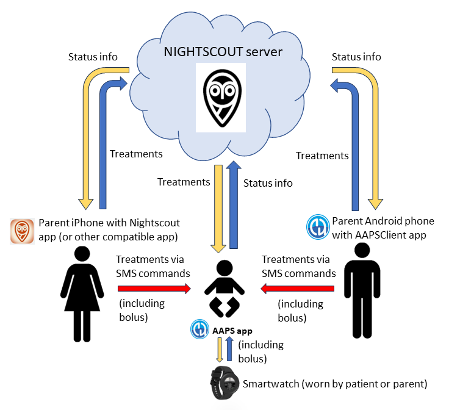
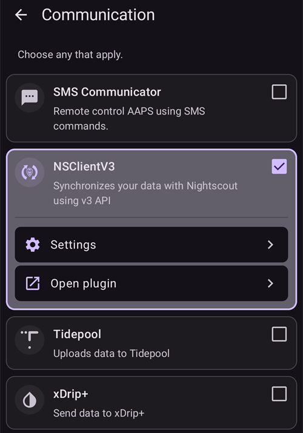
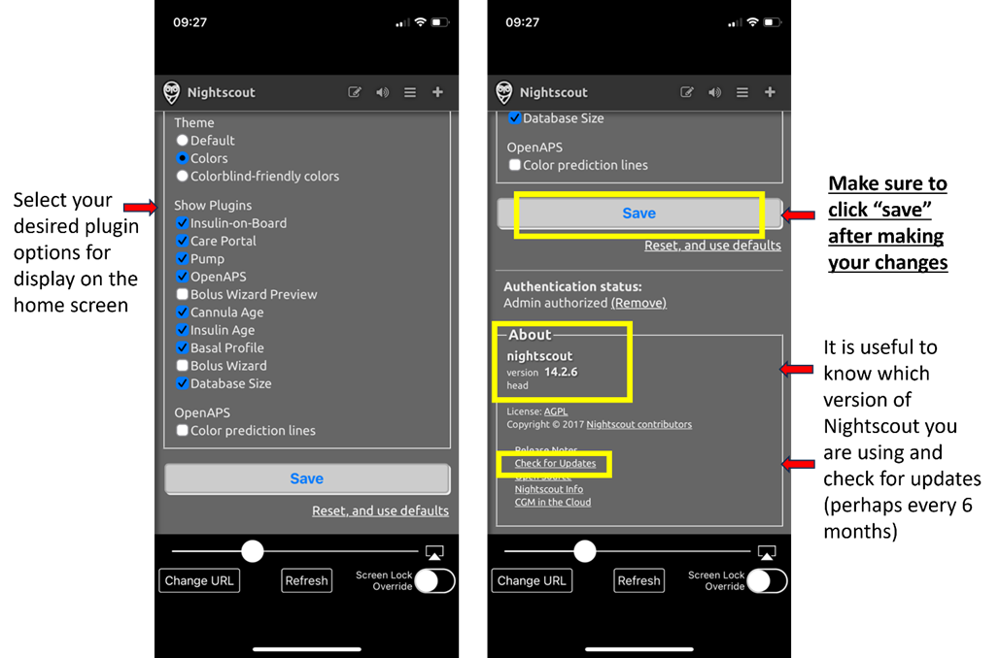

# Remote control of AAPS

```{contents} In this page
:backlinks: entry
:depth: 2
```

There are four highly effective tools for remotely managing **AAPS**:

1) [SMS commands](#RemoteControl_SMS-Commands) (follower phone can be either Android or iOS), 2) [AAPSClient](#RemoteControl_aapsclient) (follower device is an Android phone or tablet, or a Windows, Mac or Linux computer; on an iPhone you [build the app yourself](#aapsclient-iphone)) 3) [Nightscout](#RemoteControl_nightscout) (Android, iOS or other computer/device), mainly for following: see the note on [client control](#client-master-control) in that section.  
4) [Smartwatches](#RemoteControl_smartwatches) (Android)

The first three are mostly appropriate for caregivers/parents, but smartwatches are very useful for caregivers/parents **and** for adults with diabetes themselves.



(RemoteControl_SMS-Commands)=

## 1) SMS Commands

See the dedicated [SMS Commands](../RemoteFeatures/SMSCommands.md) page.

(RemoteControl_aapsclient)=
## 2) AAPSClient

**AAPSClient** looks very similar in appearance to **AAPS** itself, offering the caregiver the same screens and buttons to send commands remotely to **AAPS**:


(remotecontrol-aapsclient-versions)=
### Despre AAPSClient, AAPSClient2 și AAPSClient3

Există 3 versiuni ale aplicației client: **AAPSClient**, **AAPSClient2** și **AAPSClient3**. They work the same way. Singura diferență este că pot fi instalate una lângă alta pe același telefon de urmărire.

Un îngrijitor care urmărește o singură persoană are nevoie doar de **AAPSClient**. To follow and remote control a second person (with their own **Nightscout** site and their own **AAPS** phone), install **AAPSClient2** as well, and **AAPSClient3** for a third person. Each app is set up and [paired](#aapsclient-pairing-with-the-master) on its own, with the **Nightscout** site and the **AAPS** phone of the person it follows.

To tell the apps apart, some elements have a different color: yellow for **AAPSClient**, blue for **AAPSClient2** and green for **AAPSClient3**. Aceste elemente sunt pictograma aplicației, fundalul widgetului și secțiunea de stare **AAPS** de pe ecranul principal al aplicației. <br/> Notă: opacitatea fundalului widgetului poate fi setată în configurarea widgetului. At a low opacity the color is hard to see.


### Descărcare și instalare

**AAPSClient** can be installed on a single phone or multiple follower phones (i.e. parent 1’s follower phone and parent 2’s follower phone) in order for both caregivers to be granted access and remote control a patient's **AAPS** phone.

Pentru a descărca **AAPSClient**, mergeți la [depozitul GitHub](https://github.com/nightscout/AndroidAPS/releases/) și apăsați pe fișierul **„app-AAPSClient-release_x.x.x.x”** (poate fi o versiune mai nouă decât cea din captura de ecran de mai jos):


Then go to  _downloads_ on your computer. On Windows, _downloads_ will show in the right hand ribbon:


Once downloaded, click _show in folder_ to locate the file.

Fișierul apk **AAPSClient** poate fi acum:

Transferat printr-un cablu USB pe telefonul de tip urmăritor; sau a fost adăugat în folderul Google, apoi adăugat pe telefonul urmăritorului, prin apăsarea pe fișierul "app-AAPSClient-releasse".

Should you be needing **AAPS** for yourself, and **AAPSClient** for monitoring someone else, you will need to build **AAPSClient** yourself instead of downloading it from the GitHub repository as described above. The reason is that you can't install both **AAPS** and **AAPSClient** on the same phone, signed by a different key. <br/> To build **AAPSClient** yourself, follow the same process as [regular AAPS build](../SettingUpAaps/BuildingAaps.md). Pe pagina **Generate signed App Bundle or APK**, selectați **aapsclientRelease** în loc de **fullRelease**.

Aceeași regulă se aplică atunci când instalați mai multe aplicații client (**AAPSClient**, **AAPSClient2**, **AAPSClient3**) pe un telefon de urmărire: toate trebuie semnate cu **aceeași cheie**. Otherwise Android refuses to install the second one (error `INSTALL_FAILED_DUPLICATE_PERMISSION`).

### Sincronizare: configurarea AAPSClient și AAPS

Once the __AAPSClient__ apk is installed on the follower phone, make sure **NSClientV3** is set up the same way on both phones for Nightscout 15 (see the [update notes](../Maintenance/UpdateToNewVersion.md)). Exemplul de mai jos arată configurarea sincronizării cu NSClientV3 și Nightscout 15; în __AAPS__ sunt disponibile și alte surse de date (de ex. xDrip).

In **Configuration** > **Communication**, the user synchronizes their data with Nightscout through __NSClientV3__ (using the v3 API), set up the same way for both __AAPS__ and the follower phone.



The user must ensure that __both__ the AAPS and AAPS Client phones are synched together by setting up NSClientV3 on each. On the follower phone this can be done by scanning a QR code shown by **AAPS** instead, see [Pairing AAPSClient with AAPS](#remotecontrol-pairing) below:

- Introduceți **Adresa Nightscout** în **Setările** NSClientV3

- Introduceți **Codul de acces Nightscout** în aceleași setări. Please follow the notes [here](https://nightscout.github.io/nightscout/security/#create-a-token). On the **AAPS** phone use an **admin token**: with it **AAPS** makes a token of its own for each follower phone.

- Enable **Use websockets** on **both** phones. Websockets are **mandatory** for remote control from **AAPSClient**, on both phones. Without them, **AAPSClient** can follow **AAPS** but cannot control it. On both phones they also make synchronization faster, at the cost of slightly higher battery use.

  Your Nightscout host must support websockets. If the websocket connection keeps dropping, remote control does not work. See [Troubleshooting NSClient](../GettingHelp/TroubleshootingNsClient.md).


The user should ensure that both __AAPSClient__ and __AAPS__ are showing  ‘connected’ in the **NSClientV3** screen of each phone. At this point **AAPSClient** follows **AAPS** (BG, treatments, profile), but it cannot control it yet: pair the two phones as described below.

(remotecontrol-pairing)=
### Asocierea AAPSClient cu AAPS (control de la distanță)

Începând cu **AAPS** versiunea 4, **AAPSClient** controlează **AAPS** printr-o conexiune sigură, **asociată**. Synchronization alone is not enough: until the phones are paired, **AAPSClient** only shows **Manage** with a view-only **Profile** and **Pair with master**.

1. On the **AAPS** phone, open **Manage → Authorized clients** and turn on **Allow client control** (it is off by default, and always on in Simple Mode).
2. Tap **+**, enter a name for the follower phone, choose how it is set up and choose its **role**:
   - **QR code: Nightscout and pairing** — **AAPS** shows a QR code that sets up Nightscout on the follower phone and pairs it, in one scan. This needs an admin token in the **AAPS** phone's NSClientV3 settings.
   - **PIN** — for a follower phone without a camera, already connected to Nightscout: note the one-time **PIN** (valid for about two minutes).
3. On the **AAPSClient** phone, scan the code (in the Setup Wizard, or **Manage → Pair with master → Scan QR code**), or open **Manage → Pair with master** and enter the PIN. Confirmați.

Telefonul de urmărire apare apoi ca **Activ** în lista **Clienți autorizați**, iar **AAPSClient** afișează **Tratamente**, **Scenarii** și **Gestionați**. The follower phone gets a Nightscout token of its own, with only the rights it needs. Procedura completă, cu capturi de ecran și depanare, se află la [Controlul dispozitiv principal ↔ client](#client_master_master_setup).

Check that the set-up works: enter carbs on **AAPSClient**, confirm the amount shown, and check that the entry appears in **Treatments** on both phones.

(remotecontrol-nightscout-access-token)=

### Depanarea problemelor de configurare a „Codului de acces Nightscout”

The precise 'Nightscout access token' configuration may differ depending upon whether your Nightscout provider is a paid for hosted site or not.

If you are struggling with **AAPS** to accept the 'Nightscout access token' and using a paid for hosted Nightscout site, you may wish to first liaise with your Nightscout provider on how to resolve the 'Nightscout access token' difficulties. Otherwise, please reach out to the **AAPS** group but please double check that you have correctly followed the notes before doing so [here](https://nightscout.github.io/nightscout/security/#create-a-token).

### Ce oferă AAPSClient

Once paired, **AAPSClient** offers the caregiver almost the same screens as **AAPS** itself:

- **Tratamente**: bolus de insulină, carbohidrați și asistentul de bolusare.
- **Scenarii**: pornirea și oprirea [scenariilor](../DailyLifeWithAaps/Scenes.md).
- **Manage**: profiles, insulin settings, temporary targets, QuickWizard, automation, food, site rotation, pairing and the running temp basal.
- **Main menu**: treatments history, history browser, statistics, maintenance, configuration.

There is no pump and no objectives on **AAPSClient**. See [The AAPSClient app](AapsClient.md) for a detailed description.

**AAPSClient** lets the caregiver make most of the adjustments allowed directly in **AAPS**, **including insulin boluses**, remotely over the mobile or internet network. Every command is signed and sent through Nightscout to the **AAPS** phone, which checks it against its own data, caps it, shows you its own confirmation, and only then executes it. **AAPSClient** _can_ be much faster than [SMS Commands](../RemoteFeatures/SMSCommands.md), especially for commands that would need authentication.

Treatments entered in Nightscout by other means (for example the Nightscout website) are not applied while client control is on: **AAPS** is then in [hardened mode](#client-master-control-hardened-mode) and takes changes only from paired clients. With client control off, they are applied only if the matching **Receive** options are enabled in the [Synchronization section of NSClient preferences](#Preferences-nsclient-synchronization).

Remote control through **AAPSClient** is only recommended if your synchronization is working well (_i.e._ you don’t see unwanted data changes like self-modification of TT, TBR etc).

### AAPSClient cu opțiuni pentru ceas inteligent

A smartwatch can be a very useful tool for helping to manage **AAPS** with kids. Sunt posibile câteva configurații diferite. Dacă **AAPSClient** este instalat pe telefonul îngrijitorului, aplicația [**AAPSClient WearOS**](https://github.com/nightscout/AndroidAPS/releases/) poate fi descărcată și instalată pe un ceas inteligent compatibil, conectat la telefonul părintelui. This will show current BG and loop status. Once **AAPSClient** is paired with **AAPS**, the watch actions (including boluses, carbs, temp targets and profile changes) are relayed through **AAPSClient** to **AAPS**, which confirms and executes them: see [Wear OS on a client](#clientmastercontrol-wear-os-on-a-client). Puteți citi mai multe despre ceasurile inteligente [aici](#remotecontrol-smartwatches).

(RemoteControl_nightscout)=
## 3) Nightscout

As well as Nightscout being a server in “the Cloud”, there is also a dedicated **Nightscout** app which can be downloaded directly from the App Store on your iPhone. Dacă aveți un telefon de urmărire Android, nu există o aplicație Nightscout dedicată și este mai bine să folosiți [**AAPSClient**](#RemoteControl_aapsclient) sau, dacă doriți doar să urmăriți și nu să trimiteți tratamente, puteți descărca și instala aplicația [Nightwatch](https://play.google.com/store/apps/details?id=se.cornixit.nightwatch) din Play Store.

Once you have installed the **Nightscout** app on your iPhone, open the app and follow the set-up prompts, entering your Nightscout address (see below, left). The form of this may vary depending on how your Nightscout is hosted. (_de ex._ http://youraddresshere.herokuapp.com). Then enter your Nightscout API secret (see below, right). Dacă nu vi se cere parola API, trebuie să o introduceți apăsând pe lacătul din partea de sus a aplicației:


More info on setup is available directly from [Nightscout](https://nightscout.github.io/nightscout/discover/)

When you first log in, you will have a very simple display. Customize the display options, by selecting the “hamburger” in the top right and scrolling down:


Scroll down through to “Settings”. You may wish to change the “scale” to “linear” as the default for the BG display is logarithmic, and under “render basal” select “default” so that the pump basal shows up.


Selectați opțiunile dorite. Debifați alarmele dacă folosiți o altă aplicație pentru alarme.


Continue to scroll down until you get to “show plugins”.

You need to make sure “careportal” is checked, and can also select various other metrics (most useful are: IOB, care portal, pump, cannula age, insulin age, basal profile and OpenAPS).

Importantly, you now need to click “save” at the bottom for these changes to take effect.



După ce apăsați „save”, aplicația revine la ecranul principal Nightscout, care va arăta cam așa:

1. Valoarea curentă a glicemiei
2. Information on AAPS system status - touch the individual tabs on the screen to display more detail. Add or remove these display options using hamburger menu.
3. Graficul recent al glicemiei, cu tratamentele (carbohidrați, bolusuri) afișate
4. Longer-term glucose trace
5. "Hamburger" menu for setting display options, generating reports, editing profiles and Nightscout admin tools
6. "**+**" menu for entering treatments (see [below](#RemoteControl_nightscout-treatments) for when **AAPS** applies them).
7. Select different time period to display
8. Basal insulin profile
9. Linia verde = valoarea istorică a glicemiei Linii albastre = glicemia prognozată


Looking in more detail at the top left menu of the Nightscout app:

1. Careportal retrospective edit
2. Turn on/off alarms
3. Hamburger - pentru setarea preferințelor
4. Careportal - Log treatment (see [below](#RemoteControl_nightscout-treatments) for when **AAPS** applies these)


There is a huge amount of information on the status of the **AAPS** system in the grey tabs (and even more information is revealed if you tap the tab) on this screen:

1. Tendința glicemiei pe 5 minute
2. Bolus wizard preview
3. Apăsați pe Basal pentru a vedea profilul curent și informațiile despre bazală
4. Time since latest CGM reading in AAPS
5. **Pump**: insulin, battery % and when AAPS last connected to it
6. Last time AAPS refreshed - if this is longer than 5 mins it can indicate a connection issue between AAPS phone and pump/CGM
7. Press on IOB to see split of basal and bolus insulin
8. Vechimea insulinei din rezervor
9. Vechime canulă
10. Battery status of AAPS phone
11. Size of your database. If it gets too full (DIY Nightscout only - hosted services just ignore) you may start having connectivity issues. You can delete data to reduce the size of the number in the Admin tools menu (via hamburger).


Press "refresh" at the bottom of the page to close the popup.

(RemoteControl_nightscout-treatments)=
### Sending treatments through the Nightscout app to AAPS

În **AAPS** 4, modul acceptat de a controla **AAPS** de la distanță este un **AAPSClient asociat**, vedeți [Controlul dispozitiv principal ↔ client](#client-master-control): fiecare client are un [rol](#client-master-control-roles) care limitează ce poate face, iar fiecare comandă este semnată de client, apoi verificată și confirmată de telefonul cu **AAPS**. While client control is on, the **AAPS** phone is in [hardened mode](#client-master-control-hardened-mode): treatments, temporary targets and profile switches entered on the Nightscout website or in the Nightscout app are **not** applied. Aplicația Nightscout este atunci doar un instrument de urmărire.

```{admonition} Only when client control is off
:class: warning
If **Allow client control** is off in **Manage → Authorized clients** (and Simple Mode is off), **AAPS** applies careportal entries from Nightscout only for the data types you turned on under **Receive** in the [Synchronization section of the NSClientV3 settings](#Preferences-nsclient-synchronization): carbs, temporary targets, profile switches and the other careportal entries. Insulin is never delivered this way: a "Correction bolus" entered in Nightscout is only *announced*, and **AAPS** counts it as insulin on board without delivering it. Această configurare nu este recomandată pentru controlul de la distanță; folosiți în schimb un **AAPSClient** asociat.
```

Citiți mai multe despre opțiunile **Nightscout** [aici](https://nightscout.github.io/)

### Sfaturi pentru a folosi cât mai bine aplicația Nightscout

1). If you get “stuck” on a page and want to be able to see the main screen again, just click “refresh” (bottom middle) and this will take you back to the **Nightscout** homepage with the BG graph.

To see the current profile which is running on the phone, press the various icons on the screen above the graph. More info (current carb ratio, sensitivity and timezone etc.) can be seen by pressing “basal” and “OpenAPS” gives info about the profile and current target etc. Both the phone battery% and the pump battery % can also be monitored. BWP oferă informații despre ce crede algoritmul că se va întâmpla în viitor, pe baza IOB și COB.

#### Other icons in the menu: what does the pencil (edit) mean?

You can (technically) use the edit pencil to move or delete bolus or correction treatments from the last 48h.

More about this [here](https://nightscout.github.io/nightscout/discover/#edit-mode-edit)

Although this could potentially be useful for deleting announced (but not bolused for) carbs, in practice it doesn’t currently work well with **AAPS** and we recommend making changes like this via the **AAPS** app directly.

(RemoteControl_smartwatches)= (remotecontrol-smartwatches)=

## 4) Ceasuri inteligente

### Opțiunea 1) Controlul AAPS de pe un ceas Wear OS


Once you have [setup **AAPS** on your watch](../WearOS/BuildingAapsWearOS.md), extensive details about the smartwatch faces and their functions can be found in [Operation of Wear AAPS on a Smartwatch](../WearOS/WearOsSmartwatch.md).

As a brief overview, the following functions can be triggered from the smartwatch:

* setarea unei ținte temporare

* use the bolus calculator (calculation variables can be defined in settings on the phone)

* administrare carbohidrați extinși

* administrarea unui bolus (insulină + carbohidrați)

* setări ceas

* stare

* verificarea stării pompei

* verificarea stării buclei

* verificare și modificare profil, CPP (Profil Circadian procentual = decalaj timp + procentaj)

* afișați DZT (Doza zilnică totală = bolus + bazală pe zi)

* Remote bolus where the caregiver and T1D child are in different locations (this is possible for the **AAPS** watch and **AAPS** phone providing both devices are connected to the network)

#### Communication from caregivers to the watch using other apps (like WhatsApp)

It is possible to add additional apps to the watch, like WhatsApp, for messaging (for example) between caregivers and kids. It is important only to have ONE Google account associated with the phone, or the watch will not bring this data across. You need to be 13 or older to have a Samsung account, and this needs to be set up in the same email address which is used on the Android phone.

A video explaining getting WhatsApp setup for messaging on the Galaxy 4 watch (you can’t get full functionality of WhatsApp) is shown [here](https://gorilla-fitnesswatches.com/how-to-get-whatsapp-on-galaxy-watch-4/)

Making adjustments in both the **Galaxy wearable** app on the **AAPS** phone and the watch makes it possible for WhatsApp messages to announce with a slight vibration, and also for the WhatsApp message to display over the existing watchface.

### Opțiunea 2) **AAPS** pe ceas, pentru controlul de la distanță al **AAPS** de pe un telefon

Similarly to using a follower phone with **AAPSClient** or SMS commands (see the sections above), a smartwatch can be used to remotely control **AAPS** and provide full profile data. A key difference to using a follower phone is that the smartwatch to **AAPS** phone link is via Bluetooth and needs neither Nightscout nor an authentication code. As a side-note, if both smartwatch and **AAPS** phone linked by Bluetooth are also on a Wi-Fi/Cellular data network, the watch will also interact with the **AAPS** phone, giving a longer range of communication. This includes remote delivery of a bolus where the caregiver with the **AAPS** watch and T1D child (with **AAPS** phone) are in different locations, which can be useful in circumstances where the T1D child is in school.

A remote control smartwatch is therefore often useful in any situation where:

a)  **AAPSClient** or **SMS** commands cannot work; or

b)  The user wishes to avoid typing an authentication code (as required for SMS commands).

Un ceas inteligent are nevoie de **Wear OS 3 sau mai nou** pentru a putea controla **AAPS**. Please check the technical specifications of the watch, and see the [Smartwatches page](../Getting-Started/Watches.md). Search, or ask in the **AAPS** Facebook/Discord groups if unsure.

Specific How-to guides for setting up **AAPS** on the popular Samsung Galaxy Watch 4 (40mm) are given below. Ceasul [Garmin](https://apps.garmin.com/en-US/apps/a2eebcac-d18a-4227-a143-cd333cf89b55?fbclid=IwAR0k3w3oes-OHgFdPO-cGCuTSIpqFJejHG-klBTm_rmyEJo6gdArw8Nl4Zc#0) este, de asemenea, o alegere populară. If you have experience of setting up a different smartwatch which you think would be useful to others, please add it into these pages [edit the documentation](../SupportingAaps/HowToEditTheDocs.md) to share your findings with the wider **AAPS** community.

### Opțiunea 3) AAPSClient pe un ceas, pentru controlul de la distanță al **AAPS** de pe un telefon


Programul pentru ceas, fișierul apk **AAPSClient** Wear, poate fi descărcat direct de pe [GitHub](https://github.com/nightscout/AndroidAPS/releases/).

To download the software, click on the watch app that matches the client app on the phone: **wear-aapsclient-release_**_version_ goes with **AAPSClient**, **wear-aapsclient2-release_**_version_ goes with **AAPSClient2** (see [About AAPSClient, AAPSClient2 and AAPSClient3](#remotecontrol-aapsclient-versions)):


Then "save as" and save the file to a convenient location on your computer:


The **AAPSClient** wear apk can be transferred to your phone and side-loaded onto the watch in the same way as the **AAPS** Wear app, as detailed in [Transferring the Wear app onto your AAPS phone](#remote-control-transferring-the-aaps-wear-app-onto-your-aaps-phone)  


