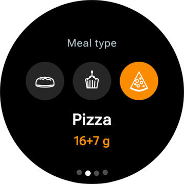
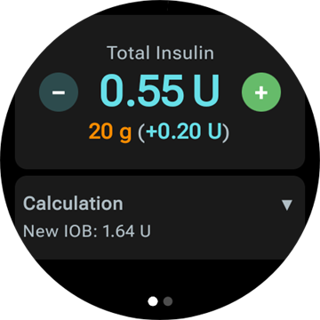
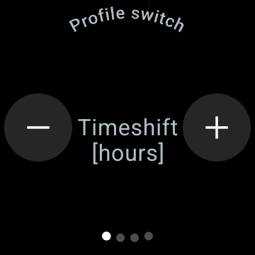
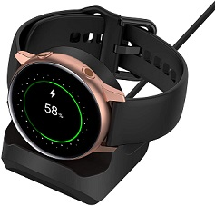

# Operarea AAPS prin intermediul ceasului inteligent Wear OS

(Watchfaces-aaps-watchfaces)=

## Cadrane AAPS

```{warning}
The classic **AAPS** watchfaces run on Wear OS 5 and older only, and Wear OS 5 already limits them. On **Wear OS 6 and newer** the watch app installs one watchface in Google's Watch Face Format instead: your custom watchface as a picture, or the **Complications watchface**. See [Wear OS watch face changes](#wearos-watchface-changes) for what breaks on each Wear OS version, and [the watchface AAPS installs](#wearos-aaps-v4-watchface) for Wear OS 6.
```

On Wear OS 5 and older, several classic watchfaces are built into the **AAPS** watch app. They show the glucose value with delta, IOB, the active basal rate and a graph of the readings. Pe ele funcționează două atingeri:

* Double-tap the glucose value to open the **AAPS** main menu
* Double-tap the graph to change its time range

On every Wear OS version, the [complications](#Watchfaces-complications) and the [tiles](#WearOsSmartwatch-wear-os-tiles) described on this page work with any watchface that has room for them.

## Configurare

Activați **Ceas** în [**Configurație** > **Comunicare**](#Config-Builder-wear).

To bolus or take other actions from the watch, turn on **Wear control**. Opțiunile asistentului de bolusare pentru ceas se setează în același loc: consultați [Setări > Ceas](#preferences-wear). While **Wear control** is off, the phone refuses every treatment or mode change sent from the watch, and the watch shows *"Wear control is turned off in the Wear settings on the phone."*

With **Open plugin** on the **Wear** card you open the Wear screen:


Primul rând afișează numele ceasului conectat sau **(Niciun ceas conectat)**. Din acest ecran puteți

* Retrimiteți toate datele. Ar putea fi de ajutor dacă ceasul nu a fost conectat de ceva timp, și doriți să transmiteți informația către ceas.
* Deschideți setările pe ceas direct de pe telefon.
* Choose which watchface **AAPS** installs on the watch (**Watchface installed on watch**: your custom watchface, or the complications watchface). This card is only shown while a **Wear OS 6** or newer watch is connected. Consultați [cadranul instalat de AAPS](#wearos-aaps-v4-watchface).
* Manage the **Custom Watchface** (the card is shown while a watch is connected): **Load Watchface** sends a custom watchface to the watch, **Infos Watchface** lists the details of the loaded watchface and the fields it contains, **More watchfaces** opens the [exchange site](../ExchangeSiteCustomWatchfaces/index.md) in your browser, and **Export template** saves a template you can edit. Sub butoane este afișată o previzualizare a cadranului încărcat. Consultați [Trecerea la un cadran AAPS](#WearOS_changing-to-AAPS-watchface).

Asigurați-vă că notificările de la AAPS nu sunt blocate pe ceas. Confirmarea unei acțiuni (spre exemplu bolus, țintă temporară) vine printr-o notificare pe care va trebui să o glisați și să o bifați.

## Accesarea meniului principal al AAPS


To open the main menu of **AAPS**, use one of these:

* deschideți **AAPS** din lista de aplicații a ceasului
* tap an **AAPS** complication that opens the menu, see [Complication related settings](#WearOsSmartwatch-complication-settings)
* tap the **BG Graph** tile with its **Tap action** set to **Main Menu**, see [Tile settings](#WearOsSmartwatch-wear-os-tiles)
* on a classic **AAPS** watchface, double-tap the glucose value

(WearOsSmartwatch-loop-status)=

## Ecranul Stare buclă

The **Loop Status** screen gives a summary of what the loop is doing, without taking out your phone. Open it from the AAPS main menu (**Loop status**, or **Status → Loop**), or by tapping the **Blood Glucose** complication. The **Status** menu also has a **Pump** page and a **TDD** page with the total daily doses.


Ecranul este o listă de carduri. Derulați în jos pentru a le vedea pe toate:

* **Running mode** — the current mode (closed loop, open loop, LGS, suspended, disconnected…) and, for a temporary mode, how long it still runs.
* **Loop result** — when the loop last ran, and the temporary basal or SMB it requested.
* **Scene** — only while a [scene](#scenes-from-watch) is active: its name, the time left (or **Until ended** for a scene without end time) and the **Follow-up** scene that starts when it ends.
* **Targets** — your target, and the temporary target if one is running.
* **Profile** — the name of the active profile, with its **Percentage** and **Timeshift** when they are not the default values. A temporary profile switch is highlighted and shows how long it still runs and the profile it **Returns to** when it ends.
* **Sensitivity** — the same lines as the sensitivity chip on the phone's main screen: the autosens value and the profile, variable and effective ISF.

A small scene icon next to a running mode, a temporary target or a profile switch means it was **set by the active scene**. The same icon is shown in the **Running mode** picker.


(WearOsSmartwatch-bolus-calculator)=

## The bolus calculator on the watch

Deschideți **Calculator** din meniul principal **AAPS**, din [panoul Acțiuni](#WearOsSmartwatch-wear-os-tiles) sau dintr-o complicație setată să deschidă asistentul. It walks through a few pages, swipe from right to left to go on:

| CH                                                                       | Solicitare                                                               | Rezultat                                                              | Calcul                                                                             | Confirmați                                                          |
| ------------------------------------------------------------------------ | ------------------------------------------------------------------------ | --------------------------------------------------------------------- | ---------------------------------------------------------------------------------- | ------------------------------------------------------------------- |
|  |  |  |  |  |

1. **Carbohidrați**: introduceți carbohidrații cu butoanele **+10**, **+5**, **−** și **+**.
2. **Solicitare**: ultima pagină înainte ca telefonul să preia controlul. It shows what you entered: the carbs, and the meal type, carb time and percentage when you use them, see [Optional pages](#WearOsSmartwatch-calculator-optional-pages). Tap the check mark to send it to the phone, which runs the calculation.
3. **Result**: the bolus **AAPS** proposes, with the carbs under it: the carbs now and the eCarbs later, the carb time and the bell of the eat reminder. Adjust the dose with **−** and **+**, see below. Scroll down for the **Calculation** card: tap it to see every line of the calculation, the same as on the phone.
4. **Confirm**: swipe to the second page and tap the check mark. Telefonul administrează bolusul și înregistrează carbohidrații.

(WearOsSmartwatch-calculator-optional-pages)=

### Pagini opționale

Trei setări ale ceasului adaugă fiecare câte o pagină după **Carbohidrați**. They are off by default. Open the **AAPS** main menu, then **Settings** > **Interface**, and turn on the ones you want; when more than one is on, the pages come in the order **Meal type**, **Carb time**, **Percentage**. Punctele din partea de jos a calculatorului arată câte pagini are.

| Setări                                                                                  | Tip masă                                                                 | Timp carbohidrați                                                                 | Procentaj                                                                  |
| --------------------------------------------------------------------------------------- | ------------------------------------------------------------------------ | --------------------------------------------------------------------------------- | -------------------------------------------------------------------------- |
|  |  |  |  |

* **Calculator Meal Type**: **Bread**, **Cake** or **Pizza**, which splits the carbs of a slow meal into carbs now and eCarbs later, see [Choosing the meal type](#WearOsSmartwatch-wizard-meal-type).
* **Calculator timp carbohidrați**: minutele până când mâncați, cu un clopoțel **Setați alarma** pentru mementoul de masă, consultați [Timpul carbohidraților și mementoul de masă](#WearOsSmartwatch-wizard-carb-time).
* **Calculator Procentaj**: un procentaj din bolusul calculat, de exemplu 70 % când doriți o doză mai mică. It starts at the **Bolus percentage** of the phone's [Bolus wizard settings](#Preferences-deliver-this-part-of-bolus-wizard-result), 100 % unless you changed it. Consultați și nota de la [Ajustarea bolusului pe pagina de rezultat](#WearOsSmartwatch-wizard-result).

(WearOsSmartwatch-wizard-result)=

### Ajustarea bolusului pe pagina de rezultat

Pagina de rezultat afișează bolusul propus de **AAPS**, împreună cu un buton **−** și un buton **+**. Use them to adjust the dose before you confirm it, without going back to the phone.

| Propus                                                                        | Mai mult                                                                            | Mai puțin                                                                              |
| ----------------------------------------------------------------------------- | ----------------------------------------------------------------------------------- | -------------------------------------------------------------------------------------- |
|  |  |  |

* Each press changes the bolus by **one step of your pump**, so the amounts offered always match what your pump can actually deliver.
* **Press and hold** a button to keep changing the value. The longer you hold, the faster it goes.
* You cannot go below **0 U**, nor above your **max bolus** setting.

Totalul curent este afișat pe pagina de rezultat, astfel încât vedeți mereu cantitatea pe care urmează să o confirmați. Modificarea este afișată după carbohidrați, de exemplu *(+0,20 U)*, iar butonul folosit devine verde pentru mai mult sau roșu pentru mai puțin.

If **AAPS** had to limit the dose, for example because the calculated bolus is above your **max bolus** setting, a warning line in amber below the total says so (for example *"Bolus constraint applied"*). The same applies to a limited carbs amount.

```{admonition} This is not the same as Calculator Percentage :class: note The **Calculator Percentage** setting lets you enter a *percentage* of the calculated bolus **before** the result page appears. Butoanele **−** și **+** ajustează *cantitatea finală* **pe** pagina de rezultat. Le puteți folosi pe amândouă.

    <br />(WearOsSmartwatch-wizard-meal-type)=
    
    ### Choosing the meal type
    
    The watch calculator can split the carbs of a slow meal into carbs now and eCarbs later, like the [carbs type](#AapsScreens-carbs-type) of the phone wizard. Activați **Calculator tip masă** în **Setări** > **Interfață** de pe ceas. The setting is off by default, and then the **Meal type** page is skipped.
    
    * După ce introduceți carbohidrații, o pagină **Tip masă** afișează trei pictograme: **Pâine**, **Prăjitură** și **Pizza**. Tap an icon: its name and the carbs it gives show below the icons, for example *65 g* for bread, or *52+22 g* for pizza (52 g now and 22 g of eCarbs later). **Bread** is the default and keeps all the carbs now.
    * Paginile de solicitare și de confirmare afișează carbohidrații în același mod (*52+22 g*). The result page also shows when the eCarbs start and how long they last.
    * The bolus is calculated only for the carbs eaten now. Împărțirea folosește aceleași valori ca asistentul de pe telefon.
    
    (WearOsSmartwatch-wizard-carb-time)=
    
    ### Carb time and the eat reminder
    
    With **Calculator Carb Time** turned on in the watch's **Settings** > **Interface**, a **Carb time** page follows the carbs: the minutes until you eat, like the [carb time](#aaps-screens-bolus-wizard) of the phone wizard. **Now** is the default. **−** and **+** move it in steps of 5 minutes, up to an hour before or after now. A time in the past is for carbs you have eaten already.
    
    With a time in the future, a **Set alarm** bell appears under the value. It is on by default, tap it to turn it off. Paginile de solicitare și de rezultat afișează timpul carbohidraților, de exemplu *+30 min*, și clopoțelul. The phone records the carbs at that time, moves the eCarbs of the meal type with it, and starts its **time to eat** reminder.
    
    | Result | BG graph | Running | Time to eat |
    | --- | --- | --- | --- |
    |  |  |  |  |
    
    The reminder also lives on the watch, so it rings when the phone is out of reach too:
    
    * The **BG Graph** screen, the **BG Graph** tile and the graph of the **Complications watchface** draw a dashed orange line where the reminder rings, with the minutes left next to it.
    * While it runs, a silent **Time to eat** notification with **Stop** and **+5 min** sits in the notification stream. It comes back when you swipe it away, until the reminder is over.
    * When the time has come, the watch vibrates, and again every half minute for five minutes until you answer. The notification offers **Silence** and **+5 min**, and swiping it away silences it too.
    
    **Stop**, **Silence** and **+5 min** do the same on the watch, on the phone and on an **AAPSClient**, and all of them show the same reminder.
    
    (Watchfaces-complications)=
    
    ## Complications
    
    _Complication_ is a term from traditional watchmaking, where it describes addition to the main watchface - as another small window or sub-dial (with date, day of the week, moon phase, etc.). Wear OS 2.0 permite diverșilor furnizori de date, cum ar fi aplicația de vremea, notificările, contoarele de fitness și multe altele - să fie adăugate la orice față de ceas care acceptă complicații.
    
    AAPS Wear OS app supports complications since build `2.6`, and allow any third party watchface that supports complications to be configured to display AAPS related data (BG with the trend, IOB, COB, etc.).
    
    Complicațiile servesc și ca **scurtătură** către funcțiile AAPS. Prin apăsarea pe ele puteți deschide meniurile și dialogurile legate de AAPS (în funcție de tipul de complicație și configurație).
    
    
    
    ### Complication Types
    
    AAPS Wear OS app provides only raw data, according to predefined formats. Depinde de dezvoltatorul terț al feței de ceas să decidă unde și cum să afișeze complicațiile, inclusiv modul de prezentare, margine, culoare și font. From many Wear OS complication types available, AAPS uses:
    
    * `SHORT TEXT` - Contains two lines of text, 7 characters each, sometimes referred to as value and label. De obicei, redat în interiorul unui cadran sau a unei mici buline - unul sub altul, sau lateral unul de altul. Este o complicație foarte limitată ca spațiu. AAPS încearcă să înlăture caracterele care nu sunt necesare pentru a se încadra: prin rotunjirea valorilor, înlăturarea zerourilor de la începutul și sfârșitul valorilor, șamd.
    * `LONG TEXT` - Contains two lines of text, about 20 characters each. De obicei, redat în interiorul unui dreptunghi sau al unui cadran lung - unul sub altul. Este folosit pentru mai multe detalii și stare textuală.
    * `RANGED VALUE` - Folosit pentru valori dintr-un interval predefinit, cum ar fi un procentaj. Conține o pictogramă și o etichetă și este de obicei afișată ca un indicator circular de progres.
    * `LARGE IMAGE` - Custom background image that can be used (when supported by watchface) as background.
    * `SMALL IMAGE` / `MONOCHROMATIC IMAGE` - O pictogramă mică. In a `SMALL IMAGE` slot AAPS draws it in its own colour; in a `MONOCHROMATIC IMAGE` slot the watchface tints it.
    
    ### Complication Setup
    
    To add complication to watchface, configure it by long press and clicking the gear icon below. În funcție de modul specific în care se configurează o față de ceas - fie apăsați pe înlocuitori fie intrați in meniul de configurare al fețelor de ceas pentru complicații. Complicațiile AAPS sunt grupate în meniul AAPS.
    
    Când configurați complicații pe ceas, Wear OS va prezenta și va filtra lista de complicații care se pot potrivi în locul selectat pe ceas. Dacă anumite complicații nu pot fi găsite în listă, este probabil din cauza faptului că acel tip nu poate fi utilizat pentru locul respectiv.
    
    ### Complicații oferite de AAPS
    
    AAPS oferă complicațiile de mai jos. "Opens" is what a tap does with **Complication Tap Action** left at **Default**, see [Complication related settings](#WearOsSmartwatch-complication-settings).
    
    **Glucose**
    
    * **Blood Glucose** (`SHORT TEXT`, opens _Loop Status_): the glucose value with the trend arrow on the first line, the age of the reading and the delta on the second.
    * **Blood Glucose (large)** (`SHORT TEXT`, opens _BG Graph_): the glucose value alone on the first line, so the watchface can draw it big. Vechimea și săgeata de tendință sunt pe al doilea rând.
    * **BG Graph** (`SMALL IMAGE` / `LARGE IMAGE`, opens _BG Graph_): the BG graph as a picture, for watchfaces with an image slot. This is the graph on the **Complications watchface**.
    * **Full Status** (`LONG TEXT`, opens _Menu_): most of the data in one line: the glucose value with the trend arrow, the delta and the age of the reading, then carbs on board, insulin on board and the basal rate.
    * **Full Status (flipped)** (`LONG TEXT`, opens _Menu_): the same, with the two lines swapped, for watchfaces that show only one of the two lines of a `LONG TEXT` slot.
    
    **Insulină și carbohidrați**
    
    * **Pictogramă IoB** (`SHORT TEXT`, deschide _Bolus_): insulina activă cu o pictogramă de seringă.
    * **IoB Detailed** (`SHORT TEXT`, opens _Bolus_): total insulin on board on the first line, the bolus and basal parts on the second.
    * **Pictogramă CoB** (`SHORT TEXT`, deschide _Asistent_): carbohidrații activi cu o pictogramă de carbohidrați.
    * **CoB Detailed** (`SHORT TEXT`, opens _Wizard_): the carbs on board now on the first line, the carbs still to come (eCarbs) on the second.
    * **CoB & IoB** (`SHORT TEXT`, deschide _Asistent_): insulina activă pe primul rând, carbohidrații activi pe al doilea.
    
    **Basal and target**
    
    * **Basal rate** (`SHORT TEXT`, opens _Menu_): the current basal rate.
    * **BR & IoB** (`SHORT TEXT`, opens _Menu_): insulin on board on the first line, the basal rate on the second.
    * **BR & Target** (`SHORT TEXT`, opens _Temp Target_): the target on the first line, with the time left when a temporary target runs, and the basal rate on the second.
    * **Target** (`SHORT TEXT`, opens _Temp Target_): the target on the first line and, while a temporary target runs, its time left on the second.
    * **BR, CoB & IoB** (`SHORT TEXT`, opens _Menu_): the basal rate on the first line, carbs on board and insulin on board on the second.
    
    **Loop and phone**
    
    * **Running mode** (`SMALL IMAGE` / `ICON`, opens _Running mode picker_): the current loop mode as an icon: closed loop, open loop, low glucose suspend, suspended, disconnected or disabled. A tap opens a picker with the mode changes allowed right now, for example **Suspend loop**, **Disconnect pump**, **Resume loop** or **Reconnect pump**. Același selector se află în meniul principal **AAPS**, la **Mod de funcționare**.
    * **Uploader/Phone Battery** (`RANGED VALUE` / `SHORT TEXT` / `ICON`, opens _Status_): the battery of the **AAPS** phone, as a gauge with a battery icon, as a number, or as the icon alone. It updates together with the other **AAPS** data, usually every 5 minutes with a new reading.
    
    The **Running mode** picker, as opened from the complication, the main menu or the Running mode tile:
    
    
    
    (WearOsSmartwatch-complication-settings)=
    
    ### Complication related settings
    
    In the **AAPS** main menu on the watch, open **Settings** > **Complication**:
    
    
    
    * **Complication Tap Action** (default `Default`): what a tap on an **AAPS** complication opens, for all complications at once:
      * _Default_: what the complication itself opens, see the list above
      * _Menu_: the **AAPS** main menu
      * _Calculator_: the bolus calculator
      * _Treatment_: the treatment dialog, insulin and carbs
      * _eCarbs_: the eCarbs dialog
      * _Status_: the status menu
      * _Running mode_: the running mode picker. Needs **Wear control** turned on in the phone's Wear settings, otherwise the main menu opens instead.
      * _None_: a tap does nothing
    * **BG graph time range** (default `3 hours`): how many hours the **BG Graph** complication shows, 1, 3 or 6. Panoul Grafic glicemie are propria setare.
    * **Unicode in Complications** (default `On`): the complications use Unicode symbols like `Δ` for the delta, `⁞` as separator and `⎍` for the basal rate. Aspectul lor depinde de fontul cadranului. Turn this `Off` when a watchface draws them as boxes or blanks.
    
    (WearOsSmartwatch-wear-os-tiles)=
    
    ## Panouri Wear OS
    
    Panourile sunt paginile la care ajungeți glisând de pe cadran. **AAPS** brings seven of them, each a set of up to four buttons. A tap on a button opens the matching dialog on the watch, or asks you to confirm, and the phone then does the work. Un panou este o scurtătură, nu un afișaj de stare: nu păstrează starea aplicației de pe telefon.
    
    Înainte de a folosi panourile, activați **Control Wear** în [Setări > Ceas](#preferences-wear).
    
    ### Adding a tile
    
    There are two ways, depending on your watch and phone:
    
    1. On the watch: swipe from the watchface past the last tile to **Add tile** and pick an **AAPS** tile. On most watches a long-press on a tile also opens the add and remove view.
    2. On the phone, in the companion app for your watch (**Galaxy Wearable** for Samsung, **Wear OS** for other brands): open **Tiles**, tap **Add** and pick the **AAPS** tiles you want. Ordinea panourilor poate fi schimbată prin tragere.
    
    
    
    ### Tile settings
    
    The **Actions**, **Temp Target**, **BG Graph** and **Scene** tiles have settings on the watch. Deschideți meniul principal **AAPS**, apoi **Setări** > **Panouri** și alegeți panoul. O apăsare lungă pe panou îi deschide și setările, cu excepția ceasurilor Pixel. Celelalte trei panouri sunt completate de pe telefon și nu au nimic de setat pe ceas.
    
    | Main menu | Settings | Tiles |
    | --- | --- | --- |
    |  |  |  |
    
    The settings of a tile are a list of its four places. Tap a place to pick what it shows, or **None** to leave it empty.
    
    | Long-press on the tile | Settings of the Temp Target tile |
    | --- | --- |
    |  |  |
    
    Every tile has four places. A tile with more entries than that shows the first four.
    
    ### Actions tile
    
    
    
    Shortcuts to the dialogs of the **AAPS** watch app. Pick up to four of these in the tile settings:
    
    * **Calc**: the bolus calculator, with a carbs input, an optional percentage [1] and an optional meal type [2]
    * **Treat**: insulin and carbs in one go
    * **Insulin**: a bolus, entered in units
    * **Carbs**: carbs, also extended carbs. A **negative** amount is accepted, down to your current COB, to correct carbs you entered earlier. Carb removals are shown on the watch's BG graph.
    * **eCarbs**: extended carbs
    * **TempT**: a temporary target with a custom target and duration
    * **Profile switch**: a profile switch with percentage, time shift and duration
    
    
    
    The dialogs the buttons open. Swipe from right to left to reach the next page of a dialog, and tap the check mark on the last page to send the request to the phone:
    
    | Treat | Insulin | Carbs | eCarbs | TempT | Profile switch |
    | --- | --- | --- | --- | --- | --- |
    |  |  |  |  |  |  |
    
    [1] In the watch's **Settings** > **Interface**, turn on **Calculator Percentage** to show the percentage input in the bolus calculator. Procentajul implicit vine din setarea telefonului [„Procentaj bolus”](#Preferences-deliver-this-part-of-bolus-wizard-result). The other calculator settings are those of the phone under **Settings** > **Bolus wizard settings**.
    
    [2] In the watch's **Settings** > **Interface**, turn on **Calculator Meal Type** to show the **Meal type** page, where you pick **Bread**, **Cake** or **Pizza** to split the carbs of a slow meal into carbs now and eCarbs later. Consultați [Alegerea tipului de masă](#WearOsSmartwatch-wizard-meal-type).
    
    ### Panoul Țintă temporară
    
    
    
    Ținte temporare din presetările telefonului. Set the duration and the target of each preset on the phone under **Settings** > [Default temp targets](#Preferences-default-temp-targets). Pick up to four of these in the tile settings:
    
    * **Activity**: for sport
    * **Eating**: eating soon, a lower target so there is more insulin on board at the meal
    * **Hypo**: a higher target during a hypo treatment
    * **Manual**: a custom target and duration
    * **Cancel**: stops the running temporary target. The button is shown only while a temporary target is running.
    
    ### Quick Wizard tile
    
    
    
    The [QuickWizard](#quickwizards) entries of the phone that have **Show on Watch** turned on, within their valid hours. A carbs entry shows its carbs in g, an insulin entry its fixed dose in U. A tap runs the entry after a confirmation on the watch. There is nothing to set on the watch: edit the entries on the phone, and turn on **Show on Watch** under **Device Selection** for each entry you want on the tile. Outside the valid hours of all your entries, the tile shows **No config available**.
    
    
    
    ### Scene tile
    
    
    
    The [Scenes](#scenes-from-watch) of the phone. Each of the four places is set to **Automatic**, **None** or one scene in the tile settings. An **Automatic** place takes the next scene from the phone's list that no other place has claimed. A place set to a scene that no longer exists on the phone shows **Unavailable**.
    
    
    
    ### Running mode tile
    
    
    
    The [running modes](#aaps-screens-running-mode) you can switch to from the current one, with the same icons as on the phone: closed loop, low glucose suspend, open loop, disable loop, suspend loop and disconnect pump, or resume and reconnect while one of those runs. **Suspendați bucla** și **Deconectați pompa** cer mai întâi o durată. Telefonul decide ce moduri sunt oferite; ceasul le afișează pe primele patru și omite **Dezactivați bucla** când **Suspendați bucla** este în listă.
    
    ### User Action tile
    
    
    
    One button for each [automation](#automations-automation-triggers) on the phone whose trigger is **User action**. A tap asks you to confirm, then the phone runs the automation's actions. Butoanele poartă numele automatizărilor, deci dați-le nume scurte. Nu este nimic de setat pe ceas.
    
    ### BG Graph tile
    
    
    
    The glucose value with arrow, delta and age, below it IOB, COB, basal rate and target, and the BG graph with predictions, boluses, carbs and SMBs. Two settings on the watch: **Time range** (1, 3 or 6 hours) and **Tap action**, which opens the full **BG Graph**, the **Main Menu** or the **Loop Status** screen.
    
    
    
    
    
    ## Always on
    
    This section and the next apply to the classic **AAPS** watchfaces on Wear OS 5 and older. On Wear OS 6 the **Complications watchface** has an always-on display of its own, see [the watchface AAPS installs](#wearos-aaps-v4-watchface).
    
    Durata lungă de viață a bateriei pentru ceasurile inteligente Android Wear OS reprezintă o provocare. Unele ceasuri inteligente pot ajunge până la 30 de ore înainte de reîncărcare. Afișajul ar trebui să fie oprit pentru o economisire optimă a energiei atunci când nu este utilizat. Cele mai multe ceasuri inteligente acceptă afișajul "Întotdeauna pornit".
    
    De la versiunea 3 AAPS, putem folosi o "Interfață Simplificată" în modul "Întotdeauna pornit". Această interfață conține numai glicemia, direcția și timpul. Această interfață este optimizată din punctul de vedere al bateriei prin actualizări mai puțin frecvente, afișarea a mai puțină informație și iluminarea a mai puțini pixeli pentru a economisi energie pe ecranele OLED.
    
    The simplified UI mode is available for the Digital Style and Custom watchfaces. The simplified UI is optional and is configured through the watch face settings (long press the watch face and click “edit” or the gear icon). Selectați configurația „Simplificare interfață” și setați-o la „Modul mereu activ” sau „Mereu activ și încărcare”.
    
    ### Night-time mode
    
    While charging, it would be helpful if the display could stay “always-on” and show your blood glucose during the night. Cu toate acestea, cadranele standard sunt prea luminoase și au prea multe informații, iar detaliile sunt greu de citit cu ochii somnoroși. Prin urmare, am adăugat o opțiune pentru ca interfața de ceas să simplifice interfața doar în timpul încărcării atunci când este stabilită în configurație.
    
    The simplified UI mode is available for the Digital Style and Custom watchfaces. The simplified UI is optional and is configured through the watch face settings (long press the watch face and click “edit” or the gear icon). Selectați configurația „Simplificare interfață” și setați-o la „În timpul încărcării” sau „Mereu activ și încărcare”.
    
    Opțiunile de dezvoltator Android permit ceasului să rămână treaz în timpul încărcării. Pentru a face disponibile opțiunile pentru dezvoltatori, consultați [documentația oficială](https://developer.android.com/training/wearables/get-started/debugging). Setați „Stay awake when charging” (Rămâneți activ la încărcare) la „on” în opțiunile pentru dezvoltatori.
    
    Notă: nu toate ecranele pot folosi modul mereu-aprins foarte bine. Poate cauza arderea ecranului, în special pe ecranele OLED mai vechi. În general, ceasurile vor estompa afișajul pentru a preveni arsurile; vă rugăm să verificați manualul, cu fabricantul sau internetul pentru recomandări.
    
    
    
    
    
    (WearOsSmartwatch-phone-alarms)=
    
    ## Phone alarms on the watch
    
    
    
    The watch shows the alarms of the phone, so you see why the phone makes a sound and can answer from the wrist. Ceasul vibrează și apoi din nou la fiecare jumătate de minut, timp de cinci minute, până când răspundeți. O notificare afișează titlul și textul alarmei, cu aceleași răspunsuri ca mementoul [Este timpul să mâncați](#WearOsSmartwatch-wizard-carb-time):
    
    * **Opriți sunetul** sau o glisare: alarma se oprește, iar ecranul de alarmă de pe telefon se închide.
    * **Amuțiți 5 min**: alarma se oprește și sună din nou după cinci minute, pe telefon și pe ceas.
    
    Two kinds of alarm reach the watch:
    
    * The alarm screen of the phone (pump errors, automation alarms, BG alarms): **Silence** and **Mute 5 min**.
    * Urgent notifications with a sound, like *Pump unreachable* or a Nightscout alarm: **Silence** only. The phone has only **Dismiss** for those, and they come back by themselves while their cause lasts.
    
    Mementoul *Este timpul să mâncați* nu este trimis în acest mod: ceasul îl sună singur.
    
    ## Snooze Alert shortcut
    
    The watch [shows the alarm](#WearOsSmartwatch-phone-alarms) itself; the shortcut is a second way to silence it, with one press. Este posibil să creați o scurtătură pentru a amâna alertele/alarma AAPS. Amuțirea sunetului prin ceas este convenabilă și mai rapidă fără a ajunge la telefon. Notă: trebuie totuși să verificați mesajul de alarmă de pe telefon și să acționați corespunzător, dar puteți face acest lucru mai târziu. When your watch has two buttons, you can assign a key to the `AAPS Snooze Alert` program.
    
    To link the button on the Samsung Watch 4 go to `Settings > Advanced Features > Customize Buttons > Double press > AAPS Snooze Alert`
    
    On a watchface with complications, an **App shortcut** complication set to **AAPS Snooze Alert** does the same with a tap. The [alternative setup of the Complications watchface](#wearos-complications-watchface-setup) uses its top-right slot for it.
    
    ### Snooze xDrip
    
    When you use xDrip and have xDrip installed on the watch, the 'AAPS Snooze Alert' shortcut will also Snooze any xDrip alarm. 
    
    
    ## Performance and battery life tips
    
    Wear OS watches are very power-constrained devices. Dimensiunea ceasului limitează capacitatea bateriei incluse. Chiar și cu progresele recente atât pe partea de hardware, cât și pe cea de software, ceasurile Wear OS necesită în continuare încărcare zilnică.
    
    If an experienced battery span is shorter than a day (from dawn to dusk), here are some tips to troubleshoot the issues.
    
    Main battery-demanding areas are:
    
    * Active display with a backlight on (for LED) or in full intensity mode (for OLED)
    * Rendering on screen
    * Radio communication over Bluetooth
    
    Since we cannot compromise on communication (we need up-to-date data) and want to have the most recent data rendered, most of the optimizations can be done in _display time_ area:
    
    * Stock watchfaces are usually better optimized than custom one, downloaded from the store.
    * Este mai bine să folosiți cadrane care limitează cantitatea de date afișate în modul inactiv/estompat.
    * Fiți atenți când combinați alte complicații, cum ar fi widgeturile meteo ale terților sau altele care folosesc date din surse externe.
    * Începeți cu cadrane mai simple. Adăugați pe rând câte o complicație și observați cum afectează durata de viața a bateriei.
    * Folosiți o temă întunecată pe cadran. On OLED displays fewer lit pixels mean less power and less burn-in.
    * Verificați ce funcționează mai bine pe ceasul dumneavoastră: cadranele standard AAPS sau alte cadrane cu complicații AAPS.
    * Observați timp de câteva zile, cu diferite profiluri de activitate. Cele mai multe ceasuri activează afișarea la ridicarea încheieturii, mișcare și alți declanșatori legați de utilizare.
    * Verificați setările globale ale sistemului care afectează performanța: notificările, luminozitatea/timpul de expirare al ecranului activ, când este activat GPS-ul.
    * Check [list of tested phones and watches](#Phones-list-of-tested-phones) and [ask community](../GettingHelp/WhereCanIGetHelp.md) for other users experiences and reported battery lifetime.
    * **Nu putem garanta că datele afișate pe cadran sau pe complicații sunt actuale**. În cele din urmă, depinde de Wear OS să decidă când actualizează fața de ceas sau complicațiile. Chiar și atunci când aplicația AAPS solicită actualizarea, Sistemul poate decide să amâne sau să ignore actualizările pentru a economisi bateria. Când aveți dubii și bateria ceasului este scăzută - verificați întotdeauna cu aplicația principală AAPS de pe telefon.
    
    (Watchfaces-troubleshooting-the-wear-app)=
    
    ## Troubleshooting the wear app
    
    If the watch shows no data or old data, first check the connection between the watch and the phone, see [Troubleshooting the AAPS watch - AAPS phone communication](#wear-os-watch-phone-communication). Pentru un ceas cu Wear OS 5, consultați și [recomandările generale de depanare pentru Wear OS 5](#wear-os-5-troubleshooting). A complication that does not update has the same causes as a tile or watchface that does not update, so check those first.
    
    ## Additional AAPS custom watchfaces are also available
    
    [Here](../ExchangeSiteCustomWatchfaces/index.md) you can download Zip-Files with custom watchfaces made by other users.
    
    ## Build your own watchface
    
    If you want to build your own watchface, follow the [guide here](../ExchangeSiteCustomWatchfaces/CustomWatchfaceReference.md).
    
    După ce ați creat un cadran personalizat, îl puteți împărtăși cu alții ca un cadran personalizat **AAPS**: fișierul zip poate fi încărcat în dosarul "ExchangeSiteCustomWatchfaces" printr-o propunere de modificare (Pull Request) pe GitHub. În timpul îmbinării propunerii de modificare (pull request), echipa de documentare va extrage fișierul CustomWatchface.png și îl va prefixa cu numele fișierului Zip.
    
    (WearOsSmartwatch-complications-watchface-download)=
    
    ## Make your own version of the Complications watchface
    
    The **Complications watchface** that **AAPS** installs on Wear OS 6 (see [the watchface AAPS installs](#wearos-aaps-v4-watchface)) is made with Samsung's **Watch Face Studio**. Its project file is free to download, so you can change it to your taste, or use it on a watch with Wear OS 5 or older where **AAPS** does not install it:
    
    [Complications watchface (AAPS V4), zip](https://github.com/openaps/AndroidAPSdocs/raw/refs/heads/master/docs/_static/wearos/Complications_watchface_AAPS_V4.zip)
    
    The zip holds four files:
    
    * `AAPS V4_0_2.wfs`: the project. Open it in [Watch Face Studio](https://developer.samsung.com/watch-face-studio/download.html), change what you like, and install it on the watch from there.
    * `com.watchfacestudio.aapsv4.apk`: cadranul așa cum este, gata de instalat cu [adb](https://developer.android.com/tools/releases/platform-tools): `adb install com.watchfacestudio.aapsv4.apk`, cu ceasul conectat prin depanare ADB.
    * `README.txt`: the two recommended complication setups, the same as on the [Wear OS page](#wearos-complications-watchface-setup).
    * `AAPS V4.png`: o previzualizare.
    
    ```{admonition} This is not a custom watchface
    :class: note
    The zip is not a custom watchface for **Load Watchface** in the **Wear** plugin, and the phone cannot install it. It must be unzipped and installed on the watch with Watch Face Studio or adb, as above.