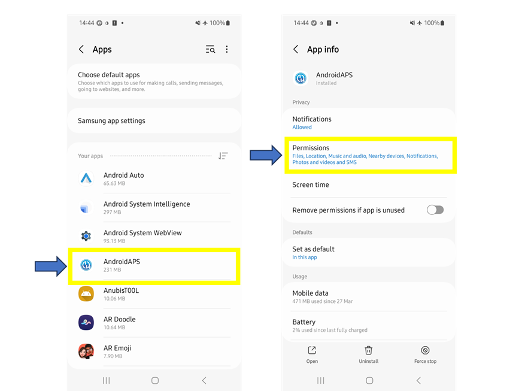
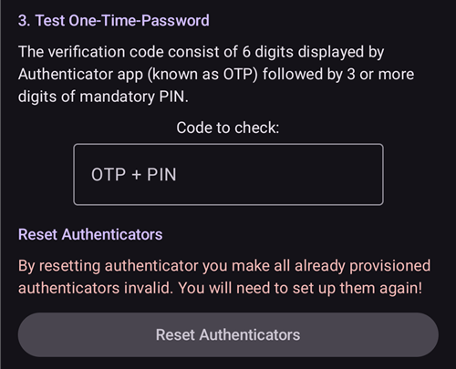
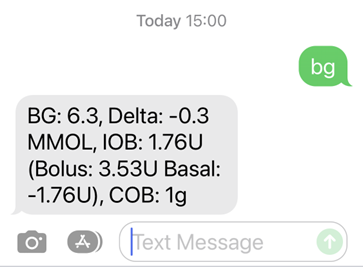
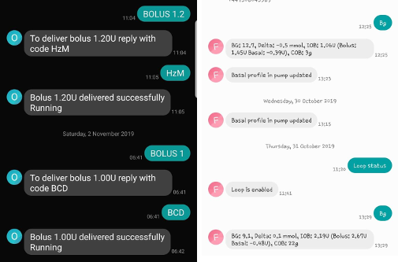
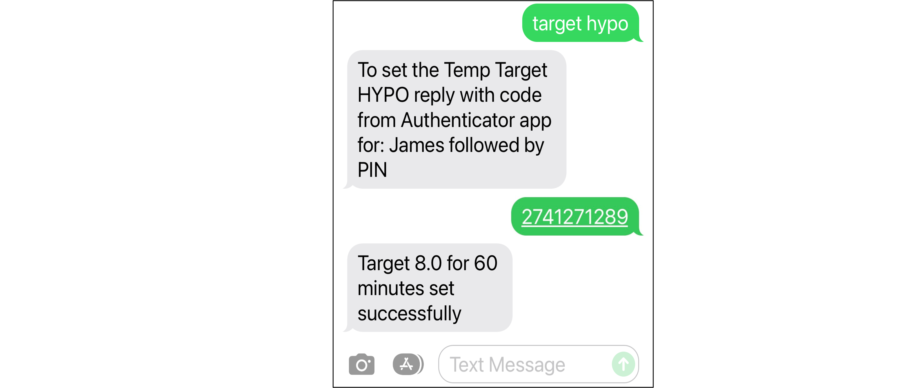

# Comenzi prin mesaje SMS

```{contents} Table of contents
:depth: 2
```

Most remote adjustments (temp targets, carbs, profile switches and, once the client is paired, boluses) can be made with the [**AAPSClient** app](../RemoteFeatures/RemoteMonitoring.md) on an Android phone with an internet connection, see [Master ↔ Client control](#client-master-control) (an iPhone version of **AAPSClient** is in development, see [AAPSClient](AapsClient.md)). Comenzile SMS rămân o alternativă care funcționează fără internet și singura opțiune de la distanță dacă folosiți un iPhone ca telefon de urmărire și nu aveți încă **AAPSClient**.

**Comenzile SMS sunt foarte utile:**
1. For routine remote control

2. If you want to remotely bolus insulin without a paired **AAPSClient**

3. In a region of poor internet reception, where text messages are able to get through, but data/internet phone reception is limited. This is very useful when going to remote areas (e.g. camping, skiing).

4. Dacă cealaltă metodă de control de la distanță (**AAPSClient**) nu funcționează temporar

## Siguranța pe primul loc

If you enable **SMS Communicator** in **AAPS**, consider that the phone which is set up to give remote commands could be stolen, and/or used by someone else. Always lock your phone handset with at least a PIN. A strong password and/ or biometric lock are highly recommended, and ensure this is different from your APK Master password (the password which is required to export **AAPS** settings).

Additionally, it is recommended to allow a [second phone number](#SMSCommands-authorized-phone-numbers) for SMS commands. This way, you can use the second number to [disable](#SMSCommands-other) SMS communicator in case your main remote phone gets compromised.

Intervalul minim implicit dintre comenzile de bolus este de 15 minute, socotit din momentul în care pompa acceptă un bolus. For safety reasons, you have to add at least two authorised phone numbers to change this to a shorter time delay. If you try to remotely bolus again within 15 minutes of the previous bolus, you will receive the response “Remote bolus not available. Încercați din nou mai târziu.”

AAPS will also inform you by text message if your remote commands, such as a bolus or a profile change, have been carried out. Este recomandabil să fie configurat astfel încât textele de confirmare să fie trimise la cel puțin două numere de telefon diferite, în cazul în care unul dintre telefoanele receptoare este furat.

**If you bolus through SMS Commands, you must enter carbs separately (second SMS, AAPSClient...)!** If you fail to do so, the IOB would be correct with too low COB, potentially leading to not performed correction bolus as **AAPS** assumes that you have too much active insulin.

For the sensitive commands, an authenticator app with a time-based one-time password must be used to increase safety.

If you want to remove the ability of a caregiver phone to send SMS commands, use the emergency button “[Reset Authenticators](#sms-commands-authenticator-setup)” in **AAPS** or send the SMS command “[SMS stop](#SMSCommands-other)”. Prin resetarea autentificatorilor, TOATE telefoanele îngrijitorilor devin invalide. Va trebui să le setați din nou.

## Setare comenzi SMS

```{contents} The overall process is as follows
:depth: 1
:local: true
```

(sms-commands-authenticator-setup)=
### Setare Authenticator

Autentificarea cu doi factori este folosită pentru a îmbunătăți siguranța.

On the caregiver phone, download (from the App store or Google play) and install an Authenticator app. Aplicațiile gratuite populare sunt:
  - [Authy](https://authy.com/download/)
  - Google Authenticator - [Android](https://play.google.com/store/apps/details?id=com.google.android.apps.authenticator2) / [iOS](https://apps.apple.com/de/app/google-authenticator/id388497605)
  - [LastPass Authenticator](https://lastpass.com/auth/)
  - [FreeOTP Authenticator](https://freeotp.github.io/)

These Authenticator apps produce a time-limited, one-time 6-digit password, similar to mobile banking or shopping. You can use an alternative Authenticator app, as long as it supports RFC 6238 TOTP tokens. Microsoft Authenticator nu funcționează.

### Verificați setările telefonului

Pe telefon, mergeți la **Aplicații > AAPS > Permisiuni**. Asigurați-vă că **SMS** și **Telefon** sunt permise.



```{admonition} "App was denied access to SMS"
:class: tip
Android can block the **SMS** permission for apps that were not installed from an app store, like **AAPS**. If you see this message when you grant the **SMS** permission, open the phone's **Settings > Apps > AAPS**, tap the **⋮** menu (top right) and select **Allow restricted settings**. Apoi acordați din nou permisiunea **SMS**.
```


### Date and time syncing

Timpul de pe ambele telefoane trebuie sa fie sincronizat. Cel mai bine este să le setați să preia timpul automat din rețea. Diferențele de timp pot duce la probleme de autentificare.

On both the **AAPS** phone and the caregiver phone, check the date and time are synched. Exactly how you do this depends on your specific device, you may need to try out different settings.

Example (for Samsung S23): **Settings > General management > Date and time**: make sure that **Automatic date and time** is checked.

Some options may be greyed out, due to needing admin via a family account if the phone has been set up as a child account. This date and time setting is called “set automatically” on a caregiver/parent iPhone. If you are not sure if you have synched the handsets, don’t worry, you can set up the SMS commands and troubleshoot afterward if it seems to be causing problems (ask for help if needed).

### Setări AAPS

Now that the phone settings have been checked, in the **AAPS** app itself, go to [**Configuration** → **Communication**](../SettingUpAaps/ConfigBuilder.md) and enable the **SMS Communicator** plugin.

Deschideți setările **Comunicator SMS**.

Activați **Permiteți comenzi la distanță prin SMS**. The **Additional mandatory PIN at token end** and **Authenticator setup** options only appear once this is enabled:


(SMSCommands-authorized-phone-numbers)=
#### Numere de telefon permise

Enter the caregiver phone number(s). Include the country code and exclude the first “0” of the phone number, as shown in these examples:
* Număr de telefon din Marea Britanie: +447976304596
* Număr de telefon din SUA: +11234567890
* FR phone number:  +33612344567
* _etc._

Note that the “+” in front of the number may or may not be required based on your location. To determine this, send a sample text which will show the received format on the **SMS Communicator** plugin screen (**Configuration** → **Communication** → **SMS Communicator** → **Open plugin**).

If you have more than one phone number to add, separate them by semicolons, with **NO space between numbers** (this is critical!). Selectați **OK**:


#### Interval minim în minute pentru bolusurile de la distanță

- You can define the minimum delay (in minutes) between two boluses issued via SMS.
- Din motive de siguranță, trebuie să adăugați cel puțin două numere de telefon autorizate pentru a modifica această valoare.

#### Cod PIN obligatoriu suplimentar la sfârșitul codului de acces

Din motive de siguranță, codul de răspuns trebuie urmat de un PIN. Choose a PIN which you (and any other caregivers) are going to use at the end of the authenticator code when the SMS command is sent.

Cerințele pentru PIN sunt:

* cel puțin 6 cifre
* doar cifre

For a safer PIN, do not use the same digit many times (_e.g._ 111111) or a sequence (_e.g._ 123456).


#### Setare Authenticator

* Tap **Authenticator setup** and follow the step-by-step instructions on the screen.
* Open your installed authenticator app on the _caregiver’s phone_, set up a new connection and
* Use the caregiver phone to scan the QR code shown under **Scan code to setup AAPS OTP codes**.


* Under **Test One-Time-Password**, enter the one-time passcode from the authenticator app on the caregiver phone followed by your PIN in **Code to check**:

Exemplu:
* The token from the authenticator app is 457051
* Codul dumneavoastră PIN obligatoriu este 2401
* Cod de verificat: 4570512401

If the entry is correct, the red text “WRONG PIN” will change automatically to a green “OK”. **There is no button you can press!** The process is now complete, there is no “OK” button you need to press after entering the code:



Acum ar trebui să aveți comenzile SMS configurate.

Folosiți butonul **Resetați autentificatorii** din partea de jos a ecranului **Setare Authenticator** dacă doriți să eliminați autentificatorii configurați. (Prin resetarea autentificatorului, TOȚI autentificatorii deja configurați devin invalizi. Va trebui să îi setați din nou.)

## Utilizarea comenzilor SMS

### First steps using SMS commands

1)  To check you have set everything up correctly, test the connection by typing “bg” as an SMS message from the caregiver phone to the **AAPS** phone. You should get a response similar to that shown here:



If you don't receive any response, check the [Troubleshooting](#SMSCommands-troubleshooting) section below.

2)  Now try an SMS command that requires the authenticator, _e.g._ “target hypo”. The caregiver’s phone will receive a text back, prompting you to enter the **six-digit authenticator password** from the authenticator app, followed by the additional secret **PIN** known only by caregivers/followers (a string of twelve digits in total, assuming your PIN has 6 digits).

When you try sending an SMS command for the first time, try it in the presence of the **AAPS** phone, to see how it works:


Telefonul îngrijitorului va primi un SMS de răspuns de la **AAPS**, care confirmă dacă comanda SMS de la distanță a fost executată cu succes.

If your command is successful, you will receive a reply to confirm this. If there is a problem you will receive an error message. See [Troubleshooting](#SMSCommands-troubleshooting) below for common errors.

**Hint**: It can be useful to have unlimited SMS on your phone plan (for each phone used) if a lot of SMS will be sent.

### Delivering mealtime boluses through SMS commands

Remote bolusing of insulin can be done via **SMS Commands** or through a paired **AAPSClient** (see [Master ↔ Client control](#client-master-control)); it cannot be done through the Nightscout website. Carbohidrații pot fi anunțați și prin SMS sau prin **AAPSClient**. With SMS, it is not possible to send both carbs and insulin commands in one single SMS message. Aceste comenzi trebuie trimise separat, astfel:

1)  Send the insulin bolus (_e.g._“bolus 2” will command a bolus of 2 units) through SMS commands is equivalent to **Treatments** → **Insulin** in **AAPS**. 2)  Send the carbs (_e.g._ “carbs 20” will announce 20g of carbs). This is equivalent to **Treatments** → **Carbs** in **AAPS**.

To avoid hypos, it is a good idea to start conservatively, by bolusing **less insulin** than would be needed according to your carb ratio, because you are not taking into account the current glucose level or glucose trend.

**Ordinea în care trimiteți aceste comenzi este importantă**. If you announce a large amount of carbs by any route, and have SMBs enabled, **AAPS** may immediately respond by giving a partial bolus of insulin. So, if you then try to send an insulin bolus _after_ announcing the carbs, you may have a frustrating delay and a “bolus in progress” message, and you then need to check what has been given as an SMB. Or, if you do not realise an SMB is being delivered, and your own subsequent bolus is also successful, too much insulin may be delivered for the meal overall. Therefore, if bolusing for meals remotely, always send the insulin bolus _before_ the carb announcement. If you prefer, you can combine **AAPSClient** with SMS commands: carbs entered on a paired **AAPSClient** need no authentication code and are therefore quicker than SMS commands. Carbs or other treatments entered on the Nightscout website are **not** applied while client control is on; **AAPS** is then in [hardened mode](#client-master-control-hardened-mode).

(SMSCommands-commands)=
## Comenzi

```{contents} List of command groups
:depth: 1
:local: true
```

Commands must be sent in English, the response will be in your local language if the response string is already [translated](#translations-translate-strings-for-AAPS-app). The commands are not case-sensitive, you can use lower or upper case.



The **SMS Commands Tables** below show all the possible SMS commands. _Example values_ are given, to aid understanding. The commands have the same range of possible values (targets, percent profile etc.) which are allowable in the **AAPS** app itself.

(authentication-or-not)=
### Cu autentificare sau fără?

Some SMS commands give an immediate response, and some SMS commands require strong **authentication** through the Authenticator app. A simple enquiry like “**BG**” (which requests an update on current glucose) is quick to type, doesn't need authenticating, and returns the **AAPS** status information shown below:


Commands which need more security require a code to be entered, for example:



The *Auth* column in the tables below, indicates whether such a strong authentication is required for each command.

### Date CGM

| Comandă    | Autentificare | Function & *Response*                                                                                                                                                                                                                                                     |
| ---------- | ------------- | ------------------------------------------------------------------------------------------------------------------------------------------------------------------------------------------------------------------------------------------------------------------------- |
| BG         | Nu            | Returns: last BG, delta, IOB (bolus and basal), COB<br/>*Last BG: 5.6 4min ago, Delta: -0,2 mmol, IOB: 0.20U (Bolus: 0.10U Basal: 0.10U)*                                                                                                                           |
| CAL 5.6/90 | Da            | Calibrează CGM-ul cu valoarea 5.6/90<br/>(folosiți valoarea potrivită unităților dumneavoastră de glicemie)<br/>Funcționează doar dacă este configurat corect în **AAPS**.<br/>*Calibrare trimisă. Recepționarea trebuie să fie activată și în xDrip+.* |

### Pompă

| Comandă              | Autentificare | Function & *Response*                                                                                |
| -------------------- | ------------- | ---------------------------------------------------------------------------------------------------- |
| POMPĂ                | Nu            | LastConn: 1 min ago<br/>Temp: 0.00U/h @11:38 5/30min<br/>IOB: 0.5U Reserv: 34U Batt: 100 |
| PUMP DISCONNECT *30* | Da            | Pentru a deconecta pompa timp de *30* de minute                                                      |
| PUMP CONNECT         | Da            | Pompă reconectată                                                                                    |

### Rate bazale

| Comandă           | Autentificare | Function & *Response*            |
| ----------------- | ------------- | -------------------------------- |
| BASAL 0.3         | Da            | To start basal 0.3U/h for 30 min |
| BASAL 0.3 20      | Da            | To start basal 0.3U/h for 20 min |
| BASAL 30%         | Da            | To start basal 30% for 30 min    |
| BASAL 30% 50      | Da            | To start basal 30% for 50 min    |
| BASAL STOP/CANCEL | Da            | Pentru a opri bazala temporară   |

Unele pompe acceptă o bazală temporară doar în procente, altele doar în U/h. If you use the other form, **AAPS** answers *"This pump takes a temp basal only in percent, not in U/h."* (or the reverse) and sets nothing. The duration must be a multiple of your pump's temp basal duration step.


### Buclă

| Comandă           | Autentificare | Function & *Response*                                                                                                                                                                                                                                                                                             |
| ----------------- | ------------- | ----------------------------------------------------------------------------------------------------------------------------------------------------------------------------------------------------------------------------------------------------------------------------------------------------------------- |
| LOOP STATUS       | Nu            | Răspunsul depinde de starea reală:<br/> - *Bucla este dezactivată* dacă bucla este dezactivată<br/> - *Bucla este activată* dacă bucla este închisă, deschisă sau în LGS<br/> - *Pompă deconectată* dacă pompa este deconectată<br/> - *Suspendat (10 minute)* dacă bucla este suspendată |
| LOOP STOP/DISABLE | Da            | The pump will revert to the pre-programmed basal rate.<br/>*Loop has been disabled*                                                                                                                                                                                                                         |
| LOOP SUSPEND 20   | Da            | *Buclă suspendată*                                                                                                                                                                                                                                                                                                |
| LOOP RESUME       | Da            | *Buclă reluată*                                                                                                                                                                                                                                                                                                   |
| LOOP CLOSED       | Da            | *Mod de funcționare curent: Buclă închisă*                                                                                                                                                                                                                                                                        |
| LOOP LGS          | Da            | *Mod de funcționare curent: Suspendare la glicemie scăzută*                                                                                                                                                                                                                                                       |

### Bolus

Bolusul de la distanță nu este permis în decurs de 15 minute (această valoare este modificabilă doar dacă se adaugă 2 numere de telefon) după ultimul bolus sau ultima comandă de la distanță! In this case, the response would be *Remote bolus not available. Try again later.* This response is also sent when the pump is currently delivering a bolus.

| Comandă              | Autentificare | Function & *Response*                                                                                                                                             |
| -------------------- | ------------- | ----------------------------------------------------------------------------------------------------------------------------------------------------------------- |
| BOLUS 1.2            | Da            |                                                                                                                                                                   |
| BOLUS 0.60 MEAL      | Da            | Delivers the specified 0.60U bolus<br/>**and** sets the [Eating Soon TempTarget](#TempTargets-eating-soon-temp-target)                                      |
| CARBS 5              | Da            | To enter 5g, without a bolus                                                                                                                                      |
| CARBS 5 17:35/5:35PM | Da            | To enter 5g at 17:35.<br/>The acceptable time format depends<br/> on the time setting (12h/24h) on the phone.                                         |
| EXTENDED 2 120       | Da            | To start extended bolus 2U for 120 min.<br/>Only for [compatible pumps](#Extended-Carbs-extended-bolus-and-switch-to-open-loop-dana-and-insight-pump-only). |
| EXTENDED STOP/CANCEL | Da            | Pentru a opri bolusul extins                                                                                                                                      |

### Profil

| Comandă        | Autentificare | Function & *Response*                                                                                                                                                |
| -------------- | ------------- | -------------------------------------------------------------------------------------------------------------------------------------------------------------------- |
| PROFILE STATUS | Nu            | Profilul curent și procentajul                                                                                                                                       |
| PROFILE LIST   | Nu            | Lista curentă a profilurilor din **AAPS**, de ex.:<br/>1. Profile1<br/> 2. Profile2                                                                      |
| PROFILE 1      | Da            | Pentru a schimba profilul la profilul 1 din listă.<br/>Folosiți numerele returnate de **PROFILE LIST**,<br/>nu numele profilurilor așa cum le-ați salvat |
| PROFILE 2 30   | Da            | Pentru a schimba profilul la Profile2 30%                                                                                                                            |

The percentage must be between 30 and 250 %, as in the app. A value outside this range is refused before you are asked for the authentication code.

### Ținte temporare

| Comandă                   | Autentificare | Function & *Response*                            |
| ------------------------- | ------------- | ------------------------------------------------ |
| TARGET MEAL/ACTIVITY/HYPO | Da            | Pentru a seta ținta temporară MEAL/ACTIVITY/HYPO |
| TARGET STOP/CANCEL        | Da            | Pentru a anula ținta temporară                   |


(SMSCommands-other)=
### Altele

| Comandă          | Autentificare | Function & *Response*                                                                                                                                                                                                                                                  |
| ---------------- | ------------- | ---------------------------------------------------------------------------------------------------------------------------------------------------------------------------------------------------------------------------------------------------------------------- |
| RESTART          | Da            | Repornește AAPS. Useful if you got issues that normally is resolved with a restart.                                                                                                                                                                                    |
| SMS DISABLE/STOP | Da            | To disable the SMS Remote Service, reply with the code.<br/>Keep in mind that you'll be able to reactivate it directly<br/>from the **AAPS** master smartphone only.                                                                                       |
| HELP             | Nu            | Returns all functions available for interrogation:<br/>BG, LOOP, PUMP, BASAL, BOLUS, EXTENDED, CAL, PROFILE, TARGET, SMS, CARBS, HELP, RESTART<br/>Send further ***HELP ***FUNCTION****** command to list<br/>all options available in this section. |
| HELP BOLUS       |               | *BOLUS 1.2<br/>BOLUS 1.2 MEAL*                                                                                                                                                                                                                                   |

(SMSCommands-troubleshooting)=
## Depanare și întrebări frecvente

```{contents} List of questions and issues
:depth: 1
:local: true
```

### Ce _nu_ putem face cu comenzile SMS?

1)  **Nu puteți seta o schimbare de profil _temporară_** (de exemplu, setarea „profile exercise” pentru 60 de minute), deși puteți trece permanent la „profile exercise”. Temporary profile switches can instead be set through **AAPSClient**.

2)  **You cannot cancel automations** or **set user-defined targets** but there are approximate solutions: As an example, imagine the normal profile target is 5.5. You have set an automation in AAPS, to always set a high target of 7.0 between 2.30pm and 3.30pm because of a sports class in school, and a condition of the automation is that “no temp target exists”. This week, you have been told at short notice that the sports class is cancelled, and is being replaced by a pizza-eating session, but your kid is already at school with the **AAPS** phone. If the high temporary target of 7.0 is started by the automation, and you cancel it (on the **AAPS** phone, or remotely) the conditions for the automation are still met and **AAPS** will simply set the high target again, a minute later.

**If you did have access to the AAPS phone**, you could uncheck/modify the automation, or, if you don’t want to do that, you could simply set a new temp target of 5.6 for 60 min by pressing on the target on the main screen, or via **Manage** → **Temp Target**. This would prevent the automation from setting the high target of 7.0.

**Dacă nu aveți acces la telefonul AAPS**, comenzile SMS pot fi folosite pentru o soluție aproximativă: de exemplu, comanda „target meal” setează o țintă de 5,0 pentru 45 de minute (celelalte ținte implicite sunt 8,0 pentru activitate sau hipo, vedeți tabelul). However, with SMS commands you cannot specify a _specific_ value target value (of 5.6 for 60 minutes, for example), you would need to use **AAPSClient** to do this.

### Ce se întâmplă dacă mă răzgândesc în privința unei comenzi pe care tocmai am trimis-o?

**AAPS** will only deliver on the most recent command. So, if you type “bolus 1.5”, and then, without authenticating, you send a new command “bolus 1”, it will ignore the earlier 1.5 command. **AAPS** will always send the caregiver's phone a response to confirm what the SMS command is before you are prompted to enter the authentication code, as well as a response following the action.

### Why didn't I get a response to an SMS command?

It could be for one of these reasons:

1)  Mesajul nu a ajuns la telefon (probleme de rețea). 2)  **AAPS** is still in the process of processing the request (_e.g._ a bolus, which can take some time to deliver depending on your bolus rate). 3)  The **AAPS** phone does not have a good Bluetooth connection to the pump when the command is received, and the command has failed (this usually creates an alarm on the **AAPS** phone).

### Niciun răspuns la comenzile SMS

On the caregiver phone and/or **AAPS** phone, try disabling the following options :
* **Send as chat message** 
* If using Android Messages App or Google Messages App, disable RCS messaging:
  - deschideți conversația SMS respectivă în Mesaje
  - Select the options ellipsis in the top right corner
  - selectați „Detalii”
  - Activați "Trimiteți doar mesaje SMS și MMS" 

### Erori la executarea comenzilor

Există mai multe motive posibile pentru care comanda poate eșua:

* Configurarea comenzilor SMS nu este completă/corectă
* You sent a command which had an incorrect format (like “disconnect pump 45” instead of “pump disconnect 45”)
* You used an incorrect, or expired authenticator code (it is usually good to wait a few seconds for a fresh code, if the current one is about to expire)
* The code+PIN was OK, but there was a delay in the SMS leaving/arriving, which led **AAPS** to calculate that the authenticator code had expired
* The **AAPS** phone is out of range/contact with the pump
* The system is already busy delivering a bolus

Erorile frecvente sunt arătate în exemplele de mai jos:


### Cum pot opri o comandă după ce a fost autentificată?

Nu puteți. However, you can cancel a bolus sent by SMS on the **AAPS** phone itself, by simply cancelling it on the bolusing popup, if you are quick. Many SMS commands (apart from bolusing and carb announcements) can be easily reversed, or actions taken to mitigate unintended effects if a mistake is made.

For errors in bolusing and carb announcements, you can still take action. For example, if you have announced 20g carbs but your child only eats 10g and you (or an onhand caregiver) is unable to delete the treatment in the **AAPS** phone directly, you could set a high temporary target, or set a reduced profile, to encourage **AAPS** to be less aggressive.

### SMS-uri multiple

If you receive the same message repeatedly (_e.g._ a profile switch) you may have accidentally set up a looping condition with other apps. This could be xDrip, for example. If so, please ensure that xDrip (or any other app) does not upload treatments to NightScout.

În cazul în care cealaltă aplicație este instalată pe mai multe telefoane, asigurați-vă că dezactivați încărcarea pe toate.

(sms-commands-too-many-messages)=
### I am getting far too many text messages from SMS Commands. Can I reduce the frequency, or make them stop?

Using SMS commands may generate a lot of automated messages from the **AAPS** phone to the caregiver’s phone. You will also receive messages, for example “basal profile in pump updated” if you have automations set up in **AAPS**. It can be useful to have unlimited SMS allowance on your **AAPS** phone plan (and for each caregiver phone used) if a lot of SMS will be sent, and to deactivate SMS notifications, alarms or vibrations on all phones. It is not possible to use SMS commands and not receive these updates. Because of this, you may want an alternative way to communicate directly with your child (if they are old enough), instead of SMS. Aplicațiile alternative de comunicare folosite des de îngrijitorii care folosesc **AAPS** includ WhatsApp, LINE, Telegram și Facebook Messenger.

Este posibil să dezactivați SMS-ul „Profilul bazal din pompă a fost actualizat” atunci când schimbarea de profil a venit din Nightscout. To do this, create a file named **exactly** `do_not_send_sms_on_profile_change` in the `extra` dir of your AAPS directory.
