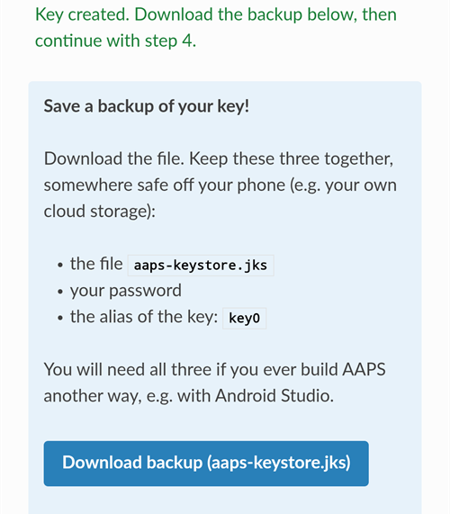
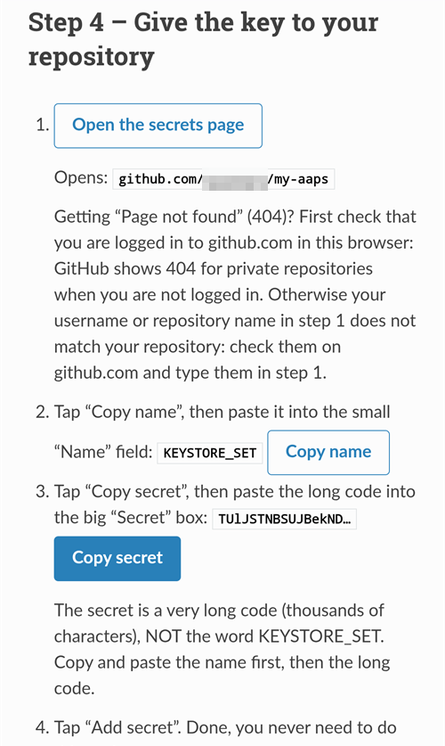
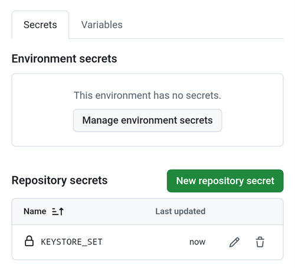
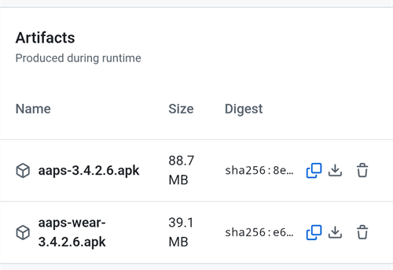

(aaps-builder)=

# Browser build with AAPS Builder

```{note}
This is the recommended way to build AAPS from an **Android phone**. Funcționează și din browserul oricărui computer. For the other ways to build from a computer or an iPhone, see the [Browser build](BrowserBuild.md) overview.
```

```{contents} In this page
:backlinks: entry
:depth: 2
```

**AAPS Builder** builds the AAPS app for you in GitHub, the free code-hosting website. Nu trebuie să instalați nimic pe telefon și nu trebuie să deschideți niciun fișier de pregătire.

A setup page walks you through it. Prima dată durează aproximativ 10 minute:

1. Create your own **private copy** of AAPS Builder in your GitHub account: the setup page opens GitHub with everything filled in, you only confirm. The build workflow, the file that tells GitHub how to build AAPS, is already in it.
2. Creați sau încărcați **cheia de semnare** (keystore-ul).
3. Dați cheia depozitului dumneavoastră ca **secret** GitHub.
4. **Construiți** aplicația. One build takes 15 to 30 minutes.
5. **Descărcați și instalați** aplicația pe telefon.

You do **not** need to fork AndroidAPS: the AAPS source code is downloaded from the official AndroidAPS repository at every build. You also do **not** need Google Drive: you download the app directly from GitHub.

```{admonition} Where the code comes from
:class: note

The build workflow is maintained by the AAPS developers in the [nightscout/aaps-builder](https://github.com/nightscout/aaps-builder) repository, and your repository is a copy of it. The [workflow](https://github.com/nightscout/aaps-builder/blob/main/.github/workflows/build.yml) in your copy is short: it runs the [build steps](https://github.com/nightscout/aaps-builder/blob/main/.github/workflows/aaps-builder.yml) kept in that repository, so improvements reach you without any change to your repository. Puteți citi ambele fișiere. When it builds, the workflow downloads only the official AAPS source code and GitHub's own build tools. Keystore-ul dumneavoastră nu părăsește niciodată browserul și depozitul dumneavoastră privat.
```

(aaps-builder-before-you-start)=

## Înainte de a începe

Veți avea nevoie de:

- Un **cont GitHub** (gratuit). Dacă nu aveți unul, creați-l mai întâi pe [github.com](https://github.com/signup).
- Un **browser web**: Chrome pe telefon sau orice browser pe un computer. Conectați-vă la github.com în acel browser înainte de a începe.
- **GitHub app on your phone?** You can keep it. Some buttons of the setup page then open the app instead of Chrome. Building works in the app, but the app **cannot download** the finished AAPS: [step 5](#aaps-builder-step5) shows how to switch to Chrome for the download.
- Your **existing keystore** (`.jks` file), its password and its alias, if you built AAPS before and want to update it without reinstalling.

```{warning}
**Your build repository must stay private.** Everything a build produces is visible to anyone who can see the repository. Pagina de configurare creează pentru dumneavoastră un depozit privat. Never change it to public, and don't **fork** AAPS Builder instead: a fork is always public.

A private repository gets 2000 free GitHub Actions minutes per month, which is enough for several builds.
```

```{warning}
**New key or existing key: this decides whether you can update AAPS.**

- **You already have AAPS on your phone, built with a keystore you still have**: choose **I already have a keystore** on the setup page and upload it. Your next build will update AAPS in place. Ați construit AAPS cu construirea anterioară în browser (propriul fork)? Your keystore is in your fork: [get a copy of it first](#aaps-builder-from-fork).
- **You build AAPS for the first time, or you lost your keystore or its password**: choose **Create a new key**. O aplicație semnată cu o cheie nouă **nu poate actualiza** un AAPS semnat cu altă cheie. You must export your settings, copy the file off your phone, uninstall the old AAPS, install the new one, then import your settings: see [Reinstalling AAPS with a new keystore](#reinstall-aaps).

Always keep using the same key afterwards. When you create a new key, download the backup the page offers and store it with its password and its alias (`key0`) somewhere safe, off your phone.
```

(aaps-builder-from-fork)=

## Coming from the previous browser build (fork)

Săriți peste această secțiune dacă nu ați construit niciodată AAPS cu metoda anterioară de construire în browser (propria copie, sau fork, a AndroidAPS în GitHub, cu fișierul de pregătire și Google Drive).

Your keystore is stored as secrets in your fork. GitHub never shows a secret again, so you can't copy it to your new repository. Get a copy of your keystore first, then use it in [step 2](#aaps-builder-step2) with **I already have a keystore**.

```{warning}
Don't choose **Create a new key**. AAPS built with a new key cannot update the AAPS on your phone.
```

Care este cazul dumneavoastră?

- **You used Option 2** (you uploaded your own keystore from Android Studio), and you still have the `.jks` file, its passwords and its alias: nothing to do here. Folosiți acel fișier la pasul 2.
- **You used Option 1** (the preparation file created your key), or you no longer have your keystore file: export it from your fork as below.

Pentru a exporta keystore-ul din fork:

1. In your fork, open **Settings** → **Secrets and variables** → **Actions** and add a secret named `ZIP_PASSWORD`. Choose a password with only English letters and numbers. It protects the file you are about to create.
2. Open the **Actions** tab of your fork, tap **CI Keystore Export**, then **Run workflow**. More details: [Export your keystore](#ci-keystore-export).
3. When the run has a green check, open your Google Drive: the file `keystore.zip` is in the folder **AAPS** → **KeyStore**. If the run fails at the Google Drive step, your fork's Google Drive access has expired: see [Google refresh token expired](#aaps-ci-google-token-expired).
4. Descărcați `keystore.zip` și deschideți-l cu `ZIP_PASSWORD`: pe un computer sau pe telefon, cu o aplicație de gestionare a fișierelor care poate deschide fișiere ZIP protejate cu parolă. Conține:
   - `keystore.jks`: keystore-ul dumneavoastră,
   - `keyStoreInfo.txt`: your `KEYSTORE_PASSWORD`, `KEY_PASSWORD` and `ALIAS` (usually `key0`).
5. Copy `keystore.jks` to your phone (or to Google Drive, so you can pick it from there).

La [pasul 2](#aaps-builder-step2) al paginii de configurare:

1. Tap **I already have a keystore**.
2. In **Keystore file**, choose `keystore.jks`.
3. In **Keystore password**, type the `KEYSTORE_PASSWORD` from `keyStoreInfo.txt`.
4. In **Key alias**, pick or type the `ALIAS` from `keyStoreInfo.txt`.
5. If `KEY_PASSWORD` is different from `KEYSTORE_PASSWORD`, untick **Key password is the same as the keystore password** and type the `KEY_PASSWORD`.

Keep `keystore.zip` and its `ZIP_PASSWORD` somewhere safe, off your phone: it is the backup of your key.

To also save the builds of AAPS Builder in Google Drive, do [step 6](#aaps-builder-google-drive): the setup page gets a new `GDRIVE_OAUTH2` for you. Puteți păstra fork-ul până când AAPS construit cu AAPS Builder este instalat pe telefon.

## Deschideți pagina de configurare

**→ [Deschideți pagina de configurare AAPS Builder](#aaps-builder-setup)**

Pagina de configurare face parte din această documentație, în limba dumneavoastră. Păstrați și această pagină deschisă într-o altă filă: secțiunile de mai jos explică mai detaliat fiecare pas al paginii de configurare, cu capturi de ecran.

The setup page opens each GitHub page in a new Chrome tab. Pentru a reveni la pagina de configurare, apăsați butonul de file de lângă bara de adrese din Chrome (pătratul cu un număr) și alegeți pagina de configurare AAPS Builder.

The setup page runs entirely in your browser: your key and passwords are never sent anywhere, except into the GitHub secret you paste them into yourself. Only your GitHub username is sent to GitHub, to check that it exists. It remembers your GitHub username and repository name, so you can come back to it at any time to reopen your secrets page or your builds.


(aaps-builder-step1)=

## Step 1 – Create your private build repository

This step creates your own private copy of AAPS Builder in your GitHub account, with the build workflow already in it. Only you can see it and the apps it builds.

1. Make sure you are logged in to github.com in this browser.

2. In **Your GitHub username**, type your GitHub username, not your e-mail. The page checks it with GitHub: **✓ GitHub user found** means it is right.

3. In **Name of your repository**, keep the suggestion `my-aaps`. If you already created your repository with another name, type that exact name.

   ```{note}
   **Already have an AAPS Builder repository** (made with an earlier version of the setup page)? Don't create a new one: type its exact name, skip **Create my private repository**, and update its workflow once as explained in [Updating AAPS](#aaps-builder-updates). Your secrets stay as they are. If you want a new repository anyway, choose a name you don't have yet, for example `my-aaps-2`, and use the same keystore in step 2.

   Don't type the name of your fork of AndroidAPS: a fork is public, and it already builds with its own **AAPS CI** workflow.
   ```

   

4. Check the line **Your repository:** it shows `github.com/<your username>/my-aaps`. The setup page remembers the name from your last visit: check it every time before you use its buttons.

5. Tap **Create my private repository**.

   

6. GitHub opens **Create a new repository** in a new tab. Everything is already filled in: under **Start with a template**, the template `nightscout/aaps-builder` with **Include all branches** off, and under **General**, your account as **Owner** and the name you chose.

   

   Nu schimbați nimic.

7. Scroll down: under **Configuration**, **Choose visibility** is already **Private**. Tap the green **Create repository** button.

   

   GitHub shows your new repository: it contains a folder `.github` (with the build workflow) and a file `README.md`. **Reveniți la fila paginii de configurare** pentru pasul 2: apăsați butonul de file de lângă bara de adrese din Chrome și alegeți pagina de configurare.

```{warning}
**Your new repository is empty**, with no files? Nu a fost creat din șablon și nu poate construi. Delete it (**Settings** → bottom of the page → **Delete this repository**), then tap **Create my private repository** on the setup page again.
```

(aaps-builder-step2)=

## Pasul 2 – Cheia de semnare

The app must be signed with your own key. Alegeți una dintre cele două file. Read the [new key or existing key warning](#aaps-builder-before-you-start) first.


### I already have a keystore

1. Tap **I already have a keystore**.
2. In **Keystore file**, choose your `.jks` file (or `.keystore`, `.p12`, `.pfx`). Pe un telefon, copiați mai întâi fișierul pe telefon sau în Google Drive.
3. In **Keystore password**, type the keystore password.
4. In **Key alias**, pick your alias from the list, or type it if there is no list. For keystores made with Android Studio it is usually `key0`.
5. If your key password is different from the keystore password, untick **Key password is the same as the keystore password** and type the key password.
6. Tap **Check and continue**.

Pagina verifică parola și aliasul pe dispozitivul dumneavoastră. **Keystore OK! Continue with step 3.** means everything is right. If it says the password will be checked when you build, continue anyway: the build tells you if something is wrong.

### Create a new key

1. Tap **Create a new key**.

2. Choose a password and type it twice. Rules: at least 8 characters, only the letters a–z and A–Z, the digits 0–9 and symbols such as `! ? #`. Fără spații, fără litere cu diacritice și fără caracterul `|`.

3. Tap **Create key**. It takes a few seconds before **Key created** appears.

   

4. Tap **Download backup (aaps-keystore.jks)**. If Chrome asks **Download file again?**, an older backup with the same name is already on your phone: tap **Download again**. Chrome then saves the new key as `aaps-keystore (1).jks`: that is the file that goes with this key, keep it and don't mix it up with the older one.

   Keep these three together, somewhere safe off your phone (for example your own cloud storage):

   - fișierul `aaps-keystore.jks`,
   - your password,
   - aliasul cheii: **`key0`**.

   You need all three if you ever build AAPS another way, for example with Android Studio. Keys created with an earlier version of the setup page have the alias `aaps`.

   

(aaps-builder-step3)=

## Pasul 3 – Dați cheia depozitului dumneavoastră

Step 3 unlocks when step 2 is done. Your key, its passwords and its alias are packed into one value, the `KEYSTORE_SET` secret.

1. Tap **Open the secrets page**.



2. GitHub deschide pagina **New secret** (secret nou) a depozitului dumneavoastră. On a phone, it is below the settings menu: scroll down.


3. Switch to the setup page tab and tap **Copy name**. Switch back to the GitHub tab and paste it into the small **Name** field. Numele este `KEYSTORE_SET`.

4. Switch to the setup page tab and tap **Copy secret**. Switch back to the GitHub tab and paste it into the big **Secret** box (long press on a phone). The secret is a very long code, thousands of characters: the setup page shows its first characters next to the button. Nu lipiți acolo cuvântul `KEYSTORE_SET`.

5. Tap **Add secret**. `KEYSTORE_SET` now shows under **Repository secrets**.



Trebuie să faceți acest lucru o singură dată.

```{tip}
GitHub shows **Page not found** (404)? First check that you are logged in to github.com in this browser: GitHub shows 404 for private repositories when you are not logged in. Otherwise the username or repository name in step 1 doesn't match your repository. Verificați numele pe github.com, corectați-l la pasul 1 și apăsați din nou butonul.
```

(aaps-builder-step4)=

## Step 4 – Build the app

1. On the setup page, tap **Open the build page**. GitHub deschide pagina **Build AAPS** a depozitului dumneavoastră.

   

   If the **GitHub app** opens instead: tap **RUN WORKFLOW**, check the version and the variant, and tap **RUN WORKFLOW** again. The app may still show **Nothing to see here**: pull the list down to refresh it and see your build. Apoi continuați cu pasul 4 de mai jos.

2. If GitHub asks, tap the green button to enable workflows.

   The list of workflows shows two entries: use **Build AAPS**. Ignore **AAPS Builder**: it holds the build steps and has no **Run workflow** button.

3. Tap **Run workflow**. Se deschide un mic formular:
   - **Version**: keep `latest` to build the newest AAPS release, or type a release number such as `4.0.0`.
   - **Variant**: keep `fullRelease` for normal use with a pump. The other variants are explained in [build variants](#browserbuild-variant). `aapsclient3Release` builds **AAPSClient3**, available from **AAPS** version 4.0 (see [About AAPSClient, AAPSClient2 and AAPSClient3](#remotecontrol-aapsclient-versions)).
   - Tap the green **Run workflow** button.

   

4. The build starts and shows **In progress**, with two parts: **AAPS / Check**, then **AAPS / Build AAPS**.

   

5. Wait 15 to 30 minutes. O bifă verde înseamnă că construirea s-a terminat. A red cross means it failed: open the build to read the message, then see [troubleshooting](#aaps-builder-troubleshooting).

   

   ```{tip}
   **E-mail when a build is done:** GitHub only e-mails you when a build fails. To also get an e-mail when it succeeds: on github.com, open your profile picture → **Settings** → **Notifications** → **System** → **Actions**, and untick **Only notify for failed workflows**.
   ```

Dacă nu există butonul **Build AAPS** sau **Run workflow**:

- Deschideți depozitul și verificați că are un dosar `.github` cu fișierul `workflows/build.yml`. If the repository is empty, it was not created from the template: delete it (**Settings** → bottom of the page → **Delete this repository**) and do [step 1](#aaps-builder-step1) again with the button.
- Open the **Actions** tab. If it says workflows are disabled, tap the green button to enable them, then tap **Build AAPS** in the list.

(aaps-builder-step5)=

## Step 5 – Install the app on your phone

```{warning}
**Înainte de fiecare actualizare**, [exportați setările](#ExportImportSettings-Automating-Settings-Export) în AAPS și copiați fișierul **în afara telefonului** (Google Drive, Dropbox…). Keep several older exports and the APK files there too, so you can always go back.
```

1. Pe telefon, deschideți pagina de configurare în **Chrome**. Conectați-vă la github.com dacă vi se cere.
2. Tap **Open my builds**, then the newest build with a green check.

   ```{admonition} The GitHub app opened instead of Chrome?
   :class: note

   The GitHub app cannot download builds. In the app, open the newest build, then tap **Artifacts ↗**, or tap the share icon at the top and choose **Chrome** (or **Copy link**, then paste the link in Chrome's address bar). Construirea se deschide în Chrome: continuați acolo cu pasul următor.

   To stop GitHub links opening in the app: Android **Settings** → **Apps** → **GitHub** → **Open by default** → turn off **Open supported links**.
   ```

   

3. Scroll down to the build summary and tap the **Download AAPS** link.

   

   ```{tip}
   Scroll with your finger on the text, not on the diagram of the build steps: the diagram moves instead of the page.
   ```

   You can also scroll further down to **Artifacts** and tap the download icon next to `aaps-….apk`.

   

4. When the download is done, open Chrome's menu **⋮** → **Downloads**, tap `aaps-….apk` and choose **Install**. If asked, allow installing apps from this source.

   

`aaps-wear-….apk` este aplicația pentru ceasul inteligent. Skip it if you don't use one.

The app is kept on the build page for **14 days**. It is not shown under **Code** in your repository. Copiați-o într-un loc sigur, în afara telefonului, împreună cu exporturile setărilor.

For more ways to install the app, see [Transferring and Installing AAPS](TransferringAndInstallingAaps.md).

```{note}
From September 2026, Google's [Android developer verification](#android-developer-verification) may block installing the APK by tapping the file, depending on your country. Free workarounds are explained on that page.
```

(aaps-builder-google-drive)=

## Step 6 (optional) – Also save the app in Google Drive

You can also have each build saved to your Google Drive, in the folder `AAPS/<version>`. This is optional: the app is always available on the build page.

It needs one more secret, `GDRIVE_OAUTH2`. Step 6 of the setup page gets it from Google for you, on a phone or a computer. **AAPS** can then only see and change the files it creates in your Google Drive, nothing else.

1. On the setup page, tap **Connect Google Drive**. Google se deschide într-o filă nouă.
2. Alegeți contul Google și permiteți accesul. Dacă Google spune că aplicația nu este verificată, apăsați **Advanced** (avansat), apoi **Go to …** (accesați …).
3. The new tab then shows an error such as **This site can't be reached** or **127.0.0.1 refused to connect**. **This is expected:** Google's answer is in the address of that tab. Tap the address bar, select the whole address (it starts with `http://127.0.0.1:47913/`) and copy it.
4. Go back to the setup page tab within a few minutes: Google's answer is only valid for a short time, and only once. Paste the address into **Paste the copied address here** and tap **Get GDRIVE_OAUTH2**. The page shows **GDRIVE_OAUTH2 is ready**.
5. Tap **Open the secrets page**. Tap **Copy name**, then paste it into the small **Name** field (the name is `GDRIVE_OAUTH2`). Tap **Copy secret**, paste it into the big **Secret** box and tap **Add secret**.

From the next build, the APKs are also saved in Google Drive.

Aveți deja o valoare `GDRIVE_OAUTH2` din fișierul de pregătire al celorlalte metode de construire în browser? Funcționează și aceasta: adăugați-o ca secret `GDRIVE_OAUTH2`.

Google stops the access if you don't build for 6 months, or if you change your Google password. The build then tells you so: redo these steps. See [Google refresh token expired](#aaps-ci-google-token-expired).

(aaps-builder-updates)=

## Actualizarea AAPS

Your repository never builds anything by itself: you decide when to build, which version and which variant. Când este lansată o nouă versiune AAPS:

1. [Back up your settings](#aaps-builder-step5) as explained in step 5.
2. Construiți noua versiune ca la [pasul 4](#aaps-builder-step4). Keep `latest`, or type the release number.
3. Descărcați-o și instalați-o ca la [pasul 5](#aaps-builder-step5).

**Updates of the build steps** reach you by themselves: at every build, your repository runs the build steps released by the AAPS developers in nightscout/aaps-builder. Nothing changes in your repository, and there is no automatic build.

**Updates of your workflow file** are rare: only when the **Run workflow** form changes, for example for a new build variant, or once if your repository was made with an earlier version of the setup page (an empty repository with a short workflow file) or from the old template. The [Docs updates & changes](../Maintenance/DocumentationUpdate.md) page says so. Your `KEYSTORE_SET` secret stays as it is. On the setup page, open **Updating your copy** at the end of step 1:

1. Tap **Open the newest workflow**. On a computer, click the **copy icon** ("Copy raw file") at the top right of the file. On a phone, open the **plain-text version** instead, press and hold the text, then **Select all** and **Copy**.
2. Tap **Open my workflow file**.
3. Replace the whole text with the copied workflow (long press on a phone: **Select all**, then **Paste**).
4. Tap **Commit changes…**, then **Commit changes**.

The first line of the file shows its version.

(aaps-builder-troubleshooting)=

## Depanare

Pentru a vedea de ce a eșuat o construire, [citiți jurnalul de construire](#aaps-ci-read-the-logs): numele pașilor sunt diferite, dar găsiți eroarea în același mod. You can also [update a secret](#aaps-ci-update-secret) and [run the build again](#aaps-ci-rerun) the same way.

- **No "Build AAPS" or "Run workflow" button, or the repository is empty**: the repository was not created from the template. Delete it (**Settings** → bottom of the page → **Delete this repository**) and do [step 1](#aaps-builder-step1) again with the **Create my private repository** button.
- **The build stops with "This repository is PUBLIC"**: in your repository, open **Settings** → **General** → **Danger Zone** → **Change visibility** → **Private**, then build again.
- **„Secret KEYSTORE_SET is missing”** (lipsește secretul KEYSTORE_SET): faceți pasul 3 al paginii de configurare.
- **"The secret is too short"**, **"The secret is not a valid code"** or **"The secret does not contain a keystore"**: the wrong text was pasted into the secret, often the word `KEYSTORE_SET` itself, or only part of the code. In your repository, open **Settings** → **Secrets and variables** → **Actions**, edit `KEYSTORE_SET` and paste the long code from **Copy secret** again (redo step 2 of the setup page first if you closed it).
- **„Keystore, password or alias is wrong”** (keystore-ul, parola sau aliasul sunt greșite): verificați parola și aliasul keystore-ului, apoi refaceți pașii 2 și 3 ai paginii de configurare.
- **"Version … does not exist"**: the version you typed is not an AAPS release. Folosiți `latest` sau verificați numărul versiunii.
- **"Variant … is not supported"**: your workflow file is an older version. Replace it as explained in [Updating AAPS](#aaps-builder-updates).
- **"Page not found" (404) when the setup page opens GitHub**: log in to github.com in the same browser (GitHub shows 404 for private repositories when you are not logged in). If you are logged in, the username or repository name in step 1 of the setup page does not match your repository. Type the exact names.
- **"No GitHub user with this name"** in step 1: type your GitHub username, as shown in your GitHub profile, not your e-mail.
- **No Download link, or the GitHub app opened**: the GitHub app cannot download builds. Open the build in Chrome as explained in [step 5](#aaps-builder-step5). To stop GitHub links opening in the app: Android **Settings** → **Apps** → **GitHub** → **Open by default** → turn off **Open supported links**.
- **"Google Drive access has expired or was revoked"**: redo [step 6](#aaps-builder-google-drive) and update the `GDRIVE_OAUTH2` secret.

For other GitHub and Google Drive issues, see [Browser build troubleshooting](../GettingHelp/BrowserBuildTroubleshooting.md).

```{toctree}
:hidden:

Pagina de configurare AAPS Builder <BrowserBuildAapsBuilderSetup.md>
```
