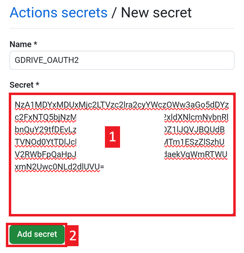

(aaps-ci-google-drive-auth)=

# Construirea în browser – Pasul 3: Autorizați Google Drive

```{note}
Acesta este **Pasul 3** din [Construirea în browser](BrowserBuild.md). First complete [Step 2 – Create your signing keystore](BrowserBuildKeystore.md).
```

```{warning}
No matter which of the prior sets of instructions you followed (Option 1 or Option 2), you MUST add the Google Drive authorization to successfully use the Browser Build.
```

Note: If you already followed this part in the video, you can now skip to [Step 4 – Build the APK](BrowserBuildAPK.md).

```{warning}
If the Google authorization does not start or the preparation page fails, close the preparation page, open `aaps-ci-preparation.html` again the same way as in Step 2, and start this step again. See [troubleshooting](#aaps-ci-preparation-web).
```

Reveniți la fila paginii de pregătire.

Scroll down to the Google Drive Auth section and tap Start Auth.


Select your Google account.


Derulați în jos și acceptați accesul. The web page needs it to obtain the Google Drive authentication key.

Tap Continue.


The `GDRIVE_OAUTH2` field will populate, tap the top Copy button.


Reveniți la fila GitHub.

Scroll down to Repository secrets and tap New repository secret.

If you followed Option 1 you should see this:


Dacă ați urmat Opțiunea 2, vor fi mai multe chei:


In the Name field, paste the text you just copied. Use a long touch on the text box to show the paste menu.


Treceți la fila paginii de pregătire.

Apăsați al doilea buton Copy.


Reveniți la fila GitHub.

1. În câmpul Secret, lipiți textul pe care tocmai l-ați copiat. Use a long touch on the text box to show the paste menu.

2. Tap Add secret.



You should have either two (option 1) or five (option 2) secrets entries now.


GitHub will now be able to store the AAPS apk file in your Google Drive, once built.

----

**Next: [Step 4 – Build the APK](BrowserBuildAPK.md) →**
