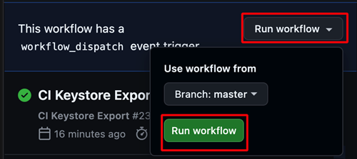

(aaps-ci-preparation)=

# Construirea în browser – Pasul 2: Creați keystore-ul de semnare

```{note}
Acesta este **Pasul 2** din [Construirea în browser](BrowserBuild.md). First complete [Step 1 – Create your GitHub fork](BrowserBuildFork.md).
```

AAPS trebuie semnat cu chei private păstrate într-un **Java KeyStore (JKS)**. This is the most important decision of the whole process, because it determines whether you will be able to **upgrade** AAPS later without reinstalling.

```{note}
In the next steps you will store private information (your keystore, and later your Google Drive access) inside GitHub as **secrets**. A secret is simply an encrypted value that only your own build can read – nobody else, not even people looking at your fork, can see it. This is what keeps your build yours.
```

## Choose your keystore strategy

Citiți ambele opțiuni și alegeți-o pe cea care se potrivește situației dumneavoastră.

### Opțiunea 1 – Generați un keystore nou (utilizatori noi)

Alegeți această opțiune dacă **oricare** dintre următoarele este adevărată:

- This is your **first time** building AAPS.
- You don't have a keystore from a previous Android Studio (computer) build.
- Ați uitat parola sau aliasul keystore-ului.

```{warning}
Building AAPS with **Option 1** creates a brand-new keystore, so it **will not allow you to upgrade your existing AAPS** in place. To move to this new build you must export your settings, uninstall the old AAPS, install the new one and import your settings again. Urmați pașii din [Reinstalarea AAPS cu un keystore nou](#reinstall-aaps).
```

**→ [Continuați cu Opțiunea 1 – Generați un keystore nou](BrowserBuildO1.md)**

### Option 2 – Upload your existing keystore (existing / past users)

Choose this if you **already have** the `.jks` keystore you used on a previous build of AAPS from a computer in Android Studio, **and** you know its password and alias (usually `key0`).

This keeps your current AAPS install upgradeable: future updates will use the same keystore.

**→ [Continuați cu Opțiunea 2 – Încărcați keystore-ul existent](BrowserBuildO2.md)**

----

```{note}
On the next page you will pick your device (computer or iPhone). Each device page then walks you through downloading and opening the preparation file the right way for that device, and creating your keystore. The built AAPS app will be saved in your Google Drive.
```

**Next: choose [Option 1](BrowserBuildO1.md) or [Option 2](BrowserBuildO2.md) above, then follow the page for your device.**

----

(ci-keystore-export)=

## Exportați keystore-ul (opțional)

If you want to export your stored keystore, use this method.

This script will export your previously configured keystore information (from Option 1 or Option 2) as a password-protected ZIP file to the `/AAPS/KeyStore` directory in your Google Drive.

```{warning}
Before using this export method, make sure your keystore and Google Drive settings have been completed.
```

### Pași:

1. **Adăugați secretul pentru parola ZIP:**
   - Go to your repository's **Settings** → **Secrets and variables** → **Actions**
   - Click **New repository secret**
   - In the **Name** field, enter: `ZIP_PASSWORD`
   - In the **Secret** field, enter your custom ZIP encryption password
   - Use only English letters and numbers for the password (no special symbols)
   - Click **Add secret**

   

2. **Run Export Workflow:**
   - Go to the **Actions** tab in your repository
   - Selectați **CI Keystore Export**
   - Click **Run workflow**
   - Fișierul ZIP cu keystore-ul exportat va fi salvat în Google Drive

   

   

```{toctree}
:hidden:

Opțiunea 1 – Generați un keystore nou <BrowserBuildO1.md>
Opțiunea 2 – Încărcați keystore-ul existent <BrowserBuildO2.md>
```
