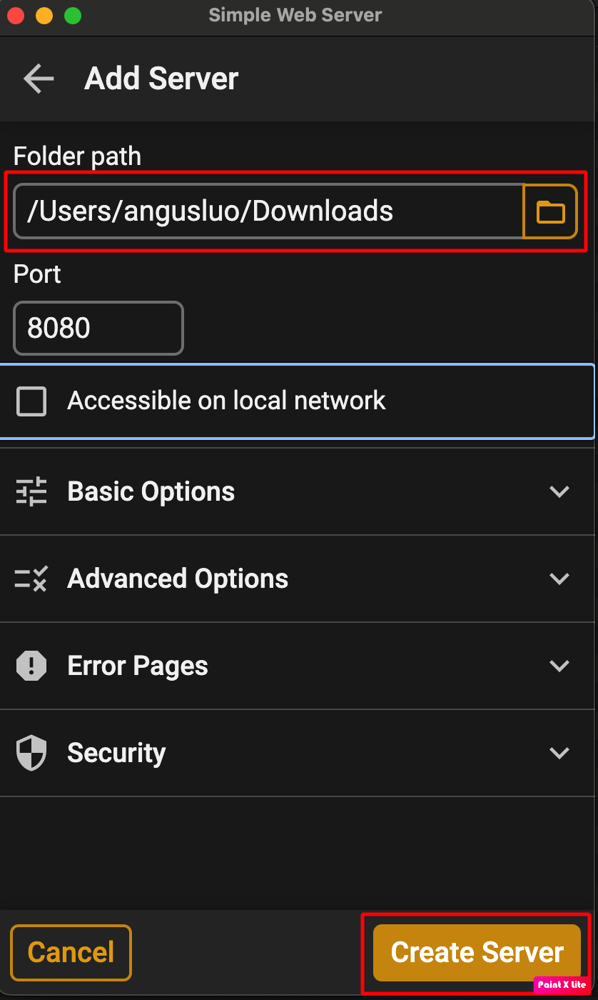

(aaps-ci-option2-computer)=

# Opțiunea 2 · Computer – Încărcați keystore-ul existent

```{note}
[Option 2](BrowserBuildO2.md) (upload an existing keystore) on a **computer** (Windows / Mac / Linux).
```

## 1. Descărcați fișierul de pregătire

:::{include} BrowserBuildDownloadPrep.md
:::

## 2. Porniți un server local și încărcați keystore-ul

Folosiți un computer (Windows/Mac/Linux)

<!--crowdin: exclude-->
<div align="center" style="max-width: 360px; margin: auto; margin-bottom: 2em;">
  <div style="position: relative; width: 100%; aspect-ratio: 9/16;">
    <iframe
      src="https://geo.dailymotion.com/player/x9rdyc6.html?video=x9rdyc6&loop=true&mute=true"
      loading="lazy"
      style="position: absolute; top: 0; left: 0; width: 100%; height: 100%;"
      frameborder="0"
      allowfullscreen>
    </iframe>
  </div>
</div>

Instalați Simple Web Server<br/><br/> Dacă folosiți Windows sau Mac, îl puteți instala din Microsoft Store sau din Mac App Store. Dacă browserul vă întreabă dacă să deschidă aplicația magazinului, permiteți acest lucru.<br/><br/> <br/><br/>

Exemplu pe Mac:

- get → install → open<br/><br/> <br/><br/>

- Click Get Started<br/><br/> <br/><br/>

- Click New Server<br/><br/> <br/><br/>

- In Folder Path, select the folder where aaps-ci-preparation.html is located, and then click Create Server.<br/><br/> <br/><br/>

- Seeing this screen means the server has been started.<br/><br/> <br/><br/>

- Nu închideți Simple Web Server. Treceți la browser și deschideți<br/><br/> [http://127.0.0.1:8080/aaps-ci-preparation.html](http://127.0.0.1:8080/aaps-ci-preparation.html)<br/><br/>

- Pentru pașii următori, urmăriți videoclipul de mai jos, începând de la minutul 2:18.<br/><br/>
  <!--crowdin: exclude-->
  <div align="center" style="max-width: 360px; margin: auto; margin-bottom: 2em;">
    <div style="position: relative; width: 100%; aspect-ratio: 9/16;">
      <iframe
        src="https://geo.dailymotion.com/player/x9rdvt0.html?video=x9rdvt0&startTime=138&loop=true&mute=true"
        loading="lazy"
        style="position: absolute; top: 0; left: 0; width: 100%; height: 100%;"
        frameborder="0"
        allowfullscreen>
      </iframe>
    </div>
  </div>

----

**Next: [Step 3 – Authorize Google Drive](BrowserBuildGoogleDrive.md) →**
