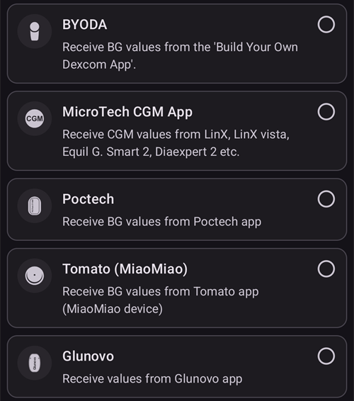

# Configurație (Config Builder)

```{admonition} Coming from AAPS v3? :class: note **Config Builder** se numește acum **Configurație** și se află în **meniu** (☰). See [What changed in AAPS v4](#v4-changes).

    <br />În **Configurație** alegeți ce module sunt active (CGM, pompă, algoritm APS, sensibilitate, sincronizare, …) și deschideți fiecare modul și setările lui. The [walkthrough](#configuration-v4) is below; the rest of this page describes each section in detail.
    
    (configuration-v4)=
    ## Configuration in AAPS v4
    
    In **AAPS** v4, tap the **menu** (☰) in the **top-left** corner of the main screen and choose **Configuration** (*“Set up your configuration (CGM, pump, …) and enable features”*).
    
    
    
    Plugins are grouped by **category** — for example *Smoothing*, *Calibration*, *Sensitivity detection*, *APS*, *Communication* and *General*. Each row shows the category name and the **currently active** plugin (e.g. *APS → OpenAPS SMB*). Apăsați un rând pentru a deschide o categorie.
    
    
    
    În interiorul unei categorii vedeți modulele disponibile pentru ea. For single-choice categories you pick the active one; some categories are multi-select (*“Choose any that apply”*). Each plugin offers two actions:
    
    - **Open plugin** — opens the plugin's own screen.
    - **Settings** — opens the plugin's preferences (settings may be grouped into expandable sections).
    
    
    
    (configuration_sync_icon)=
    ### The mobile icon — “synced from the master”
    
    A small **mobile (phone) icon** next to a category or setting means that item is **synchronized from the master** — its value/selection is delivered to this device over the NSClientV3 (Nightscout) channel.
    
    On a **client** (**AAPSClient**) these items are **kept in sync with the master**. The icon is only shown on a client, so it does not appear in the screenshot above, which was taken on the main **AAPS** app. On a client it typically appears on *Smoothing*, *Calibration*, *Sensitivity detection* and *APS*. Exactly how the master and clients stay aligned — and which settings you can change from either side — is covered under [Master ↔ Client control](#client-master-config-prefs).
    
    The same icon also appears **inside the settings**, next to the individual preferences that are synced. In the example below *Absorption cutoff* carries the icon; settings without the icon are configured per device:
    
    
    
    Items **without** the icon are configured **per device**. The most important example is the **NSClientV3 (Communication)** connection itself — the **Nightscout URL**, **access token** and **websockets** are set on each phone individually, so they do **not** show the mobile icon.
    
    ---
    
    (Config-Builder-tab-or-hamburger-menu)=
    ## Opening a plugin screen
    
    Each plugin screen is opened in one of these ways (the tabs and the eye checkbox of **AAPS** v3 are gone, see [What changed in AAPS v4](#v4-changes)):
    
    - **Configuration** → the plugin's category → **Open plugin**,
    - the **Manage** sheet of the bottom navigation, for the screens you use most (Profile, Insulin settings, Pump, Automation, Food...),
    - a [QuickLaunch](../DailyLifeWithAaps/QuickLaunch.md) button that you add yourself,
    - the **search bar** on the main screen.
    
    ```{contents}
    :backlinks: entry
    :depth: 2
    

(ConfigBuilder_Profile)=

## Profil

This module cannot be disabled as it is a core part of **AAPS**.

Vedeți [Profilul dumneavoastră AAPS](../SettingUpAaps/YourAapsProfile.md) pentru o înțelegere de bază a ceea ce este în interiorul **Profilului** dumneavoastră.

(insulin)= (Config-Builder-insulin)=

## Insulină


In **AAPS** 4 the insulin is no longer a plugin selected in **Configuration**. Deschideți **Gestionați → Setări insulină** pentru a configura insulina pe care o folosiți.

The insulin editor lets you:

* dați insulinei un **Pseudonim insulină**, ca să o recunoașteți ușor,
* setați **Vârf** (timpul până la activitatea maximă a insulinei, în minute) și **DIA** (durata de acțiune a insulinei, în ore), fie scriind valoarea, fie folosind butoanele **–** / **+**,
* tap a **Load peak from** preset button — **Novorapid** (75 min), **Fiasp** (55 min) or **Lyumjev** (45 min) — to fill in the standard peak time for that insulin in one step.

Intervalele permise sunt aceleași, indiferent de insulina folosită:

* **DIA**: 5 to 9 hours (5 to 10 hours if the patient type is set to **Pregnant**). See [Duration of insulin action (DIA) and peak](#Config-Builder-insulin-dia) to choose a value.
* **Peak**: 35 to 120 minutes.

The **IOB** (insulin on board) and **Activity** curves shown at the bottom of the editor update as you change the values, so you can see straight away how your settings shape the insulin action.

Mai multe informații pentru a înțelege Profilul Insulinei așa cum este indicat în **AAPS** [aici](#AapsScreens-insulin-profile).

(Config-Builder-insulin-change-active)=

### Schimbarea insulinei folosite (DIA sau vârf)

The insulin marked **ACTIVE** is the one your running profile uses. Its fields are greyed out: you cannot edit or delete it. This way, the insulin name shown in your running profile always matches the settings actually in use.

To change the DIA or peak you are using:

1. Deschideți **Gestionați → Setări insulină**. Dacă ecranul se deschide doar pentru citire (un **✏️ creion** în bara de sus), apăsați creionul și deblocați setările.
2. Apăsați **+** (*Adăugați o nouă insulină*). **AAPS** creează o copie a insulinei afișate pe ecran.
3. Set the new **Peak** and/or **DIA**, then tap the save icon (top right).
4. Apăsați **▶** (*Activați insulina*) și confirmați. The new insulin becomes **ACTIVE**.

```{admonition} The name includes peak and DIA :class: note **AAPS** adds the peak, DIA and concentration to the insulin name automatically (for example *Fiasp 55m 8h U100*), so you can tell your configurations apart at a glance.

    <br />You can delete the old insulin once it is no longer active.
    
    ### The "Load peak from" presets
    
    In **AAPS** 4 there is no list of insulin types to choose from. Every insulin uses the same exponential activity curve; only its **Peak** and **DIA** differ. The **Load peak from** presets in the insulin editor fill in the recommended peak for the most common insulins in one tap (the small ⓘ next to **Load peak from** lists them with their peak values). You can still adjust the **Peak** and **DIA** afterwards.
    
    Schimbați vârful față de valoarea recomandată doar dacă înțelegeți efectul acestei schimbări. [Graficul curbei insulinei](#AapsScreens-insulin-profile) vă ajută să înțelegeți curbele.
    
    #### Novorapid
    
    
    
    * recommended for Humalog, Novolog and Novorapid (called *Rapid-Acting Oref* in **AAPS** v3)
    * Peak = 75 minutes after injection
    
    #### Fiasp
    
    
    
    * recommended for Fiasp (called *Ultra-Rapid Oref* in **AAPS** v3)
    * Peak = 55 minutes after injection
    
    (Config-Builder-lyumjev)=
    #### Lyumjev
    
    
    
    * recommended for Lyumjev
    * Peak = 45 minutes after injection
    
    #### Custom peak
    
    * There is no separate "Free-Peak Oref" insulin type in **AAPS** 4: enter any **Peak** (35 to 120 minutes) directly in the [insulin editor](#Config-Builder-insulin), without using a preset.
    * Un vârf personalizat este util dacă folosiți o insulină care nu este în listă sau un amestec de insuline diferite.
    
    (Config-Builder-insulin-dia)=
    ### Duration of insulin action (DIA) and peak
    
    ```{warning}
    In looping, decreasing DIA or peak will always increase administered insulin. DIA works differently in AAPS than in commercial AID systems, and careless changes to these settings can change insulin dosing in a way which is much larger or smaller than expected.
    

AAPS models the timeline of insulin action with a mathematical formula, configured using **DIA** and the closely related **peak** settings. DIA este durata teoretică până când IOB ajunge la zero, iar vârful este momentul în care efectul insulinei este cel mai puternic. This yields an IOB curve and an activity curve, which is simply the **rate** of IOB decay.

Consider that when AAPS is looping, it's normal to have periods of [zero-temping](#Open-APS-features-super-micro-bolus-smb). This missing basal insulin is fully subtracted from the IOB, explaining why IOB will in practice reach zero many hours earlier than the configured DIA. You can inspect [bolus IOB and basal IOB](#aaps-screens-iob-cob-basal-sens) separately from the main screen.

Pentru a configura DIA și vârful, apăsați **Gestionați** pe ecranul principal, apoi apăsați **Setări insulină**. AAPS displays the active insulin configuration like this:


In this example, the peak setting is 55 minutes, DIA is 8 hours and [insulin concentration](#Insulin-Concentration) is the standard 100 IU/mL.

Due to the influence of zero-temping explained above and the formula used for IOB decay in AAPS, most users set a clearly higher DIA than in commercial systems. In general, many people find that a **DIA** of 9h works well for them. After you have more experience with AAPS and have a well-tuned profile, you can try to find personalized DIA and peak settings with the information below.

````{admonition} Detalii despre impactul configurării DIA și a vârfului :class: dropdown

Since the basal rate has an indirect influence on IOB decay in AAPS, it follows that too high basal rates can mask too high DIA, and vice versa. It makes sense to first carefully tune basal rates before adjusting DIA and peak. Additionally, consider that the DIA and peak settings interact, in the sense that the effect of DIA depends on peak, and vice versa.

Aceste grafice arată impactul exact al DIA și al vârfului asupra curbelor IOB, pe tot intervalul de valori permise.

Ajustarea DIA:

```{image} ../images/iob_remaining_static_peak.png :width: 400px

    <br />Ajustarea vârfului:
    
    ```{image} ../images/iob_remaining_static_dia.png
    :width: 400px
    

În final, o comparație în care DIA și vârful sunt ajustate în paralel. The logic here is that both values are adjusted in the same relative amounts, so that `49/35 ~ 7/5`. Or similarly, `120/93 ~ 9/7`. The intervals will be consistent regardless of the baseline DIA or peak, as long as the relative change is the same for both.

```{image} ../images/iob_remaining_uniform.png :width: 400px

    <br />Note that when DIA and peak are adjusted in this fashion, every point in the curve will shift by the same relative amount.
    
    ````
    
    #### Further reading on DIA and peak configuration
    
    * [Technical details and historical background from the AAPS predecessor, OpenAPS](https://openaps.readthedocs.io/en/latest/docs/While%20You%20Wait%20For%20Gear/understanding-insulin-on-board-calculations.html#understanding-the-new-iob-curves-based-on-exponential-activity-curves).
    * [Why we are regularly wrong in the duration of insulin action (DIA) times we use, and why it matters…](https://www.diabettech.com/insulin/why-we-are-regularly-wrong-in-the-duration-of-insulin-action-dia-times-we-use-and-why-it-matters/) on Diabettech.
    * [Exponential Insulin Curves + Fiasp](https://web.archive.org/web/20220630154425/http://seemycgm.com/2017/10/21/exponential-insulin-curves-fiasp/) on See My CGM (archive).
    * [Revised Humalog model in a closed loop](https://bionicwookiee.com/2022/04/13/revised-humalog-model-in-a-closed-loop/) and other articles on Bionic Wookie, recommending a DIA of 9h for Lyumjev, Fiasp, NovoRapid, Humalog.
    
    (Config-Builder-bg-source)=
    ## Sursă glicemie
    Selectați sursa de glicemie pe care o folosiți. See [BG Source](../Getting-Started/CompatiblesCgms.md) page for more setup information.
    
    
    
    Scroll down to see the other sources:
    
    
    
    
    
    * [xDrip+ BG](../CompatibleCgms/xDrip.md) - also for compatible apps such as [Juggluco](../CompatibleCgms/Juggluco.md)
    * [NSClient BG](../CompatibleCgms/CgmNightscoutUpload.md) - only if you know what you are doing, see [BG Source](../Getting-Started/CompatiblesCgms.md).
    * [MM640g](../CompatibleCgms/MM640g.md)
    * Glimp - only version 4.15.57 and newer are supported
    * [BYODA (Build Your Own Dexcom App)](#DexcomG6-if-using-g6-with-build-your-own-dexcom-app).
    * MicroTech CGM App - for the Aidex / LinX CGM
    * [Poctech](../CompatibleCgms/PocTech.md)
    * Tomato (MiaoMiao) - Tomato App for MiaoMiao device
    * [Glunovo](https://infinovo.com/) - Glunovo App for Glunovo CGM system
    * Intelligo - Intelligo App
    * Syai/Ottai - for the Syai and Ottai apps (see [Syai Tag](../CompatibleCgms/SyaiTagX1.md) and [Ottai](../CompatibleCgms/OttaiM8.md))
    * SI App - patched SI App or Sibionics App for Sibionics CGM
    * Sino App - patched app for Sinocare CGM
    * Notification Reader - reads glucose values from the notifications shown by official CGM apps (Dexcom, Medtronic, Eversense, etc.)
    * Instara - Instara App
    * Random BG - generates random BG data for testing. It can only be enabled in an engineering (developer) build with the **Virtual Pump**, so in a normal **AAPS** installation it cannot be used.
    
    ## Smoothing
    
    
    
    See [Smoothing blood glucose data](../CompatibleCgms/SmoothingBloodGlucoseData.md).
    
    ## Calibration
    
    Choose how **AAPS** treats the values it receives from your sensor:
    
    - **No calibration**: the sensor values are used as they are. Use this when the sensor is already factory-calibrated and accurate. This is the default.
    - **Linear calibration**: **AAPS** corrects the sensor values with a slope and an offset that it computes from your fingerstick entries.
    
    Cum folosiți **Calibrare liniară**:
    
    1. Selectați **Calibrare liniară** în categoria **Calibrare**.
    2. Când puneți un senzor nou, înregistrați schimbarea senzorului: folosiți **Înregistrați schimbarea senzorului** pe ecranul de calibrare sau introduceți o inserare de senzor CGM în Careportal. Astfel **AAPS** știe când a început sesiunea senzorului. Dacă **AAPS** observă o pauză de peste 30 de minute între citiri, vă poate cere să marcați o schimbare de senzor; această întrebare apare doar pe dispozitivul principal, nu pe un client.
    3. Deschideți modulul și apăsați **Adăugați calibrare**. Introduceți valoarea măsurată din deget. **AAPS** pairs it with the sensor value from the last 10 minutes.
    
    O calibrare este acceptată doar dacă:
    
    - este înregistrată o schimbare de senzor și au trecut de atunci cel puțin **2 ore** (încălzire),
    - glicemia dumneavoastră este stabilă. Dacă se schimbă prea repede, dialogul vă spune acest lucru și arată limita,
    - există o citire CGM din ultimele 10 minute,
    - este pentru momentul actual. Nu puteți introduce valori mai vechi măsurate din deget.
    
    Cum funcționează corecția:
    
    - **AAPS** trasează o linie dreaptă prin perechile senzorului actual: `corrected value = slope × sensor value + offset`.
    - Perechile mai noi contează mai mult decât cele mai vechi: o pereche veche de 2 zile contează cam 37 %, o pereche veche de 4 zile cam 14 %. Astfel, linia urmează senzorul atunci când acesta deviază.
    - Este nevoie de cel puțin **2 perechi**.
    - Dacă perechile sunt apropiate (diferență mai mică de 54 mg/dL / 3 mmol/L), valorile sunt doar deplasate (decalaj, fără pantă).
    - Panta este păstrată între 0,55 și 1,6. O pantă în afara acestui interval este limitată la cea mai apropiată valoare.
    - Limită de siguranță: dacă la 100 mg/dL (5,5 mmol/L) corecția ar fi mai mare de ±30 mg/dL (1,7 mmol/L), nu se aplică nicio corecție. Aceasta vă protejează de o valoare introdusă greșit.
    
    Ce se schimbă:
    
    - Valoarea corectată este folosită peste tot: glicemia de pe ecranul principal, graficul și bucla. Citirile senzorului în sine nu sunt modificate. Corecția este aplicată peste ele, și pentru citirile anterioare ale senzorului actual.
    - O nouă schimbare de senzor pornește de la zero. Perechile de la senzorii anteriori nu mai contează.
    - Pe grafic, o calibrare este afișată ca un marcaj la valoarea măsurată din deget.
    - Calibrările sunt sincronizate prin Nightscout, astfel încât clienții dumneavoastră arată aceleași valori corectate.
    
    Verificați și eliminați înregistrări:
    
    - **Deschideți modulul** arată starea (de exemplu *Pantă 0,85, corecție la mijlocul intervalului -0,4*), un grafic al perechilor cu linia și lista înregistrărilor.
    - Dacă o înregistrare este greșită (de exemplu, aveați zahăr pe deget), apăsați pictograma coș de gunoi de lângă ea. Linia este calculată din nou imediat.
    
    ```{admonition} Folosiți xDrip+ ca sursă de glicemie?
    :class: note
    xDrip+ are propria calibrare. Calibrați într-un singur loc, pentru ca valorile senzorului să nu fie corectate de două ori.
    

    {admonition} Calibrați cu atenție
    :class: warning
    O valoare greșită măsurată din deget duce la valori greșite ale glicemiei și, prin urmare, la doze greșite de insulină. Wash your hands before measuring, and do not calibrate while your glucose is changing fast.


(Config-Builder-pump)=

## Pompă

Alegeți tipul de pompă pe care îl folosiți. Vedeți pagina [Pompele compatibile](../Getting-Started/CompatiblePumps.md) pentru mai multe informații despre configurare.


Derulați în jos pentru a vedea toate driverele de pompă:


Când selectați altă pompă, **AAPS** vă cere să confirmați schimbarea:


* [Dana R](../CompatiblePumps/DanaR-Insulin-Pump.md)
* Dana R Korean (pentru pompa DanaR vândută în Coreea)
* Dana Rv2 (Pompa DanaR cu actualizare de firmware neoficială)
* [Dana-i/RS](../CompatiblePumps/DanaRS-Insulin-Pump.md)
* [Accu-Chek Insight](../CompatiblePumps/Accu-Chek-Insight-Pump.md)
* [Accu Chek Combo](../CompatiblePumps/Accu-Chek-Combo-Pump-v2.md)
* Omnipod pentru [Omnipod Eros](../CompatiblePumps/OmnipodEros.md)
* Dash pentru [Omnipod DASH](../CompatiblePumps/OmnipodDASH.md)
* [Medtronic](../CompatiblePumps/MedtronicPump.md)
* [Diaconn G8](../CompatiblePumps/DiaconnG8.md)
* [EOPatch2](../CompatiblePumps/EOPatch2.md)
* [Medtrum](../CompatiblePumps/MedtrumNano.md)
* [Equil 5.3](../CompatiblePumps/Equil5.3.md)
* [Carelevo](../CompatiblePumps/CareLevo.md)
* Pompă virtuală: doar sugestii pentru buclă deschisă - **AAPS** 
  * pe măsură ce faceți primii pași cu **AAPS**, în timpul primelor [obiective](../SettingUpAaps/CompletingTheObjectives.md)
  * pentru pompa care încă nu are driver

(config-builder-wrong-pump-data)=

### Mesaj: „Datele vin de la o pompă diferită”

**AAPS** remembers the pump it is connected to (pump type and serial number). If it receives data from another pump, for example after your pump was replaced by a new one of the same model, it shows this message and ignores the data from that pump:


To use the new pump, change the pump driver: select **Virtual pump**, confirm, then select your pump again. **AAPS** then registers the pump it is connected to now.

(Config-Builder-sensitivity-detection)=

## Detectare Sensibilitate


Alegeți tipul de detecție a sensibilității. Pentru mai multe detalii despre diferite designuri, vă rugăm să [citiți aici](../DailyLifeWithAaps/SensitivityDetectionAndCob.md). Această funcție analizează în timp real datele istorice și face ajustări dacă consideră că reacționați mai sensibil (sau invers, sunteți mai rezistent) la insulină decât de obicei. More details about how the sensitivity ratio itself is calculated can be found in [Key AAPS Features > Autosens](#Open-APS-features-autosens).

Puteți vedea sensibilitatea pe ecranul principal într-un [grafic suplimentar](#AapsScreens-section-g-additional-graphs), selectând SENS% și urmărind linia albă. Notă, trebuie să fiți în [Obiectivul 8](#objectives-objective8) pentru a permite Detectării Sensibilității /[Autosens](#Open-APS-features-autosens) să ajusteze automat cantitatea de insulină administrată. Înainte de a ajunge la acest obiectiv, procentajul Autosens / linia din grafic este afișată doar pentru informare.

### Setări absorbție

Dacă utilizați Oref1 cu **SMB** trebuie să schimbați **min_5m_carbimpact** (impactul estimat al carbohidraților la fiecare 5 minute) la 8. Valoarea este utilizată în timpul întreruperii citirilor **CGM** sau atunci când activitatea fizică "folosește" întreaga creștere a glicemiei, care altfel ar determina **AAPS** să scadă COB. În momentele în care [absorbția de carbohidrați](../DailyLifeWithAaps/CobCalculation.md) nu poate fi ajustată dinamic pe baza reacțiilor din sânge, se introduce o degradare implicită a carbohidraților. Practic, este un sistem de siguranță.

(Config-Builder-aps)=

## APS


Selectați algoritmul APS dorit pentru ajustări ale terapiei. Puteți vedea detaliile active ale algoritmului ales cu **Deschideți modulul**.

* OpenAPS AMA 
  * Asistență Avansată pentru Masă: algoritmul mai vechi nu mai este recomandat.
  * Pe scurt, avantajul este că, după ce îți administrezi un bolus pentru masă, sistemul poate crește mai rapid nivelul temporar al insulinei DACĂ introduci corect valorile pentru carbohidrați.
* [OpenAPS SMB](#Open-APS-features-super-micro-bolus-smb) 
  * Super Micro Bolus: cel mai recent algoritm recomandat pentru toți utilizatorii.
  * Spre deosebire de AMA, SMB nu folosește rate bazale temporare pentru a controla nivelurile glicemiei, ci în principal mici **Super Micro Bolusuri**.
  * Notă: Este recomandat să utilizați acest algoritm de la început, chiar dacă nu veți primi Super Micro Bolusuri (SMB) până la [Obiectivul 9](#objectives-objective9).
* [Auto ISF](#Open-APS-features-auto-isf) 
  * Experimental algorithm for advanced users. Apare în listă doar după ce obiectivele sunt îndeplinite.

Dacă treceți de la algoritmul AMA la SMB, *min_5m_carbimpact* trebuie schimbat manual la **8** (valoarea implicită pentru SMB) în [Setări → Setări absorbție](#Preferences-min_5m_carbimpact).

## Buclă

This module cannot be disabled as it is a core part of **AAPS**.


## Constrângeri


### Obiective

**AAPS** are un program de învățare (o serie de obiective) pe care trebuie să îl parcurgeți pas cu pas. Acesta ar trebui să vă ghideze să configurați în siguranță un sistem de buclă închisă.

Vedeți pagina [Obiective](../SettingUpAaps/CompletingTheObjectives.md) pentru mai multe informații.

## Comunicare

În această categorie (numită **Sincronizare** în **AAPS** v3) alegeți dacă și unde doriți ca **AAPS** să trimită datele dumneavoastră.


Derulați în jos pentru a vedea restul listei:


### NSClientV3

Poate fi folosit ca un [server de raportare](../SettingUpAaps/SettingUpTheReportingServer.md) și/sau pentru [monitorizare la distanță](../RemoteFeatures/RemoteMonitoring.md), [control de la distanță](../RemoteFeatures/RemoteControl.md).

See [Synchronization with the reporting server](#SetupWizard-synchronization-with-the-reporting-server-and-more) to set up NSClientV3 synchronization.

### Tidepool

Poate fi folosit ca un [server de raportare](../SettingUpAaps/SettingUpTheReportingServer.md).

Vedeți [Tidepool](../SettingUpAaps/Tidepool.md).

### xDrip

Folosit pentru a **trimite** date, cum ar fi valorile glicemiei și tratamentele, către xDrip+ de pe același telefon. Its settings also hold **Send status to xDrip+**, a status line with IOB and COB that xDrip+ and some watch companion apps display.

### Open Humans

Vedeți [Open Humans](../SupportingAaps/OpenHumans.md).

(Config-Builder-wear)=

### Ceas

Monitor and control **AAPS** from a Wear OS watch. Setting up the watch is explained on [Wear OS smartwatch](../WearOS/WearOsSmartwatch.md). După ce activați modulul, alegeți opțiunile lui în [Setări > Ceas](#preferences-wear). Using the watch is explained on [Operation of AAPS via your Wear OS smartwatch](../RemoteFeatures/RemoteControlWearOS.md).

(external-companion-apps)=

### Aplicații tip companion externe

Broadcasts **AAPS** status data on the phone so that other apps installed on it can display it — for example watch or widget companion apps. The broadcast includes glucose and trend, IOB, COB, basal and temp basal, profile name, loop status, phone and pump battery, reservoir level and bolus progress. Enable it only if a companion app you use asks for this data.

Apps known to read this broadcast are [WatchDrip+](https://bigdigital.home.blog/) (Xiaomi and Amazfit watches), [GlucoDataHandler](https://github.com/pachi81/GlucoDataHandler) (Wear OS complications and widgets, and Android Auto through GlucoDataAuto) and the G-Watch app. Their setup is described on [Smartwatches and AAPS](#watches-external-companion-apps). Some of them also use **Send status to xDrip+** from the **xDrip** plugin above for a status line with IOB and COB.

In earlier versions this plugin was called **Samsung Tizen**, after the [G-Watch app for Samsung Tizen watches](#Watchfaces-tizen) it was first made for.

### Garmin

Conexiune la dispozitivul Garmin (Fenix, Edge…)

## Tratamente

Deschideți **meniul** (☰) și selectați [Istoricul tratamentelor](#aaps-screens-treatments) pentru a vedea tratamentele care au fost înregistrate. Should you wish to edit or delete an entry (e.g. you ate less carbs than you expected) then select 'Remove' and enter the new value (change the time if necessary) through **Treatments → Carbs** in the bottom navigation (see [Carbs](#screens-bolus-carbs)).

## General

In **AAPS** 4 the **General** category of **Configuration** only lists **Autotune**. Celelalte funcții descrise mai jos sunt mereu disponibile și nu mai trebuie activate aici; fiecare paragraf spune unde le găsiți.


### Privire de ansamblu

[Ecranul principal](#AapsScreens-the-homescreen) al **AAPS** nu mai este un modul și nu are setări proprii în **Configurație**. The options that used to be here are in **Settings** (gear icon): [Show notes in dialogs](#Preferences-show-notes-field-in-treatments-dialogs), [Status lights](#Preferences-status-lights) and the [Bolus percentage](#Preferences-deliver-this-part-of-bolus-wizard-result) used by the bolus wizard. The super bolus option of **AAPS** 3.x is [not available as a setting](#Preferences-advanced-settings-overview) in **AAPS** 4.

(Config-Builder-actions)=

### Acțiuni

Fila Acțiuni din **AAPS** 3.x nu mai există. Its buttons are now in the **Manage** sheet — see [Where did the Actions tab go?](#screens-action-tab).

### Automatizare

**Manage → Automation** lets you manage your [Automations](../DailyLifeWithAaps/Automations.md), starting at [Objective 10](#objectives-objective10).

(Config-Builder-sms-communicator)=

### Comunicator SMS

Permite aparținătorilor să controleze de la distanță anumite funcții ale **AAPS**prin SMS, vedeți [Comenzi SMS](../RemoteFeatures/SMSCommands.md) pentru mai multe informații privind configurarea.

### Mâncare

**Manage → Food** displays the food presets defined in the Nightscout food database, see [Nightscout Readme](https://github.com/nightscout/cgm-remote-monitor#food-custom-foods) for more setup information.

Notă: Intrările nu pot fi utilizate în calculatorul **AAPS**. (Numai vizualizare)

(Config-Builder-autotune)=

### Autotune

Puteți activa Autotune, vedeți [aici](../AdvancedOptions/Autotune.md).

### Mentenanță

Open the **menu** (☰) and select **Maintenance** to export / import settings and manage log files.


### Configurarea Sistemului (Config Builder)

Now called **Configuration**: this current page.