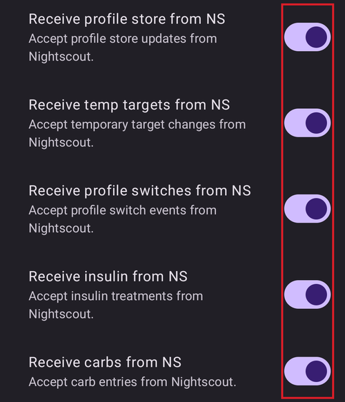

# Nightscout

(Nightscout-security-considerations)=

## Aspecte de securitate

Nightscout is the reporting and monitoring server of **AAPS**: **AAPS** uploads your data to it, and you or your caregivers look at it on the Nightscout website or in follower apps. It holds your medical data, profiles and treatments, so it is worth thinking about securing your Nightscout website.

In **AAPS** 4, remote control does not go through the Nightscout website. While client control is on ([hardened mode](#client-master-control-hardened-mode)), treatments or targets typed directly into Nightscout are **not applied** by **AAPS**. Comenzile de la distanță vin în schimb de la un **AAPSClient** asociat — consultați [Controlul dispozitiv principal ↔ client](#client-master-control).

Fiți extrem de precauți dacă folosiți Nightscout ca sursă de date de glicemie pentru AAPS.

### Setări Nightscout

You can deny public access to your Nightscout site by using [authentication roles](https://nightscout.github.io/nightscout/security): make sure you only share your URL with a `readable` token, never with an `admin` token.

Nightscout `API_SECRET` is your site main password: don't share it publicly.

(Nightscout-aaps-settings)=

### Setări AAPS

Acceptarea datelor din Nightscout (schimbări de profil, tratamente, ...) este opțională și dezactivată implicit. The switches described below are hidden while client control is on (hardened mode) and in [simple mode](#preferences-simple-mode).

* Access the **Synchronization** settings of the NSClientV3 plugin with either 1) **Settings** (gear icon on the main screen) -> **NSClientV3** -> **Synchronization**, or 2) **Configuration** (☰ menu) -> **Communication** -> "**Settings**" under NSClientV3.
* Activați „Încărcați date în NS”.
* "Upload BG data to NS" is in the settings of your BG source (**Configuration → BG Source → Settings**). Enable it, unless your AAPS BG data source is Nightscout: in that case **do not** enable it.
* Do not enable "Receive CGM data from NS" unless Nightscout is your BG data source.

#### Nu sincronizați din Nightscout

Când toate opțiunile „Primiți … din NS” sunt dezactivate, AAPS nu va folosi nicio modificare din Nightscout:

#### Accept changes from Nightscout

Enabling these options allows you to change AAPS settings through Nightscout, like profiles modifications and switch, temporary targets and adding carbs that will be taken into account by AAPS. They are only shown when client control and simple mode are off.  
Note that insulin treatments will only be used for calculations like "Do not bolus, record only".

### Alte setări de securitate

Keep your phone up to date as described in [safety first](#preparing-safety-first).

(Nightscout-manual-nightscout-setup)=

## Configurarea manuală a Nightscout

It is assumed you already have a Nightscout site, if not visit the [Nightscout](http://nightscout.github.io/nightscout/new_user/) page for full instructions on setup. The instructions below are then settings you will also need to add to your Nightscout site. Your Nightscout site needs to be at least version 15, so please check you are running the [latest version](https://nightscout.github.io/update/update/#updating-your-site-to-the-latest-version) otherwise you will get an error message on your AAPS app.

* [Edit your variables](https://nightscout.github.io/nightscout/setup_variables/#nightscout-configuration)

* Adăugați sau modificați variabilele astfel:
  
  * `ENABLE` = `careportal boluscalc food bwp cage sage iage iob cob basal dbsize pushover pump openaps`
  * `DEVICESTATUS_ADVANCED` = `true`
  * `SHOW_FORECAST` = `openaps`
  * `PUMP_FIELDS` = `reservoir battery clock`
  * Pot fi setate diferite alarme pentru [monitorizarea pompei](https://github.com/nightscout/cgm-remote-monitor#pump-pump-monitoring), bateriei % în special este încurajată: 
    * `PUMP_WARN_BATT_P` = `51`
    * `PUMP_URGENT_BATT_P` = `26` 

* Salvați modificările. Your Nightscout site should now allow you to display the pills. You can force default display adding them in `SHOW_PLUGINS`.
  
  * `SHOW_PLUGINS` = `careportal boluscalc food bwp cage sage iage iob cob basal dbsize pushover pump openaps`
  
  

## Nightscout as a paid SaaS (Software as a Service)

Folosiți interfața web a furnizorului pentru a seta variabilele. Contact the vendor support service if necessary.