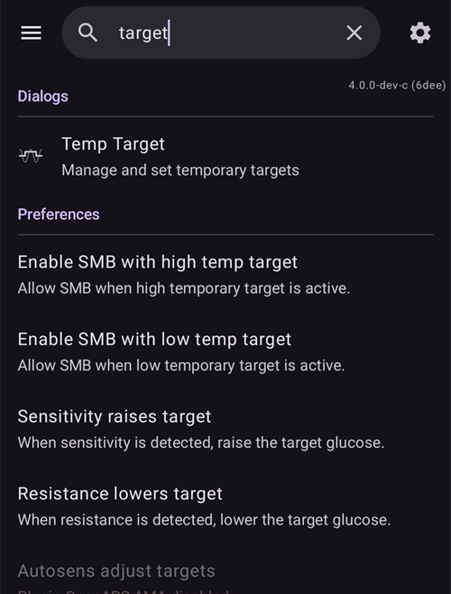
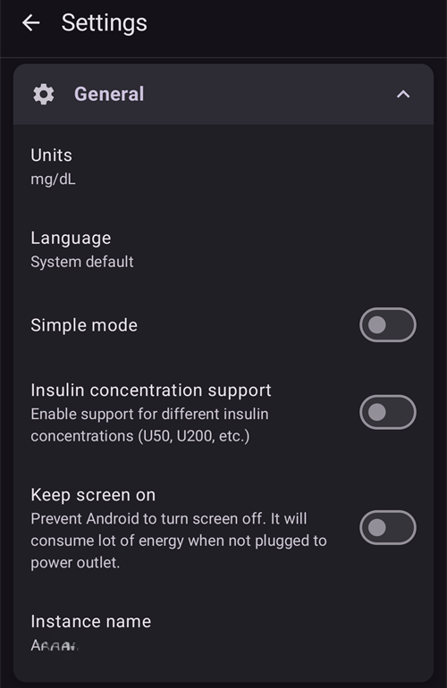
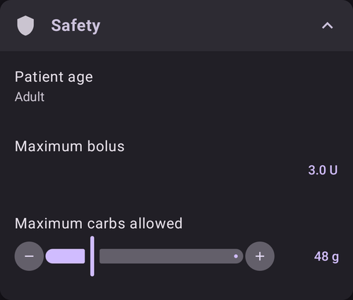
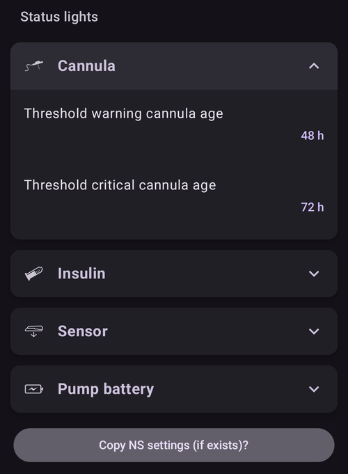
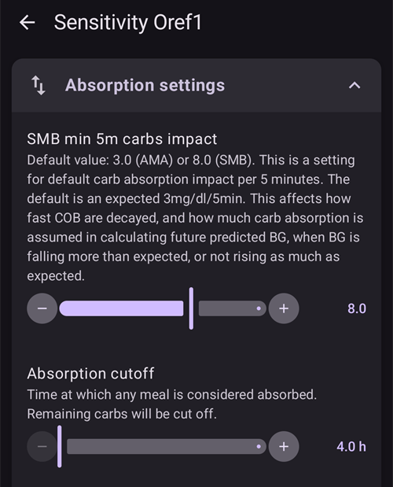
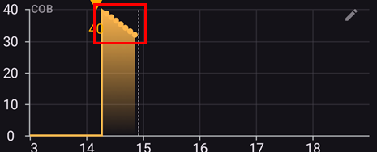
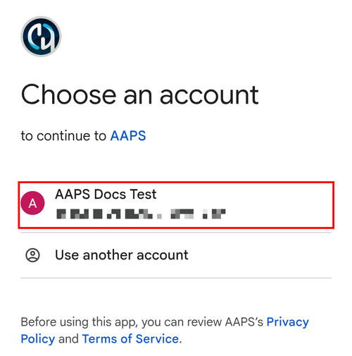

# Setări

În **AAPS** v4, preferințele se găsesc pe ecranul **Setări**. There are three routes to reach them — see [Making changes to your AAPS' configuration](../SettingUpAaps/ChangeAapsConfiguration.md) for details:

1. Tap the **Settings** (gear) icon in the top-right corner of the main screen: all settings, grouped into expandable sections.
2. În **Configurație**, apăsați „**Setări**” sub un modul activ: doar setările acelui modul.
3. Use the **search bar** on top of the main screen: just start typing part of the text you are looking for. This finds individual settings (even those not visible in the Settings screen), dialogs and documentation.



- **Sections** are opened and closed by tapping them. Secțiunile pe care le vedeți depind de modulele activate și de [Modul simplu](#preferences-simple-mode).


```{contents}
:backlinks: entry
:depth: 2
```

(Preferences-general)=
## General



**Unități**

- Set units to mmol/L or mg/dL depending on your preferences.

**Limbă**

- By default **AAPS** follows the language of the phone (recommended).

- If you want **AAPS** in another language than the phone, choose it here. On Android 13 and newer, **AAPS** registers it as its own app language in Android, so all its screens, the main screen, the widgets and the way numbers are written follow it.

- When you change the language, the texts of **AAPS** switch to the new language straight away. If some texts still show the old language, restart **AAPS**.
- Pe Android 12 această setare nu este afișată: **AAPS** folosește întotdeauna limba telefonului.
- Setare ascunsă în [modul simplu](#preferences-simple-mode).

(preferences-simple-mode)= **Mod simplu**

The **simple mode** is activated by default when you first install **AAPS**. In **simple mode**, a significant amount of settings is hidden and preferences are replaced by predefined values. You should switch off Simple mode once you become familiar with **AAPS** user interface and settings.

**Suport pentru concentrația insulinei**

- Activează suportul pentru diferite concentrații de insulină (U50, U200, ...). Activați această opțiune doar dacă folosiți cu adevărat o altă concentrație decât U100 și citiți cu atenție avertismentele.
- Setare ascunsă în [modul simplu](#preferences-simple-mode).

**Păstrați ecranul aprins**

- Forces Android to keep the screen on at all times. Acest lucru este folositor pentru prezentări șamd. Dar consumă repede bateria. Ca urmare e recomandabil sa conectați telefonul inteligent la un încărcător.

**Nume instanță**

- Numele persoanei care folosește acest telefon. It tells this **AAPS** instance apart in reports and synchronization, for example if two children with type 1 diabetes in your family use **AAPS**.
- Este folosit în numele fișierelor de setări exportate.
- Displayed in the [Dual Watchface](../WearOS/WearOsSmartwatch.md).

(Preferences-skin)=
### Piele

The skin selection from **AAPS** 3.x (Original, Low resolution, Large display...) no longer exists in **AAPS** 4. The new interface adapts to your screen automatically, and the color scheme can be changed in [Appearance](#preferences-appearance).

(preferences-appearance)=
## Aspect


(Preferences-range-for-visualization)=
### Intervalul pentru vizualizare

Choose the high and low marks for the BG-graph on **AAPS** main screen and smartwatch. Este doar pentru vizualizare, nu este intervalul țintă al glicemiei. Exemplu: 70 - 180 mg/dL sau 3,9 - 10 mmol/L

(Preferences-show-notes-field-in-treatments-dialogs)=
### Afișați notele în dialoguri

Oferă posibilitatea sa adaugi texte scurte la tratament (ajutor la bolusare, carbohidrați, insulină...)

Setare ascunsă în [modul simplu](#preferences-simple-mode).

### Schema de culori a aplicației

Choose between the light theme, the dark theme, or following the phone's system setting.

(Preferences-protection)=
## Protecție


(Preferences-master-password)=
### Parola principală

Obligatorie pentru a putea [exporta setările](../Maintenance/ExportImportSettings.md), deoarece acestea sunt criptate începând cu versiunea 2.7.

**Biometric protection may not work on OnePlus phones. Aceasta este o problemă cunoscută a OnePlus pe unele telefoane.**


(Preferences-settings-protection)=
### Protecție setări

- Protect your settings with a password or phone's biometric authentication (i.e. [child is using **AAPS**](../RemoteFeatures/RemoteMonitoring.md)). If you enable this feature, you will be prompted for authentication each time you want to access any Settings related view.

- The management screens (**Profile**, **Insulin settings**, **Temp Target**, **QuickWizard**) then open **read-only**. You can still activate or use an entry, but adding, editing, cloning and deleting are hidden until you unlock your settings. Consultați [Protecția setărilor blochează acum și ecranele de gestionare](#v4changes-read-only-management).

- Custom password should be used if you want to use master password just for securing [exported settings](../Maintenance/ExportImportSettings.md), and use a different one for editing the settings.

- If you are using a custom password click on line "Settings password" to set password as described [above](#Preferences-master-password).

### Protecție aplicație

If the app is protected, you must enter the password or use the phone's biometric authentication to open **AAPS**, and again when you come back to it after the [protection timeout](#Preferences-password-and-pin-retention).

**AAPS** will shut down immediately if a wrong password is entered - but will still run in background if it was previously opened successfully.

### Protecție bolus

- Bolus protection might be useful if **AAPS** is used by a small child and you [bolus via SMS](../RemoteFeatures/SMSCommands.md).

- **Bolus protection** can only be selected once **Settings protection** (Level 2) is set.

- În exemplul de mai jos, protecția bolusului folosește **Parola principală**: **AAPS** o cere înainte de a deschide un dialog de tratament, cum ar fi **Insulină**. Cu **Biometric**, dacă autentificarea biometrică nu funcționează, puteți introduce în schimb parola principală.


(Preferences-password-and-pin-retention)=
### Păstrarea parolei și a PIN-ului

**Protection timeout** defines how long (in seconds) the settings or bolus functionalities remain unlocked after you successfully enter the password.

## Siguranța tratamentului



(preferences-patient-type)=
### Vârsta pacientului

- Limitele de siguranță sunt stabilite în baza vârstei selectate în această setare.
- Dacă începeți să vă loviți de aceste limite dure (cum ar fi bolusul maxim) este timpul să vă mutați cu un pas mai sus.
- Nu este o idee bună să alegeți o vârstă mai mare decât cea reală, deoarece poate duce la supradozare dacă introduceți o valoare greșită în dialogul de insulină (de exemplu, dacă omiteți separatorul zecimal).
- If you want to know the actual numbers for these hard-coded safety limits, scroll to the algorithm feature you are using on [this page](../DailyLifeWithAaps/KeyAapsFeatures.md).

(Preferences-maximum-bolus)=
### Bolus maxim

- Defines the maximum amount of bolus insulin, in insulin units, that **AAPS** is allowed to deliver at once.
- Această setare are rațiunea de a fi o limită de siguranță pentru a preveni administrarea unor bolusuri masive, datorită unor greșeli de introducere sau din eroarea utilizatorului.
- Se recomandă să setați o valoare rezonabilă, care corespunde aproximativ cantității maxime de insulină bolus de care ați putea avea vreodată nevoie pentru o masă sau pentru o doză de corecție.
- Restricția este, de asemenea, aplicată și rezultatele calculatorului de bolus.

### Maximul de carbohidrați permis

- Defines the maximum amount of carbs, in grams, that **AAPS** bolus calculator is allowed to dose for.
- Această setare are rațiunea de a fi o limită de siguranță pentru a preveni administrarea unor bolusuri masive, datorită unor greșeli de introducere sau din eroarea utilizatorului.
- Se recomandă să stabiliți această setare la o valoare de bun simț, care să corespundă, în linii mari, cantității maxime de carbohidrați pe care ați putea-o ingera la o masă.

## Sursă glicemie

The settings of your selected [BG source](#Config-Builder-bg-source) appear as their own section. De exemplu, cu **Glicemie xDrip+**:


- **Upload BG data to NS**: let **AAPS** upload the received BG values to Nightscout. Only enable this if the CGM app itself is not already uploading them.
- **Log sensor change**: create a sensor change therapy event automatically when the sensor is inserted.

## Ecranul principal

In **AAPS** 3.x these settings were grouped in an "Overview" section. In **AAPS** 4 they are configured directly from the main screen elements they belong to.

(Preferences-buttons)=
### Butoanele Lansare rapidă

Define which action buttons are visible on the main screen: tap the small **gear** at the bottom center of the main screen ("Configure QuickLaunch") and **Add** the actions you want quick access to (treatments, CGM actions, careportal entries...).


(Preferences-quick-wizard)=
### Asistent Rapid

Create customized buttons for certain standard meals or snacks which will be displayed on the main screen. Useful for standard meals frequently eaten.

Pentru fiecare buton definiți carbohidrații și metoda de calcul pentru bolus. Then, you define during which time period the button will be visible on your main screen - just one button per period. The button will not be visible if outside the specified time range or if you have enough IOB to cover the carbs defined in the QuickWizard button. If different times are specified for the different meals you will always have the appropriate standard meal button on the main screen, depending on the time of day.

To manage your Quick Wizard presets, type "QuickWizard" in the main screen search bar and open **QuickWizard - Manage quick wizard presets**.

If you click the quick wizard button **AAPS** will calculate and propose a bolus for those carbs based on your current ratios (considering blood glucose value or insulin on board if set up).

Propunerea trebuie confirmată înainte de a se administra insulină.

(Preferences-default-temp-targets)=
### Ținte temporare implicite

[Temporary targets (TT)](../DailyLifeWithAaps/TempTargets.md) allow you to change your blood glucose target for a certain time period. When setting a default TT, you can easily change your target for activity, eating soon etc.

Apăsați **intervalul țintă** de pe ecranul principal pentru a deschide ecranul **Țintă temporară**. Swipe through the preset cards (Eating Soon, Activity, Hypo) and change the target and the duration of each preset under **Preset Settings**. Valorile prestabilite sunt:

* Mănânc în curând: țintă 90 mg/dL / 5,0 mmol/L, durată 45 min
* Exercițiu fizic: țintă 140 mg/dL / 7,8 mmol/L, durată 90 min
* Hypo: target 160 mg/dL / 8.9 mmol/L, duration 60 min


Aflați cum să [activați țintele temporare aici](#TempTargets-where-can-i-select-a-temp-target).

### Umplere/Amorsare cantități standard de insulină

Dacă doriți să umpleți tubul sau să amorsați canula prin **AAPS**, puteți face acest lucru cu butoanele **Amorsare/Umplere** din panoul de stare extins al ecranului principal.

The default amounts of the three fill buttons can be defined in the **Prime/Fill** settings, depending on the length of your catheter. Type "prime" in the main screen search bar to open them.


(Preferences-status-lights)=
### Lumini de stare

Luminile de stare oferă un avertisment vizual pentru:

- Vechime senzor
- Vechimea insulinei (de câte zile este utilizat rezervorul)
- Nivelul rezervorului (unități)
- Vechime canulă
- Vechime baterie pompă
- Nivel baterie pompă (%)

If the warning threshold is exceeded, values will be shown in yellow. If the critical threshold is exceeded, values will be shown in red.

To change the thresholds, expand the status panel on the main screen (chevron on the right of the status row) and tap the small **Settings** icon next to "Status":



Tap an item (**Cannula**, **Insulin**, **Sensor** or **Pump battery**) to open its warning and critical thresholds:


Ultima opțiune vă permite să importați aceste setări din Nightscout, dacă sunt definite acolo. Consultați [documentația Nightscout](https://nightscout.github.io/nightscout/setup_variables/#age-pills) pentru mai multe informații.

(Preferences-deliver-this-part-of-bolus-wizard-result)=
### Setările asistentului de bolusare

Type "bolus" in the main screen search bar to open the **Bolus wizard** settings:


**Bolus percentage** sets the [default percentage](#AapsScreens-section-j) of the bolus calculated when using the bolus wizard.

Default is 100%: no correction. Even when setting a different value here, you can still change each time you use the bolus wizard. If this setting is 75 % and you had to bolus 10U, the bolus wizard will propose a meal bolus of only 7.5 units.

When using [SMB](#objectives-objective9), many people do not meal-bolus 100% of needed insulin, but only a part of it (e.g. 75 %) and let the SMB with UAM (Unattended Meal Detection) do the rest. Using a value lower than 100% here can be useful:
* for people with slow digestion: sending all the bolus upfront can cause hypo because the insulin action is faster than the digestion.
* to leave more room to **AAPS** to deal by itself with **BG rise**. In both cases, **AAPS** will compensate for the missing part of the bolus with SMBs, if/when deemed adequate.

**Utilizați calculatorul de bolus**

When enabled, if you use the bolus wizard while you are in hyperglycemia, you will get a warning, prompting you if you wish to pre-bolus and eat later, when your **BG** gets back in range.

(Preferences-advanced-settings-overview)=
### Superbolus

The Superbolus option of **AAPS** 3.x is not available as a setting in **AAPS** 4.

## Buclă

Consultați [Ecranele AAPS > Ecranul principal > Stare buclă](#AapsScreens-loop-status) pentru a schimba acum modul buclei.

(Preferences-minimal-request-change)=
### Schimbare minimă în modul deschis

Când folosiți **Buclă deschisă**, veți primi notificări de fiecare dată când **AAPS** recomandă ajustarea ratei bazale. To reduce the number of notifications you can either use a [wider bg target range](#profile-glucose-targets) or increase the percentage of the "**Open mode minimum change**" setting. Aceasta definește modificarea relativă necesară pentru a declanșa o notificare.


## Asistent avansat la masă (AMA) sau Super Micro bolus (SMB)

În funcție de setările din [Configurație > APS](../SettingUpAaps/ConfigBuilder.md), puteți alege între doi algoritmi:

- [Advanced meal assist (OpenAPS AMA)](#Open-APS-features-advanced-meal-assist-ama) - state of the algorithm in 2017
- [Super Micro Bolus (OpenAPS SMB)](#Open-APS-features-super-micro-bolus-smb) - most recent algorithm recommended for beginners

Începând cu [**AAPS** versiunea 3.3](#version3300), funcția [ISF dinamic](../DailyLifeWithAaps/DynamicISF.md) a fost mutată în OpenAPS SMB.

### OpenAPS AMA

All the settings for OpenAPS AMA are described in the dedicated section in [Key AAPS Features > Advanced Meal Assist (AMA)](#Open-APS-features-advanced-meal-assist-ama).

(Preferences-openaps-smb-settings)=
### OpenAPS SMB

All the settings for OpenAPS SMB are described in the dedicated section in [Key AAPS Features > Super Micro Bolus (SMB)](#Open-APS-features-super-micro-bolus-smb).

The list of settings you see depends on your progress in the [Objectives](../SettingUpAaps/CompletingTheObjectives.md) and on [Simple mode](#preferences-simple-mode). On a new installation only **Use dynamic sensitivity** is shown. După ce obiectivele sunt îndeplinite, secțiunea arată astfel:


**Advanced Settings** at the bottom of the section holds values that you normally do not have to change:


## Setări absorbție



(Preferences-min_5m_carbimpact)=
### Impactul minim al carbohidraților pe 5 minute (SMB) (min_5m_carbimpact)

Setare ascunsă în [modul simplu](#preferences-simple-mode).

The algorithm uses BGI (blood glucose impact) to determine when [carbs are absorbed](../DailyLifeWithAaps/CobCalculation.md).

At times when carb absorption can’t be dynamically worked out based on your blood's reactions, **AAPS** inserts a default decay to your carbs. Practic, este un sistem de siguranță. This value is only used during gaps in **CGM** readings or when physical activity “uses up” all the blood glucose rise that would otherwise cause **AAPS** to decay COB.

Pentru a spune mai simplu: Algoritmul "știe" cum *ar trebui* să se comporte glicemia ta atunci când este afectată de doza actuală de insulină șamd. Whenever there is a positive deviation from the expected behavior, some carbs are absorbed/decayed. Schimbare mare=mulți carbohidrați etc.

Algoritmul min_5m_carbimpact definește impactul implicit al absorbției carbohidraților per 5 minute. For the full parameter reference see [OpenAPS's preferences and safety settings documentation](https://openaps.readthedocs.io/en/latest/docs/While%20You%20Wait%20For%20Gear/preferences-and-safety-settings.html?highlight=carbimpact#min-5m-carbimpact).

Valoarea standard pentru AMA este 3, pentru SMB este 8.

The COB graph on the main screen indicates when min_5m_carbimpact is being used by putting orange dots along the top of the COB curve.



### Limită de absorbție

Time at which any meal is considered absorbed; remaining carbs will be cut off. Dacă mâncați în mod obișnuit mâncăruri grase sau cu proteine multe, va trebui să creșteți timpul de absorbție.

### Setări avansate - raport autosens


- Definiți raportul minim și maxim [autosens](#Open-APS-features-autosens).
- Normally standard values (max. 1.2 and min. 0.7) should not be changed.

## Pompă


### BT Watchdog

Activate BT watchdog if necessary (e.g. for Dana pumps). It switches off Bluetooth for one second if no connection to the pump is possible. Acest lucru poate ajuta pe unele telefoane la care stiva Bluetooth se blochează.

## Setări pompă

The options here will vary depending on which pump driver you have selected in [Configuration > Pump](#Config-Builder-pump). Pair and set up your pump according to the [pump-related instructions](../Getting-Started/CompatiblePumps.md).

For example with the **Virtual Pump**, the section is called **Virtual pump settings**. You choose the **Pump type** the virtual pump imitates, and whether its status is uploaded to Nightscout:


## Tidepool

Mai multe informații pe pagina dedicată [Tidepool](../SettingUpAaps/Tidepool.md).

(Preferences-nsclient)=
## NSClientV3


The NSClient plugin (shown as **NSClientV3** in the configuration menu) synchronizes your data with Nightscout. It uses the Nightscout API v3.

```{admonition} Data uploaders
:class: warning

When using NSClientV3, all uploaders must use the Nightscout API v3. If another uploader (for example your CGM app) is not API v3 compliant, **let AAPS upload all data** (BG, treatments, ...) to Nightscout and disable that uploader.
```

- Set your *Nightscout URL* (i.e. <https://yoursitename.yourplatform.dom>).
- **Make sure that the URL is WITHOUT /api/v1/ at the end.**
- In Nightscout, create an *[Admin token](https://nightscout.github.io/nightscout/security/#create-a-token)* (requires [Nightscout 15](https://nightscout.github.io/update/update/) to use the V3 API) and enter it in the **Nightscout access token** (not your API Secret!). On **AAPSClient** you can scan the main phone's QR code instead, which sets up a token of the client's own. A client paired with the PIN gets its own token from the main phone after pairing. See [The client's own Nightscout token](#client-master-control-own-token).
- This enables data to be read and written between both the Nightscout website and **AAPS**.
- Verificați temeinic să nu existe greșeli de scriere în aceste setări, în cazul în care nu puteți îndeplini Obiectivul 1.
- Leave "Use websockets" enabled (recommended). Websockets are **mandatory** for remote control from **AAPSClient**, on both phones.

(Preferences-nsclient-synchronization)=
### Sincronizare


Opțiunile de sincronizare depind de modul în care doriți să folosiți **AAPS**.

You can select which data you want to [upload and download to or from Nightscout](#Nightscout-aaps-settings).

While client control is on (always in Simple Mode), these settings are hidden: **AAPS** is then in [hardened mode](#client-master-control-hardened-mode), takes no changes made directly in Nightscout and uploads all its data.

### Opțiuni alarme


- Alarm options allows you to select which Nightscout alarms to use through the app. **AAPS** will alarm when a Nightscout alarm triggers.
- Pentru ca alarmele să sune, trebuie să setați valorile alarmelor Urgent High, High, Low și Urgent Low în [variabilele Nightscout](https://nightscout.github.io/nightscout/setup_variables/#alarms).
- They will only work while you have a connection to Nightscout and are intended for parent/caregivers.
- If you have the **CGM** source on your phone (i.e. xDrip or BYODA) then use those alarms instead of Nightscout Alarms.
- NS announcements will echo Nightscout [announcements](https://nightscout.github.io/nightscout/discover/#announcement) in the **AAPS** notifications.
- You can change stale data and urgent stale data alarms threshold when no data is received from Nightscout after a certain time.

### Control de la distanță

The switch "**Allow client control**" is no longer in these settings: it is at the top of **Manage → Authorized clients**, where the paired clients are managed. See the dedicated [Client / Master control](../RemoteFeatures/ClientMasterControl.md) page, including [hardened mode](#client-master-control-hardened-mode), which this switch turns on.

### Setări conexiune


- Connection settings define when Nightscout connection will be enabled.
- Restricționați încărcarea Nightscout doar prin Wi-Fi sau doar prin anumite rețele Wi-Fi.
- If you want to use only a specific Wi-Fi network you can enter its Wi-Fi SSID.
- Rețele SSID multiple pot fi separate prin punct și virgulă.
- Pentru a șterge toate rețelele SSID introduceți un spațiu gol în câmp.

(Preferences-advanced-settings-nsclient)=
### Setări avansate (NSClientV3)


Opțiunile din setările avansate se explică de la sine.

## Comunicator SMS

Mai multe informații pe pagina dedicată [Comenzi prin mesaje SMS](../RemoteFeatures/SMSCommands.md).

(preferences-wear)=
## Ceas

Această secțiune este afișată când modulul **Ceas** este activat în [Configurație > Comunicare](#Config-Builder-wear). More information on the dedicated [Wear OS smartwatch](../WearOS/WearOsSmartwatch.md) and [Operation of AAPS via your Wear OS smartwatch](../RemoteFeatures/RemoteControlWearOS.md) pages.


- **Control Wear**: permite trimiterea tratamentelor și a altor acțiuni de pe ceas. Without it, the watch only displays data: the phone refuses any command from the watch, and tapping a complication that would open a control screen opens the **AAPS** menu on the watch instead.

**Setări Asistent Wear** definește ce calcule sunt incluse în rezultatul asistentului de bolusare de pe ceas. Pe ceas introduceți doar carbohidrații; aceste comutatoare înlocuiesc alegerile pe care le-ați face în asistentul de bolusare de pe telefon:

- **Include BG in wizard**: add a correction for the difference between your current glucose and your target.
- **Include temp target in wizard**: use the running temp target instead of the profile target for this correction.
- **Include trend in wizard**: take the current glucose trend into account.
- **Include COB in wizard**: add insulin for the carbs that are still on board.
- **Include IOB in wizard**: subtract the insulin that is still on board.


**Setări cadran personalizat** conține **Autorizați cadrane de ceas personalizate**. A custom watchface file can include values for some watch settings. When this switch is on, loading such a watchface is allowed to change those settings on the watch; when it is off, the watchface is loaded but the settings stay as they are:


**Setări generale** conține **Notificați despre SMB**, pentru a primi o notificare pe ceas de fiecare dată când este administrat un SMB:


## Autotune

Această secțiune este afișată când modulul **Autotune** este activat în [Configurație > General](#Config-Builder-autotune). Setările sunt descrise pe pagina dedicată [Autotune](../AdvancedOptions/Autotune.md).


## Automatizare


Selectați ce serviciu de localizare va fi folosit:

- Use passive location: **AAPS** only takes locations if other apps are requesting it
- Folosiți locația de rețea: Locația Wi-Fi
- Utilizați localizarea GPS (Atenție! Poate cauza un consum excesiv de baterie!)

## Alerte locale


Setările ar trebui să fie de la sine înțelese.

**Override Do Not Disturb mode** (on by default): the **AAPS** alarms ring even when the phone is silent or in Do Not Disturb. Turn it off if **AAPS** should respect those modes: the alarms do not ring then, and in Do Not Disturb they only vibrate, on the phone and on the watch. Loop suggestions that arrive during Do Not Disturb are shown without a sound.

When an alarm rings, the alarm screen offers **Silence alarm** (the screen stays open, so you can read the message) and **Silence and close**. Swiping the alarm notification away in the notification tray mutes the alarm. Când deschideți **AAPS** mai târziu, o alarmă la care nu ați răspuns este afișată din nou.

(preferences-maintenance-settings)=
## Setări mentenanță


**Destinatar email**: destinatarul standard al jurnalelor este <logs@aaps.app>.

**Number of logs to send**: how many of the most recent log files are attached when you send logs.

**Opțiuni de date**


You can help develop **AAPS** further by sending crash reports to the developers.

**Unattended Settings Export**<br/> By enabling this feature, you allow **AAPS** to execute settings exports without user intervention. Pentru aceasta, parola principală este salvată în siguranță pe telefon (doar acolo) la următorul export manual. The stored password will be used for up to 4 weeks. After 4 weeks you will be notified the password is about to expire. During a grace period of 1 week, the password can then be refreshed by manually exporting settings from the maintenance menu.

After the grace period of 1 week has passed the stored password expires and any automated settings export will abort while notifying the user, asking to reenter the password. [(**Automated settings exports**)](../DailyLifeWithAaps/Automations.md#automating-preference-settings-export) will be logged to the **AAPS** 'Careportal' and 'User entry' lists under Treatments.

After enabling this option, make sure to perform a manual settings export, where you will be requested for your password, so that **AAPS** can store it.

### Fișiere jurnal

AAPS va salva jurnale pentru depanare.

Do not disable this feature: it will help understanding the reasons if something goes wrong.

If you need to send the logs to the developers, make sure you accurately describe the issue in the email. It is preferable to send logs only after being requested to do so, following an [issue report in GitHub](https://github.com/nightscout/AndroidAPS/issues).

You can find AAPS logs in your phone memory -> Android -> data -> info.nightscout.androidaps -> files.

Log handling (log settings, sending and deleting logs) and file management are found on the **Maintenance** screen, opened from the **menu** (☰) in the top-left corner of the main screen:


(preferences-maintenance-logdirectory)=

### Setting the local AAPS directory

Ecranul **Mentenanță** include și **Dosar AAPS**. This setting allows the user to choose a directory on their phone where **AAPS** will store preferences, logs, and other files. Once a directory is chosen, its path (for example `Documents/AAPS`) is shown below **AAPS directory**, so you can always see where your files are saved.

It is strongly recommended to use a directory directly in the main entry of your phone memory. Default is AAPS.


If you select a subdirectory of AAPS, you will see an error message. Tap "OK" and retry, selecting the correct directory (one above). Do not select "DISMISS" unless you clearly know what you are doing.


Android can silently take the directory permission away, for example after you reinstall **AAPS** or clear its storage. When that happens, **AAPS** shows a persistent **Access to the AAPS directory was lost** notification and local settings export stops working until you come back here and select the directory again. Do this promptly, otherwise your backups on the phone are no longer refreshed.

(preferences-maintenance-cloud)=

### Setarea unui dosar cloud

Puteți exporta setările, jurnalele și datele CSV într-un serviciu cloud.

1. Deschideți **meniul** (☰), selectați **Mentenanță** și apăsați **Dosar Cloud** (sub **Gestionarea fișierelor**).

   

2. În **Alegeți tipul de stocare**, selectați **Google Drive**.

   

3. A Google sign-in page opens. Choose the Google account that will hold your backups (you can use a [dedicated Google account](../UsefulLinks/DedicatedGoogleAccountForAaps.md)).

   

4. Check that the account is the right one and tap **Continue** to give **AAPS** access. If you set up the cloud directory before, the page says that **AAPS** already has some access.

   

5. Înapoi în **AAPS**, mesajul **Autentificare reușită în stocarea din cloud** apare în partea de jos a ecranului principal:

   

   In the **Maintenance** menu, **Cloud Directory** now has a green dot, and the **Cloud** buttons next to **Send logs**, **Export settings**, **Import settings** and **Export User Entries to Excel (csv)** are available.

   

To stop exporting to the cloud, tap the **✕** (**Clear Settings**) icon at the end of the **Cloud Directory** row in the **Maintenance** menu (it is shown once a cloud service is set up) and confirm **Clear Cloud Settings**. This switches back to local storage and clears the authorization.

## Open Humans

Poți ajuta comunitatea prin donarea datelor tale către proiecte de cercetare! Details are described on the [Open Humans page](../SupportingAaps/OpenHumans.md).

In **Settings → Open Humans**, you can define when data shall be uploaded
- doar dacă este conectat la Wi-Fi
- doar când se încarcă
