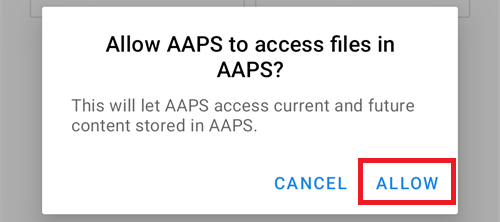
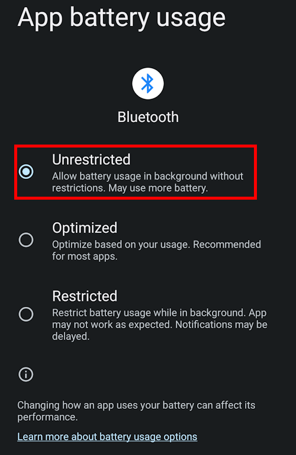
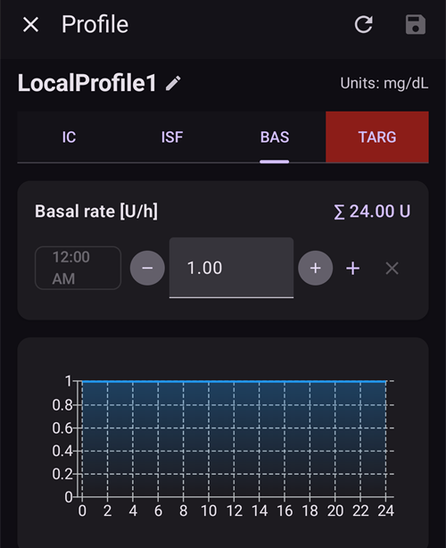
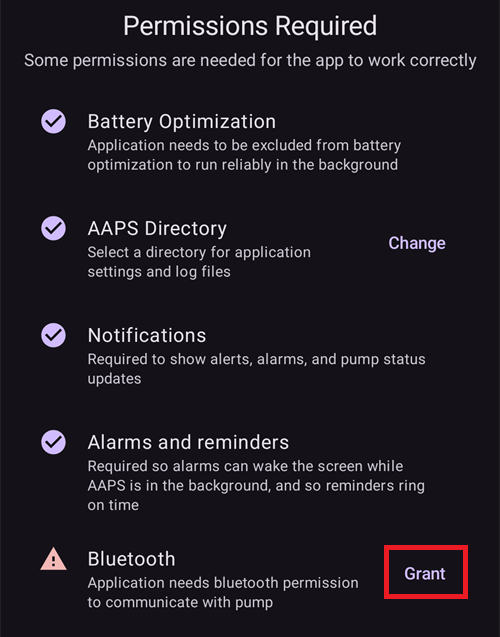

# Asistent de configurare AAPS

```{contents} In this page
:backlinks: entry
:depth: 2
```

When you first start **AAPS** you are guided by the "**Setup Wizard**", to quickly setup all the basic configurations of your app in one go. **Setup Wizard** guides you, in order to avoid forgetting something crucial. De exemplu, **setările de permisiuni** sunt fundamentale pentru configurarea corectă a **AAPS**.

However, it's not mandatory to get everything completely configured in the first run of using the **Setup Wizard** and you can easily exit the Wizard and come back to it later. There are three routes available after the **Setup Wizard** to further optimize/change the configuration. Acestea vor fi explicate în următoarea secțiune. Așa că este în regulă dacă săriți peste câteva puncte în asistentul de configurare, le puteți configura mai târziu.

During, and directly after using the **Setup Wizard** you may not notice any significant observable changes in **AAPS**. To enable your **AAPS** loop, you have to follow the **Objectives** to enable feature after feature. You will start **Objective 1** at the end of the Setup Wizard. You are the master of **AAPS**, not the other way around.

```{admonition} Preview Objectives
:class: note
If you are keen to know the structure of the objectives, please read [Completing the objectives](../SettingUpAaps/CompletingTheObjectives.md) but then come back here to run the Setup Wizard first.

```

From previous experience, we are aware that new starters often put themselves under pressure to setup **AAPS** as fast as possible, which can lead to frustration as it is a big learning curve.

So, please take your time in configuring your loop, the benefits of a well-running **AAPS** loop are huge.

```{admonition} Ask for Help
:class: nota
Dacă există o eroare în documentație sau aveți o idee mai bună despre cum se poate explica ceva, puteți cere ajutor din partea comunității așa cum este explicat la [Conectați-vă cu alți utilizatori](../GettingHelp/WhereCanIGetHelp.md).
```
## Mesaj de întâmpinare

When the Setup Wizard opens, it greets you with a short welcome message and immediately shows a "**Permissions Required**" panel at the bottom of the screen (see next section).

Once you have granted the permissions, the panel closes and the welcome screen shows a "**Next**" button. Apăsați „**URMĂTOR**” pentru a continua:


## Permisiunile necesare

**AAPS** are nevoie de câteva permisiuni pentru a funcționa corect. Asistentul le grupează într-un singur panou „**Permisiuni necesare**”, fiecare cu propriul buton „**Acordați**”. Grant them one by one — the icon next to each item turns into a tick once it is done.


### Optimizarea bateriei

Battery consumption on smartphones is a consideration, as the performance of batteries is still quite limited. Therefore, the Android operating system on your smartphone is restrictive about allowing applications to run and consume CPU time, and therefore battery power.

However, **AAPS** needs to run regularly, _e.g._ to receive the glucose readings every few minutes and then apply the algorithm to decide how to deal with your glucose levels, based on your specifications. Therefore it must be excluded from battery optimization.

Press "**Grant**" next to "**Battery Optimization**", then select "**Allow**" on the "Let app always run in background?" dialog:


(SetupWizard-StoragePermission)=

### AAPS Directory

**AAPS** needs to store its settings and log information on the permanent storage of your smartphone. Stocarea permanentă înseamnă că va fi disponibilă chiar și după repornirea telefonului dumneavoastră inteligent. Alte informații se pierd, deoarece nu sunt salvate în spațiul de stocare permanent.

Apăsați „**Acordați**” lângă „**Dosar AAPS**”. This opens the file system on your phone and lets you choose where **AAPS** stores its information.

```{tip}
Choosing the default AAPS directory is recommended.</br>
Do **not** select a subdirectory of AAPS.
```

The default directory is **AAPS**, but you can use any dedicated directory of your liking. Create the directory if necessary, enter it and choose "**USE THIS FOLDER**":


Confirm with "**ALLOW**" that you wish to grant access to **AAPS** to the selected directory:



### Notificări

Android necesită permisiuni speciale pentru aplicații dacă acestea doresc să vă trimită notificări.

While it is a good feature to disable notifications _e.g._ from social media apps, it is essential that you allow **AAPS** to send you notifications.

Press "**Grant**" next to "**Notifications**" and select "**Allow**" at the system prompt:


### Alarme și mementouri

On **Android 14 and newer**, **AAPS** needs the "**Alarms and reminders**" permission so that alarms can wake the screen while **AAPS** is in the background, and so that reminders (for example from an **Automation**) ring on time.

Acest element este afișat doar cât timp este necesar. Once **AAPS** is excluded from battery optimization (see above), Android grants exact alarms automatically and the item disappears. If it is still listed, press "**Grant**" next to "**Alarms and reminders**". This opens a system settings screen for **AAPS**; enable the toggle and return to **AAPS**. On Android 13 and older this item does not appear and no action is needed.

Once all the permissions show a tick (three, or four on Android 14 and newer), the "**Permissions Required**" panel closes by itself and you can press "**NEXT**" on the welcome screen to continue.

(setup-wizard-bluetooth-battery-optimisation)=
### Optimizarea bateriei pentru Bluetooth

```{admonition} Extra Android setting, not part of the Wizard
:class: note
The following is additional Android configuration done outside of the Setup Wizard. It is not one of the "Grant" buttons above, but it is important for a reliable pump connection.
```

Versiunile mai noi de Android au adăugat optimizarea bateriei și pentru aplicația de sistem Bluetooth.

Pe lângă dezactivarea optimizării bateriei pentru **AAPS**, probabil va trebui să o dezactivați și pentru aplicația de sistem Bluetooth. Failure to do this may lead to pump connection dropouts and issues.

***NOTE: The xDrip documentation covers how to do this here: [xDrip documentation](https://navid200.github.io/xDrip/docs/BluetoothBatteryOpt.html)***

Follow these steps on Android 16; other versions will vary slightly from the provided screenshots:

1. Open Android settings and search for **Apps**, and open the Apps settings.

   

2. You will see the App settings, however we need to expand to see all apps, click on **See all apps** to expand.

   

3. As the Bluetooth app is a system app, it's hidden by default, so we need to show system apps. Click on the **three dots** (⋮) on the top right (1). Then click on **Show system** (2).

   

4. Search for the `Bluetooth` app and click on `Bluetooth` and/or `Legacy Bluetooth` if both are present ensure the procedure is followed for both.

   ***NOTE: It's safe to ignore the `Bluetooth MIDI Service` this is not used by AAPS***

           

   1. Pe Android 12 apăsați pe `Battery` (Baterie), pe Android 13+ apăsați pe `App battery usage` (Utilizarea bateriei de către aplicație).

      

5. On Android 12+ select the `Unrestricted` option, on Android 15+ you need to expand the `Allow background usage` setting, click on the section highlighted in red to do this then follow step 6 to complete.

       

6. On Android 16 Select `Unrestricted`

   

## Acord de licențiere

In the end user license agreement there is important information about the legal aspects of using **AAPS**. Vă rugăm să o citiți cu atenție.

If you don't understand, or can't agree to the end user license agreement please don't use **AAPS** at all!

If you understand and agree, please press the "**I UNDERSTAND AND AGREE**" button and follow the Setup Wizard:


A "**Next**" button appears once you have agreed. Apăsați „**URMĂTOR**”.

The next screen, "**Permissions**", lists the permissions again. They should all show a tick, as you granted them at the start. Dacă lipsește una, apăsați „**Acordați**” lângă ea. Apăsați „**URMĂTOR**” pentru a continua:


## Parola principală

As the configuration of **AAPS** contains some sensitive data (_e.g._ the access token for your Nightscout server) it is encrypted by a password you set here.

Asistentul afișează „**Parola nu a fost setată**”. Apăsați „**Setați**”:


Se deschide ecranul „**Protecție**”. Apăsați „**Parola principală**” (afișată ca „Parola nu a fost setată”):


Introduceți aceeași parolă în ambele câmpuri și apăsați „**OK**”:


Reveniți cu săgeata din colțul din stânga sus. Asistentul afișează acum „**Parola a fost setată!**”:


```{admonition} Do not lose your Master Password
:class: danger
Please **DO NOT LOSE YOUR MASTER PASSWORD**. Make a note of it _e.g._ on Google Drive, which is a good place as it is backed up by Google for you. Calculatorul sau telefonul dumneavoastră inteligent se pot defecta și este posibil să nu aveți nicio copie. Dacă uitați parola principală, vă poate fi dificil să vă recuperați configurația profilului și să progresați prin **Obiective** la o dată ulterioară.
```

Când ați terminat, apăsați „**URMĂTOR**” pentru a trece la ecranul următor.

(setup-wizard-import-settings)=
## Importați setările

This screen is only shown when **AAPS** finds settings exported earlier in the **AAPS** directory ("Stored settings found"), for example when you reinstall the app or move to a new phone.

- To restore your previous configuration, press "**Import settings**" — see [Export & import settings](../Maintenance/ExportImportSettings.md).
- To start with a new configuration, press "**NEXT**" and continue with the Wizard.


## Unități (mg/dL <-> mmol/L)

Selectați dacă valorile glicemiei sunt în mg/dL sau mmol/L, apoi apăsați butonul „**URMĂTOR**”:


## Setări afișare

Here you set the "**LOW mark**" and "**HIGH mark**" for the sensor glucose display. Glucose values between these two marks are shown as "in range". You can leave the default values (72 and 180 mg/dL) for now, and edit them later.

Valorile pe care le alegeți afectează doar prezentarea grafică a diagramei și nimic altceva.

Your glucose target _e.g._ is configured separately in your profile.

Intervalul dumneavoastră de analizare a TIR (timpul în interval) este configurat separat în serverul dumneavoastră de raportare.

Adjust the marks with the "−" / "+" buttons if needed, then press the "**NEXT**" button:


(SetupWizard-synchronization-with-the-reporting-server-and-more)=
## Comunicare

The "**Communication**" screen lists the plugins used to upload, synchronize and broadcast your data:

- **Comunicator SMS** – controlul de la distanță al **AAPS** prin comenzi SMS
- **NSClientV3** – synchronizes your data with Nightscout using the v3 API
- **Tidepool** – încarcă datele în Tidepool
- **xDrip** – sends data to xDrip
- **Open Humans** – upload and donate your diabetes data to scientific projects
- **Ceas** – monitorizați și controlați **AAPS** de pe un ceas WearOS
- **External Companion Apps** – data broadcasting to various external apps
- **Garmin** – connection to a Garmin device


Derulați în jos pentru a vedea restul listei:


You could configure several of these now, but for the first run we will just focus on the reporting server. If you are not able to set it up at the moment, skip it for now — you can configure it later.

În acest exemplu folosim Nightscout ca server de raportare. Bifați căsuța din dreapta lui „**NSClientV3**” pentru a-l activa. Pentru Tidepool este chiar mai simplu, deoarece aveți nevoie doar de informațiile dumneavoastră personale de autentificare.

După activare, apăsați „**Setări**” sub NSClientV3 pentru a-l configura:


Aici configurați serverul de raportare Nightscout. The NSClientV3 settings are shown as one scrollable page:


Press "**Nightscout URL**" and enter your personal Nightscout server address (the URL you set up yourself, or were given by your service provider). Confirmați cu „**OK**”.

Press "**Nightscout access token**" and enter the access token for your Nightscout server. Fără acest jeton, accesul nu va funcționa. Dacă nu îl aveți încă, consultați documentația pentru configurarea serverului de raportare.

Leave "**Use websockets**" enabled for real-time communication with Nightscout. Websockets are **mandatory** for remote control from **AAPSClient**, on both phones.

Celelalte secțiuni pot rămâne deocamdată la valorile implicite. They are described here so you know where to find them later:

**Alarm options** — Nightscout alarms, announcements and stale-data thresholds. Leave the switches off for now; we only open them so you are aware of the options.

**Connection settings** — choose how data is transferred. Caregivers must enable "**Use cellular data**", otherwise the phone of the person they care for (_e.g._ a child) cannot upload outside Wi-Fi range, _e.g._ on the way to school. Other users can disable cellular transfer to save data or battery. If in doubt, leave everything enabled.


**Advanced Settings** — enable "**Log app start event**" if you want to see in Nightscout when the app restarts (useful for caregivers). Keep "**Create announcements from errors**" and "**Create announcements from carbs required**" enabled. Leave "**Use slow sync**" off; you would only use it if the Nightscout server is slow to process a large amount of data.


Reveniți la lista de module și apăsați „**URMĂTOR**” pentru a trece la ecranul următor.

## Control client

From **AAPS** version 4, client devices running **AAPSClient** can be **paired** with this phone (the **master**) and control it with signed commands sent over Nightscout. This is the new recommended way to control **AAPS** remotely — see [Master ↔ Client control](../RemoteFeatures/ClientMasterControl.md) for the full explanation and setup.

There is nothing you have to configure on this screen now; you can pair clients at any time later from **Manage → Authorized clients**. There you add a client with a **QR code** (it sets up Nightscout on the client too) or with a **PIN**, and give it a **role**.

- "**Authorized clients**" — manage the paired client devices allowed to control this master.
- „**Acceptarea datelor Nightscout**” — acceptarea tratamentelor și a datelor introduse direct în Nightscout (metoda veche, mai puțin sigură) este acum dezactivată implicit. Only open these settings if you still need it, _e.g._ to enter data through Nightscout or third-party apps.

When client control is already on — always in [Simple Mode](#preferences-simple-mode) — this phone is in [hardened mode](#client-master-control-hardened-mode): it takes changes only from paired clients, so the screen explains hardened mode instead of offering the "**Nightscout data acceptance**" settings.


"**Nightscout data acceptance**" opens the "**Synchronization**" settings, where each kind of data received from Nightscout has its own switch:


Apăsați „**URMĂTOR**” pentru a trece la ecranul următor.

(setup-wizard-instance-name)=
## Cine folosește acest telefon?

Aici introduceți numele persoanei care folosește acest telefon. It tells this **AAPS** instance apart from others in reports and when synchronizing, for example if two children in your family use **AAPS**. It is also used in the names of exported settings files and shown on the watch.

Poate fi orice. You can change it later in **Settings → General → Instance name**.

Apăsați „**URMĂTOR**” pentru a trece la ecranul următor.


## Tip de pacient

Here you select your "Patient type" which is important, as the **AAPS** software has different limits, depending on the age of the patient. Acest lucru este important din motive de securitate și siguranță.

Here is where you also configure the **maximum allowed bolus** for a meal. Adică, cel mai mare bolus pe care trebuie să-l dați pentru a acoperi mesele obișnuite. It's a security feature to help avoid accidentally overdosing when you are bolusing for a meal.

A doua limită este similară din punct de vedere al conceptului, dar se referă la cantitatea maximă de carbohidrați pe care o așteptați.

After setting these values, press "**NEXT**" to go to the next screen:


## Insulină

Here you configure the insulin used in your pump. New insulin profiles require a **DIA of at least 5 h**.

Apăsați butonul „**Insulină**” pentru a deschide editorul de insulină:


In the editor you can give the insulin a **nickname** and set its **Peak** (in minutes) and **DIA** (in hours). The quickest way is to load a preset with "**Load peak from**" — choose **Novorapid**, **Fiasp** or **Lyumjev** — and the peak is filled in for you. The graph at the bottom previews the resulting insulin activity curve.


Pick the preset that matches your insulin, for example **Fiasp**:


```{admonition} Use your insulin brand's preset peak
:class: danger
Please don't change the peak unless you are an expert — usually the preset values work well for each branded insulin.
```

If you are a new **AAPS** user, set **DIA** to 9 hours — see [Duration of insulin action (DIA) and peak](#Config-Builder-insulin-dia) to understand why.

```{admonition} "Insulin configuration changed" dialog
:class: note
If a paired client (_e.g._ another phone) has changed the insulin configuration, a dialog appears. Press **OK** to load their changes, or **Cancel** to keep editing (your next save will overwrite theirs).
```


Apăsați pictograma de salvare (dreapta sus), apoi apăsați „**URMĂTOR**” pentru a trece la ecranul următor.

## Sursa glicemiei

Here you select where **AAPS** gets its glucose data from. Please read the documentation for your [BG source](../Getting-Started/CompatiblesCgms.md).

Many sources are available — scroll through the list and select the one you use:


Once you select a source, its card expands and shows two buttons: "**Settings**" to adjust how the data is received, and "**Open plugin**" to open the source's own screen. În exemplul de mai jos este selectat **BYODA**. Some sources have nothing to configure at this stage, so you can usually go straight to the next screen:


După ce ați făcut selecția, apăsați „**URMĂTOR**” pentru a trece la ecranul următor.

(setup-wizard-profile)=
## Profil

Acum intrăm într-o parte foarte importantă a asistentului de configurare.

Please read the documentation about [profiles](../SettingUpAaps/YourAapsProfile.md) before you try to enter your profile details on the following screen.

```{admonition} Working profile required - no exceptions here !
:class: danger
An accurate profile is necessary to control the safe action of **AAPS**.

It's required that you have determined and discussed your profile with your doctor, and that it has been proven to work by successful basal rate, ISF and IC testing!

If a robot has an incorrect input it will fail - consistently. **AAPS** poate lucra doar cu informațiile pe care le primește. If your profile is too strong, you risk hypoglycemia, and if it is too weak, you risk hyperglycemia. 
```

Apăsați butonul „**Profil**” pentru a deschide editorul de profil:


Editorul se deschide gol („Nicio înregistrare disponibilă”). Apăsați butonul „**+**” din partea de jos pentru a crea un profil nou:


Puteți avea mai multe profiluri pe termen lung, dacă este necesar. Noi creăm doar unul aici.

```{admonition} Profile only for tutorial - not for your usage
:class: note
The example profile here is only to show you how to enter data.

It is not intended to be an accurate profile or something very well optimized, because each person's needs are so different.

Don't use it for actually looping!
```

The new profile (for example "**LocalProfile1**") has four tabs: **IC**, **ISF**, **BAS** and **TARG**. Apăsați creionul de lângă numele profilului pentru a-l redenumi. Completați fiecare filă — o filă rămâne roșie și afișează un mesaj de eroare până când conține valori valide:


Press "**IC**" and enter your [IC](#your-aaps-profile-insulin-to-carbs-ratio) values. Use the "**+**" button to add more time blocks:


Apăsați „**ISF**” și introduceți [valorile ISF](#your-aaps-profile-insulin-sensitivity-factor):


Press "**BAS**" and enter your [basal values](#your-aaps-profile-basal-rates):



Apăsați „**ȚINTĂ**” și introduceți valorile țintă ale glicemiei.

For open looping this target can be a wider range, as otherwise **AAPS** notifies you permanently to change the temporary basal rate or another setting, which can be exhausting.

Mai târziu, pentru bucla închisă, veți avea, în general, o singură valoare pentru partea de sus și de jos. That makes it easier for **AAPS** to hit the target and give you better overall diabetes control.


Când toate cele patru file sunt valide, **pictograma de salvare** (dreapta sus) devine activă. Apăsați-o pentru a salva profilul:


Închideți editorul cu „**X**” din colțul din stânga sus. The profile summary then shows its name, its total daily basal (∑), the units and the IC and ISF values with their graphs:


```{admonition} Several defined but only one active profile
:class: note
You can have several profiles defined, but only one activated profile running at any given time.
```

Apăsați butonul „**▶**” (activare) din dreapta jos. Se deschide ecranul „**Activați**”. As no insulin is in use yet, it first asks you to select the insulin you are using, so that the profile switch can record it. Butonul „**Activați**” rămâne gri până când faceți acest lucru:


Apăsați „**Selectați insulina**” și alegeți insulina pe care ați configurat-o mai devreme. Leave the percentage at 100 % and press "**Activate**":


Apare un dialog de schimbare de profil. In this case let it stay as preset and confirm with "**OK**":

```{admonition} Profile switch dialog
:class: note
You will learn later how to use this general dialog to handle situations like illness or sport, where you need to change your profile to suit the circumstances.
```


Your profile is now active. Apăsați „**URMĂTOR**” pentru a trece la ecranul următor.

## Pompa de insulină

Acum selectați pompa de insulină. Please read the documentation for your [insulin pump](../Getting-Started/CompatiblePumps.md).

Scroll the list and select your pump. In this example we use the "**Virtual Pump**", which is useful while you are still learning and have not connected a real pump yet:


Sunt acceptate multe pompe — derulați în jos pentru a o găsi pe a dumneavoastră:


When you select a real pump, **AAPS** asks for a confirmation, because it will copy the basal rates of your profile to the pump and overwrite the basal rates stored there. Press "**OK**" only if the basal rates in your **AAPS** profile are correct; otherwise press "**Cancel**" and switch to the pump later:


Dacă pompa selectată comunică prin Bluetooth, **AAPS** cere permisiunea de a se conecta la dispozitivele din apropiere după ce terminați asistentul (vedeți [Permisiunea Bluetooth](#setup-wizard-bluetooth-permission)).

If you have already set up your profile and know how to connect your pump, feel free to connect it now. Otherwise leave it on **Virtual Pump** for the moment — you can change it anytime, or leave the Setup Wizard using the arrow in the top left corner and let **AAPS** first show you some blood glucose values.

Apăsați „**URMĂTOR**” pentru a trece la ecranul următor.

## Algoritm APS

Utilizați algoritmul OpenAPS SMB ca algoritm APS. Despite the name, the SMB feature of the algorithm is disabled until you are familiar with AAPS and have worked through the first objectives. OpenAPS SMB is newer and generally better than OpenAPS AMA anyway.

SMB is disabled at the start because the SMB feature reacts faster to a blood sugar increase, using a Super Micro Bolus instead of increasing the basal rate percentage. Because your profile is generally not as good in the beginning as it is after some experience, the feature is disabled at first.

```{admonition} Only use the older algorithm **OpenAPS AMA** if you know what you are doing
:class: note
OpenAPS AMA is the most basic algorithm which does not support micro boluses to correct high values. There might be circumstances where it is better to use this algorithm but it is not the recommendation.
```

Selectați „**OpenAPS SMB**”, apoi apăsați „**Setări**” pentru a vedea detaliile:


Singura opțiune de aici este „**Utilizați sensibilitatea dinamică**”. Lăsați-o dezactivată și nu schimbați nimic deocamdată — doar citiți textul.

Due to the limitations which are imposed by the **Objectives** you can't use either "closed loop" or "SMB features" at the moment anyway.

Reveniți și apăsați „**URMĂTOR**” pentru a trece la ecranul următor:


## Detectare sensibilitate

Leave "**Sensitivity Oref1**" selected as the standard sensitivity plugin:


If you press "**Settings**" you can review the absorption settings; the defaults (_e.g._ a 6 h absorption cutoff) are fine for now.


Apăsați „**URMĂTOR**” pentru a trece la ecranul următor.

## Începeți Obiectivul 1

Acum intrați în Obiective — calificarea pentru accesul la alte funcții **AAPS**.

Apăsați „**Deschideți obiectivele**”:


Aici începem Obiectivul 1, chiar dacă deocamdată configurația noastră nu este complet pregătită să finalizeze cu succes acest obiectiv. Dar acesta este începutul.

Apăsați butonul „**Start**” al **Obiectivului 1**:


The objective expands to show its individual checks. Puteți vedea că ați făcut deja unele progrese, în timp ce alte elemente mai trebuie făcute:


Go back, then press "**FINISH**" to complete the Setup Wizard:


After pressing "**FINISH**" you arrive at the main screen of **AAPS**. A "**Notification**" panel may open with information messages, for example about the profile switch you just made — press "**Dismiss**" below each message to clear it.

If you accidentally leave the Setup Wizard at any point, you can either simply re-start the Wizard, or change the [configuration of the AAPS loop](../SettingUpAaps/ChangeAapsConfiguration.md) manually.

(setup-wizard-bluetooth-permission)=
## Bluetooth permission

If you select a pump that connects over Bluetooth (for example **Omnipod Dash**), a banner reminds you that **AAPS** needs Bluetooth permission. You can press "**Dismiss**" for now — the permission is granted after you finish the Wizard:


Once the Setup Wizard is finished, the **AAPS** main screen shows a "**Permissions Required**" panel. Celelalte permisiuni sunt deja acordate; apăsați „**Acordați**” lângă „**Bluetooth**”:



Select "**Allow**" so **AAPS** can find and connect to your pump:


If your **AAPS** loop is now fully setup, please move on to the next section ["Completing the objectives"](../SettingUpAaps/CompletingTheObjectives.md).
