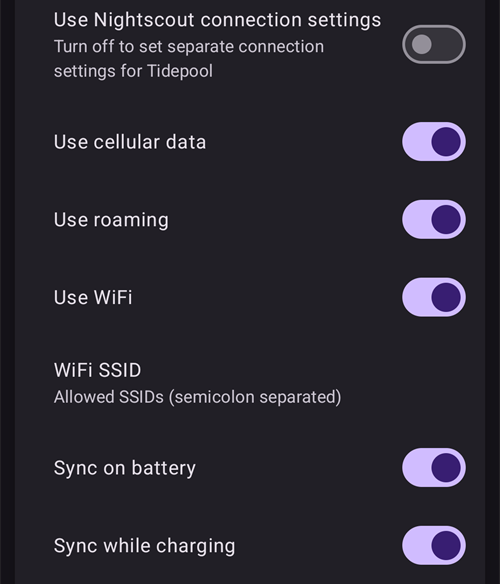

# Tidepool

Tidepool is a third party tool that collects data regarding BG, insulin and carbs (and the notes you add to your treatments) and can be used to analyze and share this data with your clinical team. Since AAPS version 3.2 it can be used as an alternative to Nightscout for satisfying part of Objective 1. Poate fi utilizat, de asemenea, în asociere cu Nightscout, ca o platformă alternativă de raportare care se integrează bine în contexte clinice. Aceasta poate fi opțiunea dorită pentru copiii care utilizează AAPS care doresc să aibă capacitățile de monitorizare și control la distanță ale Nightscout, dar care doresc o platformă de raportare cu care echipa lor clinică se simte mai confortabil.

It is important to understand that Tidepool is for reporting only. NU este o aplicație de urmărire în timp real. Dacă aveți nevoie de urmăritori în afară de telefonul principal AAPS, trebuie să configurați și Nightscout.

Note: the Tidepool organization has brought the iOS Loop product to market with FDA approval. Acest efort nu are nimic de-a face cu platforma lor de raportare a datelor sau cu AAPS.

## Pasul 1 - Creați un cont Tidepool

- Navigați la [tidepool.org](https://www.tidepool.org/)

- Select “Personal Sign Up” or “Sign Up”

- Creați o adresă de e-mail și o parolă pentru cont și notați-le

- Select “Personal Account” and click “Continue”

- Completați secțiunea de informații a pacientului și acceptați termenii de utilizare

- Verificați-vă adresa de e-mail prin intermediul instrucțiunilor primite pe adresa dumneavoastră de e-mail

## Pasul 2 - Conectați AAPS la Tidepool

- Deschideți **meniul** (☰) din colțul din stânga sus al ecranului principal și selectați „**Configurație**”

- Deschideți categoria „**Comunicare**” și activați „**Tidepool**”:

- Apăsați „**Deschideți modulul**” sub Tidepool, apoi apăsați pictograma **Autentificați-vă** (o săgeată care intră într-o ușă) din colțul din dreapta sus

- Se deschide o fereastră de browser cu pagina de autentificare Tidepool. Autentificați-vă cu adresa de e-mail și parola create la Pasul 1 de mai sus:

- After a successful login the browser closes and the Tidepool screen shows the status "**Connected**"; the log below documents the data uploads. If the login fails, confirm your credentials are correct and that you have verified your email address with Tidepool.

- În „**Setări**” ale modulului Tidepool, deschideți „**Setări conexiune**”. By default "**Use Nightscout connection settings**" is on, so Tidepool uploads under the same conditions you set for Nightscout. Turn it off if you want separate conditions for Tidepool, for example to upload to Tidepool only on Wi-Fi and while charging, while Nightscout also uses mobile data.

 

Pentru mai multă asistență despre cum să folosiți datele dumneavoastră odată ce sunt încărcate în Tidepool vă rugăm să vizitați: [https://www.tidepool.org/viewing-your-data](https://www.tidepool.org/viewing-your-data)

(tidepool-menu)=
## Butoanele Tidepool

În colțul din dreapta sus al ecranului Tidepool:

- The **Login** or **Logout** icon — connect to or disconnect from your Tidepool account. Only one of them is shown: **Login** while you are logged out, **Logout** while you are logged in. **AAPS** asks you to confirm before it logs you out.
- The gear icon — the Tidepool settings.

Butoanele din partea de jos a ecranului Tidepool:

- "**Upload now**" — upload new data straight away instead of waiting for the next automatic upload.
- "**Full synchronization**" — upload all data stored in **AAPS** again.
- „**Ștergeți toate datele**” — șterge **toate** datele pe care **AAPS** le-a încărcat în contul dumneavoastră Tidepool. Această acțiune nu poate fi anulată. Folosiți-o doar pentru a elimina date greșite sau duplicate, apoi rulați „**Sincronizare completă**” pentru a încărca din nou datele.
- „**Ștergeți jurnalul**” — golește jurnalul afișat pe ecranul Tidepool.

In Tidepool, the data uploaded by **AAPS** 4 is shown under the device name **AAPS**. Consultați [Ce s-a schimbat în AAPS v4](#v4changes-tidepool) dacă ați folosit Tidepool cu o versiune mai veche. 
