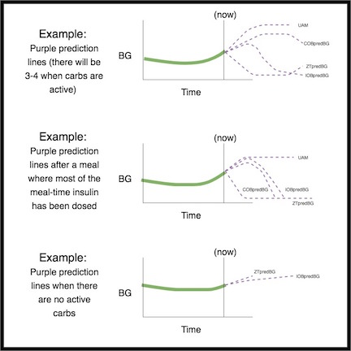
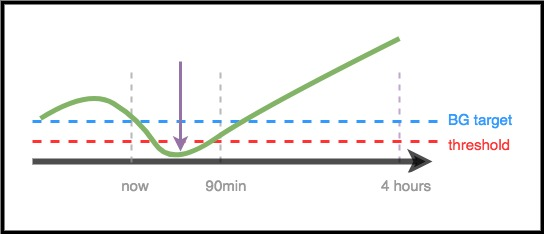
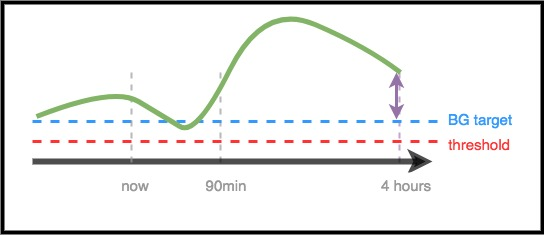

# For Clinicians – A General Introduction and Guide to AAPS

```{note}
Această pagină este o introducere generală pentru medici. A fost revizuită ultima dată în iunie 2026. AAPS develops continuously, so for the most accurate and up-to-date detail always refer to the [main AAPS documentation](../index.md).
```

This page is intended for clinicians who have expressed interest in open source artificial pancreas technology such as AAPS, or for patients who want to share such information with their clinicians.

This guide has some high-level information about DIY closed looping and specifically how AAPS works. For more details on all of these topics, please view the [comprehensive AAPS documentation online](../index.md). If you have questions, please ask your patient for more details, or always feel free to reach out to the community with question. (If you’re not on social media (e.g. [Twitter](https://twitter.com/kozakmilos) or Facebook), feel free to email developers@aaps.app). [Aici puteți găsi și unele dintre cele mai recente studii și date despre rezultate](https://openaps.org/outcomes/).

## Pașii pentru construirea unei bucle închise DIY:

To start using AAPS, the following steps should be taken:

* Găsiți o [pompă compatibilă](../Getting-Started/CompatiblePumps.md), un [dispozitiv Android compatibil](../Getting-Started/Phones.md) și o [sursă CGM compatibilă](../Getting-Started/CompatiblesCgms.md).
* [Download the AAPS source code and build the software](../SettingUpAaps/BuildingAaps.md).
* [Configure the software to talk to their diabetes devices and specify settings and safety preferences](../SettingUpAaps/SetupWizard.md).

## Cum funcționează o buclă închisă DIY

Without a closed loop system, a person with diabetes gathers data from their pump and CGM, decides what to do, and takes action.

With automated insulin delivery, the system does the same thing: it gathers data from the pump, CGM, and anywhere else information is logged (such as Nightscout), uses this information to do the maths and decide how much more or less insulin is needed (above or below the underlying basal rate), and uses temporary basal rates to make the necessary adjustments to keep or eventually bring BGs into target range.

Dacă dispozitivul pe care rulează AAPS se strică sau iese din raza de acțiune a pompei, după ce se termină ultima rată bazală temporară, pompa revine la funcționarea ca pompă standard, cu ratele bazale preprogramate.

## Cum se colectează datele:

Cu AAPS, un dispozitiv Android rulează o aplicație specială care face calculele, iar dispozitivul comunică prin Bluetooth cu o pompă compatibilă. AAPS can communicate with other devices and to the cloud via Wi-Fi or mobile data to gather additional information, and to report to the patient, caregivers, and loved ones about what it’s doing and why.

Dispozitivul Android trebuie:

* să comunice cu pompa și să citească istoricul - câtă insulină a fost administrată
* communicate with the CGM (either directly, or via the cloud) - to see what BGs are/have been doing

When the device has collected this data, the algorithm runs and does the decision-making based on the settings (ISF, carb ratio, DIA, target, etc.). If required, it then issues commands to the pump to modify insulin delivery rate.

It will also gather any information about boluses, carbohydrate consumption, and temporary target adjustments from the pump or from Nightscout to use it for the calculation of insulin delivery rates.

## Cum știe ce să facă?

The open source software is designed to make it easy for the device to do the work people used to do (in manual mode) to calculate how insulin delivery should be adjusted. Mai întâi colectează datele de la toate dispozitivele auxiliare și din cloud, pregătește datele și face calculele, face predicții despre cum va evolua glicemia în orele următoare în diferite scenarii și calculează ajustările necesare pentru ca glicemia să rămână în intervalul țintă sau să revină în acesta. Apoi trimite pompei ajustările necesare. Then it reads the data back, and does it over and over again.

As the most important input parameter is the blood glucose level coming from the CGM, it is important to have high-quality CGM data.

AAPS is designed to transparently track all input data it gathers, the resulting recommendation, and any action taken. It is therefore easy to answer the question at any time, “why is it doing X?” by reviewing the logs.

## Examples of AAPS algorithm decision making:

AAPS folosește același algoritm de bază și același set de funcții ca OpenAPS. The algorithm makes multiple predictions (based on settings, and the situation) representing different scenarios of what might happen in the future. În Nightscout, acestea sunt afișate ca „linii violet”. AAPS uses different colors to separate these [prediction lines](#aaps-screens-prediction-lines). In the logs, it will describe which of these predictions and which time frame is driving the necessary actions.

### Iată exemple de linii violet de predicție și cum ar putea acestea să difere:



(clinicianguide-dosing-scenarios)=

### Aici sunt exemple de intervale de timp diferite care influențează ajustările necesare pentru administrarea insulinei:

### Scenariul 1 – Bazală temporară zero pentru siguranță

In this example, BG is rising in the near-term time frame; however, it is predicted to be low over a longer time frame. In fact, it is predicted to go below target *and* the safety threshold. For safety to prevent the low, AAPS will issue a zero temp (temporary basal rate at 0%), until the eventualBG (in any time frame) is above threshold.


### Scenariul 2 – Bazală temporară zero pentru siguranță

In this example, BG is predicted to go low in the near-term, but is predicted to eventually be above target. However, because the near-term low is actually below the safety threshold, AAPS will issue a zero temp, until there is no longer any point of the prediction line that is below threshold.



### Scenariul 3 - Este necesară mai multă insulină

În acest exemplu, o predicție pe termen scurt arată o scădere sub țintă. However, it is not predicted to be below the safety threshold. Glicemia finală este peste țintă. Prin urmare, AAPS nu va adăuga insulină care ar contribui la o hipoglicemie pe termen scurt (adică insulină care ar face ca predicția să scadă sub prag). It will then assess adding insulin to bring the lowest level of the eventual predicted BG down to target, once it is safe to do so. *(În funcție de setări și de cantitatea și momentul insulinei necesare, această insulină poate fi administrată prin bazale temporare sau prin SMB (super micro bolusuri)).*



### Scenariul 4 – Bazală temporară redusă pentru siguranță

În acest exemplu, AAPS vede că glicemia crește mult peste țintă. However, due to the timing of insulin, there is already enough insulin in the body to bring BG into range eventually. In fact, BG is predicted to eventually be below target. Therefore, AAPS will not provide extra insulin so it will not contribute to a longer-timeframe low. Although BG is high/rising, a low temporary basal rate is likely here.


## Optimizarea setărilor și efectuarea de modificări

As a clinician who may not have experience with AAPS or DIY closed loops, you may find it challenging to help your patient optimize their settings or make changes to improve their outcomes. We have multiple tools and [guides](https://openaps.readthedocs.io/en/latest/docs/Customize-Iterate/optimize-your-settings.html) in the community that help patients make small, tested adjustments to improve their settings.

The most important thing for patients to do is make one change at a time, and observe the impact for 2-3 days before choosing to change or modify another setting (unless it’s obviously a bad change that makes things worse, in which case they should revert immediately to the previous setting). The human tendency is to turn all the knobs and change everything at once; but if someone does so, then they may end up with further sub-optimal settings for the future, and find it hard to get back to a known good state.

One of the most powerful tools for making settings changes is an automated calculation tool for basal rates, ISF, and carb ratio. Aceasta se numește „[Autotune](#autotune-how-autotune-calculates-adjustments)”. Este proiectat să permită datelor să vă ghideze pe dumneavoastră sau pe pacientul dumneavoastră în modificări treptate ale setărilor. It is best practice in the community to run (or review) Autotune reports first, prior to attempting to make manual adjustments to settings. Autotune is built into AAPS as a plugin (**Configuration** → **General** → **Autotune**); see [Autotune](../AdvancedOptions/Autotune.md). Poate fi rulat la cerere sau automat. As these parameters are a prerequisite both for standard pump insulin delivery and for closed loop insulin delivery, discussion of the autotune results and adjustment of these parameters would be the natural link to the clinician.

Additionally, human behavior (learned from manual diabetes mode) often influences outcomes, even with a DIY closed loop. For example, if BG is predicted to go low and AAPS reduces insulin on the way down, only a small amount of carbs (e.g. 3-4g carbs) may be needed to bring BG up from 70 mg/dL (3.9 mmol/L). However, in many cases, someone may choose to treat with many more carbs (e.g. sticking to the 15 rule), which will cause a resulting faster spike both from the extra glucose and because insulin had been reduced in the timeframe leading up to the low.

## OpenAPS

**Acest ghid a fost adaptat după [The clinician's guide to OpenAPS](https://openaps.readthedocs.io/en/latest/docs/Resources/clinician-guide-to-OpenAPS.html).** OpenAPS este un sistem dezvoltat pentru a rula pe un mic computer portabil (numit în general „rig”). AAPS uses many of the techniques implemented in OpenAPS, and shares much of the logic and algorithms, which is why this guide is very similar to the original guide. Much of the information about OpenAPS can be easily adapted to AAPS, with the main difference being the hardware platform where each piece of software is run.

## Rezumat

Aceasta este o prezentare generală a modului în care funcționează AAPS. For more details, ask your patient, reach out to the community, or read the full AAPS documentation available online.

Lecturi suplimentare recomandate:

* The [full AAPS documentation](../index.md)
* The [OpenAPS Reference Design](https://OpenAPS.org/reference-design/), which explains how OpenAPS is designed for safety: https://openaps.org/reference-design/
* Documentația [completă OpenAPS](https://openaps.readthedocs.io/en/latest/index.html) 
  * See [how AAPS turns predictions into a dosing decision](#aaps-screens-how-predictions-become-a-dosing-decision) in this documentation, or [OpenAPS's determine-basal documentation](https://openaps.readthedocs.io/en/latest/docs/While%20You%20Wait%20For%20Gear/Understand-determine-basal.html#understanding-the-determine-basal-logic) for the underlying algorithm in full technical detail