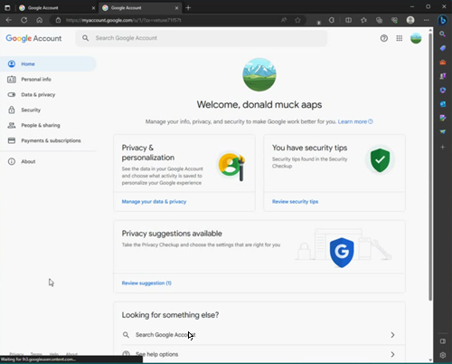

# Un cont Google special pentru AAPS (opțional)

Unii utilizatori **AAPS** preferă să folosească și pentru **AAPS** contul lor principal de e-mail. Alternatively, some **AAPS** users (or their caregivers) set-up a dedicated **AAPS** email account - this is optional, we give an example of how to do it below.

If you don't want to set up an **AAPS**-dedicated Gmail account, you can just go straight to the next section, [building AAPS](../SettingUpAaps/BuildingAaps.md).

```{admonition} Advantages of a dedicated Google account for AAPS
:class: dropdown

- Un spațiu Google Drive separat înseamnă că nu riscați să umpleți limita spațiului Google Drive personal cu fișierele create prin **Exportați setările**.
- Each version of **AAPS** (and supporting apps like xDrip, BYODA, etc) will be stored in one single place which is independent of your computer hardware. If your PC or phone is stolen/lost/broken you will still have access.
- By harmonizing the setup, it will make online support simpler across users with similar folder structure.
- Depending on the setup (see below), you will have a separate identity as an alias to communicate within the community which can protect your privacy. 
- Children with T1D can preserve their own “everyday” email account as minors while using **AAPS** and associated features which require an adult account.
- Gmail vă permite să înregistrați până la 4 conturi cu același număr de telefon.
```

## Cum se configurează un cont Google dedicat AAPS

(⌛Aproximativ 10 minute)


Cerințe:

* You have a Windows’ PC (Windows 10 or newer) and an Android phone (Android 12 or newer) which will host the **AAPS** app. Ambele au toate cele mai recente actualizări de securitate, acces la internet și privilegii de administrator, deoarece unii pași necesită descărcarea și instalarea de programe.
* Telefonul Android este deja configurat cu adresa dumneavoastră personală de e-mail „de zi cu zi”, de exemplu un cont Gmail.

```{admonition} Things to consider when setting up your new account
:class: dropdown
- You could use a name different to your own, which has relevance to the account (like t1dsuperstar) for privacy reasons. You can then use it in **AAPS** public forums while keeping your own identity private. Since Google requires a recovery email and phone number, it is still traceable.
- Noul cont **AAPS** va folosi pentru verificare același număr de telefon ca și contul dumneavoastră „_de zi cu zi_”. It will use the “everyday” email address for verification;
- We will setup email forwarding such that any email sent to the new dedicated AAPS account will be forwarded to the primary one (so there is no need to check two different mailboxes);
- Use separate passwords for your _everyday_ Gmail account and the AAPS-dedicated Gmail account
- If you use google “2-step verification” (aka multifactor) authentication for one Gmail account, you might as well do it for both Gmail accounts.
- If you plan to use Google “Passkeys”, make sure you register multiple devices. This is so you don’t lock yourself out. Only do it on devices that nobody else can access (_i.e._ not on a PC with a shared account that other people can unlock).
```


```{admonition} Video Walkthrough!
:class: note
Click [here](<https://drive.google.com/file/d/1dMZTIolO-kd2eB0soP7boEVtHeCDEQBF/view?usp=drive_link>) for a video walkthrough of how to set up a dedicated Google account.
```

 Aceștia sunt pașii evidențiați în videoclip:

In this example: 
- Contul Google existent, „_de zi cu zi_”, este <donald.muck42@gmail.com>; 
- Your new “_AAPS_” Gmail account will be: <donald.muck42.aaps@gmail.com>; 


### Accesați <https://myaccount.google.com> 

 If you are already logged into Google, this will direct you to your “Everyday” **My Account** page. (1) Faceți clic în dreapta sus a paginii, pe imaginea de profil (în acest caz, un simplu ) (2) selectați „_add another account_” (adăugați alt cont).


### Introduceți datele NOULUI cont dedicat: 

- Enter the new account: 
- Creați cont
- for my personal use. 


### Introduceți persoana dumneavoastră:
 - Introduceți prenumele
 - nume
 - Data nașterii (trebuie să fie o vârstă de adult)

### Alegeți NOUA adresă de e-mail și parola

This example appends “.AAPS” to Donald Muck’s existing one…\
Set a password

### Introduceți un număr de telefon care poate primi SMS-ul de verificare

Gmail vă va trimite acum un cod unic de introdus pentru validare.

### Enter the recovery email address

In this case it will be your existing “_everyday_” email…

### Finalizați configurarea contului

Gmail va afișa numele contului. Vi se va cere să acceptați termenii și condițiile Gmail și să confirmați setările de personalizare.

### Personalizați afișarea noului profil

At this point you should be on Gmail’s MyAccount page showing your new **AAPS**-dedicated email account. Imaginea de profil va fi setată în mod implicit la prima literă a numelui dumneavoastră. Schimbați-o cu ceva unic, pentru a evita confuziile… în acest exemplu, Donald.Muck.AAPS a înlocuit  cu .

\


### Deschideți site-ul Gmail pe ambele ferestre pentru a configura noul cont

So that you don’t need to monitor a separate email account, forward all the emails from the new **AAPS**-dedicated account to your everyday account\
This part can be a bit confusing, since you will have to switch back and forth between both accounts. Pentru a ușura demersul, deschideți 2 ferestre separate ale browserului unul peste celălalt:

1. Move your existing browser to the top of your screen and resize it such that it only takes about half of the top of the screen…
2. Faceți clic dreapta pe pictograma browserului din bara de activități
3. From the menu select “New Window”... and adjust it so it only takes the bottom half of the screen.

Deschideți <https://gmail.com> în fiecare fereastră de browser. Make sure your personal account is on top and the new dedicated **AAPS** account is on the bottom, and is easily identifiable by the profile picture in the top right corner. Dacă este nevoie, puteți oricând să schimbați contul: faceți clic pe imaginea de profil și selectați contul corect.


Your Gmail homepages screen should look like this:\


 ### În noul cont Gmail (fereastra de jos), deschideți setările Gmail…

- Faceți clic pe rotița din stânga imaginii de profil
- apoi selectați „**See all Settings**” (Vedeți toate setările)


### Setați redirecționarea…

- Apăsați pe fila de configurare "Redirecționare și POP/IMAP"
- Apăsați pe “adăugați o adresă de redirecționare”
- Adăugați adresa dumneavoastră de e-mail "de zi cu zi"
- Gmail va trimite un cod de verificare la adresa dumneavoastră de e-mail „de zi cu zi”.
- Veți trece înapoi la profilul dumneavoastră zilnic și veți apăsa pe link pentru a verifica dacă acceptați redirecționarea (sau veți primi codul de la e-mailul de verificare Gmail în fereastra Gmail "de zi cu zi" și veți copia și lipi codul în fereastra Gmail "dedicată AAPS").

Există un destul de mare dute-vino între ferestre, însă acest lucru va asigura faptul că, atunci când vă verificați e-mailurile din contul „de zi cu zi”, veți vedea și e-mailurile redirecționate de pe contul dedicat AAPS, cum ar fi alertele Gmail.


### Verificați adresa de e-mail redirecționată

- În contul Gmail „de zi cu zi” (fereastra de sus), veți primi e-mailul „Gmail forwarding Confirmation” (confirmarea redirecționării Gmail).
- Deschideți-l și “apăsați pe link pentru a confirma cererea”

### Arhivați e-mailurile redirecționate în noul cont dedicat Gmail (fereastra de jos)

<!---->

1. Reîmprospătați fereastra de jos
2. Bifați "redirecționați mailurile care vin"
3. Și arhivați copia Gmail (pentru a păstra noua cutie poștală dedicată curată)
4. Scroll all the way to the bottom to save your changes\
   


Felicitări! Acum ați creat un cont Google dedicat AAPS. Următorul pas este să [construiți aplicația AAPS](../SettingUpAaps/BuildingAaps.md).