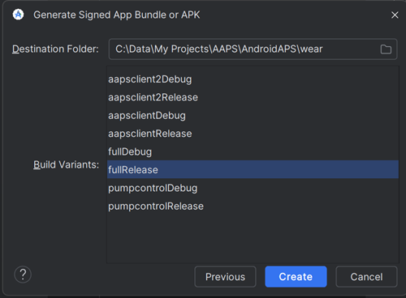

# Building the Wear AAPS app

Aplicația **AAPS** pentru un ceas inteligent Wear OS (**apk-ul Wear**, `aaps-wear-….apk`) este un fișier de instalare separat de aplicația **AAPS** pentru telefon. You need both: the phone app runs the loop, the watch app shows its data and can send commands to it. The watch app is installed from the phone, see [Set up AAPS on your Wear OS watch](WearOsSmartwatch.md).

Cele două aplicații funcționează împreună doar dacă se potrivesc:

- **Aceeași versiune AAPS** pe telefon și pe ceas.
- **Același keystore** folosit pentru semnarea ambelor aplicații.

Cel mai simplu mod de a vă asigura de acest lucru este să construiți ambele aplicații **în același timp**, în aceeași construire. The browser build does this for you: every build produces the phone apk and the Wear apk together. Cu Android Studio sau din linia de comandă, construiți apk-ul Wear ca al doilea pas, imediat după apk-ul pentru telefon.

```{note}
Already using **AAPS** on your phone but no Wear apk from the same build? Construiți din nou ambele aplicații, cu același keystore, și reinstalați și aplicația de pe telefon. A Wear apk built months later, or with a different Android Studio version, is unlikely to be compatible with the phone app.
```

## Versiuni Wear OS acceptate

**AAPS** funcționează pe ceasuri cu **Wear OS 3.0, 3.2 sau 3.5** (Android 11, nivel API 30) **sau mai nou** (Wear OS 4, 5 și 6). Ceasurile cu Wear OS 2 nu sunt acceptate.

```{warning}
AAPS Watchfaces are available for Wear OS smartwatches with API level 30 to 33 (Wear OS 3.0, 3.2, 3.5 and 4).<br>
Newer Wear OS versions progressively break the AAPS watchfaces — see [Wear OS watch face changes](#wearos-watchface-changes) and the [Wear OS 5 limitations](#BuildingAapsWearOs-WearOS5).
```

(building-aaps-wear-os-method)=

## Get the Wear apk with your build method

Follow the section for the method you use to [build AAPS](../SettingUpAaps/BuildingAaps.md).

(building-aaps-wear-os-browser)=

### Construirea în browser (recomandat)

**Nothing extra to do.** Every browser build produces two files from the same source and the same keystore:

- `aaps-….apk`: aplicația pentru telefon.
- `aaps-wear-….apk`: aplicația pentru ceas.

The Wear apk follows the [variant](#browserbuild-variant) you selected for the build: `fullRelease` gives the **AAPS Wear** app, `aapsclientRelease` the **AAPSClient Wear** app, `pumpcontrolRelease` the **PumpControl Wear** app. Each Wear app only talks to its matching phone app.

Unde găsiți apk-ul Wear:

- **AAPS Builder**: pe pagina de construire, derulați în jos la **Artifacts** (artefacte) și descărcați `aaps-wear-….apk` de lângă aplicația pentru telefon, cum se arată în [Pasul 5 – Instalați aplicația pe telefon](#aaps-builder-step5). Download it on the phone that runs **AAPS** if you install the watch app from the phone (Wear Installer 2 or Easy Fire Tools), or on your computer if you use ADB.

  

- **Fork with Google Drive**: open your Google Drive, folder `AAPS`, then the folder of the version you built. It contains the phone apk and the Wear apk, see [Step 4 – Build the APK](#github-build-apk).

  

Păstrați apk-ul Wear împreună cu apk-ul pentru telefon în copiile de rezervă. Cu **AAPS Builder**, fișierele rămân pe pagina de construire doar 14 zile.

Next: install the Wear apk on the watch, see [Set up AAPS on your Wear OS watch](WearOsSmartwatch.md).

(building-aaps-wear-os-android-studio)=

### Android Studio

The Wear apk is built like the phone apk, as a second signed build. Do it right after the phone apk, with the same Android Studio version and the same keystore.

- Follow the instructions for [Android Studio Build](../SettingUpAaps/ComputerBuild.md).
- When you reach [module selection](#Building-APK-wearapk) in "Build the AAPS signed apk", make sure to select **`AndroidAPS.wear`**.


Select "**fullRelease**" to generate the **AAPS** Wear apk file.



If you prefer, you can build **“pumpcontrolRelease”** instead, from the drop-down menu, which will allow you to just remotely control the pump but without looping.

Next: install the Wear apk on the watch, see [Set up AAPS on your Wear OS watch](WearOsSmartwatch.md).

(building-aaps-wear-os-troubleshooting)=

#### Depanarea construirii cu Android Studio

In the process of building the full **AAPS** app (and in fact any signed app), Android Studio generates a .json file in the same folder. This then causes errors with [uncommitted changes](#troubleshooting_androidstudio-uncommitted-changes) when you try to build the next signed app, like the **AAPS** wear app. The quickest way to resolve this is to navigate to the folder where the full AAPS app has been built, your folder is probably something like:

`C:\Users\Your Name\AndroidStudioProjects\AndroidAPS\app\full\release.`

Either delete, or move the unneeded .json file out of the folder. Then try to build the **AAPS** wear app again. If that doesn't work, the more detailed [troubleshooting guide](../GettingHelp/TroubleshootingAndroidStudio.md) will help you to identify the specific file causing the issue, which could also be your keystore file.

(building-aaps-wear-os-cli)=

### Linia de comandă

Follow [Build instructions for the command-line](../SettingUpAaps/CLIBuild.md) and repeat the compile and sign steps for the `wear` module, with the same keystore:

```sh
./gradlew :wear:assembleFullRelease
```

The unsigned Wear apk is written under `wear/build/outputs/apk/full/release/`. Sign it with `apksigner` exactly like the phone apk, then install it on the watch, see [Set up AAPS on your Wear OS watch](WearOsSmartwatch.md).
