# Как пользоваться модулем Autotune

Модуль Autotune – это реализация алгоритма OpenAPS autotune в AAPS. Он анализирует вашу недавнюю историю AAPS и предлагает изменения базальных скоростей, ISF и углеводного коэффициента (IC).

Модуль Autotune доступен в версиях AAPS начиная с [3.4](#version3400), но по умолчанию скрыт.

(autotune-how-autotune-calculates-adjustments)=
## Как Autotune рассчитывает изменения

Autotune просматривает вашу недавнюю историю AAPS – данные CGM, болюсы, углеводы и временные базалы – и определяет, где ваш **Профиль** (базальные скорости, ISF, углеводный коэффициент) не совсем совпадает с тем, что на самом деле происходило с вашей ГК.

Для каждой 5-минутной точки данных он сравнивает **фактическое изменение ГК** с изменением, которое предсказал ваш профиль, и относит полученное отклонение к одной из трех групп:

* отклонения без активных углеводов и без активности инсулина (используются для настройки **базальных скоростей**, час за часом),
* отклонения после болюса/коррекции без углеводов (используются для настройки **ISF**), или
* отклонения во время усвоения углеводов (используются для настройки **углеводного коэффициента**).

Затем он смотрит на картину отклонений в каждой группе (с помощью процентилей, а не простого среднего, чтобы несколько неточных точек данных не искажали результат) и предлагает новое значение для этого часа/параметра.

Чтобы один запуск не скорректировал слишком сильно, каждый запуск Autotune сдвигает значение только на часть пути к тому, что показывают данные: до 10% для ISF и углеводного коэффициента и до 20% для каждого базального сегмента. Общее изменение дополнительно ограничено настройками **Максимальный коэффициент Autosens** / **Минимальный коэффициент Autosens** (см. [Другие настройки](#autotune-other-settings) ниже) – это те же границы, которые ограничивают Autosens. Поэтому Autotune нужно запускать много раз (день за днем или каждую ночь), а не доверять ему после одного запуска: результаты должны сходиться постепенно, а большой скачок за один запуск – это знак, что нужно перепроверить данные (пропущенные углеводы, день с плохим сенсором _и т. д._), а не доверять ему вслепую.

Autotune можно запускать тремя способами: вручную, один раз из модуля (как описано ниже), автоматически каждую ночь с помощью [правила автоматизации](#autotune-run-autotune-with-an-automation-rule) или – полностью вне AAPS – как отдельный инструмент командной строки на экспортированных данных; так некоторые руководства сообщества описывают его использование без телефона с работающим AAPS.

*Подробное математическое описание исходного алгоритма oref0 см. в [документации Autotune от OpenAPS](https://openaps.readthedocs.io/en/latest/docs/Customize-Iterate/autotune.html).*

## Показать модуль Autotune

Создайте пустой файл с именем `enable_autotune` в подпапке `extra` [каталога AAPS](#preferences-maintenance-settings) на вашем телефоне.

***ПРИМЕЧАНИЕ: Обязательно проверьте в настройках AAPS, где находится ваш каталог AAPS, и что вы положили файл в правильный каталог. Несколько пользователей положили файл не в ту папку.***

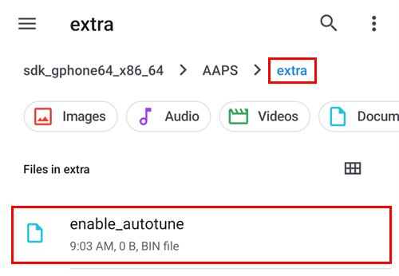

Перезапустите **AAPS**. Затем откройте **меню** (☰), выберите **Конфигурация**, затем категорию **Общее** и отметьте **Автонастройка**. Тогда на карточке появятся **Настройки** и **Открыть модуль**:

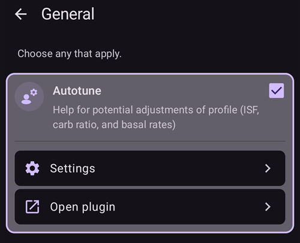

## Интерфейс пользователя Autotune

Нажмите **Открыть модуль** на карточке **Автонастройка**, чтобы открыть экран Autotune:

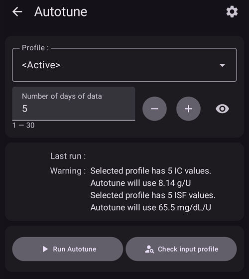

- В выпадающем меню профилей можно выбрать профиль, который хотите настроить (по умолчанию выбран ваш текущий активный профиль)
  - Примечание: каждый раз, когда вы выбираете новый профиль, предыдущие результаты удаляются, а **Количество дней с данными** возвращается к значению по умолчанию
- Затем в поле **Количество дней с данными** (в старых версиях **Дней для анализа**) выбирают количество дней, которые используются в расчете для настройки профиля. Минимальное значение составляет 1 день и максимальное 30 дней. Это число не должно быть слишком маленьким, чтобы получить правильные итеративные и сглаженные результаты (более 7 дней для каждого расчета)
  - Примечание: каждый раз, когда вы меняете **Количество дней с данными**, предыдущие результаты удаляются
- Последнее выполнение - это ссылка, восстанавливающая предыдущий корректный расчёт. Если вы не запускали Autotune в текущий день, или если предыдущие результаты были удалены с модификацией, то можно восстановить параметры и результаты последнего успешного запуска.
- Предупреждение показывает некоторую информацию о выбранном профиле (если у вас есть несколько значений IC или несколько значений ISF)
  - Примечание: Расчет Autotune работает только с одним углеводным коэффициентом и одним значением ISF. Сейчас нет алгоритма Autotune, который настраивает циркадный IC или циркадный ISF. Если профиль имеет несколько значений, вы увидите предупреждение о среднем значении, принятом для настройки профиля.
- Кнопка «Проверьте профиль ввода» открывает просмотр профиля, чтобы вы могли быстро проверить свой профиль (единицы, IC, ISF, базал и цель)
  - Примечание: Autotune подстроит только углеводный коэффициент IC (единичное значение), ISF (единичное значение) и базальный профиль (с вариацией в пределах суток). Единицы и цель в выходном профиле не изменятся.

- «Выполнить Autotune» запускает расчет Autotune с выбранным профилем и выбранным количеством дней с данными
  - Примечание: Расчет Autotune может занять длительное время. После запуска можно перейти на другой экран (главный экран и т. п.) и вернуться позже в модуль Autotune, чтобы увидеть результаты

  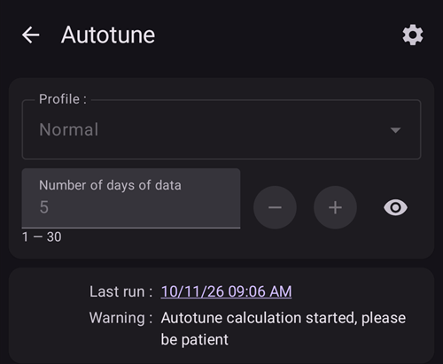

- Затем во время запуска вы увидите промежуточные результаты

  - Примечание: Во время работы Autotune настройки заблокированы, поэтому изменить выбранный входной профиль или количество суток, участвующих в анализе, уже нельзя. Если требуется запустить другой анализ с другими параметрами, дождитесь окончания текущего расчета.

  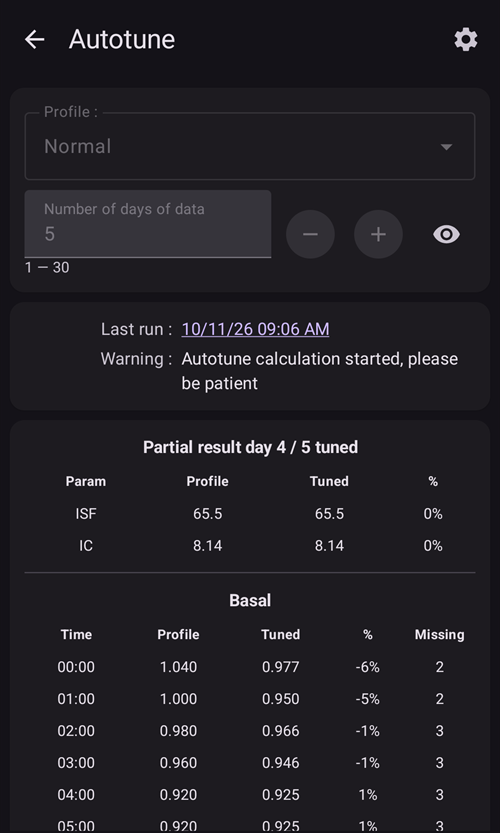

- По завершении вычисления Autotune вы увидите результат - настроенный профиль (Tuned profile) и четыре кнопки.

  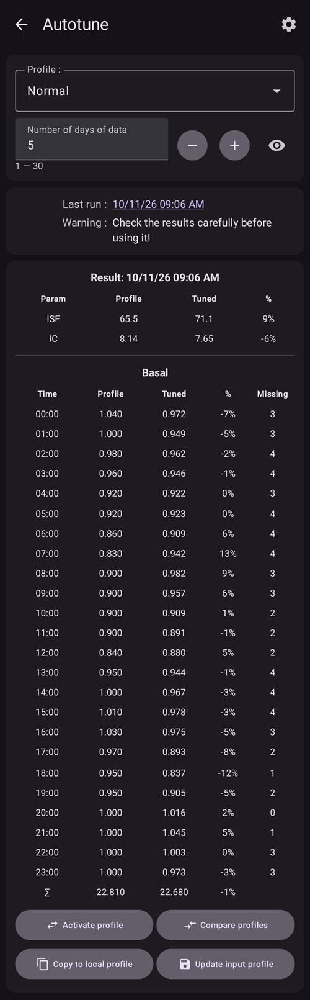

- Важно всегда сравнивать входной профиль (столбец "Профиль"), выходной профиль (столбец "Настроено") и процент изменений каждого значения (столбец "%").

- Для базальной скорости имеется "количество недостающих дней". Недостающие дни появляются, когда у Autotune недостаточно данных в категории «Basal», чтобы настроить базальную скорость за этот период (например, после каждой еды, когда идет усвоение углеводов). Это число должно быть как можно меньше, особенно когда базал важен (например, ночью или в конце второй половины дня)

- Кнопка "Сравнить профили" открывает окно сравнения профилей. Профиль на входе синий, а на выходе ("Настроенный") - красный.

  - Примечание: в примере ниже профиль на входе имеет циклические суточные отклонения для IC и ISF, но профиль на выходе имеет одно значение. Если вам важно получить циркадный выходной профиль, см. [Циркадный профиль IC или ISF](#autotune-circadian-ic-or-isf-profile) ниже.

  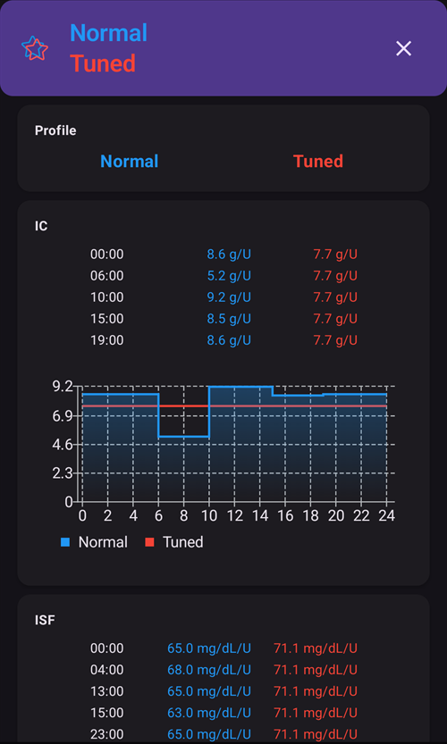

- Если вы доверяете результатам (низкий процент изменений между входным профилем и выходным профилем), нажмите на кнопку "Активировать профиль" и затем на OK для подтверждения.

  - «Активировать профиль» автоматически создает новый профиль «Настроено» в вашем списке профилей (**Управление → Профиль**).
  - Если у вас уже есть профиль с именем «Настроено» в **Управление → Профиль**, этот профиль будет обновлен рассчитанным профилем Autotune перед активацией

  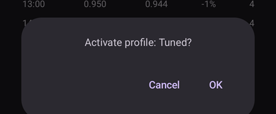

- Если вы считаете, что настроенный профиль нужно скорректировать (например, если некоторые изменения слишком велики), нажмите на кнопку "Копировать в локальный профиль"

  - В **Управление → Профиль** будет создан новый профиль с префиксом «Настроено» и датой и временем запуска

  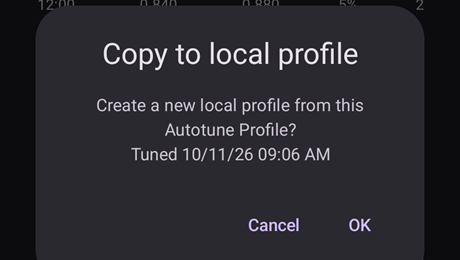

- Затем вы можете отредактировать настроенный профиль: откройте **Управление** > **Профиль**, пролистайте до карточки «Настроено» с датой и временем запуска и нажмите кнопку **Редактировать** (карандаш)

  - значения в профиле в интерфейсе будут округлены под возможности вашей помпы

  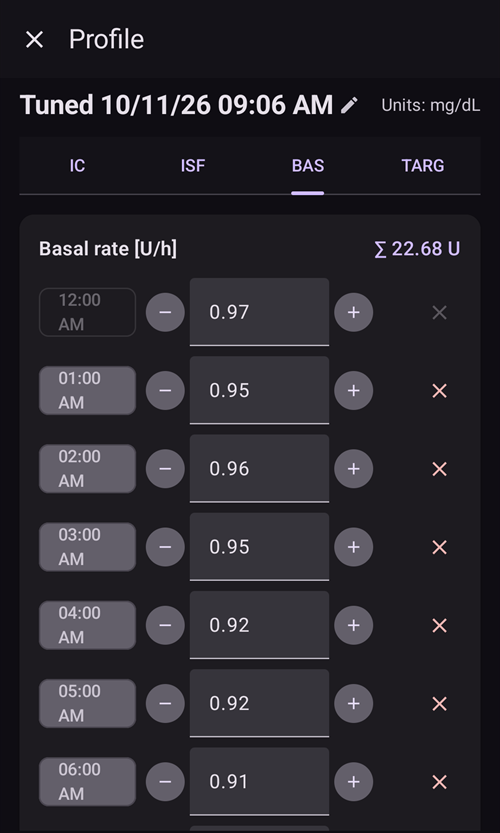

- Если вы захотите заменить свой профиль на результат Autotune, нажмите на кнопку "Обновить профиль ввода" и нажмите OK во всплывшем окне

  - Примечание: если вы нажмете «Активировать профиль» после «Обновить профиль ввода», будет активирован ваш обновленный профиль, а не профиль «Настроено» по умолчанию.

  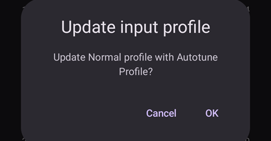

- Если вы обновили свой профиль ввода, то кнопка «Обновить профиль ввода» заменяется кнопкой «Вернуть профиль ввода» (см. снимок экрана ниже). Так вы сразу видите, содержит ли ваш текущий входной профиль в **Управление → Профиль** результат последнего запуска или нет. Этой кнопкой также можно вернуть входной профиль без результата Autotune

  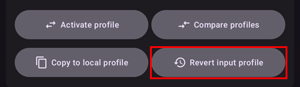


## Настройки Autotune

(autotune-plugin-settings)=

### Настройки модуля Autotune

  

```{admonition} Only DEV
:class: note
Функция **Автоматическое переключение профиля** доступна только в режиме Dev/Engineering (режим отладки).
```

- **Автоматическое переключение профиля** (по умолчанию выключено): см. [Запустить Autotune с правилом автоматизации](#autotune-run-autotune-with-an-automation-rule) ниже. Если изменить эту настройку на Включить, профиль ввода будет автоматически обновлен профилем Tuned и активирован.
  - **Будьте осторожны: в течение нескольких следующих дней нужно проверять и убедиться, что после обновления и активации настроенного профиля без изменений ваш цикл работает лучше**

- **Классифицировать UAM как базал** (по умолчанию выключено): эта настройка для пользователей, которые используют AAPS вообще без ввода углеводов (полный UAM). Это помешает (когда Выключено) классифицировать UAM как базал.
  - Примечание: если в течение одного дня обнаружен хотя бы один час усвоения углеводов, то все данные в категории UAM будут отнесены к базалу, независимо от этой настройки (включена или выключена)
- **Дней для анализа по умолчанию** (по умолчанию 5): этой настройкой можно задать значение по умолчанию. Каждый раз, когда вы выбираете новый профиль в модуле Autotune, **Количество дней с данными** заменяется этим значением по умолчанию
- **Использовать циркадные IC/ISF** (по умолчанию выключено): см. [Циркадный профиль IC или ISF](#autotune-circadian-ic-or-isf-profile) ниже.

(autotune-other-settings)=
### Other settings

- Для ограничения вариативности, Autotune применяет Максимальный коэффициент Autosens и Минимальный коэффициент Autosens. Эти значения можно посмотреть и изменить в [**Настройки** > **Настройки усваиваемости** > **Дополнительные настройки**](../SettingUpAaps/Preferences.md) (**Autosens макс.** и **Autosens мин.**).

  


## Дополнительные возможности

(autotune--циркадный-профиль-ic-или-isf)=

### Циркадный профиль IC или ISF

- Если в вашем профиле IC и/или ISF сильно меняются в течение суток и вы полностью доверяете своему циркадному времени и изменениям, можно включить **Использовать циркадные IC/ISF** (в старых версиях называлось «Применять средний результат к циркадным IC/ISF»)

  - Обратите внимание, что вычисление Autotune всегда будет выполняться с одним значением, а циркадные вариации не будут подстроены при помощи Autotune. Эта настройка применяет среднее отклонение, рассчитанное только для IC и/или ISF на ваши циркадные величины

- На снимке экрана ниже настроенный профиль с отключенной опцией "применять средний вариант значения" слева и с включенной - справа

  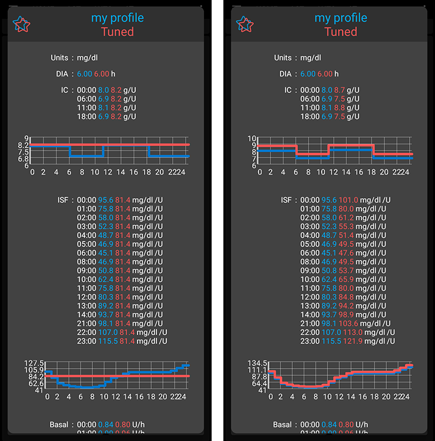


### Настройка определенных дней недели

- Если нажать на значок **глаза** справа от поля **Количество дней с данными**, вы увидите выбор дней. Можно указать, какой день недели войдет в расчет Autotune (на снимке экрана пример для "рабочих дней" с неотмеченными для расчета autotune субботой и воскресеньем)
  - Если количество дней, включенных в расчет Autotune, меньше, чем **Количество дней с данными**, справа от выбора дней будет показано, сколько дней будет включено (в примере ниже 10 дней)
  - Эта настройка дает хорошие результаты, только если оставшихся дней не слишком мало (например, если вы настраиваете отдельный профиль для выходных и выбрали только воскресенье и субботу, задайте **Количество дней с данными** не меньше 21 или 28, чтобы в расчет Autotune вошли 6 или 8 дней)

  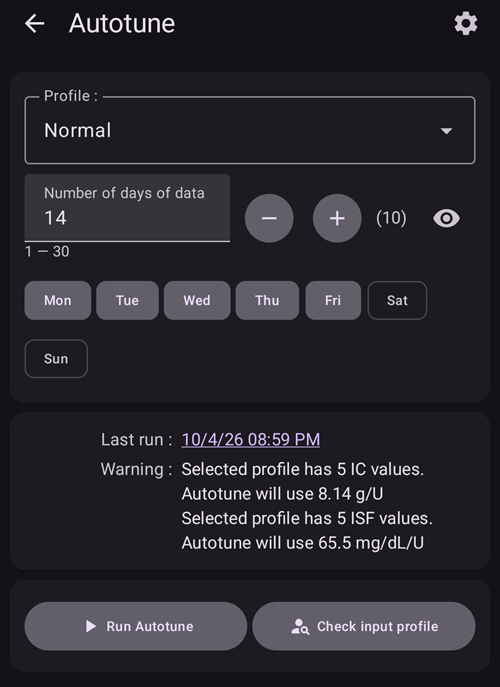

- Во время расчета Autotune можно видеть ход вычислений («Частичный результат дня 1 / 4 для расчета» в примере ниже, где суббота и воскресенье исключены)

  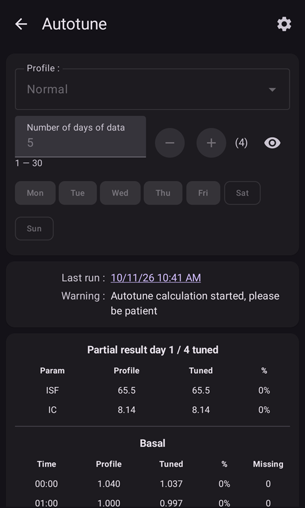


(autotune-run-autotune-with-an-automation-rule)=

## Запустить Autotune с правилом автоматизации

```{admonition} Only DEV
:class: note
Функция **Автоматическое переключение профиля** доступна только в режиме Dev/Engineering (режим отладки).
```

Первый шаг заключается в определении правильной отправной точки (триггера) для правила автоматизации с автонастройкой:

Примечание: подробнее о создании правил для автоматизации см [здесь](../DailyLifeWithAaps/Automations.md).

- Выберите триггер «Время повторения»: запускайте Autotune только один раз в сутки; Autotune создан для ежедневного запуска (при каждом новом запуске период сдвигается на один день, и изменения профиля быстро должны стать очень маленькими)

  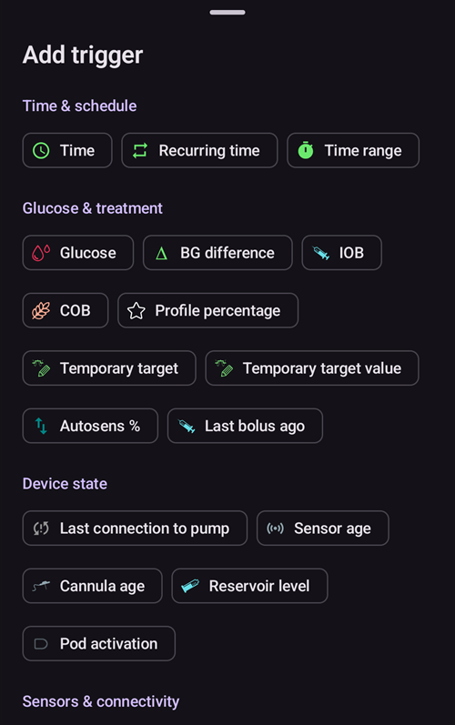

- Вначале лучше запускать Autotune днем, чтобы иметь возможность проверить результаты. Если вы хотите запустить Autotune ночью, в триггере следует выбрать 4 часа ночи или позже, чтобы включить текущий день в следующий запуск Autotune.

  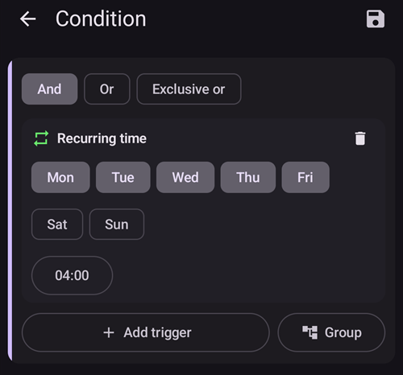

- Затем можно выбрать действие **Выполнить Autotune** (в группе **Цикл и инсулин**)

  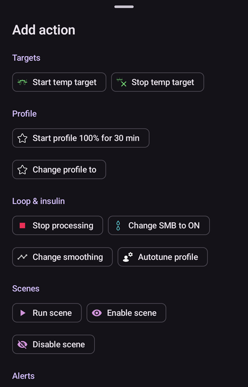

- Затем можно задать параметры действия для запуска. В новом действии **Выберите профиль для изменения** показывает первый профиль из списка локальных профилей, поле **Дней для анализа** пустое, и выбраны все дни. Выберите профиль для настройки и введите количество **Дней для анализа** (от 1 до 30).

  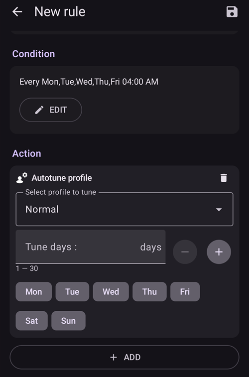

- Через несколько дней, если вы полностью доверяете результатам Autotune и процент изменений небольшой, можно включить в [настройках Autotune](#autotune-plugin-settings) «**Автоматическое переключение профиля**», чтобы после расчета настроенный профиль автоматически обновлялся и активировался.

Примечание: если вы хотите автоматически настраивать профили на определенные дни недели (например, профиль для "выходных" и другой для "рабочих дней"), создайте по одному правилу для каждого профиля, выберите те же дни в триггере и в действиях Autotune. Количество дней для настройки должно быть достаточно высоким, не менее 6 или 8 дней, и не забудьте выбрать время после 04: 00 в триггере...

- Ниже пример правила, которое запускается каждый рабочий день (с понедельника по пятницу) в 04:00 и настраивает профиль «Normal» с 14 **Дней для анализа**, только рабочие дни (поэтому в расчет Autotune включено только 10 дней).

  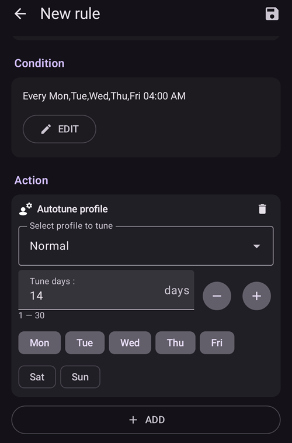


## Советы и подсказки

Autotune работает с информацией из вашей базы данных, поэтому если вы только что установили AAPS на новый телефон, придется подождать несколько дней, прежде чем запускать Autotune с достаточным количеством дней для получения адекватных результатов.

Autotune - всего лишь помощник, важно регулярно проверять, согласны ли вы с расчетным профилем. Если у вас есть сомнения, измените настройки Autotune (например, количество дней) или скопируйте результаты в локальный профиль и скорректируйте профиль перед использованием.

Всегда используйте Autotune несколько дней вручную для проверки результатов перед их применением. И только когда вы полностью доверяете результатам Autotune и разница между предыдущим и рассчитанным профилем становится очень маленькой, начинайте использовать автоматизацию (никогда раньше)

- Autotune может хорошо работать для одних пользователей, и плохо для других, поэтому **Если вы не доверяете результату Autotune, не применяйте его**

Также важно анализировать результаты Autotune, чтобы понять (или попытаться понять), почему Autotune предлагает эти изменения

- вы можете получить полное увеличение или уменьшение силы профиля (например, увеличение общего базала, связанное со снижением значений ISF и IC). это может быть связано с несколькими последующими днями с коррекцией autosens выше 100% (нужна большая агрессивность) или ниже 100% (вы более чувствительны)
- Иногда Autotune предлагает другой баланс между базальными скоростями и IC/ISF (например, меньше базала и более агрессивные IC/ISF)

Мы рекомендуем не применять Autotune в следующих случаях:

- Вы вводите не все углеводы
  - Если вы не вводите углеводы для коррекции гипогликемии, Autotune увидит неожиданный рост ГК и повысит базальные скорости на 4 часа раньше; это может быть противоположно тому, что вам нужно, чтобы избежать гипо, особенно посреди ночи. Поэтому важно вводить все углеводы, особенно для коррекции гипо.
- У вас много периодов с UAM в течение дня.
  - Вы ввели все углеводы и правильно оценили их количество?
  - Все периоды непредвиденных приемов пищи (за исключением случаев, когда вы не вводите углеводы в течение дня и отключена настройка классифицировать UAM как базалы), все периоды UAM будут классифицированы как базалы, а это может значительно увеличить базал (намного больше, чем необходимо)

- У вас медленное усвоение углеводов: если бóльшая часть абсорбции углеводов рассчитывается с помощью параметра min_5m_carbimpact (эти периоды можно увидеть как маленькую оранжевую точку в верхней части кривой COB), подсчет активных углеводов COB может быть неправильным и привести к неправильным результатам.
  - При занятиях спортом чувствительность обычно выше, и ГК растет не сильно, поэтому во время или после тренировки часто бывают периоды медленного усвоения углеводов. Но если у вас слишком часто происходит неожиданное медленное усвоение углеводов, то может потребоваться корректировка профиля (более высокое значение IC) или значение min_5m_carbimpact слишком высокое.
- У вас есть «очень плохие дни», например, когда вы много часов застряли в гипергликемии и нужно огромное количество инсулина, чтобы вернуться в целевой диапазон, или после замены сенсора долгое время были неверные значения ГК. Если за последние недели у вас был только один или 2 «плохих дня», можно вручную отключить эти дни в расчете Autotune, чтобы исключить их из расчета, и снова **внимательно проверить, можно ли доверять результатам**
- Если процент изменений слишком большой
  - Можно увеличить количество дней, чтобы получить более плавные результаты
