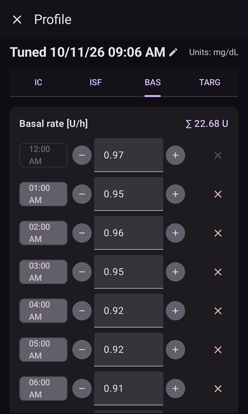
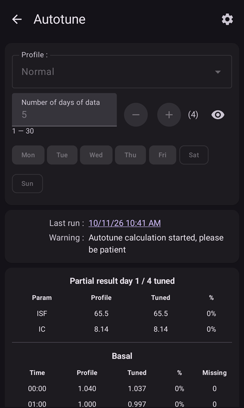

# How to use Autotune plugin

Autotune plugin is an implementation of OpenAPS autotune algorithm within AAPS. It analyzes your recent AAPS history to suggest adjustments to your basal rates, ISF and carb ratio.

Autotune Plugin is available in AAPS releases since [3.4](https://github.com/nightscout/AndroidAPS/releases/tag/3.4.0.0) but is hidden by default.

(autotune-how-autotune-calculates-adjustments)=
## How Autotune calculates adjustments

Autotune looks back over your recent AAPS history — CGM readings, boluses, carbs and temporary basal rates — and works out where your **Profile** (basal rates, ISF, carb ratio) doesn't quite match what actually happened to your BG.

For each 5-minute data point, it compares your **actual BG change** to the change your Profile predicted, and sorts the resulting deviation into one of three buckets:

* deviations that happened with no carbs on board and no insulin activity (used to tune **basal rates**, hour by hour),
* deviations that happened after a bolus/correction with no carbs (used to tune **ISF**), or
* deviations that happened while carbs were absorbing (used to tune **carb ratio**).

It then looks at the pattern of deviations in each bucket (using percentiles rather than a simple average, so a few noisy data points don't skew the result) and proposes a new value for that hour/parameter.

To keep any single run from overcorrecting, each Autotune run only ever moves a value a fraction of the way towards what the data suggests: up to 10% for ISF and carb ratio, and up to 20% for each basal segment. Overall drift is further capped by the **Max autosens ratio** / **Min autosens ratio** settings (see [Other settings](#autotune-other-settings) below) — the same bounds that limit Autosens. This is why Autotune is meant to be run repeatedly (day after day, or nightly) rather than trusted after a single run: results should converge gradually, and a big jump on one run is a sign to double check your data (missed carbs, a bad sensor day, _etc._) rather than to trust it blindly.

Autotune can be run three ways: manually as a one-off from within the plugin (as described below), automatically every night via an [automation rule](#autotune-run-autotune-with-an-automation-rule), or — outside of AAPS entirely — as a standalone command-line tool against exported data, which is how some community guides describe using it without a phone actively running AAPS.

*For the underlying oref0 algorithm in full mathematical detail, see [OpenAPS's Autotune documentation](https://openaps.readthedocs.io/en/latest/docs/Customize-Iterate/autotune.html).*

## Show the Autotune plugin

Create an empty file named `enable_autotune` in the `extra` subfolder of your phone [AAPS directory](#preferences-maintenance-settings).

***NOTE: Ensure you check in the AAPS settings where your AAPS Directory is, and that you placed the file in the correct one. Several users have put the file into the wrong folder.***


Restart **AAPS**. Then open the **menu** (☰), select **Configuration**, then the **General** category, and tick **Autotune**. The card then shows **Settings** and **Open plugin**:


## Интерфейс пользователя Autotune

Tap **Open plugin** on the **Autotune** card to open the Autotune screen:


- В выпадающем меню профилей можно выбрать профиль, который хотите настроить (по умолчанию выбран ваш текущий активный профиль)
  - Note: each time you select a new profile, previous results will be removed and the **Number of days of data** will be set to its default value
- Then **Number of days of data** (called **Tune days** in older versions) is to select the number of days used in calculation to tune your profile. Минимальное значение составляет 1 день и максимальное 30 дней. Это число не должно быть слишком маленьким, чтобы получить правильные итеративные и сглаженные результаты (более 7 дней для каждого расчета)
  - Note: each time you change the **Number of days of data**, previous results will be removed
- Последнее выполнение - это ссылка, восстанавливающая предыдущий корректный расчёт. Если вы не запускали Autotune в текущий день, или если предыдущие результаты были удалены с модификацией, то можно восстановить параметры и результаты последнего успешного запуска.
- Предупреждение показывает некоторую информацию о выбранном профиле (если у вас есть несколько значений IC или несколько значений ISF)
  - Примечание: Расчет Autotune работает только с одним углеводным коэффициентом и одним значением ISF. There is currently no existing Autotune algorithm to tune a circadian IC or circadian ISF. Если профиль имеет несколько значений, вы увидите предупреждение о среднем значении, принятом для настройки профиля.
- Check Input Profile button open the Profile Viewer to allow you a quick verification of your profile (Units, IC, ISF, basal and target)
  - Примечание: Autotune подстроит только углеводный коэффициент IC (единичное значение), ISF (единичное значение) и базальный профиль (с вариацией в пределах суток). Units and target will remain unchanged in output profile.

- "Run Autotune" will launch Autotune calculation with selected profile and the selected number of days of data
  - Примечание: Расчет Autotune может занять длительное время. После запуска autotune можно переключиться на другое окно (главый экран и. п., ...) и вернуться позже в Autotune, чтобы увидеть результаты

  

- Затем во время запуска вы увидите промежуточные результаты

  - Примечание: Во время работы Autotune настройки заблокированы, поэтому изменить выбранный входной профиль или количество суток, участвующих в анализе, уже нельзя. Если требуется запустить другой анализ с другими параметрами, дождитесь окончания текущего расчета.

  

- По завершении вычисления Autotune вы увидите результат - настроенный профиль (Tuned profile) и четыре кнопки.

  

- Важно всегда сравнивать входной профиль (столбец "Профиль"), выходной профиль (столбец "Настроено") и процент изменений каждого значения (столбец "%").

- Для базальной скорости имеется "количество недостающих дней". Недостающие дни появляются когда Autotune не хватает данных в категории «Basal» для настройки базовой скорости за этот период (например, после каждой еды, когда идет поглощение углеводов). Это число должно быть как можно более низким, особенно если базал важен (например, в ночь или в конце второй половине дня)

- Кнопка "Сравнить профили" открывает окно сравнения профилей. Профиль на входе синий, а на выходе ("Настроенный") - красный.

  - Примечание: в примере ниже профиль на входе имеет циклические суточные отклонения для IC и ISF, но профиль на выходе имеет одно значение. If it's important for you to get a circadian output profile see [Circadian IC or ISF profile](#autotune-circadian-ic-or-isf-profile) below.

  

- Если вы доверяете результатам (низкий процент изменений между входным профилем и выходным профилем), нажмите на кнопку "Активировать профиль" и затем на OK для подтверждения.

  - Activate Tuned profile will automatically create a new profile "Tuned" in your profile list (**Manage → Profile**).
  - If you already have a profile named "Tuned" in **Manage → Profile**, then this profile will be updated with calculated Autotune profile before the activation

  

- Если вы считаете, что профиль Tuned должен быть скорректирован (например, если некоторые вариации слишком важны), вы можете нажать на кнопку "Копировать в локальный профиль"

  - A new profile with the prefix "Tuned" and the date and time of the run will be created in **Manage → Profile**

  

- You can then edit the Tuned profile: open **Manage** > **Profile**, swipe to the card named "Tuned" with the date and time of the run, and tap the **Edit** (pencil) button

  - the values in the profile will be rounded in the user interface to your pump capabilities

  

- Если вы захотите заменить свой профиль на результат Autotune, нажмите на кнопку "Обновить профиль ввода" и нажмите OK во всплывшем окне

  - Note: if you click on "Activate profile" after "Update input profile", then you will activate your updated profile and not the default "Tuned" profile.

  

- Если вы обновили свой профиль ввода, то кнопка «Обновить профиль ввода» заменяется кнопкой «Вернуть профиль ввода» (см. снимок экрана ниже). You can that way immediately see if your current input profile in **Manage → Profile** already includes the result of last run or not. You also have the possibility to recover your input profile without autotune result with this button

  


## Настройки Autotune

(autotune-plugin-settings)=

### Настройки модуля Autotune

  

```{admonition} Only DEV
:class: note
The **Auto switch profile** feature is only available in Dev/Engineering mode.
```

- **Auto switch profile** (default Off): see [Run Autotune with an automation rule](#autotune-run-autotune-with-an-automation-rule) below. Если изменить эту настройку на Включить, профиль ввода будет автоматически обновлен профилем Tuned и активирован.
  - **Будьте внимательны, в течение нескольких следующих дней следите, чтобы после обновления и активации настроенного профиля система заработала лучше по сравнен с профилем без изменений**

- **Categorize UAM as basal** (default Off): This setting is for the users using AndroidAPS without any carbs entered (Full UAM). Это помешает (когда Выключено) классифицировать UAM как базал.
  - Примечание: если в течение одного дня обнаружен по крайней мере один час абсорбции углеводов, тогда все данные, классифицированные как UAM, будут классифицированы как basal, вне зависимости от того, включен параметр или выключен
- **Default tune days** (default 5): You can define the default value with this setting. Each time you select a new profile in the Autotune plugin, the **Number of days of data** will be replaced by this default value
- **Use circadian IC/ISF** (default Off): see [Circadian IC or ISF profile](#autotune-circadian-ic-or-isf-profile) below.

(autotune-other-settings)=
### Other settings

- Для ограничения вариативности, Autotune применяет Максимальный коэффициент Autosens и Минимальный коэффициент Autosens. You can see and adjust these values in [**Settings** > **Absorption settings** > **Advanced Settings**](../SettingUpAaps/Preferences.md) (**Autosens max** and **Autosens min**).

  


## Дополнительные возможности

(autotune--циркадный-профиль-ic-или-isf)=

### Циркадный профиль IC или ISF

- If you have important variation of IC and/or you ISF in your profile, and you fully trust in your circadian time and variation, then you can enable **Use circadian IC/ISF** (called "Apply average result in circadian IC/ISF" in older versions)

  - Обратите внимание, что вычисление Autotune всегда будет выполняться с одним значением, а циркадные вариации не будут подстроены при помощи Autotune. Эта настройка применяет среднее отклонение, рассчитанное только для IC и/или ISF на ваши циркадные величины

- На снимке экрана ниже настроенный профиль с отключенной опцией "применять средний вариант значения" слева и с включенной - справа

  


### Настройка определенных дней недели

- If you tap the **eye** icon on the right of the **Number of days of data** field, you will see the day selection. Можно указать, какой день недели войдет в расчет Autotune (на снимке экрана пример для "рабочих дней" с неотмеченными для расчета autotune субботой и воскресеньем)
  - If the number of days included in Autotune calculation is lower than the **Number of days of data**, then you will see how many days will be included on the right of the days selector (10 days in the example below)
  - This setting gives good results only if the number of remaining days is not too small (for example if you Tune a specific profile for week end days with only Sunday and Saturday selected, you should set **Number of days of data** to at least 21 or 28 to have 6 or 8 days included in Autotune calculation)

  

- During Autotune calculation, you can see the progress of the calculations ("Partial result day 1 / 4 tuned" in the example below, with Saturday and Sunday excluded)

  


(autotune-run-autotune-with-an-automation-rule)=

## Запустить Autotune с правилом автоматизации

```{admonition} Only DEV
:class: note
The **Auto switch profile** feature is only available in Dev/Engineering mode.
```

Первый шаг заключается в определении правильной отправной точки (триггера) для правила автоматизации с автонастройкой:

Примечание: подробнее о создании правил для автоматизации см [здесь](../DailyLifeWithAaps/Automations.md).

- Следует выбрать время повторения запускать Autotune только один раз в сутки, ежедневно (после каждого нового выполнения Autotune смещать график на день вперед и делать небольшие быстрые модификации профиля)

  

- Вначале лучше запускать Autotune днем, чтобы иметь возможность проверить результаты. Если вы хотите запустить Autotune ночью, в триггере следует выбрать 4 часа ночи или позже, чтобы включить текущий день в следующий запуск Autotune.

  

- Then you can select the **Autotune profile** action (in the **Loop & insulin** group)

  

- You can then adjust the parameters of the action for your run. In a new action, **Select profile to tune** shows the first profile of your local profile list, the **Tune days** field is empty and all days are selected. Choose the profile to tune and enter the number of **Tune days** (1 to 30).

  

- After a few days, if you fully trust Autotune results and percentage of modification is low, you can modify [Autotune settings](#autotune-plugin-settings) "**Auto switch profile**" to enabled to automatically update and activate profile tuned after calculation.

Примечание: если вы хотите автоматически настраивать профили на определенные дни недели (например, профиль для "выходных" и другой для "рабочих дней"), создайте по одному правилу для каждого профиля, выберите те же дни в триггере и в действиях Autotune. Количество дней для настройки должно быть достаточно высоким, не менее 6 или 8 дней, и не забудьте выбрать время после 04: 00 в триггере...

- See below an example of rule that runs every working day (Monday to Friday) at 04:00 and tunes the profile "Normal" with 14 **Tune days**, working days only (so only 10 days are included in the Autotune calculation).

  


## Советы и подсказки

Автототал работает с информацией из вашей базы данных, так что если вы только что установили AAPS на новый телефон, вам придется подождать несколько дней, прежде чем запускать Autotune чтобы получить адекватные результаты.

Autotune - всего лишь помощник, важно регулярно проверять, согласны ли вы с расчетным профилем. В случае сомнений, измените параметров Autotune (например, количество дней) или скопируйте результаты в локальный профиль и подкорректируйте перед использованием.

Всегда используйте Autotune несколько дней вручную для проверки результатов перед их применением. И только тогда, когда вы полностью доверяете результатам Autotune и когда между предыдущим и новым профилем и вариации становятся незначительными, можно запускать Автоматизацию (никогда не раньше)

- Autotune может хорошо работать для одних пользователей, и плохо для других, поэтому **Если вы не доверяете результату Autotune, не применяйте его**

It's also important to analyze Autotune results to understand (or try to understand) why Autotune proposes these modifications

- вы можете получить полное увеличение или уменьшение силы профиля (например, увеличение общего базала, связанное со снижением значений ISF и IC). it could be associated to several following days with autosens correction above 100% (more aggressivity required) or below 100% (you are more sensitive)
- Sometimes Autotune proposes a different balance between basal rates and IC/ISF (for ex lower basal and more aggressive IC/ISF)

Мы рекомендуем не применять Autotune в следующих случаях:

- Вы не всгда вводите все углеводы
  - If you don't enter carbs correction for hypoglycemia, Autotune will see an unexpected increase of your BG value and will increase your basal rates 4 hours earlier, it could be the opposite of what you need to avoid hypo, especially if it's in the middle of the night. That's why it's important to enter all carbs, especially correction for hypo.
- You have a lot of periods with UAM detected during the day.
  - Do you have entered all your carbs and correctly estimated your Carbs?
  - Все периоды непредвиденных приемов пищи (за исключением случаев, когда вы не вводите углеводы в течение дня и отключена настройка классифицировать UAM как базалы), все периоды UAM будут классифицированы как базалы, а это может значительно увеличить базал (намного больше, чем необходимо)

- У вас медленное усвоение углеводов: если бóльшая часть абсорбции углеводов рассчитывается с помощью параметра min_5m_carbimpact (эти периоды можно увидеть как маленькую оранжевую точку в верхней части кривой COB), подсчет активных углеводов COB может быть неправильным и привести к неправильным результатам.
  - При занятиях спортом, чувствительность, как правило, повышается, и уровень сахара в крови повышается не сильно, поэтому во время или после тренировки обычно наблюдаются периоды медленного усвоения углеводов. Но если у вас слишком часто происходит неожиданное медленное усвоение углеводов, то может потребоваться корректировка профиля (более высокое значение IC) или значение min_5m_carbimpact слишком высокое.
- You have "very bad days", for example stuck several hours in hyperglycemia with a huge amount of insulin to be able to go down within the range, or after a sensor change you have long periods of wrong BG values. If during the past weeks you only have one or 2 "bad days", you can disable manually these days in autotune calculation to exclude them from calculation, and again **check carefully if you can trust the results**
- Если очень важен процент изменений
  - Можно увеличить количество дней, чтобы получить более плавные результаты
