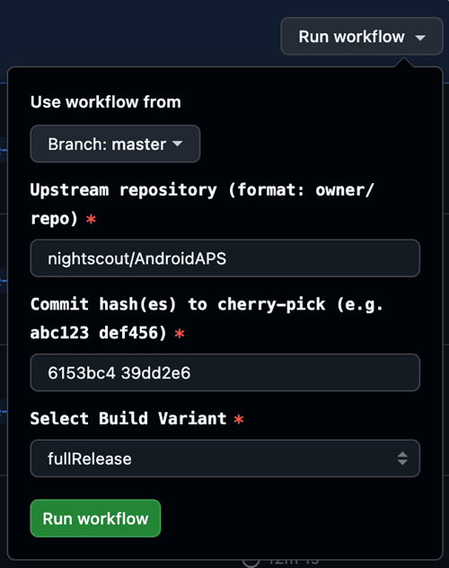

(github-cherry-pick)=

# Сборка через браузер: cherry-pick коммита

```{note}
Это необязательная операция для опытных пользователей. Она работает, только если вы собираете приложение через **fork** ([Сборка через браузер, шаги 1–4](../SettingUpAaps/BrowserBuild.md)). В репозиториях **AAPS Builder** этого workflow нет.
```

Используйте это, только когда разработчик просит вас проверить определенное изменение (он дает вам один или несколько хешей коммитов) до того, как оно попадет в выпущенную версию.

## Перед началом

- [Синхронизируйте свой fork](#Update-to-new-version-update-your-repo): этот workflow собирает текущее состояние вашей ветки, а не версию, выбранную из списка.
- Доступ к Google Диску должен быть разрешен ([Шаг 3](../SettingUpAaps/BrowserBuildGoogleDrive.md)): собранное приложение сохраняется там, как при обычной сборке.

## Запуск workflow

1. В своем fork AndroidAPS на GitHub откройте **Actions**.
2. Раскройте **All workflows** и выберите **Cherry Pick CI (Pre-release Feature Backport)**.
3. Нажмите **Run workflow** и заполните:

   

   - **Use workflow from**: ветка, в которую нужно добавить коммиты, обычно `master`.
   - **Upstream repository**: откуда берутся коммиты. Оставьте `nightscout/AndroidAPS`, если разработчик не сказал иначе.
   - **Commit hash(es) to cherry-pick**: хеш(и), которые вам дали, через пробел.
   - **Select Build Variant**: см. [варианты](#browserbuild-variant) (обычно `fullRelease`).
4. Нажмите **Run workflow**. Когда сборка завершится, приложение будет в вашем Google Диске, как после [обычной сборки](../SettingUpAaps/BrowserBuildAPK.md).
