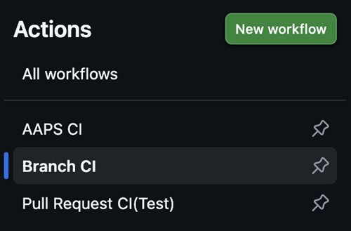
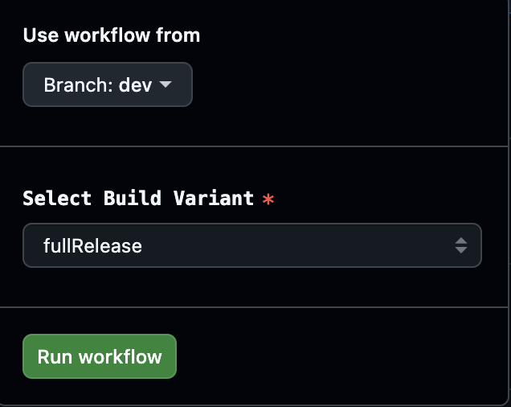
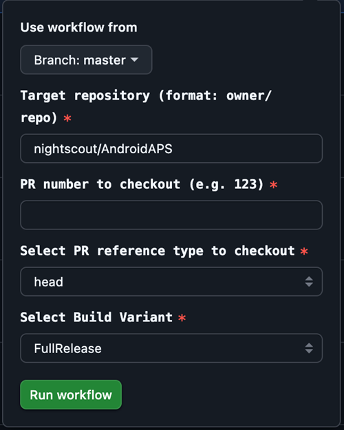

# Версия разработчиков

```{warning}
Ветка dev предназначена только для дальнейшей разработки AAPS. Ее следует использовать на отдельном телефоне для тестирования, <font color="#FF0000">**а не для реального управления циклом!**</font>
```

Самая стабильная версия AAPS находится в [ветке Master](https://github.com/nightscout/AndroidAPS/tree/master). It is advised to stay on the Master branch for actual looping.

Версия dev AAPS предназначена только для разработчиков и тестировщиков, которые умеют разбираться с трассировкой стека (stacktrace), просматривать файлы журналов и, возможно, запускать отладчик, чтобы составить полезные для разработчиков отчеты об ошибках (короче говоря: для людей, которые знают, что делают, и не нуждаются в помощи!). Therefore many unfinished features are disabled. Чтобы включить эти функции, войдите в **Режим отладки**: создайте файл с именем `engineering_mode` в папке /AAPS/extra. Включение режима отладки может полностью нарушить работу цикла.

Тем не менее ветка dev — хорошее место, чтобы увидеть, какие функции сейчас тестируются, помочь исправить ошибки и рассказать, как новые функции работают на практике. Часто люди тестируют ветку dev на старом телефоне и старой помпе, пока не убедятся, что она стабильна. Любое ее использование — на ваш собственный риск. When testing any new features, remember that you are choosing to test a still-in-development feature. Делайте это на свой страх и риск и с должной осторожностью, чтобы обеспечить свою безопасность.

Если вы нашли ошибку или думаете, что при работе с веткой dev что-то пошло не так, откройте [вкладку issues](https://github.com/nightscout/AndroidAPS/issues) и проверьте, не нашел ли ее уже кто-то другой. Если нет, добавьте ее сами. The more information you can share here the better (don't forget you may need to share your [log files](../GettingHelp/AccessingLogFiles.md)). Новые функции также можно обсудить в [discord](https://discord.gg/4fQUWHZ4Mw).

A dev version has an expiration date. This seems inconvenient when using it satisfactorily, but serves a purpose. Когда в обращении только одна версия dev, легче отслеживать ошибки, о которых сообщают люди. Разработчики не хотят оказаться в ситуации, когда в обращении три версии dev, в одних ошибки исправлены, а в других нет, и люди продолжают сообщать об уже исправленных ошибках.

(branch-ci-test)=

## Тестирование отдельной ветки (branch-ci)

Чтобы собрать тестовую ветку, выберите branch-ci: так вы сможете выбрать определенную ветку для создания APK. Этот способ можно использовать, когда нужно протестировать ветку dev.





(github-pr-test)=

## Тестирование изменений из pull request (развертывание через GitHub CI actions)

Доступно начиная с 3.3.2.1.dev

- Подходит для тестировщиков и тех, кто помогает с тестированием.

```{eval-rst}
.. raw:: html

    <!--crowdin: exclude-->
    <div align="center" style="max-width: 360px; margin: auto; margin-bottom: 2em;">
      <div style="position: relative; width: 100%; aspect-ratio: 9/16;">
        <iframe
          src="https://geo.dailymotion.com/player/x9rdx1q.html?video=x9rdx1q&loop=true&mute=true"
          loading="lazy"
          style="position: absolute; top: 0; left: 0; width: 100%; height: 100%;"
          frameborder="0"
          allowfullscreen>
        </iframe>
      </div>
    </div>
```



- Target repository: репозиторий, который содержит PR, в формате owner/repo. Оставьте значение по умолчанию **nightscout/AndroidAPS**, если вам не сказали использовать другой репозиторий (это нужно только разработчикам).

- PR number: введите номер PR, который вы хотите протестировать.

- PR reference types: есть два варианта типа ссылки на PR:
    
    - head:
    - Берет фактическое содержимое из ветки автора PR (то есть исходную историю коммитов без каких-либо слияний).
    - Это соответствует исходному состоянию ветки PR, как если бы ее взяли прямо из fork или из ветки функции (feature branch).
    
    - merge:
    
    - Берет результат слияния PR с целевой веткой (например, dev), которое GitHub заранее выполнил для проверки.
    - Это виртуальный коммит слияния, который GitHub создает автоматически.
    - Этот коммит существует, только если в PR нет конфликтов и его можно слить.
    
    - variant:
    
    - См. [variant](#browserbuild-variant)