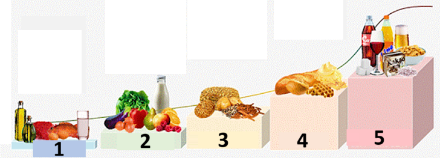
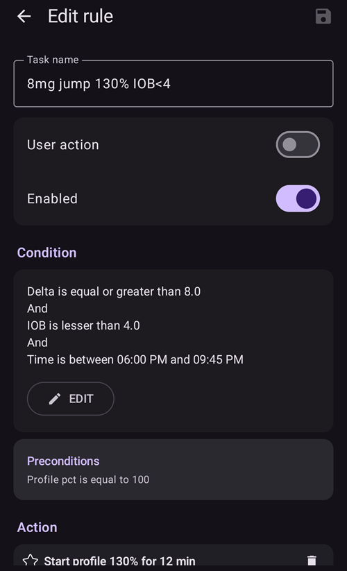
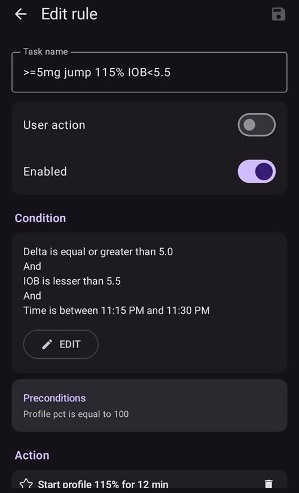
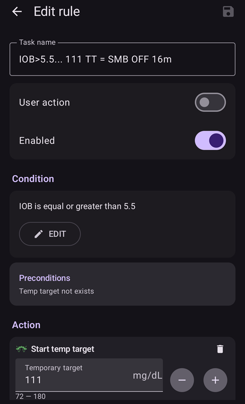
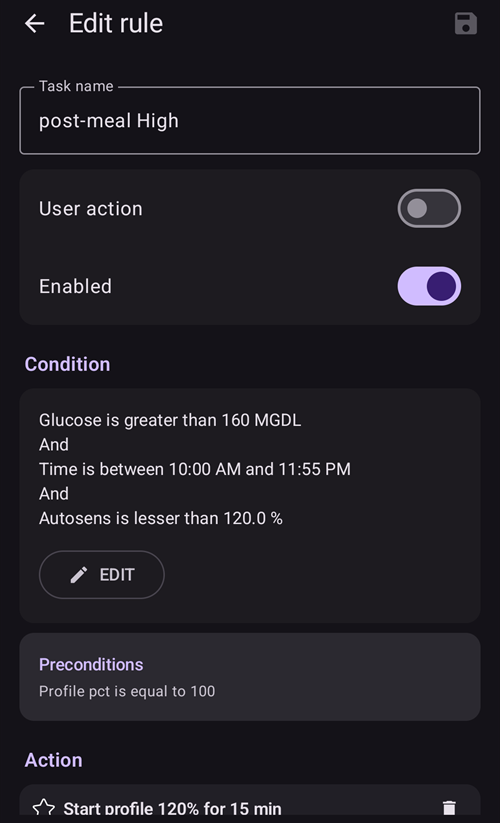

# Автономный замкнутый цикл

```{contents} In this page
:backlinks: entry
:depth: 2
```

Привлекательность технологии Автономного замкнутого цикла **FCL ** в том, что она потенциально может имитировать искусственную поджелудочную железу и упрощать повседневную компенсацию без необходимости введения болюсов на еду.

Несмотря на то, что ** гибридный замкнутый цикл ** ("HCL") имеет собственный алгоритм работы, он, тем не менее требует, чтобы пользователь самостоятельное вводил болюсы на прием пищи. В результате цикл может временно прекратить подачу (временный нулевой базал), чтобы предотвратить избыточную подачу инсулина.

В Автономном замкнутом цикле **FCL** больше не требуются болюсы на еду: алгоритм производит все расчеты самостоятельно!  **AAPS** может справляться с едой без болюса и без ввода углеводов в режиме «непредвиденный прием пищи» **(«UAM»)**. Режим **UAM** позволяет алгоритму **AAPS** лучше справляться с неверно введенными углеводами за счет большей агрессивности.

## Чего ожидать?

Существует множество публикаций, посвященных позитивным результатам, достижимым при помощи автономного замкнутого цикла **FCL**. С ними можно ознакомиться в этих работах:

1)   National Library of Medicine, PubMed [First Use of Open-Source Automated Insulin Delivery AndroidAPS in Full Closed-Loop Scenario: Pancreas4ALL Randomized Pilot Study](https://pubmed.ncbi.nlm.nih.gov/36826996/);

2)  ClinicalTrials.gov National Library of Medicine, Clinical Trial [Feasibility and Safety Study of the Automated Insulin Delivery Closed Loop System Pancreas4ALL (ASAP)](https://www.clinicaltrials.gov/study/NCT04835350?term=Feasibility%20and%20Safety%20Study%20of%20the%20Automated%20Insulin%20Delivery%20Closed%20Loop%20System%20Pancreas4ALL%20(ASAP)&rank=1)

Для успешного применения автономного замкнутого цикла **FCL** от пользователей требуется:

- проверить, соответствуют ли они требованиям **FCL**;
- настроить **автоматизации**, адаптированные к потребностям повседневного контроля; и
- выполнить более тонкую настройку и подгонку всех параметров **AAPS** (особенно **Автоматизаций**).


## Общие соображения, почему (не) переходить с неполного на автономный замкнутый цикл

Автономный замкнутый цикл (**FCL**) не для всех:

- Некоторые пользователи **АЗЦ** добиваются TIR (70–180) около 90% и HbA1c ниже 6%, однако другие предпочитают более жесткий контроль. В частности, чтобы свести к минимуму значения выше 140 мг/дл при еде с быстрыми углеводами, вероятно, нужен преболюс.
- Тонкая настройка **AAPS** может быть сложной. Он не подходит для пользователей, которым и так трудно справляться с AAPS.  Для полноценной настройки **Автономного ЗЦ** понадобится несколько недель. Потраченное время не пропадет зря: вы получите лучшие результаты и лучший контроль **ГК**.
- Справляться с едой может стать проще, однако физическая нагрузка в **АЗЦ** по-прежнему может быть сложной. Многие любят ограничивать себя в количестве спортивных перекусов чтобы контролировать массу тела.
- Организация **АЗЦ** для детей по-прежнему представляет сложности (обсуждаются ниже).


## Правильно настроенный гибридный замкнутый цикл

Рекомендуется сначала хорошо настроить **гибридный ЗЦ**, прежде чем думать о переходе на **АЗЦ**.  Для успешной работы **АЗЦ** требуются точные индивидуальные настройки, чтобы ** AAPS** мог полноценно имитировать именно ВАШ гибридный режим замкнутого цикла.

**АЗЦ** требует настройки режимов **Автоматизации**. Прежде чем переходить на **АЗЦ**, пользователь должен иметь четкое представление о своих потребностях в инсулинотерапии. Ошибки могут маскироваться другими ошибками. Это может создать нестабильную систему **АЗЦ**, которую будет трудно откорректировать. Следует стремиться к достижению целевых показателей времени в диапазоне %TIR, сопоставимых с теми, которые вы уже имеете в гибридном цикле **HCL**.

**АЗЦ — это самостоятельная (DIY) настройка автоматизаций, которую пользователь определяет, анализируя свои данные из успешного гибридного ЗЦ и первого опыта АЗЦ при настройке параметров.**

## Инсулины короткого действия (Lyumjev, Fiasp)

Для корректной работы **АЗЦ** требуется быстродействующий инсулин.  Это нужно, чтобы в начале роста **ГК**, связанного с едой, **АЗЦ** мог удерживать **ГК** в диапазоне (по общему определению ниже 180 мг/дл (10 ммоль/л)).

Моделирующее исследование (подробности см по ссылке Full Loop V2/Март 2023; там же раздел 2.2) показывает, что *инсулины короткого действия*

Источник:

 


EEE Control Systems Magazine, ResearchGate [The Artificial Pancreas and Meal Control: An Overview of Postprandial Glucose Regulation in Type 1 Diabetes](https://www.researchgate.net/publication/322866519_The_Artificial_Pancreas_and_Meal_Control_An_Overview_of_Postprandial_Glucose_Regulation_in_Type_1_Diabetes);

- дают значительно более низкие пики **ГК**, чем более медленные инсулины;
- справляются с задержкой подачи болюса в пару минут, не допуская при этом пиков; и
- уменьшить влияние разного количества углеводов (размера порций) на пик **ГК**.

**АЗЦ** вряд ли будет эффективен при применении иных инсулинов кроме Lyumjev или Fiasp, если только пользователь не придерживается диеты с очень умеренным или низким содержанием углеводов.

Однако Fiasp или Lyumjev могут приводить к частым окклюзиям помпы, даже после оптимизации, например, длины иглы. Важно следить за временем использования катетера или Pod. Многие пользователи считают, что примерно через 48 часов инсулин теряет эффективность и возникает сбой катетера/Pod.

## Предварительные требования

Значения **ГК** и стабильное соединение Bluetooth нужны, чтобы **AAPS** работал оптимально и не терял ценное время. **АЗЦ** требует технически стабильной системы 24/7:

- **качество работы вашего CGM**. Ваш CGM не должен давать скачущие значения **ГК**, которые **АЗЦ** может ошибочно принять за признак начала еды. Аналогично, калибровки **CGM** могут давать скачущие значения.
- как и где выполняется сглаживание данных **CGM** и что это может значить для ваших настроек. Особенно то, как определена дельта и что AAPS распознает ее как признак начала еды.
- стабильность Bluetooth для помпы и CGM;
- недопущение (или по крайней мере раннее распознавание окклюзии помпы);
- поток данных и используемые приложения телефона, а также разница между днями использования сенсора;
- поддержание всех компонентов **AAPS** в хорошо заряженном состоянии и в непосредственной близости от запасных частей; и
- заблаговременная замена катетера (или Pod) для снижения риска окклюзии;

Всё вышеперечисленное варьируется в зависимости от компонентов **AAPS** и образа жизни пользователя.

## Ограничения, относящиеся к приему пищи

- Настройка **АЗЦ** проще для людей, чей рацион состоит из компонентов, не оказывающих влияние на быстрое и значительное колебание **ГК**, и питание которых не сильно меняется изо дня в день. Это не обязательно означает низкоуглеводную диету.

- Диета, богатая жирами или белками, или гастропарез (замедленное переваривание пищи), скорее облегчают, чем усложняют работу **АЗЦ**, потому что запоздалые углеводы хорошо маскируют неизбежные “хвосты” болюса, вводимого в пиковое время.

### Glycemic index and effect on blood glucose

Сложность для режима **UAM** растет с ростом «влияния на глюкозу крови» (EBG)

- Начните с пищи с умеренным/низким воздействием и подстройте **Профиль** соответствующим образом. Только после этого пробуйте "тестировать" пищу с более высоким воздействием на гликемию **EBG**.
- Если вы едите блюда с очень высоким **EBG**, подумайте о начальном болюсе < 50%.

1) **С нулевым EBG **: например, у таких продуктов как свежее мясо, рыба, яйца, ветчина, растительные масла, сыр. 2) **С низким воздействием на гликемию **: например, у свежих овощей и ягод, грибов, орехов, молока, йогурта, творога. 3) **С умеренным воздействием на гликемию**: например, у хлеба из цельного зерна/лапши, картофеля, дикорастущего риса, овсяных хлопьев, сухофруктов. 4) **Высокий EBG**: например, пшеничный хлеб, багет, тосты, вафли, печенье, картофельное пюре, лапша, рис. 5) **С очень высокой степенью воздействия на уровень сахара в крови**: например, сахар, сладкие напитки, фруктовые соки, кукурузные хлопья, конфеты, помадки, картофельные чипсы, соленые крендельки.



Самыми сложными блюдами для **АЗЦ** являются продукты с очень высоким воздействием на гликемию **EBG** (см. красный цвет на рисунке): происходит не только быстрый подъем **ГК**, но и отсутствуют жировые/белково-волокнистые компоненты, уравновешивающие неизбежный “хвост” активности инсулина при попытках контролировать высокий уровень глюкозы на ранних стадиях.

Несбалансированное потребление закусок и сладких напитков, содержащих быстро усваиваемые углеводы, приводит к некорректной работе **АЗЦ**.


## Подготовка к физическим нагрузкам

При физических нагрузках или занятиях спортом на помпе или гибридном замкнутом цикле перед нагрузкой рекомендуется уменьшить значение **IOB**.

При работе **АЗЦ** алгоритм настроен на обнаружение непредвиденного приема пищи **UAM** и автоматическую подачу инсулина для противодействия повышению **ГК**.  Задолго до начала любой нагрузки следует установить высокую ** временную цель TT** и низкий ** процент профиля** (который вступит в силу уже перед началом приема пищи).

Необычные или неустойчивые уровни физической активности создают трудности для **АЗЦ**. Перед тренировкой необходимо заранее планировать свои действия (особенно если хотите уменьшить потребность в дополнительных углеводах / перекусах на купирование гипогликемии). После активного дня рекомендуется на ночь, когда ужин полностью переварен, установить более низкий **процент профиля**: задайте в **автоматизациях** повышенную (>100 мг/дл) целевую **ГК**, а в **настройках** **AAPS** выключите **Включить SMB при высокой временной цели**.

## Сложности для детей

**АЗЦ** может создавать дополнительные трудности для детей, в том числе:

- Lyumjev или Fiasp могут быть недоступны или плохо переноситься.
- Часовая базальная скорость может быть очень низкой, и это плохая основа для больших **SMB**.
- Диета может быть богата сладкими компонентами. При низком объеме крови в теле ребёнка очевидна тенденция к высоким скачкам уровня **ГК**.
- Гормоны роста и заметные изменения чувствительности к инсулину затрудняют точную настройку **АЗЦ**.


## Включение повышенного SMB; безопасность

В гибридных **ЗЦ** реализованы ограничения безопасности в отношении размера болюсов автоматически вводимых циклом.

Пользователям **АЗЦ** больше не нужно вводить большую дозу перед началом приема пищи. Это означает, что ограничения размера **SMB** нужно расширить, чтобы цикл мог вводить достаточно большие **SMB**.

Если вы используете **AAPS** в версии Master, рекомендуется задать в **настройках** **AAPS** максимально допустимый размер **SMB**, который может дать **АЗЦ** (maxUAMSMBBasalMinutes=120, т. е. базал за 2 часа в это время суток).

Если ваша базальная скорость очень низкая, то пределы **SMB** могут также оказаться слишком низкими и не обеспечить достаточный контроль над повышением **ГК** после приема пищи. Одно из возможных решений — избегать еды, которая вызывает сильные скачки **ГК**. Алгоритм [Auto ISF](#Open-APS-features-auto-isf) (доступен только в dev-сборке с режимом отладки) имеет настройку **Расширение макс. диапазона SMB**, которая увеличивает стандартный максимум (базал за 2 часа) в >1 раз и позволяет поднять стандартный **коэффициент подачи SMB** 50%.

Чтобы позволить AAPS имитировать обычные болюсы при помощи введения нескольких микроБолюсов (SMB) **следуйте этой инструкции**.

Периодически проверяйте экран модуля **APS** (**Конфигурация → APS → Открыть модуль**), чтобы увидеть, достаточно ли велики разрешенные **SMB**, чтобы подать инсулин, который нужен циклу в начале еды.

Иначе, все усилия по настройке параметров могут оказаться бесполезными!


```{admonition} Boosting **ISF** can become dangerous
:class: danger

Внимательно наблюдайте и анализируйте размеры **SMB** вскоре после начала еды. Настраивайте пошагово и никогда не меняйте более 1 или 2 параметров одновременно.

Настройки **AAPS'** должны быть достаточно эффективны для того, чтобы справляться с разнообразием потребляемых вами (!) блюд.
```

## Обнаружение приёма пищи/ Автоматизация для повышения эффективности

Для успешной работы **АЗЦ** ключевым параметром настройки является чувствительность к инсулину **ISF**. При использовании **AAPS** Master + **Автоматизаций** **изменение профиля > 100% должно автоматически запускаться при распознавании приема пищи** (по дельтам глюкозы) и давать усиленный **ISF**.

**AAPS** Master позволяет временный **профиль** до 130% в режиме **гибридного ЗЦ**. Увеличение **ISF** осуществляется в 3 этапа:

- Шаг 1 – проверьте **ISF** в **профиле** для этого часа еды и посмотрите, предлагает ли, например, Autosens изменение, учитывающее текущую (за последние несколько часов) чувствительность организма к инсулину.
- Шаг 2 – применение коэффициента (1/процент профиля, заданный в **Автоматизации**) для усиления **ISF**.
- Шаг 3 - проверка, не выходит ли предлагаемый **ISF** за ограничители безопасности.

### Шаблоны автоматизации АЗЦ

Поля для галочек вверху. Имеются следующие варианты:

- В списке **Автоматизаций** можно снять флажок (слева от каждого пункта)=> Это деактивирует данную **автоматизацию**. Это можно сделать для всех **Автоматизаций** **АЗЦ**, связанных с завтраком(ами), для перехода на **Гибридный ЗЦ**.

- Для каждого правила **Автоматизации** можно поставить галочку напротив пункта «Действие пользователя» => тогда определенные действия не будут автоматически выполняться при появлении Условий. Вместо этого на главном экране **AAPS** будет оповещение каждый раз, когда алгоритм **АЗЦ** вводит микроболюс **SMB**. У вас есть возможность принять или отклонить его. Это очень удобно на стадии отладки.

Эта функция может быть полезна в некоторых ситуациях, например при синдроме «ноги на пол» (foot to floor), когда утром при вставании **ГК** резко растет, но пользователь хочет избежать полностью автоматической реакции «начался завтрак».

В разделе ниже описано, как объединять условия **автоматизаций** и как справляться с ситуациями, в которых **AAPS** должен увеличить (или уменьшить) подачу инсулина. Так как **ISF** нельзя настроить напрямую, для наших целей то же самое делает повышение **процента профиля** выше 100%.

### Автоматические большие SMB при росте ГК

Ключ к успешному **АЗЦ**: **в начале роста ГК от еды цикл должен как можно быстрее дать очень большие автоматические SMB**, чтобы «догнать» нужный **IOB** (сравните с вашим обычным болюсом на похожую еду в **гибридном ЗЦ**!)

Для этого нужно проанализировать данные вашего **гибридного ЗЦ** и определить, какие **дельты** могут быть не связаны с едой, а какие — связаны.

- Так как **автоматизацию** можно задать в определенном временном окне, анализировать нужно только его.
- Если ваши приемы пищи очень разные (например, завтрак с довольно большим количеством углеводов, а обед с малым), можно сделать два разных (набора) **автоматизаций** для каждого временного интервала.
- Если в ночное время у вас случаются скачки ГК из-за сдавливания сенсора во сне, исключите ночное время из настроек автоматизации
- Обычно достаточно пользоваться изменениями / дельтой последних 5 минут.
- Но можете использовать одно из усредненных изменений /приращений. Сравнивая дельты в условиях ваших **автоматизаций**, можно даже задать действия разной агрессивности в зависимости от того, растет ли **ГК** с ускорением или нет.

> ( delta – short avg delta )>n   — это выражение, которое можно использовать для обнаружения ускорения, чтобы запустить первый **SMB** при самом раннем признаке роста **ГК**. -                                                                             
> Внимание: нельзя использовать при плохих или сильно сглаженных значениях **CGM**!

**CGM** с неровными данными ставит пользователя в плохое положение: чтобы перестраховаться, вам приходится «завышать» дельту, которая точно означает начало приема пищи. Это означает:

- **АЗЦ** теряет дополнительное время, что приводит к более высоким пикам **ГК** и более низкому %**TIR**;
- вы не можете использовать более раннюю или меньшую дельту, которая могла бы и без еды запустить **SMB**, заменяющие в **АЗЦ** болюс пользователя.

Кроме того, первые подъемы после еды характеризуются **низким уровнем активного инсулина IOB**. С учетом этого, Автоматизация(#1) для ужина может выглядеть следующим образом:



Автоматизация #1

Если условия выполняются, **AAPS** в ближайшие 12 минут даст 1 или 2 **SMB** с усиленным **ISF** согласно заданному повышенному **проценту профиля** (в примере это усиление insulinReq на 30%). Пока эти условия выполняются, правило **автоматизации** продлевается еще на 12 минут. При еде с малым количеством углеводов **ГК** может расти медленнее. Для такой пищи полезна еще одна Автоматизация (#2), которая срабатывает при более низкой дельте и дает более слабую подачу инсулина.



Та же **автоматизация**, вероятно, сработает и при еде с большим количеством углеводов, когда закончится крутой подъем, заданный в автоматизации #1.

Эти две (и, может быть, третью) **автоматизации** нужно «выстроить по ступеням» так, чтобы они подходили к тому, что вы видите при ваших (разных) приемах пищи => подбор подходящих размеров скачков, критериев **IOB** и усилений будет пошаговым процессом настройки.  Кроме того, если в Условия добавить соответствующие временные интервалы, вы сможете легко создавать различные автоматизации для разных приемов пищи (завтрак, обед, ужин).

Учтите, что еще в фазе роста (!) нужно заблокировать «перелив» **IOB**, чтобы позднее действие **инсулина** («**хвост**» через 3–5 часов) не превысило тормозные возможности цикла через нулевой временный базал («отбирание» базала для снижения риска гипо).

При большом приёме пищи **иногда наблюдается вторичное увеличение уровня глюкозы**. К этому времени, обычно, уровень активного инсулина немного падает, и более агрессивная Автоматизация снова вступает в силу. (Проверьте, что условие IOB в автоматизации #2 не задано слишком низким, чтобы это могло произойти).

Вскоре после нескольких первых **SMB** наступает **сбалансированная фаза**, в которой умеренная подача инсулина должна покрывать дополнительно усвоенные углеводы. (Кроме еды с малым количеством углеводов, где цикл может увидеть слишком слабый рост **ГК** и уже сейчас сразу перейти на нулевой временный базал).

Главный экран **AAPS** (где в режиме **UAM** АЗЦ вы видите cob=0) в этой фазе может запрашивать дополнительные углеводы. В режиме **UAM** это просто означает, что можно сделать очень грубую проверку правдоподобия: может ли такое количество углеводов из еды примерно час назад (о которой вы не дали циклу никакой информации) еще оставаться неусвоенным в вашем теле?


### iob threshold

Часто **автоматизации** #1 и/или #2 поднимают IOB до уровня, которого обычно достаточно для **ваших** приемов пищи. Для индивидуальной настройки посмотрите в данных вашего **гибридного ЗЦ** максимальные значения IOB при хорошо компенсированной еде (часто это ваш болюс на еду), а также выше какого значения в конце возникала гипо (или потребность в дополнительных углеводах).

Разумные **ограничения активного инсулина IOB**, при которых следует снизить агрессивность цикла, могут не совпадать для разных видов пищи. Но особенно в первый час после начала еды, который очень важен в режиме **UAM**. У каждого пользователя это будет по-разному. У некоторых пользователей усваивается всего около 30 г/час, и тогда можно задать разумный **IOB**, не зависящий от конкретной еды.

Для особой еды или чтобы снизить его перед спортом, порог **IOB** можно быстро изменить в вашей **автоматизации**.

Автоматизация (#3) «iobTH достигнут => **SMB** выкл.» нужна, чтобы закончить (или приостановить до следующей волны роста от углеводов) агрессивное усиление **SMB**.



Автоматизация #3

Она сообщает циклу, что выше заданного вами **порога IOB** лучше больше не использовать **SMB**

- В примере это делается установкой ВЦ=111 (число довольно произвольное; выберите число >100, которое вы легко узнаете как автоматическое отключение **SMB**)
- В **AAPS** в разделе [Настройки → OpenAPS SMB](#Preferences-openaps-smb-settings) обычно не разрешайте **SMB** при повышенной цели.                                                                                                                   
  Тогда нужный инсулин придется подавать гораздо осторожнее, через «узкое горлышко» **временных базалов**

**Внимание: Автоматизация #3 работает только при отсутствии временной цели TT.** Поэтому, если ранее устанавливалась "Временная цель TT Ожидаемый прием пищи", она должна быть завершена к этому времени, обычно спустя 30-40 минут после начала еды.

Один из способов — создать условие **автоматизации**, которое завершает работающую ВЦ «Ожидаемый прием пищи» при условии **IOB**>65% * iobTH.
> Способы работы с ВЦ «Ожидаемый прием пищи» Некоторые пользователи устанавливают ВЦ «Ожидаемый прием пищи» примерно за час или больше до начала еды (кнопкой ВЦ или автоматически через пониженную целевую **ГК** в **профиле**, если время еды довольно постоянное), чтобы гарантировать низкую начальную **ГК** и немного повышенный **IOB**. Но если **АЗЦ** и так всегда движется к цели, это может дать немного, и вы можете предпочесть **автоматизацию**, которая устанавливает ВЦ «Ожидаемый прием пищи» при распознавании начала еды (дельта глюкозы или ускорение = дельта > средняя дельта). Низкая **ВЦ** важна на этом этапе, так как цикл рассчитывает любой **SMB** по формуле (прогнозируемая глюкоза минус ВЦ)/sens, поэтому низкая ВЦ делает итоговый insulinReq больше.

После первых усиленных **SMB** ваш iobTH и **автоматизация** #3 должны дать хороший баланс: ограничить пик глюкозы, но и не привести к гипо после еды.

Если ваш завтрак по количеству углеводов сильно отличается от обычного ужина, вам могут помочь **автоматизации**, которые действуют в соответствующее время суток и имеют разный **iobTH** (возможно, также разные дельты и разный **процент профиля**). И вы, задавая спектр своей еды и настройки (особенно **iobTH**), и цикл, управляя растущей кривой **ГК**, должны принять определенную высоту пиков, чтобы снизить риск гипо в конце **DIA** от **SMB**.

### Stagnation at high bg values

Если после «обильной» еды видна долгая стагнация с **высокой ГК**, **автоматизация** #4 (ниже), «Высокая ГК после еды», помогает справиться с резистентностью из-за жирных кислот: после еды из нескольких блюд, большой жирной пиццы, вечера с раклетом кривая глюкозы может образовать два горба или, очень часто, длинное высокое плато.



Автоматизация #4


Автоматизация #5

Автоматизация #4, "Высокая ГК после еды", подходит и для гибридного цикла.

Кроме того, Автоматизация #5, “Stop post-meal High”, применяется для снижения агрессивности подачи инсулина как только начинает падать уровень глюкозы. (Однако часто алгоритм всё равно ограничивает количество инсулина для предотвращения гипогликемии, поскольку прогнозируемый уровень глюкозы уже снижается).

## Hypo prevention

Главная проблема в том, что **UAM** **АЗЦ** (без ввода углеводов) **не может знать, сколько граммов углеводов еще осталось** для усвоения, которые могли бы израсходовать этот «хвост» инсулина, не вызывая у вас гипо.

С помощью усиленных **SMB** **АЗЦ** «догнал» то, что раньше делал болюс на еду. Но **в конце периода активности инсулина, на первое место выходит профилактика гипогликемии**.

Готовясь к **АЗЦ**, пользователь должен внимательно посмотреть на **изменение IOB во времени** при типичной еде и оценить, **когда его становится слишком много и как это поймать настройкой ваших автоматизаций**. Это возможно, потому что у нас есть несколько «регулировочных винтов». Сделать это правильно может быть непросто

В целом нет смысла бесконечно оптимизировать настройки для одного вида еды. Как только появятся хорошие настройки для любимого обеда, следует проверить, как они работают с другими продуктами, а где потребуются «компромиссы».

Чтобы предотвратить гипогликемию в послеобеденные 3 – 5 часов, уменьшите агрессивность алгоритма и не допускайте избытка активного инсулина. Конкретные способы:

- Делайте **ISF** все мягче уже во время роста глюкозы, как в приведенных примерах автоматизаций #1 и #2.
- Задайте порог IOB, начиная с которого **AAPS** становится заметно осторожнее (автоматизация #3, выше). Учтите, что этот **IOB** может быть превышен последним **SMB** до вступления правила в силу, а затем еще временными базалами, если цикл видит insulinReq. Carbs getting absorbed will provide a counter-movement towards lower iob.
- Порог IOB можно задавать по-разному для разной еды: клонируя автоматизации, легко сделать разные значения для завтрака, обеда и ужина (или даже для мест, например столовой на работе или в гостях у тещи и т. д.)
> Внутри этих интервалов можно различать еще больше, задавая разные ВЦ для еды с малым количеством углеводов и для быстрых углеводов и т. д. Так можно «закодировать» разные классы еды, которые бывают в это время суток, и вызывать их с помощью специально настроенных для них **автоматизаций**. Вероятно, это не нужно, если ваши привычки питания не очень сильно меняются.

Перед особым приемом пищи можно поднять порог **IOB** или изменить что-то еще в любой из ваших автоматизаций менее чем за 5 секунд прямо на телефоне с AAPS (**Управление → Автоматизация**).

Опасность гипогликемии через несколько часов после еды, по существу, зависит от того, будет ли **оставшийся инсулин** **расходоваться на покрытие «пролонгированных углеводов»** (излишних/замедленных углеводов/белков/жиров/клетчатки).

Со временем вы изучите закономерности, настроите свои автоматизации и, возможно, даже немного измените привычки питания. Например, можно иногда позволить себе поздний маленький(!) перекус, который поможет сохранить хороший **баланс между активностью инсулина и усвоением углеводов** на **все** время приема пищи (переваривание, усвоение) и тем самым облегчит жизнь вашему циклу (и вам).

### Order of programmed Automations

Проблемы могут возникать при пересекающихся условиях в **автоматизациях**. Пример: проблема в том, что дельта >8 — это также дельта >5, т. е. могут быть две конкурирующие **автоматизации**. Что тогда делает цикл? Он всегда решает по порядку, в котором ваши **автоматизации** стоят в **Управление → Автоматизация**.  Пример: Правило дельта > +8 должно быть первым в списке (и если все правила активны, запускать самый сильный ответ); потом алгоритм проверяет значение дельты >5 (соответственно более мягкий ответ). Если отсортировать список наоборот, правило дельта>8 никогда не вступит в силу, поскольку правило дельта>5 уже применяется первым.
> Совет по автоматизациям: изменить порядок очень легко. В **Управление → Автоматизация** нажмите и удерживайте ручку **=** справа от правила и перетащите его на другое место.

Можно очень быстро подстраиваться к любым условия или действиям, прямо на экране AndroidAPS; например, если вы отправляетесь на праздничный ужин. (Но не забудьте вернуть очерёдность списка в нормальное состояние на следующий день).

(full-closed-loop-troubleshooting)=

## Устранение неполадок

### How to get back into Hybrid Closed Loop

Можно снять флажки **автоматизаций**, связанных с вашим **АЗЦ**, и снова вводить болюсы на еду и вводить углеводы. Если вы убрали кнопки **Инсулин** или **Калькулятор** с главного экрана, добавьте их снова в настройке [панели быстрого запуска](#quicklaunch) (они всегда доступны в разделе **Терапия** в нижней навигации). Be aware that now it is again up to you to bolus for meals.

Возможно, разумно использовать **АЗЦ** только для тех приемов пищи (временных интервалов), где **автоматизации** полностью заданы и включены, и выключать только автоматизации для других приемов пищи, когда вы хотите использовать **гибридный ЗЦ** (или пока ничего для них не задали в переходный период).

Например, без дополнительных шагов вполне можно, задав **автоматизации** для ужина, использовать **АЗЦ** только для ужинов, а завтрак и обед — в **гибридном ЗЦ**, как вы привыкли.


### Выполняются ли еще предварительные условия для АЗЦ?

- Базовый **профиль** все еще правильный?
- Ухудшилось ли качество данных **CGM**
- См. предварительные требования (выше).

### Glucose goes too high

- Момент приёма пищи не распознается вовремя
    - Проверьте стабильность Bluetooth-соединений
    - Проверьте, можно ли задать меньшие дельты для запуска первого **SMB**
    - Попробуйте аперитив или суп за пару минут до начала еды
- Слишком малые дозы микроболюсов SMB
    - Проверьте порядок **автоматизаций** (например: большая дельта перед малой)
    - Проверьте (в реальном времени) на экране модуля **APS**, не ограничивают ли часовой базал профиля и заданные минуты (макс. 120) допустимый размер SMB
    - Проверьте (в реальном времени) на экране модуля **APS**, не нужно ли увеличить процент профиля
- Если все настройки достигли лимитов, возможно, вам придется жить с временным высоким или применить диету.
> Если вы готовы тестировать dev-сборку, [Auto ISF](#Open-APS-features-auto-isf) также позволяет еще больше увеличить размер SMB. Некоторые пользователи также делают небольшой преболюс в своем «АЗЦ». Однако это влияет на поведение кривой глюкозы, а значит, и на обнаружение роста и запуск **SMB**, поэтому это непросто сделать с убедительной общей пользой.
- Важное наблюдение пилотных пользователей: то, как ваши кривые глюкозы и IOB подходят к началу еды, сильно влияет на пик от углеводов: Снижение ГК (например, к заданной ВЦ «Ожидаемый прием пищи»), небольшой запас IOB и кривая, которая уже поворачивает к сильному положительному ускорению, по-видимому, очень помогают держать пики низкими.

### Glucose goes too low

- Некорректно определяется время начала приёма пищи
    - Проверьте, можно ли задать большие дельты для запуска первого **SMB**
    - Отметьте «Действия пользователя» в соответствующей автоматизации, чтобы в будущем можно было на месте решать, блокировать ли выполнение автоматизации, если она не связана с едой
    - Чтобы перекусы не запускали **SMB** как для еды, установите ВЦ>100 во время перекуса (как вы и так делаете при спорте и для перекусов против гипо)
- SMB вводят слишком много инсулина
    - Проверьте (в реальном времени) на экране модуля **APS**, не нужно ли уменьшить **Расширение макс. диапазона SMB**
    - Проверьте (в реальном времени) на экране модуля **APS**, не нужно ли уменьшить **процент профиля**
    - Коэффициент SMB вероятно должен быть меньше, чем установлен. Учтите, что в этом случае это действует на все **SMB** (во всех временных интервалах),
- Проблемы с инсулиновым «хвостом» после еды
    - Возможно, потребуется перекус (из-за прогноза гипогликемии) или прием таблеток декстрозы (если вы уже в зоне гипогликемии). Но учтите: углеводы, которые цикл в какой-то момент может запросить, скорее всего, сильно завышены, так как у цикла нет совсем никакой информации о том, сколько съеденных углеводов еще ждет усвоения (вы же можете это примерно оценить, включая жиры и белки).
    - Полезно было бы знать, возникает ли проблема в основном уже в фазе роста ГК. В этом случае простым решением может быть установка более низкого порога iobTH.
    - Если потребность в дополнительных углеводах возникает слишком часто, запишите, сколько граммов потребовалось (не считая того, что вы в итоге переборщили и вам снова потребовался дополнительный инсулин).  Затем по значению IC в профиле оцените, на сколько меньше инсулина должен был ввести **SMB**, и используйте эту информацию при настройке (**процента профиля** в **автоматизациях** или, может быть, заданного iobTH). Это может относиться к **SMB**, поданным при высокой глюкозе, или также к **SMB** во время роста **ГК**.
    - Вполне может быть, что вам просто придется принять более высокие пики **ГК**, чтобы не уходить в гипо. Или измените питание: меньше углеводов, больше белков и жиров.


### More info

Обязательно поддерживайте связь с другими пользователями **АЗЦ**.

Обсуждение автономного замкнутого цикла с помощью автоматизаций:

- На английском:   [Discord Channel](https://discord.gg/ChXj8BaKwA)

- На немецком:  [German Looper Community](https://de.loopercommunity.org/t/ueber-die-kategorie-full-loop/10107)
