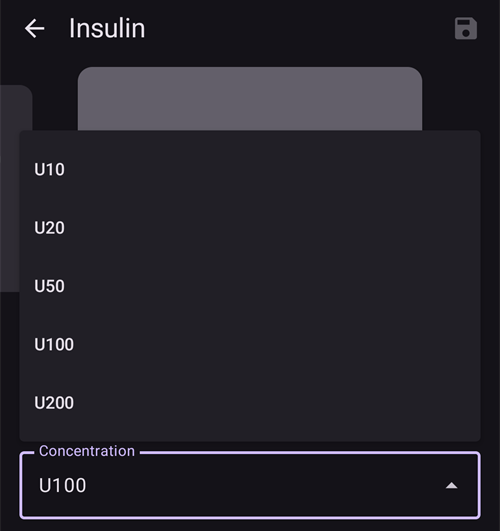
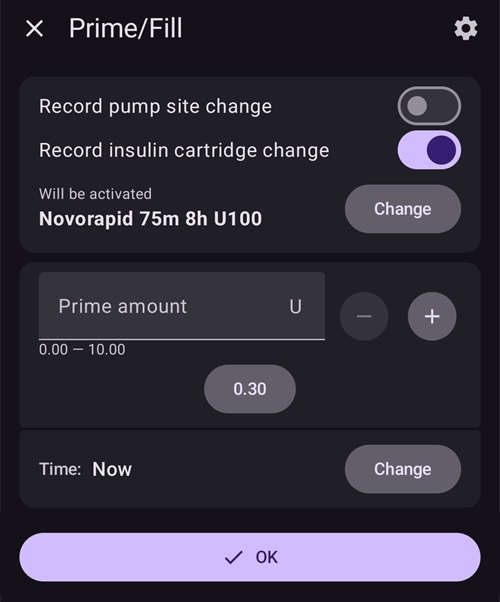

(Insulin-Concentration)=
# Концентрация инсулина

```{warning}
Все серийные помпы рассчитаны **ТОЛЬКО** на инсулин U100. Использовать в помпе инсулин другой концентрации может быть опасно. Хотя все больше пользователей работают с AAPS на инсулине других концентраций, пересчет всегда нужно контролировать, и он часто приводит к ошибкам (даже у очень опытных пользователей!).
```

## Основы: напоминание об инсулине

В этой главе описаны основные понятия измерения и подачи инсулина.

### Единица инсулина: мера действия

Инсулин измеряется в **международных единицах (МЕ)**. Они выражают его биологическую активность (способность снижать ГК), а не только физическую массу.

- **Определение:** 1 МЕ соответствует активности определенного количества инсулина, стандартизированного до **примерно 0,04167 мг**.
- **Главное:** «единица» означает одинаковое биологическое действие для всех видов инсулина, поэтому дозировка остается одинаковой.

### Концентрации инсулина

Инсулин бывает разной концентрации. Она определяется числом единиц в одном миллилитре (мл).

- **U100:** мировой стандарт, **100 МЕ/мл**.
- **U200–U500:** более концентрированные инсулины (например, U200 содержит 200 МЕ/мл) для меньшего объема инъекции.
- **U40/U50:** менее распространенные, исторические концентрации (40 МЕ/мл и 50 МЕ/мл). **Для U40 нужны специальные шприцы U40.**
- **Ручное разведение:** клиническая практика получения сильно разведенного инсулина (например, U50, U10) для редких случаев, например у новорожденных или при очень высокой чувствительности. Для этого нужно очень тщательное приготовление в аптеке.

```{admonition} Critical Warning
:class: danger
Использовать инсулин с концентрацией, которая не подходит к устройству, крайне опасно: это может привести к сильной передозировке или недостаточной дозе. **Всегда трижды проверяйте, что концентрация инсулина соответствует шприцу, шприц-ручке или характеристикам помпы.**
```

## Когда используется нестандартная концентрация?

Инсулиновые помпы рассчитаны на инсулин U100, но в некоторых особых медицинских ситуациях нужна нестандартная концентрация. В таких случаях нужны предельная осторожность и очень тщательный контроль.

### Случай 1: разведенный инсулин для очень малых доз

- **Ситуация:** лечение диабета 1 типа у очень маленьких детей и малышей.
- **Проблема:** их потребность в инсулине так мала, что минимальная доза помпы (например, 0,05 ед) может быть все еще слишком большой. Из-за этого трудно точно управлять гликемией, и риск гипогликемии высок.
- **Решение:** использовать сильно разведенный инсулин (например, U10, то есть 10 МЕ/мл).
- **Результат:** увеличивается объем жидкости на одну единицу инсулина. Каждая «порция» инсулина становится больше по объему, но слабее по концентрации. Это позволяет гораздо тоньше настраивать дозы и точнее дозировать при существующих настройках помпы.

```{admonition} Critical Safety Note on Dilution
:class: danger
Разведение инсулина — процедура высокого риска. Никогда не делайте его дома без специального обучения и медицинского контроля. Его должен выполнять медицинский работник или обученный опекун со стерильным разбавителем, предназначенным именно для этого вида инсулина. **Никогда не используйте водопроводную воду, физраствор или любую другую жидкость**: они могут инактивировать инсулин, изменить его действие и внести опасные загрязнения.
```

### Случай 2: концентрированный инсулин при высокой потребности в инсулине или выраженной инсулинорезистентности

- **Ситуация:** лечение взрослых или подростков с выраженной инсулинорезистентностью, а также людей, у которых добавки в стандартном инсулине вызывают местную боль.
- **Проблема:**
  1. **Высокая потребность:** очень высокая суточная потребность в инсулине может превышать максимальный болюс помпы или ее суточные лимиты подачи.
  1. **Боль:** консерванты в инсулине могут вызывать жжение или раздражение при введении.
- **Решение:** использовать более концентрированный инсулин, например U200 (200 МЕ/мл).
- **Результат:** нужная доза инсулина вводится в половинном объеме. Для этого пользователь должен изменить внутренние настройки помпы (например, уменьшить базальные скорости и болюсы вдвое) с учетом удвоенной концентрации, чтобы подавалось правильное число единиц. Кроме того, уменьшается объем жидкости, которая может вызывать раздражение под кожей.

## Как управлять концентрацией инсулина в AAPS (AAPS 3 и более ранние версии)?

Инсулин не U100 в цикле AAPS требует очень тщательной настройки, чтобы расчеты программы совпадали с инсулином, который подается на самом деле. Один из распространенных способов — «использование измененного профиля».

### Использование измененного профиля

Этот способ «обманывает» AAPS: программа считает, что потребность пациента в инсулине ниже, чем на самом деле. Так компенсируется то, что помпа подает инсулин более концентрированный, чем тот, на который она рассчитана. Пример ниже — для инсулина U200 в помпе, рассчитанной на U100.

- **Основная проблема:** помпа для U100 откалибрована подавать **10 мкл** на **1 единицу**. Если заполнить ее инсулином U200 (1 единица U200 соответствует **5 мкл** инсулина), то при выборе **1 единицы** на помпе она подает **10 мкл** инсулина, но в этом объеме теперь **2 единицы инсулина U200**. Это приводит к передозировке на 100%.
- **Решение «Переключение профиля 50%»:** Чтобы это исправить, весь профиль терапии пациента в AAPS делают «в два раза слабее».
  1. Пользователь создает новый профиль на основе своего стандартного профиля U100 с помощью функции «Переключение профиля **50%**».
  1. Так создается новый профиль, в котором:
     - **Базальные скорости** уменьшены вдвое.
     - **Углеводный коэффициент (IC)** удвоен (например, 1:10 г становится 1:20 г).
     - **Фактор чувствительности к инсулину (ISF)** удвоен (например, «1 единица снижает ГК на 50 мг/дл (2,8 ммоль/л)» становится «1 единица снижает ГК на 100 мг/дл (5,6 ммоль/л)»).
- **Исправленный результат:** Теперь AAPS считает, что пациенту нужна только половина инсулина. Когда AAPS рассчитывает и отправляет болюс **1 единица**, помпа (рассчитанная на U100, но заполненная U200) подает **10 мкл**, в которых **2 реальные единицы инсулина U200**. Так как AAPS рассчитал эту дозу по профилю «половинной силы», подача **2 реальных единиц** — правильная, нужная доза. Расчеты цикла «половинной силы» совпадают с подачей помпы «двойной силы».

```{admonition} Critical Risks and Common Errors
:class: caution

Этот способ несет значительные риски: данные приложения постоянно расходятся с физической реальностью.

**Главная ошибка: несоответствие при «внешнем болюсе»**

Самая частая ошибка возникает, когда инсулин вводят и записывают **вне** системы AAPS–помпа.

- **Ситуация:** AAPS с измененным профилем рассчитывает на прием пищи болюс **5 единиц**. Пользователь вводит его шприц-ручкой U200.
- **Двойная ошибка:**
  1. **Неправильный выбор дозы:** пользователь думает «AAPS рассчитал 5 единиц» и, так как ручка U200, собирается ввести **5 реальных единиц U200** без пересчета. Но так как профиль уменьшен вдвое, организму на самом деле нужно **10 реальных единиц**. Это **недостаточная доза на 50%**, которая может привести к гипергликемии.
  1. **Неправильный расчет активного инсулина (IOB) (IOB завышен):** записывая этот внешний болюс в AAPS, пользователь вносит **5 единиц**. Это неправильно. Так как профиль AAPS рассчитан на U200, **1 единица в AAPS равна 2 реальным единицам**. Поэтому 5 реальных единиц, введенных ручкой, нужно записать в приложении как **2,5 единицы**. Записав 5 единиц, пользователь завышает IOB на 100%. Теперь AAPS считает, что активны 5 «концентрированных единиц» (это 10 реальных единиц), хотя на самом деле активны только 5 реальных единиц. Из-за этого цикл может снизить базальный инсулин или уменьшить следующие болюсы, и риск гипергликемии из-за начальной недостаточной дозы станет еще выше.

**Другие риски:**

- **Вводящие в заблуждение данные и отчеты:** все данные в AAPS или Nightscout, включая IOB, суммарную суточную дозу (TDD) и отчеты за прошлые периоды, указаны в «концентрированных единицах». Это искажает картину для пользователя и его медицинской команды. Врач, который смотрит отчет, может увидеть TDD 30 единиц и не понять, что пациент на самом деле получил 60 реальных единиц. Это ведет к неправильной оценке терапии.
- **Измененное мышление:** после долгого использования пользователь начинает «думать» уменьшенными вдвое значениями приложения. Он привыкает, что его ISF — 100 мг/дл (5,6 ммоль/л) или базал — 0,5 ед/ч, и забывает, что это «концентрированные» значения. Это создает опасную зависимость от системы и потерю связи с реальной потребностью в инсулине, а это критически важно для безопасности при отказе помпы или проблемах с приложением.

**Вывод:** этот способ требует постоянной бдительности: пользователь должен все время пересчитывать между «концентрированным миром» в приложении и физическим миром. Любое введение инсулина вне системы или просмотр данных нарушает эту схему и создает серьезный риск. Он полностью меняет смысл каждого числа в системе.
```

## Использование параметра концентрации (новая функция в AAPS 4.0)

Чтобы снизить риски измененного профиля, новая функция управляет концентрацией инсулина прямо в AAPS. Эта функция выполняет пересчет автоматически, поэтому основное приложение всегда работает в **реальных международных единицах (МЕ)**.

### Как это работает: автоматический пересчет

Главный принцип — четкое разделение между логикой приложения и связью с помпой:

- **AAPS использует международные единицы:** основная база данных AAPS, алгоритмы, отчеты и журналы **всегда используют реальные МЕ**. Это значит, что ваш IOB, TDD и настройки терапии (базал, ISF, IC) отражают реальные биологические единицы инсулина.
- **Драйвер помпы использует концентрированные единицы:** все значения, которые передаются в драйвер помпы или приходят от него, автоматически пересчитываются в «концентрированные единицы» внутри драйвера помпы по выбранной концентрации.
  - **Пример с U200:** когда пользователь запрашивает **болюс 1 единица**, драйвер помпы получает **0,5 CU (концентрированные единицы)** и затем передает их в помпу. Помпа (настроенная на U100) подает **5 мкл**, в которых **1 МЕ инсулина U200**.

### Преимущества и оставшиеся риски

**Benefits:**

- Не нужен измененный профиль и связанные с ним ошибки пересчета в уме.
- Пользователь всегда может «думать» в реальных МЕ.
- Для внешнего болюса шприц-ручкой просто выберите на ручке нужное количество инсулина (какими бы ни были ручка и концентрация инсулина). Пересчет не нужен, так как ручки U100 и U200 всегда выбирают дозу в МЕ.
- Все отчеты и данные AAPS (TDD, IOB) указаны в реальных МЕ, это понятно пользователю и его медицинской команде.
- Нет риска ошибиться в расчете внешних болюсов, так как они записываются в реальных МЕ.

**Оставшиеся риски:**

- **Переход к новому мышлению:** пользователи, которые переходят со способа «измененного профиля», должны вернуть правильный реальный профиль (то есть в два раза сильнее, если они переходят с U200), и им нужно время, чтобы перестроить **свое мышление**. Привыкнув к «концентрированным» значениям в приложении, они должны заново научиться доверять **реальным, неизмененным значениям в МЕ**, которые теперь показываются везде. В этот переходный период есть риск неправильно понять значения.
- **Ручной болюс на помпе:** болюс собственной функцией помпы (в обход AAPS) приводит к передозировке на 100%, так как помпа подает инсулин U200 по расчетам объема для U100.
- **Общее предупреждение:** нестандартные концентрации — это по-прежнему сложная процедура с рисками, и официально она не рекомендуется.

```{admonition} Never use the pump's own interface (tube pump users) to deliver a bolus manually
:class: danger
Наклейте на помпу постоянную надпись **«Инсулин U200»** как напоминание, чтобы никогда об этом не забыть!
```

### Отображение в интерфейсе

Для ясности интерфейс показывает и реальные, и концентрированные единицы там, где это нужно. Если текущий инсулин — U100, интерфейс не меняется.

**Примеры отображения:**

- **Окно хода болюса:**
  - Окно хода болюса — часть основного приложения AAPS, поэтому в нем показывается только информация в МЕ (в соответствии с выбором пользователя): **`2.50 U / 10.00 U delivered`**
- **Интерфейс драйвера помпы (текущее состояние):**
  - На вкладке помпы введенное количество показано в обеих единицах. Например, если выбран `U200`: **`Last Bolus: 10 U (5 CU) (10')`**

**Обратите внимание:** обе единицы (U и CU) видны только на основной вкладке помпы. В зависимости от вашей помпы, на других экранах могут показываться только концентрированные единицы. Данные истории в драйверах помп обычно остаются в «концентрированных единицах».

### Включение функции

Из-за рисков для безопасности этот параметр по умолчанию выключен. Чтобы включить его, завершите Цель 3 и включите **Поддержка концентрации инсулина** в общих настройках.

### Создание нового инсулина с другой концентрацией

Чтобы создать инсулин с другой концентрацией, сначала откройте **Управление → Настройки инсулина**.

- Нажмите значок «+» внизу экрана.
- Выберите нужную новую концентрацию в выпадающем списке (доступны U10, U20, U50, U100, U200).
  - Разведенные концентрации, например U10, U20 или U50, используются для детей с очень низкими базальными скоростями.
  - U200 подходит скорее взрослым с высокой потребностью в инсулине.

  

- Настройте время пика, время действия инсулина (DIA) и, при желании, название инсулина.
- Нажмите кнопку сохранения вверху справа.

На этом шаге инсулин создан, но выбрать его напрямую в **Настройки инсулина** нельзя.

### Смена концентрации с U100 на Uxxx (AAPS 4)

```{admonition} Switching concentration is only allowed during a reservoir or patch/pod change
:class: warning
Из соображений безопасности AAPS записывает смену концентрации только при замене резервуара или замене патча/Pod.
```

Если вы начинаете с инсулина U100, весь ваш профиль, данные истории и отчеты уже соответствуют стандарту международных единиц, поэтому смена очень «простая»:

- Для патч-помпы / Pod при замене помпы есть отдельный шаг, на котором вы выбираете залитый в нее инсулин.
- Для помпы с трубкой нажмите кнопку «Прайм/заполнение» (для замены инсулина) на главном экране (развернутая строка состояния), затем нажмите кнопку «Изменить».

1. Выберите нужную концентрацию в выпадающем списке (например, `U200`).
1. Затем выберите ниже нужный инсулин. Пока вы не подтвердите выбор, над названием инсулина написано **Будет активирован** (вместо **Сейчас активен**).

   

1. **Важно:** смена концентрации записывается в AAPS только после того, как переключение профиля применено к помпе.
   - Этот шаг обязателен для всех патч-помп и Pod.
   - Для помп с трубкой дождитесь, пока переключение профиля будет применено к помпе, или примените его в **Управление → Профиль** или **Настройки инсулина**.

Вот и все!

```{admonition} If the profile cannot be written to the pump
:class: warning
The new insulin is already in the pump before the profile with the new concentration is written to it. Until it is written, the pump gives the wrong amount of insulin.

- While the profile is not written yet, **AAPS** refuses boluses, SMBs, TBRs and extended boluses: *The profile with the new insulin is not written to the pump yet. Insulin cannot be given until it is written.* Prime and cancelling still work.
- If writing the profile fails, **AAPS** raises an **Insulin change failed** alarm, and raises it again at every retry until the profile is written. **Disconnect or remove the pump**, check your BG and give insulin another way if you need it. Connect the pump again only after the profile is written.
- If the prime itself fails, the insulin is not switched either. If the new insulin is already in the pump, do not connect the pump, and run the insulin change again.
```

Если при замене инсулина действует временное **переключение профиля** (с длительностью), новый инсулин также назначается профилю, который вернется после окончания временного переключения. Старый инсулин не возвращается.

### Смена концентрации для пользователей с инсулином U200 и профилем 50% (AAPS 4)

Если в вашей помпе уже используется U200, но вместе с профилем 50%, вам нужно сделать дополнительные шаги по сравнению со стандартной сменой с инсулина U100.

Помните: самым трудным, скорее всего, будет не правильная смена в AAPS, а то, чтобы снова научить свой мозг думать в «МЕ», а не в «CU». Все обычные значения болюсов (завтрак, обед, ужин...) станут в два раза выше, так же как ваш TDD, базальные скорости и т. д. Будьте очень осторожны, чтобы не ошибиться в первые несколько недель, пока вы снова не начнете «думать» в международных единицах.

- Сначала подготовьте новый профиль, все значения которого соответствуют международным единицам:
  - Сделайте временное переключение профиля 200% от вашего обычного текущего профиля.
  - Откройте меню (☰) → **Терапия**, перейдите на вкладку **Смена профиля** и клонируйте новый профиль 200% (см. [Клонирование переключения профиля](#your-aaps-profile-clone-profile-switch)).
  - Вернитесь к своему обычному профилю до следующей замены резервуара или патча.
  - Откройте **Управление → Профиль** и дайте этому новому профилю понятное название (это будет ваш будущий профиль для инсулина U200, заданного в AAPS 4).
- Если вы используете функцию Динамический ISF (DynISF), выключите ее как минимум на одну неделю:
  - Вся ваша история в AAPS или Nightscout записана в неправильных единицах (CU), то есть в половине реального значения в международных единицах. Подождите как минимум одну неделю работы на инсулине U200, прежде чем снова ее включить.
- Теперь вы готовы сменить инсулин (на новый U200, заданный в **Настройки инсулина**) при следующей замене инсулина или замене Pod.
- Когда новый инсулин U200 будет правильно применен, не забудьте применить новый стандартный профиль, подготовленный на первом шаге.

## Как вводить внешние болюсы разными шприц-ручками?

### С инсулином U200 и профилем 50% (AAPS 3)

Помните, что все шкалы шприц-ручек в международных единицах. Поэтому какой бы ручкой (U100, U200) вы ни вводили внешний болюс, пересчитывать нужно в обе стороны:

- Из AAPS в ручку: если калькулятор предлагает болюс или вы задумали определенное количество, при выборе количества на ручке умножьте его на 2 по сравнению с тем же болюсом из AAPS.
- Из ручки в AAPS: если вы выбрали количество на ручке для внешнего болюса, разделите его на 2 и запишите это количество в AAPS (кнопка «Инсулин», внешний болюс), чтобы IOB правильно рассчитывался в CU (концентрированных единицах).

### С инсулином U200 и управлением концентрацией, встроенным в AAPS 4

С встроенным управлением концентрацией в AAPS все гораздо проще: просто выберите на ручке нужное количество (какими бы ни были ручка и инсулин) и запишите его в AAPS.

- Если в окне кнопки «Инсулин» выбрать внешний болюс, можно выбрать любой инсулин, заданный в **Настройки инсулина** (в основном U100, U200 для ручек). Так IOB рассчитывается очень точно, даже если пик/DIA инсулина в ручке сильно отличается от пика/DIA инсулина в помпе.
